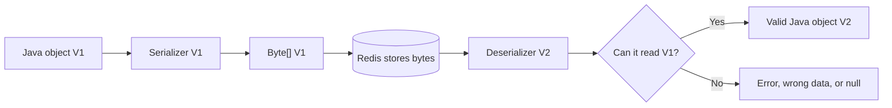

# Compatibility Testing When Changing Serializers or Upgrading Libraries in Spring Data Redis

A system using Spring Data Redis can run smoothly for months and then suddenly throw cache-read errors after deploying a new application version. For example, the old version wrote Java objects using **JDK serialization**, while the new version switched to **JSON**; or both still use Jackson, yet class names, field structures, type metadata, or `ObjectMapper` configuration changed. Redis keeps holding the old bytes, while the new code tries to read them the new way.

This issue falls under **serialization compatibility**. Whenever switching serializers or upgrading Spring Data Redis, Jackson, Lettuce/Jedis, JDK, or domain types, you must verify whether existing data can still be read properly by the new version—and also consider the reverse direction when two application versions run concurrently or during rollback.

Starting point of this lesson:

> **Changing a serializer in Spring does not automatically convert bytes already sitting in Redis.** A key can still exist with a valid TTL and Redis type, yet the new application cannot decode its contents.

This lesson focuses on planning, creating fixtures, testing, and safely rolling out serialization changes in Spring Data Redis.

## 1. Understand Exactly What Needs to Be Compatible

When calling:

```java
redisTemplate.opsForValue().set("cart:42", cart);
CartCache cart = redisTemplate.opsForValue().get("cart:42");
```

`RedisTemplate` uses serializers to convert between **Java objects** and **byte arrays**. For a Redis string key, the conceptual flow is:



Redis Server does not know whether bytes are JSON, Java objects, Protobuf, or compressed data. For most structures, Redis simply stores key and value bytes under the Redis data type. Application serializers determine how those bytes are interpreted.

### 1.1. Compatibility Has Multiple Layers

| Layer | Example Change | Possible Consequence |
|---|---|---|
| **Key serializer** | `StringRedisSerializer` to a binary serializer | Physical keys change; application may fail to locate existing data |
| **Value serializer** | JDK serialization to JSON | Keys still exist yet legacy values fail decoding |
| **Hash key/value serializer** | Changing field or hash value encoding | `HGET` fails to find old fields or value reads fail |
| **Domain schema** | Renaming fields, changing numeric types, enums, object structure | Decoded values differ from expectations or fail |
| **Type metadata** | JSON embedding class names, package moves, polymorphic typing changes | Cannot resolve class or subtype is rejected |
| **Library/JDK version** | Upgrading Jackson, Spring Data Redis, Java, or driver | Changes APIs, defaults, or decoding conditions |
| **Cache/Repository mapping** | Changing key prefixes, cache names, or `@RedisHash` | Keys or storage layout change even if serializers stayed identical |
| **Compression/envelope** | Adding GZIP compression, changing encoding, adding byte headers | Old/new parsers fail to recognize each other's payloads |

**No exception does not mean compatible.** For instance, if old data parses yet currency becomes `null`, an enum falls back to a default, or numbers get rounded, the application can still return wrong business results.

### 1.2. Two-Way Compatibility

Let:

- **V1**: the currently running application and serializer version.
- **V2**: the version planned for deployment.

Distinguish clearly between:

1. **Backward read compatibility:** V2 reads payloads written by V1 (`V1 write → V2 read`).
2. **Forward read compatibility:** V1 reads payloads written by V2 (`V2 write → V1 read`).
3. **Round-trip correctness:** the same version writing and reading back yields accurate data.
4. **Mixed-version compatibility:** during a rolling deployment, V1 and V2 instances read/write the same Redis system without errors or corrupting data.

Reading old data is necessary when reusing existing keys holding data; however, if you need **rollback** or rolling deployments where both versions write, also evaluate the `V2 write → V1 read` direction.

## 2. Common Serializers in Spring Data Redis

Spring Data Redis provides `RedisSerializer` to encode and decode data. Serializer choice directly shapes byte layouts in Redis.

| Serializer / Approach | Stored Data | Compatibility Notes |
|---|---|---|
| `StringRedisSerializer` | UTF-8 of strings | Suitable for key names, IDs, and explicit strings; must keep encoding and normalization consistent |
| `JdkSerializationRedisSerializer` | Binary Java Object Serialization | Coupled to class structure, `serialVersionUID`, and Java serialization rules; requires strict security care on deserialization |
| `Jackson2JsonRedisSerializer<T>` | JSON for a declared Java type | Depends on JSON schema, Jackson config, and target type; exact APIs change across library versions |
| `GenericJackson2JsonRedisSerializer` | JSON capable of storing dynamic type info | Requires managing class/type metadata, polymorphic typing config, and class renames |
| Custom serializer | JSON envelope, MessagePack, Protobuf, CBOR, compressed bytes... | Must explicitly define schema, versioning, codec, and compatibility rules |

**Note on defaults:** `RedisTemplate`, `StringRedisTemplate`, `RedisCacheManager`, and custom beans may use different serializers. `StringRedisTemplate` works primarily with strings; a standard `RedisTemplate` may default to JDK serialization if not configured otherwise. Never infer from a bean name alone that all keys/values are JSON.

Inspect the actual serializers on the **exact read and write path**:

```java
RedisSerializer<?> keySerializer = redisTemplate.getKeySerializer();
RedisSerializer<?> valueSerializer = redisTemplate.getValueSerializer();
RedisSerializer<?> hashKeySerializer = redisTemplate.getHashKeySerializer();
RedisSerializer<?> hashValueSerializer = redisTemplate.getHashValueSerializer();
```

For Spring Cache, check `RedisCacheConfiguration` and how `RedisCacheManager` configures key prefixes, cache names, and key/value serializers. Serializers on a custom `RedisTemplate` **do not automatically determine** serializers for caches managed by `RedisCacheManager`.

## 3. Types of Changes That Commonly Break Legacy Data

### 3.1. Switching from JDK Serialization to JSON

Suppose V1 uses `JdkSerializationRedisSerializer` and writes objects to `cart:42`. Redis holds Java serialization binary data. V2 configures JSON:

```java
RedisSerializer<CartCacheEntry> newSerializer =
    new Jackson2JsonRedisSerializer<>(CartCacheEntry.class);
```

If V2 reads old keys directly with the JSON deserializer, input bytes are not JSON and decoding fails. **Using the same key name does not make two serializers compatible.**

Deliberate options:

- If it is only regenerable cache: use a new namespace/version, let old caches expire via TTL or delete within scope, and warm up the new cache.
- If data must be preserved: read using the V1 serializer in a controlled migration process, convert to the V2 model/schema, and write with the V2 serializer.
- If two versions must run concurrently: design a V2 phase that reads both old and new formats, or use separate key namespaces per version. Test rollback compatibility before changing the write format.

### 3.2. Keeping JSON Yet Changing Fields

For example, V1 stores:

```json
{
  "cartId": "c-42",
  "subtotalMinor": 125000,
  "currency": "VND"
}
```

V2 adds `state`:

```json
{
  "cartId": "c-42",
  "subtotalMinor": 125000,
  "currency": "VND",
  "state": "OPEN"
}
```

When V2 reads V1 data, the `state` field is absent. The new Java record/class may receive `null` or a primitive default depending on Jackson settings and constructors. If business logic defaults to expecting `state == "OPEN"`, implement and test that explicitly.

The reverse direction also matters: V1 reading V2 JSON with `state` that V1 does not recognize may ignore it or throw an unknown-property error depending on Jackson settings. **Never assume JSON is automatically backward/forward compatible.**

### 3.3. Renaming Properties, Changing Numeric Types, or Changing Enums

| Change | Risk | Approach |
|---|---|---|
| `name` → `displayName` | Old payloads lack the field V2 expects | Use aliases/compatibility mappers during transition |
| `amount: 123.45` → `amountMinor: 12345` | Different units; values can be misread | Convert with unit validation and sample fixtures |
| `int` → `long` | Often works one-way; check out-of-range values | Fixtures covering min/max/boundary values |
| Add enum `SUSPENDED` | V1 may not recognize the new value | Defer writing new values until rolling deploy finishes, or define explicit fallback |
| `LocalDateTime` → `Instant` | Changes timezone semantics, format, or Jackson modules | Standardize format and test timezone-bearing timestamps |
| `BigDecimal` → `double` | Risk of precision loss | Test monetary amounts and avoid imprecise conversions |
| `null` → required field | Legacy data may lack values | Post-deserialization validation and data backfill plan |

One way to guard JSON read compatibility when adding fields:

```java
import com.fasterxml.jackson.annotation.JsonIgnoreProperties;

@JsonIgnoreProperties(ignoreUnknown = true)
public record CartCacheEntry(
        String cartId,
        long subtotalMinor,
        String currency,
        String state
) {}
```

`@JsonIgnoreProperties(ignoreUnknown = true)` only skips extra fields the model does not recognize. It **does not** populate missing fields with right values, handle currency unit changes, or handle polymorphic classes. Add validation or mapping on read.

### 3.4. JSON Embedding Class Name Metadata

Some dynamic JSON serializer setups record type metadata that may carry Java class or package names. Illustrative payload:

```json
{
  "@class": "com.example.shop.cache.CartCacheV1",
  "cartId": "c-42",
  "subtotalMinor": 125000
}
```

If the package moves to `com.example.store.cache.CartCacheEntry`, old data may point to a class that no longer exists. Even if all business JSON fields stay identical, the deserializer can fail because it cannot resolve type metadata.

Exact type hint field names, type encoding, and subtype acceptance **depend on the specific serializer and ObjectMapper configuration**; the example above is not a mandatory format across every Jackson/Spring Data Redis version.

Never work around this by enabling unrestricted polymorphic typing or bypassing subtype checks. Deserializing untrusted data poses security risks. When type metadata is needed, allow only genuinely required types and apply appropriate type validation.

### 3.5. Changing Key Serializers and Key Prefixes

If V1 stores string keys in UTF-8:

```text
cart:c-42
```

while V2 uses a binary key serializer, even though code still passes `"cart:c-42"`, Redis receives **different key byte arrays**. V2 reads `null` like a cache miss while old keys remain in Redis.

Similarly, changing `RedisCacheManager` prefix from `shop:v1:cache::` to `shop:v2:cache::` changes the Redis keys via configuration. This is a **storage address change**, not a payload decoding error. Classifying correctly guides you to the right fix.

### 3.6. Redis Hashes, Repositories, and Specialized Structures

A Redis hash encodes fields and values individually:

```text
HSET customer:c-42 name <bytes> status <bytes>
```

With `RedisTemplate`, `hashKey` and `hashValue` serializers can differ from `key` and `value`. Changing only `valueSerializer` does not necessarily change the format used by `opsForHash()`.

With **Spring Data Redis Repository**, the mapper manages hashes alongside auxiliary keys like indexes/sets/TTLs. Changes to class names, mapping metadata, keyspaces, property names, or converter configurations must be tested through **the real repository API**, not merely direct serializer unit tests. Overwriting a hash with a JSON string changes the Redis data type and triggers `WRONGTYPE` errors.

## 4. Establish a Compatibility Contract Before Changing Versions

Before writing tests, document:

- **Data category:** regenerable cache, session, rate limiter, event, business state, or intermediate data.
- **Read/write paths:** `RedisTemplate`, `StringRedisTemplate`, `RedisCacheManager`, Redis Repository, Redis Streams, or direct driver code.
- **Key format:** prefix, key serializer, Redis data type, hash field names, TTL.
- **Wire format:** serializer, Jackson/ObjectMapper config, encoding, compression, type metadata, format/schema version.
- **Rollout requirements:** concurrent V1/V2 deployment vs. hard cutover; whether V2-to-V1 rollback is required.
- **Error policy:** evict and rebuild broken caches, try fallback serializer, quarantine payloads, halt migration, or alert.

Example contract record:

```yaml
dataFamily: cart-cache
redisType: string
keyPattern: "shop:prod:v1:tenant:{tenant}:cart:{cartId}"
keyEncoding: UTF-8
v1ValueFormat: JDK-serialization
v2ValueFormat: JSON-typed-CartCacheEntry
ttlSeconds: 1800
sourceOfTruth: order-database
mustReadV1WithV2: true
mustReadV2WithV1: false
rollingDeployment: use-versioned-keyspace
rollback: revert-reader-and-writer-to-v1-namespace
```

This is an illustrative project contract document, not a built-in Spring YAML config. The flags capture **deployment decisions**: if V2 writes to a different namespace, V1 never needs to read V2 JSON in V1's namespace; you must still know which version writes and reads at every phase.

## 5. Compatibility Testing Matrix

Build your test matrix across **actual versions** instead of only running `serialize()` then `deserialize()` in the same build.

| Data Written By | Read By | Purpose | When Mandatory? |
|---|---|---|---|
| V1 | V1 | Confirm old fixtures truly read cleanly on V1 | Establishing baseline and verifying fixtures |
| **V1** | **V2** | Verify reading legacy data | Whenever V2 reads shared old keys/formats or migrates data |
| V2 | V2 | Verify new format works | Every change |
| **V2** | **V1** | Verify rolling deployment/rollback | Whenever V1 might encounter data written by V2 |
| V1/V2 concurrent writes | V1/V2 concurrent reads | Verify mixed versions and concurrency | During mixed-version deployments |
| Corrupted/truncated data | V2 | Verify fail-safe behavior, metrics, and error handling | Systems with long-lived data or untrusted sources |

Example plan:

```text
                         V1 READ     V2 READ
V1 WRITE (legacy bytes)    PASS      MUST PASS if reusing old keys
V2 WRITE (new JSON)        PASS?     PASS
```

The `PASS?` cell is not mandatory in every architecture: if V2 writes only to `v2:*` and V1 instances never read `v2:*` keys, V1 does not need to parse V2 JSON. Conversely, when sharing the same key during a rolling deployment, failing that cell can break V1 instances.

### 5.1. Sample Data Must Cover Edge Cases

Do not test only a simple object with a couple of strings. Fixture suites should represent real-world data:

| Group | Cases to Include |
|---|---|
| Strings | Unicode diacritics, emojis, empty strings, newlines, special characters |
| Numbers | 0, negative numbers, max/min, large monetary amounts, fractional decimals |
| Dates/times | UTC, timezones, DST transitions where relevant, legacy timestamps |
| Nulls/missing fields | `null`, absent fields, empty collections, empty objects |
| Enums | Current values, legacy values, new values absent in V1 |
| Complex objects | Nested objects, lists, maps, polymorphic subtypes |
| Type names | Package/class renames, discriminator/type hint changes |
| Bytes | UTF-8 characters, binary files, compressed payloads, magic bytes |
| Malformed data | Truncated JSON, wrong types, oversized payloads, unsupported versions |
| Redis behavior | Missing keys, low remaining TTLs, expiration, hash fields, cache prefixes |

When building fixtures from production data, **redact or replace all sensitive information** before committing to the repository. Preserve the exact byte characteristics that expose compatibility bugs; never "clean up" fixtures by re-serializing them with the new serializer, as that can mask the exact bug you need to test.

## 6. Golden Fixtures: Stronger Evidence Than Round-Trip Tests

A simple test:

```java
assertEquals(value, serializer.deserialize(serializer.serialize(value)));
```

only proves a serializer **can read the exact format it just wrote**. It does not prove the V2 serializer can read data written by V1 months ago.

A **Golden fixture** is a byte file generated by the **actual V1 application/libraries** and frozen in the test suite. When upgrading to V2, tests feed that exact byte file as input and assert the result.

Example fixture layout:

```text
src/test/resources/redis-compat/
  README.md
  cart-v1-typical.bin
  cart-v1-null-state.bin
  cart-v1-unicode.bin
  cart-v1-legacy-enum.bin
  cart-v2-typical.bin
```

In the fixture `README.md`, record:

- Release commit/tag that generated the fixtures.
- Versions of Spring Data Redis, Jackson, JDK, serializers, and relevant config.
- Write path used: `RedisTemplate`, CacheManager, Repository, or driver.
- Redis value type (string/hash), key/hash-field serializers, and naming conventions.
- Expected business values after deserialization; optionally SHA-256 hashes of fixture files to detect accidental edits.

### 6.1. Generating Fixtures Properly

Run a program/test **on actual V1 dependencies**, using V1's real write path:

```java
CartCacheV1 oldValue = new CartCacheV1(
    "c-42",
    125_000L,
    "VND"
);

byte[] legacyBytes = legacySerializer.serialize(oldValue);
Files.write(
    Path.of("src/test/resources/redis-compat/cart-v1-typical.bin"),
    legacyBytes
);
```

This example assumes `CartCacheV1` and `legacySerializer` exist in V1 code. When generating fixtures, use the exact serializer, `ObjectMapper`, and data types of the old version. Once fixtures are frozen, **never regenerate V1 fixtures using V2 code** during CI runs.

If real data was written via `RedisCacheManager` or Repository, fixtures must mirror the exact output of that write path. You can capture bytes directly from a test Redis running V1 to avoid discrepancies between "what we thought the serializer was" and "the actual serializer."

### 6.2. Testing Reading V1 Bytes with the V2 Serializer

The example below uses JUnit 5 and Spring Data Redis's typed JSON serializer. This code sample verifies a transition **when the V1 fixture already uses a compatible JSON format**. If V1 used JDK binary, this test is expected to fail until an appropriate migration or fallback is implemented.

```java
package com.example.redis.compat;

import static org.junit.jupiter.api.Assertions.assertEquals;
import static org.junit.jupiter.api.Assertions.assertNotNull;

import java.io.IOException;
import java.nio.file.Files;
import java.nio.file.Path;

import com.fasterxml.jackson.annotation.JsonIgnoreProperties;
import org.junit.jupiter.api.Test;
import org.springframework.data.redis.serializer.Jackson2JsonRedisSerializer;

class CartSerializerCompatibilityTest {

    @JsonIgnoreProperties(ignoreUnknown = true)
    record CartCacheEntry(
        String cartId,
        long subtotalMinor,
        String currency,
        String state
    ) {}

    private final Jackson2JsonRedisSerializer<CartCacheEntry> newSerializer =
        new Jackson2JsonRedisSerializer<>(CartCacheEntry.class);

    @Test
    void v2ReadsGoldenPayloadWrittenByV1() throws IOException {
        byte[] legacyBytes = Files.readAllBytes(Path.of(
            "src/test/resources/redis-compat/cart-v1-typical.bin"
        ));

        CartCacheEntry result = newSerializer.deserialize(legacyBytes);

        assertNotNull(result);
        assertEquals("c-42", result.cartId());
        assertEquals(125_000L, result.subtotalMinor());
        assertEquals("VND", result.currency());

        // If V1 did not store the state field, V2 must explicitly handle the missing value.
        String effectiveState =
            result.state() == null ? "OPEN" : result.state();
        assertEquals("OPEN", effectiveState);
    }

    @Test
    void v2RoundTripRetainsDomainSemantics() {
        CartCacheEntry input =
            new CartCacheEntry("c-99", 999_000L, "VND", "OPEN");

        byte[] bytes = newSerializer.serialize(input);
        CartCacheEntry result = newSerializer.deserialize(bytes);

        assertEquals(input, result);
    }
}
```

The first test verifies **legacy byte compatibility**; the second verifies **new-version round-trip**. Both tests answer distinct questions. When V1/V2 serializers are incompatible, never tweak tests to "PASS" using a V2-generated fixture; instead implement the appropriate read/migration strategy.

### 6.3. Testing the Reverse Direction: V1 Reading Data Written by V2

To verify rollback, generate a `cart-v2-typical.bin` fixture using V2. Then run a test **on actual V1 dependencies/runtime** to read that file with the V1 deserializer.

Creating a Java class named `OldCart` inside V2 source is not enough: the Jackson/JDK versions and runtime configuration are still V2. Reliable verification runs **two independent builds or two processes/containers** with pinned dependencies:

```text
Build V1                            Build V2
 ├── generate v1 fixture ──────────► read v1 fixture
 ├── read v2 fixture ◄────────────── generate v2 fixture
 └── verify schema/semantics         └── verify schema/semantics
```

If V1 is prohibited from reading V2 by a versioned-key architecture, document that constraint explicitly and test that routes do not mix namespaces, rather than assuming every combination must be readable.

## 7. Integration Testing Against Real Redis

Calling `serializer.deserialize(bytes)` directly does not test which serializer is wired into `RedisTemplate`, key-construction rules, or Redis state. Integration tests against a dedicated Redis instance (such as Redis Testcontainers) catch configuration bugs that unit tests miss.

### 7.1. Using Testcontainers to Write Legacy Bytes and Read Through the New Template

Sample Gradle dependencies (exact versions should be managed by the project's BOM/dependency management):

```groovy
dependencies {
    implementation 'org.springframework.boot:spring-boot-starter-data-redis'

    testImplementation 'org.springframework.boot:spring-boot-starter-test'
    testImplementation 'org.testcontainers:junit-jupiter'
    testImplementation 'org.testcontainers:testcontainers'
}
```

Integration test example (JUnit 5, Spring Data Redis 3.x):

```java
package com.example.redis.compat;

import static org.junit.jupiter.api.Assertions.assertEquals;
import static org.junit.jupiter.api.Assertions.assertNotNull;

import java.nio.file.Files;
import java.nio.file.Path;

import com.fasterxml.jackson.annotation.JsonIgnoreProperties;
import org.junit.jupiter.api.Test;
import org.springframework.data.redis.connection.RedisConnection;
import org.springframework.data.redis.connection.lettuce.LettuceConnectionFactory;
import org.springframework.data.redis.core.RedisTemplate;
import org.springframework.data.redis.serializer.Jackson2JsonRedisSerializer;
import org.springframework.data.redis.serializer.StringRedisSerializer;
import org.testcontainers.containers.GenericContainer;
import org.testcontainers.junit.jupiter.Container;
import org.testcontainers.junit.jupiter.Testcontainers;
import org.testcontainers.utility.DockerImageName;

@Testcontainers
class RedisWireCompatibilityIT {

    @Container
    static GenericContainer<?> redis =
        new GenericContainer<>(DockerImageName.parse("redis:7.4-alpine"))
            .withExposedPorts(6379);

    @JsonIgnoreProperties(ignoreUnknown = true)
    record CartCacheEntry(
        String cartId,
        long subtotalMinor,
        String currency,
        String state
    ) {}

    @Test
    void templateV2ReadsRedisKeyContainingV1Bytes() throws Exception {
        LettuceConnectionFactory factory =
            new LettuceConnectionFactory(
                redis.getHost(),
                redis.getMappedPort(6379)
            );
        factory.afterPropertiesSet();

        try {
            RedisTemplate<String, CartCacheEntry> template =
                new RedisTemplate<>();
            template.setConnectionFactory(factory);
            template.setKeySerializer(new StringRedisSerializer());
            template.setValueSerializer(
                new Jackson2JsonRedisSerializer<>(CartCacheEntry.class)
            );
            template.afterPropertiesSet();

            String key = "compat:test:v1:cart:c-42";
            byte[] keyBytes = new StringRedisSerializer().serialize(key);
            byte[] oldBytes = Files.readAllBytes(Path.of(
                "src/test/resources/redis-compat/cart-v1-typical.bin"
            ));

            // Keep bytes generated by V1 verbatim, without re-serializing via V2.
            RedisConnection connection = factory.getConnection();
            try {
                connection.stringCommands().set(keyBytes, oldBytes);
            } finally {
                connection.close();
            }

            CartCacheEntry read = template.opsForValue().get(key);
            assertNotNull(read);
            assertEquals("c-42", read.cartId());
            assertEquals(125_000L, read.subtotalMinor());
        } finally {
            factory.destroy();
        }
    }
}
```

This test uses a real Redis instance without touching production Redis. V1 data is injected as **raw bytes**, while the V2 read goes through a real `RedisTemplate`. That catches bugs in both serializers and template wiring.

Run similar tests for other data paths managed by your application:

- `opsForHash()` with real key, hash-key, and hash-value serializers.
- `RedisCacheManager` with real cache names, prefixes, and cache value serializers.
- Redis Repositories when changing mappings or converters, including related indexes/TTLs.
- Keys with TTLs to verify reads, migrations, or rewrites do not accidentally alter lifetimes.

If the application runs on Redis Cluster, multi-key tests, hash slots, or hash-tagged prefixes must run against a matching topology. Standalone Redis tests never prove a multi-key operation works on Cluster.

## 8. Testing Through Spring Cache and Repositories

### 8.1. Spring Cache Must Be Tested on Its Real Path

With Spring Cache:

```java
@Cacheable(cacheNames = "cartSummary", key = "#cartId")
public CartSummary getSummary(String cartId) {
    return loadFromDatabase(cartId);
}
```

When upgrading cache serializers, verify:

1. Physical Redis keys generated by the cache manager still match expected prefixes/cache names.
2. How old cached values in Redis are read by the new cache serializer.
3. On cache hit, returned values have the exact **type and content** expected by services.
4. On cache miss due to prefix changes or expiration, the app safely reloads from the origin source.
5. On decode failure, whether the system throws or triggers an intentional handler—never conflating deserialization errors with normal cache misses.
6. Whether `@CachePut` and `@CacheEvict` share the exact key convention as `@Cacheable`.

Example of explicit cache serializer configuration:

```java
import java.time.Duration;
import org.springframework.context.annotation.Bean;
import org.springframework.context.annotation.Configuration;
import org.springframework.data.redis.cache.RedisCacheConfiguration;
import org.springframework.data.redis.cache.RedisCacheManager;
import org.springframework.data.redis.connection.RedisConnectionFactory;
import org.springframework.data.redis.serializer.GenericJackson2JsonRedisSerializer;
import org.springframework.data.redis.serializer.RedisSerializationContext;

@Configuration
public class CacheSerializationConfig {

    @Bean
    public RedisCacheManager cacheManager(RedisConnectionFactory factory) {
        RedisCacheConfiguration config =
            RedisCacheConfiguration.defaultCacheConfig()
                .serializeValuesWith(
                    RedisSerializationContext.SerializationPair.fromSerializer(
                        new GenericJackson2JsonRedisSerializer()
                    )
                )
                .computePrefixWith(name -> "shop:v2:cache:" + name + "::")
                .entryTtl(Duration.ofMinutes(15));

        return RedisCacheManager.builder(factory)
            .cacheDefaults(config)
            .build();
    }
}
```

This snippet merely illustrates where to attach serializers and prefixes in the Spring Data Redis 3.x API. When upgrading major versions, check the target version's actual API. **New configuration does not automatically convert bytes in V1 cache keys.** Switching prefixes `v1` → `v2` makes V2 read fresh keys, which is often a safe isolation choice when cached data is regenerable.

With dynamic JSON serializers, test type metadata carefully; never allow deserialization of arbitrary unverified types. For caches holding a single value type, prefer a typed serializer or design a stable schema suited to all supported types.

### 8.2. Redis Repositories Are More Than a Single Value Serializer

`@RedisHash` and repositories use a Redis hash-based mapping mechanism. Example:

```java
@RedisHash("customers")
public class Customer {
    @Id
    private String id;
    private String displayName;
    // Constructors/getters/setters...
}
```

When upgrading Spring Data Redis or modifying converter settings:

- Test reading legacy aggregates via `findById`, not merely deserializing a JSON string.
- Verify hash field names and types, nested fields, and polymorphic type metadata.
- Test `save`, `deleteById`, and `@Indexed` queries when entities use secondary indexes.
- Verify TTL lifetimes when entities use `@RedisHash(timeToLive = ...)` or `@TimeToLive`.
- Never overwrite a repository-managed Redis hash with `SET key JSON`; doing so triggers `WRONGTYPE` and corrupts indexes.

Renaming classes/packages can also impact type metadata stored inside hashes. This is why even a "Jackson upgrade" must be evaluated per **concrete storage path**, not just by library name.

## 9. When Are Separate Tests in Two Runtimes Needed?

Certain regressions appear only when running each version's exact dependency graph and JDK:

- Major upgrades of Spring Data Redis or Jackson.
- Classpath/Jackson module changes; missing modules for Java Time, Kotlin, parameter names, or specialized types.
- JDK upgrades while using Java native serialization.
- Moving packages/classes, changing `serialVersionUID`, or changing serializable fields.
- Changes in Spring Boot auto-configured defaults.
- Driver upgrades and Redis connection changes altering effective execution paths.

In these cases, do not just instantiate `oldSerializer` and `newSerializer` inside one test runtime. Run a pipeline with **two independent builds**:

```text
Repository tag V1                  Repository branch V2
Pinned V1 dependencies             Pinned V2 dependencies
V1 JDK                             Target V2 JDK
       │                                  │
       ├── write golden payloads ────────►│ test V2 reads
       │                                  ├── write V2 payloads
       │◄─────────────────────────────────┘
       └── test V1 reads V2 if rollback is needed
```

You can also run two application containers against a shared Testcontainers/test Redis instance to simulate a rolling deployment. Agree on key prefixes and test cleanup upfront so runs never interfere with one another.

In CI, **pin dependency versions** and log versions in test reports; "V1 compatibility" checks become meaningless if a test accidentally pulls "latest" dependencies and runs V2 libraries on both sides.

## 10. Compatibility Testing for JDK Serialization

Java native serialization depends on `Serializable` rules and class metadata.

Example:

```java
import java.io.Serializable;

public class CartV1 implements Serializable {
    private static final long serialVersionUID = 1L;

    private String id;
    private long subtotalMinor;

    // Constructors/getters/setters...
}
```

If V2 changes `serialVersionUID` incompatibly, the Java deserializer throws `InvalidClassException`. Even with the same UID, changes to inheritance hierarchy, field types, package/class names, or restoration logic can break compatibility or corrupt data.

Scenarios to test using V1 binary fixtures:

1. V2 reads a typical V1 object.
2. V2 reads a V1 object containing nested objects and collections.
3. V2 reads after class renames/package moves.
4. V2 reads after field/type changes or `serialVersionUID` changes.
5. V2 handles corrupted bytes without producing invalid objects.
6. V1 reads V2 payloads if rollback or mixed-version operation is required.

**Security note:** Java native deserialization is dangerous when inputs can be influenced by untrusted sources. Never treat keeping `JdkSerializationRedisSerializer` indefinitely as a safe compatibility strategy; when moving to another format, establish a proper migration or invalidation plan. If reading legacy bytes temporarily is unavoidable, restrict allowed classes, protect Redis write permissions, and time-box the legacy read path.

## 11. Failure Scenarios to Anticipate Ahead of Time

These symptoms point to distinct root causes:

| Symptom | Likely Cause | How to Investigate |
|---|---|---|
| `GET` returns `null` even though key is believed to exist | Key serializer/prefix changed, key expired/evicted, wrong DB/endpoint | Inspect raw key, `EXISTS`, `TTL`, key serializer |
| Deserialization throws `SerializationException` | Bytes do not match format or mapper fails to parse payload | Identify V1 format, test golden bytes, read stack trace |
| Jackson unknown-field error | V1/V2 schema mismatch or strict `ObjectMapper` | Test `V2→V1` direction and configure ignoring extra fields if suitable |
| Class/type id not found error | JSON embeds obsolete class metadata or subtype validation fails | Check type hints/packages and mapping rules |
| `InvalidClassException` | JDK serialization class/UID mismatch | Inspect class version and V1 binary fixture |
| `ClassCastException` on cache retrieval | Serializer returned unexpected object type | Inspect generic serializer/type metadata and mixed-type caches |
| Reads succeed yet monetary/timestamp values are wrong | Changed units, precision, timezone, or defaults | Assert business semantics, not merely `assertNotNull` |
| `WRONGTYPE` | Redis key type string/hash/list mismatches invoked command | Check `TYPE key` and history of structural changes |
| Mass cache misses right after deploy | Prefix/version changed or intentional invalidation | Monitor origin source and warm-up strategy |
| TTL unexpectedly increases after rewrite | Migration rewrote key via `SET` without preserving TTL | Measure `PTTL` before/after and apply explicit TTL policy |

**Never silently turn all deserialization errors into `null`.** For rebuildable caches, evicting broken keys and reloading is acceptable alongside logs/metrics tracking incompatibilities. For sessions, idempotency keys, state machines, or non-regenerable data, swallowing errors causes serious business corruption.

## 12. Rollout Strategies for Serializer Changes

### 12.1. Option A — Versioned Namespace and Cache Rebuild

Best suited when Redis holds **caches regenerable from an authoritative source**.

Example:

```text
V1 key: shop:prod:v1:cache:price:sku-42
V2 key: shop:prod:v2:cache:price:sku-42
```

Sequence:

1. V2 uses prefix `v2` and the new serializer/schema without touching V1 bytes.
2. V2 caches initially miss and load from the authoritative source.
3. V1 continues using `v1` during concurrent operation or rollback.
4. Old `v1` entries expire naturally via TTL or are cleaned up once transition ends.

Pros: crisp format isolation, avoids mis-deserializing incompatible payloads, simpler rollback while V1 namespace stays intact. Cons: elevated cache misses, higher origin load, and temporary memory growth while two versions coexist.

Confirm your services can handle **cold-cache load** during rollout. Use canary rollouts, prewarming, and rate limiting to avoid overwhelming origin databases.

### 12.2. Option B — Dual-Format Compatible Reader

Best suited when existing data must be read and cannot be discarded immediately:

```text
Read key
   │
   ├── New format? ──► V2 deserializer ──► validation
   │
   └── Old format? ──► V1 deserializer ──► map to V2 ──► validation
```

Design a **reliable format discriminator**, such as:

- Distinct prefix/keyspace versions; or
- An envelope carrying an explicit version inside payloads; or
- A predefined magic header/metadata written upfront.

If a legacy system lacks markers, a decoder may try formats in order while catching **only known format exception types**. A sloppy fallback of "try JSON, catch anything and try JDK, else return null" masks infrastructure bugs, data corruption, security issues, and logic flaws. Keep legacy fallbacks bounded, metered, and scheduled for removal.

Example envelope with schema version for **new JSON data**:

```json
{
  "schemaVersion": 2,
  "payload": {
    "cartId": "c-42",
    "subtotalMinor": 125000,
    "currency": "VND",
    "state": "OPEN"
  }
}
```

A self-describing envelope helps decoders pick schemas cleanly and supports explicit migrations. Still, if V1 payloads lacked envelopes, V2 must route legacy reads properly.

### 12.3. Option C — Phased Expand/Contract Rollout

When two versions share a keyspace, avoid letting V2 suddenly write a format V1 cannot read. An **expand/contract** rollout typically follows:

1. Deploy a new reader able to understand both V1 and V2 payloads, while still **writing V1**.
2. Wait until old instances are gone and verify critical consumers support V2.
3. Flip V2 writing on via deployment config or feature flag.
4. Monitor decode errors, cache hits/misses, and remaining legacy data.
5. Once the compatibility window ends, retire the V1 read path as planned.

Execute this full sequence rather than swapping serializers in a single deploy. If external systems or batch jobs still read Redis, include them as V1 consumers.

### 12.4. Option D — Batch Migration

Best suited when data must be preserved and converted at scale.

General workflow:

```text
Controlled SCAN / ID list
              │
              ▼
Read raw bytes and current TTL
              │
              ▼
Decode with V1 + validate
              │
              ▼
Map to V2 model/schema
              │
              ▼
Write to V2 namespace via V2 serializer
              │
              ▼
Readback with V2 + business verification
              │
              ▼
Checkpoint progress; clean up V1 per policy
```

Key requirements:

- Maintain checkpoints so jobs are **safe to re-run (idempotent)** after interruption.
- Never turn decode failures into default data and overwrite state.
- Preserve or intentionally recompute TTLs; writing new values can alter lifetimes.
- Guard against concurrent writes: while migration reads V1, older app instances might update that key. Coordinate cutover, version checks, compare-and-set/scripts, or locks as consistency demands.
- Throttle scan and write rates to avoid sudden load spikes on Redis/databases.
- Reconcile against authoritative sources, tracking total records, failed records, and successfully converted records.
- On Redis Cluster, handle shard topology properly; `SCAN` on one node does not cover the whole cluster.

`DUMP`/`RESTORE` preserves Redis's internal structure representation and **does not convert JDK bytes to JSON**. `RENAME` only renames keys without changing value formats. Neither replaces the `deserialize V1 → map → serialize V2` pipeline.

### 12.5. Choosing by Data Characteristics

| Data Kind | Typical Reasonable Option |
|---|---|
| Database-backed caches | Versioned namespace and cache warm-up |
| Active user sessions | Test reading legacy sessions or plan controlled expiry/re-login |
| Idempotency keys | Never delete carelessly; ensure duplicate requests are not reprocessed |
| Rate-limit counters | Check whether changing key formats unintentionally resets quotas |
| Queues/lists/stream events | Transition producers/consumers and message schemas in compatible order |
| Non-regenerable business data | Checkpointed migration with readback, concurrent-write protection, and clear rollback |
| Indexed Redis Repositories | Migrate via compatible mapping mechanisms, preserving indexes and TTLs |

## 13. TTL, Eviction, and Lifetimes of Migrated Data

Redis does not attach a "serializer version" to TTLs. Key lifetime and byte encoding are separate properties.

Example:

```redis
SET shop:v1:cache:cart:c-42 "legacy-bytes" EX 300
TTL shop:v1:cache:cart:c-42
```

If migration reads this key after 200 seconds, roughly 100 seconds remain. Writing V2 via `SET` without a TTL can create a key **with no expiry**, keeping stale cache entries alive far longer than intended.

Related test procedure:

1. Write a V1 key with a short TTL.
2. Wait briefly so TTL decreases.
3. Read `PTTL` before migration.
4. Convert and write the new key per the chosen TTL policy.
5. Verify post-migration TTL still satisfies business rules.
6. Repeat for nearly expired keys, keys without TTL, and already-expired keys.

When migrating to a new namespace, you can carry over **remaining** TTL so lifetimes are not extended; handle negative TTLs (persistent keys, missing keys), near-zero TTLs, and concurrent expirations carefully. If policy calls for resetting TTL from business update time, document that choice explicitly.

Memory-pressure eviction can also occur during migration or cache warm-up. When key counts temporarily double during transition, account for `maxmemory`, eviction policies, and cache-miss surges. Losing keys to expiration/eviction is not a serializer bug; monitor `expired_keys` and `evicted_keys` separately.

## 14. Testing Serialization Changes Across Environments

A practical testing strategy spans multiple levels:

| Level | Checks | Value |
|---|---|---|
| Serializer unit tests | V1 golden bytes → V2 object; V2 round-trip; invalid payloads | Catches format/schema issues early |
| Redis integration tests | Real reads of keys/hashes/caches via template/manager/repository | Catches key serializer, prefix, and mapping bugs |
| Cross-version tests | Separate V1 and V2 builds/processes reading each other's outputs | Catches runtime/dependency and rollback issues |
| Migration rehearsal | Run migration tooling against copied data or synthetic datasets | Measures duration, TTL behavior, decode errors, checkpoints |
| Staging/canary | Deploy using the exact production rollout strategy | Observes real behavior under load |
| Post-deploy validation | Error/miss rates, metrics, sample readbacks | Detects regressions after rollout |

### 14.1. Test Environments Must Match Production on Critical Dimensions

You do not need to clone everything, yet align properties that directly govern compatibility:

- Redis Server version and active features/commands.
- Standalone, Sentinel, or Cluster topology (especially for multi-key operations).
- Versions of JDK, Spring Boot, Spring Data Redis, Jackson, drivers, and Jackson modules.
- Serializer/`ObjectMapper` settings, prefixes, and TTLs.
- Presence or absence of compression, encryption, schema registries, or envelope formats.
- Dataset rich enough to surface rare legacy edge cases.

Testing only on a brand-new Redis populated exclusively by V2 never verifies whether V2 can read legacy production bytes.

### 14.2. Assert Semantic Correctness, Not Just Byte Equality

Two JSON strings can differ in property order while carrying identical data. For JSON, raw byte comparisons via `assertArrayEquals` cause false negatives unless canonical output is required. Conversely, `assertNotNull` is far too weak.

Verify:

- IDs and tenant associations.
- Monetary values and units, timestamps and timezones.
- Statuses/enums, nested structures, collections.
- Default values when legacy inputs omit fields.
- Zero dropped required fields.
- Business invariants after mapping.

Byte-level comparison still shines for **frozen fixtures**, artifact checksums, or protocols requiring exact wire formats. Distinguish byte checks from semantic checks purposefully.

## 15. Observability During Rollout and Rollback Readiness

Before releasing V2, decide upfront how the application reacts to V1 payloads:

```text
V2 reads cache/Redis data
          │
          ▼
Decode succeeded? ── Yes ──► Validate data ──► Use
          │
          No
          │
          ▼
Determine data category
          │
          ├── Regenerable cache:
          │       Record metric/error → invalidate specific key → reload
          │
          └── Data that must be preserved:
                  Controlled error alert → preserve bytes → migrate/recover
```

Monitor at least:

- Counts and rates of `SerializationException`, `ClassCastException`, `InvalidClassException`, or parser errors per data family.
- Cache hit/miss ratios and database load after namespace switches.
- Abnormal TTLs, evictions, Redis memory usage, and key growth during V1/V2 coexistence.
- Fraction of legacy records still served via fallback paths.
- Migration outcomes: attempted, converted, skipped due to expiry, decode failures, validation failures, write conflicts.
- p95/p99 latency of critical read paths and request impact.

Never log raw bytes containing session tokens, user data, or sensitive info. To reproduce failures, save redacted fixtures with non-sensitive metadata: serializer version, schema version, key family, and error message.

### Rollback Scenarios

Rolling back V2 code to V1 **does not roll back Redis data**. If V2 wrote JSON onto the very key where V1 only understands JDK serialization, V1 will keep failing after rollback.

Before shipping, answer:

1. If rolled back to V1, which keys will V1 read?
2. Do those keys still hold V1 bytes, or did V2 overwrite them?
3. Can you run a "V2 reads new, keeps writing old" phase early in rollout?
4. Does the V1 namespace retain enough TTL to support rollback?
5. If data was already migrated, is there a safe reverse migration or only restoration from origin?
6. During rolling deploy, will any old consumers still read messages/events emitted by new producers?

For regenerable caches, versioned namespaces provide a clean rollback path. For irreplaceable data, rollback requires a data strategy (schemas, migrations, snapshots/backups, and consistency controls), not just redeploying an older container image.

## 16. Practical Scenario: Upgrading the Cart Serializer

Suppose a service has this history:

```text
V1:
  key = shop:prod:v1:cart:c-42
  value = Java serialization of CartV1
  TTL = 30 minutes

V2:
  key = shop:prod:v2:cart:c-42
  value = JSON of CartCacheEntry
  TTL = 30 minutes
```

Shopping carts can be reconstructed from a database or another authoritative source. We choose a **versioned namespace** so V1 and V2 never overwrite each other's bytes.

### Step 1 — Capture V1 Baseline

On the V1 branch/tag, write representative carts and save raw value bytes into fixtures. Record serializers, JDK, dependency versions, key serializers, and TTLs. Never store real personal data.

### Step 2 — Test the V2 Decoder

Run `v2ReadsGoldenPayloadWrittenByV1` to confirm whether V2 can read/migrate V1. If V1 is Java binary and typed V2 JSON cannot read it, that is a valid technical finding proving **namespaces must be separated or a legacy read path added**, not a reason to alter fixtures.

### Step 3 — Set the V2 Prefix

Example V2 key:

```text
shop:prod:v2:cart:c-42
```

V2 reads/writes only this namespace. On cache miss, the service loads the cart from the authoritative source and writes V2 JSON with the proper TTL. V1 keeps reading/writing the V1 namespace throughout the rolling deployment.

### Step 4 — Integration Test

On Redis Testcontainers:

1. Write raw V1 fixture bytes into the `v1` key.
2. Call the V2 read path when the `v2` key does not exist yet to confirm fallback to the authoritative source.
3. Verify the `v2` key has the right Redis type, serializer output, and TTL.
4. Confirm V1 can still read the `v1` key if rollback is needed.
5. Run concurrent requests to verify cache warm-up stays within system capacity.

### Step 5 — Canary and Legacy Cleanup

Route a portion of traffic to V2 while monitoring cache misses, latency, and database load. Once stable, expand rollout; retire the V1 namespace only after no V1 instances/consumers remain and the rollback window passes. For TTL-bound keys, let them expire naturally; never run `FLUSHDB` on shared Redis just to clear one cache version.

If carts **cannot** be rebuilt from an authoritative source, this option is insufficient. In that case, run a V1→V2 migration with data validation and concurrent-write protection.

## 17. Mental Traps to Avoid

**"Just swap the serializer and deploy, and Redis data updates automatically."**  
False. Redis keeps the bytes already written unless you re-read and rewrite them, change keys, or clean up entries.

**"Serializing and deserializing a V2 object proves V1 compatibility."**  
False. That test never touches V1 payloads. You need golden fixtures genuinely produced by the old version.

**"Both versions use JSON, so they will definitely read each other."**  
False. Fields, enums, timestamps, numeric types, subtype metadata, and `ObjectMapper` configurations can all diverge.

**"No exception means the data is right."**  
False. Default values, `null` fields, and silent coercions can corrupt business meaning without throwing.

**"If reading a key returns nothing, the serializer is broken."**  
Premature conclusion. Check key serializers, prefixes, Redis database/endpoint, expiration, and eviction first.

**"Rolling back the application automatically rolls back Redis."**  
False. Redis may hold V2 bytes that V1 code cannot parse; plan data strategies for rollbacks.

**"We can run `KEYS *` to fetch everything and migrate in production."**  
Unsuitable for large systems because it can block the server. Use safe iteration like bounded `SCAN` handling cursors and Redis Cluster shards, or iterate IDs from an authoritative source; migration must guard against concurrent writes.

**"Switch from JDK serialization to JSON using `RENAME` or `RESTORE`."**  
False. Renaming keys or restoring Redis internal dumps does not translate Java wire format into JSON.

**"Catching all decode errors and returning null makes the system resilient."**  
Not universally valid. For critical state that must be preserved, doing so drops state silently; even for rebuildable caches, track metrics and invalidate precisely.

## 18. Developer Decision Table

| Question | If "Yes" | Design Direction |
|---|---|---|
| Is the data strictly a rebuildable cache? | Yes | Prefer new key namespaces/versions, TTLs, and warm-up |
| Must V2 read legacy keys? | Yes | V1→V2 golden fixtures, fallback/migration where needed |
| Will V1 instances keep running after V2 starts writing? | Yes | Test V2→V1 or avoid sharing the same keyspace |
| Is fast rollback to V1 required? | Yes | Keep V1 read paths working and protect old keys/formats |
| Is the data non-regenerable? | Yes | Checkpointed migration with readback, concurrent-write handling, and explicit rollback |
| Are Redis hashes or repository indexes used? | Yes | Test the full mapping/index path, not just string serializers |
| Is type/class metadata embedded in payloads? | Yes | Check package renames, subtype validation, and typing settings |
| Are major libraries/JDK versions being upgraded? | Yes | Test across independent V1/V2 runtimes with pinned dependencies |
| Are TTLs or evictions involved? | Yes | Measure lifetimes before/after migration and Redis capacity |

## 19. Self-Check Questions

**1. Why is `deserialize(serialize(x))` insufficient to prove post-upgrade compatibility?**  
Because both steps run with the new serializer. It never tests bytes previously written into Redis by the V1 serializer.

**2. Distinguish backward read from forward read compatibility.**  
Backward read: V2 reads V1 payloads. Forward read: V1 reads V2 payloads. The second matters especially during rolling deployments sharing keys or when rollback is needed.

**3. When switching from JDK serialization to JSON, what should you do with rebuildable caches?**  
Use a newly versioned namespace and let cache misses reload from the authoritative source; plan ahead for warm-up load, TTLs, evictions, and keeping the old namespace briefly.

**4. A key still has a valid TTL and Redis type `string`, yet V2 fails to read it. Is that contradictory?**  
No. TTL and Redis type describe key state inside Redis; they do not guarantee value bytes match the V2 serializer.

**5. V2 adds a `state` field to JSON; why might V1 fail to read V2 JSON?**  
V1 may use a Jackson setup that rejects unknown properties or rejects new enum/type values. Test the V2→V1 direction if both versions share keys.

**6. Why must golden fixtures be generated by the real V1 build?**  
Because V1's serializers, `ObjectMapper`, JDK, and type metadata produced the actual stored wire format. Generating fixtures with V2 can let tests "PASS" while real legacy data still fails.

**7. When migrating a key with 120 seconds of TTL left, what happens if you rewrite via `SET` without a TTL?**  
It can strip the expiry from the new/overwritten key, letting it live far longer than intended. Migrations need explicit TTL policies and pre/post `PTTL` tests.

**8. Spring Cache uses a separate `RedisCacheManager`. Does changing `RedisTemplate`'s `valueSerializer` guarantee changing how caches read?**  
No. Check the serializers and prefixes on the exact cache manager used by Spring Cache.

**9. Why might rolling back code fail to restore the application?**  
Because V2 may have written bytes to Redis that V1 cannot decode. Safe rollbacks require keeping V1-compatible data/namespaces or having a reverse conversion plan.

**10. When can you delete broken keys and regenerate vs. when shouldn't you?**  
Caches rebuildable from an authoritative source can use metered invalidation policies. Sessions, idempotency keys, or business state require data-loss and correctness analysis before deleting anything.

**Key takeaway:** Serialization compatibility is a **contract across versions reading and writing Redis data**. A safe upgrade validates against real V1 bytes, tests the actual Spring APIs in use, accounts for rolling deployments and rollbacks, and plans for legacy data, TTLs, decode errors, and migrations. When data is rebuildable, versioned namespaces keep changes manageable; when data must be preserved, migration testing and consistency safeguards are mandatory.
