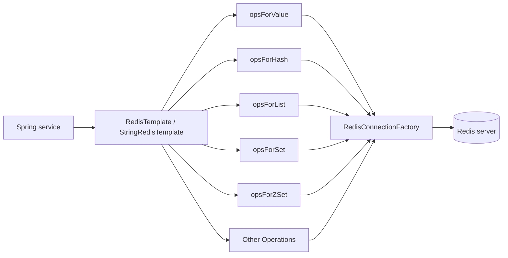

# Accessing opsForValue, opsForHash, and Other Operations Groups

`RedisTemplate` is the central API of **Spring Data Redis** for synchronous Redis operations. Instead of sending raw string commands over a socket, the Java application obtains an operations group organized by **Redis data type**: `opsForValue()` to work with Strings, `opsForHash()` with Hashes, `opsForList()` with Lists, `opsForSet()` with Sets, `opsForZSet()` with Sorted Sets, and several other groups.

The key point is that **the Operations group name reflects the data structure stored in Redis**, not the Java variable type. For instance, a Java `ProductDto` object serialized into a JSON String can be stored via `opsForValue()`; meanwhile, a `Map<String, String>` stored as a Redis Hash uses `opsForHash()`.

This lesson belongs to the **RedisTemplate** chapter and focuses on choosing the right `opsFor...` group, calling APIs in Spring Boot, understanding what is actually stored, TTL/serializer rules, and limitations when an application runs across multiple threads or instances.

## 1. The Big Picture of RedisTemplate

Processing flow diagram:



`RedisTemplate<K, V>` holds shared responsibilities such as connections, serialization, exception translation, callbacks, and pipeline/transaction support. Operations objects are obtained from the template to expose methods for each command group.

```java
ValueOperations<String, String> values = redis.opsForValue();
HashOperations<String, String, String> hashes = redis.opsForHash();
ListOperations<String, String> lists = redis.opsForList();
SetOperations<String, String> sets = redis.opsForSet();
ZSetOperations<String, String> sortedSets = redis.opsForZSet();
```

The snippet above assumes `redis` is a `StringRedisTemplate`. In practice, you often call them directly:

```java
redis.opsForValue().set("app:message", "Hello Redis");
String message = redis.opsForValue().get("app:message");
```

### 1.1. Quick Selection Table

| API Group | Redis Data Type | Common Redis Commands | Business Examples |
|---|---|---|---|
| `opsForValue()` | String | `SET`, `GET`, `INCR`, `MGET` | JSON cache, temporary tokens, counters |
| `opsForHash()` | Hash | `HSET`, `HGET`, `HMGET`, `HINCRBY` | Multi-field profile, metadata |
| `opsForList()` | List | `LPUSH`, `RPUSH`, `LRANGE`, `LPOP` | Recent activity feed, simple queue |
| `opsForSet()` | Set | `SADD`, `SISMEMBER`, `SREM`, `SINTER` | Unique members, tags, permissions |
| `opsForZSet()` | Sorted Set | `ZADD`, `ZRANGE`, `ZREVRANK` | Leaderboards, score-based sorting |
| `opsForGeo()` | Geospatial backed by Sorted Set | `GEOADD`, `GEODIST`, `GEOSEARCH` | Finding nearby locations |
| `opsForHyperLogLog()` | HyperLogLog | `PFADD`, `PFCOUNT`, `PFMERGE` | Estimating unique user counts |
| `opsForStream()` | Stream | `XADD`, `XREAD`, `XACK` | Event logs and consumer groups |

Beyond these groups, `RedisTemplate` also provides **key-level** operations such as `delete`, `unlink`, `expire`, `getExpire`, `hasKey`, `type`, `rename`, as well as callback, pipeline, and transaction APIs.

## 2. Preparing Spring Boot and a Redis Server

Examples use **Spring Boot 3.x** and synchronous Spring Data Redis. You need a running Redis server, such as a Docker container or a dedicated development instance.

With Gradle Groovy DSL:

```groovy
dependencies {
    implementation 'org.springframework.boot:spring-boot-starter-data-redis'
}
```

`application.yml` for a local environment:

```yaml
spring:
  data:
    redis:
      host: ${REDIS_HOST:127.0.0.1}
      port: ${REDIS_PORT:6379}
      timeout: 2s
```

Typically, Spring Boot auto-configures `RedisConnectionFactory` and `StringRedisTemplate` when the starter, driver, and auto-configuration conditions are met. Lettuce is usually the default client for the starter; the application does not need to open Redis sockets manually.

You can verify connectivity from a terminal with `redis-cli`:

```redis
PING
```

Expected output:

```text
PONG
```

Or test from Java:

```java
@Service
public class RedisPingService {

    private final StringRedisTemplate redis;

    public RedisPingService(StringRedisTemplate redis) {
        this.redis = redis;
    }

    public void writeAndRead() {
        redis.opsForValue().set("demo:ping", "ok", Duration.ofSeconds(30));
        String result = redis.opsForValue().get("demo:ping");
        System.out.println(result); // ok if write/read succeeds
    }
}
```

Imports in this example: `java.time.Duration`, `org.springframework.stereotype.Service`, and `org.springframework.data.redis.core.StringRedisTemplate`. If the Redis server is missing or the network path is blocked, operation calls can throw connection/timeout exceptions. Successfully injecting the template **does not prove** Redis is reachable.

## 3. Understanding Serializers Before Choosing an Operations Group

Redis stores keys and values as **byte sequences**. Java types like `String`, `Long`, `Map`, or DTOs only exist on the application side; the template converts them to bytes via serializers.

There are four common configuration positions:

| Template Property | Encoded Component |
|---|---|
| `keySerializer` | Primary Redis key, e.g., `product:42` |
| `valueSerializer` | Redis String value or collection element |
| `hashKeySerializer` | Field name inside a Redis Hash |
| `hashValueSerializer` | Value of a field inside a Redis Hash |

`StringRedisTemplate` uses string representations for these common positions, making it very convenient for inspecting Redis via CLI.

```java
@Service
public class RedisTextService {
    private final StringRedisTemplate redis;

    public RedisTextService(StringRedisTemplate redis) {
        this.redis = redis;
    }

    public void save(String key, String value) {
        redis.opsForValue().set(key, value);
    }
}
```

With a general `RedisTemplate`, you must know its default serializer or the serializer configured by the project. You cannot assume `RedisTemplate` automatically saves every Java object as JSON readable with `redis-cli`. In many default configurations, Java serialization may be used; it produces binary data and requires attention to compatibility and security.

### 3.1. Creating a Transparent String-Based RedisTemplate

Although `StringRedisTemplate` is usually all you need, the following example shows how to configure serializers when creating a template manually:

```java
import org.springframework.context.annotation.Bean;
import org.springframework.context.annotation.Configuration;
import org.springframework.data.redis.connection.RedisConnectionFactory;
import org.springframework.data.redis.core.RedisTemplate;
import org.springframework.data.redis.serializer.StringRedisSerializer;

@Configuration
public class RedisTextTemplateConfiguration {

    @Bean
    RedisTemplate<String, String> explicitTextRedisTemplate(
            RedisConnectionFactory factory) {

        StringRedisSerializer stringSerializer = new StringRedisSerializer();

        RedisTemplate<String, String> template = new RedisTemplate<>();
        template.setConnectionFactory(factory);
        template.setKeySerializer(stringSerializer);
        template.setValueSerializer(stringSerializer);
        template.setHashKeySerializer(stringSerializer);
        template.setHashValueSerializer(stringSerializer);
        template.afterPropertiesSet();

        return template;
    }
}
```

The bean is configured **once at startup**. Afterwards, the template can be shared across requests and threads. Never swap serializers mid-flight, because the same key would be read and written in different formats.

If the project needs JSON objects, define the DTO, JSON structure, serializer, and versioning strategy clearly. One easily observable approach is using `StringRedisTemplate` with `ObjectMapper` to explicitly convert DTOs to JSON Strings, avoiding hidden serializer changes across modules.

### 3.2. Example: Storing a DTO as a Redis String

```java
public record ProductView(long id, String name, long price) {
}
```

Service:

```java
import com.fasterxml.jackson.core.JsonProcessingException;
import com.fasterxml.jackson.databind.ObjectMapper;
import java.time.Duration;
import org.springframework.data.redis.core.StringRedisTemplate;
import org.springframework.stereotype.Service;

@Service
public class ProductJsonCache {

    private final StringRedisTemplate redis;
    private final ObjectMapper mapper;

    public ProductJsonCache(StringRedisTemplate redis, ObjectMapper mapper) {
        this.redis = redis;
        this.mapper = mapper;
    }

    public void put(ProductView product) throws JsonProcessingException {
        String json = mapper.writeValueAsString(product);
        redis.opsForValue().set(
                "product:view:" + product.id(),
                json,
                Duration.ofMinutes(5)
        );
    }

    public ProductView get(long productId) throws JsonProcessingException {
        String json = redis.opsForValue().get("product:view:" + productId);
        return json == null ? null : mapper.readValue(json, ProductView.class);
    }
}
```

`ObjectMapper` here is the Jackson bean configured in a Spring Boot application with Jackson support. Storing objects as JSON helps debugging, though serialization/deserialization overhead and schema compatibility still require management.

## 4. `opsForValue()`: Working with Redis Strings

`ValueOperations<K, V>` is the operations group for single values under a Redis key. A Redis String can hold text, bytes, JSON, or numbers encoded as strings.

### 4.1. `set` and `get`

```java
redis.opsForValue().set("shop:message", "Hello");
String value = redis.opsForValue().get("shop:message");
```

Equivalent Redis commands in meaning:

```redis
SET shop:message Hello
GET shop:message
```

If the key does not exist or has expired, `get` typically returns `null`. That differs from an empty string `""`, which is a valid value that can be stored in Redis.

You can save with a TTL right inside the `set` call:

```java
redis.opsForValue().set(
        "shop:otp:request:42",
        "pending",
        Duration.ofMinutes(2)
);
```

The **key**'s TTL begins when the write command takes effect. Once expired, Redis no longer treats the key as existing.

### 4.2. `setIfAbsent`: Create Only If Key Does Not Exist

```java
Boolean created = redis.opsForValue().setIfAbsent(
        "job:42:claim",
        "worker-7",
        Duration.ofSeconds(30)
);
```

Corresponding in meaning to `SET ... NX` with expiry:

```redis
SET job:42:claim worker-7 NX EX 30
```

If the key does not exist, key creation and TTL assignment can happen in **a single Redis command**. If the key already exists, the usual result is `false` and the old value is preserved.

This pattern is useful for temporary flags or basic idempotency, but **it is not a complete distributed lock solution**. If used as a lock, you must account for owner tokens, lease duration, owner-checked deletion, failover, and tasks outliving the TTL.

The return type is boxed `Boolean`; in pipeline/transaction contexts, methods can return `null` before actual results are collected. Therefore code should check:

```java
if (Boolean.TRUE.equals(created)) {
    // Key was created in a standard synchronous call.
}
```

### 4.3. `increment` and `decrement` Counters

```java
Long newCount = redis.opsForValue().increment("views:article:42");

Long next = redis.opsForValue().increment("quota:used:42", 5L);

Long remaining = redis.opsForValue().decrement("quota:remaining:42");
```

Redis uses commands like `INCR`, `INCRBY`, and `DECR`. Each integer increment/decrement command is handled atomically by Redis for the target key.

Do not write this pattern:

```java
// LOST UPDATE RISK UNDER CONCURRENT REQUESTS:
String old = redis.opsForValue().get("views:article:42");
long next = Long.parseLong(old == null ? "0" : old) + 1;
redis.opsForValue().set("views:article:42", Long.toString(next));
```

Two requests can read the same old value and overwrite each other. `increment` avoids that race for incrementing a single key.

The Redis value must contain a numeric representation suitable for increment/decrement commands. If the key already holds `"hello"` or JSON, Redis returns a data type/value format error. `increment` also does not automatically set a TTL when creating a new key; if expiry must be atomically attached in multi-step logic, design an appropriate transaction or script.

### 4.4. Reading Multiple Keys at Once

```java
List<String> values = redis.opsForValue().multiGet(
        List.of("product:1:name", "product:2:name", "product:3:name")
);
```

Equivalent in meaning to `MGET`, helping reduce round-trips compared to three sequential `get` calls in certain scenarios.

Preserve input order when pairing results with keys. Non-existent keys can produce `null` slots in the result list. In pipelines or transactions, some APIs may return `null` while queuing commands; check the respective method contract.

**In Redis Cluster**, direct multi-key operations like `MGET` have hash-slot routing constraints. Do not assume arbitrary key lists work the same as on standalone Redis; if you need multi-key operations across slots, design keys and hash tags to meet Cluster requirements.

### 4.5. When to Use Value Instead of Hash?

Use `opsForValue()` when the application:

- Reads/writes an entire object serialized as JSON.
- Stores temporary tokens/status flags, or a simple string.
- Increments counters.
- Needs a single value representing a key with a clear TTL.

If you need to update individual fields like `profile.name` without loading and rewriting the entire JSON, a Hash may be more suitable.

## 5. `opsForHash()`: Working with Fields of a Redis Hash

A Redis Hash contains multiple **field → value** pairs under a single key:

```text
user:42:profile
    name   → An
    city   → Ha Noi
    level  → gold
```

In Spring Data Redis, `HashOperations<H, HK, HV>` effectively has three type parameters: `H` is the primary Redis key, `HK` is the field, and `HV` is the field value.

With `StringRedisTemplate`:

```java
HashOperations<String, String, String> hashes = redis.opsForHash();
```

### 5.1. Writing and Reading a Field

```java
redis.opsForHash().put("user:42:profile", "name", "An");
redis.opsForHash().put("user:42:profile", "city", "Ha Noi");

Object name = redis.opsForHash().get("user:42:profile", "name");
```

Equivalent commands:

```redis
HSET user:42:profile name An
HSET user:42:profile city "Ha Noi"
HGET user:42:profile name
```

When using `StringRedisTemplate`, values are stored as strings, though `opsForHash().get(...)` has an `Object` return type depending on the method and template's generic signature. In a service, check for `null` and cast/convert to the appropriate type.

A Redis Hash **is not a Java `HashMap` living in JVM RAM**. It is a value residing on the Redis server, accessed via network commands.

### 5.2. Writing Multiple Fields

```java
Map<String, String> fields = Map.of(
        "name", "An",
        "city", "Ha Noi",
        "tier", "silver"
);

redis.opsForHash().putAll("user:42:profile", fields);
```

This corresponds to writing multiple fields (`HSET` with multiple field–value pairs). If a field already exists, its content can be updated; there is no need to delete the whole Hash before changing one field.

For a field that must be preserved if already present, consider `putIfAbsent`:

```java
Boolean inserted = redis.opsForHash()
        .putIfAbsent("user:42:profile", "createdBy", "registration");
```

### 5.3. Reading Only the Needed Fields

```java
List<Object> summary = redis.opsForHash().multiGet(
        "user:42:profile",
        List.of("name", "tier")
);
```

Similar to `HMGET`, this operation requests only the specified fields.

Other useful methods:

```java
Long count = redis.opsForHash().size("user:42:profile");
Boolean hasTier = redis.opsForHash().hasKey("user:42:profile", "tier");
Long removed = redis.opsForHash().delete("user:42:profile", "tier");
```

For a small Hash, you can inspect everything:

```java
Map<Object, Object> allFields =
        redis.opsForHash().entries("user:42:profile");
```

However, **do not default to calling `entries()` on a Hash with hundreds of thousands of fields**. It corresponds to `HGETALL` in Redis and can return a massive payload, causing network latency and JVM memory pressure. When batch processing is needed, consider `scan` or redesigning storage/query patterns.

### 5.4. Incrementing a Number in a Field

```java
Long points = redis.opsForHash().increment(
        "user:42:stats",
        "points",
        10L
);
```

Matches the `HINCRBY` command for fields whose value represents an integer. Incrementing a field avoids a Java read–add–write cycle, preventing the lost updates of multi-command approaches.

### 5.5. Hash and TTL

Standard TTL is managed at the **Redis key** level:

```java
redis.opsForHash().put("user:42:profile", "name", "An");
redis.expire("user:42:profile", Duration.ofMinutes(15));
```

This sets an expiration for the **entire Hash** `user:42:profile`, not just the `name` field. Some newer Redis versions support hash-field-level expiration, though API and support conditions depend on server, driver, and Spring Data Redis versions. The basic examples here use key-level TTL.

If the application needs each attribute to have a different, independent TTL, consider separate keys rather than forcing everything into one Hash.

### 5.6. Hash or JSON String?

| Criterion | Hash | JSON String |
|---|---|---|
| Updating a single field | Direct `HSET` | Often requires reading/modifying/re-serializing the whole JSON |
| Reading the entire object | `HGETALL` when appropriate | Single `GET` |
| Complex nested data | Needs flattening/serialization conventions | JSON represents nesting naturally |
| Basic TTL | On the Hash key | On the String key |
| Java data types | Depends on hash serializers and mappers | Depends on serializer/JSON mapper |
| Large data volume | Avoid unbounded `entries()` | Avoid giant JSON Strings |

Choose based on **access patterns**, data size, and update strategy—not merely whether the Java object has many fields.

## 6. `opsForList()`: Ordered Lists

A Redis List suits adding/removing at either end while keeping elements in a linear order.

Example storing a user's most recent activities:

```java
ListOperations<String, String> list = redis.opsForList();

list.leftPush("user:42:recent", "view:product:100");
list.leftPush("user:42:recent", "view:product:101");

List<String> recent = list.range("user:42:recent", 0, 9);
```

With `LPUSH`, new elements go to the head of the list. `range(key, 0, 9)` fetches up to the first 10 elements (if the list has enough items).

### 6.1. Common Methods

| API | Meaning | Redis Command |
|---|---|---|
| `leftPush(key, value)` | Prepend to head | `LPUSH` |
| `rightPush(key, value)` | Append to tail | `RPUSH` |
| `leftPop(key)` | Pop and remove first element | `LPOP` |
| `rightPop(key)` | Pop and remove last element | `RPOP` |
| `range(key, start, end)` | Read index range | `LRANGE` |
| `trim(key, start, end)` | Keep only index range | `LTRIM` |
| `size(key)` | Get element count | `LLEN` |

Example capping at 100 activities:

```java
redis.opsForList().leftPush("user:42:recent", "view:product:102");
redis.opsForList().trim("user:42:recent", 0, 99);
```

**These two calls are two separate operations.** With multiple concurrent writers and a strict size-cap invariant, combine them via an appropriate mechanism (such as a Lua script) rather than assuming `leftPush` plus `trim` is automatically atomic.

Do not use:

```java
redis.opsForList().range("user:42:recent", 0, -1);
```

on a huge List when the UI only needs a few dozen items. `-1` in Redis means the end of the list, not a small count.

### 6.2. Using List as a Limited Queue

A simple FIFO model:

```java
redis.opsForList().leftPush("queue:demo", "task:1");
String task = redis.opsForList().rightPop("queue:demo");
```

These operations suit demo queues or lightweight tasks, but **do not automatically provide durable ack/retry if a worker crashes between popping and processing**. For critical jobs, consider Redis Streams with consumer groups or a dedicated message broker.

Some List APIs have timeout-based blocking variants useful for consumers waiting for work. Set timeouts and manage blocking connections carefully; never call unbounded blocking operations on HTTP request threads.

## 7. `opsForSet()`: Unique Element Collections

A Redis Set forbids duplicate elements. This type fits questions like "has the user joined the group?" or "does a product have this tag?".

```java
SetOperations<String, String> set = redis.opsForSet();

set.add("course:redis:students", "user:1", "user:2");
set.add("course:redis:students", "user:2");

Boolean enrolled =
        set.isMember("course:redis:students", "user:2");

Long total = set.size("course:redis:students");
```

Even though `user:2` is added multiple times, the set contains only one `user:2` member.

### 7.1. Key Operations

| API | Meaning | Redis Command |
|---|---|---|
| `add` | Add member | `SADD` |
| `isMember` | Check membership | `SISMEMBER` |
| `size` | Count members | `SCARD` |
| `remove` | Remove member | `SREM` |
| `members` | Fetch all members | `SMEMBERS` |
| `intersect` | Intersect two or more sets | `SINTER` |
| `union` | Union of sets | `SUNION` |
| `randomMember` | Pick random member without removing | `SRANDMEMBER` |

Example finding users enrolled in both courses:

```java
Set<String> common = redis.opsForSet().intersect(
        "course:java:students",
        "course:redis:students"
);
```

The result is the intersection of members across the two Sets. Note: commands generating large outputs can still consume significant CPU and RAM; evaluate set cardinality before running them on sets with millions of elements.

### 7.2. Sets Do Not Guarantee Display Order

Do not call `members()` and assume the returned collection reflects join order. A Redis Set **has no business-meaningful ordering**. When ordering by timestamp or score is needed, consider a Sorted Set.

`members()` is also unsuitable for paginating very large Sets. Redis supports cursor-based `SSCAN`; Spring Data Redis provides corresponding scan APIs for incremental traversal, keeping in mind that scan cursors are not stable pages when data changes concurrently.

## 8. `opsForZSet()`: Sorted Sets with Scores

Sorted Sets store unique members paired with numeric **scores**. Redis keeps them ordered by score, supporting rank lookups, top-N queries, and score updates.

Leaderboard example:

```java
ZSetOperations<String, String> ranking = redis.opsForZSet();

ranking.add("leaderboard:weekly", "user:1", 120.0);
ranking.add("leaderboard:weekly", "user:2", 200.0);
ranking.add("leaderboard:weekly", "user:3", 150.0);
```

Fetching the top 3 in descending score order:

```java
Set<ZSetOperations.TypedTuple<String>> top =
        ranking.reverseRangeWithScores("leaderboard:weekly", 0, 2);

if (top != null) {
    for (ZSetOperations.TypedTuple<String> entry : top) {
        System.out.println(entry.getValue() + ": " + entry.getScore());
    }
}
```

`reverseRangeWithScores` returns members and scores; outside pipelines/transactions, elements follow Redis's defined order. Avoid fetching members alone if the UI also needs scores and querying individual scores afterwards would cause extra round-trips.

### 8.1. Common Operations

```java
Double current = ranking.score("leaderboard:weekly", "user:2");

Double updated = ranking.incrementScore(
        "leaderboard:weekly", "user:1", 15.0
);

Long reverseRank =
        ranking.reverseRank("leaderboard:weekly", "user:1");

Long numberOfPlayers = ranking.zCard("leaderboard:weekly");
```

- `score` retrieves the current score.
- `incrementScore` increments a member's score on Redis.
- `reverseRank` gets the descending rank, **0-indexed**.
- `zCard` gets the member count.

If the UI displays 1-based rankings, compute `reverseRank + 1` when the result is non-null.

### 8.2. Sorted Set Is Not a List

| Redis List | Redis Sorted Set |
|---|---|
| Order based on element position | Order based on score (and lexicographical tie-breakers) |
| Can contain duplicate values | Unique members; re-adding a member updates its score |
| Suited for FIFO, recent events | Suited for leaderboards, rankings, score/time schedules |
| Accessed by index | Accessed by rank or score range depending on API |

Do not pick Sorted Set merely because you "want a list." If you have no need to order by score, a List or Set may be simpler.

### 8.3. Notes on Score Precision

Scores are floating-point numbers. For monetary amounts or quantities requiring exact precision, do not blindly use `double` scores to represent currency values. Use storage types and arithmetic designed for exact precision, such as integer minor units where appropriate.

A Sorted Set can serve as an index/ranking structure, while the business database remains the source of truth for points, rewards, or transactions.

## 9. `opsForGeo()`: Geospatial Data

Redis supports geospatial operations where coordinates are encoded in a Sorted Set-backed structure. `GeoOperations` helps add locations, measure distances, and search for points within a radius.

Example:

```java
import org.springframework.data.geo.Distance;
import org.springframework.data.geo.Metrics;
import org.springframework.data.geo.Point;

redis.opsForGeo().add(
        "geo:pickup-points",
        new Point(106.70, 10.80),
        "pickup:1"
);

redis.opsForGeo().add(
        "geo:pickup-points",
        new Point(106.75, 10.82),
        "pickup:2"
);

Distance distance = redis.opsForGeo().distance(
        "geo:pickup-points",
        "pickup:1",
        "pickup:2",
        Metrics.KILOMETERS
);
```

`Point(x, y)` here takes **longitude first, latitude second**. Swapping the order is a common mistake that leads to wrong distances or search results.

Common capabilities:

- `add`: add or update a member's coordinates.
- `distance`: calculate distance between two members stored in the same geo key.
- `position`: retrieve coordinates of members.
- `search`: search members by reference position/distance and query options supported by the API version.
- `remove`: remove members.

Location search results follow Redis Geo semantics and distance approximations; this is not a full GIS system with routing, complex polygons, or traffic maps. For those requirements, consider dedicated geospatial infrastructure.

## 10. `opsForHyperLogLog()`: Estimating Distinct Elements

Some products want to answer "roughly how many unique users visited today?" without storing millions of IDs in an exact Set. Redis HyperLogLog provides **cardinality estimation** with a tiny memory footprint in exchange for a probabilistic margin of error.

```java
HyperLogLogOperations<String, String> hll = redis.opsForHyperLogLog();

hll.add("uv:2026-11-12", "user:1", "user:2", "user:1");

Long uniqueEstimate = hll.size("uv:2026-11-12");
```

The returned value is an **estimate**, not an exact count like `SCARD` on a Set.

Notes:

- HyperLogLog primarily supports adding elements and estimating distinct counts; there is no operation to "fetch all user IDs" like a Set.
- Do not use it for membership testing or determining whether a user has access permissions.
- Multiple HyperLogLogs can be merged depending on API and server capabilities, useful for reporting across multiple time ranges.
- Choose keys by day/week/month and set TTL/retention according to analytics requirements.

If the product needs exact IDs or only tracks a few thousand items, a Set may fit better. HyperLogLog should be used when **approximate counting** is acceptable.

## 11. `opsForStream()`: Event Stream Data

Redis Stream stores entries with monotonically increasing IDs managed by Redis. Unlike a simple List, Streams support consumer groups and pending/acknowledgment states for work processing pipelines.

Example appending an entry:

```java
import java.util.Map;
import org.springframework.data.redis.connection.stream.MapRecord;
import org.springframework.data.redis.connection.stream.RecordId;
import org.springframework.data.redis.connection.stream.StreamRecords;

MapRecord<String, String, String> record =
        StreamRecords.mapBacked(
                Map.of("type", "order-created", "orderId", "42")
        ).withStreamKey("stream:orders");

RecordId id = redis.opsForStream().add(record);
```

Functionally equivalent to:

```redis
XADD stream:orders * type order-created orderId 42
```

The ID identifies the entry within the Stream. When consumer groups are needed, the application must also manage:

1. Creating consumer groups and choosing the starting read offset.
2. Reading entries using stream APIs corresponding to `XREAD`/`XREADGROUP`.
3. Acknowledging (`ack`) only after successful processing per business policy.
4. Tracking pending entries, retries/reclaiming, and idempotency.
5. Defining retention/trimming; an unbounded Stream can become a Big Key.

Do not assume "written to a Stream" equals exactly-once processing. Consumers may receive an entry again after timeouts, crashes, or retries. When side effects touch databases or external services, deduplication mechanisms are required.

### 11.1. Distinguishing Stream from Pub/Sub

| Criterion | Redis Stream | Redis Pub/Sub |
|---|---|---|
| Persists entries for later reading | Yes, subject to retention | Does not retain messages for absent subscribers |
| Consumer groups | Yes | Not under Stream semantics |
| Ack/pending tracking | Yes | Not present in basic Pub/Sub |
| Use cases | Event processing, managed work queues | Simple real-time notifications |

Pub/Sub is usually accessed via connection/listener container APIs rather than standard `opsForValue`/`opsForHash` groups. In Spring, `RedisMessageListenerContainer` is a common way to integrate Pub/Sub listeners.

## 12. Key-Level Operations Outside Any Specific `opsFor...` Group

Many needs do not depend on whether a Redis key is a String, Hash, or List. `RedisTemplate` provides direct APIs:

```java
Boolean exists = redis.hasKey("product:view:42");

Boolean ttlSet = redis.expire(
        "product:view:42",
        Duration.ofMinutes(10)
);

Long secondsLeft =
        redis.getExpire("product:view:42", TimeUnit.SECONDS);

Boolean deleted = redis.delete("product:view:42");
```

Import `java.time.Duration` and `java.util.concurrent.TimeUnit` when writing code like the above.

### 12.1. TTL Is a Property of the Key

```redis
SET session:42 active EX 120
TTL session:42
```

Keys can expire; subsequent application reads return `null` or detect absence. TTL and eviction are two distinct mechanisms:

- **TTL**: the key automatically expires after its configured duration.
- **Eviction**: Redis may remove keys according to its memory policy when configured limits are reached.
- **Delete**: the application explicitly deletes the key.

A key with a TTL can still be evicted early; a key without a TTL can still be evicted if the eviction policy permits. For caches, always define a fallback on cache misses.

### 12.2. Be Careful with `delete` and `unlink`

`redis.delete(key)` maps to a synchronous key deletion operation. For very large values, synchronous memory deallocation can introduce noticeable latency.

Spring Data Redis also supports `unlink` on corresponding APIs, mapping to the Redis `UNLINK` command in supported versions; it unlinks the key and allows asynchronous memory reclamation where available.

```java
Boolean unlinked = redis.unlink("cache:large:obsolete");
```

Using `UNLINK` does not make deletion "free": memory still has to be reclaimed in the background. Only delete keys once you clearly know the data belongs to your application and can be removed.

### 12.3. `hasKey` Followed by `set` Is Not an Atomic Check-and-Set

This code:

```java
if (!Boolean.TRUE.equals(redis.hasKey("task:42"))) {
    redis.opsForValue().set("task:42", "processing");
}
```

has a race condition when two instances check and write concurrently. If you need to create a key only once, use `setIfAbsent` with a context-appropriate timeout:

```java
Boolean acquired = redis.opsForValue().setIfAbsent(
        "task:42",
        "processing",
        Duration.ofSeconds(30)
);
```

When requirements span more steps than a single command, design atomicity, idempotency, and recovery accordingly.

## 13. Bound Operations: Binding a Key to an Operations Object

Alongside `opsForValue()` or `opsForHash()`, the template provides **bound operations**, such as `boundValueOps(key)`, `boundHashOps(key)`, `boundListOps(key)`, `boundSetOps(key)`, and `boundZSetOps(key)`.

Bound Operations hold the **target key** so you avoid repeating it on every method call:

```java
import org.springframework.data.redis.core.BoundValueOperations;

BoundValueOperations<String, String> counter =
        redis.boundValueOps("counter:article:42");

counter.increment();
counter.increment();
String current = counter.get();
```

Compare with the unbound API:

```java
redis.opsForValue().increment("counter:article:42");
redis.opsForValue().increment("counter:article:42");
String current = redis.opsForValue().get("counter:article:42");
```

Both execute the corresponding operations; bound operations do not automatically create a transaction or a local value cache.

With Hash:

```java
BoundHashOperations<String, String, String> profile =
        redis.boundHashOps("user:42:profile");

profile.put("name", "An");
profile.put("tier", "gold");
Object tier = profile.get("tier");
```

Do not treat bound operations as a reason to hold a `RedisConnection` manually. Bound Operations still use the template's execution mechanism. If you need an atomic sequence of commands, use a proper transaction or script rather than simply grouping calls around a bound object.

## 14. Accessing Multiple Operations Groups in the Same Service

One business workflow may use multiple Redis data types, such as storing course details, student rosters, and a points leaderboard.

```text
course:42:title             -> String
course:42:metadata          -> Hash
course:42:members           -> Set
course:42:recent-activity   -> List
course:42:leaderboard       -> Sorted Set
```

Illustrative service:

```java
import java.time.Duration;
import java.util.List;
import java.util.Set;

import org.springframework.data.redis.core.StringRedisTemplate;
import org.springframework.stereotype.Service;

@Service
public class CourseRedisService {

    private final StringRedisTemplate redis;

    public CourseRedisService(StringRedisTemplate redis) {
        this.redis = redis;
    }

    public void registerCourse(long courseId, String title) {
        String prefix = "course:" + courseId;

        redis.opsForValue()
                .set(prefix + ":title", title, Duration.ofDays(1));

        redis.opsForHash()
                .put(prefix + ":metadata", "status", "open");
    }

    public void enroll(long courseId, String userId) {
        String prefix = "course:" + courseId;

        redis.opsForSet()
                .add(prefix + ":members", userId);

        redis.opsForList()
                .leftPush(prefix + ":recent-activity", "enroll:" + userId);

        // Leaderboard starts at 0 points.
        redis.opsForZSet()
                .addIfAbsent(prefix + ":leaderboard", userId, 0.0);
    }

    public Long rewardPoints(long courseId, String userId, long points) {
        String key = "course:" + courseId + ":points:" + userId;
        return redis.opsForValue().increment(key, points);
    }

    public Set<String> members(long courseId) {
        return redis.opsForSet().members("course:" + courseId + ":members");
    }

    public List<String> recentActivity(long courseId) {
        return redis.opsForList().range(
                "course:" + courseId + ":recent-activity", 0, 19
        );
    }
}
```

This example illustrates how **each Operations group is chosen by Redis data type**. Keys with distinct suffixes serve distinct roles, avoiding writing a String to a key and then suddenly calling Hash/List commands on the same key, which would cause `WRONGTYPE`.

This is an access-pattern example, not a full production course-enrollment workflow. The `SADD`, `LPUSH`, and `ZADD` calls are separate; if one fails or the process stops midway, key states may become inconsistent. For data requiring strict invariants, define transactions/scripts or keep the source of truth in an appropriate database.

### 14.1. Different Keys Can Have Different TTLs

In the example above, `course:42:title` has a 1-day TTL, whereas metadata/members/list/leaderboard have no TTL set. Redis does not infer that keys sharing a prefix belong to the same "object" and share a lifetime.

If all keys belong to a temporary learning session, the application must explicitly apply expiration to each key or reorganize the data model for lifecycle consistency.

## 15. Choosing Data Structures by Operation, Not by Java Variable Name

Suppose you have a Java `List<String>`:

```java
List<String> tags = List.of("java", "spring", "redis");
```

There are at least three meaningfully different ways to store it:

1. **JSON String**: store a single String containing `["java","spring","redis"]`, fetched via `GET`; ideal when always reading/writing the whole list.
2. **Redis List**: store each element, preserving order and allowing duplicates; ideal when pushing/popping at either end.
3. **Redis Set**: store unique members for fast membership checks; display order is not guaranteed.

A Java `Map<String, String>` can likewise be:

- Serialized into a JSON String and handled via `opsForValue()`.
- Stored as entries in a Redis Hash and handled via `opsForHash()`.

Choose based on the business question:

| What do you need to do? | Consider using |
|---|---|
| Read an entire cached JSON blob | Value |
| Update only the `name` field | Hash |
| Prepend new activity to the front | List |
| Check whether a user belongs to a group | Set |
| Get top 10 by score | Sorted Set |
| Measure distance between locations | Geo |
| Estimate unique visitors | HyperLogLog |
| Consume events with acknowledgments | Stream |

Never store a single key under multiple types. For example:

```redis
SET demo:thing "hello"
HSET demo:thing name An
```

The `HSET` command on a key currently holding a String returns a **`WRONGTYPE`** error. The fix is designing a clear key schema or deleting/migrating old keys in a controlled way, not just swapping Java APIs.

## 16. Handling `null`, `Boolean`, and Connection Errors

Spring Data Redis return types must be interpreted in context.

### 16.1. Non-Existent Keys

```java
String missing = redis.opsForValue().get("key:does-not-exist");
```

`missing` is normally `null`. With `HashOperations.get`, a missing field can also return `null`. Do not use `null` to represent a complex business state without clearly distinguishing "key absent," "TTL expired," "evicted," and "access failure."

Network or Redis server failures are normally surfaced as exceptions rather than silently returning `null`.

### 16.2. Boxed `Boolean`

Many methods return `Boolean` rather than primitive `boolean`:

```java
Boolean exists = redis.hasKey("user:42:profile");
Boolean removed = redis.delete("old:cache:key");

if (Boolean.TRUE.equals(exists)) {
    // Key currently exists in a standard call.
}
```

This comparison is null-safe. In pipelines or transactions, some methods may return `null` at command queuing time; actual results arrive in the response list after `exec`/pipeline completion.

### 16.3. Special TTL Values

Using:

```java
Long ttl = redis.getExpire("cache:product:42", TimeUnit.SECONDS);
```

In a normal call, Redis represents special states such as:

- Non-negative value: seconds remaining.
- `-1`: key exists but has no TTL.
- `-2`: key does not exist.

In Spring Data Redis, the return value can be `null` during pipelines/transactions depending on the API. Do not write logic assuming `ttl > 0` without accounting for these cases.

### 16.4. Distinguishing Missing Data from Access Failures

A caching application must clearly distinguish:

- Cache miss: read from the database and optionally populate the cache.
- Redis timeout: apply bounded fallback or return an error per SLA.
- Deserialization failure: investigate key schema/serializer/versioning.
- `WRONGTYPE`: data type conflict at that key.
- Redis out of memory with a non-evicting policy: writes may fail.

Do not catch every exception and treat it as a cache miss; doing so hides infrastructure failures and can overload the database.

## 17. Concurrency: Operations Do Not Automatically Group Multiple Commands Atomically

A configured `RedisTemplate` can generally be used concurrently by multiple threads. Spring Data Redis manages execution through the factory and connections. However, **consecutive method calls do not automatically form a transaction**.

Example:

```java
redis.opsForValue().increment("rate:user:42");
redis.expire("rate:user:42", Duration.ofMinutes(1));
```

If the process crashes or the network drops after `increment` but before `expire`, the key may end up with no TTL. For a rate limiter, that is a bug because the key never gets cleaned up properly.

If a multi-step invariant is needed, use a Lua script or a properly managed transaction depending on the required semantics:

```text
One atomic command: INCR
Two independent commands: INCR; EXPIRE
One Redis script: check, increment, and set TTL by rule in a single execution
```

Additionally, retrying non-idempotent commands like `INCR` can increment twice if Redis executed the command but the client timed out before receiving the reply. Business invariants require separate idempotency handling when retries exist.

## 18. `execute`, Callbacks, and Low-Level Operations

`RedisTemplate.execute(RedisCallback<T>)` exposes `RedisConnection` within a callback scope. This is useful when Operations APIs do not directly expose a command or when fine-grained control over a connection-level operation is required.

```java
import java.nio.charset.StandardCharsets;
import org.springframework.data.redis.core.RedisCallback;

Long result = redis.execute((RedisCallback<Long>) connection -> {
    byte[] key = "counter:example".getBytes(StandardCharsets.UTF_8);
    return connection.stringCommands().incr(key);
});
```

Inside a callback:

- Do not store `RedisConnection` in a static variable or field for later use.
- Do not pass the connection to another thread.
- Do not manually close the connection handed to the callback by the template.
- Do not leak the connection outside the callback scope.

Callbacks are a lower-level escape hatch, not required for routine commands already available in `opsForValue()` or `opsForHash()`. When an Operations API fits, use it for clearer code.

### 18.1. Pipelining for Multiple Independent Operations

Pipelining can reduce round-trips when sending many commands to Redis:

```java
import java.nio.charset.StandardCharsets;
import java.util.List;
import org.springframework.data.redis.core.RedisCallback;

List<Object> results = redis.executePipelined(
        (RedisCallback<Object>) connection -> {
            connection.stringCommands().incr(
                    "metrics:read".getBytes(StandardCharsets.UTF_8)
            );
            connection.stringCommands().incr(
                    "metrics:write".getBytes(StandardCharsets.UTF_8)
            );
            return null;
        }
);
```

The callback returns `null` because pipeline results are collected by `executePipelined` and returned in the outer list. Result formatting also depends on the template's serializers.

**A pipeline is not an atomic transaction.** Redis executes the commands sequentially, yet their individual semantics still apply; do not rely on a pipeline for "all succeed or all roll back" guarantees.

### 18.2. Redis Transactions

Redis supports `MULTI`/`EXEC`, and Spring Data Redis offers APIs like `SessionCallback` to group commands within an appropriate session context. If `WATCH` is needed for optimistic locking, manage it within the same session and check whether `EXEC` was aborted.

Important boundaries:

- Redis transactions do not create a shared transaction with a SQL database.
- `MULTI`/`EXEC` does not provide relational-database-style rollback for all error types.
- Do not share a `RedisConnection` across threads to "hold a transaction together."
- Do not use transactions to mask an inappropriate data structure choice; sometimes a single atomic command or a Lua script is simpler.

## 19. How Are RedisTemplate, Spring Cache, and Repositories Different?

`RedisTemplate` lets you specify **keys, operations, and data structures** explicitly:

```java
redis.opsForValue().set("cache:product:42", json, Duration.ofMinutes(5));
```

Spring Cache abstracts caching at the method level:

```java
@Cacheable(cacheNames = "productById", key = "#id")
public ProductDto getProduct(long id) {
    return repository.findById(id)
            .map(ProductDto::from)
            .orElseThrow();
}
```

When configured with `RedisCacheManager`, Spring Cache uses Redis as its backend. `@Cacheable` fits when cache logic aligns with method boundaries. It does not provide an interface for adding a member to a Sorted Set or incrementing a Hash field.

Spring Data Redis Repositories serve an entity/repository mapping model according to the Redis module's capabilities; not all JPA-style Java queries behave the same way on Redis.

| Scenario | Typical choice |
|---|---|
| Caching a method's return value | Spring Cache + RedisCacheManager |
| Direct Hash/String/List/Set/ZSet Redis operations | RedisTemplate / StringRedisTemplate |
| Supported repository-style object mapping | Spring Data Redis Repository |
| Reactive pipelines | ReactiveRedisTemplate / ReactiveStringRedisTemplate |

These choices can coexist in one application, provided **serializers, key namespaces, TTLs, and ownership** are aligned so two layers never write the same key in conflicting formats.

## 20. Common Mistakes When Working with Operations

### 20.1. Reading a Key Written via `opsForValue()` with `opsForHash()`

```java
redis.opsForValue().set("user:42", "{\"name\":\"An\"}");
redis.opsForHash().get("user:42", "name"); // Wrong data type.
```

The key `user:42` is a Redis String, not a Hash. Even though the string content looks like JSON with a `name` field, Redis does not treat it as a Hash.

Fix: read the entire JSON with `opsForValue()`, or change the write model to a Hash and migrate keys deliberately.

### 20.2. Two Templates Using Different Serializers

One template writes Redis keys using Java serialization; another reads using a String serializer. In the CLI, keys show binary bytes and the app reads `null` because it is looking up **different key bytes**.

Inspect `keySerializer`, `hashKeySerializer`, `valueSerializer`, and `hashValueSerializer` on each template. Never change serializers on existing data without a compatibility or migration plan.

### 20.3. Fetching an Entire Collection When Only a Small Page Is Needed

APIs like `opsForHash().entries()`, `opsForSet().members()`, `opsForList().range(key, 0, -1)`, or `opsForZSet().range(key, 0, -1)` can produce massive responses.

As data grows, prefer:

- Reading only the fields actually needed.
- Fetching the head or a bounded range.
- Partitioning by tenant/time/page.
- Iterating with bounded cursors during administrative scans.
- Enforcing retention and element limits.

Do not treat "Redis is in RAM" as an excuse for unbounded data fetches.

### 20.4. Confusing Element Ordering

`Set` has no meaningful display order; `List` is position-based; `ZSet` is score-based. If a collection needs both unique members and ranking, Sorted Set is usually more appropriate than Set.

### 20.5. Forgetting TTL or Accidentally Erasing TTL

A plain `SET` can overwrite the value and clear any prior TTL per command semantics. If you must preserve TTL on updates, choose an API/command supporting TTL preservation in your version or explicitly reapply the expiration.

Do not assume Hash/List/Set writes automatically extend TTL. TTL is a key property; verify and measure with `getExpire` in flows with strict lifetime requirements.

### 20.6. Calling Redis Inside a Loop Creating N Round-Trips

For example, querying 1,000 keys:

```java
for (String key : keys) {
    redis.opsForValue().get(key);
}
```

This creates many network round-trips, slowing down execution even if each command is fast. For suitable workloads, consider `multiGet`, pipelining, or revising the key schema. On Redis Cluster, account for hash slots and driver behavior on multi-key commands.

### 20.7. Assuming `@Transactional` Unifies Redis and SQL into One Transaction

It does not. Database transaction managers and Redis transactions do not automatically merge. Clearly define the source of truth, commit order, post-commit invalidation, retries, and idempotency.

### 20.8. Putting Too Much Data into a Single Key

A multi-megabyte JSON String, a Hash with millions of fields, or an untrimmed Stream can create a Big Key. A small key accessed by huge volumes of requests can create a Hot Key. Choosing the right Operations group **is not enough**; design key sizes, TTLs, and access patterns.

## 21. Short Hands-On Lab with Operations Groups

The following examples can be run against a dedicated development Redis instance. Use the `demo:ops:` prefix to avoid colliding with business keys.

### 21.1. Value

Java:

```java
redis.opsForValue().set("demo:ops:greeting", "hello", Duration.ofSeconds(60));
System.out.println(redis.opsForValue().get("demo:ops:greeting"));
```

Redis CLI:

```redis
GET demo:ops:greeting
TTL demo:ops:greeting
```

Expected: returns `"hello"` while TTL remains; TTL counts down over time.

### 21.2. Hash

Java:

```java
redis.opsForHash().putAll(
        "demo:ops:profile",
        Map.of("name", "Lan", "level", "beginner")
);
Object level = redis.opsForHash().get("demo:ops:profile", "level");
```

Redis CLI:

```redis
HGETALL demo:ops:profile
HGET demo:ops:profile level
TYPE demo:ops:profile
```

Expected: `TYPE` is `hash`, reading `level` returns `beginner`.

### 21.3. List, Set, and Sorted Set

Java:

```java
redis.opsForList().rightPush("demo:ops:list", "A");
redis.opsForList().rightPush("demo:ops:list", "B");

redis.opsForSet().add("demo:ops:set", "A", "B", "A");

redis.opsForZSet().add("demo:ops:zset", "A", 10.0);
redis.opsForZSet().add("demo:ops:zset", "B", 20.0);
```

Redis CLI:

```redis
LRANGE demo:ops:list 0 -1
SCARD demo:ops:set
ZRANGE demo:ops:zset 0 -1 WITHSCORES
```

Expected: List has two elements in insertion order; Set has two unique elements; Sorted Set is ordered by score.

### 21.4. Cleaning Up Demo Keys

After testing:

```redis
DEL demo:ops:greeting
DEL demo:ops:profile
DEL demo:ops:list
DEL demo:ops:set
DEL demo:ops:zset
```

Never use `FLUSHALL` or wipe the entire keyspace just to clean up a lesson when the Redis instance may contain other applications' data.

## 22. Summary of API Selection in Real Projects

Designing a Redis-backed feature can start with:

1. **Identify the source of truth:** Is Redis a rebuildable cache or storing critical state?
2. **Identify the primary operations:** Reading whole objects, updating fields, incrementing counters, fetching top N, checking membership, or processing events?
3. **Pick the Redis data structure:** String, Hash, List, Set, ZSet, Geo, HyperLogLog, or Stream.
4. **Pick the Operations group:** `opsForValue`, `opsForHash`, and corresponding groups.
5. **Lock down serializers:** Key, value, hash field serializers, and versioning strategy must be consistent.
6. **Lock down lifecycle:** TTL, invalidation, retention, deletion, and eviction.
7. **Lock down correctness:** Single-command atomicity differs from multi-step transactions; guard against races and retries per business needs.
8. **Lock down observability:** Latency, cache hit/miss rates, payload sizes, Big Keys/Hot Keys, memory, and connection errors.

`RedisTemplate` provides a consistent API, but it does not automatically choose the best data structure for the application. A maintainable Redis model is one where **key names, value structures, Operations groups, serializers, TTLs, and consistency requirements are all explicitly defined**.

## Conclusion

`opsForValue()`, `opsForHash()`, and the other Operations groups of Spring Data Redis bridge Java code to Redis data structures. Choose `Value` for strings/counters/JSON, `Hash` for field maps, `List` for positional elements, `Set` for unique membership, and `ZSet` for rankings; Geo, HyperLogLog, and Stream address specialized workloads.

When using `RedisTemplate`, look beyond method syntax: **serializers decide what bytes are written, TTL decides lifetime, data structures decide valid commands, and transactions/idempotency decide correctness under concurrent requests**. Mastering those boundaries lets you write Spring Boot services accessing Redis that are clear, efficient, and scalable.
