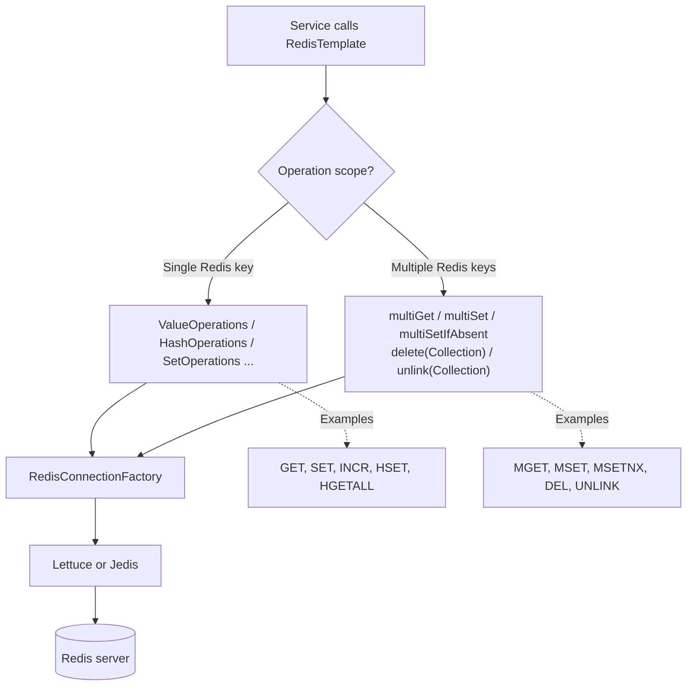
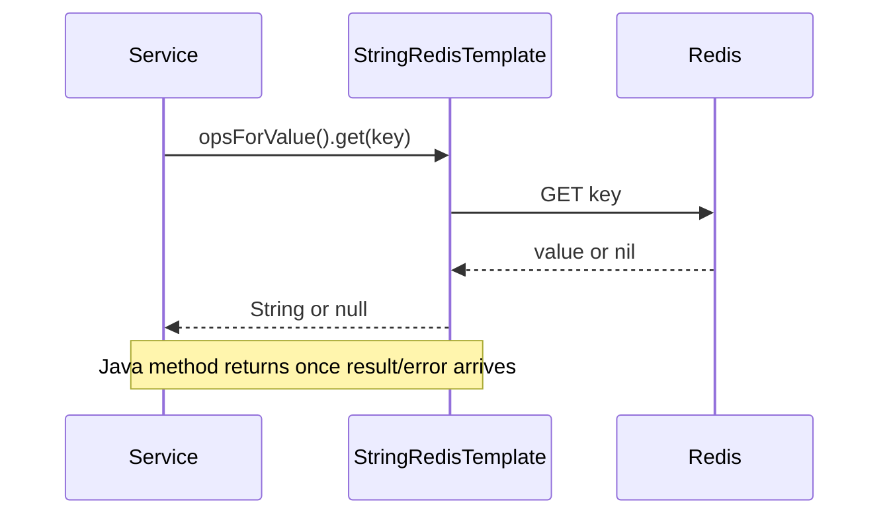
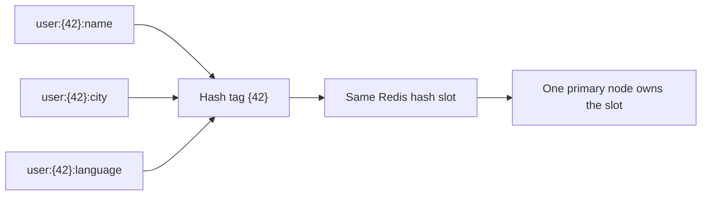

# Synchronous Single-Key and Multi-Key Operations with RedisTemplate

In Spring Data Redis, `RedisTemplate` provides synchronous-style Redis operations: Java code invokes a method, waits for the result, and then continues processing. These methods can act on **a single Redis key** such as `GET`, `SET`, and `INCR`, or **multiple Redis keys** such as `MGET`, `MSET`, `MSETNX`, and `DEL` with a collection of keys.

When studying this topic, distinguish two axes clearly:

- **Synchronous vs. asynchronous** describes how the Java caller receives results. With standard `RedisTemplate`, the calling thread waits until the operation completes or fails. With reactive or asynchronous APIs, results are represented differently.
- **Single-key vs. multi-key** describes the scope of a Redis operation. A Redis command can operate on one or many keys; additionally, an application can invoke multiple commands sequentially, use a pipeline, or use a transaction. They do not share the same atomicity guarantees.

Examples in this lesson use `StringRedisTemplate` so data can be easily inspected via Redis CLI; the same concepts apply to `RedisTemplate<K,V>` once appropriate serializers are configured.

## 1. Map of Synchronous Operations



| Intent | Spring Data Redis API | Typical Redis Command | Redis Key Count |
|---|---|---|---|
| Read a single value | `opsForValue().get(key)` | `GET` | One |
| Write a value with TTL | `opsForValue().set(key, value, duration)` | `SET ... EX/PX` | One |
| Write when key does not exist | `opsForValue().setIfAbsent(key, value)` | `SET ... NX` | One |
| Increment a counter | `opsForValue().increment(key)` | `INCR` | One |
| Read multiple fields of a Hash | `opsForHash().multiGet(key, fields)` | `HMGET` | **One Redis key**, multiple fields |
| Write multiple fields into a Hash | `opsForHash().putAll(key, map)` | `HSET` with multiple field/value pairs | **One Redis key**, multiple fields |
| Read multiple Redis String keys | `opsForValue().multiGet(keys)` | `MGET` | Multiple |
| Write multiple Redis String keys | `opsForValue().multiSet(map)` | `MSET` | Multiple |
| Write group only if all keys do not exist | `opsForValue().multiSetIfAbsent(map)` | `MSETNX` | Multiple |
| Delete multiple keys | `delete(keys)` | `DEL` or client/topology-appropriate command combination | Multiple |
| Unlink multiple keys and reclaim memory asynchronously on Redis | `unlink(keys)` | `UNLINK` or appropriate execution strategy | Multiple |

The listed commands represent **typical execution paths**, not a guarantee that every driver and every Redis topology sends a single network request for every API overload. For instance, Redis Cluster imposes multi-key constraints and clients may split commands per node. Therefore, consider serializers, Redis data types, topology, and atomicity requirements together.

## 2. Preparing a Spring Boot Application with RedisTemplate

With Gradle Groovy:

```groovy
dependencies {
    implementation 'org.springframework.boot:spring-boot-starter-data-redis'
}
```

Example standalone Redis configuration on a development machine:

```yaml
spring:
  data:
    redis:
      host: localhost
      port: 6379
      connect-timeout: 2s
      timeout: 3s
```

In Spring Boot 3.x, the Redis starter typically creates a `RedisConnectionFactory` and provides `StringRedisTemplate` as well as `RedisTemplate` when auto-configuration conditions are met. `StringRedisTemplate` uses string serializers for keys and values, storing them as easily inspectable UTF-8.

`RedisTemplate<K,V>` is more general. Key/value and hash key/hash value may need separate serializers. If a service writes JSON with one template and reads with a template using the JDK serializer, the data may fail to deserialize even though both talk to the same Redis server.

In the examples:

```java
import org.springframework.data.redis.core.StringRedisTemplate;
import org.springframework.stereotype.Service;

@Service
public class RedisLessonService {
    private final StringRedisTemplate redis;

    public RedisLessonService(StringRedisTemplate redis) {
        this.redis = redis;
    }
}
```

The class above only demonstrates dependency injection. Complete methods are built in the following sections. A Redis server must be running and reachable from **the JVM's environment**; YAML configuration alone does not start Redis.

## 3. Synchronous Operations on a Single Redis Key

### 3.1. GET, SET, and DELETE

`ValueOperations<K,V>` is the operations group for Redis String values. A key can hold text, string-encoded numbers, or bytes of a serialized object.

```java
import java.time.Duration;
import org.springframework.data.redis.core.StringRedisTemplate;
import org.springframework.stereotype.Service;

@Service
public class VerificationCodeStore {
    private final StringRedisTemplate redis;

    public VerificationCodeStore(StringRedisTemplate redis) {
        this.redis = redis;
    }

    public void save(String userId, String code) {
        String key = "verify:user:" + userId;
        redis.opsForValue().set(key, code, Duration.ofMinutes(5));
    }

    public String read(String userId) {
        return redis.opsForValue().get("verify:user:" + userId);
    }

    public boolean remove(String userId) {
        Boolean deleted = redis.delete("verify:user:" + userId);
        return Boolean.TRUE.equals(deleted);
    }
}
```

Call flow of `read()`:



If `GET` succeeds but the key does not exist, `get()` returns `null`. Failing to connect to Redis or experiencing a command timeout is an **access error**, not equivalent to an absent key.

`set(key, value, Duration)` writes the value and attaches its lifetime in a single appropriate Redis operation. Replacing it with `set(key, value)` followed by `expire(key, ...)` performs **two operations**; if the `expire` call fails, the key may remain without the intended TTL.

### 3.2. SET NX: Create Key Only When Absent

```java
import java.time.Duration;

Boolean created = redis.opsForValue().setIfAbsent(
    "registration:request:evt-123",
    "processing",
    Duration.ofMinutes(2)
);

if (Boolean.TRUE.equals(created)) {
    // Caller created the key for the first time.
}
```

`setIfAbsent` has semantics corresponding to `SET ... NX`; checking "key does not exist" and writing the key are performed by Redis in the same command.

Do not replace it with:

```java
if (!Boolean.TRUE.equals(redis.hasKey(key))) {
    redis.opsForValue().set(key, value);
}
```

Two requests can both observe `hasKey(key) == false` before both call `set`. This is a **check-then-act race condition**.

`setIfAbsent` can be useful for simple idempotency markers, but a self-expiring key does not automatically constitute a safe distributed lock. When a true lock is required, you need an owner token and a safe release mechanism that guards against deleting another owner's lock, along with accounting for TTL, failover, and actual processing duration.

### 3.3. INCR: Updating Counters Atomically

```java
import org.springframework.data.redis.core.StringRedisTemplate;

public Long countView(StringRedisTemplate redis, String articleId) {
    return redis.opsForValue()
        .increment("metrics:article:" + articleId + ":views");
}
```

Redis executes `INCR` on a single key as an atomic command. When multiple threads call `increment`, they do not have to read the number into Java, increment it, and write it back.

Compare:

```java
// Approach prone to lost updates under concurrency:
String current = redis.opsForValue().get(key);
long next = current == null ? 1 : Long.parseLong(current) + 1;
redis.opsForValue().set(key, Long.toString(next));
```

Between `GET` and `SET`, another caller can write a new value. Redis does not automatically treat these two commands as a single transaction. `INCR` cleanly solves integer increments when the value is valid.

**Timeout note:** if Redis executes `INCR` but the response is lost, the caller may receive a timeout even though the counter incremented. Retrying `INCR` without an operation ID/deduplication can increment twice. *Atomic* does not mean *exactly-once across network retries*.

### 3.4. Other Single-Key Commands

```java
// Check existence:
Boolean exists = redis.hasKey("user:42:name");

// Set TTL on an existing key:
Boolean expiryApplied = redis.expire(
    "user:42:name",
    Duration.ofMinutes(15)
);

// Inspect remaining TTL:
Duration remaining = redis.getExpire("user:42:name");

// Get old value and set new value:
String previous = redis.opsForValue()
    .getAndSet("user:42:name", "Lan");

// Delete a key:
Boolean deleted = redis.delete("user:42:name");
```

`getAndSet` maps to the atomic semantics of Redis `GETSET` or an equivalent command mechanism, retrieving the old value and updating to the new value in one operation. Use it instead of `GET` followed by `SET` when business logic genuinely needs that behavior.

`getExpire` requires distinguishing keys with a TTL, keys without a TTL, and non-existent keys. In Redis CLI, `TTL` returns `-1` for an existing key without expiry and `-2` for a non-existent key. In Spring Data Redis, check the `Duration` return contract of your API/version to handle those two sentinel cases properly.

## 4. One Redis Hash Key with Multiple Fields

**Multiple fields are not multiple Redis keys.** This is a common point of confusion upon seeing the method name `multiGet`.

Suppose you want to store user `42`'s profile in a single Redis Hash:

```text
Redis key: user:42:profile
Redis TYPE: hash
Fields:
    name     -> Lan
    city     -> Hanoi
    language -> vi
```

With `StringRedisTemplate`:

```java
import java.util.LinkedHashMap;
import java.util.List;
import java.util.Map;
import org.springframework.data.redis.core.StringRedisTemplate;
import org.springframework.stereotype.Service;

@Service
public class ProfileHashStore {
    private final StringRedisTemplate redis;

    public ProfileHashStore(StringRedisTemplate redis) {
        this.redis = redis;
    }

    public void saveFields() {
        Map<String, String> fields = new LinkedHashMap<>();
        fields.put("name", "Lan");
        fields.put("city", "Hanoi");
        fields.put("language", "vi");

        redis.opsForHash().putAll("user:42:profile", fields);
    }

    public List<Object> readTwoFields() {
        return redis.opsForHash().multiGet(
            "user:42:profile",
            List.of("name", "language")
        );
    }
}
```

`putAll` writes multiple fields into **the same Redis key**, typically via `HSET` with multiple field-value pairs. `HashOperations.multiGet` reads the requested fields, typically via `HMGET`.

Inspecting via Redis CLI:

```bash
redis-cli TYPE user:42:profile
# hash

redis-cli HMGET user:42:profile name language
# Lan
# vi
```

Comparing the two `multiGet` variants:

| API | Input | Actual Redis key | Typical command |
|---|---|---|---|
| `redis.opsForHash().multiGet(key, fields)` | **One** Hash key and multiple field names | `user:42:profile` | `HMGET` |
| `redis.opsForValue().multiGet(keys)` | **Multiple** String keys | `user:42:name`, `user:42:city`... | `MGET` |

These two layouts affect TTL, Cluster hash slot distribution, and update patterns. A Redis Hash has a **key-level** TTL, not independent per-field TTLs by default. A Hash managed manually via Template also does not automatically create mappings or indexes like a Redis Repository with `@RedisHash`.

## 5. Reading Multiple Redis Keys with multiGet

When each attribute is stored as a separate Redis String key:

```text
user:42:name     -> Lan
user:42:city     -> Hanoi
user:42:language -> vi
```

You can read each key with three `get` calls, or combine them into a single `multiGet` call:

```java
import java.util.List;
import org.springframework.data.redis.core.StringRedisTemplate;

List<String> keys = List.of(
    "user:42:name",
    "user:42:city",
    "user:42:language"
);

List<String> values = redis.opsForValue().multiGet(keys);

if (values != null) {
    for (int i = 0; i < keys.size(); i++) {
        String key = keys.get(i);
        String value = values.get(i);
        System.out.println(key + " = " + value);
    }
}
```

Key semantics:

- `multiGet` returns a result list **matching the input key order**. Never pair keys and values based on the arbitrary iteration order of a `HashSet`.
- Non-existent keys produce `null` elements at their corresponding positions. Redis `MGET` returns nil for missing keys without treating it as an error.
- In pipeline or transaction contexts, the contract of some template methods allows returning `null` before results are assembled. On the normal synchronous path outside pipelines/transactions, the caller uses the final list.
- `MGET` only applies to Redis String keys. If a key holds a Redis Hash, List, or another type, Redis may return nil for positions lacking a String value per `MGET` semantics; do not interpret every nil as "the key does not exist at all" without checking `TYPE`.
- In Redis Cluster, multi-key commands are constrained by hash slots. Keys across different slots may be rejected or handled by the client using specific strategies; you cannot assume the entire batch is read atomically.

### 5.1. When Should You Use multiGet?

If you need to read 20 attributes stored across 20 String keys at once, `multiGet` usually saves round-trips compared to 20 sequential `get` calls on a single Redis node. In exchange, the reply payload is larger and memory/latency must be watched if the key count grows huge.

`multiGet` makes sense when:

- The keys are already known upfront, such as IDs from another query.
- All values are stored as Redis Strings with compatible serializers.
- The key batch is small enough that one request does not produce an oversized payload.
- The Redis topology supports multi-key access for that group of keys.

If you only want to discover keys by prefix, **`MGET` does not search for keys**. You must supply the list of keys; searching by pattern is a different operation, typically using bounded `SCAN` suited to your topology.

## 6. Writing Multiple Redis Keys with multiSet

`ValueOperations.multiSet(Map<K,V>)` writes multiple key/value pairs:

```java
import java.util.LinkedHashMap;
import java.util.Map;
import org.springframework.data.redis.core.StringRedisTemplate;

public void saveProfile(StringRedisTemplate redis) {
    Map<String, String> values = new LinkedHashMap<>();
    values.put("user:42:name", "Lan");
    values.put("user:42:city", "Hanoi");
    values.put("user:42:language", "vi");

    redis.opsForValue().multiSet(values);
}
```

On a standalone Redis node, the typical operation is `MSET`:

```redis
MSET user:42:name Lan user:42:city Hanoi user:42:language vi
```

`MSET` writes all key/value pairs as one Redis command. Redis executes the single command atomically within the relevant instance: other clients will not observe a partially updated state **among elements of the same MSET command**. However:

- `MSET` overwrites existing values; it does not only create new keys.
- `MSET` does not accept per-key TTL in the same syntax as `SET key value EX ...`.
- If you must write values and TTLs for multiple keys, a `multiSet` step followed by multiple `expire` steps **is not atomic as a single command**.
- In Redis Cluster, do not assume `MSET` across different hash slots has the same atomic semantics as on a standalone Redis node.

### 6.1. MSET Is Not "Saving Multiple Repository Entities"

When calling `RedisTemplate.opsForValue().multiSet`, values are written as Redis Strings using the template's serializer. It does not invoke `repository.saveAll(entities)` and does not create Redis Repository secondary indexes or metadata.

For example:

```text
multiSet(
  user:42:name = "Lan",
  user:42:city = "Hanoi"
)
```

differs from saving a `UserProfile` entity via `@RedisHash`. The two approaches have different key layouts and query mechanisms.

### 6.2. Setting TTL Properly for a Group of Keys

Suppose business logic requires three keys to expire together after 5 minutes. There are several options:

1. If the three pieces of data form one logical aggregate, consider **a single Redis Hash key** and set TTL once on that key.
2. If three String keys are still needed, call `SET` with duration for each key; pipelining can reduce round-trips, though pipelining **does not automatically provide cross-command atomicity**.
3. If "creating multiple keys with TTL" must be guaranteed together, consider an appropriate Lua script or transaction, keeping Redis Cluster same-slot constraints in mind.

No `RedisSerializer` property assigns TTL automatically. TTL is determined by write APIs, `expire`, cache configuration, or the owning data layer.

## 7. multiSetIfAbsent: All Keys Must Not Exist

`ValueOperations.multiSetIfAbsent(Map<K,V>)` is designed for the intent: **write the entire group only if none of the keys in the group already exist**.

```java
import java.util.Map;

Boolean created = redis.opsForValue().multiSetIfAbsent(
    Map.of(
        "checkout:order:42:status", "NEW",
        "checkout:order:42:owner", "worker-7"
    )
);

if (Boolean.TRUE.equals(created)) {
    // The group of keys was created because all were absent.
} else {
    // At least one key already existed (in normal execution).
}
```

On standalone Redis, the corresponding operation is `MSETNX`. If **even one key already exists**, Redis writes **none** of the keys in the group. Condition checking and writing all keys are atomic in one command on a single node.

Suppose:

```text
Initially:
    checkout:order:42:status = "PAID"
    checkout:order:42:owner  does not exist

MSETNX status="NEW" owner="worker-7"
    → returns false
    → status remains "PAID"
    → owner still does not exist
```

Contrast with this flawed approach:

```java
for (Map.Entry<String, String> e : values.entrySet()) {
    redis.opsForValue().setIfAbsent(e.getKey(), e.getValue());
}
```

The loop creates missing keys **one by one**; some keys may be created even while others already exist. `multiSetIfAbsent` expresses "all or nothing" within the scope supported by Redis.

Note: `MSETNX` does not attach a TTL; keys can live indefinitely without a separate expire or cleanup step. For lock/idempotency use cases, timely expiration is part of the design. Nor can you use `MSETNX` across hash slots and expect single-node atomicity.

## 8. Deleting Multiple Keys: delete and unlink

`RedisTemplate` lets you delete a known collection of keys:

```java
import java.util.List;

Long deletedCount = redis.delete(List.of(
    "cart:42:items",
    "cart:42:total",
    "cart:42:coupon"
));
```

`delete(Collection<K>)` returns the number of keys actually deleted as reported by the driver; **not the number of keys passed in**. If some keys do not exist, the deleted count will be smaller than the input list.

With Redis supporting `UNLINK`:

```java
Long unlinkedCount = redis.unlink(List.of(
    "cache:report:old:1",
    "cache:report:old:2"
));
```

`UNLINK` removes keys from the keyspace per Redis command semantics and defers memory reclamation of the values asynchronously on the server side. However, **the Java `unlink(...)` call via RedisTemplate is still a synchronous call** with respect to the command response; "asynchronous" here refers primarily to Redis's internal memory freeing.

When should you consider `UNLINK`?

- Deleting keys with huge payloads where synchronous memory freeing on the main thread could cause latency spikes.
- Cleaning up many keys during controlled maintenance jobs.

Do not confuse `UNLINK` with a "Java background task" or assume deleting keys is risk-free. You still must identify key ownership, prefixes, key counts, and effects on Repository indexes/caches.

With Redis Cluster, a collection of keys may span multiple shards. Multi-key deletion in the library may be split by node, and the whole operation cannot be treated as an atomic cross-shard transaction.

## 9. How Do One Multi-Key Command, Sequential Commands, and Pipelining Differ?

All three approaches can return the same final data when there is no concurrency, yet they differ in round-trips and atomicity.

### 9.1. Sequential Synchronous Calls

```java
String name = redis.opsForValue().get("user:42:name");
String city = redis.opsForValue().get("user:42:city");
String language = redis.opsForValue().get("user:42:language");
```

Each call waits for its result before the next begins in code order. It is easy to read and allows per-result handling, but incurs multiple round-trips and reads values at **different points in time**.

### 9.2. One Multi-Key Command

```java
List<String> values = redis.opsForValue().multiGet(
    List.of("user:42:name", "user:42:city", "user:42:language")
);
```

On standalone Redis, `MGET` is **one command**: Redis processes the keys in a single operation. It usually reduces round-trips. However, a single `MGET` does not turn preceding or subsequent operations into a transaction.

### 9.3. Pipeline: Sending Multiple Commands to Reduce Round-Trips

Pipelining sends multiple Redis commands without waiting for the reply of **each command** before sending the next. Spring Data Redis provides `executePipelined`:

```java
import java.util.List;
import org.springframework.data.redis.core.RedisCallback;
import org.springframework.data.redis.core.StringRedisTemplate;
import org.springframework.data.redis.serializer.StringRedisSerializer;

public List<Object> readWithPipeline(StringRedisTemplate redis) {
    StringRedisSerializer serializer = new StringRedisSerializer();

    return redis.executePipelined((RedisCallback<Object>) connection -> {
        connection.stringCommands().get(
            serializer.serialize("user:42:name")
        );
        connection.stringCommands().get(
            serializer.serialize("user:42:city")
        );
        connection.stringCommands().get(
            serializer.serialize("user:42:language")
        );
        // Pipeline callback must return null; results are in the outer list.
        return null;
    });
}
```

Key takeaways:

- `executePipelined` **still waits** for all responses to return `List<Object>` to the Java caller. This API does not turn reactive.
- Pipelined commands are still processed by Redis **individually**; other clients may interleave depending on scheduling, connections, and server execution.
- A pipeline does not automatically roll back earlier commands if a later command fails.
- Pipeline results are deserialized by the template according to its serializers and reply semantics; caller code must understand the type of each element.
- Pipelining helps when multiple independent operations lack an appropriate multi-key command or mix command types. For thousands of commands, split into batches and monitor memory.

If the entire requirement is reading Redis String keys on one node within `MGET`'s scope, `multiGet` is usually simpler than pipelining three `GET` commands.

### 9.4. Comparison Table

| Approach | Calls in code | Redis commands | Atomicity |
|---|---|---|---|
| Three sequential `get(key)` calls | Three | Three `GET`s | Each `GET` is individual, no shared snapshot |
| One `multiGet(keys)` call | One | Typically one `MGET` | One command on a single Redis node; Cluster caveats apply |
| One `executePipelined` with three `GET`s | One API call | Three `GET`s | No atomicity across the three |
| `MULTI/EXEC` wrapping three commands | One transaction scope | Multiple queued commands executed together | No interleaving within the transaction on a single Redis node; semantics differ from DB rollback |

## 10. Synchronous Java Does Not Mean Atomic Transaction

An important misconception:

```java
redis.opsForValue().set("order:42:status", "PAID");
redis.opsForValue().increment("order:42:revision");
```

These are **two synchronous Java calls**: the caller waits for the first before sending the second. However, if the second fails, the first has already succeeded. Another client can observe `status=PAID` while `revision` has not yet incremented.

To get appropriate atomicity, choose according to the problem:

- **A built-in atomic Redis command** like `INCR`, `SET NX`, `MSET`, or `MSETNX` is the simplest choice when its semantics fit.
- **Lua scripts / Redis Functions** can evaluate conditions and mutate multiple keys atomically within a Redis node and Cluster constraints.
- **Redis `MULTI/EXEC` transactions** group commands under Redis's model and can be combined with `WATCH` for optimistic concurrency control.
- When consistency is needed between Redis and an external database, a Redis transaction does not span the database's transaction.

### 10.1. Example of MULTI/EXEC via SessionCallback

Spring Data Redis provides `SessionCallback` to ensure multiple operations inside the callback use the same appropriate connection/session:

```java
import java.util.List;
import org.springframework.dao.DataAccessException;
import org.springframework.data.redis.core.RedisOperations;
import org.springframework.data.redis.core.SessionCallback;
import org.springframework.data.redis.core.StringRedisTemplate;

public List<Object> markPaid(StringRedisTemplate redis) {
    return redis.execute(new SessionCallback<List<Object>>() {
        @Override
        @SuppressWarnings({"unchecked", "rawtypes"})
        public <K, V> List<Object> execute(RedisOperations<K, V> operations)
                throws DataAccessException {
            // Callback runs with StringRedisTemplate in this example.
            RedisOperations<String, String> strings =
                (RedisOperations) operations;

            strings.multi();
            strings.opsForValue().set("order:42:status", "PAID");
            strings.opsForValue().increment("order:42:revision");
            return strings.exec();
        }
    });
}
```

Because `SessionCallback` defines a generic method, the example uses an unchecked cast where the template is known to be `StringRedisTemplate`. In production code, you can wrap this in a typed adapter or use lower-level APIs with explicit contracts. Results of operations queued inside `MULTI` are generally unavailable at call time; actual results are returned by `exec()`.

**Redis transactions are not SQL transactions:**

- Redis executes queued commands in `MULTI/EXEC` sequentially without interleaving commands from other clients on the same node.
- Redis has no RDBMS-style full transaction rollback if a command inside `EXEC` encounters a runtime error; other commands can still take effect.
- If you want to update only when data has not changed, you need `WATCH` or an equivalent atomic compare-and-set; `MULTI/EXEC` alone does not solve client-side read-modify-write races.
- With Redis Cluster, check same-hash-slot constraints and client/driver transaction support; never assume adding `MULTI` enables multi-shard transactions.

Spring Data Redis offers mechanisms to participate in Spring transactions when configured; it **does not automatically turn every `@Transactional` method into a Redis transaction**, nor do the semantics equal a cross-Redis+JDBC transaction.

## 11. Redis Cluster: The Hash Slot Issue with Multiple Keys

Redis Cluster distributes Redis keys across **hash slots**. Multi-key commands like `MGET`, `MSET`, and `MSETNX` may require all keys to belong to the same hash slot. For example:

```text
user:42:name
user:42:city
user:42:language
```

Looking similar to humans does not guarantee these three keys land in the same slot. To place one user's keys in the same slot, use a **hash tag**:

```text
user:{42}:name
user:{42}:city
user:{42}:language
```

Redis Cluster computes the hash slot from the substring inside curly braces—`42` for all three keys:



As a result, a compatible multi-key command can run across this group without hitting a `CROSSSLOT` error caused by keys living in different slots. However:

- An overly broad shared hash tag like `{all-users}` funnels too many keys into one slot, hurting load distribution.
- Keys for different user IDs should spread across slots when scaling is the goal.
- On Cluster, verify driver support for each Redis command as well as topology/failover handling.
- If using HashOperations in code, **a Redis Hash is a single key**, so all its fields naturally live on the same node without needing hash tags per field.

When an entity's attributes are always read and written together, consider a single Redis Hash key or a JSON String key rather than splitting into multiple keys purely for perceived flexibility.

## 12. Timeouts, Partial Failures, and Retries

"Synchronous" does not mean every operation succeeds or fails cleanly and instantaneously. Possible issues include:

- Redis connection is not yet ready.
- Command timeout when the server processed the command but the reply was delayed or lost.
- A pipelined batch executes some commands before the connection drops.
- The driver reconnects while a request is in flight.
- A multi-key command is rejected due to incompatible Cluster hash slots.

### 12.1. A Multi-Key Command Times Out

With `MSET` on standalone Redis, if the caller gets a timeout, **you cannot conclude Redis did not write**. Redis may have executed the command atomically and lost the response. Retrying with the same values may converge on the same final state; however, if consumers react to key changes or TTLs, you must still consider side effects.

With `INCR` or `LPUSH`, retrying after a timeout easily causes duplicate effects. **Never blindly retry non-idempotent commands**.

### 12.2. Sequential Commands Failing Midway

Suppose:

```java
redis.opsForValue().set("invoice:42:status", "PAID");
redis.opsForValue().set("invoice:42:paidBy", "u-7");
redis.opsForValue().set("invoice:42:paidAt", "2026-11-12T08:00:00Z");
```

If the third command fails, the first two may already have succeeded. Calling consecutive Java methods does not make all three fields a single transaction.

If values form a single logical entity that must stay consistent, consider storing them in one Hash/JSON, using a transaction or conditional Lua script, or keeping the authoritative record in an external database and updating the cache deterministically.

### 12.3. Distinguishing nil from Exceptions

```java
import org.springframework.dao.DataAccessException;

try {
    String value = redis.opsForValue().get("user:42:name");
    if (value == null) {
        // Redis read succeeded; key has no readable String value.
    } else {
        // Result received.
    }
} catch (DataAccessException ex) {
    // Redis could not perform/complete the operation; handle per policy.
    throw ex;
}
```

In a pure Redis String context, `null` normally means the key does not exist. With `MGET`, you must also know that all keys have the right Redis type to distinguish nil due to absence from nil due to a non-String key. Access errors are normally translated by Spring Data into Spring's exception hierarchy; inspect the cause chain to distinguish timeouts, connectivity failures, and command errors.

## 13. Performance: Round-Trips, Key Count, and Payload Size

Suppose a network round-trip takes 2 ms and Redis executes each command very quickly. Three sequential `GET` calls pay three network round-trips, whereas a single `MGET` typically cuts network trips. However, this is an illustrative mental model, **not a benchmark or latency guarantee**.

```text
GET k1 → reply  | GET k2 → reply | GET k3 → reply
      (multiple round-trips, executed sequentially)

MGET k1 k2 k3 → reply [v1, v2, v3]
      (single multi-key command on standalone Redis)

PIPELINE GET k1, GET k2, GET k3 → replies
      (multiple Redis commands, reducing wait time between sends)
```

| Technique | Benefit | Cost / Things to watch |
|---|---|---|
| Per-key `GET` | Simple structure; per-key error and logic handling | Multiple round-trips when called sequentially |
| `MGET` | Combines multiple String keys in one command | Data type/Cluster constraints; large replies with too many keys |
| `MSET` | Writes multiple String keys in one command | TTL and conditional updates require separate design |
| Redis Hash + `HMGET` | Reads selected fields in one aggregate | Key-level TTL; manual updates on Repository keys require clear ownership |
| Pipeline | Batches heterogeneous commands, reduces round-trips | Not atomic; result list must be parsed carefully |
| Transaction/Lua | Enforces atomicity across a multi-command flow | Complexity, Cluster limits, command latency, and contention |

For hundreds of thousands of keys, never pass all of them into `multiGet` at once. Chunk into batches bounded by payload/memory limits, observe latency, preserve result ordering, and handle per-batch failures. The goal of optimization is **response time and business correctness**, not simply fewer Java method calls.

## 14. Notes on RedisTemplate, Serializers, and Thread Safety

`RedisTemplate` is designed to be reused as a Spring bean once configured. Keep clear:

- Key serializers must match between writes and reads. With `StringRedisTemplate`, keys are easily inspectable via Redis CLI.
- `RedisTemplate<String, Product>` with a JSON value serializer calling `opsForValue()` creates **a Redis String containing JSON**; it does not automatically turn the object into a Redis Hash.
- `opsForHash()` uses hash key and hash value serializers. A Redis Hash can hold multiple fields whose values are JSON payloads.
- Redis Repository `@RedisHash` maintains its own mapping, indexes, and metadata. Manually issuing `multiSet` or `HSET` against Repository-owned keys can break index and TTL invariants.
- `RedisCacheManager` for Spring Cache has its own serialization and TTL settings; it does not automatically inherit custom serializers from business templates.

In concurrent code, a properly initialized template bean can be shared safely, whereas a low-level Redis connection with stateful lifecycle requirements should not be shared arbitrarily. Enabling transactions or pipelining binds to connections inside callbacks; use Spring's APIs to manage those resources properly.

## 15. Inspecting via Redis CLI

The following examples demonstrate both single-key and multi-key commands:

```bash
# Single String key
redis-cli SET demo:one "hello" EX 60
redis-cli GET demo:one

# Two String keys in one command
redis-cli MSET demo:a "A" demo:b "B"
redis-cli MGET demo:a demo:b demo:missing

# Write the group only if none of the keys exist
redis-cli MSETNX demo:c "C" demo:d "D"

# One Hash key with multiple fields
redis-cli HSET demo:profile name "Lan" language "vi"
redis-cli HMGET demo:profile name language
redis-cli TYPE demo:profile

# Delete multiple keys
redis-cli DEL demo:a demo:b
```

When searching keys by pattern during debugging:

```bash
redis-cli --scan --pattern 'demo:*'
```

Avoid `KEYS *` on large production Redis instances because it can block Redis while scanning the entire keyspace. On Redis Cluster, administrative tooling must account for all primary nodes; scanning one node does not cover the entire cluster.

### 15.1. Signs to Watch For

| Symptom | Potential cause to check |
|---|---|
| `multiGet` has `null` at one position | Key does not exist or key type is incompatible with `MGET` |
| `multiSetIfAbsent` returns `false` | At least one key already existed on the atomic `MSETNX` execution path |
| `WRONGTYPE` | Using an operation incompatible with the key's Redis TYPE |
| `CROSSSLOT` | Multi-key operation in Cluster targeting keys in different slots |
| `delete(keys)` returns a smaller count than input | Some keys did not exist; consider concurrent mutations |
| Pipeline returns results out of expected order | Caller matched responses incorrectly; check command order and serializers |
| Command timeout | Network/Redis slowness; does not prove the command never executed |
| Redis Hash exists but Repository query fails | Hash may have been edited manually without updating Repository-managed indexes |

## 16. Four Scenarios for Choosing an Approach

### Scenario A — Incrementing Article Views

Every request increments a counter `metrics:article:42:views`. Choose:

```java
Long views = redis.opsForValue()
    .increment("metrics:article:42:views");
```

Because `INCR` is a single atomic command on one key, it is far better than manual `GET` then `SET`. If each business request must be counted at most once despite retries, add an operation ID or deduplication mechanism.

### Scenario B — Reading Three Settings Stored as Three String Keys

The keys `user:{42}:theme`, `user:{42}:language`, and `user:{42}:timezone` are all Strings. Choose `multiGet` to read them together in one command when topology permits, paying attention to ordering and `null` values.

```java
List<String> settings = redis.opsForValue().multiGet(List.of(
    "user:{42}:theme",
    "user:{42}:language",
    "user:{42}:timezone"
));
```

Using the `{42}` hash tag can place all three keys in the same Cluster slot. If the application always reads and updates all three together, consider storing them in a single Hash instead of three independent keys.

### Scenario C — Creating Two Keys If and Only If Both Are Absent

Business logic wants to create `reservation:{100}:owner` and `reservation:{100}:status` only when both do not exist. `multiSetIfAbsent` fits better than a `setIfAbsent` loop on standalone Redis or supported same-slot Cluster keys. If an atomic TTL is also needed with the operation, add a suitable transaction or script design.

```java
Boolean reserved = redis.opsForValue().multiSetIfAbsent(
    Map.of(
        "reservation:{100}:owner", "u-7",
        "reservation:{100}:status", "PENDING"
    )
);
```

### Scenario D — Recording Payment Outcome and Updating Revision

Two operations `SET status=PAID` and `INCR revision` may not be allowed to split. Calling two `RedisTemplate` methods sequentially does not give group atomicity. Determine the business condition, pick a transaction or Lua script when appropriate, and do not confuse Redis transactions with database transactions.

If Redis is merely caching PostgreSQL data, it may be safer to update PostgreSQL first and invalidate the affected cache entries afterwards, rather than treating Redis as the source of truth for payment state.

## 17. Common Misconceptions

| Misconception | Accurate understanding |
|---|---|
| "RedisTemplate is synchronous, so two consecutive `set` calls are atomic." | Synchronous only means the Java caller waits; two Redis commands remain separate. |
| "`multiGet` and `HashOperations.multiGet` are the same." | One reads multiple String **keys**; the other reads multiple **fields of a single Hash key**. |
| "`multiSet` sets individual TTLs per key." | `MSET` does not attach TTLs; use a different strategy when expiry is part of the contract. |
| "`multiSetIfAbsent` equals a `setIfAbsent` loop." | A loop can write partially; `MSETNX` on a single Redis node applies the condition to the whole group. |
| "Pipelining means transaction." | Pipelining optimizes round-trips; it does not guarantee atomicity. |
| "`UNLINK` is a non-blocking Java call." | The template API is still synchronous; only Redis's internal memory reclamation is asynchronous. |
| "Redis Cluster allows any cross-node `MGET` just like standalone." | Account for hash slots and client handling; cross-node atomicity is not guaranteed. |
| "A timed-out operation definitely did not write data." | The reply may have been lost after Redis already performed the mutation. |
| "String templates automatically maintain Redis Repository indexes." | Templates do not manage secondary indexes or entity mappings. |

## 18. Thinking Framework for Choosing Operations

When designing a Spring Data Redis requirement, clarify:

1. **How many Redis keys?** One String, one multi-field Hash, or multiple independent keys?
2. **Synchronous in what sense?** Does the Java caller simply wait for results, or must multiple mutations happen atomically together?
3. **Is there a single-operation Redis command that fits?** `GET`/`SET`/`INCR`, `MGET`/`MSET`/`MSETNX`, `HMGET`/`HSET`...
4. **Is TTL a mandatory part of the operation?** Avoid creating keys and forgetting expiration.
5. **Are there concurrency and retries?** Preserve idempotency, especially for counters and mutations.
6. **Is Redis running standalone or Cluster?** Check hash slot constraints and driver behavior.
7. **Who owns the key?** Template, Repository, or Cache; avoid overwriting another component's representation or indexes.

**Synchronous `RedisTemplate` keeps Redis code easy to follow; single-key and multi-key APIs express the exact scope of each operation.** When atomicity is needed, rely on **the semantics of individual Redis commands or appropriate transactions/scripts**, rather than inferring it from the word "synchronous" or adjacent Java lines.
