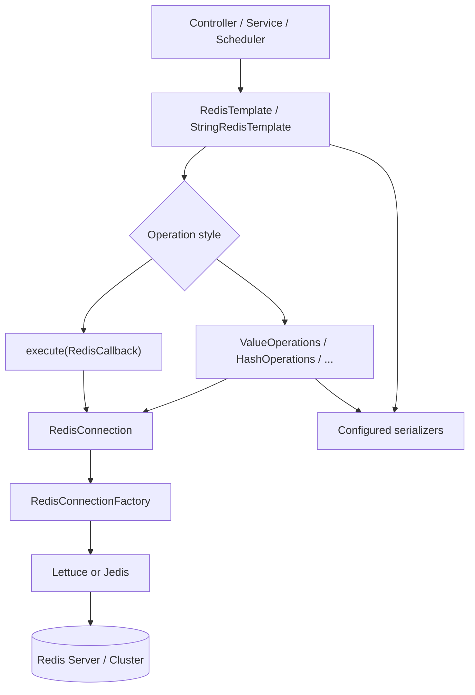
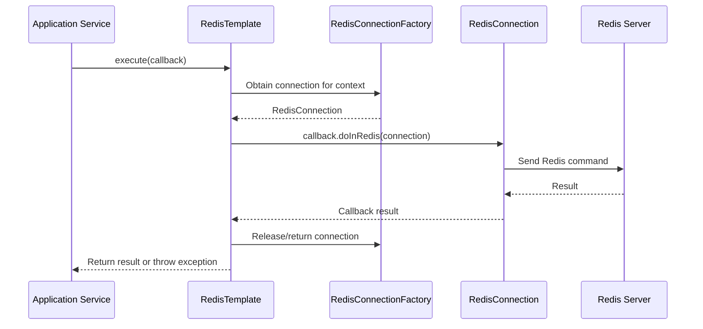
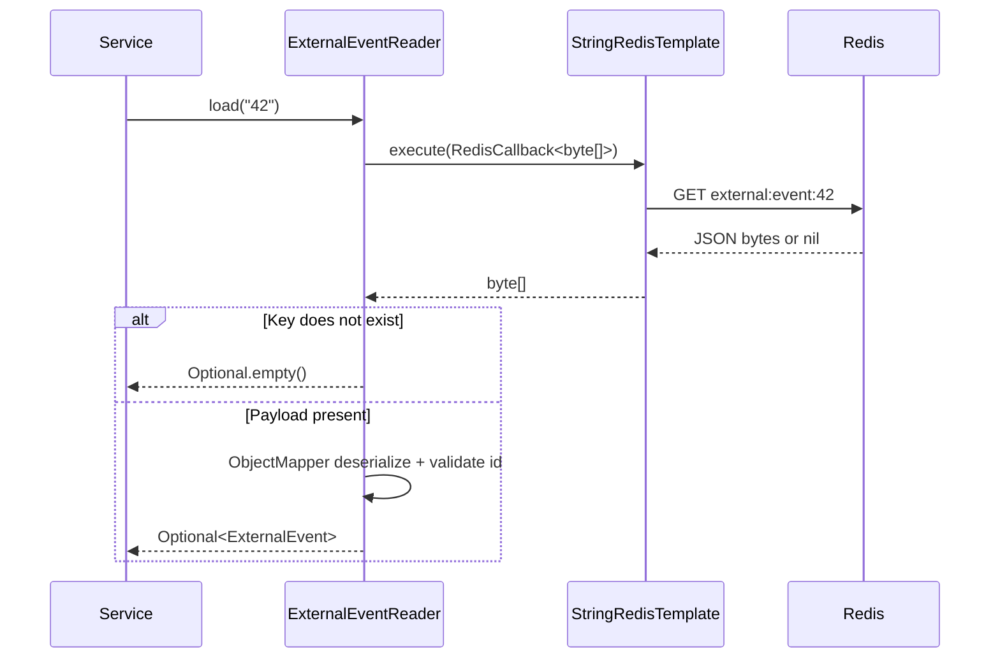

# Using RedisCallback to Execute Commands at the Connection Layer

## 1. What Is RedisCallback and Where Does It Fit in RedisTemplate?

In Spring Data Redis, developers usually read and write data through high-level APIs like `RedisTemplate.opsForValue()`, `opsForHash()`, `opsForSet()`, and `StringRedisTemplate`. These APIs let business code work with Java objects, automatically apply configured serializers, and hide most connection management details.

However, there are situations where you need to **invoke Redis commands directly through the `RedisConnection` layer**: needing a specialized command not conveniently exposed by standard operations, inspecting raw byte results, integrating with a custom binary protocol, or controlling operation boundaries at the connection level. In those cases, `RedisCallback<T>` is an extension mechanism of `RedisTemplate`.

`RedisCallback<T>` is a functional interface with one core method:

```java
@FunctionalInterface
public interface RedisCallback<T> {
    T doInRedis(RedisConnection connection) throws DataAccessException;
}
```

Simplest example:

```java
String answer = stringRedisTemplate.execute(
        (RedisCallback<String>) connection ->
                connection.serverCommands().ping());
```

`execute(...)` obtains a connection according to Spring Data Redis's management lifecycle, passes it into the callback, runs your logic, and then handles resource cleanup and exception translation per the template's contract. Here `ping()` sends the `PING` command to Redis and can return the string `PONG`.

**RedisCallback is not a standalone Redis client.** It is an extension hook letting application code access the `RedisConnection` managed by the template and `RedisConnectionFactory`.

### What Problems Does RedisCallback Solve?

Suppose a system uses a custom binary convention for keys and values. With `opsForValue().get("account:42")`, the template applies serializers and returns an object. If you need to inspect the exact bytes Redis returned, you can drop down to `RedisConnection` to read raw `byte[]` directly, then decode them according to the required format.

At the same time, callbacks avoid scattered boilerplate like:

```java
RedisConnection connection = factory.getConnection();
try {
    // Call low-level commands.
} finally {
    connection.close();
}
```

Manual management like the snippet above may be necessary when explicitly managing connections, but when working through `RedisTemplate`, using `execute(RedisCallback<T>)` follows the connection lifecycle established by Spring.

## 2. Position of RedisCallback in Spring Data Redis Architecture



The diagram outlines responsibility boundaries: `RedisTemplate` is the Spring interface; `RedisConnection` represents protocol-near commands; `RedisConnectionFactory` supplies driver-backed connections. When using a callback, **the callback itself decides how objects are converted to bytes and how results are decoded**.

| Component | Typical input | Abstraction level | Who manages serialization? |
|---|---|---|---|
| `opsForValue().get(key)` | `String`/`K` | High | `RedisTemplate` using configured serializers |
| `opsForHash().put(...)` | Key, field, Java object | High | `RedisTemplate` using key/hash serializers |
| `execute(RedisCallback<T>)` | Function receiving `RedisConnection` | Low | Callback code explicitly converts bytes |
| `RedisConnection` | `byte[]`, numbers, command options | Near Redis protocol | Does not understand Java business types |
| Native Lettuce/Jedis API | Depends on driver codec and API | Driver-dependent | That driver's codec or mechanism |

**Crucial boundary:** a callback accesses the same Redis server, but **does not automatically apply the template's `keySerializer` or `valueSerializer` to raw byte arguments** you pass into `RedisConnection`. To read the same key as `opsForValue()`, raw code must produce the **exact same key bytes**.

## 3. Calling RedisTemplate.execute(RedisCallback<T>)

With Spring Boot, add the Spring Data Redis starter:

```groovy
dependencies {
    implementation 'org.springframework.boot:spring-boot-starter-data-redis'
}
```

Example local configuration:

```yaml
spring:
  data:
    redis:
      host: localhost
      port: 6379
      connect-timeout: 2s
      timeout: 2s
```

This configuration illustrates a local environment only; real deployments still need authentication, TLS, and appropriate topology settings.

Inject `StringRedisTemplate` into a service:

```java
import java.nio.charset.StandardCharsets;
import org.springframework.data.redis.core.RedisCallback;
import org.springframework.data.redis.core.StringRedisTemplate;
import org.springframework.stereotype.Service;

@Service
public class RawGreetingStore {

    private final StringRedisTemplate redis;

    public RawGreetingStore(StringRedisTemplate redis) {
        this.redis = redis;
    }

    public void save(String userId, String greeting) {
        byte[] rawKey = ("greeting:" + userId)
                .getBytes(StandardCharsets.UTF_8);
        byte[] rawValue = greeting.getBytes(StandardCharsets.UTF_8);

        redis.execute((RedisCallback<Boolean>) connection ->
                connection.stringCommands().set(rawKey, rawValue));
    }

    public String find(String userId) {
        byte[] rawKey = ("greeting:" + userId)
                .getBytes(StandardCharsets.UTF_8);

        return redis.execute((RedisCallback<String>) connection -> {
            byte[] rawValue =
                    connection.stringCommands().get(rawKey);

            return rawValue == null
                    ? null
                    : new String(rawValue, StandardCharsets.UTF_8);
        });
    }
}
```

This example uses `StringRedisTemplate` and UTF-8 to produce the exact same byte format as the string template's default `StringRedisSerializer`. With plain-text keys, you can verify in `redis-cli`:

```redis
SET greeting:42 "Hello"
GET greeting:42
```

In Java code:

1. `StringRedisTemplate` is injected and reused.
2. The callback is a lambda accepting `RedisConnection`.
3. `connection.stringCommands().set(rawKey, rawValue)` writes key/value bytes.
4. `connection.stringCommands().get(rawKey)` returns `byte[]` or `null`.
5. The callback decodes bytes back to `String`.
6. The callback's return value becomes the return value of `redis.execute(...)`.

For a simple `set`, the high-level call is shorter:

```java
redis.opsForValue().set("greeting:" + userId, greeting);
String value = redis.opsForValue().get("greeting:" + userId);
```

Both approaches produce identical data **if the byte format matches**. The callback example exists to clarify the connection layer and byte-conversion responsibilities; in ordinary services, prefer higher-level APIs whenever they suffice.

### 3.1. Return Type of the Callback

`RedisCallback<T>` uses generic type `T` for **the Java return type of the whole callback**, not the Redis value type. For example:

```java
Long counter = redis.execute(
        (RedisCallback<Long>) connection -> {
            byte[] rawKey = "metrics:visits"
                    .getBytes(StandardCharsets.UTF_8);
            return connection.stringCommands().incr(rawKey);
        });
```

`Long` is the `INCR` result already converted to a number by the Redis driver. For `GET`, the callback receives `byte[]` and decides whether to return a `String`, a DTO, a checksum, or the original `byte[]`.

Because `RedisTemplate` has multiple `execute(...)` overloads for callbacks and other abstractions, **explicitly casting to `RedisCallback<T>` or specifying variable types clearly** helps Java overload resolution and readability.

### 3.2. Does a Command Returning null Mean Redis Has No Data?

Not necessarily. `GET` returns `null` when a key does not exist, yet in pipeline or transaction contexts, direct command calls can return `null` because responses are collected later. Distinguish:

- `null` as a valid command result during normal execution;
- `null` because a pipeline/transaction API has not collected responses yet;
- an exception due to timeout, connectivity, serialization, or Redis error.

Do not collapse every case into "key does not exist" in business code.

## 4. Serializing Bytes Consistently When Using RedisConnection

The easiest bug to introduce when moving from `ValueOperations` to `RedisCallback` is **mismatching key bytes and value bytes**.

With the high-level API:

```java
redisTemplate.opsForValue().set("product:42", product);
```

the template uses `keySerializer` to encode `"product:42"` and `valueSerializer` to encode `product`. If the template uses JDK or JSON serialization, key/value bytes may differ from `String.getBytes(UTF_8)`.

With a raw callback:

```java
redisTemplate.execute((RedisCallback<byte[]>) connection ->
        connection.stringCommands().get(
                "product:42".getBytes(StandardCharsets.UTF_8)));
```

you **explicitly** chose UTF-8 key bytes. Both snippets access the same key only if `redisTemplate`'s key serializer generates those exact bytes.

### 4.1. Using the Same Serializers as the Template

Suppose a template is configured with `StringRedisSerializer` for keys and `Jackson2JsonRedisSerializer<ProductSnapshot>` for values. A clean way is using matching serializers across both high-level and low-level paths:

```java
import java.time.Duration;
import org.springframework.context.annotation.Bean;
import org.springframework.context.annotation.Configuration;
import org.springframework.data.redis.connection.RedisConnectionFactory;
import org.springframework.data.redis.core.RedisTemplate;
import org.springframework.data.redis.serializer.Jackson2JsonRedisSerializer;
import org.springframework.data.redis.serializer.StringRedisSerializer;

public record ProductSnapshot(
        String id,
        String name,
        long priceCents) {}

@Configuration
class ProductRedisConfiguration {

    @Bean
    RedisTemplate<String, ProductSnapshot> productRedisTemplate(
            RedisConnectionFactory factory) {

        var template = new RedisTemplate<String, ProductSnapshot>();
        template.setConnectionFactory(factory);
        template.setKeySerializer(new StringRedisSerializer());
        template.setValueSerializer(
                new Jackson2JsonRedisSerializer<>(ProductSnapshot.class));
        template.setHashKeySerializer(new StringRedisSerializer());
        template.setHashValueSerializer(
                new Jackson2JsonRedisSerializer<>(ProductSnapshot.class));

        return template;
    }
}
```

Then the callback can use the same explicitly configured serializers:

```java
import org.springframework.data.redis.core.RedisCallback;
import org.springframework.data.redis.core.RedisTemplate;
import org.springframework.data.redis.serializer.Jackson2JsonRedisSerializer;
import org.springframework.data.redis.serializer.StringRedisSerializer;

public class ProductRawReader {

    private final RedisTemplate<String, ProductSnapshot> redis;

    private final StringRedisSerializer keySerializer =
            new StringRedisSerializer();

    private final Jackson2JsonRedisSerializer<ProductSnapshot>
            valueSerializer =
                    new Jackson2JsonRedisSerializer<>(ProductSnapshot.class);

    public ProductRawReader(
            RedisTemplate<String, ProductSnapshot> redis) {
        this.redis = redis;
    }

    public ProductSnapshot read(String id) {
        byte[] rawKey = keySerializer.serialize("product:" + id);

        return redis.execute(
                (RedisCallback<ProductSnapshot>) connection -> {
                    byte[] bytes =
                            connection.stringCommands().get(rawKey);

                    return bytes == null
                            ? null
                            : valueSerializer.deserialize(bytes);
                });
    }
}
```

This example instantiates serializers inside the reader to highlight the format. In a real project, avoid duplicating configuration where it can drift: define the serializer/codec as a shared component or encapsulate operations in a single Redis adapter. If Jackson settings change, every writer and reader must agree on the new format.

### 4.2. JDK Binary Keys vs. String Keys

Two identical Java strings `"product:42"` do not guarantee identical Redis keys:

| Writer | Key serializer | Redis key bytes |
|---|---|---|
| `StringRedisTemplate` | `StringRedisSerializer` | UTF-8 of `product:42` |
| `RedisTemplate` with JDK serializer | `JdkSerializationRedisSerializer` | Java-serialized String |
| Callback with `getBytes(UTF_8)` | Manual UTF-8 | UTF-8 of `product:42` |

A service that wrote a key with the JDK serializer can "see" it through that same template, yet `GET product:42` in Redis CLI will not find it. Redis does not understand display text; it only compares raw bytes.

**Good convention:** prefer String/UTF-8 for keys and hash fields unless there is a special technical reason. For DTO values, establish a clear JSON/binary format and a read strategy for schema evolution.

### 4.3. Do Not Mix Raw Data with Encoded Formats

If a template uses a JSON serializer and a raw callback writes `"hello"` via `getBytes(UTF_8)`, reading later with `opsForValue().get(...)` can fail because `hello` is not valid JSON (a JSON string requires quotes in the byte payload). Likewise, if the template expects a DTO object and a callback writes a non-conforming string, deserialization fails even though the key is found.

This failure comes from a **data contract mismatch**, not a `RedisConnection` malfunction.

## 5. Which Command Groups Does RedisConnection Expose?

Spring Data Redis organizes commands into groups. `RedisConnection` provides command interfaces such as `stringCommands()`, `hashCommands()`, `keyCommands()`, `setCommands()`, `listCommands()`, `zSetCommands()`, and more depending on version.

| Command group | Redis equivalent | Use cases |
|---|---|---|
| `stringCommands()` | `GET`, `SET`, `INCR`, `MGET` | String values, counters |
| `hashCommands()` | `HGET`, `HSET`, `HDEL`, `HGETALL` | Hash fields |
| `keyCommands()` | `DEL`, `EXISTS`, `EXPIRE`, `TTL` | Key management and expiration |
| `listCommands()` | `LPUSH`, `RPUSH`, `LPOP`, `LRANGE` | Redis Lists |
| `setCommands()` | `SADD`, `SISMEMBER`, `SMEMBERS` | Unique element sets |
| `zSetCommands()` | `ZADD`, `ZRANGE`, score/rank commands | Leaderboards or priority queues |
| `serverCommands()` | `PING`, `INFO`, and server operations | Controlled diagnostics |
| `streamCommands()` | `XADD`, `XREAD`, and Stream commands | Event logs, consumer groups |

Group names, signatures, return types, and capabilities may vary across Spring Data Redis, driver, and Redis Server versions. At the raw layer, most key/value/field arguments are passed as `byte[]`, while results can be `Boolean`, `Long`, `String`, collections/maps, or command-specific types.

### 5.1. Writing and Reading a Redis Hash via Callback

Suppose a shopping cart is a Redis Hash: top-level key `cart:user-42`, field `sku-7`, value as a text-encoded quantity.

```java
import java.nio.charset.StandardCharsets;
import org.springframework.data.redis.core.RedisCallback;
import org.springframework.data.redis.core.StringRedisTemplate;

public final class RawCartReader {
    private final StringRedisTemplate redis;

    public RawCartReader(StringRedisTemplate redis) {
        this.redis = redis;
    }

    public void putQuantity(
            String userId, String sku, int quantity) {

        byte[] key = bytes("cart:" + userId);
        byte[] field = bytes(sku);
        byte[] value = bytes(Integer.toString(quantity));

        redis.execute((RedisCallback<Boolean>) connection ->
                connection.hashCommands().hSet(key, field, value));
    }

    public Integer getQuantity(String userId, String sku) {
        byte[] key = bytes("cart:" + userId);
        byte[] field = bytes(sku);

        return redis.execute((RedisCallback<Integer>) connection -> {
            byte[] raw = connection.hashCommands().hGet(key, field);
            return raw == null
                    ? null
                    : Integer.valueOf(
                            new String(raw, StandardCharsets.UTF_8));
        });
    }

    private static byte[] bytes(String text) {
        return text.getBytes(StandardCharsets.UTF_8);
    }
}
```

With Redis CLI:

```redis
HGET cart:user-42 sku-7
HGETALL cart:user-42
```

`hSet(...)` returns `Boolean` per command contract; distinguish what the return value indicates (adding a new field vs. updating an existing field) from overall business validity. If writes must obey rules like "quantity non-negative, cart total within limit," calling `HSET` alone is insufficient: validate inputs and design concurrency handling appropriately.

There is no TTL in the example. If the cart must expire, do not call `hSet` followed separately by `expire` while **assuming** the two commands are atomic as one block; consider a script or appropriate design when that invariant is required.

### 5.2. Checking Key Existence

With the high-level API:

```java
Boolean exists = stringRedisTemplate.hasKey("cart:user-42");
```

When working directly with bytes:

```java
Boolean exists = stringRedisTemplate.execute(
        (RedisCallback<Boolean>) connection ->
                connection.keyCommands().exists(
                        "cart:user-42".getBytes(
                                StandardCharsets.UTF_8)));
```

Both calls produce equivalent results when the key serializer is UTF-8. For multiple keys or Redis Cluster, understand multi-key constraints, hash slots, and how adapters/drivers execute those commands.

### 5.3. Be Careful with Large Data

At the low level, a callback can still read an entire huge hash or massive list and pull it all into RAM. Writing a callback does not make a Redis command consume fewer resources. For high-cardinality data, limit returned entries, use cursors/scans, or adjust key layout rather than running unbounded `HGETALL`/`SMEMBERS` on hot request paths.

## 6. When Should You Use a Callback Instead of opsForValue or opsForHash?

A sensible choice depends on the level of control required:

| Need | Prefer | Reason |
|---|---|---|
| Standard String read/write | `opsForValue()` | Applies serializers automatically; short, maintainable code |
| Standard Hash CRUD | `opsForHash()` | Manages key/hash key/hash value serializers |
| Incrementing counters, simple TTLs | `opsForValue().increment()`, `expire()` | Semantically clear APIs |
| Reading raw bytes or custom binary protocols | `RedisCallback<T>` | Explicit control over bytes and results |
| Low-level commands or special API combinations | `RedisCallback<T>` | Direct access to `RedisConnection` when Operations fall short |
| Multiple commands to reduce network round-trips | `executePipelined(...)` | Pipelining has dedicated result collection mechanics |
| Multiple commands in a transaction on one connection | `SessionCallback` + appropriate transaction support | Explicit transaction/connection boundaries |
| Multi-step updates requiring server-side atomicity | Lua `RedisScript` or appropriate Redis primitives | Avoids relying on separate sequential commands |
| Event logs and consumer groups | `StreamOperations`/listener containers; raw callback when needed | High-level APIs usually manage message lifecycles more cleanly |
| WebFlux/reactive flows | `ReactiveRedisTemplate` and reactive APIs | Avoids blocking request event loops |

**Choose callbacks when low-level capabilities are actually needed**, not just to rewrite every `GET`/`SET`. Callback code usually manages byte serialization, error handling, and command contracts manually, carrying higher maintenance cost.

## 7. RedisConnection Lifecycle Inside execute: Who Opens, Who Closes?

A major advantage of `RedisTemplate.execute(RedisCallback<T>)` is that **Spring manages the connection lifecycle**.

Logical sequence:



Inside a callback:

- **Do not call `connection.close()`** on the connection the template passed to the callback. The template manages releasing it.
- **Do not close `RedisConnectionFactory`** or the native Lettuce/Jedis client during a request.
- **Do not store `RedisConnection` in a field, static variable, or cache** for use after the callback finishes. Its lifecycle and state belong to the template/factory.
- **Do not pass `RedisConnection` to another thread** to run after the callback exits. Wrapper thread-safety and connection boundaries are not guaranteed that way.
- **Do not manually invoke `multi()`/`exec()` or open a pipeline and leave it unfinished** unless you fully understand those APIs' contracts.

**Wrong** lifecycle example:

```java
private RedisConnection savedConnection;

public void leakConnection() {
    redis.execute((RedisCallback<Void>) connection -> {
        savedConnection = connection; // Wrong: holding connection outside scope.
        return null;
    });
}

public void later() {
    savedConnection.stringCommands().get(...); // Unsafe.
}
```

**Correct** scope example:

```java
public byte[] readRaw(byte[] key) {
    return redis.execute(
            (RedisCallback<byte[]>) connection ->
                    connection.stringCommands().get(key));
}
```

If code explicitly calls `connectionFactory.getConnection()` instead of using the template, that code must wrap it in `try/finally` or `try-with-resources` per the connection contract. Never mix the two ownership models.

### 7.1. How Do Lettuce and Jedis Affect This?

With Lettuce, the native connection for normal commands can be shared by the factory's design, while the `RedisConnection` wrapper still has its own usage boundaries. With Jedis, the driver typically borrows connections per operation from a pool. `RedisCallback` lets services stay on Spring's shared abstraction without deciding manually when to borrow or return.

Never assume "every callback opens a new socket" or "every callback uses a single socket" across all topologies and configurations. Actual behavior depends on driver, pooling, transactions, pub/sub, and blocking commands.

## 8. Is a Callback Containing Multiple Commands Automatically Atomic?

**No.** `RedisTemplate.execute(callback)` scopes operations to a connection context, but does not automatically turn commands inside the callback into a Redis transaction.

Example:

```java
redis.execute((RedisCallback<Void>) connection -> {
    byte[] key = "rate:user-7".getBytes(StandardCharsets.UTF_8);

    connection.stringCommands().incr(key);
    connection.keyCommands().expire(key, 60);

    return null;
});
```

Errors can still occur between the two commands. Moreover, other commands can interleave, or if the key already had a TTL, resetting the TTL on every increment changes the rate-limit semantics. Being inside the same Java lambda does not grant Redis atomicity.

To guarantee **incrementing a counter and setting TTL only on the first increment** in a single server-side operation, use Lua:

```lua
local current = redis.call('INCR', KEYS[1])
if current == 1 then
    redis.call('EXPIRE', KEYS[1], tonumber(ARGV[1]))
end
return current
```

Integrating with `RedisScript` is far cleaner than manually handling protocol bytes when the goal is an atomic computation:

```java
import java.util.List;
import org.springframework.data.redis.core.StringRedisTemplate;
import org.springframework.data.redis.core.script.DefaultRedisScript;
import org.springframework.data.redis.core.script.RedisScript;

public final class AtomicWindowCounter {

    private static final RedisScript<Long> SCRIPT =
            new DefaultRedisScript<>(
                    """
                    local current = redis.call('INCR', KEYS[1])
                    if current == 1 then
                        redis.call('EXPIRE', KEYS[1], tonumber(ARGV[1]))
                    end
                    return current
                    """,
                    Long.class);

    private final StringRedisTemplate redis;

    public AtomicWindowCounter(StringRedisTemplate redis) {
        this.redis = redis;
    }

    public long increment(String userId) {
        Long count = redis.execute(
                SCRIPT,
                List.of("rate:" + userId),
                "60");

        if (count == null) {
            throw new IllegalStateException("No Redis script result");
        }
        return count;
    }
}
```

In this example, the 60-second window starts when the first increment occurs. This is a simple **fixed-window counter**, not a complete rate limiter. Production designs also require threshold enforcement, overload handling, key cardinality management, retries, and a policy for when Redis is unavailable.

### 8.1. Redis MULTI/EXEC and SessionCallback

Redis supports `MULTI`/`EXEC` to group commands in a Redis transaction. When multiple Redis operations must run over **the same connection carrying transaction state**, Spring Data Redis's dedicated `SessionCallback` abstraction is usually better suited than calling arbitrary operations outside a transaction.

Conceptual flow:

```text
SessionCallback
  |
  +-- operations.multi()
  +-- operations.opsForValue().set(...)
  +-- operations.opsForValue().increment(...)
  +-- operations.exec() -> list of results
```

Do not equate Redis transactions with ACID transactions in relational databases: Redis does not roll back already-executed commands the way DB transactions roll back, and optimistic compare-and-set requires `WATCH` with retry logic. When participating in multi-system Spring transactions, do not assume Redis shares a transaction with JDBC.

`RedisCallback` can still invoke transaction commands at the connection level, but manually coordinating connection state, `WATCH`/`MULTI`/`EXEC`, and error cleanup involves many subtleties. Only go that route when you thoroughly understand the contract and higher-level APIs do not suffice.

## 9. RedisCallback and Pipelining

Pipelining sends multiple commands over a connection without waiting for each command's reply before sending the next, reducing round-trip latency when appropriate. Spring Data Redis provides `executePipelined(...)` taking a callback to define the batch of commands.

Illustrative example:

```java
import java.nio.charset.StandardCharsets;
import java.util.List;
import org.springframework.data.redis.core.RedisCallback;
import org.springframework.data.redis.core.StringRedisTemplate;

public final class PipelineGreetingWriter {

    private final StringRedisTemplate redis;

    public PipelineGreetingWriter(StringRedisTemplate redis) {
        this.redis = redis;
    }

    public List<Object> writeBatch() {
        return redis.executePipelined(
                (RedisCallback<Object>) connection -> {
                    connection.stringCommands().set(
                            bytes("greeting:1"), bytes("Hello"));
                    connection.stringCommands().set(
                            bytes("greeting:2"), bytes("Hi there"));
                    connection.stringCommands().set(
                            bytes("greeting:3"), bytes("Bonjour"));

                    // Pipelined callback must return null.
                    return null;
                });
    }

    private static byte[] bytes(String value) {
        return value.getBytes(StandardCharsets.UTF_8);
    }
}
```

**Key distinctions:**

1. `executePipelined(...)` manages pipeline boundaries, collects responses, and returns `List<Object>` in command order.
2. A pipelined callback **must return `null`**; do not use the callback's return value to return command results.
3. Commands invoked inside a pipeline may return `null` directly inside the callback because replies are processed later.
4. Pipeline results may be deserialized by Spring Data Redis using the template's configured serializer or a serializer passed to a specific overload; understand each command's return type.
5. Pipelining **does not automatically guarantee atomicity**. Other clients' commands can interleave between commands processed by Redis.
6. Large pipelines or huge payloads increase memory usage and latency; split into moderate batches and measure with realistic workloads.

### 9.1. Regular Callback vs. Pipelined Callback

| Criterion | `execute(RedisCallback<T>)` | `executePipelined(RedisCallback<?>)` |
|---|---|---|
| Main goal | Customize low-level connection operations | Send multiple commands, collect replies |
| Result | Value returned by callback | `List<Object>` of command responses |
| Commands inside callback | Normally return results per call | Direct returns may be `null` |
| Input serialization | Callback handles raw arguments manually | Callback still handles raw arguments manually |
| Multi-command atomicity | Not automatic | Not automatic |
| Connection lifecycle | Managed by template | Managed by template |

If you only need `MGET`/`MSET` or a matching multi-key command, consider the native API before building a pipeline of hundreds of single commands. On Redis Cluster, multi-key commands are subject to hash-slot restrictions; pipelining and routing also depend on topology.

## 10. Things to Watch When Callbacks Handle byte[]

### 10.1. UTF-8 and StringRedisSerializer

Converting Strings to bytes is straightforward:

```java
byte[] key = "demo:key".getBytes(StandardCharsets.UTF_8);
String decoded = new String(valueBytes, StandardCharsets.UTF_8);
```

However, only use `getBytes(UTF_8)` manually when both writer and reader agree on UTF-8. If a template uses a JSON, JDK, or custom serializer, raw UTF-8 bytes cannot be substituted casually.

With a standard `StringRedisTemplate`, `StringRedisSerializer` uses UTF-8, so raw bytes are generally compatible with its text keys and values.

### 10.2. Null, Empty, and Invalid Bytes

Redis `GET` on a missing key returns `null`; **a zero-length byte array** is a distinct value from null. If the application can store empty strings, avoid writing `if (bytes == null || bytes.length == 0) return null;` and erasing the distinction between "key missing" and "empty value."

Bound data sizes and validate contents before deserialization. With external inputs, parsing JSON, integers, or binary formats can throw exceptions; those are data errors and should not be lumped together with Redis connection errors.

### 10.3. Byte Arrays Are Mutable

`byte[]` in Java can be modified after creation. If a class keeps a byte array for asynchronous use or passes it to other code that mutates it, sent/received data may be corrupted. In adapters that cache or operate concurrently, never hold and share mutable byte arrays carelessly.

### 10.4. Do Not Apply a Serializer to the Wrong Command's Response

Some commands return `Long`, `Boolean`, or specialized structures rather than JSON bytes. Callbacks must match each command's signature:

- `GET` → bytes or null.
- `INCR` → number.
- `HGET` → bytes or null.
- `PING` → response string.
- `EXISTS` → existence state per API contract.

Never pass a `Long` returned by `INCR` into a JSON deserializer, or assume every raw command yields `byte[]` just because other commands used a serializer.

## 11. Handling Exceptions When Calling RedisCallback

`RedisCallback#doInRedis(...)` can throw `DataAccessException` or other appropriate exceptions. Spring Data Redis translates many driver errors into Spring's exception hierarchy so applications are not tightly coupled to Lettuce or Jedis.

A service may want to distinguish:

| Case | Interpretation | Reference response |
|---|---|---|
| `GET` returns null | Key does not exist or expired | Handle cache miss / optional result |
| Timeout error | No response within deadline | Controlled retry; for writes, verify idempotency |
| Connection error | Cannot reach Redis | Fall back or fail based on Redis's role |
| Byte format error | Data retrieved but failed to decode | Log schema/serializer error; do not silently treat as cache miss |
| `WRONGTYPE` | Command incompatible with Redis key type | Inspect key namespace and writers |
| Redis Server command error | Syntax, permissions, policy, or server state | Fix command contract, ACLs, or config |

Example accepting missing values without swallowing infrastructure exceptions:

```java
public Optional<String> findGreeting(String userId) {
    byte[] rawKey = ("greeting:" + userId)
            .getBytes(StandardCharsets.UTF_8);

    String result = redis.execute(
            (RedisCallback<String>) connection -> {
                byte[] bytes =
                        connection.stringCommands().get(rawKey);
                return bytes == null
                        ? null
                        : new String(bytes, StandardCharsets.UTF_8);
            });

    return Optional.ofNullable(result);
}
```

When Redis is unavailable, this method propagates the exception so the service layer can decide how to handle it. It does not turn every error into `Optional.empty()`, which would obscure the difference between absent data and a broken system.

### 11.1. Timeouts and Retrying Non-Idempotent Writes

Consider:

```text
Java -- INCR key --> Redis executes INCR --> network drops
Java <-- timeout ------------------------- (reply never arrives)
```

The caller cannot infer the command never ran. Retrying `INCR` can increment the counter twice. `RedisCallback` does not change this. For critical operations, use idempotency keys, transactions/unique constraints in the business source of truth, or state-verifiable writes.

### 11.2. Do Not Swallow Errors Inside the Callback

Pattern to avoid:

```java
redis.execute((RedisCallback<byte[]>) connection -> {
    try {
        return connection.stringCommands().get(rawKey);
    } catch (Exception ignored) {
        return null; // Fails to distinguish connection errors from missing keys.
    }
});
```

If Redis holds authoritative state that must be accurate, returning `null` can trigger wrong decisions. Pure caches can fall back to the origin database, but that fallback should happen deliberately outside the Redis adapter with load protection.

## 12. Synchronous Execution Flow and Callback Limits

`RedisTemplate.execute(RedisCallback<T>)` is a **synchronous** API in the imperative Spring Data Redis stack. Inside the callback, ordinary command calls block or return results synchronously via `RedisConnection`.

This directly affects the calling thread:

- In **Spring MVC** using request threads, callbacks fit well when commands are short with clear timeouts.
- In **Spring WebFlux/Reactor**, running blocking callbacks on the Netty event loop can stall unrelated requests. Use `ReactiveRedisTemplate` or reactive clients per the architecture rather than calling `block()` on the event loop.
- In **schedulers/consumers**, long callbacks or blocking Redis commands tie up threads and connections; account for worker concurrency and graceful shutdown.
- With **Redis Cluster**, callbacks issuing multi-key commands must respect hash slots and routing; sending raw bytes does not bypass Redis Server restrictions.

Never perform unrelated or long-running work inside a callback:

```java
redis.execute((RedisCallback<Void>) connection -> {
    byte[] result = connection.stringCommands().get(rawKey);

    // Do not call slow REST APIs, sleep long durations, or run heavy reports
    // while holding the callback's connection scope.

    return null;
});
```

Return compact results and execute heavy business processing after the template has released the connection.

## 13. Should You Access Native Lettuce/Jedis APIs from RedisCallback?

`RedisConnection` is Spring Data Redis's abstraction. Some implementations allow unwrapping the native connection/client, yet native APIs depend on the driver, version, and standalone/cluster mode.

Conceptual hierarchy:

```text
RedisCallback
    |
    +-- RedisConnection (Spring-neutral API)
            |
            +-- Lettuce or Jedis implementation
                    |
                    +-- Native connection/client-specific API
```

Using native APIs can help when you need a feature not yet supported by Spring Data Redis. In exchange, application code becomes coupled to the driver, threading model, codec, and connection lifecycle. Above all, never close a native client retrieved from a Spring-managed connection.

If your goal is simply controlling raw bytes and standard Redis commands, **`RedisConnection` is sufficient in most cases**. Only reach for native APIs when you have clearly identified a missing feature, result-conversion behavior, and resource-closing boundaries.

## 14. Designing an Adapter Around a Callback

To keep business code free of repeated `byte[]` conversions, serializers, and lifecycle pitfalls, encapsulate callbacks inside a typed adapter class.

Suppose a service needs to store a binary blob produced by an external system with a business-defined TTL. The adapter can accept validated `byte[]` and expose clearly named methods:

```java
import java.nio.charset.StandardCharsets;
import java.time.Duration;
import java.util.Objects;
import org.springframework.data.redis.connection.RedisStringCommands;
import org.springframework.data.redis.core.RedisCallback;
import org.springframework.data.redis.core.StringRedisTemplate;
import org.springframework.data.redis.core.types.Expiration;
import org.springframework.stereotype.Repository;

@Repository
public class BinaryPayloadRedisAdapter {

    private final StringRedisTemplate redis;

    public BinaryPayloadRedisAdapter(StringRedisTemplate redis) {
        this.redis = redis;
    }

    public boolean put(String businessId, byte[] payload, Duration ttl) {
        Objects.requireNonNull(payload, "payload");

        if (ttl.isZero() || ttl.isNegative()) {
            throw new IllegalArgumentException("ttl must be positive");
        }

        byte[] key = ("payload:" + businessId)
                .getBytes(StandardCharsets.UTF_8);

        Boolean saved = redis.execute(
                (RedisCallback<Boolean>) connection ->
                        connection.stringCommands().set(
                                key,
                                payload,
                                Expiration.from(ttl),
                                RedisStringCommands.SetOption.upsert()));

        return Boolean.TRUE.equals(saved);
    }

    public byte[] read(String businessId) {
        byte[] key = ("payload:" + businessId)
                .getBytes(StandardCharsets.UTF_8);

        return redis.execute(
                (RedisCallback<byte[]>) connection ->
                        connection.stringCommands().get(key));
    }
}
```

Here, `SET` with expiration is sent in **the same command**, avoiding a failure window between `SET` and `EXPIRE`. `SetOption.upsert()` expresses the intent to overwrite if the key exists, matching standard Redis `SET`. Specific Spring Data Redis/client versions may adjust method signatures or how factories handle command options; this example follows the Spring Data Redis 3.x API line.

If the caller continues mutating the payload array, establish ownership of `byte[]` and consider copying when necessary to avoid unintended changes. For most ordinary DTO storage use cases, a `RedisTemplate` configured with a JSON serializer is preferable to a binary adapter like this.

### 14.1. Validation Belongs Before the Callback

Callbacks should stay focused on Redis I/O:

- Validate `businessId` and limit key length.
- Limit `payload` size.
- Validate TTL.
- Exclude sensitive data from keys and logs.
- Separate key names by namespace, environment, and tenant.
- Configure timeouts, retries, and fallbacks at the appropriate layer.

Do not pack complex business branching inside a callback before sending commands; heavy logic holds connection resources longer than necessary.

### 14.2. Why You Should Not Create RedisConnectionFactory Inside an Adapter

An anti-pattern:

```java
public byte[] read(String key) {
    LettuceConnectionFactory factory = new LettuceConnectionFactory();
    factory.afterPropertiesSet();
    RedisConnection connection = factory.getConnection();
    // ... Send command ...
}
```

Every call re-initializes driver resources and leaks connections without lifecycle cleanup. In Spring Boot, inject a container-managed `RedisTemplate` or `RedisConnectionFactory`. Instantiating clients/factories manually belongs in infrastructure configuration with clear ownership and shutdown hooks, not inside a service method.

## 15. Comparing RedisCallback with Other Spring Data Redis Callbacks

Besides `RedisCallback`, Spring Data Redis offers several other callback/layer mechanisms. Do not confuse their names:

| Mechanism | What the callback receives | Best suited when |
|---|---|---|
| `RedisCallback<T>` | `RedisConnection` | Running connection-level commands, handling raw bytes |
| `SessionCallback<T>` | `RedisOperations` | Running multiple commands sharing a session/transaction context |
| `executePipelined(RedisCallback<?>)` | `RedisConnection` in pipeline mode | Sending batches of commands, collecting results |
| `RedisScript<T>` via `execute(...)` | Script + keys/args | Multi-step logic requiring server-side atomicity in Redis |
| `ValueOperations`, `HashOperations` | No direct callback | CRUD on Java objects using template serializers |
| `ReactiveRedisTemplate` | Reactive APIs (Mono/Flux) | Accessing Redis in non-blocking reactive pipelines |

**RedisCallback does not replace RedisScript:** calling `GET` then `SET` inside one callback can still be interleaved by another caller. When atomic compare-and-set is needed, use a Redis primitive or a well-designed script/transaction.

**RedisCallback also does not replace pipelining:** multiple commands in `execute(...)` still typically wait for each reply; pipelining requires `executePipelined(...)` or an equivalent API.

## 16. Common Mistakes When Using RedisCallback

### Mistake 1: Using getBytes When the Template Wrote Keys with the JDK Serializer

**Symptom:** `opsForValue().get(key)` reads the data, while raw callback `GET UTF8(key)` returns null.

**Cause:** the template's key serializer produced non-UTF-8 bytes.

**Fix:** standardize and use matching key serializers; migrate data when changing formats rather than relying on Java generics.

### Mistake 2: Calling a Callback and Forgetting to Decode

**Symptom:** callback returns `byte[]`, and business code tries casting it to `ProductSnapshot`.

**Cause:** the `RedisConnection` layer does not automatically apply the template's value serializer to raw bytes.

**Fix:** use the same serializer as the writer and deserialize inside the adapter, or use high-level operations.

### Mistake 3: Closing the Connection Inside the Callback

**Symptom:** subsequent commands fail unexpectedly, drop connections, or exhibit erratic behavior.

**Cause:** the callback closed a resource managed by `RedisTemplate`.

**Fix:** let the template release the connection when the callback exits; only close connections manually when you explicitly borrowed them from the factory outside a callback.

### Mistake 4: Retaining RedisConnection for Use After the Callback

**Symptom:** the connection is destroyed or returned to the pool before another thread uses it, or the wrapper is shared unsafely.

**Cause:** the connection escaped the callback scope.

**Fix:** complete all I/O inside the callback; return copied data or result objects, never the connection itself.

### Mistake 5: Thinking a Callback with Two Commands Is a Transaction

**Symptom:** one key updates while the other fails or races with another request.

**Cause:** a Java lambda does not create atomicity in Redis.

**Fix:** choose `MULTI/EXEC`, `SessionCallback`, Lua, or idempotent designs depending on requirements.

### Mistake 6: Receiving null Inside a Pipeline and Concluding the Key Does Not Exist

**Symptom:** pipeline logic breaks even though the final pipeline result list contains data.

**Cause:** commands inside a pipelined callback do not return immediate results like standalone calls.

**Fix:** have the pipeline callback return null; process `List<Object>` returned by `executePipelined(...)` in command order.

### Mistake 7: Retrying INCR After a Timeout Without Deduplication

**Symptom:** the counter grows higher than the actual number of business requests.

**Cause:** Redis may have executed the first command while the client missed the reply.

**Fix:** establish idempotency and exactly-once requirements at the business layer; design around request IDs or deterministic final writes.

### Mistake 8: Using Blocking RedisCallback on the WebFlux Event Loop

**Symptom:** unrelated requests on the event loop experience latency spikes and abnormally high p99s.

**Cause:** synchronous calls hold the thread waiting on Redis I/O.

**Fix:** use reactive Redis APIs, or isolate blocking work onto a bounded scheduler if integrating legacy code.

### Mistake 9: Running Long Non-Redis Work Inside a Callback

**Symptom:** connections/pools are held too long and requests queue waiting for resources.

**Cause:** the callback performs HTTP calls, file I/O, or heavy computation while holding the connection scope.

**Fix:** keep the callback strictly for reading/writing and returning results; run heavy processing after exiting the callback.

## 17. Complete Scenario: Reading a Raw Blob and Returning a Typed Result

A system has a non-Java external writer storing UTF-8 JSON values in Redis. The Spring Boot application wants to read the raw bytes directly to validate contents before parsing. You can build an adapter:

```java
import com.fasterxml.jackson.databind.ObjectMapper;
import java.io.IOException;
import java.nio.charset.StandardCharsets;
import java.util.Optional;
import org.springframework.data.redis.core.RedisCallback;
import org.springframework.data.redis.core.StringRedisTemplate;
import org.springframework.stereotype.Repository;

public record ExternalEvent(String id, String type) {}

@Repository
public class ExternalEventReader {
    private final StringRedisTemplate redis;
    private final ObjectMapper mapper;

    public ExternalEventReader(
            StringRedisTemplate redis,
            ObjectMapper mapper) {
        this.redis = redis;
        this.mapper = mapper;
    }

    public Optional<ExternalEvent> load(String id) {
        byte[] key = ("external:event:" + id)
                .getBytes(StandardCharsets.UTF_8);

        byte[] payload = redis.execute(
                (RedisCallback<byte[]>) connection ->
                        connection.stringCommands().get(key));

        if (payload == null) {
            return Optional.empty();
        }

        try {
            ExternalEvent event = mapper.readValue(
                    payload, ExternalEvent.class);

            if (!id.equals(event.id())) {
                throw new IllegalStateException(
                        "Redis event key and payload id mismatch");
            }
            return Optional.of(event);

        } catch (IOException exception) {
            throw new IllegalStateException(
                    "Invalid external event payload in Redis", exception);
        }
    }
}
```

Processing flow:



Architectural point: the callback only performs Redis I/O, and the template immediately releases the connection. JSON parsing and content validation occur **after the callback**, keeping connection scope short and separating connection errors from data errors.

If all of this data were written by Spring itself with a unified JSON serializer, `RedisTemplate<String, ExternalEvent>.opsForValue().get(key)` would be simpler. The callback helps here because the data originates outside Java and the application inspects the raw bytes explicitly.

## 18. Operations and Performance at the Connection Layer

Raw callbacks do not make Redis automatically faster. Latency is driven by:

- Command count and network round-trips.
- Key and value payload sizes.
- Serialization/deserialization overhead.
- Connection pooling and wait times.
- Redis Server CPU/memory, command complexity, and cluster topology.
- Network latency, TLS, and reconnects.
- Time spent doing work inside the callback itself.

When benchmarking, compare identical workloads and serializers. If you use `RedisCallback` for a single `GET`, the benefit may purely be raw-byte control; bypassing the higher abstraction does not guarantee measurable p95/p99 improvements.

Monitor call exceptions/timeouts, Redis latency, connection counts, pool wait times, and payload sizes. If scanning many keys via callbacks, avoid `KEYS *` in production; with `SCAN`, manage cursors, bound batch sizes, and account for duplicates or missed keys while the keyspace mutates per Redis's contract.

During application shutdown, in-flight callbacks may fail if connections/clients are closed. Stop accepting new work, give running requests/consumers a deadline, and let Spring close the connection factory/client according to its lifecycle. **Never shut down the driver from inside a callback.**

## 19. Key Takeaways on RedisCallback

`RedisCallback<T>` is how `RedisTemplate` drops the application down to the **`RedisConnection` command layer**. It fits when you need raw byte access, custom format integration, or low-level command APIs not conveniently exposed by standard operations.

Keep five boundaries clear:

1. **Serialization:** callbacks manage `byte[]` manually and must match the key/value format of all writers and readers.
2. **Ownership:** the template borrows and releases the connection; callbacks must never retain or close it outside scope.
3. **Atomicity:** a lambda with multiple commands does not create a transaction; use primitives, scripts, or transactions when invariants demand it.
4. **Execution:** `execute(RedisCallback)` is synchronous; `executePipelined` and reactive APIs follow different result/threading mechanics.
5. **Error semantics:** timeouts and retries do not guarantee an earlier command did not run; design idempotency according to criticality.

Understanding these boundaries lets you apply `RedisCallback` as a precise engineering tool while keeping ordinary business code concise and maintainable with `ValueOperations`/`HashOperations` wherever high-level APIs suffice.
