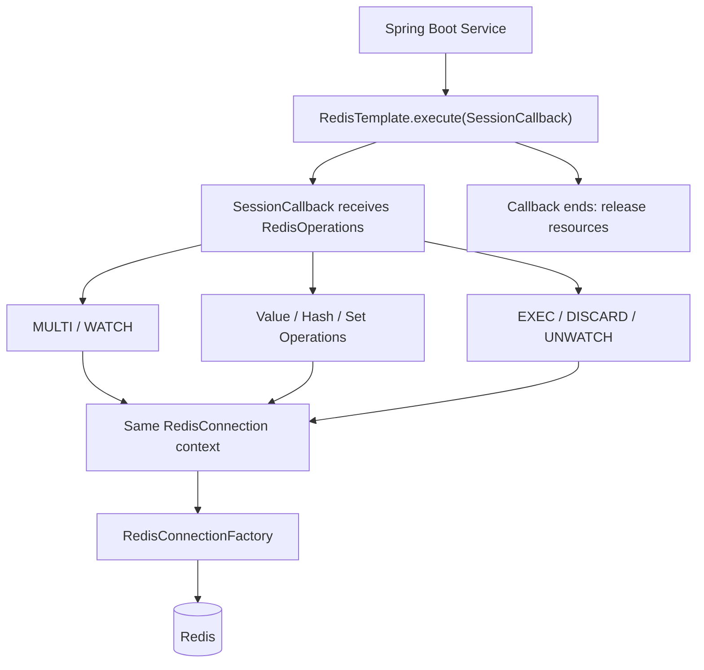
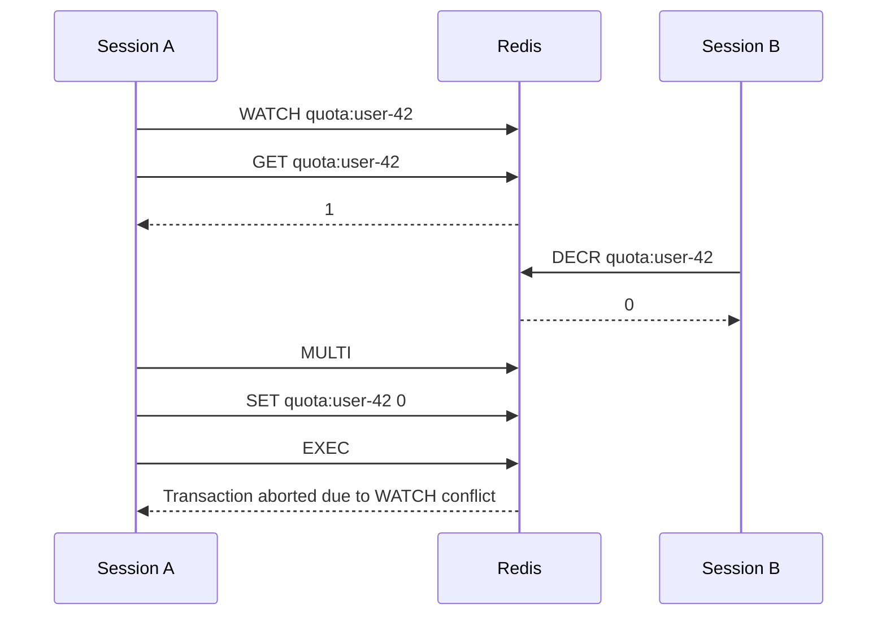

# Using SessionCallback to Keep Operations in the Same Connection Session

## 1. The Problem: Do Multiple Redis Commands Need the Same Connection?

In a Spring Boot application, reading or writing a Redis key usually requires only a single call:

```java
String status = redisTemplate.opsForValue().get("jobs:status:v1:42");
redisTemplate.opsForValue().set("jobs:status:v1:42", "RUNNING");
```

For independent calls, `RedisTemplate` can borrow a connection from `RedisConnectionFactory` to perform each operation and then release resources under Spring Data Redis's management mechanism. This works well when operations do not need to share **connection state**.

However, several Redis capabilities tie state directly to a connection:

- **`MULTI` / `EXEC`:** commands after `MULTI` are queued on the current connection; `EXEC` executes the command queue of that specific connection.
- **`WATCH`:** Redis tracks changes to one or more keys for a transaction on the connection that issued `WATCH`.
- **Pipelining:** the client sends a sequence of commands within a connection context and collects the corresponding replies, typically in a batch.

If `MULTI` runs on connection A, `SET` uses connection B, and `EXEC` uses connection C, the intended transaction cannot form. Redis has no way to know those connections came from the same Java method.

**`SessionCallback<T>`** is the Spring Data Redis API that executes multiple `RedisOperations` calls within **the same logical connection session**, with lifecycle managed by `RedisTemplate`. It is an essential tool when using Redis transactions, `WATCH`, or command sequences requiring a shared connection.



This means **the same connection context for the duration of the callback execution**, not a promise that a `SessionCallback` object permanently pins a dedicated TCP socket or that all Java operations inside automatically become atomic.

## 2. Understanding RedisTemplate, RedisOperations, and SessionCallback

`RedisTemplate<K,V>` is the standard synchronous Redis access class in Spring Data Redis. `StringRedisTemplate` is the string-focused variant, convenient for text keys and values. Both implement the `RedisOperations<K,V>` contract with methods such as `opsForValue()`, `opsForHash()`, `multi()`, `exec()`, `watch()`, and `discard()`.

The callback interface has the shape:

```java
public interface SessionCallback<T> {
    T execute(RedisOperations operations) throws DataAccessException;
}
```

*This is a simplified signature to highlight the callback's role; exact generics and APIs depend on the Spring Data Redis version.*

When calling:

```java
T result = redisTemplate.execute(sessionCallback);
```

Spring Data Redis prepares a session scope, passes the `RedisOperations` object into the callback, lets operations in that scope share the appropriate connection, and then cleans up bindings and releases resources when the callback finishes.

| Component | Responsibility | Key reminder |
|---|---|---|
| `RedisTemplate` / `StringRedisTemplate` | Command API, serializers, and connections per Spring Data Redis contract | Normally a shared singleton bean after configuration |
| `RedisConnectionFactory` | Supplies connections for the Lettuce/Jedis driver | Works with connection pools / shared native connections per configuration |
| `SessionCallback<T>` | Defines the scope of operations sharing a session | Callback receives `RedisOperations` to invoke multiple commands |
| `RedisOperations` inside callback | Sends Redis commands for the current session | Use the provided object for the entire sequence needing a shared connection |
| Redis server | Stores connection-specific state for transactions and WATCH | Server follows the Redis protocol; unaware of external Spring transactions |

### What SessionCallback **Does** and **Does Not** Do

`SessionCallback` **does**:

1. Allow multiple template calls to pass through the same appropriate connection session.
2. Provide the scope for `WATCH`, `MULTI`, queued commands, and `EXEC`/`DISCARD`.
3. Reuse `RedisTemplate`'s serializers, exception translation, and connection management.
4. Clean up the resource scope once `execute(...)` finishes, even if the callback throws an exception (via framework cleanup).

`SessionCallback` **does not automatically**:

- Call `MULTI` or start a Redis transaction.
- Guarantee relational-database-style rollback of all commands.
- Create a distributed lock protecting keys from other requests.
- Batch commands into a pipeline unless a pipeline API is invoked.
- Create an ACID transaction spanning PostgreSQL and Redis.
- Preserve the session across `@Async`, another thread, or separate `execute(...)` calls.

Keeping this distinction clear prevents a common bug: wrapping commands in a callback and assuming they have become **one atomic operation**.

## 3. Basic Example: A Redis Transaction Inside SessionCallback

Suppose when starting a job, the application wants to record the `RUNNING` state and increment a counter of started jobs. This is an example of two Redis operations to queue and execute in a Redis transaction.

```java
import java.util.List;

import org.springframework.dao.DataAccessException;
import org.springframework.data.redis.core.RedisOperations;
import org.springframework.data.redis.core.SessionCallback;
import org.springframework.data.redis.core.StringRedisTemplate;
import org.springframework.stereotype.Service;

@Service
public class JobStartStore {

    private final StringRedisTemplate redis;

    public JobStartStore(StringRedisTemplate redis) {
        this.redis = redis;
    }

    public List<Object> markStarted(String jobId) {
        String stateKey = "jobs:state:v1:" + jobId;
        String counterKey = "jobs:started:total:v1";

        return redis.execute(new SessionCallback<List<Object>>() {
            @Override
            @SuppressWarnings({"rawtypes", "unchecked"})
            public List<Object> execute(RedisOperations operations)
                    throws DataAccessException {

                operations.multi();
                try {
                    operations.opsForValue()
                            .set(stateKey, "RUNNING");
                    operations.opsForValue()
                            .increment(counterKey);

                    return operations.exec();
                } catch (RuntimeException failure) {
                    // Best effort: discard the queue if MULTI is still open.
                    try {
                        operations.discard();
                    } catch (RuntimeException cleanupFailure) {
                        failure.addSuppressed(cleanupFailure);
                    }
                    throw failure;
                }
            }
        });
    }
}
```

During normal execution, the command flow is essentially:

```text
Connection A:
    MULTI
    SET jobs:state:v1:job-42 RUNNING      -> QUEUED
    INCR jobs:started:total:v1          -> QUEUED
    EXEC                               -> [SET result, INCR result]

SessionCallback ends -> Spring releases the connection context
```

Each step has a distinct role:

1. `redis.execute(callback)` opens an operational session scope.
2. The callback **must use the received `operations`** for `multi()`, write commands, and `exec()`.
3. `multi()` switches the connection into Redis command-queuing mode.
4. `set` and `increment` are queued; the application cannot treat their immediate return values as actual execution results.
5. `exec()` instructs Redis to execute the transaction; the list of results is returned upon completion.
6. If an exception occurs before closing the transaction, the callback attempts `discard()` to clear the queue. If the connection drops or `EXEC` reached the server but the reply was lost, `discard()` cannot undo changes that already occurred.

**Atomicity scope of `EXEC`:** Redis prevents commands from other clients from interleaving between commands executed inside the same transaction, but Redis does not provide RDBMS-style rollback when an already-executed command succeeds and a subsequent command hits a runtime error. If either key holds financial or authoritative data, evaluate durability and business transaction requirements separately.

### Note: With Redis Cluster

Multi-key transactions like `stateKey` and `counterKey` in the example must satisfy Redis Cluster multi-key constraints. Two arbitrary keys usually do not share a hash slot, so this example illustrates standalone Redis or configurations where Redis permits the commands; in Cluster, design keys to share a slot if a multi-key transaction is needed. Only apply hash tags when they fit data distribution, as funneling too many hot keys into one slot skews load.

## 4. Why Must You Use the RedisOperations Passed to the Callback?

Compare these two styles:

```java
redis.execute(new SessionCallback<List<Object>>() {
    @Override
    @SuppressWarnings({"rawtypes", "unchecked"})
    public List<Object> execute(RedisOperations operations) {
        operations.multi();
        operations.opsForValue().set("job:42", "RUNNING");
        return operations.exec();
    }
});
```

This is the right approach: every command belonging to the transaction uses the session's `operations`.

Conversely, the following causes subtle bugs:

```java
redis.execute(new SessionCallback<List<Object>>() {
    @Override
    @SuppressWarnings({"rawtypes", "unchecked"})
    public List<Object> execute(RedisOperations operations) {
        operations.multi();

        // Do not arbitrarily mix another template/factory/client:
        anotherRedisTemplate.opsForValue()
                .set("job:42", "RUNNING");

        return operations.exec();
    }
});
```

`anotherRedisTemplate` may use a different factory, different serializer, different Redis endpoint, or a different connection. That `SET` command will not necessarily be part of the transaction opened by `operations.multi()`.

A practical rule is to **pass every Redis operation belonging to the same session through the provided `operations` object**. If you call a helper method, pass `RedisOperations` to that helper rather than letting it resolve another template or connection.

```java
@SuppressWarnings({"rawtypes", "unchecked"})
private void enqueueJobCommands(
        RedisOperations operations, String stateKey) {
    operations.opsForValue().set(stateKey, "RUNNING");
    operations.opsForValue().increment("jobs:started:total:v1");
}
```

The helper does not need to know how the connection was obtained; it participates in the caller-managed session scope. The helper should not call `multi()` or `exec()` itself if the caller already owns the transaction boundary.

## 5. Return Values Inside MULTI and After EXEC

A misconception that causes business bugs is reading the return value of `get()`, `increment()`, or `setIfAbsent()` while the transaction is still queuing:

```java
operations.multi();

Long count = (Long) operations.opsForValue()
        .increment("stats:views:v1");

// count may be null because the command was only queued!
List<Object> result = operations.exec();
```

Once `MULTI` has been called, Redis typically replies `QUEUED` for commands instead of actual values. Spring Data Redis may represent those temporary Operations return values as `null`. You must read results from **`exec()`** after Redis executes the commands.

```text
Before MULTI:  INCR counter   -> Long (e.g. 15)
Inside MULTI:  INCR counter   -> QUEUED / API typically returns null
After EXEC:    result list    -> numeric value after increment
```

**Result ordering:** the list from `exec()` reflects the order of queued commands, though exact Java types depend on the command, serializers, and how Spring Data Redis converts results. Do not hard-code casts of every list element to `String` or `Long` without knowing each command's data contract.

With `WATCH`, `EXEC` can be aborted if a watched key changed; the application must check for transaction abortion, typically represented by `null` from the transaction API in that context. Distinguish **optimistic locking aborts** from **connection exceptions** and **failed command results**.

## 6. Using WATCH in the Same Session for Conditional Updates

`WATCH` is especially important because key-watching state exists **before `MULTI`** and remains attached to the connection. Suppose two requests attempt to deduct from the same temporary quota:



If A read through a different connection not tracked by `WATCH`, the application-side check would lose its protection. Therefore, the entire sequence **WATCH → read value → MULTI → write → EXEC** must use the same connection session.

An illustrative example with conflict handling:

```java
import java.util.List;
import org.springframework.data.redis.core.RedisOperations;
import org.springframework.data.redis.core.SessionCallback;

public enum QuotaResult {
    USED, EXHAUSTED, CONFLICT
}

public QuotaResult consumeOneQuota(String userId) {
    String key = "quota:remaining:v1:" + userId;

    return redis.execute(new SessionCallback<QuotaResult>() {
        @Override
        @SuppressWarnings({"rawtypes", "unchecked"})
        public QuotaResult execute(RedisOperations operations) {
            boolean multiOpened = false;
            operations.watch(key);

            try {
                String raw = (String) operations
                        .opsForValue().get(key);

                long remaining =
                        raw == null ? 0 : Long.parseLong(raw);

                if (remaining <= 0) {
                    operations.unwatch();
                    return QuotaResult.EXHAUSTED;
                }

                operations.multi();
                multiOpened = true;

                operations.opsForValue()
                        .set(key, Long.toString(remaining - 1));

                List<Object> result = operations.exec();
                multiOpened = false;

                return result == null
                        ? QuotaResult.CONFLICT
                        : QuotaResult.USED;
            } catch (RuntimeException failure) {
                try {
                    if (multiOpened) {
                        operations.discard();
                    } else {
                        operations.unwatch();
                    }
                } catch (RuntimeException cleanupFailure) {
                    failure.addSuppressed(cleanupFailure);
                }
                throw failure;
            }
        }
    });
}
```

This example illustrates a quota held in Redis; it does not imply Redis guarantees durability suited for financial transactions. It also uses `SET` for the new value; if the key must keep an existing TTL, design TTL preservation (or use another atomic update mechanism) as required. A plain `SET` can wipe out an existing TTL.

**Two distinct outcomes:**

- `EXHAUSTED`: the read value is insufficient; the application explicitly calls `UNWATCH` and skips writing.
- `CONFLICT`: `EXEC` did not run because the key changed after `WATCH`. You can retry using **a new session**, re-reading the data and bounding the retry count.

Under very high contention, a built-in atomic Redis command or a Lua script may fit better than looping `WATCH`/`MULTI`/`EXEC`. Choose based on the update condition and measure conflict rates. Never retry infinitely inside a callback.

## 7. SessionCallback Does Not Replace Atomic Commands

Consider a page view counter:

```java
// Redis INCR already increments atomically on a single key:
Long count = redis.opsForValue()
        .increment("page:views:v1:42");
```

If you only need to increment a counter, there is no need to write a `SessionCallback` with a transaction because `INCR` already provides the required semantics. Similarly, `SET key value NX EX ...` fits creating a key if absent with a TTL; Spring Data Redis provides overloads like `setIfAbsent(key, value, Duration)`.

`SessionCallback` is useful when **operations must share a connection**, while atomicity comes from **Redis commands** or **`MULTI/EXEC`**, not from the callback itself.

An unsafe example:

```java
redis.execute(new SessionCallback<Void>() {
    @Override
    @SuppressWarnings({"rawtypes", "unchecked"})
    public Void execute(RedisOperations operations) {
        String oldValue = (String)
                operations.opsForValue().get("counter:v1");
        long next = Long.parseLong(oldValue) + 1;
        operations.opsForValue().set(
                "counter:v1", Long.toString(next));
        return null;
    }
});
```

Two different clients can still interleave commands between `GET` and `SET` because the callback holds no exclusive lock on the key. Without `WATCH` or another atomic mechanism, updates can be lost. For numeric counters, simply using `increment` is both simpler and safer.

## 8. How Do SessionCallback and RedisCallback Differ?

Spring Data Redis has two callbacks whose names are often confused:

| Criterion | `RedisCallback<T>` | `SessionCallback<T>` |
|---|---|---|
| Callback parameter | `RedisConnection` | `RedisOperations` |
| API layer | Low-level Redis commands, usually working with `byte[]` | Java-typed Operations groups with template serializers |
| Typical purpose | Calling low-level commands not conveniently exposed on template | Multi-step RedisTemplate sequences requiring a shared session |
| Serialization | Caller usually encodes/decodes bytes manually on low-level APIs | Template applies configured serializers |
| Connection management | Template supplies connection and releases after callback | Template manages session binding and releases after callback |
| `MULTI/EXEC` transactions | Can call directly on the same `RedisConnection` | Can invoke `operations.multi()/exec()` for template commands |
| Usage | When low-level connection APIs are truly required | Preferred for multi-step RedisOperations logic |

`RedisCallback` example:

```java
import java.nio.charset.StandardCharsets;
import org.springframework.data.redis.core.RedisCallback;

String key = "feature:flag:v1";

byte[] rawValue = redis.execute(
        (RedisCallback<byte[]>) connection -> {
            byte[] rawKey = key.getBytes(StandardCharsets.UTF_8);
            return connection.stringCommands().get(rawKey);
        });
```

The code converts the key to `byte[]` manually because it operates at the low level. If the template's key serializer is not UTF-8, this direct byte conversion may fail to read data written by `opsForValue()`. And **never close `connection` manually inside the callback**; it is provided and managed by the template.

With `SessionCallback`, code uses the high-level API without manual serialization:

```java
String result = redis.execute(new SessionCallback<String>() {
    @Override
    @SuppressWarnings({"rawtypes", "unchecked"})
    public String execute(RedisOperations operations) {
        return (String) operations.opsForValue().get(key);
    }
});
```

This single-command example only illustrates the API difference; in practice, calling `redis.opsForValue().get(key)` directly is cleaner and needs no `SessionCallback`.

## 9. Using SessionCallback with Pipelining: Same Session, Different Goal

**Pipelining** sends multiple commands without waiting for each command's reply before sending the next, reducing network round-trips for batches of independent commands.

```text
Without pipeline:
  SET k1 -> wait for reply
  SET k2 -> wait for reply
  SET k3 -> wait for reply

Pipeline:
  send SET k1, SET k2, SET k3
  then collect corresponding replies
```

Spring Data Redis provides `executePipelined(SessionCallback<?>)`. This combines `SessionCallback` with a command-processing mode explicitly opened and closed by the template:

```java
import java.util.List;
import java.time.Duration;
import org.springframework.data.redis.core.RedisOperations;
import org.springframework.data.redis.core.SessionCallback;

public List<Object> storeBatch(List<String> jobIds) {
    return redis.executePipelined(new SessionCallback<Object>() {
        @Override
        @SuppressWarnings({"rawtypes", "unchecked"})
        public Object execute(RedisOperations operations) {
            for (String jobId : jobIds) {
                operations.opsForValue().set(
                        "jobs:state:v1:" + jobId,
                        "QUEUED",
                        Duration.ofMinutes(20));
            }
            return null;
        }
    });
}
```

Important points:

1. `executePipelined` manages opening, flushing, and closing the pipeline via the template.
2. The pipeline callback **must return `null`**; command results are returned in `List<Object>` from `executePipelined` once the pipeline finishes.
3. Do not inspect `Boolean` or return values of `set/get/increment` inside the callback for branching, because pipelined calls typically have no final result yet.
4. **Pipelining does not automatically create a Redis transaction**. Commands already executed before an error do not roll back.
5. Cap command counts and total response size per batch; oversized pipelines pressure client and server buffers and RAM.

`SessionCallback` packages a sequence of same-session operations, while `executePipelined` is the template API enabling **pipeline mode**. A `SessionCallback` invoked via ordinary `redis.execute(...)` does not use pipelining merely because it executes multiple commands.

### Comparing Transactions and Pipelines

| Feature | `MULTI/EXEC` in SessionCallback | `executePipelined(SessionCallback)` |
|---|---|---|
| Goal | Execute a group of commands without interleaving other clients | Reduce network round-trips across multiple commands |
| Same connection | Required | Required |
| Intermediate commands | Queued until `EXEC` | Sent/buffered to collect replies in batch |
| When results arrive | After `exec()` | After `executePipelined()` |
| Group atomicity | Redis transaction atomic execution semantics; no RDBMS rollback | No |
| Optimistic conflict handling | Can combine with `WATCH` | Not handled automatically |
| Suited for | Updating related keys within Redis limits | Cache warming, large independent updates |

Transactions and pipelines can sometimes be combined, though result nesting and reply ordering are more complex; avoid mixing them unless you have verified your Spring Data Redis API contract and Redis environment limits.

## 10. Spring `@Transactional` and SessionCallback

Two distinct kinds of transactions are often loosely called "transactions":

- **Redis transaction:** a single connection issuing `MULTI`, queuing commands, and running `EXEC` or `DISCARD`.
- **Spring-managed transaction:** coordinated by `PlatformTransactionManager`, typically a database transaction when using JPA/JDBC.

Simply placing `@Transactional` on a service method **does not by default** wrap `RedisTemplate` calls into Redis `MULTI/EXEC`.

Spring Data Redis offers optional synchronization with the active transaction, e.g. via template configuration:

```java
import org.springframework.context.annotation.Bean;
import org.springframework.context.annotation.Configuration;
import org.springframework.data.redis.connection.RedisConnectionFactory;
import org.springframework.data.redis.core.StringRedisTemplate;

@Configuration
class RedisTransactionSupportConfiguration {
    @Bean
    StringRedisTemplate transactionAwareStringRedisTemplate(
            RedisConnectionFactory connectionFactory) {
        StringRedisTemplate template =
                new StringRedisTemplate(connectionFactory);
        template.setEnableTransactionSupport(true);
        return template;
    }
}
```

When a Spring transaction is active, a template with transaction support enabled can bind a Redis connection to the running thread and synchronize Redis operations with that transaction's lifecycle. **This differs from manually calling `multi/exec` in a `SessionCallback`**:

| Question | SessionCallback + `multi/exec` | Spring transaction support |
|---|---|---|
| Who opens/closes the Redis transaction? | Callback invokes explicitly | Integrated via configured transaction synchronization |
| Requires Spring `@Transactional`? | No | Typically requires an active Spring transaction |
| Connection scope | Callback scope | Transaction/thread context |
| Reads after queued writes | Do not immediately see queued writes | May execute on another connection since writes are queued |
| Do SQL and Redis commit with joint ACID? | No | Still no |

**Do not arbitrarily mix both transaction models** on the same template within a single method. For instance, calling `multi()` manually on a template already participating in a Spring transaction can yield unpredictable behavior if a transaction is already managed at another layer. Choose one clear management model per workflow and keep data boundaries explicit.

### Why Is There No Atomic SQL + Redis Commit?

Consider an application updating an order in PostgreSQL and then updating a Redis cache:

```java
@Transactional
public void completeOrder(String orderId) {
    orderRepository.complete(orderId);
    redisTemplate.opsForValue().set(
            "orders:state:v1:" + orderId,
            "COMPLETED");
}
```

Even with Redis transaction support enabled, **this does not form an ACID distributed transaction between PostgreSQL and Redis**. The DB commit can succeed while Redis drops the network at commit time, or another side effect can fall out of sync.

For authoritative business data, keep the source of truth in a transactional store suited to it; use Redis for caches or derived state. When post-commit synchronization is needed, consider cache invalidation, transactional outbox, idempotent retries, or application-appropriate consistency mechanisms.

## 11. Connection Lifecycle, Pooling, and Resources

Inside `RedisTemplate.execute(SessionCallback)`, **the template owns acquiring and releasing the connection**. Code inside the callback must never grab the framework's connection to close it manually or keep a reference after the callback returns.

Common usage patterns:

| Operation type | Connection source | Who releases? |
|---|---|---|
| `redis.opsForValue().get(key)` | Template/factory | Template |
| `redis.execute(SessionCallback)` | Template, preserving session scope | Template after callback |
| `redis.execute(RedisCallback)` | Template supplies `RedisConnection` | Template after callback |
| `redis.executePipelined(...)` | Template opens pipeline | Template after pipeline |
| Direct `connectionFactory.getConnection()` | Acquired by app code | App code must close/return per contract |
| Direct native Lettuce/Jedis connection | Specific client API | Per client/pool contract |

Example **only for code that manually acquired a connection**:

```java
import org.springframework.data.redis.connection.RedisConnection;

try (RedisConnection connection = connectionFactory.getConnection()) {
    // Low-level operations strictly inside this scope.
    // The caller that obtained the connection is responsible for closing/returning it.
}
```

Do not put `connection.close()` inside a `RedisCallback`, and never close a shared native Lettuce connection managed by `LettuceConnectionFactory`. `RedisConnection.close()` may return a wrapper/connection to the factory or pool rather than immediately closing a TCP socket.

### 11.1. How Do Lettuce and Jedis Affect This?

Lettuce typically uses Netty, allowing a shared native connection for ordinary independent commands; however, transactions, blocking commands, and stateful connections require dedicated scoping. Classic Jedis typically borrows a connection from a pool to serve concurrent threads. Spring Data Redis hides most of these details behind `RedisConnectionFactory` and templates.

**A Spring Data Redis `RedisConnection` wrapper should never be shared arbitrarily across threads**, even when the underlying native driver supports sharing. `SessionCallback` keeps synchronous operations cleanly scoped to the call site rather than exposing a global connection object.

### 11.2. Keep Sessions as Short as Possible

A common mistake:

```java
redis.execute(new SessionCallback<Void>() {
    @Override
    @SuppressWarnings({"rawtypes", "unchecked"})
    public Void execute(RedisOperations operations) {
        operations.watch("job:state:v1:42");

        // Illustrates what to avoid:
        slowRemotePaymentRequest(); // May take several seconds!

        operations.multi();
        operations.opsForValue().set("job:state:v1:42", "DONE");
        operations.exec();
        return null;
    }
});
```

This snippet holds the session/`WATCH` while calling an external system. When many requests do this, connections stay tied up, pools exhaust, `WATCH` conflicts spike, and timeouts occur.

A better structure: prepare data, invoke external systems, and evaluate preconditions before opening the Redis session; once the session opens, perform only the Redis commands needing a shared connection and finish immediately with `EXEC`/`DISCARD`/`UNWATCH`.

With payment workflows, external calls can also produce non-rollbackable side effects, requiring an idempotent workflow backed by an authoritative state store; Redis transactions do not manage that.

## 12. Concurrency Across Threads: SessionCallback Is Not Asynchronous

In the synchronous model, Spring Data Redis session binding attaches to the calling thread's context. Never spawn a `CompletableFuture`, `@Async` call, or new thread inside a callback and assume commands on that thread use the same Redis connection.

```java
redis.execute(new SessionCallback<Void>() {
    @Override
    @SuppressWarnings({"rawtypes", "unchecked"})
    public Void execute(RedisOperations operations) {
        operations.multi();

        // Do not do this to send commands belonging to the transaction:
        CompletableFuture.runAsync(() ->
                anotherRedisTemplate.opsForValue()
                        .set("job:state:v1:42", "RUNNING"));

        operations.exec();
        return null;
    }
});
```

In this snippet, the callback can finish before the async task runs on another thread, and that task may also use a different connection. It is not protected as part of the Redis transaction.

**If your application uses WebFlux/reactive**, use `ReactiveRedisTemplate`/`ReactiveStringRedisTemplate` and the corresponding reactive connection/transaction APIs. Never take a synchronous `SessionCallback` and call `block()` on the event loop. Reactive APIs return publishers (`Mono`/`Flux`) and manage execution contexts differently from synchronous callbacks.

## 13. Common Errors and How to Diagnose Them

| Symptom | Possible cause | Resolution |
|---|---|---|
| `EXEC` returns empty or misses expected commands | `MULTI` and commands ran on different connections/contexts | Wrap `multi`, commands, and `exec` inside one `SessionCallback` using the callback's `operations` |
| `increment` result inside transaction is `null` | Command is still in `QUEUED` state | Read results after `exec()` |
| `EXEC` unexpectedly aborts | `WATCH` detected a modified key | Distinguish conflict from connection errors; retry with a cap in a new session |
| Transaction left dangling on exception | Callback exited after `MULTI` without `EXEC`/`DISCARD` | Best-effort cleanup and resource release; inspect connection state on error |
| Redis requests slow despite low server load | Sessions holding connections too long or pool exhaustion | Measure pool wait times, callback duration; move non-Redis I/O outside sessions |
| GET then SET in SessionCallback still loses updates | Callback holds a connection, not a Redis key lock | Use atomic commands, `WATCH`, or conditional scripts |
| `SessionCallback` does not run reactively | Synchronous, thread-scoped API | Use `ReactiveRedisTemplate` in reactive applications |
| Timeout after `EXEC` leaves outcome uncertain | Server may have executed while reply was lost | Ensure idempotent operations / operation IDs; do not blindly retry |
| Calling `DISCARD` without `MULTI` | Cleanup mismatched with transaction state | Only discard when a transaction may still be open; handle cleanup exceptions |
| Java values fail to decode as expected | Template key/value serializers differ from written data | Use consistent serializers and key schemas; review the data contract |

### Why a Timeout Error Does Not Prove Redis Did Not Execute

The application can send `EXEC` to Redis, Redis executes it, and the connection drops before the reply arrives. The caller receives an exception even though the data may already have changed. Retrying the entire transaction containing a non-idempotent `INCR` risks incrementing twice.

Solutions must start from **business semantics**: record operation IDs, execute commands only if unprocessed, use an atomic check-and-set script, or reconcile against the source of truth. `SessionCallback` cannot by itself distinguish "executed / not executed" after a network failure.

## 14. Rules for Writing Readable, Maintainable Callbacks

A well-written callback should:

1. **Have one clear purpose:** e.g., "deduct quota if available" or "record state and counter."
2. **Stay short-lived:** run the required Redis commands and finish promptly.
3. **Use the provided `operations`** for every command in the same session.
4. **Keep transaction boundaries explicit:** `WATCH` if needed, `MULTI`, queued commands, `EXEC`, or `DISCARD`/`UNWATCH` on error paths.
5. **Never branch on queued command returns** while inside `MULTI`.
6. **Return meaningful domain outcomes:** distinguish success, conflict, insufficient data, and system errors.
7. **Avoid non-Redis work:** no HTTP calls, user waits, or heavy CPU work while a session is open.
8. **Never switch threads mid-session** when using synchronous APIs.
9. **Bound retries:** especially for `WATCH` conflicts or network errors.
10. **Separate adapters from business logic:** expose domain-oriented methods to services so callers never deal with `MULTI`, serializers, or key schemas.

Example adapter exposing only a business API:

```java
@Repository
public class RateQuotaRedisStore {
    private final StringRedisTemplate redis;

    public RateQuotaRedisStore(StringRedisTemplate redis) {
        this.redis = redis;
    }

    public QuotaResult consume(String subjectId) {
        // Implements SessionCallback WATCH/MULTI/EXEC
        // like the example in section 6, mapping to QuotaResult.
        return consumeOneQuota(subjectId);
    }
}
```

*The snippet above is a class outline*: `consumeOneQuota` represents the implementation from the earlier example; in a real project, place that method inside the appropriate class with all dependencies, key scopes, parsing error handling, and TTLs properly addressed.

### Choosing Clean Key Structures

Examples:

```text
jobs:{job-42}:state:v1
jobs:{job-42}:attempts:v1
quota:remaining:v1:user-42
```

Keys sharing the `{job-42}` hash tag are routed by Redis Cluster to the same slot, useful when multi-key transactions are needed within a single job. Avoid putting all keys of all jobs under one shared tag, which easily creates hotspots.

Choose clear namespaces, schema versions, and stable IDs; avoid embedding tokens, personal data, or secrets directly in keys. `SessionCallback` does not alter how Redis keys are serialized; the template still applies its configured serializers.

## 15. When to Choose SessionCallback vs. Other Approaches

| Requirement | Appropriate tool | Reason |
|---|---|---|
| Reading a single key | `opsForValue().get(key)` | No multi-command session needed |
| Atomic counter increment | `opsForValue().increment(key)` | Redis `INCR` is atomic for a single key |
| Writing multiple commands that need `MULTI/EXEC` | `execute(SessionCallback)` | Keeps the transaction command queue on one connection |
| Read-check-write only if data unchanged | `SessionCallback` with `WATCH/MULTI/EXEC` | Needs the same connection from `WATCH` through `EXEC` |
| Loading many independent cache keys with high throughput | `executePipelined(SessionCallback)` | Reduces round-trips; atomic transaction not required |
| Working directly with raw bytes/low-level commands | `RedisCallback` | Direct access to `RedisConnection` |
| Complex atomic conditional update with minimal round-trips | Redis Lua script or suitable built-in command | Can be simpler than `WATCH` with retries |
| Updating business data in SQL and Redis cache | DB transaction + post-commit sync/cache invalidation | No default ACID distributed commit |
| Fully reactive WebFlux pipeline | `ReactiveRedisTemplate` and reactive transaction/session APIs | Avoids blocking the event loop |

## 16. Conclusion

`SessionCallback` is Spring Data Redis's explicit way to express that **a group of `RedisOperations` calls requires the same connection context**. This is especially critical because `MULTI`, `EXEC`, and `WATCH` are stateful commands bound to a Redis connection.

When using it:

- Call `redisTemplate.execute(new SessionCallback<...>() { ... })`.
- Execute **all session commands through the `RedisOperations operations`** passed into the callback.
- If a Redis transaction is needed, explicitly manage `MULTI`, queued commands, and `EXEC`/`DISCARD` within the callback.
- If optimistic locking is needed, start with `WATCH` on the same connection, read and decide before `MULTI`, and handle conflicts when `EXEC` aborts.
- If the goal is reducing round-trips, use `executePipelined` and remember pipelining does not automatically provide atomicity.
- Let the template manage resource lifecycles, keep callbacks short, and design controlled error and retry paths.

Keeping operations in **the same connection session** satisfies a crucial technical prerequisite, while overall business correctness also depends on choosing atomic commands, managing concurrency, TTLs, serializers, Redis persistence, and resilient handling of network disconnects.
