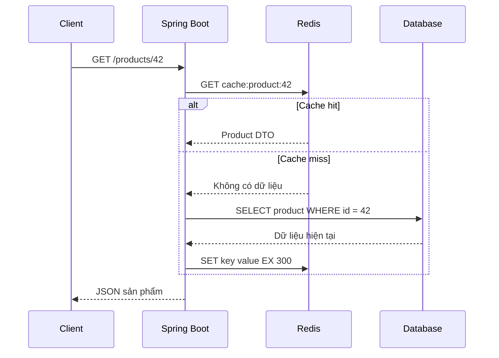
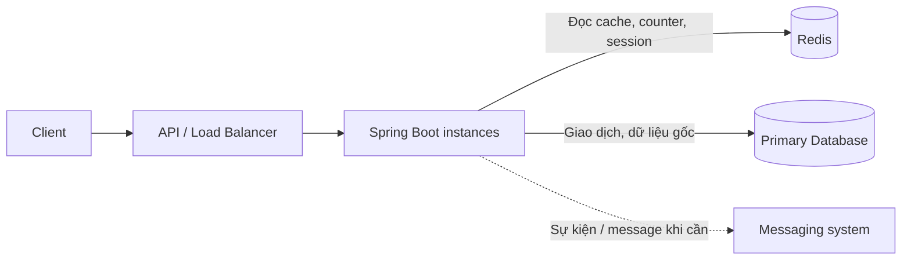

# Redis là gì và vai trò trong kiến trúc ứng dụng

Redis là một **kho dữ liệu có cấu trúc chạy chủ yếu trên bộ nhớ (in-memory data store)**. Ứng dụng giao tiếp với Redis qua mạng, lưu dữ liệu dưới dạng **key → value** và sử dụng các lệnh chuyên biệt cho từng kiểu dữ liệu. Redis thường được dùng làm **bộ nhớ đệm (cache)**, nhưng còn hỗ trợ bộ đếm, phiên đăng nhập, bảng xếp hạng, giới hạn lưu lượng, truyền sự kiện và một số dạng phối hợp giữa nhiều tiến trình.

Trong hệ sinh thái Java, **Spring Data Redis** cung cấp cách truy cập Redis từ ứng dụng Spring qua các abstraction như `RedisTemplate`, `StringRedisTemplate`, repository và API reactive. Spring Cache hoặc Spring Session có thể dùng Redis làm hạ tầng lưu trữ cho nhu cầu tương ứng. Hiểu Redis trước khi chọn API Spring giúp thiết kế đúng vòng đời dữ liệu và xử lý sự cố chính xác.

## 1. Vì sao ứng dụng cần Redis?

Hãy xét một hệ thống bán hàng có nhiều người cùng xem thông tin sản phẩm. Dữ liệu sản phẩm nằm trong cơ sở dữ liệu quan hệ vì hệ thống cần giao dịch, ràng buộc và cập nhật đáng tin cậy. Tuy nhiên, mỗi lượt xem trang đều truy vấn tên, giá, mô tả của cùng một sản phẩm:

1. Client gửi yêu cầu lấy sản phẩm `42`.
2. Backend gọi cơ sở dữ liệu, đọc bản ghi rồi trả kết quả.
3. Hàng nghìn yêu cầu tương tự lặp lại dù dữ liệu sản phẩm hiếm khi thay đổi.
4. Cơ sở dữ liệu phải xử lý nhiều truy vấn giống nhau và cạnh tranh tài nguyên với các truy vấn quan trọng khác.

Đặt Redis ở giữa tầng ứng dụng và cơ sở dữ liệu có thể giảm tải:

```text
Không có cache:
Client → Spring Boot → Database → Spring Boot → Client

Có cache:
Client → Spring Boot → Redis (cache hit) → Client
                     └→ Database (cache miss) → ghi Redis → Client
```

Redis thường cho thời gian truy cập rất thấp nhờ lưu phần lớn tập dữ liệu đang thao tác trong RAM và hỗ trợ các thao tác dữ liệu trực tiếp. Tuy vậy, kết quả thực tế còn phụ thuộc vào độ trễ mạng, kích thước payload, cách tuần tự hóa, tải hệ thống và cấu hình. **Redis không biến mọi thao tác thành “miễn phí” và không tự động làm ứng dụng nhanh nếu cách dùng cache không phù hợp.**

Một phân biệt quan trọng:

- **Database chính** quản lý dữ liệu nghiệp vụ cần độ bền và tính nhất quán theo yêu cầu của hệ thống.
- **Redis cache** giữ bản sao dữ liệu có thể tái tạo để phục vụ nhanh hơn; việc mất cache thường chỉ làm tăng tải hoặc độ trễ.
- **Redis làm nơi lưu dữ liệu chính** cũng là khả năng có thật, nhưng đòi hỏi thiết kế riêng về persistence, sao lưu, phục hồi, replication và giới hạn nhất quán. Không nên mặc định dữ liệu trong Redis luôn có thể bỏ đi.

## 2. Redis hoạt động như thế nào?

### 2.1. Mô hình key–value có kiểu dữ liệu

Mỗi khóa là một định danh, chẳng hạn:

```text
cache:product:42
session:9fb2...
counter:article:42
leaderboard:weekly
```

Dấu `:` chỉ là **quy ước đặt tên** để con người và công cụ dễ quản lý; Redis không tự tạo cấu trúc thư mục theo dấu `:`. Giá trị có thể là chuỗi, hash, list, set, sorted set, stream và các cấu trúc khác.

Ví dụ với Redis CLI:

```redis
SET cache:product:42 '{"id":42,"name":"Bút bi"}' EX 120
GET cache:product:42
TTL cache:product:42
DEL cache:product:42
```

- `SET ... EX 120` lưu một chuỗi với thời hạn 120 giây.
- `GET` lấy nội dung nếu khóa vẫn tồn tại.
- `TTL` xem thời gian sống còn lại (hoặc giá trị đặc biệt nếu không có TTL/khóa không tồn tại).
- `DEL` xóa khóa, thường dùng khi cần vô hiệu hóa cache.

Trong ví dụ, JSON là **chuỗi do ứng dụng tự serialize**. Lệnh `GET` không tự hiểu các trường JSON chỉ vì văn bản có dạng JSON. Các khả năng thao tác JSON chuyên biệt có thể đến từ RedisJSON/module hoặc sản phẩm tương ứng, tùy bản phân phối và cấu hình; đó là phạm vi khác với String thông thường.

### 2.2. Các kiểu dữ liệu và bài toán phù hợp

| Kiểu dữ liệu | Ý nghĩa | Ví dụ lệnh | Tình huống |
|---|---|---|---|
| **String** | Chuỗi/byte, số nguyên có thể tăng giảm bằng lệnh chuyên biệt | `SET`, `GET`, `INCR` | Cache JSON, token, bộ đếm |
| **Hash** | Tập các field–value trong một key | `HSET`, `HGET`, `HGETALL` | Thông tin hồ sơ hoặc trạng thái nhỏ |
| **List** | Dãy phần tử theo thứ tự, thao tác ở hai đầu | `LPUSH`, `RPOP`, `LRANGE` | Danh sách công việc đơn giản |
| **Set** | Tập phần tử duy nhất, không có thứ tự hiển thị cố định | `SADD`, `SISMEMBER` | Thành viên nhóm, nhãn |
| **Sorted Set (ZSet)** | Thành viên duy nhất kèm điểm số để sắp thứ tự | `ZADD`, `ZRANGE` | Bảng xếp hạng, top-N |
| **Stream** | Nhật ký các entry có ID, hỗ trợ consumer group | `XADD`, `XREADGROUP`, `XACK` | Xử lý sự kiện/công việc cần theo dõi |
| **Bitmap, HyperLogLog, Geospatial** | Các cách biểu diễn hoặc lệnh phục vụ nhu cầu chuyên biệt | `SETBIT`, `PFADD`, `GEOADD` | Cờ trạng thái, ước lượng số phần tử khác nhau, vị trí |

Một vài ví dụ ngắn:

```redis
INCR counter:article:42
HSET user:7 name "An" tier "premium"
HGETALL user:7
SADD tags:article:42 "java" "redis"
SISMEMBER tags:article:42 "redis"
ZADD leaderboard:weekly 120 user:7
ZREVRANGE leaderboard:weekly 0 9 WITHSCORES
```

Điểm mạnh của Redis không nằm ở việc nhét mọi đối tượng thành một chuỗi lớn, mà ở việc **chọn kiểu dữ liệu và lệnh đúng với thao tác cần thực hiện**. Chẳng hạn, tăng bộ đếm bằng `INCR` thường phù hợp hơn quy trình `GET` → cộng ở Java → `SET`, vốn dễ bị ghi đè khi nhiều request chạy đồng thời.

### 2.3. Tính nguyên tử, TTL và eviction là ba khái niệm khác nhau

**Tính nguyên tử của lệnh:** Một lệnh Redis như `INCR` được thực thi như một thao tác riêng lẻ, nên hai client đồng thời tăng cùng bộ đếm không gặp kiểu lost update của quy trình đọc–sửa–ghi ở phía ứng dụng. Điều này **không** làm cho một chuỗi nhiều lệnh bất kỳ tự động trở thành giao dịch nguyên tử. Đối với logic nhiều bước, cần xem xét các khả năng như Lua script, `MULTI`/`EXEC` hoặc thiết kế lại thao tác, đồng thời hiểu giới hạn của từng cơ chế.

**TTL (time to live):** Thời hạn sống gắn với một key. Khi hết hạn, key được xem là không còn hợp lệ và Redis có cơ chế loại bỏ key hết hạn. TTL đặc biệt hữu ích cho cache, phiên làm việc và dữ liệu tạm thời. TTL **không phải** chính sách nhất quán đủ mạnh để đảm bảo mọi lần đọc luôn phản ánh thay đổi mới nhất của database.

**Eviction (thu hồi bộ nhớ):** Khi Redis đạt giới hạn bộ nhớ được cấu hình (`maxmemory`), chính sách `maxmemory-policy` quyết định có loại bỏ key theo điều kiện phù hợp để nhường chỗ hay từ chối các lệnh cần thêm bộ nhớ. Eviction có thể diễn ra **trước khi TTL kết thúc**; một key không có TTL vẫn có thể bị loại bỏ nếu chính sách áp dụng cho nó.

## 3. Vai trò của Redis trong kiến trúc ứng dụng

### 3.1. Cache cho dữ liệu đọc thường xuyên

Đây là vai trò phổ biến nhất. Redis lưu kết quả truy vấn hoặc tính toán tốn kém: chi tiết sản phẩm, cấu hình dùng chung, danh mục, thống kê ngắn hạn, kết quả tổng hợp.

Một luồng đọc theo mô hình **cache-aside (lazy loading)**:



**Cache hit** là tìm thấy dữ liệu hợp lệ; **cache miss** là không tìm thấy, nên ứng dụng quay về nguồn dữ liệu gốc. Cache hiệu quả khi dữ liệu có tỷ lệ đọc lại cao và việc nạp lại từ nguồn chính có chi phí đáng kể.

Cache không tự đồng bộ với database. Nếu giá sản phẩm được cập nhật, ứng dụng cần quyết định khi nào xóa hoặc ghi lại cache. Đây là lý do thiết kế **cache invalidation** quan trọng không kém việc bật cache.

### 3.2. Lưu session dùng chung giữa nhiều instance

Khi ứng dụng chạy nhiều Spring Boot instance phía sau load balancer, session chỉ lưu trong RAM của từng instance sẽ gây khó khăn nếu request tiếp theo đi sang instance khác.

```text
              ┌── Spring Boot A ──┐
Client → LB ──┤                   ├── Redis (session chung)
              └── Spring Boot B ──┘
```

Nếu hệ thống dùng **server-side session**, có thể lưu session tập trung trên Redis để các instance đọc được cùng trạng thái. Trong Spring, đây là một trường hợp sử dụng của **Spring Session Data Redis**. Redis không bắt buộc đối với ứng dụng xác thực bằng JWT stateless; quyết định phụ thuộc mô hình xác thực, yêu cầu thu hồi phiên và vòng đời session.

Session cần TTL phù hợp, cách xử lý hết hạn rõ ràng và chính sách bảo mật cao hơn cache công khai.

### 3.3. Bộ đếm, rate limiting và chống lạm dụng

Redis hữu ích cho việc đếm sự kiện theo người dùng, API key, địa chỉ mạng hoặc khoảng thời gian. Các thao tác tăng số và gắn TTL cho phép xây dựng nhiều thuật toán giới hạn lưu lượng.

Ví dụ ý tưởng “không quá N request trong một cửa sổ”:

```text
key = rate:user:7:window:<time-bucket>
mỗi request:
  tăng counter của key
  bảo đảm key có TTL
  từ chối nếu vượt ngưỡng
```

Đây chỉ là **mô tả thuật toán**. Nếu chỉ gọi `INCR` rồi `EXPIRE` như hai lệnh độc lập, lỗi giữa hai lệnh có thể tạo counter không có TTL. Ngoài ra, fixed window có thể cho phép dồn request ở ranh giới hai cửa sổ. Hệ thống thật nên chọn thuật toán theo yêu cầu (fixed window, sliding window, token bucket...) và gộp những bước cần nguyên tử, ví dụ bằng Lua script.

### 3.4. Bảng xếp hạng và trạng thái thời gian thực

Sorted Set giữ cặp **member → score**. Cập nhật điểm và lấy top người dùng thường là các thao tác trực tiếp, tránh việc đọc toàn bộ bảng từ database để tự sắp xếp trong ứng dụng.

Redis cũng phù hợp với presence/heartbeat, số người đang trực tuyến hoặc trạng thái tạm thời. Tuy nhiên, ứng dụng phải chấp nhận rằng các tín hiệu presence có thể trễ hoặc mất khi lỗi mạng; không nên diễn giải chúng thành sự thật tuyệt đối.

### 3.5. Truyền thông điệp giữa các dịch vụ

Redis có hai nhóm khả năng dễ bị nhầm:

| Khía cạnh | Pub/Sub | Redis Streams |
|---|---|---|
| Mô hình | Publisher phát, subscriber đang kết nối nhận | Producer thêm entry vào stream, consumer đọc |
| Khi consumer offline | Thông điệp đã phát thường không được giữ cho subscriber vắng mặt | Entry tồn tại cho tới khi bị trim/xóa theo chính sách |
| Theo dõi xử lý | Không có cơ chế ack/replay bền vững trong Pub/Sub cơ bản | Consumer group hỗ trợ pending entry và `XACK` |
| Thường dùng | Thông báo tức thời, tín hiệu không cần replay | Xử lý sự kiện nhẹ, công việc cần quản lý tiến độ |

Streams **không tự mang lại exactly-once processing**. Ứng dụng vẫn cần xử lý lặp, ack, retry, retention, dead-letter strategy và khả năng phục hồi. Với yêu cầu streaming quy mô lớn, phân vùng, retention dài hạn hoặc hợp đồng giao hàng phức tạp, cần đánh giá Kafka/RabbitMQ hay dịch vụ hàng đợi chuyên dụng thay vì mặc định Redis là tương đương.

### 3.6. Phối hợp trạng thái giữa các node

Redis có thể được dùng cho khóa phân tán, cờ trạng thái hoặc idempotency key. Chẳng hạn, lưu dấu một yêu cầu thanh toán đã tiếp nhận giúp giảm nguy cơ xử lý lại.

Nhưng **lệnh `SET key value NX EX ...` một mình chưa đủ để bảo đảm mọi bài toán distributed lock an toàn**. Cần tính đến timeout, chủ sở hữu khóa, xóa khóa có kiểm tra token, lỗi mạng, failover và nguy cơ tác vụ cũ tiếp tục làm việc sau khi lease hết hạn. Với cập nhật tài chính hoặc bất biến nghiệp vụ quan trọng, kiểm tra duy nhất/idempotency trong database và giao dịch của nguồn dữ liệu chính thường vẫn là lớp bảo vệ bắt buộc.

## 4. Redis đứng ở đâu so với database?

Một kiến trúc thường thấy:



Redis và database quan hệ thường **bổ sung** cho nhau. Cơ sở dữ liệu xử lý ràng buộc, truy vấn kết hợp và giao dịch theo nghiệp vụ; Redis phục vụ truy cập nhanh hoặc các cấu trúc dữ liệu đặc thù.

| Bài toán | Lựa chọn thường hợp lý | Lý do |
|---|---|---|
| Danh mục sản phẩm đọc nhiều, sửa ít | Database + Redis cache | Tránh lặp truy vấn, vẫn giữ nguồn dữ liệu chuẩn |
| Chuyển tiền, cập nhật số dư | Database giao dịch là nguồn sự thật | Cần bất biến, kiểm soát đồng thời và khả năng phục hồi |
| Session server-side cho nhiều instance | Redis + Spring Session (nếu cần) | Trạng thái phiên dùng chung, có thời hạn |
| Top 100 người chơi | Redis Sorted Set; database nếu cần lưu lịch sử | Lấy thứ hạng và điểm nhanh |
| Log nghiệp vụ cần tra cứu nhiều năm | Kho log/search/database phù hợp | Redis RAM thường không tối ưu cho lưu trữ dài hạn |
| Thông báo realtime, chấp nhận mất khi offline | Redis Pub/Sub có thể phù hợp | Phát sự kiện nhẹ, tức thời |
| Công việc không được phép bỏ sót hoặc chạy trùng tùy tiện | Hàng đợi bền vững + idempotency, chọn công nghệ theo SLA | Cần retry, giám sát và cơ chế khôi phục rõ ràng |

Không có đáp án chung cho mọi hệ thống. Quyết định phải dựa trên **dữ liệu có thể mất không, có thể tái tạo không, cần nhất quán đến mức nào, cách mở rộng và chi phí vận hành**.

## 5. Các chiến lược cache và đánh đổi

### 5.1. Cache-aside: ứng dụng kiểm soát việc đọc và nạp cache

Ở lần đọc đầu, ứng dụng kiểm tra Redis; nếu miss thì đọc database rồi ghi kết quả vào Redis với TTL. Khi dữ liệu gốc được sửa, ứng dụng thường **xóa key liên quan** để lần đọc tiếp theo nạp lại dữ liệu mới.

Ưu điểm: đơn giản, chỉ cache dữ liệu thực sự được truy cập, dễ bổ sung vào hệ thống hiện có.

Nhược điểm: lần đầu vẫn chậm; cache có thể cũ giữa thời điểm database thay đổi và lúc key bị vô hiệu hóa; nhiều request đồng thời có thể cùng tải dữ liệu khi cache miss.

Ví dụ:

```text
Đọc:
  Redis GET product:42
  ├── có dữ liệu: trả kết quả
  └── không có: đọc database → Redis SET với TTL → trả kết quả

Cập nhật:
  database UPDATE product 42
  sau khi cập nhật được xác nhận: xóa cache product:42
```

**Cẩn thận với giao dịch:** nếu xóa cache trước khi transaction database commit, request khác có thể đọc bản cũ và đưa nó vào cache trở lại. Ngay cả sau commit, đua giữa request đọc và ghi vẫn có thể xảy ra. Với dữ liệu đòi hỏi tính nhất quán cao, cần giải pháp phù hợp hơn như versioned cache key, cơ chế đồng bộ khi cập nhật, xử lý sự kiện sau commit hoặc bỏ cache ở luồng nhạy cảm.

### 5.2. Write-through, write-behind và cache theo thời hạn

- **Write-through:** thay đổi đi qua một lớp có trách nhiệm ghi cả cache lẫn nguồn dữ liệu. Đòi hỏi xác định rõ thứ tự và cách xử lý lỗi; Redis và database không tự hình thành giao dịch phân tán.
- **Write-behind / write-back:** ghi nhanh vào cache, trì hoãn lưu về nguồn chính. Có thể tăng throughput nhưng thêm rủi ro mất dữ liệu, đảo thứ tự và phức tạp khi phục hồi.
- **TTL-only:** để dữ liệu tự hết hạn mà không chủ động invalidate. Dễ triển khai, nhưng chấp nhận cửa sổ dữ liệu cũ tối đa theo TTL và có thể lâu hơn về mặt quan sát nếu có tầng cache khác.

Ví dụ giá niêm yết có thể chấp nhận trễ ngắn trong một số màn hình, nhưng số dư khả dụng trước khi chuyển tiền thì không nên dựa vào cache có thể cũ.

### 5.3. Những tình huống lỗi cache kinh điển

**Cache stampede / thundering herd:** một key “nóng” hết hạn, hàng nghìn request cùng miss rồi truy vấn database. Có thể dùng TTL có độ lệch ngẫu nhiên, preload, stale-while-revalidate theo quy tắc phù hợp, hoặc giới hạn số luồng được nạp lại một key.

**Cache penetration:** yêu cầu liên tục tới ID không tồn tại nên request nào cũng truy vấn database. Cân nhắc cache kết quả “không tồn tại” trong thời gian ngắn, xác thực input, rate limit; phải tránh che khuất dữ liệu vừa được tạo.

**Cache avalanche:** nhiều key cùng hết hạn hoặc Redis gặp sự cố, tải dồn về backend/database. Dùng TTL phân tán, warm-up có kiểm soát, giới hạn concurrency, circuit breaker/fallback và bảo vệ database.

**Hot key:** một key nhận phần lớn truy cập, gây nghẽn nút Redis hoặc đường mạng. Cân nhắc cache cục bộ cấp ứng dụng cho dữ liệu phù hợp, phân tán workload, giảm payload hoặc thay thiết kế key. Thêm node không nhất thiết giải quyết một key đơn lẻ đang “nóng”.

## 6. Dữ liệu trong Redis có bền vững không?

Redis lưu phần lớn dữ liệu đang hoạt động trong RAM, nhưng có cơ chế persistence để khôi phục dữ liệu:

| Cơ chế | Cách hoạt động | Điểm cần hiểu |
|---|---|---|
| **RDB snapshot** | Ghi ảnh chụp dữ liệu ra đĩa theo thời điểm/chính sách | Phục hồi tương đối gọn; thay đổi sau snapshot gần nhất có thể mất khi sự cố |
| **AOF (Append Only File)** | Ghi lại các thao tác làm thay đổi dữ liệu để phục hồi | Có thể giảm khoảng dữ liệu mất tùy chính sách đồng bộ đĩa, đổi lại thêm I/O và chi phí vận hành |
| **Kết hợp persistence** | Dùng các cơ chế theo cấu hình/khả năng phiên bản | Cần thử phục hồi, backup và đo SLA thực tế |

**Persistence, replication và high availability là ba mục tiêu khác nhau.**

- **Persistence:** có dữ liệu để khởi tạo lại sau khi tiến trình hoặc máy lỗi.
- **Replication:** tạo bản sao giữa các node, hỗ trợ phân tải đọc hoặc chuyển đổi vai trò. Replication mặc định thường bất đồng bộ; một bản ghi đã được primary chấp nhận vẫn có thể chưa đến replica trước failover.
- **High availability:** tăng khả năng tiếp tục phục vụ khi node hỏng, ví dụ qua Redis Sentinel (với mô hình phù hợp) hoặc Redis Cluster. Failover không đồng nghĩa tính nhất quán mạnh hay không thể mất dữ liệu.

Khi số key/dung lượng và thông lượng tăng, Redis Cluster có thể chia key theo các hash slot. Một số thao tác nhiều key chịu giới hạn vị trí slot; vì vậy cách đặt key, nhóm khóa và transaction cần được thiết kế phù hợp từ đầu.

Cần định nghĩa rõ **RPO** (mức mất dữ liệu có thể chấp nhận) và **RTO** (thời gian khôi phục mục tiêu). Không nên coi Redis đã “an toàn như database giao dịch” chỉ vì đã bật AOF hoặc replica.

## 7. Spring Data Redis kết nối tầng ứng dụng với Redis

Spring Data Redis giúp mã Java làm việc với Redis theo phong cách Spring. Các thành phần thường gặp:

| Thành phần | Vai trò |
|---|---|
| `RedisConnectionFactory` | Tạo/quản lý kết nối qua client được cấu hình (thường là Lettuce) |
| `RedisTemplate<K,V>` | API thao tác nhiều kiểu dữ liệu, hỗ trợ cấu hình serializer cho key/value |
| `StringRedisTemplate` | Biến thể tiện dụng khi key và value dùng chuỗi |
| `ReactiveRedisTemplate<K,V>` | API reactive cho pipeline bất đồng bộ theo reactive stack |
| Spring Data Redis Repositories | Ánh xạ một số mô hình object sang Redis theo cơ chế repository, với giới hạn truy vấn/mapping riêng |
| Spring Cache + Redis | Dùng annotation `@Cacheable`, `@CacheEvict` và `CacheManager` để quản lý cache |
| Spring Session Data Redis | Lưu session Spring trên Redis; là khả năng tích hợp riêng |

Các abstraction này **không thay thế việc hiểu TTL, serializer, nhất quán và điều kiện lỗi**. Chúng chỉ giúp triển khai hợp lý hơn trong hệ sinh thái Spring.

### 7.1. Ví dụ cấu hình Spring Boot

Ví dụ phụ thuộc Gradle Groovy DSL:

```groovy
dependencies {
    implementation 'org.springframework.boot:spring-boot-starter-data-redis'
    implementation 'org.springframework.boot:spring-boot-starter-cache'
}
```

Cấu hình minh họa trên máy phát triển (`application.yml`):

```yaml
spring:
  data:
    redis:
      host: localhost
      port: 6379
      timeout: 2s
  cache:
    type: redis
    redis:
      time-to-live: 5m
      cache-null-values: false
```

Những property trên là hướng cấu hình thông dụng của Spring Boot 3.x; khi đưa vào dự án cần kiểm tra phiên bản thực tế và override bằng biến môi trường/secret cho production. Redis dùng kết nối từ backend; không đưa password vào nguồn Java hay tài liệu công khai.

Bật annotation cache:

```java
@Configuration
@EnableCaching
public class CacheConfiguration {
}
```

Ví dụ service với **database là nguồn sự thật**:

```java
@Service
public class ProductService {
    private final ProductRepository repository;

    public ProductService(ProductRepository repository) {
        this.repository = repository;
    }

    @Cacheable(cacheNames = "productById", key = "#id")
    public ProductDto getById(Long id) {
        // Chỉ chạy khi cache miss.
        Product product = repository.findById(id)
            .orElseThrow(() -> new ProductNotFoundException(id));
        return ProductDto.from(product);
    }

    @CacheEvict(cacheNames = "productById", key = "#id")
    public ProductDto update(Long id, ProductUpdate request) {
        Product product = repository.findById(id)
            .orElseThrow(() -> new ProductNotFoundException(id));
        product.setName(request.name());
        Product saved = repository.save(product);
        return ProductDto.from(saved);
    }
}
```

Đây là **ví dụ mô tả cách dùng API**; `Product`, `ProductRepository`, `ProductDto`, `ProductUpdate` và exception là lớp nghiệp vụ giả định cần định nghĩa trong ứng dụng thật.

- `@Cacheable` có thể bỏ qua phần thân phương thức nếu cache đã có giá trị, với điều kiện lời gọi đi qua cơ chế cache proxy của Spring.
- `@CacheEvict` loại bỏ entry sau khi lời gọi hoàn thành bình thường theo mặc định; đây chưa tự động bảo đảm việc invalidate diễn ra sau **commit** transaction.
- Cache cần quy ước key ổn định và **serializer phù hợp**. Redis Cache mặc định ở một số cấu hình Spring sử dụng Java serialization; DTO khi ấy phải phù hợp hoặc cần cấu hình JSON serializer rõ ràng. Không nên thay serializer trong môi trường đã có dữ liệu mà bỏ qua vấn đề tương thích.
- Lời gọi từ một phương thức sang phương thức khác **trong cùng bean** (self-invocation) có thể đi vòng qua Spring proxy, khiến annotation cache không có hiệu lực như mong đợi.

### 7.2. Khi nào dùng `StringRedisTemplate`?

Với những lệnh rõ ràng như tăng counter, truy cập thẳng Redis có thể dễ hiểu hơn dùng abstraction cache:

```java
@Service
public class ViewCounterService {
    private final StringRedisTemplate redis;

    public ViewCounterService(StringRedisTemplate redis) {
        this.redis = redis;
    }

    public Long countView(long productId) {
        return redis.opsForValue()
            .increment("counter:product:view:" + productId);
    }
}
```

`INCR` ở Redis xử lý cập nhật bộ đếm cho từng lệnh một cách nguyên tử. Ví dụ chưa thiết lập TTL: nếu bộ đếm chỉ cần giữ theo ngày/tuần, cần thiết kế key theo cửa sổ thời gian và thêm expiry phù hợp, bảo đảm không có tình trạng chỉ tăng mà quên đặt hạn.

Chọn API theo mô hình công việc:

- **Cache của kết quả method:** ưu tiên Spring Cache khi quy tắc cache khớp mô hình gọi phương thức.
- **Cấu trúc dữ liệu, counter, rate limit, stream:** thường dùng `RedisTemplate`, `StringRedisTemplate` hoặc API phù hợp.
- **Ứng dụng reactive:** cân nhắc `ReactiveRedisTemplate` và client reactive để tránh đưa blocking calls vào event loop.
- **Session:** dùng mô hình Spring Session nếu cần chia sẻ phiên máy chủ.

## 8. Thiết kế key, TTL và dữ liệu trước khi triển khai

Redis dễ thử nghiệm với vài key nhưng khó vận hành khi key tăng hàng triệu. Một số nguyên tắc thiết kế:

### 8.1. Quy ước key rõ nghĩa

```text
<application>:<environment>:<domain>:<entity>:<id>[:<version>]
shop:prod:product:detail:42:v3
shop:prod:rate:user:7:2026-11-12T10
shop:prod:session:<opaque-id>
```

Không đưa mật khẩu, access token nguyên bản hoặc dữ liệu nhạy cảm không cần thiết vào tên key. Mỗi nhóm key nên có chủ sở hữu, chính sách TTL, quy tắc xóa và giới hạn kích thước. Tiền tố `prod`, `staging` giúp phân biệt tên, nhưng **không thay thế cách ly bảo mật**, ACL hoặc instance riêng khi cần.

### 8.2. Chọn TTL theo mức chấp nhận dữ liệu cũ

- Cache danh mục ít thay đổi có thể dùng TTL dài hơn cache giá/khuyến mại.
- Session cần TTL gắn với chính sách đăng nhập/đăng xuất.
- Key giới hạn lưu lượng cần TTL theo thuật toán.
- Counter lịch sử có thể cần giữ dài hạn trong database hoặc hệ thống analytics thay vì nằm vô thời hạn trong RAM Redis.

Không có “TTL chuẩn” cho mọi nghiệp vụ. TTL ngắn giảm khoảng dữ liệu cũ nhưng tăng cache miss và tải nguồn chính; TTL dài giúp hit rate nhưng kéo dài rủi ro stale data nếu không invalidate đúng.

### 8.3. Ước lượng tài nguyên và độ trễ

Đánh giá tổng thể gồm **số key, kích thước key/value, metadata, cấu trúc dữ liệu, replication, persistence, traffic, số kết nối và peak load**. Dung lượng JSON đơn thuần không phản ánh đầy đủ bộ nhớ thực tế Redis sử dụng.

Quan sát tối thiểu:

- Cache hit/miss và tỷ lệ hit theo nhóm cache.
- Độ trễ từng lệnh, timeout, lỗi kết nối, số kết nối.
- Bộ nhớ đang dùng, key bị eviction, key hết hạn.
- Lệnh chậm (`SLOWLOG`), hot key, payload quá lớn.
- Tải đột biến lên database khi Redis chậm hoặc cache miss hàng loạt.
- Trạng thái replica, failover, backup/restore nếu Redis chứa dữ liệu quan trọng.

Tránh dùng `KEYS *` để quét toàn bộ key trên instance production đông dữ liệu; khi cần duyệt key, ưu tiên `SCAN` theo từng đợt và vẫn phải giới hạn khối lượng công việc. Cũng cần hạn chế lệnh trả về tập dữ liệu khổng lồ hoặc thao tác có độ phức tạp tăng mạnh theo số phần tử.

## 9. Vận hành an toàn và xử lý khi Redis lỗi

### 9.1. Redis có thể chậm hoặc không truy cập được

Với **cache có thể tái tạo**, ứng dụng nên thiết kế timeout và cơ chế fallback có giới hạn về database hoặc nội dung mặc định phù hợp. Nhưng fallback ồ ạt cũng có thể làm database sập vì quá tải; cần giới hạn đồng thời, backpressure/circuit breaker hoặc degrade chức năng theo mức ưu tiên.

Với **session, rate limiter hoặc idempotency**, fallback phải tuân thủ nghiệp vụ và an ninh. Chẳng hạn, khi rate limiter lỗi, chọn fail-open hay fail-closed là một quyết định chính sách, không phải câu trả lời giống nhau cho mọi API.

### 9.2. Bảo mật Redis

Redis là thành phần hạ tầng nội bộ:

- Chỉ cho phép mạng ứng dụng đã được cấp quyền kết nối; không công khai cổng Redis ra Internet.
- Cấu hình xác thực, ACL và TLS theo môi trường.
- Giữ thông tin kết nối trong secret manager hoặc cơ chế cấu hình bí mật của nền tảng.
- Giới hạn quyền của tài khoản ứng dụng theo các lệnh/không gian key thực sự cần.
- Có quy trình backup, restore, nâng cấp và ứng phó lỗi khi Redis lưu dữ liệu quan trọng.

### 9.3. Chọn phạm vi nhất quán

Không nhầm “lệnh Redis đơn lẻ là atomic” với “toàn hệ thống đã nhất quán”. Một nghiệp vụ có thể gồm database transaction, cache invalidation, message queue và nhiều node. Những thao tác đó **không tự được gộp thành một transaction xuyên hệ thống** chỉ nhờ sử dụng Redis hoặc Spring Data Redis.

Với dữ liệu mà cập nhật sai gây hậu quả lớn, giữ kiểm soát cuối cùng tại nguồn dữ liệu có khả năng giao dịch và ràng buộc phù hợp; cache chỉ hỗ trợ các luồng đọc cho phép đánh đổi.

## 10. Tình huống tổng hợp: ứng dụng thương mại điện tử

Giả sử một backend Spring Boot quản lý sản phẩm, đơn hàng và truy cập người dùng:

| Nhu cầu | Thành phần đề xuất | Lý do |
|---|---|---|
| Xem sản phẩm nhiều lần | `@Cacheable` + Redis cache với TTL và invalidate | Giảm truy vấn trùng lặp |
| Cập nhật giá sản phẩm | Database transaction + invalidate cache sau commit thích hợp | Giữ nguồn dữ liệu chuẩn, giảm stale value |
| Đếm lượt xem | `StringRedisTemplate` với `INCR`, sau đó tổng hợp nếu cần | Tăng đồng thời đơn giản |
| Đăng nhập theo server-side session | Spring Session Data Redis | Nhiều backend instance đọc chung session |
| Giới hạn API gửi OTP | Redis + thuật toán rate limit atomic và chính sách khi Redis lỗi | Chống abuse; bảo đảm tính đúng đắn của cửa sổ |
| Tạo đơn và thanh toán | Database là nguồn sự thật, idempotency được cưỡng chế ở tầng bền vững | Tránh tác động của dữ liệu cache cũ hoặc mất Redis |
| Gửi sự kiện đặt hàng | Chọn message broker theo yêu cầu giao hàng; Streams là một ứng viên trong phạm vi phù hợp | Cần retry, tracking và xử lý trùng |

Ví dụ nếu `GET /products/42` được cache 5 phút, việc mất Redis khiến request đầu phải truy vấn lại database; hệ thống vẫn có thể phục vụ nếu database còn khả năng chịu tải. Ngược lại, nếu chỉ lưu tình trạng hoàn tất thanh toán vào một key Redis có TTL, thì mất key sẽ khiến backend không còn đủ bằng chứng để quyết định xử lý lại giao dịch. Hai loại dữ liệu này **không thể áp dụng cùng chính sách lỗi**.

## 11. Những hiểu lầm thường gặp

**“Redis chỉ là cache?”** Không. Redis là data store với nhiều kiểu dữ liệu và lệnh, có thể sử dụng để cache, lưu state, counters, messaging và hơn thế nữa.

**“Có Redis rồi thì bỏ database SQL được?”** Chỉ khi yêu cầu dữ liệu, giao dịch, truy vấn, vận hành và phục hồi thực sự phù hợp. Đối với phần lớn ứng dụng nghiệp vụ quan hệ, Redis thường đóng vai trò hỗ trợ.

**“Redis lưu RAM nên không có persistence?”** Redis hỗ trợ RDB/AOF; cấu hình persistence và replica quyết định đặc điểm khôi phục. Không nên suy luận rằng mọi ghi đã được bảo đảm bền vững tuyệt đối.

**“`@Cacheable` tự đồng bộ với thay đổi database?”** Không. Cache cần TTL, chiến lược vô hiệu hóa và xem xét race condition theo nghiệp vụ.

**“Dùng `INCR` là đủ cho mọi rate limiter?”** Không. Bộ đếm là một thành phần; thuật toán giới hạn, expiry nguyên tử, cửa sổ thời gian và chính sách khi hệ thống lỗi cũng cần được xác định.

**“Chuyển sang Redis Cluster thì mọi thao tác tự mở rộng?”** Không. Hot key, lệnh nhiều key, kích thước payload và cách phân phối hash slot vẫn là yếu tố giới hạn.

## Kết luận

Redis cung cấp một lớp dữ liệu có độ trễ thấp và các phép toán chuyên dụng, giúp ứng dụng Spring Boot giảm truy vấn lặp lại, chia sẻ trạng thái giữa instance và giải quyết nhiều nhu cầu thời gian thực. Giá trị của Redis đến từ **đặt đúng loại dữ liệu vào đúng vai trò**: phần nào là cache có thể bỏ và tái tạo, phần nào cần persistence và phục hồi, phần nào buộc phải nhất quán với database.

Khi làm việc với **Spring Data Redis**, nên đi theo thứ tự: xác định yêu cầu dữ liệu → chọn vai trò Redis → chọn cấu trúc key/value, TTL và cơ chế xử lý lỗi → chọn abstraction Spring phù hợp → đo và quan sát hành vi thực tế. Thứ tự đó giúp tránh việc có một cache chạy được nhưng làm phát sinh dữ liệu cũ, lỗi đồng thời hoặc rủi ro vận hành về sau.

