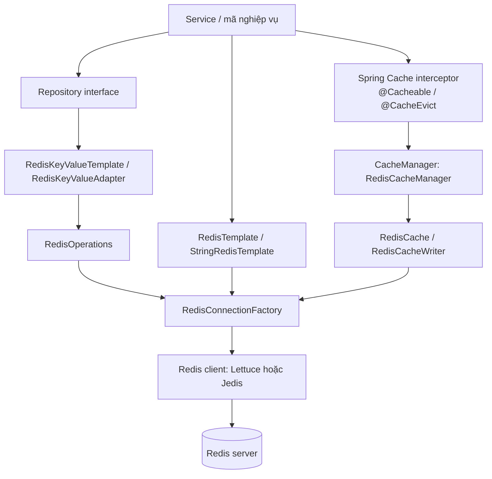
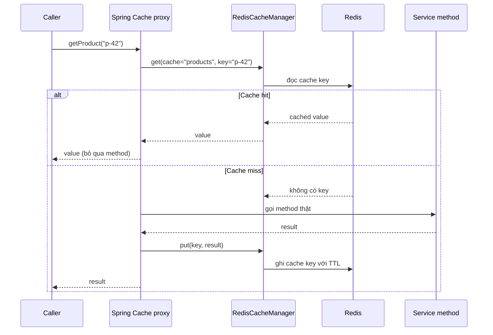
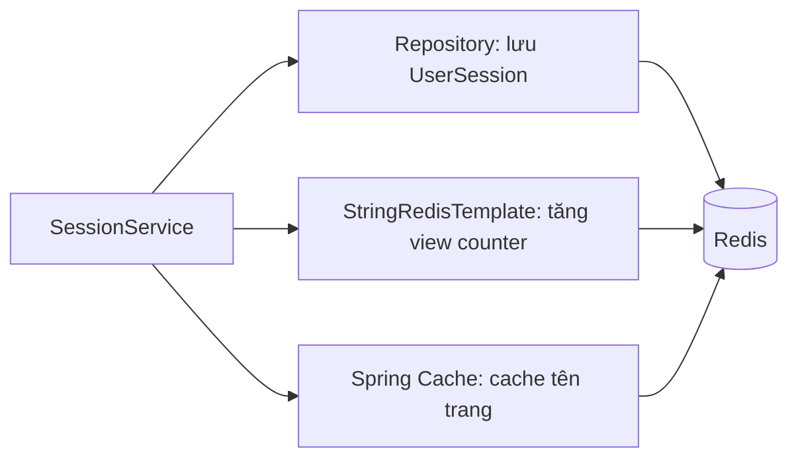

# Bản đồ các thành phần: ConnectionFactory, Template, Repository và Cache trong Spring Data Redis

Khi tích hợp Redis vào ứng dụng Spring, bốn tên thường xuất hiện cùng nhau là `RedisConnectionFactory`, `RedisTemplate`, Redis Repository và `RedisCacheManager`. Chúng cùng giao tiếp với một Redis server nhưng giải quyết **những vấn đề khác nhau**: kết nối, thao tác dữ liệu trực tiếp, lưu đối tượng theo mô hình repository và lưu kết quả tính toán để tái sử dụng.

Bài này xây dựng bản đồ quan hệ giữa các thành phần, giải thích luồng thực thi và chỉ ra cách chọn đúng abstraction trong từng tình huống. Ví dụ sử dụng cách đặt tên và API phổ biến của Spring Boot 3.x / Spring Data Redis 3.x; chi tiết cấu hình có thể khác theo phiên bản dự án.

## 1. Nhìn toàn cảnh: bốn thành phần nằm ở đâu?

Spring Data Redis là lớp tích hợp nằm giữa mã Java/Spring và Redis. Redis vẫn là hệ thống lưu trữ bên ngoài: các thành phần Spring **không tạo ra bốn Redis server** hay bốn cơ sở dữ liệu riêng.



Hãy đọc sơ đồ từ dưới lên:

1. **Redis server** thực thi lệnh và lưu dữ liệu theo key.
2. **Redis client** như Lettuce/Jedis quản lý giao tiếp qua mạng.
3. **`RedisConnectionFactory`** cung cấp kết nối Redis cho các lớp phía trên.
4. **`RedisTemplate`** và **Repository** là hai cách thao tác dữ liệu ứng dụng. Template làm việc theo lệnh/cấu trúc dữ liệu; Repository làm việc với đối tượng và ID.
5. **`RedisCacheManager`** triển khai cơ chế Spring Cache. Lệnh `@Cacheable` đi qua cache interceptor để tìm hoặc ghi kết quả vào Redis.

Điểm quan trọng: nhánh **Cache không bắt buộc đi qua `RedisTemplate` mà bạn khai báo cho nghiệp vụ**. `RedisCacheManager` dùng `RedisCacheWriter` và `RedisConnectionFactory`. Nhánh Repository có infrastructure riêng và sử dụng Redis operations bên dưới; không đồng nghĩa với việc mọi phương thức Repository chỉ là một lời gọi `opsForValue()`.

| Thành phần | Đầu vào bạn thường cung cấp | Công việc chính | Câu hỏi mà nó trả lời |
|---|---|---|---|
| `RedisConnectionFactory` | Cấu hình host, port, authentication, SSL, topology | Tạo/cung cấp kết nối đến Redis qua driver | “Ứng dụng kết nối Redis bằng cách nào?” |
| `RedisTemplate<K, V>` | Key, value, lệnh Redis, serializer, TTL | Thao tác dữ liệu Redis ở mức cấu trúc dữ liệu | “Tôi muốn `GET`, `SET`, `INCR`, thao tác Hash/Set/List thế nào?” |
| Redis Repository | Entity, ID, phương thức `save`/`findById`, thuộc tính được index | Ánh xạ đối tượng sang dữ liệu Redis và quản lý truy xuất theo ID/index | “Tôi lưu và tìm một aggregate Java ra sao?” |
| `RedisCacheManager` | Cache name, cache key, kết quả phương thức, TTL, chính sách serialization | Lưu và lấy lại kết quả qua Spring Cache | “Có thể bỏ qua lần xử lý tốn kém này khi dữ liệu đã được cache không?” |

## 2. RedisConnectionFactory: nền tảng kết nối

`RedisConnectionFactory` là interface của Spring Data Redis, còn `LettuceConnectionFactory` là implementation phổ biến khi dùng starter Redis của Spring Boot. Tùy cấu hình và dependency, ứng dụng có thể dùng driver phù hợp với standalone, Sentinel hoặc Redis Cluster.

Luồng thực thi rút gọn:

```text
Service → RedisTemplate → RedisConnectionFactory
                              ↓
                         Lettuce/Jedis
                              ↓
                         Redis server
```

Một ví dụ cấu hình kết nối Redis standalone trên máy phát triển:

```yaml
spring:
  data:
    redis:
      host: localhost
      port: 6379
      timeout: 2s
```

Với Spring Boot có `spring-boot-starter-data-redis`, auto-configuration thường cung cấp một bean `RedisConnectionFactory` từ các thuộc tính `spring.data.redis.*`. Ứng dụng có thể inject factory vào bean cần nó; thông thường không phải tự khởi tạo `LettuceConnectionFactory`.

**Factory không đồng nhất với một TCP socket cố định.** Việc chia sẻ, cấp phát và quản lý connection tùy driver và cấu hình. Template quản lý vòng đời tài nguyên cho mỗi thao tác; không nên mở `RedisConnection` thủ công để thực hiện CRUD thông thường rồi quên đóng hoặc giải phóng.

Khi nào cần dùng trực tiếp `RedisConnectionFactory`?

- Tạo một `RedisTemplate` hoặc `RedisCacheManager` có cấu hình riêng.
- Xây dựng chức năng cấp thấp thật sự cần `RedisConnection` hay driver-specific API.
- Tùy chỉnh kết nối theo môi trường, TLS, authentication, timeout, Sentinel hoặc Cluster.

Factory **không quyết định** một giá trị là JSON hay JDK serialization, một entity tồn tại bao lâu, hoặc tên cache là gì. Những quyết định này nằm ở tầng trên.

## 3. RedisTemplate: thao tác Redis một cách tường minh

`RedisTemplate<K, V>` là lớp thực hiện các Redis operations và chuyển đổi Java object thành byte qua serializer. Nó lo việc lấy connection, thực thi lệnh và chuyển exception của driver sang hệ thống exception của Spring Data.

`RedisTemplate` cung cấp các nhóm thao tác theo cấu trúc dữ liệu:

| API | Kiểu Redis / ví dụ lệnh | Tình huống |
|---|---|---|
`opsForValue()` | String: `GET`, `SET`, `INCR` | Mã OTP, bộ đếm, giá trị đơn |
`opsForHash()` | Hash: `HGET`, `HSET` | Thuộc tính dạng field/value |
`opsForList()` | List: `LPUSH`, `LRANGE` | Danh sách có thứ tự |
`opsForSet()` | Set: `SADD`, `SISMEMBER` | Tập phần tử duy nhất |
`opsForZSet()` | Sorted Set: `ZADD`, `ZRANGE` | Điểm số, xếp hạng |
`opsForStream()` | Stream: `XADD`, đọc stream | Luồng sự kiện trong Redis |
`expire(key, ...)` | `EXPIRE` / tương đương | Gắn TTL cho key |

### 3.1. StringRedisTemplate: trường hợp đơn giản nhất

`StringRedisTemplate` là chuyên biệt của `RedisTemplate<String, String>`, sử dụng serializer dạng chuỗi cho key và value. Nó phù hợp khi dữ liệu lưu là text, số biểu diễn bằng chuỗi hoặc bạn cần kiểm tra key bằng Redis CLI.

```java
import java.time.Duration;
import org.springframework.data.redis.core.StringRedisTemplate;
import org.springframework.stereotype.Service;

@Service
public class VisitCounter {
    private final StringRedisTemplate redis;

    public VisitCounter(StringRedisTemplate redis) {
        this.redis = redis;
    }

    public Long recordVisit(String articleId) {
        String key = "metrics:article:" + articleId + ":views";
        return redis.opsForValue().increment(key);
    }

    public String currentVisits(String articleId) {
        String key = "metrics:article:" + articleId + ":views";
        String value = redis.opsForValue().get(key);
        return value == null ? "0" : value;
    }

    public void saveOneTimeCode(String userId, String code) {
        redis.opsForValue().set(
            "otp:user:" + userId,
            code,
            Duration.ofMinutes(5)
        );
    }
}
```

Ở đây, `recordVisit()` dùng phép tăng số của Redis, vì vậy thao tác tăng trên một key có tính nguyên tử tại Redis. Lệnh `set(key, value, Duration)` ghi giá trị kèm TTL. Không có entity hay cache annotation nào tham gia.

### 3.2. RedisTemplate với đối tượng Java

Khi value là Java object, cần quyết định cách serialize. Ví dụ một template riêng lưu giỏ hàng dưới dạng JSON:

```java
import org.springframework.context.annotation.Bean;
import org.springframework.context.annotation.Configuration;
import org.springframework.data.redis.connection.RedisConnectionFactory;
import org.springframework.data.redis.core.RedisTemplate;
import org.springframework.data.redis.serializer.Jackson2JsonRedisSerializer;
import org.springframework.data.redis.serializer.StringRedisSerializer;

@Configuration
public class CartRedisConfig {
    @Bean
    RedisTemplate<String, CartSnapshot> cartRedisTemplate(
            RedisConnectionFactory connectionFactory) {

        RedisTemplate<String, CartSnapshot> template = new RedisTemplate<>();
        template.setConnectionFactory(connectionFactory);
        template.setKeySerializer(new StringRedisSerializer());
        template.setHashKeySerializer(new StringRedisSerializer());

        var json = new Jackson2JsonRedisSerializer<>(CartSnapshot.class);
        template.setValueSerializer(json);
        template.setHashValueSerializer(json);
        template.afterPropertiesSet();
        return template;
    }
}

record CartSnapshot(String cartId, int itemCount) {}
```

Sử dụng:

```java
cartRedisTemplate.opsForValue().set(
    "cart:42",
    new CartSnapshot("42", 3),
    Duration.ofMinutes(15)
);

CartSnapshot snapshot = cartRedisTemplate.opsForValue().get("cart:42");
```

Trong ứng dụng thực tế, inject bean `RedisTemplate<String, CartSnapshot>` ở service sử dụng nó. Snippet minh họa cấu hình serializer cho một kiểu đơn giản; với model phức tạp (ví dụ ngày giờ, polymorphism, đổi schema), cần cấu hình Jackson và chiến lược tương thích dữ liệu phù hợp.

**Phân biệt bốn vị trí serializer:** key, value, hash key và hash value. Cùng một key Redis nhưng đổi value serializer có thể khiến ứng dụng đọc sai byte đã lưu. Không nên mặc định cho rằng cấu hình serializer của một `RedisTemplate` sẽ tự thay đổi cách Repository hay Spring Cache ghi dữ liệu.

## 4. Redis Repository: làm việc với entity và ID

Nếu xem dữ liệu như một đối tượng nghiệp vụ có định danh, Redis Repository cung cấp phong cách quen thuộc của Spring Data: `save()`, `findById()`, `findAll()`, `deleteById()` và một số phương thức truy vấn theo thuộc tính được hỗ trợ.

Một entity Redis thường được đánh dấu `@RedisHash`. Spring Data Redis ánh xạ các thuộc tính của nó sang cấu trúc Redis Hash và quản lý keyspace cùng metadata/index cần thiết; đó không phải là một bảng SQL.

```java
import org.springframework.data.annotation.Id;
import org.springframework.data.redis.core.RedisHash;
import org.springframework.data.redis.core.index.Indexed;

@RedisHash(value = "sessions", timeToLive = 1800)
public class UserSession {
    @Id
    private String id;

    @Indexed
    private String userId;

    private String currentPage;

    public UserSession() {}

    public UserSession(String id, String userId, String currentPage) {
        this.id = id;
        this.userId = userId;
        this.currentPage = currentPage;
    }

    public String getId() { return id; }
    public String getUserId() { return userId; }
    public String getCurrentPage() { return currentPage; }
    public void setCurrentPage(String currentPage) {
        this.currentPage = currentPage;
    }
}
```

```java
import java.util.List;
import org.springframework.data.repository.CrudRepository;

public interface UserSessionRepository
        extends CrudRepository<UserSession, String> {

    List<UserSession> findByUserId(String userId);
}
```

```java
UserSession session =
    repository.save(new UserSession("s-101", "u-42", "/home"));

UserSession loaded = repository.findById("s-101").orElseThrow();
List<UserSession> sessions = repository.findByUserId("u-42");
```

Ý nghĩa của các annotation:

- `@RedisHash("sessions")` xác định keyspace cho loại entity này. Dữ liệu entity được ánh xạ chủ yếu sang Redis Hash; Spring Data còn có thể tạo key phục vụ quản lý tập ID hoặc index.
- `@Id` xác định định danh để Repository tìm và lưu entity.
- `@Indexed` cho phép Spring Data Redis duy trì secondary index cho thuộc tính `userId`, phục vụ truy vấn như `findByUserId()`. Index tiêu tốn thêm bộ nhớ và công duy trì.
- `timeToLive = 1800` quy định TTL mặc định **1.800 giây (30 phút)** cho entity được lưu. Đọc entity không tự động làm mới TTL theo kiểu sliding session.

Trong Spring Boot, Repository có thể được phát hiện nhờ auto-configuration và component scan phù hợp. Khi cần chủ động chọn package, có thể cấu hình `@EnableRedisRepositories`. Cần đảm bảo entity và interface nằm trong phạm vi quét tương ứng.

### Repository không phải JPA cho Redis

Không nên suy diễn các khả năng của SQL/JPA sang Redis Repository:

- Redis không có join hoặc SQL transaction theo mô hình relational database.
- Derived query phụ thuộc hỗ trợ của Redis Repository và các index cần thiết; `findByUserId()` trong ví dụ được xây dựng quanh thuộc tính `@Indexed`.
- Không phải mọi biểu thức truy vấn phức tạp, điều kiện kết hợp hay phân trang đều hoạt động như Spring Data JPA.
- Redis Hash của Repository không tự đồng nghĩa với một JSON string do `RedisTemplate.opsForValue()` ghi. Trộn hai cách ghi vào cùng keyspace có thể phá vỡ định dạng dữ liệu.

Nên chọn Repository khi mục tiêu là quản lý vòng đời **đối tượng được định danh**, thao tác CRUD rõ ràng và số kiểu truy vấn phù hợp với index của Redis.

## 5. Cache: dùng Redis để tránh lặp lại công việc

Spring Cache là abstraction ở mức **kết quả phương thức**. Nó trả lời câu hỏi: “Kết quả cho bộ tham số này đã có chưa?”. Khi cấu hình Redis làm cache provider, `RedisCacheManager` quản lý các cache dựa trên Redis.

Đường đi của `@Cacheable`:



Ví dụ cấu hình Redis Cache cho Spring Boot:

```gradle
dependencies {
    implementation 'org.springframework.boot:spring-boot-starter-data-redis'
    implementation 'org.springframework.boot:spring-boot-starter-cache'
}
```

```yaml
spring:
  data:
    redis:
      host: localhost
      port: 6379
  cache:
    type: redis
    redis:
      time-to-live: 10m
      cache-null-values: false
```

Kích hoạt Spring Cache:

```java
import org.springframework.boot.SpringApplication;
import org.springframework.boot.autoconfigure.SpringBootApplication;
import org.springframework.cache.annotation.EnableCaching;

@SpringBootApplication
@EnableCaching
public class RedisDemoApplication {
    public static void main(String[] args) {
        SpringApplication.run(RedisDemoApplication.class, args);
    }
}
```

Một service sử dụng dữ liệu ở nguồn chính và cache kết quả tra cứu:

```java
import org.springframework.cache.annotation.CacheEvict;
import org.springframework.cache.annotation.Cacheable;
import org.springframework.stereotype.Service;

@Service
public class ProductService {
    private final ProductGateway sourceOfTruth;

    public ProductService(ProductGateway sourceOfTruth) {
        this.sourceOfTruth = sourceOfTruth;
    }

    @Cacheable(cacheNames = "product-name", key = "#id")
    public String getName(String id) {
        return sourceOfTruth.loadName(id);
    }

    @CacheEvict(cacheNames = "product-name", key = "#id")
    public void rename(String id, String newName) {
        sourceOfTruth.rename(id, newName);
    }
}
```

`ProductGateway` trong ví dụ đại diện cho nguồn dữ liệu chính của sản phẩm (database/API), không phải API có sẵn của Spring Data Redis. Lần đầu gọi `getName("p-42")` sẽ truy vấn nguồn; lần tiếp theo có thể trả về kết quả Redis. `rename()` xóa cache tương ứng sau khi cập nhật thành công, để lần đọc tiếp theo lấy dữ liệu mới.

Các annotation hay dùng:

| Annotation | Ý nghĩa | Trường hợp điển hình |
|---|---|---|
| `@Cacheable` | Có cache thì trả từ cache; nếu miss thì gọi method và lưu kết quả | Đọc dữ liệu nhiều lần |
| `@CachePut` | Vẫn thực thi method rồi cập nhật cache bằng kết quả mới | Đồng bộ cache khi biết giá trị mới |
| `@CacheEvict` | Xóa một hoặc nhiều cache entry | Dữ liệu nguồn bị thay đổi |
| `@Caching` | Kết hợp nhiều thao tác cache | Cập nhật nhiều vùng cache liên quan |

Ở chế độ Spring AOP proxy thông thường, annotation chỉ được áp dụng khi lời gọi **đi qua proxy Spring**. Một lời gọi từ method này tới method khác trong chính cùng object (`this.getName(...)`) thường bỏ qua cache interceptor. Phương thức cần được Spring quản lý và phải phù hợp với cơ chế proxy.

Ngoài TTL, cache phải có chính sách **invalidation**: nếu dữ liệu nguồn thay đổi nhưng cache chưa hết hạn và không được evict/update, người dùng có thể nhận dữ liệu cũ. Redis Cache không tự phát hiện mọi thay đổi trong database.

### CacheManager và RedisTemplate khác nhau ở đâu?

Hai đoạn mã dưới có thể cùng đưa dữ liệu vào Redis, nhưng ngữ nghĩa khác nhau:

```java
// Chủ động quản lý key và TTL
stringRedisTemplate.opsForValue().set(
    "profile:42:name", "An", Duration.ofMinutes(10)
);

// Để Spring Cache quản lý cache name, cache key, hit/miss và TTL
@Cacheable(cacheNames = "profile-name", key = "#id")
public String loadProfileName(String id) {
    return profileGateway.loadName(id);
}
```

Trong nhánh template, **service tự quyết định** khi nào đọc/ghi key. Trong nhánh Cache, Spring proxy quyết định có cần thực thi method hay không. Cache thường dùng key có prefix theo cache name (ví dụ dạng `profile-name::42` theo cấu hình mặc định), nhưng định dạng thực tế có thể tùy chỉnh.

Cache value serializer cũng có cấu hình riêng, chẳng hạn qua `RedisCacheConfiguration`. Spring Data Redis cache configuration mặc định có thể dùng JDK serialization cho value; nếu muốn cache JSON, phải cấu hình serialization phù hợp với kiểu dữ liệu và phương án versioning. Đừng giả định `StringRedisTemplate` hoặc template JSON tự đổi serializer của `RedisCacheManager`.

## 6. Ba luồng dữ liệu cùng dùng một RedisConnectionFactory

Ví dụ sau cho thấy cùng một Redis instance vẫn phục vụ được ba nhu cầu khác nhau.



Giả sử ứng dụng đã khai báo `UserSessionRepository` và bật Spring Cache như trên:

```java
import org.springframework.cache.annotation.CacheEvict;
import org.springframework.cache.annotation.Cacheable;
import org.springframework.data.redis.core.StringRedisTemplate;
import org.springframework.stereotype.Service;

@Service
public class SessionService {
    private final UserSessionRepository sessions;
    private final StringRedisTemplate redis;

    public SessionService(
            UserSessionRepository sessions,
            StringRedisTemplate redis) {
        this.sessions = sessions;
        this.redis = redis;
    }

    public UserSession create(String id, String userId) {
        return sessions.save(new UserSession(id, userId, "/home"));
    }

    public Long countVisit(String sessionId) {
        return redis.opsForValue().increment(
            "metrics:session:" + sessionId + ":views"
        );
    }

    @Cacheable(cacheNames = "session-page", key = "#sessionId")
    public String currentPage(String sessionId) {
        return sessions.findById(sessionId)
            .map(UserSession::getCurrentPage)
            .orElse("session-not-found");
    }

    @CacheEvict(cacheNames = "session-page", key = "#sessionId")
    public void changePage(String sessionId, String newPage) {
        UserSession session = sessions.findById(sessionId).orElseThrow();
        session.setCurrentPage(newPage);
        sessions.save(session);
    }
}
```

Một request đi qua ba abstraction:

1. `create("s-101", "u-42")` gọi **Repository** để tạo một entity session có TTL riêng.
2. `countVisit("s-101")` gọi **StringRedisTemplate** để tăng counter trên key `metrics:session:s-101:views`; counter không tự nhận TTL từ entity.
3. `currentPage("s-101")` đi qua **Spring Cache**. Nếu có cache hit, Repository không bị gọi; nếu cache miss, phương thức đọc entity rồi cache chuỗi kết quả.
4. `changePage(...)` sửa entity bằng Repository và xóa cache `session-page` của session đó.

Đây là **ba nhóm key độc lập về mục đích và chính sách sống**:

| Ví dụ key logic | Ai sở hữu? | TTL |
|---|---|---|
| `sessions:s-101` cùng metadata/index liên quan | Redis Repository | `@RedisHash(timeToLive=1800)` |
| `metrics:session:s-101:views` | StringRedisTemplate / service | Không có trừ khi code đặt TTL |
| `session-page::s-101` | RedisCacheManager | `spring.cache.redis.time-to-live=10m` |

Tên key thực tế phụ thuộc vào keyspace, prefix và key generator/serializer. Không lấy ví dụ này làm hợp đồng về tất cả key nội bộ do Repository tạo ra.

**Hệ quả về dữ liệu:** TTL của entity, counter và cache không tự đồng bộ. Chẳng hạn cache một kết quả “đã tìm thấy session” gần thời điểm entity hết hạn có thể khiến kết quả đó tồn tại thêm đến khi cache TTL kết thúc. Nếu yêu cầu nhất quán chặt, phải thiết kế TTL và invalidation riêng.

## 7. Cách chọn abstraction cho một yêu cầu cụ thể

| Nhu cầu | Chọn trước tiên | Giải thích |
|---|---|---|
| Kết nối Redis bằng host, password, TLS hoặc Cluster | `RedisConnectionFactory` / Spring Boot configuration | Tầng kết nối được chia sẻ cho các thành phần khác |
| Đếm lượt xem, tăng số, làm việc với Set, Sorted Set, List, Stream, hoặc key tùy chỉnh | `StringRedisTemplate` / `RedisTemplate` | Cần trực tiếp dùng lệnh và dữ liệu Redis |
| Lưu một entity theo ID, tìm lại và xóa theo ID | Redis Repository | API CRUD gắn với vòng đời của aggregate |
| Truy vấn một vài thuộc tính của entity qua index được hỗ trợ | Repository với `@Indexed` | Spring Data quản lý index phục vụ tìm kiếm đó |
| Tăng tốc phương thức gọi database hoặc API ngoài | Spring Cache + `RedisCacheManager` | Đơn giản hóa hit/miss, key generation, expiry và eviction |
| Cần dùng Redis làm cache nhưng cũng cần bộ đếm độc lập | Kết hợp Cache và Template | Mỗi đường phục vụ đúng ngữ nghĩa của nó |

Một quy tắc lựa chọn hữu ích:

- **Đang nghĩ bằng lệnh Redis, cấu trúc dữ liệu và tên key?** Bắt đầu với Template.
- **Đang nghĩ bằng aggregate, ID và CRUD?** Cân nhắc Repository, sau khi xem khả năng truy vấn/index.
- **Đang nghĩ bằng “gọi lại method này có tốn kém không”?** Bắt đầu với Spring Cache.
- **Chỉ cần đổi thông tin kết nối?** Cấu hình `RedisConnectionFactory`, không viết lại service.

Không phải mọi dữ liệu trong Redis đều nên đưa vào Repository. Ví dụ leaderboard cần `ZINCRBY` và top-N từ Sorted Set thường hợp với Template hơn; một phương thức tra cứu giá sản phẩm từ PostgreSQL thường hợp với Cache hơn; một đối tượng session có ID, TTL và thuộc tính đã index có thể hợp với Repository.

## 8. Serializer, TTL và keyspace là ba ranh giới cần nhớ

### 8.1. Serializer: Java object thành byte

Redis làm việc với byte, còn Spring nhận/gửi Java object. Mỗi nhánh có cơ chế chuyển đổi riêng:

- Template chọn serializer cho key, value, hash key và hash value.
- Repository dùng cơ chế mapping Redis Hash của Spring Data, không tự biến entity thành JSON string của một template bất kỳ.
- Redis Cache dùng `RedisCacheConfiguration` cho serialize key/value và cấu hình prefix.

Nếu mở Redis CLI thấy một value giống byte nhị phân, chưa thể kết luận key bị hỏng. Trước tiên xác định **thành phần đã ghi key** và serializer của nó. Việc đổi serializer trong bản phát hành mới cũng là thay đổi định dạng dữ liệu; cần lên kế hoạch tương thích, xóa cache có kiểm soát hoặc migration.

### 8.2. TTL: hết hạn ở từng tầng

TTL là thuộc tính của **key Redis**. Cách thiết lập tùy abstraction:

- Template: gọi `set(key, value, Duration)` hoặc `expire(key, Duration)`.
- Repository: dùng `@RedisHash(timeToLive=...)` hay thuộc tính `@TimeToLive` khi cần TTL gắn với entity.
- Cache: cấu hình TTL chung hoặc theo từng cache name bằng `RedisCacheConfiguration` / Spring Boot cache properties.

Redis xóa/hết hiệu lực key khi TTL chạm 0, nhưng sự kiện hết hạn, index phụ và hành vi listener của Repository có điều kiện cấu hình riêng. Đừng dựa vào key-expiration event như một cơ chế đảm bảo thực thi nghiệp vụ đúng thời điểm tuyệt đối.

### 8.3. Keyspace: tránh va chạm và hiểu quyền sở hữu

Ví dụ về quy ước dễ đọc:

```text
metrics:article:42:views      # Template / counter
otp:user:42                  # Template / code ngắn hạn
sessions:s-101               # Repository / entity
session-page::s-101          # Spring Cache / cache entry
```

Chọn prefix nhất quán giúp quan sát và tránh các thành phần ghi đè dữ liệu lẫn nhau. Tuy nhiên Redis không áp dụng schema độc lập cho từng prefix: nếu một key trùng tên mà hai thành phần dùng kiểu dữ liệu/serializer khác nhau, có thể phát sinh lỗi kiểu Redis hoặc lỗi deserialize.

## 9. Các nhầm lẫn và lỗi phổ biến

| Hiện tượng | Nguyên nhân đáng kiểm tra | Hướng xử lý |
|---|---|---|
| `@Cacheable` không tạo cache | Chưa `@EnableCaching`, thiếu cache manager, lời gọi nội bộ cùng bean không qua proxy | Kiểm tra cấu hình và đường gọi method |
| Redis đã có key nhưng đọc ra lỗi deserialize | Template/Cache/Repository ghi bằng định dạng khác nhau hoặc vừa thay serializer | Xác định owner và cấu hình serializer trước khi đọc |
| `findById()` hoạt động nhưng `findByUserId()` không như mong đợi | Truy vấn phụ thuộc index hoặc mapping chưa đúng | Kiểm tra `@Indexed`, dữ liệu được ghi qua Repository và giới hạn query support |
| Entity mất sau 30 phút nhưng counter còn | TTL Repository không áp dụng cho key của Template | Đặt TTL riêng cho counter nếu nghiệp vụ yêu cầu |
| Sửa database rồi `@Cacheable` vẫn trả dữ liệu cũ | Cache chưa hết TTL hoặc chưa được evict | Dùng `@CacheEvict`/`@CachePut` tại điểm cập nhật, cân nhắc TTL |
| Một Redis operation bị timeout | Kết nối, hạ tầng Redis, lệnh chậm, pool/driver hoặc network | Kiểm tra server, timeout, monitoring và log exception |
| Tưởng mọi Redis access có cùng transaction | Nhiều lệnh từ Repository, Template và Cache không tự tạo transaction xuyên tầng | Thiết kế atomicity/idempotency theo thao tác thật sự cần |

Không nên dựa vào Redis Cache như cơ chế đồng bộ dữ liệu nguồn hoàn hảo, hay xem mọi method `save()` của Repository tương đương một lệnh `SET` đơn lẻ. Repository có thể cần cập nhật hash và cấu trúc index; cache có thể cần read + compute + write. Khi có nhiều request đồng thời hoặc Redis tạm thời không khả dụng, hành vi cần được đánh giá theo yêu cầu nhất quán và chiến lược xử lý lỗi của ứng dụng.

## 10. Quan sát dữ liệu thật trong Redis

Redis CLI hữu ích khi học và debug một instance phát triển:

```bash
# Liệt kê key thuộc một prefix mà không dùng KEYS *
redis-cli --scan --pattern 'metrics:*'

# Xem kiểu dữ liệu và TTL của một key
redis-cli TYPE metrics:article:42:views
redis-cli TTL metrics:article:42:views

# Đọc một string được ghi bằng StringRedisTemplate
redis-cli GET metrics:article:42:views

# Xem field của hash entity (đúng key thực tế của Repository)
redis-cli HGETALL sessions:s-101
```

`TYPE` giúp phân biệt Redis String/Hash/List/Set/Sorted Set/Stream. `TTL` trả số giây còn lại, `-1` nếu key tồn tại nhưng không có TTL, `-2` nếu key không tồn tại. Với key có serializer nhị phân, `GET`/`HGETALL` có thể không hiển thị nội dung đọc được trực tiếp.

Khi quan sát hãy đối chiếu ba câu hỏi:

1. **Ai đã ghi key?** Template, Repository hay Cache?
2. **Redis đang lưu kiểu gì?** String, Hash hoặc kiểu khác; serialization nào?
3. **Ai quyết định thời điểm hết hạn hoặc xóa key?** TTL do template đặt, TTL entity hay TTL/invalidation của cache?

Tránh dùng `KEYS *` để quét toàn bộ keyspace trên Redis production vì nó có thể chặn server khi tập key lớn; dùng `SCAN` theo từng lô và giám sát tải hệ thống.

## 11. Phân biệt API đồng bộ và reactive

Các ví dụ trên dùng nhánh đồng bộ thông thường: `RedisConnectionFactory`, `RedisTemplate`, `StringRedisTemplate` và Spring Cache synchronous. Trong ứng dụng reactive, Spring Data Redis có `ReactiveRedisConnectionFactory`, `ReactiveRedisTemplate` và `ReactiveStringRedisTemplate` với kết quả dạng `Mono`/`Flux`. Đây là đường thao tác Redis riêng; chuyển sang WebFlux không tự động biến lời gọi `RedisTemplate` đồng bộ thành non-blocking.

Tương tự, không nên cho rằng Redis Repository và Spring Cache annotations trong những ví dụ trên tự cung cấp cùng ngữ nghĩa reactive. Hãy chọn API đúng với execution model và phiên bản thư viện đang dùng.

## 12. Tự kiểm tra hiểu biết bằng ba tình huống

**Tình huống A — số lượt xem của bài viết.** Yêu cầu tăng số lượt xem atomically và đọc top-level counter bằng key. `StringRedisTemplate.opsForValue().increment()` là lựa chọn trực tiếp; Repository không tạo thêm lợi ích rõ ràng.

**Tình huống B — phiên đăng nhập tạm thời.** Mỗi phiên có ID, user ID, current page và TTL 30 phút; cần tìm theo user ID. Redis Repository với `@RedisHash`, `@Id` và `@Indexed` là một mô hình phù hợp, nếu giới hạn truy vấn/index đáp ứng yêu cầu.

**Tình huống C — hiển thị tên sản phẩm lấy từ database.** Thao tác đọc lặp lại nhiều, database là nguồn chính và có thao tác cập nhật tên. Dùng `@Cacheable` cho đường đọc, `@CacheEvict` hoặc `@CachePut` cho đường ghi, và RedisCacheManager để quản lý cache entries.

Khi tự mô tả kiến trúc, hãy tách đúng trách nhiệm: **ConnectionFactory kết nối; Template thực hiện thao tác Redis; Repository ánh xạ entity; Cache quản lý kết quả method.** Bốn thành phần có thể phối hợp trong một ứng dụng, dùng chung Redis server nhưng không có cùng định dạng dữ liệu, TTL hoặc quy tắc nhất quán.
