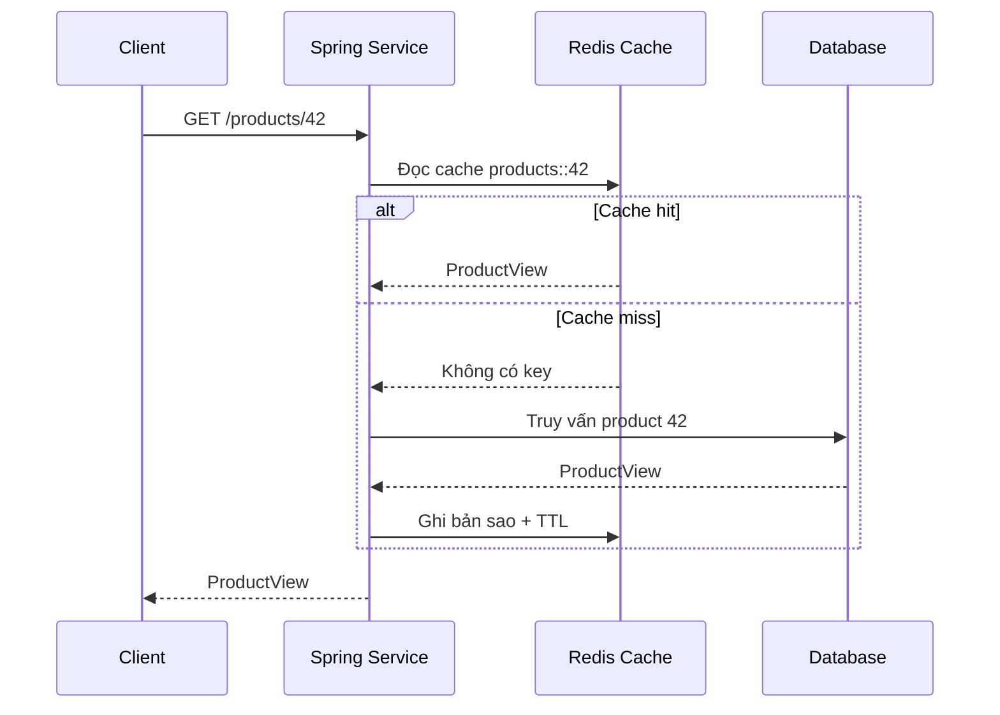
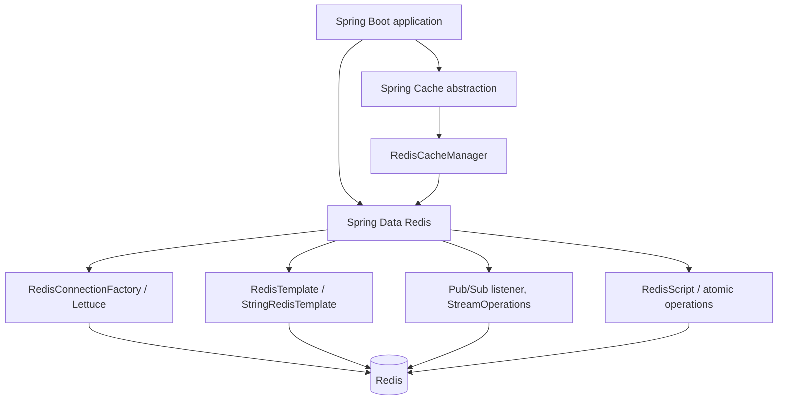
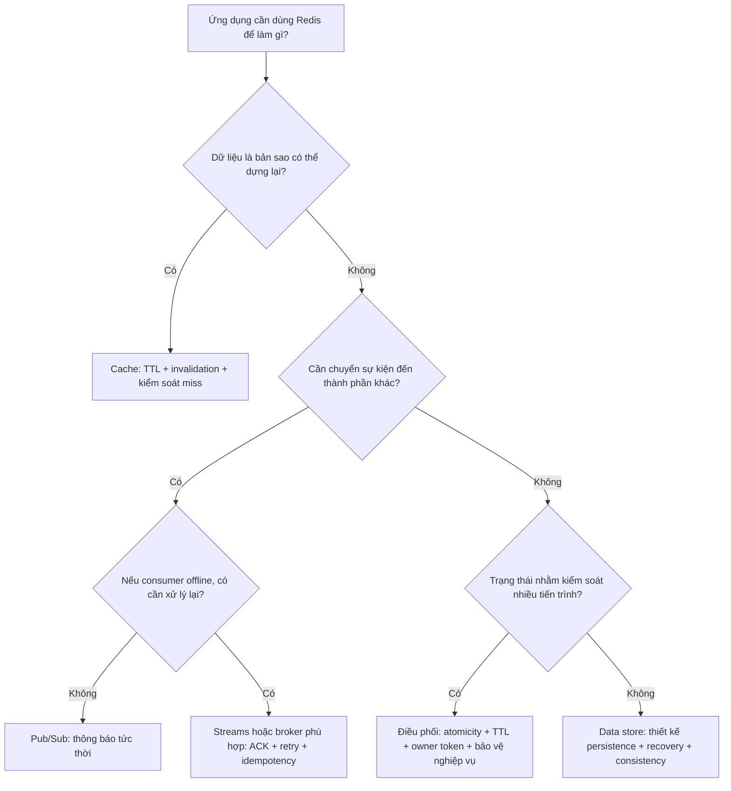

# Phân biệt lưu dữ liệu, cache, nhắn tin và điều phối bằng Redis

Redis thường được giới thiệu là một **kho dữ liệu key–value trong bộ nhớ**, nhưng trong ứng dụng Spring Boot, cùng một Redis có thể xuất hiện với bốn vai trò rất khác nhau: **lưu dữ liệu**, **cache**, **nhắn tin**, và **điều phối giữa các tiến trình**. Điểm khác nhau quan trọng không nằm ở việc dùng `String`, `Hash` hay `Stream`, mà nằm ở **ý nghĩa của dữ liệu, cách dữ liệu được tạo và khôi phục, thời gian tồn tại, cùng cam kết khi có lỗi**.

Ví dụ, trong hệ thống bán hàng:

- Giỏ hàng đang thao tác có thể được lưu trực tiếp trong Redis.
- Thông tin sản phẩm vốn thuộc cơ sở dữ liệu chính có thể được sao chép sang Redis để giảm độ trễ đọc.
- Sự kiện “giá sản phẩm thay đổi” có thể được phát qua Redis Pub/Sub hoặc Redis Streams cho dịch vụ khác.
- Nhiều instance cùng chạy một tác vụ có thể dùng Redis để giới hạn số lần thực hiện đồng thời.

Đây là bốn bài toán riêng. Chọn sai vai trò dễ dẫn đến mất dữ liệu, trả dữ liệu cũ, mất thông báo hoặc chạy trùng tác vụ, dù các lệnh Redis vẫn thực thi thành công.

## 1. Bức tranh tổng thể: cùng Redis, bốn hợp đồng sử dụng

| Góc nhìn | Lưu dữ liệu (data store) | Cache | Nhắn tin (messaging) | Điều phối (coordination) |
|---|---|---|---|---|
| Mục đích | Nắm giữ trạng thái nghiệp vụ hoặc trạng thái phiên | Tăng tốc truy cập bằng bản sao có thể tạo lại | Chuyển thông báo/sự kiện giữa các thành phần | Đồng bộ hành động giữa nhiều tiến trình/instance |
| Redis giữ gì? | Bản dữ liệu mà ứng dụng đọc/ghi trực tiếp | Bản sao của dữ liệu có nguồn gốc ở nơi khác | Thông điệp đang phát hoặc bản ghi sự kiện | Khóa, token, bộ đếm, hạn mức, trạng thái tạm |
| Redis có thể là nguồn dữ liệu chính? | Có, **nếu** hệ thống chấp nhận và thiết kế được cam kết độ bền cần thiết | Thông thường không | Không áp dụng cho Pub/Sub; với Streams có thể giữ lịch sử sự kiện trong phạm vi retention | Thường không phải nguồn sự thật cuối cùng của nghiệp vụ |
| TTL hoặc giới hạn lưu giữ | Tùy yêu cầu: có thể có hoặc không | Rất phổ biến; cần chính sách làm mới/xóa | Pub/Sub không lưu; Streams cần chính sách trim/retention | Gần như luôn cần TTL để tránh trạng thái kẹt |
| Khi Redis mất dữ liệu | Có thể mất trạng thái nghiệp vụ nếu không có nguồn khôi phục | Có thể nạp lại từ hệ thống gốc, đổi lại tăng tải và độ trễ | Pub/Sub mất thông điệp đã bỏ lỡ; Streams tùy persistence, retention và quy trình xử lý lại | Khóa/token mất có thể làm thay đổi quyền thực thi; phải bảo vệ bất biến nghiệp vụ ở tầng phù hợp |
| API Spring thường dùng | `RedisTemplate`, `StringRedisTemplate`, repository Redis | Spring Cache, `RedisCacheManager`, `@Cacheable` | `convertAndSend`, `RedisMessageListenerContainer`, Redis Streams APIs | `setIfAbsent`, `increment`, `RedisScript`, thao tác nguyên tử |

**Nguyên tắc nhận diện:** Hãy hỏi “Dữ liệu này là sự thật gốc, bản sao, thông điệp, hay tín hiệu phối hợp?” trước khi hỏi “Dùng lệnh Redis nào?”. Cùng một `SET key value EX ...` có thể đang lưu session, cache kết quả truy vấn, hoặc tạo khóa phân tán; vì mục đích khác nhau nên cách xử lý lỗi cũng phải khác.

### Redis có độ bền dữ liệu đến đâu?

Redis giữ tập dữ liệu hoạt động chủ yếu trong RAM, nhưng có các cơ chế ghi dữ liệu xuống đĩa như **RDB snapshot** và **AOF (append-only file)**. Những cơ chế này giúp phục hồi sau khi tiến trình khởi động lại; chúng **không tự động biến mọi lệnh ghi thành một giao dịch bền vững không thể mất**. Cửa sổ mất dữ liệu còn phụ thuộc cấu hình đồng bộ AOF, thời điểm snapshot, replication và failover. Replication thông thường là bất đồng bộ, nên một ghi đã được Redis phản hồi vẫn có thể chưa có trên replica được nâng lên sau sự cố.

Tương tự, TTL là thời hạn tồn tại logic của key; chính sách `maxmemory`/eviction có thể loại key sớm hơn khi bộ nhớ bị áp lực. **TTL, eviction, persistence và replication là bốn cơ chế khác nhau**. Một key không có TTL cũng không có nghĩa là nó sẽ tồn tại vĩnh viễn trong mọi cấu hình và sự cố.

## 2. Redis như nơi lưu dữ liệu: khi giá trị trong Redis chính là trạng thái cần dùng

Ở vai trò **data store**, ứng dụng ghi trạng thái vào Redis và các thao tác đọc tiếp theo dựa trực tiếp vào trạng thái đó. Ví dụ thích hợp gồm phiên đăng nhập với thời hạn sống, giỏ hàng tạm, điểm số trò chơi, trạng thái online, bộ đếm và bảng xếp hạng thời gian thực. Việc dùng Redis làm **nguồn sự thật duy nhất** cho số dư, đơn hàng hoặc tồn kho cần đánh giá kỹ khả năng mất dữ liệu, khôi phục, nhất quán và ràng buộc nghiệp vụ; Redis không mặc nhiên thay thế giao dịch nhiều bảng hay ràng buộc khóa ngoại của cơ sở dữ liệu quan hệ.

Redis có nhiều kiểu dữ liệu, không chỉ chuỗi:

| Kiểu | Ý tưởng | Ví dụ |
|---|---|---|
| `String` | Giá trị đơn, có thể là chuỗi/số/bytes | Session token, bộ đếm lượt xem |
| `Hash` | Nhóm các field của một đối tượng | `cart:42` chứa `sku-1 → 2`, `sku-9 → 1` |
| `Set` | Tập phần tử không trùng | Các user đang online trong phòng |
| `Sorted Set` | Tập phần tử có score, truy vấn theo thứ hạng | Leaderboard, hàng đợi theo điểm ưu tiên |
| `List` | Dãy phần tử theo thứ tự | Danh sách công việc đơn giản |
| `Stream` | Log các entry có ID, có khả năng đọc theo nhóm | Lịch sử sự kiện đơn hàng |

Ví dụ dùng `StringRedisTemplate` để giữ giỏ hàng tạm trong Spring Data Redis:

```java
@Service
public class CartStore {
    private final StringRedisTemplate redis;

    public CartStore(StringRedisTemplate redis) {
        this.redis = redis;
    }

    public void changeQuantity(String userId, String sku, int quantity) {
        String key = "cart:" + userId;
        redis.opsForHash().put(key, sku, Integer.toString(quantity));
        redis.expire(key, Duration.ofDays(7));
    }

    public Map<Object, Object> getCart(String userId) {
        return redis.opsForHash().entries("cart:" + userId);
    }
}
```

Đoạn mã minh họa cách lưu một `Hash` và gia hạn thời gian sống khi giỏ hàng được thay đổi. Hai lệnh `put` và `expire` riêng lẻ **không tạo thành thao tác nguyên tử chung**; với trạng thái cần bảo đảm tuyệt đối về TTL, hãy gói các bước trong thao tác nguyên tử phù hợp. Trong hệ thống thực tế còn cần xác thực người dùng, kiểm tra `quantity`, quy tắc xóa SKU và chính sách khi Redis không sẵn sàng.

Trước khi chọn Redis làm nơi lưu chính, cần trả lời: mất vài giây ghi cuối có chấp nhận được không, có cần lịch sử/audit không, dữ liệu có cần truy vấn quan hệ phức tạp không, và backup/restore đã được thử chưa? **Tốc độ truy cập cao không đồng nghĩa với cam kết độ bền cao.**

## 3. Redis như cache: dữ liệu trong Redis là bản sao có thể tái tạo

Cache giữ kết quả đã có ở nguồn gốc để lần đọc tiếp theo nhanh hơn. Giả sử bảng `products` nằm trong PostgreSQL; Redis chỉ giữ bản sao ngắn hạn của `ProductView`.



Đây là mô hình **cache-aside**: đọc cache trước, miss thì đọc nguồn dữ liệu và nạp cache. Các mô hình read-through/write-through/write-behind có cách chịu trách nhiệm đọc/ghi khác; ứng dụng Spring dùng `@Cacheable` thường triển khai ý tưởng cache-aside ở tầng phương thức.

Ví dụ với Spring Cache:

```groovy
dependencies {
    implementation 'org.springframework.boot:spring-boot-starter-data-redis'
    implementation 'org.springframework.boot:spring-boot-starter-cache'
}
```

```yaml
spring:
  data:
    redis:
      host: localhost
      port: 6379
      timeout: 2s
  cache:
    type: redis
    redis:
      time-to-live: 10m
      cache-null-values: false
```

```java
@Configuration
@EnableCaching
class CacheConfiguration { }

@Service
public class ProductService {
    private final ProductRepository repository;

    public ProductService(ProductRepository repository) {
        this.repository = repository;
    }

    @Cacheable(cacheNames = "products", key = "#id")
    public ProductView findProduct(String id) {
        return repository.findViewById(id)
                .orElseThrow(() -> new NoSuchElementException(id));
    }

    @CacheEvict(cacheNames = "products", key = "#id")
    public void invalidateProduct(String id) {
        // Được gọi khi thay đổi dữ liệu gốc đã hoàn tất.
    }
}
```

Ví dụ giả định `ProductRepository` và `ProductView` đã có trong dự án; `@EnableCaching` kích hoạt cơ chế cache bằng proxy. `@Cacheable` áp dụng khi một lời gọi đi qua Spring proxy; tự gọi một phương thức cùng bean thường không được interceptor xử lý. Cấu hình trên đặt TTL mặc định cho Redis cache; nếu cache của từng loại dữ liệu có yêu cầu khác nhau, cấu hình TTL riêng qua `RedisCacheManager`. Hãy chọn serializer ổn định giữa các phiên bản ứng dụng và cân nhắc dữ liệu nào được phép đưa vào cache.

### Bài toán khó của cache là tính mới và tải khi miss

- **Invalidation:** Sau khi cập nhật nguồn dữ liệu, xóa/ghi lại key liên quan. Với thay đổi trong transaction, cần phối hợp việc xóa cache với **thời điểm commit thành công**, tránh nạp lại dữ liệu cũ do race giữa cập nhật DB và truy vấn.
- **TTL:** TTL quá dài tăng độ trễ cập nhật dữ liệu; quá ngắn làm tăng miss và tải DB. TTL không thay thế invalidation nếu nghiệp vụ đòi dữ liệu mới ngay.
- **Cache stampede:** Nhiều request cùng miss một key nóng có thể đồng loạt đánh DB. Có thể dùng đồng bộ nạp trong phạm vi phù hợp, làm mới trước hạn, TTL biến thiên hoặc chiến lược gộp request.
- **Cache penetration:** Truy vấn nhiều ID không tồn tại có thể luôn xuyên xuống DB. Cân nhắc lưu kết quả âm với TTL ngắn, nhưng phải hiểu ý nghĩa của `null` và cấu hình cache-null.
- **Cache outage:** Hệ thống nên có chính sách rõ: truy vấn nguồn gốc với bảo vệ tải, trả lỗi hoặc phục vụ dữ liệu dự phòng tùy tính chất nghiệp vụ.

Nếu Redis bị xóa sạch, một cache **đúng nghĩa** vẫn có khả năng dựng lại dữ liệu từ nguồn gốc, dù tốc độ và tải hệ thống tạm thời bị ảnh hưởng. Nếu không thể tái tạo dữ liệu thì đó không còn là một cache thuần túy.

## 4. Redis để nhắn tin: Pub/Sub khác Redis Streams

Nhắn tin giúp thành phần phát sự kiện không cần gọi đồng bộ từng thành phần nhận. Redis có ít nhất hai cơ chế cần phân biệt rõ: **Pub/Sub** và **Streams**. Chúng khác nhau về việc thông điệp có được lưu lại, có thể đọc lại và xác nhận xử lý hay không.

### 4.1. Pub/Sub: thông báo tức thời cho subscriber đang kết nối

Trong Redis Pub/Sub, publisher gửi thông điệp vào channel; subscriber đang đăng ký channel nhận được thông điệp qua kết nối đang hoạt động. Server **không giữ một hàng đợi lịch sử cho subscriber đăng ký muộn**, không có ACK ở tầng Pub/Sub và không phát lại thông điệp bị lỡ. Redis mô tả delivery của Pub/Sub theo hướng **at-most-once**.

```text
Publisher ── PUBLISH "catalog.changed" ──> Redis
                                            ├──> Subscriber A (đang online)
                                            ├──> Subscriber B (đang online)
                                            └──> Subscriber C (offline: bỏ lỡ)
```

Ví dụ phía phát trong Spring Data Redis:

```java
@Service
public class CatalogNotifier {
    private final StringRedisTemplate redis;

    public CatalogNotifier(StringRedisTemplate redis) {
        this.redis = redis;
    }

    public void publishChangedSku(String sku) {
        redis.convertAndSend("catalog.changed", sku);
    }
}
```

Phía nhận có thể dùng `RedisMessageListenerContainer`:

```java
@Bean
RedisMessageListenerContainer catalogListener(
        RedisConnectionFactory connectionFactory,
        CatalogChangeHandler handler) {
    RedisMessageListenerContainer container = new RedisMessageListenerContainer();
    container.setConnectionFactory(connectionFactory);
    container.addMessageListener(
            (message, pattern) -> handler.onChangedSku(
                    new String(message.getBody(), StandardCharsets.UTF_8)),
            new ChannelTopic("catalog.changed"));
    return container;
}
```

Ở đây `CatalogChangeHandler` là thành phần xử lý do ứng dụng định nghĩa. Pub/Sub phù hợp với **invalidation cache gần thời gian thực, cập nhật giao diện, tín hiệu không bắt buộc phải nhận đủ**. Nếu người nhận offline mà mỗi sự kiện đều phải được xử lý, không thể chỉ dựa vào Pub/Sub.

### 4.2. Redis Streams: log sự kiện có ID, nhóm consumer và ACK

Redis Streams ghi các entry vào một stream, mỗi entry có ID. Consumer đọc theo vị trí; **consumer group** cho phép nhiều consumer chia nhau xử lý các entry của **cùng một group**. Một stream cũng có thể có nhiều group khác nhau, mỗi group theo dõi tiến độ riêng.

Thử trong `redis-cli` (mỗi dòng là một lệnh Redis):

```redis
XGROUP CREATE orders.events billing 0 MKSTREAM
XADD orders.events * orderId 42 event OrderCreated
XREADGROUP GROUP billing billing-1 COUNT 10 BLOCK 2000 STREAMS orders.events >
XACK orders.events billing <message-id>
```

`XGROUP CREATE ... 0` tạo group bắt đầu từ đầu stream; `MKSTREAM` cho phép tạo stream nếu chưa tồn tại. `XADD` ghi entry, `XREADGROUP ... >` lấy các message chưa được phân phối cho group, và `XACK` xác nhận xử lý thành công. Chuỗi `<message-id>` ở dòng cuối phải thay bằng ID thực tế trả về khi đọc. Nếu consumer nhận entry nhưng chết trước ACK, entry thường nằm trong **Pending Entries List (PEL)** của group; consumer cần quy trình dò pending và nhận lại công việc bị bỏ dở (ví dụ `XPENDING`, `XAUTOCLAIM`). Chỉ đọc với `>` sẽ không tự động xử lý hết các pending cũ.

Trong Spring Data Redis có thể dùng `StreamOperations`, `StreamMessageListenerContainer` hoặc reactive `StreamReceiver` để xây dựng consumer. Logic đúng thường theo thứ tự:

1. Đọc một entry từ group.
2. Xử lý tác vụ; ghi trạng thái nghiệp vụ và bảo đảm **idempotency** theo ID sự kiện hoặc khóa nghiệp vụ.
3. Chỉ `XACK` sau khi xử lý thành công.
4. Có cơ chế xử lý lại pending, retry có kiểm soát, theo dõi thông điệp lỗi kéo dài và quản lý retention.

Với quy trình ACK/recovery phù hợp, Streams có thể hỗ trợ cách xử lý **at-least-once**: một entry có thể được xử lý lại, vì vậy ứng dụng cần chịu được trùng lặp. Không nên mô tả Redis Streams là tự động bảo đảm **exactly-once end-to-end**. Lưu vào stream cũng chịu ảnh hưởng của cấu hình persistence/replication và việc trim các entry cũ.

| Tiêu chí | Redis Pub/Sub | Redis Streams |
|---|---|---|
| Thông điệp được lưu? | Không có lịch sử dành cho subscriber | Entry tồn tại trong stream cho tới khi bị trim/xóa hoặc mất do sự cố dữ liệu |
| Người nhận offline | Bỏ lỡ thông điệp | Có thể đọc lại entry còn tồn tại |
| ACK / pending | Không | Có với consumer group |
| Phân phối | Mọi subscriber đang theo dõi channel đều có thể nhận | Trong một group, các consumer chia việc; các group độc lập có thể cùng đọc sự kiện |
| Đọc lại / retry | Phải tự xây cơ chế riêng ngoài Pub/Sub | Có ID, offset, PEL và công cụ khôi phục |
| Phù hợp | Tín hiệu tức thời, mất một thông báo chấp nhận được | Sự kiện/công việc cần theo dõi tiến độ xử lý |

**Cảnh báo:** Keyspace Notifications cũng dựa trên Pub/Sub; không nên biến sự kiện hết hạn key thành nguồn thông báo nghiệp vụ duy nhất nếu yêu cầu giao hàng tin cậy. Khi cần xử lý giao dịch xuyên dịch vụ với yêu cầu độ bền cao, hãy xem xét thêm các mô hình như **transactional outbox** và hệ thống broker chuyên dụng; chọn kiến trúc dựa trên yêu cầu thực tế thay vì mặc định mọi nhu cầu nhắn tin đều dùng Redis.

## 5. Redis để điều phối: kiểm soát quyền thực thi và giới hạn dùng chung

Một ứng dụng chạy trên nhiều instance có thể cần trả lời những câu hỏi như: “Ai được làm công việc này?”, “User đã vượt quá 100 request/phút chưa?”, “Một event đã được tiếp nhận chưa?”. Trạng thái điều phối thường **nhỏ, tồn tại ngắn và bị nhiều tiến trình tranh chấp**. Khác với cache, tính đúng đắn phụ thuộc vào cách thao tác được kết hợp nguyên tử.

Ví dụ: hai instance đều muốn tạo báo cáo cho cùng `reportId`.

```text
Instance A ── thử giữ lock:report:42 ──┐
                                      ├── Redis: chỉ một lần SET NX thành công
Instance B ── thử giữ lock:report:42 ──┘
```

Redis hỗ trợ lấy lock với một lệnh nguyên tử:

```redis
SET lock:report:42 unique-token-123 NX PX 15000
```

- `NX`: chỉ ghi nếu key chưa tồn tại.
- `PX 15000`: đặt TTL 15.000 ms ngay trong cùng lệnh, giảm nguy cơ khóa bị giữ vô hạn khi tiến trình chết.
- `unique-token-123`: mã chủ sở hữu duy nhất cho **mỗi lần** giành lock, không dùng chung giữa các instance.

Không được giải phóng lock bằng `DEL` vô điều kiện. Nếu A giữ lock quá hạn, Redis xóa lock và B giành được lock mới; A kết thúc muộn rồi `DEL` sẽ xóa nhầm lock của B. Giải phóng phải **so sánh token và xóa trong một thao tác nguyên tử**, thường qua Lua script:

```lua
if redis.call('GET', KEYS[1]) == ARGV[1] then
    return redis.call('DEL', KEYS[1])
end
return 0
```

Tương ứng trong Spring Data Redis:

```java
private static final RedisScript<Long> UNLOCK_SCRIPT =
        new DefaultRedisScript<>("""
                if redis.call('GET', KEYS[1]) == ARGV[1] then
                    return redis.call('DEL', KEYS[1])
                end
                return 0
                """, Long.class);

public void runIfLockAcquired(String reportId, Runnable job) {
    String key = "lock:report:" + reportId;
    String token = UUID.randomUUID().toString();
    Boolean acquired = redis.opsForValue()
            .setIfAbsent(key, token, Duration.ofSeconds(15));
    if (!Boolean.TRUE.equals(acquired)) {
        return; // Tiến trình khác đang giữ lock.
    }
    try {
        job.run();
    } finally {
        redis.execute(UNLOCK_SCRIPT, List.of(key), token);
    }
}
```

Ở đây `redis` là `StringRedisTemplate` được inject vào service. Ví dụ tập trung vào lock trên **một key**; thời hạn phải được thiết kế theo công việc. Nếu tác vụ chạy quá TTL, lock có thể hết hạn **khi tác vụ cũ vẫn đang chạy**, rồi tiến trình mới cùng thực hiện. Gia hạn lock phải xác nhận đúng chủ sở hữu, nhưng chỉ gia hạn cũng không giải quyết hoàn toàn vấn đề worker cũ bị treo rồi tiếp tục thao tác vào tài nguyên bên ngoài.

Với nghiệp vụ cần loại trừ trùng lặp tuyệt đối, ví dụ chuyển tiền hoặc xuất hóa đơn một lần, cần cơ chế bảo vệ ở **hệ thống ghi cuối cùng**: unique constraint, transaction, idempotency key, hoặc **fencing token** được tài nguyên đích kiểm tra theo thứ tự tăng. Lock Redis đơn giản không tự cấp cơ chế fencing; failover cũng có thể ảnh hưởng an toàn khóa. Nếu thực sự cần phối hợp nhất quán mạnh/leader election, cân nhắc một hệ thống điều phối có mô hình đồng thuận phù hợp.

### Điều phối không chỉ là distributed lock

| Nhu cầu | Công cụ Redis thường gặp | Điểm phải thiết kế |
|---|---|---|
| Bộ đếm dùng chung | `INCR`, `DECR`, `HINCRBY` | Mỗi lệnh nguyên tử nhưng nhiều bước liên tiếp chưa chắc nguyên tử |
| Rate limiting | `INCR` + TTL, sorted set, Lua | Gắn cập nhật bộ đếm và TTL bằng thao tác nguyên tử; chọn fixed/sliding window hay token bucket |
| Chống xử lý lại request | `SET ... NX EX/PX`, lưu trạng thái idempotency | Đừng đánh dấu “đã hoàn tất” trước khi side effect thực sự thành công |
| Giới hạn số tác vụ đồng thời | Semaphore dựa trên key/counter hoặc sorted set | Phải có cách giải phóng/hết hạn và xử lý tiến trình chết |
| Leader election / tác vụ chỉ một worker chạy | Lock/lease có TTL | Chấp nhận giới hạn an toàn hoặc dùng bộ điều phối mạnh hơn cho yêu cầu nghiêm ngặt |

Ví dụ rate limit dùng hai lệnh `INCR` rồi `EXPIRE` riêng có thể gặp lỗi giữa hai bước, để lại bộ đếm không có hạn dùng. Lua script hoặc thao tác nguyên tử tương đương giúp bảo đảm việc tăng và đặt TTL theo cùng chính sách. `MULTI/EXEC` có thể nhóm lệnh theo ngữ nghĩa Redis, nhưng cần hiểu rõ điều kiện cạnh tranh, retry và hành vi lỗi; không suy luận rằng nó tương đương transaction ACID của cơ sở dữ liệu quan hệ.

## 6. Spring Data Redis nằm ở đâu trong bốn vai trò?

**Spring Data Redis** là lớp tích hợp giúp ứng dụng Java kết nối và thao tác với Redis qua các abstraction Spring. Nó không tự quyết định một key đang là cache, kho dữ liệu hay distributed lock; **ý nghĩa và bảo đảm là do thiết kế ứng dụng quyết định**.



Sơ đồ diễn đạt **nhóm API và trách nhiệm**, không phải sơ đồ dependency class chính xác: `RedisTemplate`, listener và các thao tác script đều dùng connection factory để làm việc với Redis. Spring Boot thường tự cấu hình `RedisConnectionFactory` dựa trên dependency/configuration hiện có; với `spring-boot-starter-data-redis`, client mặc định thường là Lettuce.

| Khi cần... | Điểm bắt đầu trong Spring |
|---|---|
| Ghi/đọc key, hash, set, sorted set, TTL | `StringRedisTemplate` khi dữ liệu là chuỗi; `RedisTemplate<K,V>` khi cần serializer khác |
| Cache kết quả method | `@EnableCaching`, `@Cacheable`, `@CachePut`, `@CacheEvict`, `RedisCacheManager` |
| Phát/nhận tín hiệu tức thời | `convertAndSend` và `RedisMessageListenerContainer` |
| Lưu/đọc luồng sự kiện | `opsForStream()`, stream consumer container hoặc reactive stream receiver |
| Xử lý tranh chấp giữa nhiều bước | `setIfAbsent` có TTL, lệnh nguyên tử, `RedisScript` và thiết kế sở hữu token |

`StringRedisTemplate` mặc định thao tác key/value dạng chuỗi; với object cần định nghĩa định dạng tuần tự hóa rõ ràng (JSON, schema version, cách đổi phiên bản) và giữ tương thích khi triển khai rolling update. Tránh nhầm `CacheManager` với `RedisTemplate`: cái thứ nhất quản lý chính sách cache ở cấp ứng dụng; cái thứ hai là API thao tác Redis trực tiếp, thường không tự áp dụng TTL/invalidation theo nghiệp vụ.

## 7. Một luồng nghiệp vụ sử dụng đồng thời bốn vai trò

Xét dịch vụ bán hàng có nhiều instance:

1. Khi khách thay đổi số lượng trong giỏ, service ghi `cart:{userId}` dưới dạng hash, TTL 7 ngày. Đây là **trạng thái phiên/giỏ hàng** đang được lưu; nếu cần đảm bảo không mất đơn, dữ liệu checkout phải được xác nhận ở hệ thống giao dịch phù hợp.
2. Khi khách xem sản phẩm, `@Cacheable("products")` đọc Redis. Cache miss sẽ truy vấn DB rồi nạp Redis với TTL 10 phút. Đây là **bản sao**.
3. Sau khi người bán cập nhật sản phẩm và transaction DB commit, hệ thống xóa key cache, rồi phát `catalog.changed`. Pub/Sub có thể giúp instance khác cập nhật giao diện nhanh; sự đúng đắn cuối cùng vẫn dựa vào invalidation/TTL và nguồn dữ liệu gốc.
4. Khi tạo đơn hàng, hệ thống phát `OrderCreated` vào stream để service hóa đơn xử lý. Consumer xác nhận với `XACK` sau khi tác vụ thành công và có cơ chế đọc lại pending. Đây là **sự kiện cần theo dõi xử lý**.
5. Nếu nhiều scheduler cùng chạy job tổng hợp báo cáo, chúng tranh `lock:report:{day}` có TTL và owner token. Đây là **điều phối**, không phải cache báo cáo.

Hệ thống có thể sử dụng cùng một Redis deployment cho các ví dụ trên, nhưng khi vận hành thực tế cần cân nhắc **tách instance/cluster theo yêu cầu tài nguyên và độ tin cậy**. Một đợt ghi stream lớn hoặc cache chiếm hết memory có thể làm tăng latency và ảnh hưởng các lock/rate limiter đang dùng chung. Redis database number hay key prefix giúp tổ chức tên; chúng không tạo ra cách ly tài nguyên và độ tin cậy tương đương triển khai tách biệt.

## 8. Chọn đúng cơ chế bằng các câu hỏi quyết định



Với một yêu cầu thực tế, kiểm tra thêm năm tiêu chí:

1. **Tính gốc:** Redis chứa sự thật cần bảo vệ hay chỉ là dữ liệu dẫn xuất?
2. **Mức độ chịu mất:** Mất một key, một thay đổi cuối hoặc một thông điệp có chấp nhận được không?
3. **Thời gian sống:** Key cần hết hạn, cần bị eviction, hay phải giữ cho tới khi có xác nhận?
4. **Đồng thời:** Nhiều instance thao tác cùng lúc có tạo race không, và một lệnh đã đủ nguyên tử chưa?
5. **Khôi phục:** Khi Redis restart, failover, consumer chết hoặc cache trống hoàn toàn, hệ thống tiếp tục ra sao?

### Các nhầm lẫn cần tránh

| Nhận định dễ sai | Cách hiểu đúng |
|---|---|
| “Đặt TTL thì tự động là cache.” | Session và distributed lock cũng có TTL; cache được xác định bởi khả năng tái tạo từ nguồn dữ liệu khác. |
| “Redis chạy trong RAM nên không lưu bền.” | Redis có RDB/AOF; độ bền thực tế phụ thuộc cấu hình và kiến trúc. |
| “Có Redis persistence thì không thể mất dữ liệu.” | Vẫn có cửa sổ mất ghi, rủi ro failover và yêu cầu backup/restore. |
| “Pub/Sub là message queue đáng tin cậy.” | Pub/Sub không lưu/ACK/replay thông điệp cho subscriber offline. |
| “Có Streams thì xử lý exactly-once.” | Cần ACK, khôi phục pending, chống xử lý trùng và xem xét tính nguyên tử với side effect ngoài Redis. |
| “`SET NX PX` giải quyết hoàn toàn distributed lock.” | Lock có thể hết hạn khi tác vụ còn chạy; failover và tài nguyên đích cần được xem xét. |
| “`INCR` nguyên tử nên chuỗi `INCR` rồi `EXPIRE` cũng nguyên tử.” | Tính nguyên tử của một lệnh không tự mở rộng sang nhiều lệnh. |
| “Redis lỗi thì cache và lock có thể xử lý giống nhau.” | Cache thường có thể nạp lại; lỗi điều phối có thể gây thao tác đồng thời sai nghiệp vụ. |

## 9. Quan sát và vận hành theo từng vai trò

Không nên chỉ quan sát tổng số key hoặc lượng RAM. Mỗi vai trò cần tín hiệu riêng:

- **Lưu dữ liệu:** memory usage, key lớn, số lần eviction, cấu hình persistence, độ trễ replication, kết quả phục hồi từ backup và mục tiêu mất dữ liệu chấp nhận được.
- **Cache:** hit/miss ratio, latency, tải về DB khi miss, stale reads, eviction và hiện tượng nhiều request cùng nạp một key.
- **Messaging:** số subscriber đang hoạt động (Pub/Sub), độ trễ xử lý stream, độ dài stream, `XPENDING`, tuổi pending, retry và số sự kiện lỗi kéo dài.
- **Điều phối:** số lần tranh lock thất bại, thời gian giữ lock so với TTL, số lock quá hạn, request bị rate-limit và những lần side effect bị thử thực hiện trùng.

Các nguyên tắc nền tảng dùng cho cả bốn vai trò gồm đặt namespace key rõ ràng (`cache:`, `session:`, `stream:`, `lock:`), giới hạn kích thước giá trị/collection, lựa chọn TTL và retention có chủ đích, tránh lệnh quét toàn bộ keyspace trong request nóng, bảo vệ Redis bằng ACL/TLS khi triển khai phù hợp và lập kế hoạch phản ứng khi Redis chậm hoặc mất kết nối. Những thiết lập này không thay thế việc định nghĩa đúng hợp đồng của từng loại dữ liệu.

## 10. Kết luận áp dụng

Khi dùng Spring Data Redis, trước tiên xác định **ý nghĩa của dữ liệu và rủi ro khi có lỗi** rồi mới chọn API:

- **Lưu dữ liệu:** đọc/ghi trạng thái trực tiếp; quyết định rõ persistence, recovery và nguồn sự thật.
- **Cache:** bản sao để tăng hiệu năng; quan tâm TTL, invalidation và cache miss.
- **Nhắn tin:** dùng Pub/Sub cho tín hiệu tức thời có thể mất; dùng Streams hoặc broker thích hợp nếu phải theo dõi, retry và ACK.
- **Điều phối:** dùng lệnh nguyên tử, token/TTL và cơ chế bảo vệ bất biến nghiệp vụ khi nhiều tiến trình tranh quyền thực hiện.

Redis cung cấp các primitive rất nhanh; **Spring Data Redis cung cấp API tích hợp**. Cam kết “không mất”, “không trùng”, “dữ liệu luôn mới” hoặc “chỉ một tiến trình được thực thi” phải đến từ thiết kế toàn hệ thống, không tự sinh ra vì ứng dụng đã kết nối Redis.
