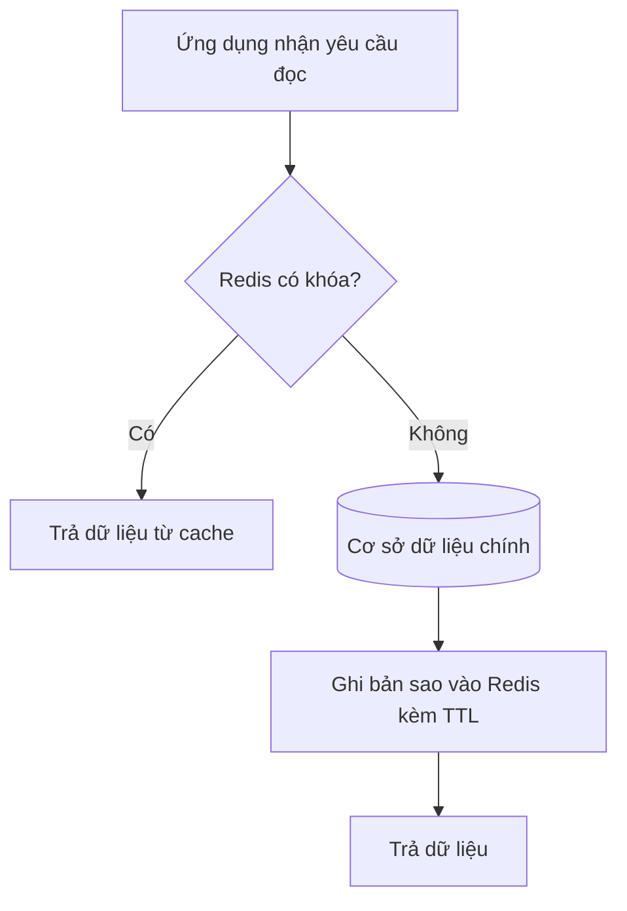

# Khi nào nên dùng Redis và khi nào nên chọn hệ lưu trữ khác

## 1. Redis giải quyết vấn đề gì?

Trong một ứng dụng Spring Boot, không phải dữ liệu nào cũng cần được đọc, ghi và lưu giữ theo cùng một cách. Đơn hàng cần tồn tại lâu dài và được cập nhật nhất quán; thông tin sản phẩm thường xuyên được đọc nhưng ít thay đổi; bộ đếm giới hạn yêu cầu chỉ cần sống vài giây hoặc vài phút; còn ảnh sản phẩm có thể chiếm nhiều megabyte. Đặt tất cả vào một hệ lưu trữ duy nhất thường khiến một số yêu cầu trở nên khó đáp ứng hoặc tốn kém.

**Redis** là một hệ lưu trữ dữ liệu theo khóa, chủ yếu thao tác trên bộ nhớ RAM, hỗ trợ nhiều cấu trúc dữ liệu và các lệnh có thể thực thi nguyên tử trên máy chủ Redis. Redis đặc biệt hữu ích khi ứng dụng cần truy cập nhanh theo khóa, lưu trạng thái dùng chung giữa nhiều instance, tự động hết hạn dữ liệu hoặc cập nhật bộ đếm/tập hợp một cách hiệu quả.

Ví dụ trong hệ thống bán hàng:

- **PostgreSQL** lưu sản phẩm, tồn kho, đơn hàng và giao dịch thanh toán.
- **Redis** lưu bản sao thông tin sản phẩm thường được xem, phiên đăng nhập và bộ đếm giới hạn tần suất gọi API.
- **OpenSearch/Elasticsearch** hỗ trợ tìm kiếm sản phẩm theo từ khóa, bộ lọc và mức độ liên quan.
- **Object storage** lưu hình ảnh, video và các tệp lớn.
- **Message broker/event streaming** phân phối công việc nền hoặc duy trì luồng sự kiện theo yêu cầu xử lý.

Đó là các vai trò có thể phối hợp trong một kiến trúc; Redis không nhất thiết thay thế cơ sở dữ liệu chính.

Trong hệ sinh thái Java, **Spring Data Redis** cung cấp `RedisTemplate`, `StringRedisTemplate`, hỗ trợ cache qua Spring Cache, repository và tích hợp với các cấu trúc dữ liệu của Redis. Thư viện giúp ứng dụng sử dụng Redis thuận tiện hơn, nhưng **không tự thay đổi đặc tính về độ bền, tính nhất quán, dung lượng RAM hay khả năng truy vấn của Redis**. Quyết định có nên dùng Redis phải xuất phát từ tính chất dữ liệu và yêu cầu nghiệp vụ.

## 2. Sáu câu hỏi nên trả lời trước khi chọn hệ lưu trữ

| Câu hỏi | Nếu câu trả lời là… | Hướng lựa chọn |
|---|---|---|
| Dữ liệu có phải **nguồn sự thật** không? | Mất dữ liệu sẽ làm sai đơn hàng, số dư, quyền sở hữu, lịch sử kiểm toán | Ưu tiên cơ sở dữ liệu bền vững với giao dịch thích hợp; Redis chỉ là lớp bổ trợ, trừ khi đã thiết kế rõ ràng các bảo đảm cần thiết |
| Cần truy cập dữ liệu như thế nào? | Biết khóa chính xác, đọc/ghi rất thường xuyên, ít truy vấn phức tạp | Redis phù hợp; nếu cần JOIN, truy vấn tùy ý, báo cáo, tìm kiếm toàn văn thì cân nhắc hệ khác |
| Dữ liệu sống bao lâu? | Vài giây/phút/giờ, có TTL tự nhiên hoặc có thể tái tạo | Redis là ứng viên mạnh |
| Có thể chịu dữ liệu cũ hoặc thiếu tạm thời không? | Cache miss có thể đọc lại DB; mất một bộ đếm thống kê ngắn hạn có thể chấp nhận | Redis phù hợp; cần kiểm soát cửa sổ sai lệch và cách phục hồi |
| Kích thước và tốc độ tăng trưởng ra sao? | Tập dữ liệu nhỏ/vừa, có giới hạn, giá trị truy cập nhanh cao hơn chi phí RAM | Redis khả thi; dữ liệu khổng lồ, lưu nhiều năm thường nên đặt ở hệ dùng đĩa phù hợp |
| Cần tính nhất quán và giao dịch mức nào? | Một thao tác nguyên tử trên một hoặc vài khóa; có thể thiết kế cùng nhóm khóa | Redis có thể đáp ứng; giao dịch nghiệp vụ qua nhiều bảng/thực thể thường hợp với RDBMS |

Không nên quyết định chỉ vì Redis có độ trễ thấp. Cần xét **độ trễ đầu cuối**, băng thông mạng, serialization, yêu cầu phục hồi, tính phức tạp vận hành và chi phí giữ dữ liệu trong RAM.

## 3. Những trường hợp Redis thường là lựa chọn tốt

### 3.1. Cache cho dữ liệu đọc nhiều, thay đổi ít

Ví dụ: chi tiết sản phẩm, thông tin danh mục, cấu hình hiển thị, kết quả tổng hợp đắt đỏ. Một yêu cầu có thể đọc Redis trước; nếu cache miss, ứng dụng lấy dữ liệu từ PostgreSQL rồi lưu bản sao vào Redis với thời gian sống (TTL).



Chiến lược trên thường gọi là **cache-aside**. Lợi ích là giảm truy vấn lặp lại vào cơ sở dữ liệu, cải thiện thời gian phản hồi khi tỷ lệ cache hit cao. Tuy nhiên:

- **TTL không tự bảo đảm dữ liệu mới nhất**: bản sao có thể cũ cho đến khi hết hạn hoặc bị xóa/cập nhật.
- Khi dữ liệu gốc thay đổi, cần có chiến lược **invalidation** phù hợp. Với giao dịch DB, chỉ vô hiệu hóa cache sau khi cập nhật dữ liệu gốc thành công; cần cân nhắc các cuộc đua giữa yêu cầu đọc và ghi.
- Nhiều yêu cầu cùng gặp cache miss cho một khóa có thể tạo **cache stampede**, gây áp lực lên DB. Có thể dùng TTL phân tán ngẫu nhiên, gom các yêu cầu trùng hoặc tải trước dữ liệu nóng.
- Redis ngừng hoạt động có thể khiến truy vấn dồn về DB. Phải dự kiến timeout ngắn, fallback và giới hạn tải.

Cache thích hợp khi có thể xác định **dữ liệu gốc** và **mức độ cũ chấp nhận được**. Không nên cache vô thời hạn các thông tin mà người dùng bắt buộc phải thấy đúng ngay sau khi ghi nếu chưa có cơ chế bảo đảm tính nhất quán.

### 3.2. Session và trạng thái tạm thời dùng chung giữa nhiều instance

Khi triển khai nhiều instance Spring Boot sau load balancer, trạng thái chỉ lưu trong bộ nhớ của một instance có thể biến mất khi instance bị thay thế hoặc người dùng chuyển sang instance khác. Redis giúp các instance cùng truy cập phiên đăng nhập, mã xác minh ngắn hạn, trạng thái giỏ hàng tạm thời hoặc các workflow có thời hạn.

Ví dụ khóa `session:v1:<opaque-id>` có TTL 30 phút. Hệ thống cần quyết định TTL có được gia hạn khi hoạt động hay không, cách thu hồi phiên và điều gì xảy ra khi Redis failover. Chỉ lưu thông tin phiên thực sự cần thiết; khóa không nên chứa email, số điện thoại, token hoặc bí mật dạng đọc được. Dữ liệu nhạy cảm cần kiểm soát quyền truy cập, truyền tải an toàn và chính sách bảo vệ tương ứng.

**Phân biệt:** giỏ hàng có thể lưu tạm trong Redis khi người dùng đang duyệt, nhưng đơn hàng đã xác nhận và thanh toán phải ghi vào hệ thống lưu trữ giao dịch bền vững. Nếu nghiệp vụ yêu cầu khôi phục giỏ hàng sau nhiều tháng hoặc đồng bộ qua nhiều thiết bị một cách đáng tin cậy, có thể cần lưu giỏ hàng chính ở DB và dùng Redis làm cache.

### 3.3. Bộ đếm, hạn mức và rate limiting

Redis có các lệnh như `INCR`, `DECR`, `EXPIRE` và cơ chế chạy script trên máy chủ, phù hợp với bộ đếm lượt xem, giới hạn thử đăng nhập hoặc hạn mức số yêu cầu trong một khoảng thời gian.

Ví dụ: giới hạn tối đa 100 yêu cầu trong mỗi cửa sổ 60 giây cho một người dùng. Với thuật toán *fixed window kể từ yêu cầu đầu tiên*, việc tăng bộ đếm và đặt TTL cần được thực hiện cùng một thao tác nguyên tử. Nếu gọi `INCR` rồi mới `EXPIRE` như hai lệnh độc lập, lỗi giữa hai lệnh có thể để lại khóa không hết hạn.

Một script Redis minh họa ý tưởng:

```lua
-- KEYS[1]: khóa bộ đếm
-- ARGV[1]: TTL tính bằng mili giây
local count = redis.call('INCR', KEYS[1])
if count == 1 then
    redis.call('PEXPIRE', KEYS[1], ARGV[1])
end
return count
```

Ứng dụng so sánh `count` với hạn mức cho phép. Thuật toán này đơn giản nhưng có thể cho phép lượng truy cập tăng đột biến ở ranh giới giữa các cửa sổ. Khi cần giới hạn chặt chẽ hơn, hãy đánh giá *sliding window* hoặc *token bucket*, đồng thời tính đến độ trễ mạng, Redis outage và khả năng lách giới hạn theo danh tính/IP. Nếu việc vượt hạn mức gây tổn thất tài chính hoặc yêu cầu pháp lý nghiêm ngặt, cần cơ chế bền vững và kiểm soát bổ sung.

### 3.4. Cấu trúc dữ liệu cập nhật liên tục

Redis hữu ích vì ngoài chuỗi giá trị (`String`), nó có sẵn nhiều cấu trúc dữ liệu:

| Nhu cầu | Cấu trúc Redis và lệnh tiêu biểu | Ví dụ |
|---|---|---|
| Lấy giá trị theo khóa, bộ đếm | String: `GET`, `SET`, `INCR` | Cache JSON, lượt truy cập |
| Cập nhật thuộc tính đơn giản | Hash: `HGET`, `HSET` | Thuộc tính trạng thái nhỏ của một phiên |
| Quản lý phần tử không trùng | Set: `SADD`, `SISMEMBER` | Danh sách ID đã xử lý ngắn hạn |
| Sắp hạng theo điểm | Sorted set: `ZADD`, `ZREVRANGE` | Bảng xếp hạng theo điểm |
| Danh sách theo thứ tự | List: `LPUSH`, `LRANGE` | Danh sách thao tác ngắn, có giới hạn |
| Luồng sự kiện có consumer group | Stream: `XADD`, `XREADGROUP`, `XACK` | Xử lý sự kiện hoặc tác vụ quy mô phù hợp với Redis |
| Vị trí địa lý cơ bản | Geo: `GEOADD`, `GEOSEARCH` | Tìm vị trí gần một tọa độ |

Ví dụ, bảng xếp hạng điểm số có thể dùng sorted set để tăng điểm và lấy top N mà không phải đọc toàn bộ người chơi vào Java rồi sắp xếp. Tuy nhiên cần giới hạn số bản ghi, thiết kế chính sách xóa dữ liệu cũ và đo dung lượng RAM; lệnh có độ phức tạp khác nhau, không phải mọi thao tác Redis đều là `O(1)`.

### 3.5. Đồng bộ hoặc phối hợp ngắn hạn giữa các instance

Các thao tác như `SET key value NX PX <milliseconds>` có thể hỗ trợ đánh dấu một tác vụ đã được nhận hoặc tạo một lease ngắn hạn. Nhưng **distributed lock** khó hơn việc đặt một khóa: ứng dụng cần token sở hữu duy nhất, chỉ xóa khóa nếu vẫn còn sở hữu, xử lý hết hạn lease khi tác vụ chạy lâu, và cân nhắc *fencing token* khi tài nguyên bên ngoài không được phép chịu thao tác từ chủ khóa cũ.

Vì vậy, dùng Redis cho phối hợp ngắn hạn khi hậu quả xử lý lặp có thể kiểm soát được. Với tác vụ tài chính hay thay đổi dữ liệu quan trọng, ưu tiên ràng buộc duy nhất, giao dịch, idempotency hoặc cơ chế điều phối có độ bền và bảo đảm phù hợp. Không xem một khóa Redis đơn giản là bảo đảm tuyệt đối rằng chỉ có một tác vụ sẽ thực thi.

### 3.6. Pub/Sub và Streams khi đúng yêu cầu giao nhận

- **Redis Pub/Sub** phù hợp với tín hiệu trực tuyến mà bên nhận chỉ cần nhận khi đang kết nối, chẳng hạn yêu cầu làm mới dữ liệu giao diện. Tin nhắn không được giữ lại để subscriber offline đọc bù.
- **Redis Streams** lưu các entry trong stream và hỗ trợ consumer group, xác nhận xử lý, đọc lại entry chưa xác nhận. Đây là lựa chọn hợp lý cho một số luồng tác vụ/sự kiện vừa phải, nếu ứng dụng thiết kế retention, retry, pending entries, idempotency và giám sát.

Khi cần lưu sự kiện dài hạn, phát lại quy mô lớn, nhiều nhóm tiêu thụ độc lập và hệ sinh thái stream processing, nên đánh giá Kafka/Pulsar. Với hàng đợi công việc có routing, retry và dead-letter semantics đặc thù, có thể chọn RabbitMQ hoặc broker chuyên dụng. Đừng đánh đồng Pub/Sub với hàng đợi bền vững.

## 4. Khi nào nên chọn hệ lưu trữ khác?

### 4.1. Cơ sở dữ liệu quan hệ: dữ liệu nghiệp vụ cần giao dịch

**PostgreSQL, MySQL** thường phù hợp với đơn hàng, số dư, thanh toán, tồn kho chuẩn, hợp đồng, quan hệ người dùng–vai trò và dữ liệu cần ràng buộc toàn vẹn. Chúng cung cấp SQL, khóa ngoại, chỉ mục, truy vấn kết hợp và giao dịch ACID theo khả năng của hệ quản trị.

Ví dụ thanh toán cần cùng lúc ghi hóa đơn, cập nhật trạng thái đơn và đảm bảo không trừ tồn kho quá mức. Một vài lệnh Redis nguyên tử trên khóa không thay thế mô hình ràng buộc nghiệp vụ và giao dịch của RDBMS. Redis có thể lưu cache số lượng tồn kho hiển thị, nhưng kiểm tra/trừ tồn kho quyết định vẫn phải thực hiện tại nguồn sự thật với cơ chế tranh chấp phù hợp.

### 4.2. Cơ sở dữ liệu tài liệu: tài liệu lớn, tồn tại lâu và có truy vấn theo trường

**MongoDB** hoặc các document database phù hợp khi dữ liệu có cấu trúc tài liệu linh hoạt, cần lưu bền vững, tạo chỉ mục theo trường và truy vấn/aggregation trên nhiều tài liệu. Redis Hash hay JSON (nếu môi trường có tính năng tương ứng) không mặc nhiên trở thành sự thay thế đầy đủ cho document database về chỉ mục, giao dịch và truy vấn.

Ví dụ hệ thống lưu hồ sơ sản phẩm với nhiều thuộc tính tùy biến và cần lọc theo các thuộc tính đó. Nếu ứng dụng luôn biết khóa sản phẩm và chỉ đọc nhanh một bản sao, Redis cache có thể bổ trợ MongoDB.

### 4.3. Search engine: tìm kiếm toàn văn và xếp hạng liên quan

**OpenSearch/Elasticsearch** thích hợp cho phân tích văn bản, stemming/tokenization, fuzzy search, gợi ý và bộ lọc tìm kiếm phức tạp. Redis có thể cache kết quả truy vấn phổ biến; các khả năng tìm kiếm nâng cao của một số phiên bản/module Redis cần được đánh giá như sản phẩm/tính năng riêng, không giả định Redis lõi luôn có đầy đủ chức năng search engine.

### 4.4. Hệ lưu trữ đối tượng và kho phân tích: dữ liệu lớn, lưu dài hạn

Ảnh, video, file tải xuống và bản sao lưu thường phù hợp với **S3-compatible object storage** hơn RAM của Redis. Với dữ liệu sự kiện nhiều năm, log phân tích hoặc truy vấn tổng hợp theo khối lượng lớn, cân nhắc **ClickHouse, data warehouse, lakehouse** hoặc kho time-series tùy dạng dữ liệu và kiểu truy vấn. Redis có thể giữ số liệu dashboard mới nhất hoặc kết quả tổng hợp có TTL.

### 4.5. Cache khác: khi chưa cần một máy chủ Redis

- **Caffeine/in-memory cache trong JVM**: phù hợp với dữ liệu nhỏ, thuần cục bộ, chấp nhận mỗi instance có bản sao khác nhau. Không cần độ trễ mạng, nhưng không chia sẻ cache và sẽ mất khi tiến trình khởi động lại.
- **Memcached**: có thể đủ nếu chỉ cần cache khóa–giá trị phân tán đơn giản, không cần cấu trúc dữ liệu phong phú hay các khả năng khác của Redis. Việc lựa chọn vẫn phụ thuộc vận hành, tích hợp và quy mô thực tế.

Nếu dữ liệu chỉ được dùng trong một request Java, một cấu trúc dữ liệu trong bộ nhớ của ứng dụng thường còn đơn giản hơn cả cache phân tán.

## 5. Bảng quyết định nhanh theo bài toán

| Bài toán | Lựa chọn chính thường hợp lý | Redis đóng vai trò gì? | Lưu ý quyết định |
|---|---|---|---|
| Thông tin sản phẩm được đọc hàng nghìn lần/phút | RDBMS/document DB làm nguồn gốc | Cache với TTL và invalidation | Chấp nhận độ trễ cập nhật bao lâu? |
| Đặt hàng, thanh toán, số dư | RDBMS có giao dịch/ràng buộc | Có thể hỗ trợ cache/trạng thái tạm | Không quyết toán dựa vào cache |
| Session chia sẻ giữa nhiều Spring Boot instance | Redis hoặc cơ chế session store tương đương | Session store có TTL | Quyết định cách phục hồi khi Redis gián đoạn |
| Giới hạn 100 request/phút | Redis | Bộ đếm nguyên tử/thuật toán giới hạn | Chọn fixed/sliding window theo mức chính xác cần thiết |
| Bảng xếp hạng thời gian gần thực | Redis sorted set | Duy trì thứ hạng nhanh | Có cần giữ lịch sử dài hạn trong DB? |
| Tìm kiếm sản phẩm theo văn bản, độ liên quan | Search engine | Cache kết quả hot | Cần chỉ mục và chiến lược đồng bộ nguồn |
| Lưu ảnh và tệp dung lượng lớn | Object storage | Có thể cache metadata ngắn hạn | Không lưu blob lớn hàng loạt trong RAM |
| Event phải giữ nhiều tuần và phát lại | Event log/broker chuyên dụng | Có thể hỗ trợ một số tín hiệu ngắn hạn | Xác định retention, delivery, replay |
| Log/số liệu lịch sử nhiều năm | Time-series/analytical DB | Cache dashboard | Dữ liệu lịch sử tăng liên tục |
| Cấu hình dùng riêng trong một JVM | Bộ nhớ local/Caffeine | Thường không cần | Có yêu cầu chia sẻ giữa các instance không? |

Đây là điểm khởi đầu, không phải quy tắc cứng. Chẳng hạn Redis có cơ chế persistence và có thể được thiết kế làm kho dữ liệu chính cho một số ứng dụng, nhưng phải kiểm chứng rõ RPO/RTO, giới hạn bộ nhớ, replication và hành vi khi failover; không suy từ chữ “in-memory” rằng dữ liệu chắc chắn mất hết, hoặc suy từ việc bật persistence rằng không bao giờ mất dữ liệu.

## 6. Các đánh đổi kỹ thuật dễ bị bỏ qua

### 6.1. RAM, eviction và TTL là ba vấn đề khác nhau

**TTL** xác định thời điểm khóa hết hiệu lực. **Eviction** là việc Redis chủ động loại bớt dữ liệu khi đạt giới hạn bộ nhớ theo chính sách cấu hình. Một khóa không TTL vẫn có thể bị loại trong một số chính sách eviction; ngược lại, với chính sách `noeviction`, lệnh ghi tăng bộ nhớ có thể bị từ chối khi chạm ngưỡng. Do đó:

1. Định nghĩa tuổi thọ và dung lượng tối đa của từng nhóm khóa.
2. Đánh giá `maxmemory` và chính sách eviction đúng với mục đích: cache có thể chịu loại sớm, trạng thái nghiệp vụ có thể không chịu được.
3. Theo dõi số lượng khóa, kích thước value, overhead cấu trúc dữ liệu, phân bố khóa nóng và tốc độ tăng trưởng.

Không trộn cache có thể bị loại với dữ liệu quan trọng không được mất trong cùng một Redis deployment khi chính sách tài nguyên và độ bền của chúng mâu thuẫn. Khi cần, tách instance/cluster hoặc chọn hệ lưu trữ khác.

### 6.2. Persistence không đồng nghĩa với giao dịch bền vững tuyệt đối

Redis hỗ trợ các cơ chế persistence như **RDB snapshot** và **AOF** (append-only file), tùy cấu hình. RDB tạo ảnh chụp theo thời điểm; AOF ghi lại thao tác và có các chế độ đồng bộ xuống đĩa khác nhau. Mức mất dữ liệu có thể xảy ra phụ thuộc chính sách đồng bộ, lỗi thiết bị, replication, failover và cấu hình cụ thể.

Replica của Redis thường được đồng bộ **bất đồng bộ**, vì vậy chuyển vai trò sang replica sau lỗi có thể mất một số ghi chưa kịp sao chép. Sao lưu, kiểm thử phục hồi, thiết kế HA và mục tiêu **RPO** (lượng dữ liệu có thể mất) / **RTO** (thời gian phục hồi) là yêu cầu kiến trúc, không phải tùy chọn có thể bỏ qua khi Redis giữ dữ liệu quan trọng.

Redis có `MULTI`/`EXEC` và script để nhóm thao tác, nhưng chúng **không có cùng hành vi rollback và giao dịch đa thực thể như RDBMS**. Với Redis Cluster, thao tác đa khóa còn bị ràng buộc bởi cách phân vùng hash slot. Thiết kế phải dựa trên bảo đảm cụ thể của từng lệnh và mô hình triển khai.

### 6.3. Cache làm xuất hiện bài toán nhất quán mới

Trong **cache-aside**, thao tác thường gồm hai hệ thống: ghi DB và xóa/cập nhật Redis. Hai bước đó không nằm trong cùng một giao dịch phân tán mặc định. Nếu xóa cache trước khi DB commit, request khác có thể nạp lại dữ liệu cũ; nếu xóa sau commit nhưng lời gọi Redis thất bại, cache cũ còn tồn tại đến TTL.

Một chiến lược thực tế là DB giữ nguồn sự thật, cache có TTL hữu hạn, invalidation sau commit, theo dõi độ trễ và chấp nhận khoảng stale đã được xác định. Yêu cầu đọc sau ghi nhất quán nghiêm ngặt có thể cần đọc thẳng DB hoặc một thiết kế đồng bộ hóa có bảo đảm cao hơn.

### 6.4. Độ trễ thấp không thay thế việc đo tải thực tế

Redis hoạt động trên RAM, nhưng một lời gọi vẫn chịu độ trễ kết nối, TLS, mạng, serialization và chờ lệnh. Giá trị quá lớn, lệnh quét toàn bộ (`KEYS` trên không gian khóa lớn), xử lý nhiều phần tử hoặc một hot key có thể làm tăng độ trễ. Dùng `SCAN` khi cần duyệt có kiểm soát; ưu tiên thiết kế khóa cho truy cập có mục tiêu và giới hạn độ lớn collections. Cần đo ở các phân vị **p95/p99**, không chỉ thời gian trung bình.

## 7. Áp dụng quyết định với Spring Data Redis

Giả sử ứng dụng Spring Boot đọc mô tả sản phẩm từ PostgreSQL. Đây là dữ liệu có thể cache năm phút để giảm tải đọc; DB vẫn là nguồn sự thật. Spring Cache kết hợp Spring Data Redis là một cách triển khai:

```java
@Configuration
@EnableCaching
class RedisCachingConfig {

    @Bean
    RedisCacheManager cacheManager(RedisConnectionFactory connectionFactory) {
        RedisCacheConfiguration defaults = RedisCacheConfiguration
                .defaultCacheConfig()
                .entryTtl(Duration.ofMinutes(5))
                .disableCachingNullValues();

        return RedisCacheManager.builder(connectionFactory)
                .cacheDefaults(defaults)
                .build();
    }
}
```

```java
@Service
class ProductQueryService {
    private final ProductRepository repository;

    ProductQueryService(ProductRepository repository) {
        this.repository = repository;
    }

    @Cacheable(cacheNames = "productDetails", key = "#id", unless = "#result == null")
    public ProductDto findById(Long id) {
        return repository.findById(id)
                .map(product -> new ProductDto(product.getId(), product.getName()))
                .orElse(null);
    }

    @CacheEvict(cacheNames = "productDetails", key = "#id")
    public void evictAfterSuccessfulUpdate(Long id) {
        // Gọi sau khi cập nhật ở DB đã commit thành công.
    }
}
```

*Đây là ví dụ rút gọn về ý tưởng, giả định ứng dụng đã có Redis connection factory, repository và `ProductDto`.* Trong hệ thống thực cần cấu hình rõ serializer (thường dùng JSON/schema có phiên bản thay vì phụ thuộc Java native serialization mặc định), TTL theo từng loại dữ liệu, tên khóa/cache có namespace, timeout và cách xử lý lỗi Redis. `@Cacheable` áp dụng qua Spring proxy: lời gọi nội bộ `this.findById(...)` trong cùng bean có thể không kích hoạt cache. Thêm `@CacheEvict` không tự giải quyết mọi race giữa đọc/ghi hoặc việc invalidation thất bại; đường ghi cần được thiết kế theo ranh giới commit thực tế.

Nếu chỉ cần thao tác giá trị theo khóa hoặc bộ đếm, có thể dùng `StringRedisTemplate`. Nếu cần hash, set, sorted set, stream hoặc serialize object, dùng các operation tương ứng của `RedisTemplate`/Spring Data Redis. **Chọn API sau khi đã chọn đúng nơi giữ dữ liệu**; không vì Spring Data Redis có annotation tiện lợi mà cache mọi method.

### Thiết kế key và TTL

Một quy ước dễ quản lý:

```text
shop:product:detail:v1:42       -> TTL 5 phút
shop:session:v1:<random-id>     -> TTL theo chính sách session
shop:rate:login:v1:<subject-id> -> TTL theo cửa sổ rate limit
shop:ranking:weekly:2026-W46   -> Xóa khi hết thời gian duy trì bảng xếp hạng
```

Tên khóa nên có namespace ứng dụng, mục đích, phiên bản cấu trúc và ID ổn định; tránh nhúng dữ liệu cá nhân hoặc token bí mật trực tiếp trong khóa. TTL cho cache có thể thêm **jitter** để tránh hàng loạt khóa cùng hết hạn. Việc thay đổi định dạng value cần có kế hoạch tương thích/đổi phiên bản, vì các instance cũ và mới có thể đọc cùng Redis trong lúc triển khai.

### Những số liệu cần theo dõi

| Chỉ số | Ý nghĩa và hành động gợi ý |
|---|---|
| Cache hit/miss, DB fallback | Cache có thực sự giảm tải hay đang tạo thêm chi phí? |
| Latency Redis p95/p99, timeout | Phát hiện nghẽn mạng, lệnh chậm, quá tải hoặc cấu hình timeout chưa hợp lý |
| Used memory, số khóa, key/value size | Dự báo RAM và phát hiện khóa không được dọn dẹp |
| Evicted/expired keys | Phân biệt khóa hết hạn theo TTL với khóa bị loại do thiếu bộ nhớ |
| Số kết nối, lỗi kết nối | Kiểm tra connection pool/client và tính sẵn sàng |
| Replication lag, persistence, failover | Đánh giá rủi ro dữ liệu khi Redis có vai trò quan trọng |
| Tốc độ yêu cầu DB khi cache suy giảm | Đảm bảo backend chịu được cache miss hàng loạt hoặc có cơ chế giới hạn tải |

## 8. Ba tình huống ra quyết định thực tế

**Tình huống A — Trang chi tiết sản phẩm:** 90% yêu cầu là đọc, dữ liệu có thể chậm cập nhật tối đa vài phút. Dùng PostgreSQL làm nguồn gốc và Redis cache với TTL phù hợp; sau khi cập nhật sản phẩm, phát tín hiệu xóa cache sau commit. Đây là trường hợp Redis tạo giá trị rõ ràng.

**Tình huống B — Xác nhận thanh toán:** Mỗi giao dịch phải được ghi đúng một lần, có lịch sử đối soát và cập nhật trạng thái/tiền/tồn kho nhất quán. Chọn RDBMS và cơ chế idempotency/transaction thích hợp làm trọng tâm; Redis có thể hỗ trợ chống gửi lặp tạm thời nhưng không được coi là bản ghi thanh toán cuối cùng.

**Tình huống C — Bảng xếp hạng game theo tuần:** Người chơi được cộng điểm thường xuyên, cần xem top 100 và thứ hạng gần thời gian thực. Redis sorted set phù hợp để duy trì leaderboard hoạt động. Nếu cần lưu kết quả nhiều năm, chống gian lận hoặc kiểm toán điểm, đồng bộ snapshot/sự kiện đã được xác thực sang kho lưu trữ bền vững và đặt chính sách dọn tuần cũ.

## 9. Quy tắc lựa chọn có thể áp dụng ngay

Hãy bắt đầu bằng việc xác định **ai là nguồn sự thật**, **dữ liệu sống bao lâu**, **truy cập bằng khóa hay truy vấn**, **mất hoặc đọc cũ có hậu quả gì**, và **chi phí vận hành khi số lượng người dùng tăng**. Chọn Redis khi lợi ích từ truy cập nhanh, TTL, thao tác nguyên tử hoặc cấu trúc dữ liệu của Redis đáp ứng trực tiếp những yêu cầu đó. Chọn RDBMS, document DB, search engine, broker, object storage hay analytical DB khi bài toán đòi hỏi thế mạnh riêng của các hệ này.

Với Spring Data Redis, một thiết kế tốt thường là: **cơ sở dữ liệu bền vững quản lý dữ liệu nghiệp vụ; Redis tăng tốc các đường đọc nóng hoặc quản lý trạng thái tạm; Spring Boot kiểm soát TTL, invalidation, timeout và fallback**. Có những ứng dụng dùng Redis làm kho chính một cách hợp lý, nhưng đó phải là quyết định dựa trên yêu cầu độ bền và kết quả kiểm thử phục hồi cụ thể, không chỉ dựa trên tốc độ.
