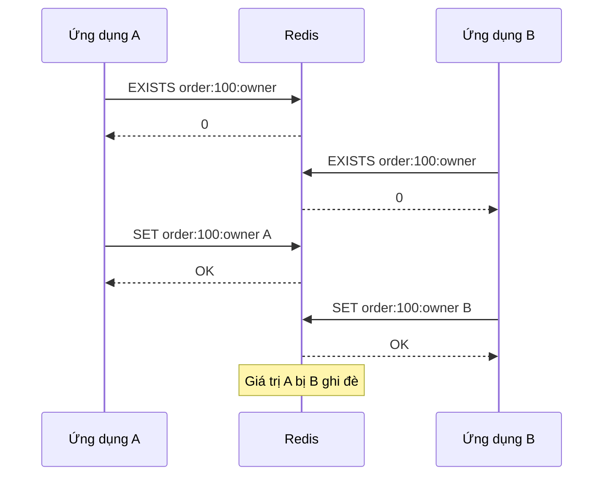
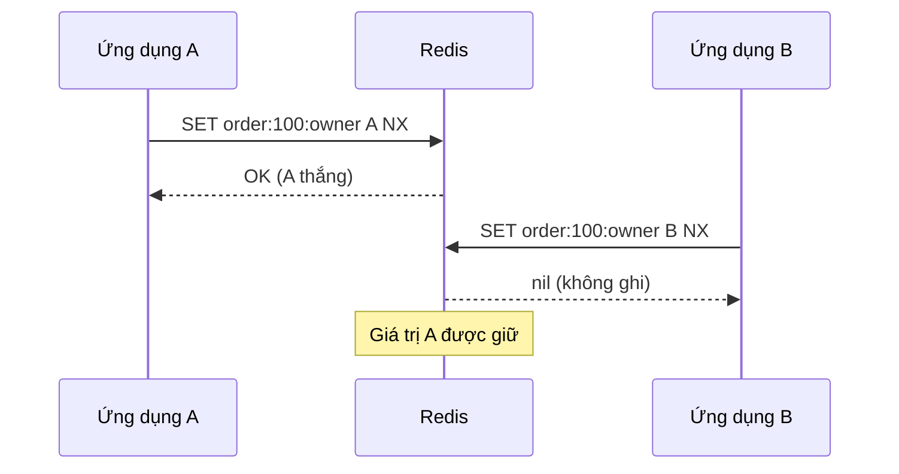

# Ghi có điều kiện bằng setIfAbsent và setIfPresent

Khi nhiều request hoặc nhiều instance ứng dụng Spring cùng truy cập Redis, việc ghi dữ liệu thường cần có điều kiện: **chỉ tạo giá trị nếu khóa chưa tồn tại** hoặc **chỉ cập nhật khi khóa đã tồn tại**. Spring Data Redis cung cấp hai thao tác trực tiếp cho nhu cầu này qua `ValueOperations`:

- `setIfAbsent(key, value)`: ghi khi khóa **chưa tồn tại**.
- `setIfPresent(key, value)`: ghi khi khóa **đã tồn tại**.

Cả hai có thể dùng với thời gian hết hạn (TTL) và dựa trên các tùy chọn điều kiện của lệnh Redis `SET`. Đặc điểm quyết định là **kiểm tra sự tồn tại và ghi được thực hiện cùng một lệnh nguyên tử trên Redis**. Điều này khác căn bản với việc gọi `hasKey()` hoặc `get()` rồi mới `set()` từ Java.

Bài học thuộc nhóm **Chuỗi và bộ đếm** trong Spring Data Redis, tập trung vào semantics khi ghi Redis String, xử lý cạnh tranh và thời gian sống của khóa. Các ví dụ dùng `StringRedisTemplate` để dễ theo dõi dữ liệu được ghi.

## 1. Hiểu Redis String và thao tác SET

### 1.1. Ghi bình thường luôn có thể thay giá trị cũ

Lệnh Redis cơ bản:

```redis
SET account:42:status ACTIVE
```

Nếu `account:42:status` chưa tồn tại, Redis tạo khóa mới. Nếu khóa đã tồn tại, Redis ghi đè giá trị.

Trong Spring Data Redis:

```java
stringRedisTemplate.opsForValue().set("account:42:status", "ACTIVE");
```

Đây là **ghi vô điều kiện**. Nhiều request cùng gọi `set()` có thể ghi đè lên nhau; giá trị cuối cùng phản ánh lệnh ghi được Redis xử lý sau cùng, không nhất thiết là request bắt đầu sau cùng ở phía Java.

Nếu cần thao tác ghi phụ thuộc trạng thái tồn tại của khóa, dùng `NX` hoặc `XX` của Redis.

### 1.2. NX và XX là gì?

Redis `SET` hỗ trợ tùy chọn điều kiện:

```redis
SET key value NX
SET key value XX
```

| Tùy chọn | Nghĩa | Khi khóa chưa tồn tại | Khi khóa đã tồn tại |
|---|---|---|---|
| Không có tùy chọn | Ghi vô điều kiện | Tạo khóa và ghi | Ghi đè |
| `NX` | Only if **Not eXists** | **Ghi thành công** | Không ghi |
| `XX` | Only if **eXists** | Không ghi | **Ghi thành công** |

`NX` và `XX` là hai điều kiện loại trừ nhau cho cùng một phép ghi. Chúng **không kiểm tra giá trị cũ có bằng một giá trị mong đợi hay không**; chúng chỉ kiểm tra khóa có tồn tại tại lúc Redis thực thi lệnh.

Ví dụ:

```redis
DEL demo:status

SET demo:status NEW NX
GET demo:status

SET demo:status PAID NX
GET demo:status

SET demo:status PAID XX
GET demo:status
```

Kết quả theo thứ tự trong môi trường không có client khác xen vào:

1. `DEL` bảo đảm khóa không tồn tại trước thực hành.
2. `SET ... NEW NX` thành công vì chưa có khóa.
3. `GET` trả `NEW`.
4. `SET ... PAID NX` không ghi vì khóa đã tồn tại.
5. `GET` vẫn trả `NEW`.
6. `SET ... PAID XX` thành công vì khóa đang tồn tại.
7. `GET` trả `PAID`.

Ở mức lệnh Redis, `SET ... NX/XX` trả `OK` nếu ghi được và trả nil/null reply nếu điều kiện không thỏa. Khi đi qua Spring Data Redis, `setIfAbsent` và `setIfPresent` cung cấp kết quả kiểu `Boolean` theo hợp đồng API, thay vì bắt ứng dụng tự diễn giải `OK` hay nil.

### 1.3. Một bảng quyết định cho ứng dụng

| Mục đích | API Spring Data Redis | Điều kiện Redis |
|---|---|---|
| Ghi đè bất kể khóa đã có hay chưa | `opsForValue().set(key, value)` | `SET` thông thường |
| Tạo giá trị một lần nếu chưa có key | `opsForValue().setIfAbsent(key, value)` | `SET ... NX` |
| Cập nhật chỉ khi đã có key | `opsForValue().setIfPresent(key, value)` | `SET ... XX` |
| Tạo có điều kiện kèm hết hạn | `setIfAbsent(key, value, duration)` | `SET ... NX` cùng expiry |
| Cập nhật có điều kiện kèm hết hạn mới | `setIfPresent(key, value, duration)` | `SET ... XX` cùng expiry |

Với các trường hợp tạo khóa có TTL, lệnh `SET` có điều kiện cùng expiry là lựa chọn trực tiếp và rõ ràng hơn việc ghép những lệnh rời.

## 2. Các overload quan trọng trong Spring Data Redis

### 2.1. API `ValueOperations`

Sau khi có một bean `StringRedisTemplate` hoặc `RedisTemplate<K, V>`, dùng:

```java
ValueOperations<String, String> values = stringRedisTemplate.opsForValue();
```

Những chữ ký thường dùng:

```java
Boolean setIfAbsent(K key, V value);

Boolean setIfAbsent(K key, V value, Duration timeout);

Boolean setIfAbsent(K key, V value, long timeout, TimeUnit unit);

Boolean setIfPresent(K key, V value);

Boolean setIfPresent(K key, V value, Duration timeout);

Boolean setIfPresent(K key, V value, long timeout, TimeUnit unit);
```

Đây là các chữ ký khái niệm của interface generic `ValueOperations<K, V>`; khi dùng `StringRedisTemplate`, `K` và `V` là `String`.

**Ý nghĩa Boolean trong ngữ cảnh gọi đồng bộ thông thường:**

- `Boolean.TRUE`: điều kiện thỏa và Redis đã thực hiện ghi.
- `Boolean.FALSE`: điều kiện không thỏa, Redis không ghi giá trị được đề nghị.
- `null`: có thể xuất hiện khi lệnh đang được đưa vào pipeline hoặc transaction; đây chưa phải kết luận khóa tồn tại hay không.

Không nên viết `if (values.setIfAbsent(key, value))` trong code có thể chạy trong pipeline/transaction vì việc auto-unbox `Boolean` null thành `boolean` có thể gây `NullPointerException`.

### 2.2. Ví dụ đơn giản với `StringRedisTemplate`

```java
import org.springframework.data.redis.core.StringRedisTemplate;
import org.springframework.stereotype.Service;

@Service
public class StatusWriter {

    private final StringRedisTemplate redis;

    public StatusWriter(StringRedisTemplate redis) {
        this.redis = redis;
    }

    public boolean createStatus(String accountId, String status) {
        String key = "account:status:" + accountId;

        Boolean written = redis.opsForValue().setIfAbsent(key, status);
        return Boolean.TRUE.equals(written);
    }

    public boolean updateStatus(String accountId, String status) {
        String key = "account:status:" + accountId;

        Boolean written = redis.opsForValue().setIfPresent(key, status);
        return Boolean.TRUE.equals(written);
    }
}
```

Đoạn code giả định gọi trực tiếp theo cách **đồng bộ thông thường**, bên ngoài pipeline/transaction. `Boolean.TRUE.equals(...)` an toàn về mặt null, nhưng nó **gộp `null` với `false`**. Với tầng nghiệp vụ cần phân biệt “không ghi” và “chưa có kết quả”, nên kiểm tra riêng:

```java
private static boolean requireCompleted(Boolean result) {
    if (result == null) {
        throw new IllegalStateException(
                "Redis conditional write result is not available yet");
    }
    return result;
}
```

Trả kiểu `boolean` có thể hợp lý khi service bảo đảm không thực hiện trong pipeline/transaction. Nếu đã có pipeline, cần lấy kết quả từ quá trình hoàn tất pipeline thay vì tự suy luận bên trong callback.

### 2.3. Điều gì xảy ra nếu các key hoặc value khác kiểu serializer?

`StringRedisTemplate` dùng string serializers cho key và value. Với `RedisTemplate<String, MyObject>`, hệ thống có thể dùng serializer khác cho value, còn Redis vẫn chỉ nhận những byte sau khi serialize.

Ví dụ `setIfAbsent("user:1", object)` chỉ kiểm tra **sự tồn tại của key byte đã được serialize**. Nếu một ứng dụng dùng key serializer JDK còn ứng dụng khác dùng UTF-8 string, hai ứng dụng có thể đang thao tác trên **hai key byte khác nhau** dù Java string đầu vào giống nhau.

`NX/XX` không biết khái niệm JSON schema, Java class hay phiên bản serializer. Khi thao tác nhiều service trên cùng Redis, phải thống nhất key namespace, charset và serialization.

## 3. Vì sao ghi có điều kiện là nguyên tử?

### 3.1. Cách làm dễ sai: đọc rồi quyết định ghi

Giả sử hai instance ứng dụng đều muốn tạo khóa `order:100:owner` nếu chưa có:

```java
if (Boolean.FALSE.equals(redis.hasKey(key))) {
    redis.opsForValue().set(key, owner);
}
```

Đoạn trên có **race condition**. Hai thao tác `hasKey` và `set` là hai lệnh riêng nên client khác có thể ghi xen giữa:



Cả hai client đều nhìn thấy khóa vắng mặt, sau đó đều ghi. Điều kiện không còn đúng ở thời điểm ghi.

### 3.2. `SET NX` ghép kiểm tra và ghi vào một lệnh

Nếu thay bằng:

```java
Boolean result = redis.opsForValue().setIfAbsent(key, owner);
```

Redis xử lý điều kiện tồn tại và việc ghi **trong một lệnh đơn lẻ**:



Nếu Redis xử lý lệnh của B trước, B có thể là bên thắng. **Không thể dự đoán bên thắng chỉ từ thời điểm một request bắt đầu ở ứng dụng**; kết quả phụ thuộc thứ tự server thực thi lệnh.

Tính nguyên tử ở đây có nghĩa: một lệnh có điều kiện không bị client khác chen **vào giữa bước kiểm tra tồn tại và bước ghi của chính lệnh đó**.

### 3.3. `SET XX` cũng nguyên tử theo cùng nguyên tắc

`setIfPresent` kiểm tra key tồn tại và ghi trong một lệnh:

```java
Boolean updated = redis.opsForValue().setIfPresent(key, "CONFIRMED");
```

Nếu key đã hết TTL hoặc bị xóa **trước lúc lệnh này được Redis thực thi**, kết quả là false và không tạo lại key. Nếu key đang tồn tại đúng thời điểm xử lý, lệnh ghi thành công.

Đây là lựa chọn hữu ích khi chỉ muốn làm mới trạng thái của một bản ghi hiện hữu và tránh việc một bản ghi đã bị xóa lại được `SET` thông thường tạo lại.

### 3.4. Nguyên tử trên một lệnh không phải transaction nghiệp vụ

Các điều sau **không** được bảo đảm chỉ bởi `NX` hoặc `XX`:

- Không bảo đảm một **chuỗi nhiều lệnh** sẽ chạy nguyên tử.
- Không kiểm tra “giá trị hiện tại đúng bằng X”.
- Không bảo đảm persistence hoặc replication đã đồng bộ đến mọi replica trước khi client nhận kết quả.
- Không biến Redis thành cơ chế exactly-once bền vững khi có mạng lỗi, restart, eviction hay failover.
- Không khóa toàn bộ các key khác trong một workflow.

Để cập nhật có điều kiện dựa trên **giá trị cũ** (compare-and-set), phải dùng giải pháp phù hợp như Lua script, Redis Functions hoặc `WATCH` với transaction, thay vì dùng `setIfPresent`.

## 4. Kết hợp điều kiện với TTL

TTL (time to live) xác định thời gian sống của key trên Redis. Đây là phần dễ sai nhất khi dùng `setIfAbsent` hoặc `setIfPresent`.

### 4.1. Tạo key kèm TTL trong một lệnh

Ví dụ ứng dụng cần giữ dấu hiệu “đã nhận sự kiện” trong 15 phút:

```java
import java.time.Duration;

Boolean created = redis.opsForValue().setIfAbsent(
        "event:seen:evt-100",
        "1",
        Duration.ofMinutes(15)
);
```

Tương ứng về ngữ nghĩa Redis:

```redis
SET event:seen:evt-100 1 NX EX 900
```

Redis chỉ ghi và đặt TTL nếu key chưa tồn tại. **Điều kiện tồn tại, ghi và đặt hạn diễn ra cùng một lệnh**.

Khi điều kiện NX không thỏa, Redis không ghi giá trị mới và **không làm mới TTL của key đã tồn tại**.

Điều này khác với hai lệnh tách rời:

```java
// Tránh khi yêu cầu "tạo key + gắn TTL" phải là một thao tác nguyên tử.
Boolean created = redis.opsForValue().setIfAbsent(key, "1");

if (Boolean.TRUE.equals(created)) {
    redis.expire(key, Duration.ofMinutes(15));
}
```

Nếu ứng dụng mất kết nối hoặc process dừng **sau khi SET NX thành công nhưng trước khi EXPIRE**, key có thể tồn tại mà không có TTL. Do đó, ưu tiên overload `setIfAbsent(key, value, Duration)`.

### 4.2. `setIfPresent` với TTL mới

Nếu key chỉ được phép cập nhật khi tồn tại và mỗi cập nhật cần làm mới hạn:

```java
Boolean refreshed = redis.opsForValue().setIfPresent(
        "session:42",
        "ACTIVE",
        Duration.ofMinutes(30)
);
```

Ý tưởng Redis:

```redis
SET session:42 ACTIVE XX EX 1800
```

Nếu key hiện hữu, giá trị được đổi thành `ACTIVE` và TTL được đặt theo thời gian mới. Nếu key đã vắng mặt, cả value và TTL đều không bị thay đổi.

### 4.3. Ghi thành công không kèm timeout có thể xóa TTL cũ

Theo semantics của Redis `SET`, một lệnh `SET` thành công **không có tùy chọn hết hạn/`KEEPTTL` sẽ loại bỏ thời gian hết hạn trước đó** của key.

Ví dụ:

```redis
SET demo:ttl A EX 60
TTL demo:ttl

SET demo:ttl B XX
TTL demo:ttl
```

Nếu chưa hết hạn và không có client khác can thiệp, `SET ... XX` thành công. Lệnh `TTL` cuối trả `-1`: key hiện tại **không có thời gian hết hạn**.

Tình huống này thường bất ngờ khi code dùng:

```java
redis.opsForValue().setIfPresent(key, newValue);
```

để làm mới nội dung của key cache có TTL. Sau cập nhật, key có thể trở thành persistent. Nếu cần duy trì một thời gian hết hạn mới, dùng overload có `Duration`.

Redis còn hỗ trợ tùy chọn `KEEPTTL` trong lệnh `SET` trên phiên bản hỗ trợ, ví dụ:

```redis
SET demo:ttl C XX KEEPTTL
```

Tùy chọn này giữ TTL hiện hành nếu lệnh ghi thành công. **Không giả định `ValueOperations.setIfPresent(key, value)` tự thêm `KEEPTTL`**; nếu nghiệp vụ cần giữ chính xác TTL cũ, phải sử dụng API/client hoặc lệnh Redis hỗ trợ `XX KEEPTTL`, sau khi xác minh phiên bản driver và cách gọi tương ứng.

### 4.4. Bảng hành vi TTL

| Thao tác | Key vắng mặt | Key tồn tại có TTL | Key tồn tại không có TTL |
|---|---|---|---|
| `setIfAbsent(k,v)` | Ghi; không có TTL mới | Không ghi; TTL giữ nguyên | Không ghi |
| `setIfAbsent(k,v,duration)` | Ghi và gắn TTL | Không ghi; TTL giữ nguyên | Không ghi |
| `setIfPresent(k,v)` | Không ghi | Ghi và **bỏ TTL cũ** | Ghi; vẫn không TTL |
| `setIfPresent(k,v,duration)` | Không ghi | Ghi, **đặt lại TTL** | Ghi, tạo TTL mới |
| `SET k v XX KEEPTTL` | Không ghi | Ghi và **giữ TTL cũ** | Ghi, không có TTL |

TTL được server tính theo thời gian. Một key có thể tồn tại lúc client ra quyết định gọi method nhưng đã hết hạn trước khi lệnh tới Redis.

### 4.5. Kiểm tra TTL bằng Redis CLI

```bash
redis-cli DEL demo:conditional:ttl

redis-cli SET demo:conditional:ttl first NX EX 120
redis-cli TTL demo:conditional:ttl

redis-cli SET demo:conditional:ttl ignored NX EX 900
redis-cli TTL demo:conditional:ttl

redis-cli SET demo:conditional:ttl second XX EX 45
redis-cli TTL demo:conditional:ttl

redis-cli SET demo:conditional:ttl third XX
redis-cli TTL demo:conditional:ttl
```

Diễn giải:

- Lệnh NX đầu tạo key và đặt TTL xấp xỉ 120 giây.
- NX thứ hai thất bại vì key đã tồn tại, không thay TTL thành 900 giây.
- XX kèm `EX 45` thành công, làm mới thời hạn xấp xỉ 45 giây.
- XX không có expiry thành công, **loại bỏ TTL**, nên `TTL` cuối trả `-1`.

Redis `TTL` quy ước `-1` khi key tồn tại nhưng không có hạn, và `-2` khi key không tồn tại. Muốn biết thời gian ở độ phân giải mili giây, dùng `PTTL`. Thời gian thực tế giảm dần trong lúc chạy lệnh, nên không dựa vào số giây tuyệt đối cho phép thử có độ trễ.

## 5. Ví dụ thực tế: tạo trạng thái mặc định và cập nhật khi còn hiệu lực

Giả sử có một quy trình xác thực tạm thời. Trạng thái chỉ nên được tạo lần đầu khi chưa có khóa, và cập nhật chỉ khi khóa chưa bị xóa/hết hạn.

### 5.1. Thiết kế key và kết quả

```text
Key:   verification:session:<session-id>
Value: PENDING | VERIFIED | REJECTED
TTL:   10 phút kể từ lúc tạo hoặc thời hạn mới theo chính sách
```

Yêu cầu:

1. Request tạo session chỉ thành công khi key vắng mặt.
2. Request cập nhật chỉ thành công khi session key còn tồn tại.
3. Mọi session phải có TTL.
4. Ứng dụng biết trường hợp ghi có điều kiện không thành công.

### 5.2. Service Spring Data Redis

```java
import java.time.Duration;
import java.util.Objects;

import org.springframework.data.redis.core.StringRedisTemplate;
import org.springframework.stereotype.Service;

@Service
public class VerificationSessionStore {

    private static final Duration SESSION_TTL = Duration.ofMinutes(10);

    private final StringRedisTemplate redis;

    public VerificationSessionStore(StringRedisTemplate redis) {
        this.redis = redis;
    }

    public boolean createIfMissing(String sessionId) {
        String key = keyFor(sessionId);
        Boolean result = redis.opsForValue().setIfAbsent(
                key, "PENDING", SESSION_TTL);

        return completed(result);
    }

    public boolean updateIfExists(String sessionId, String newStatus) {
        Objects.requireNonNull(newStatus, "newStatus");

        if (!newStatus.equals("VERIFIED")
                && !newStatus.equals("REJECTED")) {
            throw new IllegalArgumentException("Unsupported status");
        }

        String key = keyFor(sessionId);
        Boolean result = redis.opsForValue().setIfPresent(
                key, newStatus, SESSION_TTL);

        return completed(result);
    }

    public String find(String sessionId) {
        return redis.opsForValue().get(keyFor(sessionId));
    }

    private String keyFor(String sessionId) {
        Objects.requireNonNull(sessionId, "sessionId");

        if (sessionId.isBlank()) {
            throw new IllegalArgumentException("sessionId is blank");
        }

        return "verification:session:" + sessionId;
    }

    private static boolean completed(Boolean result) {
        if (result == null) {
            throw new IllegalStateException(
                    "Conditional Redis write did not yield a result");
        }
        return result;
    }
}
```

Diễn giải:

- `createIfMissing` trả true khi Redis tạo session, false khi session đã có.
- `updateIfExists` trả true khi session đang tồn tại và được cập nhật, false khi không còn session.
- Cả hai đều gắn TTL cùng lệnh ghi thành công.
- `completed` yêu cầu code gọi theo đường đồng bộ bình thường; nếu kết quả chưa khả dụng do pipeline/transaction, không âm thầm đánh đồng `null` với false.

**Giới hạn nghiệp vụ:** `updateIfExists` chỉ kiểm tra session **còn tồn tại**. Nó có thể đổi `VERIFIED` thành `REJECTED` nếu được gọi với trạng thái đó. Nếu quy trình yêu cầu chuyển trạng thái hợp lệ, ví dụ chỉ được chuyển `PENDING → VERIFIED` một lần, cần cơ chế so sánh trạng thái cũ, không thể chỉ dựa vào `XX`.

### 5.3. Vì sao không gọi GET rồi SET XX để bảo vệ trạng thái?

Ví dụ sau không bảo đảm chuyển trạng thái `PENDING → VERIFIED` nguyên tử:

```java
String current = redis.opsForValue().get(key);

if ("PENDING".equals(current)) {
    redis.opsForValue().setIfPresent(key, "VERIFIED");
}
```

Giữa `GET` và `SET XX`, client khác có thể đổi giá trị thành `REJECTED`. `SET XX` vẫn thành công nếu key còn tồn tại, dù giá trị hiện tại đã khác `PENDING`.

Với yêu cầu **so sánh giá trị cũ rồi thay giá trị**, có thể dùng Lua script atomic như ví dụ sau.

## 6. So sánh tồn tại khác với compare-and-set theo giá trị

### 6.1. `NX` và `XX` không kiểm tra nội dung cũ

Điều kiện:

```text
NX: key không tồn tại
XX: key tồn tại
```

Điều kiện nghiệp vụ có thể cần:

```text
Chỉ thay NEW → PROCESSING
Chỉ thay version 3 → version 4
Chỉ thay ownerId nếu đang là người sở hữu dự kiến
```

Các điều kiện sau không được mô tả bằng `NX` hoặc `XX`. Việc key tồn tại chưa nói lên version, trạng thái hay owner đúng.

### 6.2. Lua script để compare-and-set

Ví dụ chỉ chuyển `PENDING` thành `VERIFIED`, đồng thời làm mới TTL nếu thành công:

```lua
-- KEYS[1]: Redis key
-- ARGV[1]: expected old value
-- ARGV[2]: new value
-- ARGV[3]: TTL milliseconds

if redis.call('GET', KEYS[1]) == ARGV[1] then
    redis.call('PSETEX', KEYS[1], tonumber(ARGV[3]), ARGV[2])
    return 1
end

return 0
```

Các lệnh bên trong script được Redis thực thi như một đơn vị nguyên tử đối với các thao tác khác. Nếu key đã mất hoặc value không còn là `PENDING`, script trả 0, không ghi.

Đây là **một ví dụ** về cách mở rộng logic khi `NX/XX` chưa đủ; nếu hệ thống cần versioning, lease hoặc chính sách chuyển trạng thái phức tạp hơn, script và dữ liệu cần được thiết kế theo hợp đồng riêng.

Một chiến lược khác là `WATCH` + `MULTI/EXEC` và retry có giới hạn khi có xung đột. Chọn công cụ tùy trường hợp, không tự coi `setIfPresent` là compare-and-set.

### 6.3. Tránh trộn yêu cầu key tồn tại với kiểm soát thứ tự nghiệp vụ

Nếu cần bảo đảm một đơn hàng chỉ được chuyển qua chuỗi `CREATED → PAID → SHIPPED`, thao tác `setIfPresent` chỉ đảm bảo key hiện hữu. Nó **không cấm ghi `SHIPPED` trước khi có `PAID`**. Dữ liệu cần lưu trạng thái/version, rồi áp dụng transition check nguyên tử hoặc ghi ở cơ sở dữ liệu có ràng buộc phù hợp.

## 7. Bộ đếm: khi nào cần setIfAbsent?

### 7.1. Khởi tạo bộ đếm nếu chưa có

Ví dụ muốn cấp giá trị ban đầu là `0` khi lần đầu mở bộ đếm:

```java
Boolean initialized = redis.opsForValue().setIfAbsent(
        "visits:homepage",
        "0"
);
```

Nếu đã có bộ đếm, thao tác không thay số hiện tại. Đây là một ứng dụng thực tế của `NX`.

### 7.2. `INCR` đã xử lý key vắng mặt

Với nhu cầu phổ biến là “mỗi request tăng bộ đếm một đơn vị”, Redis `INCR` đã có semantics phù hợp:

```java
Long count = redis.opsForValue().increment("visits:homepage");
```

Khi key chưa tồn tại, Redis xử lý giá trị bắt đầu như 0 rồi tăng lên 1. Vì thế **không cần gọi `setIfAbsent(key, "0")` trước mỗi lần `increment`** chỉ để tạo bộ đếm.

Điều quan trọng:

- `INCR` là một lệnh tăng nguyên tử.
- `SET key 0 NX` là thao tác khởi tạo có điều kiện.
- Nếu key đang chứa chuỗi không biểu diễn số nguyên hợp lệ, `INCR` có thể báo lỗi.
- `INCR` trên key có TTL thường giữ TTL hiện tại, trong khi một `SET` thành công không kèm expiry có thể bỏ TTL.

### 7.3. Bộ đếm cần TTL và trường hợp tranh chấp

Ví dụ cửa sổ đếm request trong một phút có thể cần:

1. Tạo bộ đếm với TTL nếu chưa có.
2. Tăng giá trị mỗi lần yêu cầu.

Nếu thực hiện thành **nhiều lệnh rời**, cần xem xét ngữ nghĩa khi hai client cùng truy cập, thời điểm TTL được đặt và tình huống process dừng. Nếu cần “tăng và đặt TTL chỉ khi lần đầu tạo” như một hành động nguyên tử, dùng Lua script hoặc cơ chế chuyên dụng phù hợp.

Ví dụ ý tưởng Lua:

```lua
-- KEYS[1]: key counter
-- ARGV[1]: TTL milliseconds

local count = redis.call('INCR', KEYS[1])

if count == 1 then
    redis.call('PEXPIRE', KEYS[1], tonumber(ARGV[1]))
end

return count
```

Với mô hình này, key phải thuộc namespace do ứng dụng kiểm soát và dữ liệu phải luôn là số nguyên. Trường hợp key bị sửa từ nơi khác hoặc còn TTL từ trước phải được xác định trong hợp đồng. Đây là mẫu cửa sổ tính theo lần tạo đầu tiên, **không phải** thuật toán sliding-window rate limiting hoàn chỉnh.

## 8. setIfAbsent dùng làm dấu hiệu độc quyền hoặc khóa tạm

### 8.1. Giành quyền xử lý một job

Một ứng dụng có nhiều worker có thể muốn chỉ một worker nắm quyền xử lý một công việc trong một khoảng thời gian:

```java
String lockKey = "job:lock:123";
String token = UUID.randomUUID().toString();

Boolean acquired = redis.opsForValue().setIfAbsent(
        lockKey,
        token,
        Duration.ofSeconds(30)
);
```

Khi true, worker đã ghi token vào khóa chưa tồn tại. Khi false, khóa đã tồn tại tại thời điểm lệnh được xử lý. TTL giúp khóa không tồn tại mãi nếu worker bị dừng đột ngột.

**Không dùng `setIfAbsent(lockKey, token)` không TTL cho một khóa tạm nếu process có thể chết mà không xóa được key.** Khóa có thể treo vô hạn.

### 8.2. Vì sao không được giải phóng lock bằng DEL vô điều kiện?

Hãy xét chuỗi:

1. Worker A giành lock có TTL 30 giây.
2. Worker A bị tạm dừng 35 giây; lock hết hạn.
3. Worker B giành lock mới bằng token khác.
4. Worker A tiếp tục và gọi `DEL lockKey`.

Nếu A dùng `DEL` trực tiếp, nó xóa luôn lock của B. Cần **chỉ giải phóng khi token hiện tại còn thuộc quyền của mình**, bằng một thao tác nguyên tử như Lua:

```lua
-- KEYS[1]: lock key
-- ARGV[1]: token của worker muốn nhả lock

if redis.call('GET', KEYS[1]) == ARGV[1] then
    return redis.call('DEL', KEYS[1])
end

return 0
```

Nếu giá trị không trùng token, script không xóa khóa. Đoạn script tránh lỗi check-then-delete không nguyên tử.

### 8.3. Đây chưa phải bảo đảm distributed lock tuyệt đối

Ngay cả khi có TTL và token:

- Worker A có thể tiếp tục xử lý công việc **sau khi lease đã hết**, cùng lúc B đã giành quyền.
- Redis replication/failover có thể ảnh hưởng tới tính chất an toàn của một cơ chế dựa trên lock nếu không được thiết kế cẩn thận.
- Đối với cập nhật tài nguyên ngoài Redis, cần cân nhắc **fencing token** hoặc ràng buộc nhất quán ở hệ thống nhận ghi.
- Nếu cần chống xử lý trùng nghiêm ngặt, khóa Redis đơn giản chưa thay được cơ chế unique constraint/transaction ở nơi lưu trạng thái nghiệp vụ.

`setIfAbsent` là một **primitive tạo quyền có điều kiện**, hữu ích trong nhiều bài toán, nhưng không tự là một thư viện distributed lock hoàn chỉnh.

## 9. Hành vi khi pipeline và transaction

### 9.1. Vì sao kết quả có thể là null?

Spring Data Redis có thể gửi nhiều lệnh trong pipeline rồi thu phản hồi sau. Khi lệnh chưa có phản hồi tại thời điểm Java gọi method, các thao tác như `setIfAbsent` hoặc `setIfPresent` có thể trả `null` trong callback pipeline.

```java
redisTemplate.executePipelined((RedisCallback<Object>) connection -> {
    // Lệnh gửi vào pipeline.
    // Không thể quyết định nhánh nghiệp vụ dựa trên kết quả ngay ở đây.
    return null;
});
```

Kết quả của các lệnh pipeline được thu qua **giá trị trả về của `executePipelined`**, theo thứ tự tương ứng. Không nên gọi một method trả `Boolean` trong callback rồi dùng `null` để suy ra “key vắng” hoặc “key đã có”.

### 9.2. Transaction `MULTI/EXEC`

Trong transaction, Redis có thể trả `QUEUED` khi lệnh mới được xếp hàng; các kết quả thực thi được trả khi `EXEC` chạy. Spring Data Redis có thể hoãn kết quả cho đến thời điểm transaction hoàn tất.

Nếu cần biết một lệnh `SET ... NX` trong transaction có ghi hay không, phải xem **kết quả sau khi EXEC**, không dựa vào return value tức thời của lời gọi Java lúc đang queue.

### 9.3. Pipeline không biến các lệnh riêng thành một thao tác nguyên tử

Pipeline làm giảm thời gian chờ request–response của nhiều lệnh. Nếu pipeline `EXISTS key` và `SET key value` riêng biệt, vẫn có nguy cơ tranh chấp khi client khác thao tác xen vào. Dùng `setIfAbsent` hoặc `setIfPresent` khi cần điều kiện và ghi trong một command.

## 10. Những điều kiện đặc biệt ảnh hưởng kết quả

### 10.1. Key tồn tại dù value rỗng

Redis không đánh giá value có “truthy” hay không. Các khóa sau đều được coi là **tồn tại**:

```redis
SET demo:empty ""
SET demo:zero 0
SET demo:false false
```

Vì thế:

```redis
SET demo:empty new NX
```

không ghi, vì `demo:empty` đang tồn tại dù value là chuỗi rỗng.

Ngược lại, một key đã hết hạn được Redis coi là không tồn tại khi kiểm tra tồn tại phục vụ thao tác. `NX` có thể tạo key mới sau khi key cũ hết TTL.

### 10.2. Key hiện hữu ở kiểu dữ liệu khác

Redis có nhiều kiểu key: string, hash, list, set, sorted set. `NX/XX` kiểm tra **sự tồn tại của key**, không kiểm tra key đang giữ kiểu string.

Ví dụ nếu `demo:types` đang là Hash:

```redis
HSET demo:types field value
SET demo:types replaced XX
TYPE demo:types
```

`SET ... XX` có thể thành công và thay toàn bộ giá trị Hash bằng String. Điều này rất nguy hiểm nếu ứng dụng dùng trùng key namespace.

**Hãy tách namespace theo dữ liệu** và tránh dùng `setIfPresent` như một phép “cập nhật nội dung nhưng giữ nguyên kiểu Redis”.

### 10.3. Null value và serializer

Redis không có khái niệm native value null giống Java reference. Phương thức `setIfAbsent(key, null)` hoặc `setIfPresent(key, null)` không phải cách phổ quát để lưu dấu hiệu null.

Tùy serializer và API, null có thể gây lỗi hoặc dẫn tới hành vi khác hợp đồng. Nếu muốn biểu diễn giá trị “không tìm thấy”, dùng key vắng mặt hoặc một sentinel rõ ràng (`"NOT_FOUND"`) có TTL theo nghiệp vụ.

### 10.4. Kết quả false chưa chắc là lỗi

Khi `setIfAbsent` trả false vì key đã tồn tại, đó thường là **một kết quả nghiệp vụ hợp lệ**. Không cần tự động retry vô hạn; retry vẫn sẽ thấy key hiện hữu cho đến khi có xóa hoặc hết hạn.

Khi `setIfPresent` trả false vì key đã mất, ứng dụng cần quyết định có nên trả `404 Not Found`, báo session hết hạn hay bỏ qua. Không nên biến false thành thao tác tạo mới bằng `set()` khi yêu cầu ban đầu là “chỉ cập nhật nếu còn tồn tại”.

### 10.5. Lỗi kết nối khác với điều kiện false

Nếu server trả lỗi kết nối, timeout, AUTH hoặc lỗi serializer, API có thể ném exception thay vì trả false. Không bắt mọi exception rồi chuyển thành false, vì như vậy sẽ làm mất khả năng phân biệt “đã thử ghi và điều kiện không thỏa” với “không xác định được trạng thái ghi”.

Một timeout cũng **không chứng minh lệnh chưa chạy**: server có thể đã ghi rồi nhưng phản hồi bị mất trên đường về. Đây là điểm quan trọng đối với code có retry.

## 11. Retry, idempotency và phản hồi bị mất

### 11.1. Tình huống phản hồi SET NX bị mất

```text
Client A                  Redis
   |---- SET key A NX ---->|
   |                       |  Ghi A thành công
   |<---- OK bị mất -------X
   |---- SET key A NX ---->|
   |<--- nil / false ------|
```

Client A thấy lần thử lại trả false, nhưng **có thể chính A đã tạo key ở lần đầu**. False chỉ chứng minh key đã tồn tại ở thời điểm lệnh retry; nó không chứng minh một client khác đã thắng.

Nếu nghiệp vụ cần phân biệt “chính request này đã tạo” với “một request khác đã tạo”, dùng token định danh request hoặc thiết kế idempotency record có trạng thái rõ ràng, kiểm tra token/value theo cơ chế nhất quán. Không suy ra ownership chỉ từ Boolean của lần retry.

### 11.2. SET XX cũng có trường hợp tương tự

Một `SET XX` có thể đã cập nhật thành công, rồi phản hồi bị mất. Nếu key bị xóa/hết hạn trước lần retry, lần retry trả false. Không thể kết luận lần đầu chắc chắn không có thay đổi.

Với thao tác đơn giản chỉ ghi cùng một giá trị, retry có thể chấp nhận được trong một số nghiệp vụ, nhưng vẫn cần xem TTL, side effects và việc thay đổi trạng thái giữa các lần thử. Với workflow có tác động bên ngoài Redis, cần cơ chế idempotency ở cấp quy trình.

### 11.3. Khóa bị eviction hoặc hết hạn

Redis có thể xóa key do TTL hoặc chính sách eviction khi thiếu bộ nhớ. Một key được tạo bằng `NX` có thể không còn sau đó. Vì vậy `setIfAbsent` **không bảo đảm “chỉ một lần vĩnh viễn”** khi dữ liệu nằm trong Redis cache có TTL/eviction.

Nếu yêu cầu đăng ký ID duy nhất hoặc tạo thực thể quan trọng vĩnh viễn, nên xác lập unique constraint ở cơ sở dữ liệu nguồn sự thật hoặc cơ chế bền vững tương đương.

## 12. Quan sát và xác minh kết quả

### 12.1. Các lệnh CLI hữu ích

```bash
redis-cli GET demo:status
redis-cli EXISTS demo:status
redis-cli TYPE demo:status
redis-cli TTL demo:status
redis-cli PTTL demo:status
```

Ý nghĩa:

| Lệnh | Quan sát |
|---|---|
| `GET` | Giá trị nếu key là String; nil khi không có key, lỗi nếu sai kiểu |
| `EXISTS` | Key hiện có hay không tại thời điểm lệnh chạy |
| `TYPE` | Kiểu dữ liệu Redis đang lưu tại key |
| `TTL` | Số giây còn lại, `-1` nếu không hạn, `-2` nếu key vắng |
| `PTTL` | Thời gian còn lại tính bằng mili giây và các giá trị đặc biệt tương ứng |

Lưu ý `EXISTS` rồi `GET` vẫn là **hai lệnh rời**. Giá trị key có thể thay đổi giữa hai lệnh; các câu lệnh quan sát phục vụ chẩn đoán, không tạo ra một transaction cho ứng dụng.

### 12.2. Thực hành bằng CLI: NX, XX, TTL

Bắt đầu từ key riêng trong môi trường thử nghiệm:

```bash
redis-cli DEL lab:nx:order

redis-cli SET lab:nx:order CREATED NX EX 120
redis-cli GET lab:nx:order
redis-cli TTL lab:nx:order

redis-cli SET lab:nx:order DUPLICATE NX EX 120
redis-cli GET lab:nx:order
redis-cli TTL lab:nx:order

redis-cli SET lab:nx:order CONFIRMED XX EX 60
redis-cli GET lab:nx:order
redis-cli TTL lab:nx:order

redis-cli DEL lab:nx:order
redis-cli SET lab:nx:order SHIPPED XX EX 60
redis-cli EXISTS lab:nx:order
```

Diễn giải kết quả mong đợi trong điều kiện không có client khác cùng sửa key:

1. NX đầu tạo `CREATED` với TTL khoảng 120 giây.
2. NX thứ hai thất bại, value vẫn là `CREATED` và TTL không được reset về 120.
3. XX đổi value thành `CONFIRMED` và đặt TTL mới khoảng 60 giây.
4. Xóa key rồi gọi XX sẽ không tự tạo lại key; `EXISTS` trả 0.

### 12.3. Thực hành bằng Java: xác nhận điều kiện đúng

Ví dụ service trong Spring Boot:

```java
import java.time.Duration;

import org.springframework.data.redis.core.StringRedisTemplate;
import org.springframework.stereotype.Component;

@Component
public class ConditionalWriteDemo {

    private final StringRedisTemplate redis;

    public ConditionalWriteDemo(StringRedisTemplate redis) {
        this.redis = redis;
    }

    public void runDemo() {
        String key = "lab:conditional:state";

        redis.delete(key);

        Boolean first = redis.opsForValue().setIfAbsent(
                key, "CREATED", Duration.ofSeconds(90));

        Boolean second = redis.opsForValue().setIfAbsent(
                key, "IGNORED", Duration.ofSeconds(90));

        Boolean third = redis.opsForValue().setIfPresent(
                key, "CONFIRMED", Duration.ofSeconds(45));

        String finalValue = redis.opsForValue().get(key);

        // Với kết nối đồng bộ bình thường và không có client khác:
        // first == true
        // second == false
        // third == true
        // finalValue == "CONFIRMED"
    }
}
```

Đoạn trên minh họa hành vi của API, **không phải phép thử đã thực thi**. Trong hệ thống nhiều client, một thao tác khác có thể sửa key giữa các lời gọi, nên không giả định chuỗi kết quả luôn y hệt khi chạy trên Redis dùng chung.

## 13. So sánh với các công cụ điều khiển cạnh tranh khác

| Nhu cầu | Cách tiếp cận phù hợp | Vì sao? |
|---|---|---|
| Chỉ tạo key khi chưa có | `setIfAbsent` / `SET NX` | Kiểm tra tồn tại và ghi một lệnh. |
| Chỉ cập nhật key khi còn tồn tại | `setIfPresent` / `SET XX` | Tránh tạo lại key đã xóa/hết hạn. |
| Tăng bộ đếm nguyên tử | `INCR`, `INCRBY` | Tăng trực tiếp trên server, không cần GET rồi SET. |
| Thay value nếu value cũ đúng X | Lua script, Redis Functions hoặc `WATCH` + transaction | Cần so sánh **giá trị**, không chỉ tồn tại. |
| Thay nhiều key theo logic nhất quán | Lua/transaction phù hợp yêu cầu | NX/XX của một key không bảo vệ chuỗi nhiều key. |
| Giữ thời hạn cũ khi ghi đè | `SET ... KEEPTTL` (kết hợp điều kiện nếu cần) | Ghi thông thường có thể xóa TTL cũ. |
| Giành quyền xử lý có TTL | `SET NX` kèm expiry và token, bổ sung release an toàn | Primitive cho lease; cần xét hết hạn và tài nguyên bên ngoài. |
| Chống tạo bản ghi nghiệp vụ trùng vĩnh viễn | Unique constraint tại hệ thống nguồn sự thật | Redis cache có thể hết hạn, eviction, failover. |

## 14. Các câu hỏi thường gặp

### “setIfAbsent có giống SETNX không?”

Cùng ý tưởng **set only if not exists**. Redis có lệnh lịch sử `SETNX`, nhưng Redis khuyến nghị dùng lệnh `SET` với tùy chọn `NX` cho kịch bản hiện đại, đặc biệt khi cần kết hợp expiry trong một lệnh. Tầng Spring Data Redis cung cấp `setIfAbsent` dưới dạng API mức cao; không nên phụ thuộc vào một chuỗi byte lệnh cụ thể mà driver luôn phát ra trên mọi phiên bản.

### “setIfPresent có bảo đảm không có ai ghi đè sau tôi không?”

Không. Nó chỉ bảo đảm key có tồn tại tại thời điểm **lệnh của bạn được thực thi**, và value được ghi tại thời điểm đó. Một client khác vẫn có thể ghi đè sau khi lệnh hoàn tất.

### “Nếu key đã có nhưng value bằng null thì sao?”

Redis String không có một native null value. Nếu key có byte chứa JSON `null` hoặc chuỗi `"null"`, key vẫn **tồn tại** nên NX thất bại và XX có thể thành công. Phải xác định serializer đã lưu gì để hiểu semantics của value.

### “Gọi setIfAbsent với TTL có làm mới TTL khi khóa đã có không?”

Không. Khi điều kiện NX không thỏa, Redis không ghi nên TTL hiện tại không được làm mới. Nếu ứng dụng cần refresh TTL của key hiện có, đó là một nghiệp vụ khác, có thể dùng `setIfPresent` với TTL hoặc lệnh `EXPIRE` với điều kiện thích hợp.

### “Tại sao tôi nhận Boolean null?”

Trong Spring Data Redis, kết quả có thể bị hoãn trong pipeline hoặc transaction. Nếu không ở các ngữ cảnh đó, cần xem exception, driver, kết nối và đường gọi thật; không tự diễn giải null như false.

### “Có nên gọi EXISTS trước cho dễ đọc code?”

Không cần khi mục tiêu chỉ là ghi có điều kiện theo tồn tại. `EXISTS` trước `SET` làm tăng RTT và tạo race condition. Gọi thẳng `setIfAbsent` hoặc `setIfPresent` diễn đạt ý định tốt hơn.

### “Dùng XX có bảo vệ schema hoặc loại dữ liệu trong key không?”

Không. Nếu một key Redis đang giữ Hash, `SET ... XX` có thể thay thành String. Bảo vệ cấu trúc dữ liệu phải dựa vào namespace và hợp đồng ứng dụng hoặc kiểm tra nguyên tử phù hợp, không chỉ dùng XX.

## 15. Bài tập vận dụng

### Bài tập 1: tạo mã kích hoạt một lần

Một API cần ghi `activation:<code>` với TTL 5 phút, và không được thay giá trị nếu key đã có. Viết code Spring Data Redis.

**Gợi ý:**

```java
Boolean created = stringRedisTemplate.opsForValue().setIfAbsent(
        "activation:" + code,
        userId,
        Duration.ofMinutes(5)
);
```

Lần đầu có thể true; lần sau cùng code vẫn còn tồn tại sẽ false. Dùng chính kết quả để quyết định response của API thay vì gọi `hasKey` trước.

### Bài tập 2: chỉ làm mới session nếu đang hoạt động

Một session TTL 20 phút có thể được làm mới khi token còn tồn tại. Nếu đã hết hạn, API không được tạo token lại.

**Gợi ý:**

```java
Boolean renewed = stringRedisTemplate.opsForValue().setIfPresent(
        "session:" + tokenId,
        newValue,
        Duration.ofMinutes(20)
);
```

Nếu session vắng mặt, `renewed` false. Nếu hiện hữu, giá trị và TTL được làm mới.

### Bài tập 3: phát hiện bug TTL

Code đang dùng:

```java
redis.opsForValue().setIfAbsent(key, "PENDING", Duration.ofMinutes(10));
redis.opsForValue().setIfPresent(key, "CONFIRMED");
```

**Hỏi:** sau dòng thứ hai thành công, key còn TTL không?

**Trả lời:** Redis `SET` thành công không kèm expiry/`KEEPTTL` làm mất TTL hiện có. Nếu cần TTL mới, dùng `setIfPresent(key, value, Duration)`. Nếu cần giữ TTL còn lại chính xác, chọn cách hỗ trợ `KEEPTTL`.

### Bài tập 4: hai client cùng tạo key

Client A và B cùng gọi `setIfAbsent("job:1", "...")` trong lúc key chưa có. Cả hai có thể nhận true không?

**Trả lời:** trên cùng một Redis primary, với các lệnh được xử lý tuần tự trong một khoảng không có xóa/hết hạn giữa chúng, chỉ một lệnh NX có thể ghi thành công. Nhưng nếu key bị xóa/hết hạn giữa các lần thực thi, hoặc có failover/khác biệt đường kết nối, không nên suy rộng kết quả thành bảo đảm exactly-once bền vững.

### Bài tập 5: cần đổi status có điều kiện theo trạng thái cũ

Một workflow chỉ được chuyển từ `PENDING` sang `DONE`, dù key vẫn tồn tại trong trạng thái khác. `setIfPresent` có đủ không?

**Trả lời:** không. Cần kiểm tra value cũ và ghi trong cùng một thao tác nguyên tử như Lua script hoặc transaction có `WATCH`, kèm xử lý tranh chấp.

## 16. Tổng kết

`setIfAbsent` và `setIfPresent` là hai API quan trọng nhất khi muốn ghi Redis String **dựa trên sự tồn tại của key**:

- `setIfAbsent` ánh xạ ý nghĩa `SET ... NX`: chỉ ghi khi key chưa tồn tại.
- `setIfPresent` ánh xạ ý nghĩa `SET ... XX`: chỉ ghi khi key tồn tại.
- Cả hai thực hiện kiểm tra điều kiện và ghi nguyên tử trong một lệnh Redis, tránh race condition của `EXISTS` rồi `SET`.
- Overload với `Duration` gắn TTL cùng phép ghi thành công. Đặc biệt lưu ý **ghi lại bằng XX không kèm expiry có thể xóa TTL cũ**.
- `Boolean.FALSE` thể hiện điều kiện không thỏa trong lời gọi đồng bộ; `null` có thể là kết quả chưa khả dụng trong pipeline/transaction.
- NX/XX chỉ kiểm tra **tồn tại**, không thay thế compare-and-set theo giá trị, transaction nghiệp vụ, distributed lock hoàn chỉnh hoặc unique constraint bền vững.

Khi chọn API, hãy đặt câu hỏi chính xác: “Mình cần tạo nếu chưa có, cập nhật nếu đang có, tăng một bộ đếm, hay chuyển trạng thái theo giá trị cũ?” Mỗi bài toán có primitive Redis phù hợp, và việc chọn đúng primitive giúp code ngắn hơn, giảm số lần qua mạng và tránh tranh chấp.

### Tài liệu chính thức

- [Redis — SET](https://redis.io/docs/latest/commands/set/): tùy chọn `NX`, `XX`, `EX`, `PX` và `KEEPTTL`, hành vi trả kết quả.
- [Redis — SETNX](https://redis.io/docs/latest/commands/setnx/): lệnh lịch sử và khuyến nghị dùng `SET` với `NX`.
- [Redis — TTL](https://redis.io/docs/latest/commands/ttl/) và [PTTL](https://redis.io/docs/latest/commands/pttl/): giá trị TTL còn lại, `-1` và `-2`.
- [Redis — INCR](https://redis.io/docs/latest/commands/incr/): tăng bộ đếm nguyên tử và hành vi với key chưa tồn tại.
- [Spring Data Redis — ValueOperations API](https://docs.spring.io/spring-data/redis/reference/api/java/org/springframework/data/redis/core/ValueOperations.html): `setIfAbsent`, `setIfPresent` và các overload TTL.
- [Spring Data Redis — RedisTemplate](https://docs.spring.io/spring-data/redis/reference/redis/template.html): value operations, serializers, pipelining và transactions.
- [Redis — Transactions](https://redis.io/docs/latest/develop/using-commands/transactions/): `WATCH`, `MULTI`, `EXEC` và cạnh tranh giữa client.
- [Redis — Distributed Locks](https://redis.io/docs/latest/develop/clients/patterns/distributed-locks/): lock token, TTL, cách release và giới hạn an toàn.
