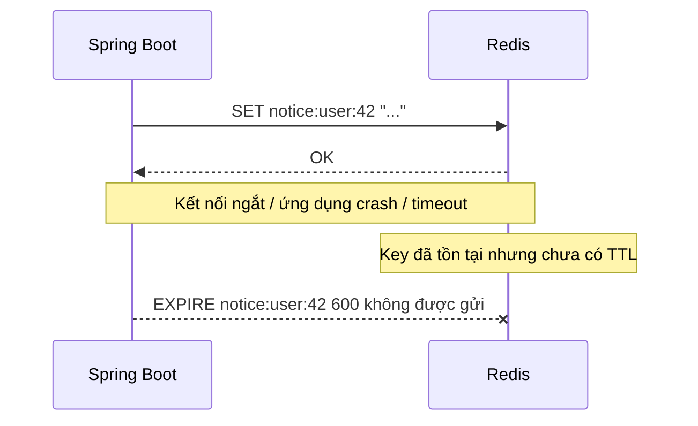
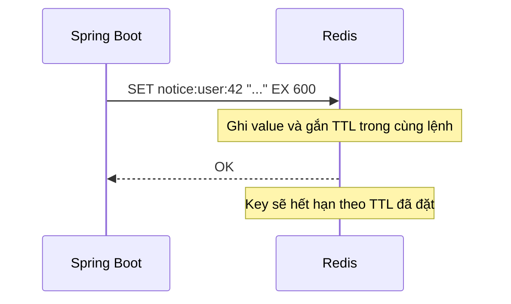

# Kết hợp ghi giá trị với thời hạn sống trong một thao tác

Khi sử dụng Redis làm nơi lưu cache, mã xác thực tạm thời, trạng thái xử lý hoặc bộ đếm theo khoảng thời gian, thông thường ta muốn **ghi dữ liệu và đặt thời hạn sống (TTL) cùng lúc**. Nếu ứng dụng ghi trước rồi mới gắn TTL bằng một lệnh khác, một lỗi xảy ra giữa hai lệnh có thể khiến dữ liệu tồn tại ngoài dự kiến. Redis hỗ trợ thiết lập giá trị và thời gian hết hạn **trong chính lệnh `SET`**, còn Spring Data Redis cung cấp các phương thức tương ứng để ứng dụng Spring Boot sử dụng trực tiếp.

Bài học thuộc chủ đề **Chuỗi và bộ đếm**. Phần đầu tập trung vào Redis String với `SET ... EX/PX`; phần tiếp theo giải thích các trường hợp ghi có điều kiện, gia hạn hoặc giữ TTL và vì sao **tăng bộ đếm bằng `INCR` rồi đặt TTL** cần cách tiếp cận riêng.

## 1. Vấn đề khi tách `SET` và `EXPIRE`

Giả sử ứng dụng cần lưu một thông báo trong 10 phút:

```redis
SET notice:user:42 "Đơn hàng đã được tiếp nhận"
EXPIRE notice:user:42 600
```

Hai lệnh đều hợp lệ, nhưng giữa chúng có một khoảng thời gian mà Redis đã lưu key và **chưa có TTL**.



Hậu quả có thể là:

- Dữ liệu tạm tồn tại **không có thời hạn**, tiêu thụ bộ nhớ lâu hơn dự kiến.
- Token/marker tạm hoặc trạng thái nghiệp vụ tồn tại quá lâu nếu không có cơ chế thu hồi khác.
- Một request khác có thể đọc key **ngay giữa** `SET` và `EXPIRE`, lúc đó key đang được xem là không có TTL.
- Trong luồng có nhiều writer, một lệnh `EXPIRE` đến muộn có thể gắn TTL lên **giá trị khác** vừa được writer khác cập nhật.

Lệnh `EXPIRE` thành công trả về số nguyên `1` nếu đặt hạn dùng cho key có tồn tại, hoặc `0` nếu không thể áp dụng cho key; kết quả đó cũng không giải quyết được khoảng trống nguyên tử giữa hai lời gọi.

### Giải pháp: một lệnh `SET` có TTL

```redis
SET notice:user:42 "Đơn hàng đã được tiếp nhận" EX 600
```

Lệnh này vừa thay đổi giá trị vừa đặt thời hạn hết hạn **như một thao tác Redis nguyên tử**. Các client khác không thể quan sát trạng thái trung gian “giá trị mới đã có nhưng TTL chưa gắn” do chính lệnh này tạo ra.



Đây là ý nghĩa của “một thao tác”: **một command Redis với ngữ nghĩa gộp**, chứ không chỉ là một phương thức Java bên ngoài có thể bí mật phát ra nhiều command.

## 2. TTL trong Redis: đơn vị, ý nghĩa và cách kiểm tra

**TTL (Time To Live)** là khoảng thời gian key còn hiệu lực trước khi Redis coi nó là đã hết hạn. Redis lưu metadata thời điểm hết hạn cho key, không lưu một “đồng hồ đếm ngược” trong giá trị String.

Các lệnh thường dùng:

| Lệnh | Chức năng | Ví dụ |
| --- | --- | --- |
| `SET key value EX seconds` | Ghi String và đặt TTL theo **giây** | `SET cache:x "ok" EX 60` |
| `SET key value PX milliseconds` | Ghi String và đặt TTL theo **mili-giây** | `SET cache:x "ok" PX 1500` |
| `SET key value EXAT unixSeconds` | Ghi và hết hạn tại **mốc Unix time tính bằng giây** | `SET cache:x "ok" EXAT 1900000000` |
| `SET key value PXAT unixMilliseconds` | Ghi và hết hạn tại **mốc Unix time tính bằng mili-giây** | `SET cache:x "ok" PXAT 1900000000000` |
| `TTL key` | Đọc thời gian còn lại tính bằng giây | `TTL cache:x` |
| `PTTL key` | Đọc thời gian còn lại tính bằng mili-giây | `PTTL cache:x` |
| `PERSIST key` | Bỏ thời hạn sống, biến key còn tồn tại thành không có TTL | `PERSIST cache:x` |

Đối với `TTL` / `PTTL`, các giá trị đặc biệt là:

- `-2`: key không tồn tại tại thời điểm kiểm tra.
- `-1`: key đang tồn tại nhưng **không có thời hạn sống**.
- Số không âm: thời gian còn lại theo đơn vị lệnh tương ứng, có làm tròn theo cách Redis biểu diễn.

Ví dụ thực hành trên một key tạm:

```redis
SET demo:ttl "hello" EX 30
# OK

GET demo:ttl
# "hello"

TTL demo:ttl
# Có thể trả về 29 hoặc 30 tùy thời điểm gọi

PTTL demo:ttl
# Giá trị mili-giây còn lại tại thời điểm kiểm tra
```

**Giới hạn quan trọng:** Redis có thể loại bỏ key hết hạn bằng cơ chế chủ động theo nền hoặc xử lý khi có truy cập. Vì vậy không nên dùng thời điểm key biến mất khỏi thống kê bộ nhớ để suy luận rằng một scheduler đã chạy chính xác tới từng mili-giây. Với lệnh đọc, Redis sẽ kiểm tra trạng thái hết hạn để tránh trả về key không còn hiệu lực theo semantics của Redis.

### Dùng `EX`, `PX` hay thời điểm tuyệt đối?

- Dùng `EX` cho các yêu cầu tự nhiên như “cache 5 phút”, “marker 30 giây” hoặc “thông báo sống 10 phút”.
- Dùng `PX` nếu cần thời hạn ngắn hoặc độ phân giải mili-giây; vẫn phải xét độ trễ mạng, scheduler và khả năng server xử lý.
- Dùng `EXAT` / `PXAT` khi nhiều writer cần chung một **mốc hết hạn tuyệt đối**, ví dụ tất cả key của một phiên xử lý hết hạn tại thời điểm xác định. Mốc thời gian phải được tính theo Unix epoch với đơn vị đúng.

Không nhầm `PX 1000` (sống trong 1 giây) với `PXAT 1000` (hết hạn tại một mốc cực xa trong quá khứ). Với thời hạn tính từ thời điểm ghi, `EX`/`PX` thường ít gây nhầm lẫn hơn.

Giá trị thời hạn phải hợp lệ và dương theo cú pháp command. Không dùng `EX 0` hoặc giá trị âm để diễn đạt “xóa ngay”; hãy dùng lệnh xóa phù hợp khi đó là hành vi mong muốn.

## 3. Các tùy chọn của `SET` liên quan tới TTL và điều kiện ghi

Redis `SET` hiện đại có thể kết hợp một số tùy chọn:

```text
SET key value [NX | XX] [GET] [EX seconds | PX milliseconds |
                        EXAT unix-seconds | PXAT unix-milliseconds | KEEPTTL]
```

Các nhóm tùy chọn không thể chọn hai cách đặt expiration trái nhau trong cùng một command; ví dụ không dùng `EX` và `KEEPTTL` đồng thời. Ngữ nghĩa quan trọng:

| Tùy chọn | Ý nghĩa | Khi kết hợp TTL |
| --- | --- | --- |
| Không có `NX` / `XX` | Ghi đè key dù key chưa có hay đã có | `SET k v EX 60` luôn đặt giá trị mới và TTL mới khi thành công |
| `NX` | Chỉ ghi nếu key **chưa tồn tại** | `SET k v NX EX 60` tạo key **và** TTL nếu tạo thành công |
| `XX` | Chỉ ghi nếu key **đã tồn tại** | `SET k v XX EX 60` cập nhật value và TTL chỉ khi key còn tồn tại |
| `GET` | Trả về giá trị cũ trong lúc thực hiện `SET` | Có thể dùng với TTL khi cần giá trị trước khi ghi; phải hiểu cách đọc response |
| `KEEPTTL` | Giữ thời điểm hết hạn của key hiện có khi ghi value mới | Dành cho trường hợp không muốn reset TTL |

### Mặc định ghi đè bằng `SET` sẽ bỏ TTL cũ

Giả sử:

```redis
SET cart:42 "draft" EX 300
TTL cart:42
# Số giây còn lại, tối đa khoảng 300

SET cart:42 "submitted"
TTL cart:42
# -1: key vẫn tồn tại nhưng không còn TTL
```

Lệnh `SET cart:42 "submitted"` thành công đã thay giá trị và **loại bỏ expiration trước đó**, bởi bạn không cung cấp TTL mới và không yêu cầu `KEEPTTL`.

Để đặt TTL mới:

```redis
SET cart:42 "submitted" EX 600
```

Để giữ thời điểm hết hạn cũ:

```redis
SET cart:42 "submitted" KEEPTTL
```

Để chỉ cập nhật nếu key còn tồn tại và đồng thời đổi TTL:

```redis
SET cart:42 "submitted" XX EX 600
```

Việc chọn **reset TTL** hay **giữ TTL** là một quyết định nghiệp vụ. Cache được làm mới thường cần reset TTL; một phiên hoặc quyền truy cập có deadline cố định có thể cần giữ deadline cũ.

## 4. Spring Data Redis: `ValueOperations.set(key, value, Duration)`

Trong Spring Boot sử dụng `spring-boot-starter-data-redis`, `StringRedisTemplate` là API thuận tiện để đọc/ghi Redis String dưới dạng UTF-8.

Khai báo dependency (Gradle Groovy):

```groovy
dependencies {
    implementation 'org.springframework.boot:spring-boot-starter-data-redis'
}
```

Hoặc Maven:

```xml
<dependency>
    <groupId>org.springframework.boot</groupId>
    <artifactId>spring-boot-starter-data-redis</artifactId>
</dependency>
```

Trong ứng dụng Spring Boot đã dùng cơ chế quản lý dependency theo phiên bản Boot, thường không cần tự ghi version của starter.

Ví dụ cấu hình kết nối cho Spring Boot 3.x:

```yaml
spring:
  data:
    redis:
      host: localhost
      port: 6379
      timeout: 2s
```

Địa chỉ `localhost` chỉ đúng nếu Redis server có thể truy cập từ **môi trường mạng của tiến trình ứng dụng**. Nếu Spring Boot chạy trong container, thường phải dùng tên service/hostname Redis phù hợp thay vì `localhost`.

### Viết service lưu giá trị có TTL

```java
import java.time.Duration;
import java.util.Objects;
import org.springframework.data.redis.core.StringRedisTemplate;
import org.springframework.stereotype.Service;

@Service
public class TemporaryNoticeService {

    private static final Duration NOTICE_TTL = Duration.ofMinutes(10);
    private final StringRedisTemplate redis;

    public TemporaryNoticeService(StringRedisTemplate redis) {
        this.redis = redis;
    }

    public void saveNotice(String userId, String message) {
        Objects.requireNonNull(userId, "userId");
        Objects.requireNonNull(message, "message");

        String key = "notice:user:" + userId;

        // Ghi value và TTL bằng một thao tác Redis.
        redis.opsForValue().set(key, message, NOTICE_TTL);
    }

    public String getNotice(String userId) {
        return redis.opsForValue().get("notice:user:" + userId);
    }
}
```

Gọi:

```java
noticeService.saveNotice("42", "Đơn hàng đã được tiếp nhận");
String value = noticeService.getNotice("42");
```

Phương thức `set(key, value, Duration)` biểu đạt một lệnh ghi String với expiration tương ứng, **không đòi hỏi tự gọi `expire()` sau đó**. Kết quả `getNotice` có thể là `null` khi key chưa được ghi, đã bị xóa hoặc đã hết hạn.

Phương thức tương ứng dùng đơn vị thời gian:

```java
redis.opsForValue().set(
        "notice:user:42",
        "Đã xử lý",
        600,
        java.util.concurrent.TimeUnit.SECONDS
);
```

Hai cách khai báo TTL có cùng mục đích. `Duration` thường dễ đọc hơn khi giá trị lấy từ `Duration.ofMinutes(10)` hoặc từ cấu hình ứng dụng.

### Xác minh từ Redis CLI

Sau khi gọi `saveNotice("42", ...)`:

```redis
GET notice:user:42
# "Đơn hàng đã được tiếp nhận"

TTL notice:user:42
# Một số giây dương nhỏ hơn hoặc bằng khoảng 600
```

Nếu `TTL` trả `-1` ngay sau khi ghi thành công, cần kiểm tra xem có writer nào đã ghi lại key **không kèm expiration**, hoặc có thao tác `PERSIST` tác động đến key không. Nếu `TTL` trả `-2`, key có thể chưa được ghi tại đúng Redis endpoint/database, đã bị xóa, hoặc đã hết hạn.

## 5. Ghi có điều kiện và TTL trong cùng thao tác

Nhiều bài toán không cho phép ghi đè tùy ý. Chẳng hạn:

- Chỉ đặt một marker nếu chưa có marker nào khác.
- Chỉ cập nhật trạng thái khi key chưa bị xóa hoặc hết hạn.
- Tạo một dấu đánh dấu xử lý với thời gian hết hạn để tránh giữ trạng thái tạm mãi mãi.

Nếu tách điều kiện, thao tác ghi và TTL thành nhiều lệnh, có thể xuất hiện **race condition**.

### 5.1. Chỉ ghi khi key chưa tồn tại: `SET ... NX EX`

Redis CLI:

```redis
SET job:dedup:task-42 "reserved" NX EX 300
# OK nếu key chưa tồn tại

SET job:dedup:task-42 "reserved" NX EX 300
# nil nếu key đã tồn tại
```

Chỉ lệnh đầu tiên thành công mới tạo cả value và TTL. Lệnh `NX` thất bại không ghi lại value, đồng thời không tự gia hạn thời hạn sống của key hiện có.

Spring Data Redis:

```java
import java.time.Duration;
import org.springframework.data.redis.core.StringRedisTemplate;
import org.springframework.stereotype.Service;

@Service
public class DedupMarkerService {
    private final StringRedisTemplate redis;

    public DedupMarkerService(StringRedisTemplate redis) {
        this.redis = redis;
    }

    public boolean tryReserve(String taskId) {
        Boolean created = redis.opsForValue().setIfAbsent(
                "job:dedup:" + taskId,
                "reserved",
                Duration.ofMinutes(5)
        );
        return Boolean.TRUE.equals(created);
    }
}
```

`setIfAbsent(key, value, Duration)` tương ứng với ý tưởng **`SET key value NX EX/PX ...`**, được thực hiện atomically tại Redis khi thao tác được gửi thành công. Giá trị trả về thường là:

- `true` khi Redis tạo key thành công.
- `false` khi key đã tồn tại nên điều kiện `NX` không thỏa.
- Có thể là `null` trong bối cảnh pipelining/transaction theo hợp đồng API Spring Data Redis; ví dụ ở trên dành cho lời gọi trực tiếp thông thường, nơi ứng dụng không diễn giải `null` như kết quả chắc chắn của server.

**Giới hạn của marker:** một key `reserved` với TTL không tự bảo đảm “exactly once processing”. Worker có thể crash sau khi tạo marker; job có thể kéo dài quá 5 phút; hoặc hai lần retry ở những thời điểm khác nhau có thể chạy lại công việc. Cần thiết kế cơ chế khôi phục, trạng thái hoàn tất, idempotency của thao tác nghiệp vụ và thời gian giữ marker theo đặc điểm workload.

### 5.2. Chỉ cập nhật nếu key còn tồn tại: `SET ... XX EX`

Redis CLI:

```redis
SET workflow:42 "pending" EX 300
SET workflow:42 "running" XX EX 300
# OK nếu key đang tồn tại
```

Spring Data Redis:

```java
Boolean updated = redis.opsForValue().setIfPresent(
        "workflow:42",
        "running",
        Duration.ofMinutes(5)
);
```

Trường hợp này **vừa cập nhật giá trị, vừa đặt lại TTL** khi key có tồn tại. Nếu key đã hết hạn, điều kiện `XX` không thỏa và lệnh không tự tạo key mới.

**Điểm cần tránh hiểu nhầm:** `XX` chỉ kiểm tra key tồn tại; nó **không kiểm tra giá trị cũ có bằng `"pending"` hay không**. Nếu muốn chuyển trạng thái có điều kiện kiểu “chỉ đổi từ pending sang running”, cần compare-and-set bằng Lua/Redis Functions hoặc cơ chế giao dịch phù hợp; chỉ `SET XX` không cung cấp điều kiện so khớp nội dung.

### 5.3. Tạo marker chỉ khi chưa có và dùng TTL như thời gian thuê

Lệnh `SET lock:resource token NX PX 10000` thường là nền tảng của một **lease/lock đơn giản**. Nhưng ví dụ tối thiểu chưa đủ cho hệ thống lock phân tán hoàn chỉnh:

- Value nên là token duy nhất cho từng người giữ khóa; không phải chuỗi cố định `"locked"` nếu nhiều process có thể cùng thử.
- TTL chỉ giới hạn thời gian thuê khóa. Nếu công việc chạy quá TTL, process khác có thể nhận khóa; cần cân nhắc khả năng gia hạn, fencing token hoặc thiết kế tránh ghi sai dữ liệu.
- Không xóa khóa chỉ bằng `DEL key` khi hoàn tất, vì khóa có thể đã hết hạn rồi được process khác giành lại. Cần so sánh token sở hữu và xóa nguyên tử bằng Lua/Redis Functions hoặc API lock đã kiểm chứng.

Do đó `SET NX PX` là một **primitive nguyên tử**, không tự giải quyết toàn bộ an toàn của distributed lock.

## 6. TTL được tính từ lần ghi nào?

Lệnh `SET key value EX 600` thành công sẽ đặt thời hạn sống mới tính từ thời điểm lệnh thực thi. Mỗi lần ghi lại bằng `SET ... EX 600` thường **reset TTL**, kể cả key đã có trước đó.

```redis
SET cache:product:42 "v1" EX 600
# Sau khoảng 120 giây:
SET cache:product:42 "v2" EX 600
# TTL quay về gần 600 giây
```

Điều này phù hợp với cache được làm mới khi có bản ghi mới. Nhưng các trường hợp có deadline cố định cần quy tắc khác:

| Nhu cầu | Hành vi muốn đạt | Cách tiếp cận |
| --- | --- | --- |
| Cache làm mới khi dữ liệu thay đổi | Reset thời gian sống sau mỗi lần ghi | `SET key value EX/PX ...` |
| Giá trị mới phải giữ hạn cũ | Không kéo dài thời gian sống khi ghi lại | `SET key value KEEPTTL`, khi phù hợp |
| Chỉ tạo key một lần | Giữ giá trị/TTL của lần tạo đầu tiên | `SET key value NX EX/PX ...` |
| Chỉ ghi lại nếu key chưa hết hạn | Không tái tạo key đã mất | `SET key value XX EX/PX ...` |
| Đọc dữ liệu và làm mới TTL cùng lúc | Lấy value cũ rồi đổi TTL | Lệnh `GETEX` khi Redis và client hỗ trợ |
| Hết hạn tại mốc thời gian chung | Không dựa vào thời điểm writer thực hiện | `SET ... EXAT/PXAT ...` |

### `GETEX` là một tình huống liền kề

Redis có lệnh:

```redis
GETEX session:42 EX 300
```

Lệnh này **đọc giá trị hiện tại và gia hạn TTL trong một thao tác**; nó **không ghi một value mới**. Spring Data Redis có các API như `ValueOperations.getAndExpire(key, Duration)` trong các phiên bản hỗ trợ để biểu đạt ngữ nghĩa này. Đây là lựa chọn hữu ích cho một số cơ chế sliding expiration.

Đừng nhầm `GETEX` với việc `GET` rồi `EXPIRE`: hai lệnh tách rời có khoảng trống giữa việc đọc và thay đổi TTL.

### Trạng thái gia hạn có thể gây kéo dài ngoài ý muốn

Nếu mỗi request luôn `SET` hoặc `GETEX` làm mới TTL, key của user được truy cập liên tục có thể sống rất lâu. Điều đó có thể đúng với session sliding expiration, nhưng không đúng với OTP hoặc phiếu ưu đãi có **deadline tuyệt đối**. Với deadline tuyệt đối, cân nhắc `EXAT/PXAT`, value chứa mốc hết hạn được xác minh tại business layer, và chính sách không cho gia hạn vô hạn.

## 7. Bộ đếm: vì sao `INCR` + `EXPIRE` vẫn là hai thao tác?

Một tình huống thường gặp là bộ đếm trong cửa sổ 60 giây:

```redis
INCR counter:api:client-42:window-100
EXPIRE counter:api:client-42:window-100 60
```

`INCR` tăng integer lưu trong Redis String một cách nguyên tử. Nhưng nó **không nhận tùy chọn `EX`/`PX`** như `SET`. Kết hợp `INCR` rồi `EXPIRE` như trên vẫn là **hai lệnh**.

Nếu `EXPIRE` chạy ở mọi lần tăng, TTL được reset theo mỗi request; đây có thể biến bộ đếm thành “hết hạn sau khi ngừng hoạt động 60 giây”, không đúng với cửa sổ thời gian cố định. Nếu chỉ đặt TTL khi kết quả `INCR` bằng 1, vẫn có khoảng trống:

```text
Worker A: INCR counter:...  → 1
Worker A: crash trước EXPIRE
Worker B: INCR counter:...  → 2
Worker B: thấy kết quả khác 1, không đặt TTL

Kết quả: bộ đếm có thể tồn tại không có TTL.
```

Điểm mấu chốt: **lệnh `SET ... EX` không dùng để thay thế đơn giản cho `INCR`** trong bộ đếm nhiều writer. Nếu client tự `GET`, tính +1 rồi `SET` có TTL, hai client đồng thời có thể đọc cùng giá trị cũ và ghi đè lẫn nhau, làm mất lượt tăng.

### 7.1. Lua script để tăng và đặt TTL nguyên tử

Redis thực thi các lệnh trong một Lua script như một đơn vị nguyên tử đối với các command từ client khác. Vì vậy có thể tăng bộ đếm, kiểm tra có phải lần tạo mới hay không, rồi gắn TTL bên trong script:

```lua
local current = redis.call('INCR', KEYS[1])
if current == 1 then
    redis.call('EXPIRE', KEYS[1], tonumber(ARGV[1]))
end
return current
```

Trong mô hình bộ đếm mới khởi tạo với giá trị không tồn tại:

1. `INCR` trên key chưa tồn tại tạo giá trị số `1`.
2. Script thấy `current == 1` và đặt TTL cùng lượt thực thi.
3. Các client khác chỉ quan sát kết quả khi script đã hoàn tất, không nhìn thấy trạng thái giữa hai lệnh.
4. Những lần tăng sau giữ nguyên TTL ban đầu, thay vì reset mỗi lần.

**Giả định cần nhớ:** script này dành cho namespace bộ đếm do chính cơ chế đó sở hữu. Nếu key có thể được tạo trước với giá trị khác 0 nhưng không có TTL, điều kiện `current == 1` sẽ không sửa trạng thái bất thường đó. Cần chính sách khởi tạo/migration riêng hoặc quy tắc khác nếu muốn phục hồi dữ liệu cũ.

### 7.2. Gọi Lua script từ Spring Data Redis

```java
import java.util.List;
import java.util.Objects;
import org.springframework.data.redis.core.StringRedisTemplate;
import org.springframework.data.redis.core.script.RedisScript;
import org.springframework.stereotype.Service;

@Service
public class ExpiringCounterService {

    private static final RedisScript<Long> INCREMENT_WITH_TTL =
            RedisScript.of(
                    """
                    local current = redis.call('INCR', KEYS[1])
                    if current == 1 then
                        redis.call('EXPIRE', KEYS[1], tonumber(ARGV[1]))
                    end
                    return current
                    """,
                    Long.class
            );

    private final StringRedisTemplate redis;

    public ExpiringCounterService(StringRedisTemplate redis) {
        this.redis = redis;
    }

    public long increment(String counterKey, long ttlSeconds) {
        if (ttlSeconds <= 0) {
            throw new IllegalArgumentException("ttlSeconds must be positive");
        }

        Long result = redis.execute(
                INCREMENT_WITH_TTL,
                List.of(counterKey),
                Long.toString(ttlSeconds)
        );
        return Objects.requireNonNull(result, "Redis script returned null");
    }
}
```

Sử dụng:

```java
long hits = counterService.increment(
        "counter:api:client-42:window-100",
        120
);
```

Trong ví dụ, chọn TTL 120 giây chỉ là một giá trị minh họa; nó không tự tạo ra cửa sổ giới hạn 60 giây. Để xây bộ giới hạn tốc độ theo cửa sổ cố định, phải xác định cách tạo **window ID**, chiều dài window, thời gian giữ dữ liệu, ngưỡng và chính sách xử lý lệch thời gian. Script trên giải quyết riêng việc tăng số và đặt expiration nguyên tử cho lần khởi tạo.

Với Spring Data Redis, `RedisScript.of(...)` xây script có kiểu kết quả `Long`; `StringRedisTemplate.execute(...)` chuyển key/argument theo serializer của template và trả kết quả mà Redis gửi lại. Trong Redis Cluster, mọi key mà một script truy cập phải đáp ứng quy tắc key routing cùng slot; ví dụ chỉ dùng một key nên không có vấn đề cross-slot.

**Quan trọng:** Lua script chạy trên luồng thực thi Redis, không nên thực hiện vòng lặp lớn hoặc xử lý dữ liệu không giới hạn. Script ví dụ có số lệnh cố định, phù hợp với mục tiêu nguyên tử của một bộ đếm đơn giản. Nếu nghiệp vụ cần bảo đảm đúng cả trong các kịch bản failover/durability, phải xem thêm cơ chế replication, persistence và tính idempotent của thao tác gọi lại.

### 7.3. Khi nào nên dùng Lua, khi nào nên dùng `SET`?

| Bài toán | Cách chọn |
| --- | --- |
| Ghi một String mới và TTL | `SET key value EX/PX ...` |
| Ghi String nếu chưa tồn tại, đồng thời TTL | `SET key value NX EX/PX ...` |
| Cập nhật String nếu tồn tại, đồng thời TTL | `SET key value XX EX/PX ...` |
| Tăng một counter đã có TTL do hệ thống khác quản lý | `INCR` là thao tác nguyên tử tăng số; không tự thay TTL |
| Tăng counter và chỉ gắn TTL khi tạo lần đầu | Lua script/Redis Functions chứa `INCR` và `EXPIRE` theo chính sách |
| Tăng counter và đồng thời quyết định cho phép/từ chối theo ngưỡng | Thường cần logic nguyên tử kết hợp tăng/kiểm tra, chẳng hạn Lua/script được thiết kế cẩn thận |

Không dùng `SET` ghi một số mới dựa trên phép cộng tại client nếu có nhiều writer đồng thời, trừ khi có cơ chế đồng bộ/so khớp phù hợp để tránh mất cập nhật.

## 8. Pipeline, transaction và một lệnh: khác nhau ở đâu?

Ba khái niệm dễ bị nhầm khi cố “gộp hai lệnh”:

**Pipelining** gửi nhiều command liên tiếp để giảm round trip:

```text
Client -> SET k v
Client -> EXPIRE k 60
Client <- [OK, 1]
```

Pipelining không biến hai lệnh thành một thao tác nguyên tử. Redis có thể thực hiện command của client khác giữa các command, tùy cách gửi và xử lý; client vẫn có thể thất bại trước khi gửi đủ chuỗi.

**MULTI/EXEC** gom các lệnh trong Redis transaction:

```redis
MULTI
SET k v
EXPIRE k 60
EXEC
```

Khi `EXEC` thực thi, các command đã queue được Redis thực hiện tuần tự như một khối không bị client khác chen ngang. Điều này có thể hữu ích nếu bắt buộc kết hợp nhiều command không có cách viết thành một command duy nhất. Tuy nhiên nó cần nhiều bước giao thức, có các đặc điểm xử lý lỗi riêng và không cung cấp rollback chung giống transaction RDBMS. Nếu chỉ cần ghi String kèm TTL thì **`SET k v EX 60` đơn giản và trực tiếp hơn**.

**Một command Redis `SET ... EX`** diễn đạt chính xác hai hiệu ứng cần thiết trong cùng lệnh. Với Spring Data Redis, sử dụng phương thức đã có `ValueOperations.set(key, value, Duration)` để thể hiện ý định ấy.

Không nên thay API gộp sẵn bằng `redis.opsForValue().set(key, value)` rồi `redis.expire(key, ttl)` chỉ vì cả hai được gọi từ cùng một phương thức Java hoặc được bao trong `@Transactional`. Annotation giao dịch của Spring không tự biến hai lệnh Redis đã phát ra độc lập thành `SET EX`.

## 9. Các giới hạn của tính nguyên tử cần hiểu đúng

Một command Redis nguyên tử đảm bảo không có lệnh client khác quan sát **trạng thái trung gian trong lúc chính command đó thực thi**. Nó không tự bảo đảm mọi mặt của hệ thống phân tán:

### 9.1. Client timeout không khẳng định lệnh thất bại

Giả sử client gửi:

```redis
SET job:dedup:task-42 reserved NX EX 300
```

nhưng response bị mất do mạng. Ứng dụng không biết chắc Redis đã ghi thành công hay chưa chỉ từ một lần timeout. Nếu retry, lần thứ hai có thể nhận thất bại do key đã được tạo bởi **chính lần gọi trước**, hoặc do writer khác. Không suy luận “timeout = Redis không thực hiện lệnh”.

Trong nghiệp vụ quan trọng, phải có cơ chế nhận diện yêu cầu, idempotency và khôi phục trạng thái sau kết quả không chắc chắn.

### 9.2. Atomic write không có nghĩa durability tuyệt đối

TTL và value được áp dụng nhất quán trong một command trên instance Redis xử lý lệnh, nhưng tính bền vững sau sự cố phụ thuộc vào cấu hình persistence (RDB/AOF), replication, failover và kiến trúc Redis. Khi dùng Redis cho cache hoặc marker tạm, thường chấp nhận một mô hình khác với database giao dịch chính. Đừng dùng atomic `SET EX` như bằng chứng rằng dữ liệu được sao lưu đồng bộ và tồn tại chắc chắn sau mọi sự cố.

### 9.3. TTL không thay thế kiểm tra nghiệp vụ

Nếu key đại diện cho một quyền sử dụng có hạn đến 10:00 UTC, ứng dụng có thể cần ghi chính **deadline nghiệp vụ** và kiểm tra nó khi xử lý, ngoài TTL ở Redis. TTL hỗ trợ dọn dữ liệu; nó không tự giải quyết các yêu cầu kiểm toán, gia hạn quyền, clock skew giữa dịch vụ hoặc quy tắc “không thể dùng sau 10:00”.

### 9.4. Giá trị mặc định của serializer vẫn quan trọng

`StringRedisTemplate` dùng String serializer cho key/value, dễ quan sát bằng Redis CLI và tương tác với ứng dụng khác. Nếu dùng `RedisTemplate<K, V>` với serializer riêng, giá trị và key được chuyển thành byte theo cấu hình đó; TTL vẫn được Redis gắn với **key byte tương ứng**. Khi client khác đọc dữ liệu, cần có hợp đồng encoding/schema nhất quán để tránh “key không tồn tại” do hai bên serialize key khác nhau.

## 10. Mẫu ứng dụng thực tế

### 10.1. Lưu cache tạm thời

```java
redis.opsForValue().set(
        "cache:product:42",
        productJson,
        Duration.ofMinutes(15)
);
```

Khi cache miss, ứng dụng truy vấn nguồn dữ liệu chính rồi ghi lại bản cache có TTL trong cùng lệnh. Đây là chiến lược cache-aside đơn giản. Nếu nhiều request đồng thời bị cache miss, vẫn có thể xảy ra stampede; `SET EX` tự nó không điều phối việc tính toán lại cache.

### 10.2. Tạo marker xử lý tạm

```java
Boolean inserted = redis.opsForValue().setIfAbsent(
        "dedup:invoice:987",
        "in-progress",
        Duration.ofMinutes(2)
);

if (Boolean.TRUE.equals(inserted)) {
    // Process có quyền thực hiện bước tiếp theo theo chính sách của ứng dụng.
}
```

Marker có TTL ngăn trạng thái tạm tồn tại vô hạn nếu worker bị dừng. Tuy nhiên phải xem xét cách hoàn tất hoặc phục hồi công việc, vì TTL có thể hết trước khi nghiệp vụ kết thúc.

### 10.3. Thay giá trị và gia hạn thời gian sống

```java
redis.opsForValue().set(
        "dashboard:refresh:42",
        newSnapshot,
        Duration.ofSeconds(45)
);
```

Với lần ghi thành công, TTL được tính lại từ thời điểm hiện tại. Người thiết kế cần xác nhận yêu cầu là “45 giây từ lần refresh mới nhất”, thay vì “45 giây kể từ lần tạo ban đầu”.

### 10.4. Ghi trạng thái nếu key còn hiệu lực

```java
Boolean updated = redis.opsForValue().setIfPresent(
        "workflow:task-42",
        "processing",
        Duration.ofMinutes(3)
);
```

Đây là kiểm tra key tồn tại, **không phải** điều kiện so sánh giá trị cũ. Nếu có nhiều trạng thái chuyển tiếp hoặc nhiều process cập nhật, cần quy tắc đồng bộ đủ mạnh cho state machine.

## 11. Chẩn đoán những lỗi phổ biến

| Triệu chứng | Khả năng nguyên nhân | Hướng xử lý |
| --- | --- | --- |
| `TTL key` trả `-1` sau khi lưu | Ghi bằng `SET` không có TTL hoặc có writer khác ghi đè, `PERSIST` | Ghi kèm TTL bằng `set(key, value, Duration)`; kiểm tra mọi writer của key |
| `TTL key` trả `-2` | Key không còn tồn tại, hết hạn, sai database/endpoint/key serializer | Xác nhận key, Redis endpoint, namespace, TTL và thời điểm đọc |
| Marker `setIfAbsent` liên tục trả `false` | Key đã tồn tại và chưa hết hạn | Kiểm tra TTL và chính sách retry/định danh key, không xóa tùy tiện |
| Marker tồn tại mãi | Tách `SETNX` và `EXPIRE`, lỗi trước khi expire; writer cũ không gắn TTL | Dùng `SET NX EX`; xử lý dữ liệu cũ theo chính sách |
| Cache bị kéo dài TTL sau mỗi update | `SET ... EX` reset TTL mỗi lần ghi | Chọn `KEEPTTL` hoặc deadline tuyệt đối nếu nghiệp vụ yêu cầu |
| Cache mất TTL khi thay value | Lệnh `SET` đơn thuần xóa TTL cũ | Ghi với TTL mới hoặc giữ TTL có chủ đích |
| Counter sống vô hạn sau khi worker crash | `INCR` đã chạy nhưng `EXPIRE` chưa được thực hiện | Dùng Lua/Redis Functions cho thao tác tăng + expire nguyên tử |
| Counter không bao giờ hết hạn khi có lưu lượng | `EXPIRE` được chạy sau mỗi `INCR` | Chỉ đặt TTL khi khởi tạo hoặc theo mô hình cửa sổ phù hợp |
| Kết quả timeout nhưng key thực sự tồn tại | Command có thể đã thực thi trước khi response bị mất | Thiết kế idempotent; kiểm tra trạng thái nghiệp vụ trước khi retry |
| Thời hạn không đúng mong đợi | Nhầm đơn vị giây/mili-giây, dùng `EXAT` với thời điểm sai | Chuẩn hóa `Duration` và kiểm tra timestamp theo epoch đúng đơn vị |

### Tách lỗi TTL với lỗi kết nối Redis

Nếu Spring Boot ném `RedisConnectionFailureException`, timeout kết nối hoặc lỗi xác thực, không thể suy luận TTL bị cấu hình sai. Kiểm tra kết nối và khả năng truy cập Redis trước. Khi lệnh đã chạy thành công, mới dùng `TTL`/`PTTL` và quan sát các writer khác để điều tra vòng đời key.

## 12. Thực hành với Redis CLI và Spring

Các thao tác sau dùng key riêng có TTL ngắn và phù hợp cho môi trường thử nghiệm:

**Thực hành A — Ghi và đặt TTL nguyên tử**

```redis
SET lesson:atomic "hello" EX 20
GET lesson:atomic
TTL lesson:atomic
```

Kỳ vọng: Redis trả `"hello"` khi key còn hiệu lực và `TTL` là số giây còn lại, tối đa xấp xỉ 20.

**Thực hành B — Khác biệt của `SET` có và không có TTL**

```redis
SET lesson:overwrite "v1" EX 20
SET lesson:overwrite "v2"
TTL lesson:overwrite
```

Kỳ vọng: `TTL` trả `-1`. Tiếp tục:

```redis
SET lesson:overwrite "v3" EX 20
TTL lesson:overwrite
```

Kỳ vọng: TTL được đặt lại.

**Thực hành C — `NX` với TTL**

```redis
SET lesson:nx "first" NX EX 30
SET lesson:nx "second" NX EX 30
GET lesson:nx
TTL lesson:nx
```

Kỳ vọng: giá trị vẫn là `"first"` trong lúc key chưa hết hạn; lệnh `NX` thứ hai không gia hạn TTL.

**Thực hành D — Ghi giữ TTL**

```redis
SET lesson:keep "before" EX 30
SET lesson:keep "after" KEEPTTL
GET lesson:keep
TTL lesson:keep
```

Kỳ vọng: value đổi thành `"after"`, deadline cũ của key được giữ lại.

**Thực hành E — Counter đơn giản**

```redis
INCR lesson:count
TTL lesson:count
```

Nếu key chưa tồn tại và lần đầu tăng bằng `INCR`, `TTL` là `-1`. Điều này cho thấy bản thân `INCR` không tự tạo expiration. Sau đó có thể xóa key thử nghiệm bằng `DEL lesson:count` hoặc dùng script được giới thiệu ở phần bộ đếm để tăng và gắn TTL trong cùng lượt nguyên tử.

Không dùng khóa tên chung với dữ liệu production khi thực hành các lệnh `SET`/`DEL`, vì chúng thay đổi hoặc xóa giá trị thực.

## 13. Câu hỏi tự luyện

**Câu 1.** Vì sao phương thức Java sau không bảo đảm ghi cùng TTL như một thao tác nguyên tử?

```java
redis.opsForValue().set("cache:42", payload);
redis.expire("cache:42", Duration.ofMinutes(5));
```

*Gợi ý:* phương thức `set` và `expire` gửi hai lệnh Redis độc lập; ngoại lệ, timeout hoặc writer đồng thời có thể xuất hiện giữa chúng.

**Câu 2.** Chọn một lời gọi Spring Data Redis phù hợp để lưu chuỗi `"ready"` dưới key `task:42` với hạn dùng 90 giây.

*Gợi ý:* `opsForValue().set(key, value, Duration.ofSeconds(90))`.

**Câu 3.** Ứng dụng muốn chỉ tạo marker nếu chưa có, đồng thời đảm bảo marker không tồn tại mãi mãi. Nên dùng `SETNX` rồi `EXPIRE` hay `SET NX EX`? Vì sao?

*Gợi ý:* điều kiện `NX`, giá trị và TTL cần thuộc cùng command.

**Câu 4.** Một key đang còn TTL 200 giây. Sau khi gọi `redis.opsForValue().set(key, newValue)`, `TTL` trả `-1`. Đây là lỗi Redis không?

*Gợi ý:* `SET` mặc định xóa expiration cũ khi không cung cấp TTL hoặc `KEEPTTL`.

**Câu 5.** Muốn mỗi counter chỉ đặt TTL ở lần tăng đầu tiên, vì sao `INCR` rồi kiểm tra `n == 1` để gọi `EXPIRE` vẫn có rủi ro?

*Gợi ý:* ứng dụng có thể dừng giữa hai command; nhiều writer có thể tiếp tục tăng một counter chưa có TTL.

**Câu 6.** Lệnh `SET session:42 active EX 600` thành công nhưng HTTP client timeout trước khi nhận phản hồi từ ứng dụng. Phía client có biết chắc Redis không ghi không?

*Gợi ý:* timeout phản hồi không phải bằng chứng command chưa thực thi.

**Câu 7.** Trong trường hợp quyền truy cập phải hết hạn đúng vào một deadline chung, vì sao cứ refresh bằng `SET ... EX 600` có thể không phù hợp?

*Gợi ý:* TTL tương đối được tính lại từ mỗi lần ghi, có thể kéo dài hơn deadline nghiệp vụ.

## 14. Kết luận

Đối với **Redis String**, dùng `SET key value EX/PX ...` là cách trực tiếp để **ghi giá trị và đặt TTL trong một thao tác nguyên tử**. Trong Spring Data Redis, triển khai tương ứng là `StringRedisTemplate.opsForValue().set(key, value, Duration)`. Khi cần điều kiện ghi, dùng `setIfAbsent(..., Duration)` cho `NX` hoặc `setIfPresent(..., Duration)` cho `XX`; điều kiện và expiration khi thành công đều nằm trong cùng thao tác.

Mỗi lần ghi `SET` cần quyết định rõ **reset TTL**, **giữ TTL** hay **chỉ ghi nếu key tồn tại/chưa tồn tại**. Riêng với **bộ đếm**, `INCR` là lệnh tăng nguyên tử nhưng không trực tiếp nhận TTL; nếu cần “tăng và gắn TTL khi khởi tạo” như một đơn vị nguyên tử, sử dụng Lua/Redis Functions hoặc thiết kế tương đương. Hiểu đúng giới hạn của atomicity, TTL và retry giúp ứng dụng Spring Boot tránh key tồn tại ngoài dự kiến, mất cập nhật hoặc sai vòng đời dữ liệu.
