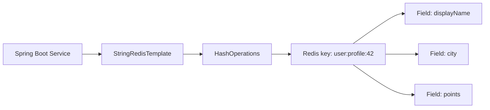
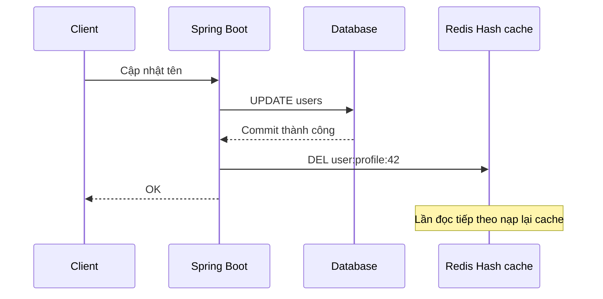

# Chọn Hash để biểu diễn thuộc tính của một đối tượng

Một ứng dụng Spring Boot thường quản lý các đối tượng có nhiều thuộc tính: hồ sơ người dùng có `displayName`, `city`, `tier`; sản phẩm có `title`, `price`, `stock`; phiên xử lý có `status`, `updatedAt`, `retryCount`. Khi đưa các đối tượng này vào Redis, chúng ta cần quyết định **lưu cả đối tượng thành một value** hay **lưu từng thuộc tính trong một Redis Hash**.

Redis Hash là một cấu trúc gồm nhiều cặp **field → value** nằm dưới **một Redis key**. Spring Data Redis cung cấp `HashOperations` thông qua `RedisTemplate.opsForHash()` hoặc `StringRedisTemplate.opsForHash()`, để cập nhật và đọc các field mà không phải lấy rồi ghi lại toàn bộ object.

Chọn Hash có ích khi ứng dụng thường truy cập hoặc thay đổi **một số thuộc tính riêng lẻ**, các thuộc tính có vòng đời tương tự nhau và được truy cập theo định danh đối tượng. Nhưng Hash không phải là một bảng SQL thu nhỏ; nó cũng không tự cung cấp truy vấn theo thuộc tính, transaction xuyên đối tượng, schema validation hay phép cập nhật lồng nhau như một object graph Java.

Bài học này trình bày cách quyết định, tổ chức key/field, triển khai với Spring Data Redis và xử lý những đánh đổi về TTL, serialization, đồng thời, hiệu năng và nhất quán.

## 1. Mô hình Redis Hash

Một Redis Hash có một key cấp cao và nhiều field:

```text
Redis key: user:profile:42
    ├── displayName  → "Lan"
    ├── city         → "Da Nang"
    ├── tier         → "gold"
    ├── points       → "120"
    └── schemaVersion→ "1"
```

Trong Redis CLI:

```redis
HSET user:profile:42 displayName "Lan" city "Da Nang" tier "gold" points "120" schemaVersion "1"
HGET user:profile:42 displayName
HMGET user:profile:42 displayName tier
HGETALL user:profile:42
```

Phân biệt:

- **Key:** `user:profile:42` xác định cả một Hash.
- **Field:** `displayName`, `city`, `points` là các thuộc tính nằm trong Hash.
- **Value của field:** chuỗi byte Redis lưu cho mỗi field, ví dụ `"Lan"` hoặc `"120"`.
- **Object Java:** `UserProfile` hoặc `ProfileDto` chỉ là cấu trúc ở JVM; muốn đọc/ghi Redis cần chọn cách mapping và serializer.

Redis Hash không tạo ra các Redis key riêng như `user:profile:42:displayName`. Bạn không thể dùng `GET user:profile:42:displayName` để lấy field `displayName` trong Hash; phải dùng `HGET user:profile:42 displayName`.



## 2. Khi nào nên chọn Hash?

Nên cân nhắc Redis Hash khi các điều kiện sau phần lớn đúng:

1. **Có một định danh tự nhiên** cho đối tượng: user ID, device ID, job ID, session ID.
2. **Đối tượng có các thuộc tính tương đối độc lập**: chỉ sửa `city`, đọc `tier` hoặc tăng `points` mà không cần ghi lại mọi field.
3. **Cần thao tác nguyên tử trên một field**: `HSET`, `HSETNX`, `HINCRBY` hoạt động ở phía Redis.
4. **Các field có vòng đời gần nhau**: một TTL của key có thể phù hợp cho cả đối tượng.
5. **Số lượng field của một đối tượng được kiểm soát**: mỗi Hash không tăng vô hạn.
6. **Truy cập chủ yếu theo ID**, không thường xuyên yêu cầu lọc, join hoặc truy vấn phức tạp theo nội dung field.

Ví dụ thực tế:

| Đối tượng | Key | Field nên lưu | Truy cập thường gặp |
|---|---|---|---|
| Hồ sơ rút gọn của người dùng | `user:profile:42` | `displayName`, `city`, `tier` | `HGET` một field, `HMGET` các field hiển thị |
| Trạng thái công việc tạm | `job:state:ab12` | `status`, `progress`, `updatedAt` | Cập nhật một field, xem trạng thái |
| Cấu hình của một thiết bị | `device:config:17` | `mode`, `threshold`, `enabled` | Đọc hoặc chỉnh từng thuộc tính |
| Bộ thống kê nhỏ theo người dùng | `user:stats:42` | `views`, `likes`, `shares` | `HINCRBY` một bộ đếm |
| Cache một đối tượng ít thuộc tính | `product:summary:99` | `title`, `price`, `category` | Đọc vài field để hiển thị |

Những ví dụ trên chỉ phù hợp khi **mô hình cập nhật và yêu cầu nhất quán** cũng phù hợp. Chẳng hạn, thuộc tính `stock` của sản phẩm liên quan đến đặt hàng và thanh toán có thể cần database giao dịch làm nguồn sự thật, dù Hash rất tiện để đọc/ghi.

### 2.1. Khi nào không nên chọn Hash?

Không nên mặc định dùng Hash nếu:

- Ứng dụng **luôn đọc và ghi nguyên một object JSON**, không bao giờ cập nhật field đơn lẻ.
- Dữ liệu có **cấu trúc lồng nhau sâu**, array hoặc schema phức tạp cần thao tác đồng bộ theo document.
- Mỗi thuộc tính cần **TTL độc lập** nhưng môi trường không hỗ trợ hoặc không muốn quản lý field expiration.
- Đối tượng có thể phình thành **hàng trăm nghìn field** mà không có chính sách giới hạn.
- Cần **truy vấn nhiều đối tượng theo một field**, tìm kiếm full-text, join hoặc ràng buộc giữa các bản ghi.
- Có **bất biến nghiệp vụ liên quan nhiều object** cần transaction xuyên Redis/database.

Trong các trường hợp đó, Redis String chứa JSON, nhiều key riêng, Sorted Set làm index, Redis Stack/khả năng JSON phù hợp, hoặc cơ sở dữ liệu chính có thể là lựa chọn tốt hơn tùy yêu cầu.

## 3. So sánh Hash với String JSON và nhiều key riêng

Giả sử đối tượng:

```json
{
  "id": 42,
  "displayName": "Lan",
  "city": "Da Nang",
  "tier": "gold",
  "points": 120
}
```

### 3.1. Phương án A: một String JSON

Redis:

```redis
SET user:profile:42 "{\"id\":42,\"displayName\":\"Lan\",\"city\":\"Da Nang\",\"tier\":\"gold\",\"points\":120}" EX 600
GET user:profile:42
```

Ứng dụng có thể serialize DTO bằng Jackson rồi lưu bằng `StringRedisTemplate.opsForValue()`.

Ưu điểm: một key, một payload; tự nhiên với object Java và cấu trúc lồng nhau; phù hợp khi luôn đọc toàn bộ dữ liệu để trả API.

Nhược điểm: nếu chỉ muốn đổi `city`, client thường phải `GET` → deserialize → sửa → serialize → `SET`. Hai request cập nhật các field khác nhau có thể ghi đè lẫn nhau nếu không có cơ chế kiểm soát đồng thời.

### 3.2. Phương án B: một Redis Hash

Redis:

```redis
HSET user:profile:42 displayName "Lan" city "Da Nang" tier "gold" points "120"
HSET user:profile:42 city "Hue"
HINCRBY user:profile:42 points 5
HGET user:profile:42 tier
```

Ưu điểm: cập nhật hoặc đọc từng field; không cần gửi lại các field khác; `HINCRBY` xử lý bộ đếm trên Redis; vẫn giữ các thuộc tính dưới một key.

Nhược điểm: cần chiến lược mapping kiểu dữ liệu và field; field value không tự là `int`, `boolean` hay object Java; cấu trúc lồng nhau cần biểu diễn riêng; TTL cơ bản áp dụng cho cả key.

### 3.3. Phương án C: mỗi thuộc tính một Redis key

Redis:

```redis
SET user:42:displayName "Lan"
SET user:42:city "Da Nang"
SET user:42:tier "gold"
SET user:42:points "120"
```

Ưu điểm: từng key có thể có TTL và chính sách riêng; thành phần độc lập có thể được quản lý khác nhau.

Nhược điểm: số key và metadata tăng; cần nhiều thao tác để gom một object; việc đọc cả object và quản lý vòng đời có thể phức tạp hơn.

| Tiêu chí | Hash | String JSON | Nhiều key riêng |
|---|---|---|---|
| Đọc một field | `HGET`, không cần toàn object | Thường đọc + parse cả JSON | `GET` key field |
| Cập nhật một field | `HSET` | Thường ghi lại JSON | `SET` key field |
| Tăng bộ đếm field | `HINCRBY` | Cần cơ chế riêng | `INCR` trên key field |
| Đọc cả object | `HGETALL`/`HMGET` | Một `GET` | Nhiều `GET`/`MGET` |
| Schema lồng nhau | Cần flatten hoặc serialize từng field | Tự nhiên hơn | Nhiều key/quan hệ |
| TTL thông dụng | Trên toàn Hash key | Trên String key | Có thể khác nhau từng key |
| Quản lý metadata | Một key, nhiều field | Một key, một value | Nhiều key |
| Nguy cơ cập nhật đè field không liên quan | Thấp với `HSET` từng field | Cao nếu đọc–sửa–ghi cả JSON không kiểm soát | Thấp với các key riêng |
| Truy vấn theo thuộc tính trên nhiều object | Không có index tự động | Không có index tự động | Không có index tự động |
| Kích thước phù hợp | Object có số field giới hạn | Payload toàn object có giới hạn | Thuộc tính thực sự độc lập |

**Lựa chọn dựa trên access pattern**: nếu UI luôn cần toàn bộ profile và profile nhỏ, JSON String có thể đơn giản. Nếu nhiều service thường chỉ lấy `tier` hoặc thay `city` mà không muốn tải lại object, Hash đáng cân nhắc.

## 4. Thiết kế schema Hash rõ ràng

Chọn một key chính ổn định:

```text
<application>:<environment>:<domain>:<entity-id>
shop:dev:user:profile:42
```

Các field phải có ý nghĩa và được thống nhất:

```text
displayName     String UTF-8
city            String UTF-8
tier            một trong basic/silver/gold
points          số nguyên thập phân dạng chuỗi
schemaVersion   số nguyên dạng chuỗi
updatedAt       ISO-8601 hoặc epoch millis, dùng một quy ước nhất quán
```

Ví dụ Redis:

```redis
HSET shop:dev:user:profile:42 \
  displayName "Lan" \
  city "Da Nang" \
  tier "gold" \
  points "120" \
  schemaVersion "1"
```

Đoạn trên trình bày dạng nhiều dòng để dễ đọc trong shell hỗ trợ escape dòng bằng `\`; khi chạy Redis CLI tương tác, dùng một dòng:

```redis
HSET shop:dev:user:profile:42 displayName "Lan" city "Da Nang" tier "gold" points 120 schemaVersion 1
```

### 4.1. Không phụ thuộc vào thứ tự field

Redis Hash là ánh xạ field–value. `HGETALL` trả tất cả field nhưng **thứ tự không phải hợp đồng nghiệp vụ**. Khi ánh xạ về Java, tìm theo tên field:

```text
displayName → biến displayName
points      → parse Long
```

Không giả định field đầu tiên luôn là `displayName` hay field thứ tư luôn là `points`.

### 4.2. Chọn cách mã hóa giá trị

Redis lưu byte. Khi dùng `StringRedisTemplate`, mọi field value của Hash có thể xem là chuỗi:

```text
"120"    → Java Long.parseLong(...)
"true"   → Boolean.parseBoolean(...)
"2026-11-12T10:15:00Z" → Instant.parse(...)
```

Nên thống nhất cách biểu diễn, nhất là đối với ngày giờ, decimal, enum, boolean và giá trị rỗng.

Đừng lưu tiền tệ ở dạng số dấu phẩy động nếu nghiệp vụ yêu cầu độ chính xác tuyệt đối. Chọn số nguyên đơn vị nhỏ nhất hoặc mô hình số phù hợp tại nguồn dữ liệu chính.

### 4.3. Field tùy chọn và giá trị null

Redis Hash có thể không có field, nhưng không có khái niệm `null` Java tương ứng một cách tự nhiên. Ví dụ:

```redis
HGET user:profile:42 nickname
```

Nếu field chưa tồn tại, Redis trả `(nil)`. Cách biểu diễn thường dùng:

- Không có field → thuộc tính chưa có giá trị.
- Có field và value là chuỗi rỗng `""` → có thuộc tính nhưng hiện là chuỗi rỗng.
- Có field với chuỗi `"null"` → chỉ là một chuỗi literal, dễ gây hiểu nhầm nếu chưa có quy ước.

Chọn một quy tắc, ghi rõ trong schema và giữ nhất quán giữa các producer/consumer. Khi cập nhật `nickname` thành “không có”, `HDEL` có thể là thao tác phù hợp.

### 4.4. Tránh đưa bí mật vào field

Không đưa mật khẩu, token thô, thông tin thanh toán hoặc dữ liệu cá nhân nhạy cảm vào Hash chỉ vì truy cập thuận tiện. Redis vẫn là hệ thống cần phân quyền, mã hóa kết nối, network isolation và kiểm soát retention. Key name cũng là metadata có thể quan sát, nên tránh đưa dữ liệu nhạy cảm trực tiếp vào tên key/field.

## 5. Các lệnh Redis Hash cốt lõi

Nhóm lệnh này cho thấy lý do Redis Hash phù hợp với một object có thuộc tính riêng lẻ.

### 5.1. Tạo hoặc cập nhật field bằng `HSET`

```redis
HSET user:profile:42 displayName "Lan"
HSET user:profile:42 city "Da Nang" tier "gold"
```

`HSET` tạo Hash nếu key chưa tồn tại; nếu Hash đã tồn tại, lệnh thêm hoặc ghi đè những field được chỉ định.

Một lần `HSET` cập nhật nhiều field được Redis thực thi như **một lệnh**, hữu ích để thiết lập một nhóm thuộc tính cùng lúc. Nhưng việc gọi hai lệnh `HSET` riêng biệt không tự tạo một transaction.

Nếu key hiện chứa kiểu khác, ví dụ String đã được tạo bằng `SET`, Redis trả lỗi `WRONGTYPE`.

### 5.2. Đọc một hoặc một số field bằng `HGET`/`HMGET`

```redis
HGET user:profile:42 tier
HMGET user:profile:42 displayName city tier
```

`HGET` là lựa chọn trực tiếp khi chỉ cần một field. `HMGET` giảm số round-trip khi biết danh sách field cần lấy.

`HMGET` trả các giá trị theo thứ tự field yêu cầu; field không tồn tại có kết quả null/nil ở vị trí tương ứng. Ứng dụng phải kiểm tra thiếu field trước khi parse.

### 5.3. Đọc toàn bộ object bằng `HGETALL`

```redis
HGETALL user:profile:42
```

Với Hash nhỏ, `HGETALL` thuận tiện để dựng DTO. Nhưng thời gian xử lý và số byte trả về tăng theo số field và kích thước value. Nếu Hash có hàng trăm nghìn field, `HGETALL` có thể tạo payload quá lớn và khiến latency/GC tăng. Hash nên có **giới hạn cardinality theo mô hình dữ liệu**.

### 5.4. Kiểm tra và xóa field

```redis
HEXISTS user:profile:42 tier
HDEL user:profile:42 city
HLEN user:profile:42
EXISTS user:profile:42
```

- `HEXISTS`: có field hay không.
- `HDEL`: xóa một hoặc nhiều field.
- `HLEN`: số field của Hash.
- `EXISTS`: có Redis key hay không.

Khi xóa field cuối cùng của một Hash, key không còn cấu trúc Hash trống để tồn tại theo cách thông thường. Cần phân biệt “không có đối tượng” với “đối tượng tồn tại nhưng chưa có field” trong thiết kế.

### 5.5. Chỉ thêm field nếu chưa có: `HSETNX`

```redis
HSETNX user:profile:42 createdBy "signup-service"
```

`HSETNX` thực hiện **check-and-set ở cấp một field** một cách nguyên tử: nếu field chưa tồn tại thì tạo, nếu đã tồn tại thì không ghi đè. Nó không bảo đảm toàn bộ object chưa tồn tại và không thay thế điều kiện duy nhất trong database.

### 5.6. Bộ đếm field: `HINCRBY`

```redis
HINCRBY user:stats:42 views 1
HINCRBY user:stats:42 likes 5
HGET user:stats:42 views
```

Redis xử lý tăng field kiểu số nguyên trong một lệnh, tránh lost update của quy trình đọc–cộng–ghi từ Java. Field được biểu diễn bằng chuỗi số nguyên hợp lệ; tăng một field đang chứa `"gold"` sẽ lỗi.

`HINCRBY` cũng có thể **tạo Hash/field mới** nếu chưa tồn tại, và không tự đặt TTL. Nếu số đếm là một phần của object có ràng buộc tồn tại, cần thiết kế để tránh việc counter tạo “hồ sơ ma” sau khi profile cũ đã hết hạn.

## 6. Redis Hash không phải Java Map hay database table

Ba khái niệm dễ bị lẫn:

| Khái niệm | Đặt ở đâu? | Hợp đồng |
|---|---|---|
| Java `Map<K,V>` | Bộ nhớ JVM | Đối tượng Java, hành vi do implementation quyết định |
| Redis Hash | Redis server, dưới một key | Nhiều field/value, lệnh `HGET`, `HSET`, `HINCRBY` |
| Bảng quan hệ | Database quan hệ | Hàng/cột, index, constraint, SQL và transaction theo database |

Khi code Java gọi:

```java
Map<String, String> fields = Map.of(
        "displayName", "Lan",
        "tier", "gold"
);
```

`Map` chỉ là dữ liệu đầu vào. Spring Data Redis có thể serialize các entry và gửi lệnh để tạo Redis Hash, nhưng **Map trong JVM không tự động đồng bộ** với Redis Hash sau khi method đã chạy.

Và Redis Hash không có khả năng query SQL kiểu:

```sql
SELECT * FROM users WHERE tier = 'gold';
```

Để truy vấn mọi user có `tier = gold`, ứng dụng cần một index được thiết kế riêng, ví dụ Set chứa user IDs theo tier; hoặc truy vấn từ database/search engine có index phù hợp. Nếu duy trì secondary index thủ công, phải xử lý đồng bộ khi tier thay đổi, xóa hoặc hết hạn.

## 7. Spring Data Redis: chuẩn bị `StringRedisTemplate`

Với Spring Boot 3.x và Gradle Groovy DSL:

```groovy
dependencies {
    implementation 'org.springframework.boot:spring-boot-starter-data-redis'
}
```

Ví dụ `application.yml` cho Redis chạy trên máy phát triển:

```yaml
spring:
  data:
    redis:
      host: ${REDIS_HOST:127.0.0.1}
      port: ${REDIS_PORT:6379}
      timeout: 2s
```

Starter Redis thường tự cấu hình connection factory và bean `StringRedisTemplate` khi các điều kiện auto-configuration phù hợp.

Với nội dung Hash chỉ cần chuỗi, `StringRedisTemplate` là lựa chọn dễ hiểu vì key, hash field và field value dùng serializer chuỗi. Code Java cũng có thể đối chiếu trực tiếp bằng Redis CLI.

```java
import org.springframework.data.redis.core.HashOperations;
import org.springframework.data.redis.core.StringRedisTemplate;
import org.springframework.stereotype.Service;

@Service
public class UserHashReader {

    private final HashOperations<String, String, String> hashes;

    public UserHashReader(StringRedisTemplate redis) {
        this.hashes = redis.opsForHash();
    }

    public String tier(long userId) {
        return hashes.get("user:profile:" + userId, "tier");
    }
}
```

`HashOperations<String, String, String>` tương ứng:

- `String` thứ nhất: Redis key chính (`user:profile:42`).
- `String` thứ hai: hash field (`tier`).
- `String` thứ ba: hash field value (`gold`).

Với một `RedisTemplate<K,V>` cấu hình kiểu dữ liệu khác, kiểu generic và serializer của Hash cần được xác định phù hợp. Không trộn template dùng Java serialization và template dùng String serialization trên cùng namespace mà không có kế hoạch mapping rõ ràng.

### 7.1. Vì sao không tự lấy `RedisConnection` cho mọi field?

`RedisTemplate` xử lý vòng đời kết nối, serialization và dịch ngoại lệ. Một `StringRedisTemplate` đã cấu hình có thể được inject vào singleton service và dùng cho nhiều request. Không giữ một instance `RedisConnection` của Spring Data Redis trong field dùng chung giữa các luồng.

`opsForHash()` cung cấp đúng hợp đồng thao tác Hash, nên thường dễ bảo trì hơn việc tự chuyển field/value thành `byte[]` rồi gọi low-level command.

## 8. Ví dụ hoàn chỉnh: lưu `UserProfileSnapshot` dưới Redis Hash

Giả sử database vẫn là nguồn dữ liệu chuẩn; Redis giữ **bản tóm tắt cache** cho màn hình profile. Những field cache có thể bỏ và nạp lại khi cần.

```java
public record UserProfileSnapshot(
        long userId,
        String displayName,
        String city,
        String tier,
        long points
) {
}
```

Ta lưu `userId` trong key, còn các thuộc tính còn lại trong Hash:

```text
user:profile:42
    displayName -> "Lan"
    city        -> "Da Nang"
    tier        -> "gold"
    points      -> "120"
    schemaVersion -> "1"
```

Service:

```java
import java.time.Duration;
import java.util.List;
import java.util.Map;
import java.util.Objects;
import java.util.Optional;

import org.springframework.data.redis.core.HashOperations;
import org.springframework.data.redis.core.StringRedisTemplate;
import org.springframework.stereotype.Service;

@Service
public class UserProfileHashCache {

    private static final Duration TTL = Duration.ofMinutes(15);

    private final StringRedisTemplate redis;
    private final HashOperations<String, String, String> hashes;

    public UserProfileHashCache(StringRedisTemplate redis) {
        this.redis = redis;
        this.hashes = redis.opsForHash();
    }

    public void put(UserProfileSnapshot profile) {
        String key = key(profile.userId());

        hashes.putAll(key, Map.of(
                "displayName", profile.displayName(),
                "city", profile.city(),
                "tier", profile.tier(),
                "points", Long.toString(profile.points()),
                "schemaVersion", "1"
        ));

        redis.expire(key, TTL);
    }

    public Optional<UserProfileSnapshot> find(long userId) {
        List<String> fields = hashes.multiGet(
                key(userId),
                List.of("displayName", "city", "tier", "points", "schemaVersion")
        );

        if (fields == null
                || fields.size() != 5
                || fields.stream().anyMatch(Objects::isNull)) {
            return Optional.empty();
        }

        if (!"1".equals(fields.get(4))) {
            return Optional.empty();
        }

        return Optional.of(new UserProfileSnapshot(
                userId,
                fields.get(0),
                fields.get(1),
                fields.get(2),
                Long.parseLong(fields.get(3))
        ));
    }

    public void invalidate(long userId) {
        redis.delete(key(userId));
    }

    private static String key(long userId) {
        return "user:profile:" + userId;
    }
}
```

Đoạn code trên thể hiện quy tắc **đọc các field cần thiết và mapping rõ ràng**. `Map.of(...)` không cho phép null; ví dụ giả định `displayName`, `city`, `tier` đều có giá trị. Nếu field tùy chọn được phép thiếu, hãy chuẩn hóa dữ liệu hoặc chỉ ghi những field có value hợp lệ, rồi thay đổi hợp đồng `find()` tương ứng.

### 8.1. Vì sao dùng `multiGet()`?

`HashOperations.multiGet(key, fieldNames)` tương ứng về ý nghĩa với `HMGET`. Thay vì gọi Redis năm lần:

```java
hashes.get(key, "displayName");
hashes.get(key, "city");
hashes.get(key, "tier");
hashes.get(key, "points");
hashes.get(key, "schemaVersion");
```

ứng dụng yêu cầu các field trong một lần gọi. Điều này thường giảm round-trip và làm việc dựng DTO dễ kiểm soát.

### 8.2. Vì sao có `schemaVersion`?

Hash là dữ liệu byte theo thỏa thuận giữa các version ứng dụng. Nếu một bản triển khai mới đổi `points` thành `loyaltyPoints` hoặc đổi đơn vị số, dữ liệu cache cũ có thể không tương thích.

Field `schemaVersion` giúp ứng dụng:

- Nhận diện dữ liệu theo định dạng đã biết.
- Từ chối hoặc nạp lại cache chưa tương thích.
- Lập kế hoạch migrate khi thay đổi representation.

Một chiến lược khác là version trong key, ví dụ `user:profile:v2:42`; các version có thể cùng tồn tại cho đến khi cache cũ hết hạn. Chọn cách nào cũng phải tránh việc nhiều phiên bản ứng dụng đọc/ghi cùng namespace mà hiểu khác nhau.

### 8.3. Hai lệnh ghi và đặt TTL không nguyên tử

Trong `put()`:

```java
hashes.putAll(key, fields);
redis.expire(key, TTL);
```

đây là **hai lời gọi Redis khác nhau**. Nếu ứng dụng bị dừng hoặc kết nối lỗi sau khi `putAll` thành công nhưng trước `expire`, key có thể chưa được gắn TTL như mong muốn.

Với một cache nhỏ, có thể chấp nhận kèm chính sách giám sát/dọn dẹp. Nếu **mọi key phải có TTL ngay khi tạo** là bất biến bắt buộc, cần gộp ghi và gắn TTL bằng Lua script, transaction thích hợp hoặc một cấu trúc lưu khác hỗ trợ TTL trong một lệnh theo yêu cầu.

Ngoài ra, `putAll` chỉ ghi đè các field được cung cấp; các field cũ không có trong map có thể **vẫn còn**. Nếu đang thay thế hoàn toàn một schema Hash, phải có chiến lược xử lý field cũ, ví dụ versioned key hoặc thao tác thay thế nguyên tử, thay vì suy rằng `putAll` xóa những thuộc tính không còn dùng.

### 8.4. Cache có thể stale so với database

Nếu database đổi `tier` của user từ `silver` sang `gold`, Redis không tự biết thay đổi đó. Ứng dụng cần TTL, invalidate sau khi cập nhật được xác nhận hoặc một cơ chế đồng bộ cache khác.

Với cập nhật trong database transaction, invalidation nên được phối hợp theo **thời điểm commit** để tránh request khác nạp lại giá trị cũ khi transaction chưa hoàn tất. Dù vậy, các race giữa reader và updater vẫn cần được đánh giá theo mức nhất quán mà hệ thống yêu cầu.

## 9. Cập nhật riêng một field: lợi ích lớn của Hash

Giả sử người dùng đổi thành phố. Với Hash, cú pháp cập nhật trực tiếp:

```java
hashes.put("user:profile:42", "city", "Hue");
```

Redis:

```redis
HSET user:profile:42 city "Hue"
```

Không cần đọc `displayName`, `tier`, `points`, rồi serialize lại toàn bộ object.

Tuy nhiên, phải hiểu tình huống sau:

```text
T1: Cache profile hết TTL, key bị xóa.
T2: Một luồng cập nhật city bằng HSET trên key cũ.
T3: Redis tạo lại Hash chỉ có field city.
T4: Luồng đọc nhận profile thiếu field.
```

**`HSET` tạo key nếu nó chưa tồn tại.** Nếu thao tác “chỉ sửa field khi object đã có” là bắt buộc, một `HEXISTS`/`EXISTS` ở client rồi `HSET` không đủ vì key có thể biến mất giữa hai lệnh.

Có thể chọn một trong các hướng:

- Sau khi update database, **xóa toàn bộ cache key** và để lần đọc tiếp theo nạp lại snapshot đầy đủ.
- Thiết kế script Redis kiểm tra key tồn tại và cập nhật field trong cùng lượt thực thi.
- Dùng versioned cache và quy tắc tạo lại snapshot hoàn chỉnh.
- Không dùng Hash làm nơi duy nhất lưu business state nếu bất biến nghiệp vụ đòi hỏi transaction mạnh hơn.

Với **cache-aside** thông thường, invalidate key sau cập nhật database thường là phương án dễ hiểu hơn cố giữ mọi field của Hash luôn đồng bộ qua nhiều luồng.

## 10. Cập nhật một số field cùng lúc

Khi cần cập nhật nhiều thuộc tính nhất quán trong **một lệnh Redis**, có thể dùng `putAll`:

```java
hashes.putAll(
        "job:state:abc",
        Map.of(
                "status", "RUNNING",
                "worker", "worker-3",
                "updatedAt", "2026-11-12T10:15:00Z"
        )
);
```

Redis hỗ trợ `HSET` với nhiều field/value trong một lệnh:

```redis
HSET job:state:abc status RUNNING worker worker-3 updatedAt 2026-11-12T10:15:00Z
```

Redis thực thi một lệnh theo semantics nguyên tử của lệnh đó. Nhưng hai tác vụ độc lập có thể ghi những field khác nhau hoặc ghi đè cùng field theo thứ tự mà Redis nhận lệnh.

Nếu logic cần điều kiện kiểu “chỉ chuyển từ `PENDING` sang `RUNNING`” thì `HSET` đơn thuần **không kiểm tra trạng thái cũ**. Cần một phép compare-and-set dựa trên Lua script hoặc transaction `WATCH`/`MULTI`/`EXEC` với chiến lược retry phù hợp.

## 11. Ví dụ cập nhật có điều kiện bằng Lua script

Giả sử một tác vụ chỉ được phép sửa field `city` **nếu Hash hiện tồn tại**. Một script ngắn cho phép kiểm tra rồi ghi trong cùng một lần Redis xử lý:

```lua
local key = KEYS[1]
local field = ARGV[1]
local value = ARGV[2]

if redis.call('EXISTS', key) == 0 then
    return 0
end

redis.call('HSET', key, field, value)
return 1
```

Tích hợp trong Spring Data Redis:

```java
import java.util.Collections;

import org.springframework.data.redis.core.StringRedisTemplate;
import org.springframework.data.redis.core.script.RedisScript;

public class ConditionalHashUpdater {

    private static final String SCRIPT = """
        if redis.call('EXISTS', KEYS[1]) == 0 then
            return 0
        end
        redis.call('HSET', KEYS[1], ARGV[1], ARGV[2])
        return 1
        """;

    private final StringRedisTemplate redis;

    public ConditionalHashUpdater(StringRedisTemplate redis) {
        this.redis = redis;
    }

    public boolean changeCityIfPresent(long userId, String city) {
        Long result = redis.execute(
                RedisScript.of(SCRIPT, Long.class),
                Collections.singletonList("user:profile:" + userId),
                "city",
                city
        );

        return Long.valueOf(1L).equals(result);
    }
}
```

Trong một service Spring Boot thực tế, class có thể được đánh dấu `@Service` hoặc khai báo bean.

**Giới hạn của ví dụ:** script chỉ kiểm tra **key tồn tại**, không kiểm tra key có đúng kiểu Hash. Nếu một key String trùng tên, `HSET` sẽ lỗi `WRONGTYPE`. Script cũng không đối chiếu phiên bản hoặc trạng thái nghiệp vụ. Nếu cần cập nhật có điều kiện theo field cũ, thêm điều kiện `HGET` trong cùng script hoặc dùng optimistic concurrency phù hợp.

Với Redis Cluster, key được truyền qua `KEYS` và phải tuân theo quy tắc slot cho các script thao tác nhiều key. Script một key như ví dụ đơn giản hơn, nhưng vẫn cần xác định retry/idempotency khi mạng lỗi.

### 11.1. Script không thay thế transaction của database chính

Lua script giúp gom các thao tác trên Redis thành một lượt xử lý nguyên tử theo semantics Redis. Nó **không** tự biến cập nhật Redis và database SQL thành một transaction phân tán. Nếu thông tin profile gốc nằm ở database, quy trình cập nhật phải ưu tiên nguồn sự thật và chiến lược cache invalidation thích hợp.

## 12. TTL: thời hạn sống của một đối tượng Hash

Với cách sử dụng cơ bản, TTL được đặt cho **Redis key**, tức toàn bộ Hash:

```redis
EXPIRE user:profile:42 600
TTL user:profile:42
```

Spring Data Redis:

```java
redis.expire("user:profile:42", Duration.ofMinutes(10));
Long ttlSeconds = redis.getExpire(
        "user:profile:42",
        TimeUnit.SECONDS
);
```

Ở đây `redis` là `StringRedisTemplate`, cần import `java.time.Duration` và `java.util.concurrent.TimeUnit`.

Khi key hết TTL, tất cả field của Hash cùng hết hiệu lực. `HSET` trên một field hiện có **không mặc nhiên gia hạn TTL của key**; việc thay đổi key bằng các lệnh khác như xóa và tạo lại có semantics TTL riêng.

### 12.1. Khi từng thuộc tính cần TTL khác nhau

Giả sử:

```text
displayName: sống cho đến khi profile hết cache
onlineStatus: cần hết hạn sau 30 giây
otpAttempts: cần reset theo cửa sổ 10 phút
```

Không nên cho tất cả field vào một Hash với một TTL 30 giây chỉ vì `onlineStatus` là tạm thời. Có thể tách:

```text
user:profile:42     -> Hash với TTL 15 phút
user:presence:42    -> String với TTL 30 giây
user:otp-attempt:42 -> String/counter với TTL theo thuật toán
```

Một số phiên bản Redis mới có tính năng **expiration theo hash field** (ví dụ dòng lệnh được bổ sung từ Redis 7.4), nhưng mức hỗ trợ và API cụ thể phụ thuộc server, client và phiên bản Spring Data Redis. Không mặc định khả năng này có sẵn trong mọi dự án Spring Boot. Tách key theo vòng đời vẫn là cách mô hình hóa dễ hiểu khi các yêu cầu độc lập rõ ràng.

### 12.2. Phân biệt TTL và eviction

- **TTL:** key được thiết kế để tự hết hiệu lực theo thời gian.
- **Eviction:** Redis có thể loại bỏ key khi thiếu bộ nhớ theo `maxmemory-policy`.
- **Invalidation:** ứng dụng chủ động xóa cache khi dữ liệu nguồn thay đổi.

Hash còn TTL vẫn có thể bị evict trước thời điểm hết hạn; code phải xử lý cache miss và nạp lại dữ liệu. Nếu Hash lưu business state duy nhất không thể tái tạo, policy TTL/eviction cần được thiết kế cẩn trọng hơn cache thông thường.

## 13. Hash field không tự có kiểu dữ liệu Java

Trong Redis CLI:

```redis
HSET user:stats:42 views 10 premium true
```

Redis lưu byte cho `"10"` và `"true"`. Khi đọc bằng `StringRedisTemplate`:

```java
String viewsText = hashes.get("user:stats:42", "views");
String premiumText = hashes.get("user:stats:42", "premium");

long views = Long.parseLong(viewsText);
boolean premium = Boolean.parseBoolean(premiumText);
```

Ở production cần xử lý field thiếu (`null`), chuỗi không hợp lệ, overflow và quy tắc validation.

Những lựa chọn serialization thường gặp:

| Field Java | Biểu diễn trên Redis | Khi đọc lại |
|---|---|---|
| `String displayName` | UTF-8 string | Trả chuỗi |
| `long points` | Chuỗi số nguyên thập phân | `Long.parseLong()` |
| `boolean enabled` | `"true"` hoặc `"false"` theo quy ước | Parse chặt theo schema |
| `Instant updatedAt` | ISO-8601 hoặc epoch millis | `Instant.parse()` hoặc epoch parsing |
| `enum tier` | `"BASIC"`, `"GOLD"` theo quy ước | Validate rồi map enum |
| `List<String> tags` | JSON string trong một field hoặc key/Set riêng | Parse JSON hoặc đọc Set |
| `Money amount` | Số nguyên đơn vị nhỏ nhất/định dạng riêng | Theo contract tài chính |

Khi schema yêu cầu giá trị đặc biệt như decimal, timestamp hay enum, hãy định nghĩa rõ format và version. Đừng để nhiều service tự chọn mỗi service một định dạng.

### 13.1. Field chứa JSON lồng nhau có được không?

Có thể:

```redis
HSET user:profile:42 preferences "{\"theme\":\"dark\",\"locale\":\"vi\"}"
```

Nhưng Redis vẫn xem `preferences` là một field có value chuỗi JSON. `HSET user:profile:42 preferences ...` cập nhật **toàn bộ value của field `preferences`**; Redis Hash thông thường không tự hỗ trợ sửa đường dẫn `preferences.theme` bên trong JSON.

Nếu cần cập nhật rất nhiều thuộc tính lồng nhau riêng lẻ, có thể cân nhắc flatten field name, tách đối tượng thành nhiều key hoặc dùng khả năng document phù hợp (nếu môi trường hỗ trợ). Mỗi phương án có trade-off về schema và số lệnh.

## 14. Serializer của RedisTemplate quyết định dữ liệu thực tế

Một lỗi thường gặp là nghĩ:

```java
RedisTemplate<String, Object> redis;
```

sẽ tự biến mọi object thành Redis Hash theo tên field. Thực tế, hành vi phụ thuộc method và serializer được cấu hình:

- `redis.opsForValue().set(key, dto)` lưu **một Redis String** với value được serialize.
- `redis.opsForHash().put(key, field, value)` thao tác Redis Hash.
- `redis.opsForHash().putAll(key, map)` thao tác nhiều field của Redis Hash.

Nếu template dùng Java serialization cho key hoặc field, dữ liệu trong CLI có thể trông như byte nhị phân, và một `StringRedisTemplate` khác sẽ không tìm thấy cùng key vì byte representation khác.

### 14.1. Cấu hình một template Hash dùng String serializer

Khi không dùng sẵn `StringRedisTemplate`, có thể khai báo tường minh:

```java
import org.springframework.context.annotation.Bean;
import org.springframework.context.annotation.Configuration;
import org.springframework.data.redis.connection.RedisConnectionFactory;
import org.springframework.data.redis.core.RedisTemplate;
import org.springframework.data.redis.serializer.StringRedisSerializer;

@Configuration
public class UserHashRedisConfiguration {

    @Bean
    RedisTemplate<String, String> userHashRedisTemplate(
            RedisConnectionFactory factory) {

        StringRedisSerializer serializer = new StringRedisSerializer();

        RedisTemplate<String, String> template = new RedisTemplate<>();
        template.setConnectionFactory(factory);
        template.setKeySerializer(serializer);
        template.setValueSerializer(serializer);
        template.setHashKeySerializer(serializer);
        template.setHashValueSerializer(serializer);
        template.afterPropertiesSet();
        return template;
    }
}
```

Ví dụ này dùng String cho cả bốn vị trí serializer. Trong trường hợp key/value/field đều là String, **`StringRedisTemplate` có sẵn thường đủ** và tránh tạo bean không cần thiết.

`RedisTemplate` được thiết kế để dùng chung giữa các luồng **sau khi cấu hình xong**; không thay serializer trong lúc các request đang truy cập.

### 14.2. Spring Data Redis repository và `@RedisHash`

Spring Data Redis còn có khả năng mapping repository, ví dụ entity đánh dấu `@RedisHash`. Đây là một cách ánh xạ object vào Redis thông qua framework, có thể liên quan metadata/index theo cấu hình.

Không nên suy ra rằng cấu trúc do Redis repository tạo ra chắc chắn giống key schema Hash thủ công `user:profile:42` của ví dụ. Repository có quy ước key, mapping và index riêng. Nếu dự án đã dùng repository, hãy xác định rõ **một nguồn sở hữu dữ liệu** và tránh để code template và repository cùng sửa key dưới những contract khác nhau.

## 15. Đồng thời: cập nhật từng field và bất biến nhiều field

Một ưu điểm của Hash là có thể cập nhật một field mà không ghi đè field khác:

```text
Thread A: HSET profile:42 city "Hue"
Thread B: HSET profile:42 tier "gold"
```

Mỗi `HSET` là một thao tác Redis. Nếu hai lệnh cập nhật **hai field khác nhau**, cả hai thay đổi có thể cùng tồn tại, khác với việc cả hai thread đọc/ghi lại toàn bộ JSON String và có nguy cơ mất cập nhật.

Nhưng nếu hai thread cập nhật **cùng field**, giá trị cuối cùng theo thứ tự Redis nhận/thực thi lệnh; Redis Hash không tự cung cấp “last updated timestamp wins” hay optimistic locking theo nghiệp vụ.

### 15.1. Một lệnh `HSET` nhiều field khác với nhiều lời gọi riêng

```redis
HSET job:42 status RUNNING worker worker-1
```

là một lệnh cập nhật hai field.

Trong Java:

```java
hashes.put("job:42", "status", "RUNNING");
hashes.put("job:42", "worker", "worker-1");
```

là hai lần gọi Redis. Nếu luồng khác đọc ở giữa, có thể thấy `status` đã mới nhưng `worker` còn cũ. Khi các field cần cùng phiên bản, dùng `putAll` để gửi trong một lệnh nếu phù hợp, hoặc cơ chế update/validation nguyên tử cần thiết.

### 15.2. Điều kiện chuyển trạng thái

Giả sử:

```text
PENDING → RUNNING → SUCCEEDED/FAILED
```

Chỉ dùng:

```java
hashes.put("job:42", "status", "RUNNING");
```

cho phép bất kỳ writer nào ghi đè trạng thái, kể cả khi job đã `SUCCEEDED`. Nếu muốn “chỉ chuyển khi trạng thái hiện tại là PENDING”, cần compare-and-set.

Một Lua script minh họa:

```lua
local key = KEYS[1]
local expected = ARGV[1]
local next = ARGV[2]

if redis.call('HGET', key, 'status') ~= expected then
    return 0
end

redis.call('HSET', key, 'status', next)
return 1
```

Khi server xử lý script, điều kiện đọc và ghi nằm trong một lượt thực thi trên Redis. Ứng dụng cần bổ sung xử lý lỗi, retry và timeout theo mục đích; Lua script không tạo transaction tự động với các hệ thống ngoài Redis.

### 15.3. `HINCRBY` có giúp tính đúng đắn tuyệt đối?

`HINCRBY` nguyên tử cho **mỗi lần tăng thành công**. Tuy nhiên, timeout có thể xảy ra sau khi Redis đã tăng nhưng trước khi client nhận phản hồi; nếu client tự gửi lại, giá trị có thể tăng **hai lần** cho một sự kiện nghiệp vụ.

Bộ đếm lượt xem có thể chấp nhận xử lý riêng; số dư tiền hoặc quota giao dịch thường cần idempotency key và nguồn dữ liệu có ràng buộc mạnh. Không suy rằng lệnh nguyên tử đồng nghĩa end-to-end exactly-once.

## 16. Redis Hash và transaction với database

Giả sử bảng `users` trong PostgreSQL giữ profile chuẩn, Redis giữ cache Hash.



Cách này thường dễ quản lý hơn cập nhật mỗi field cache ngay trước khi transaction DB được commit. Nếu xóa cache **trước** commit, một request khác có thể đọc dữ liệu cũ từ DB và ghi lại cache cũ.

Ngay cả với invalidate sau commit, vẫn có race giữa một request đọc lâu và thao tác cập nhật. Nếu hệ thống đòi hỏi nhất quán nghiêm ngặt, cần thêm version, kiểm soát nạp cache hoặc tránh dùng cache trong luồng nhạy cảm.

Không dùng `@Transactional` của database rồi mặc định Redis và SQL trở thành một giao dịch ACID chung. Spring Data Redis và database transaction manager có các hợp đồng riêng.

### 16.1. Hash có là nguồn dữ liệu chính được không?

Có thể thiết kế ứng dụng dùng Redis làm nguồn dữ liệu chính trong phạm vi phù hợp, nhưng khi đó cần quyết định persistence (RDB/AOF), replication, backup, restore, failover, tính nhất quán và giới hạn truy vấn. Không coi mọi Redis Hash đều là cache có thể xóa.

Với hồ sơ người dùng quan trọng, SQL/document database thường là nguồn dữ liệu chuẩn; Hash giúp giảm chi phí đọc/cập nhật một số trường tạm thời hoặc bản cache.

## 17. Cần giới hạn số field để tránh Big Hash

Một Hash có 5–30 thuộc tính thường dễ quản lý. Một Hash có **hàng triệu field** có thể gây rủi ro:

- Tăng RAM cho dữ liệu và metadata.
- `HGETALL` tạo phản hồi lớn.
- Serializing toàn bộ vào Java có thể gây áp lực GC.
- Xóa/expire một cấu trúc khổng lồ có thể tăng độ trễ.
- Một key lớn thuộc **một slot** trong Redis Cluster; thêm shard không tự tách một Hash.
- Một key được truy cập cực nhiều có thể trở thành Hot Key.

Không có ngưỡng “big” tuyệt đối: cần đo theo kích thước value, số field, thời gian xử lý và traffic thật.

Đừng nhét mọi sự kiện của user vào Hash:

```text
user:42:all-events
    event:1 → ...
    event:2 → ...
    ...
    event:1000000 → ...
```

Nếu dữ liệu tăng theo thời gian, cân nhắc key theo ngày/tháng, Stream có retention, List được trim, Sorted Set có giới hạn hoặc database phù hợp.

### 17.1. Đọc theo field thay vì `HGETALL`

Với màn hình chỉ cần tên và tier:

```java
List<String> summary = hashes.multiGet(
        "user:profile:42",
        List.of("displayName", "tier")
);
```

`HMGET` chỉ trả các field được yêu cầu. Đừng gọi `entries()` để tải cả Hash nếu endpoint chỉ cần hai thuộc tính.

### 17.2. `HSCAN` cho công việc duyệt từng batch

Redis hỗ trợ `HSCAN` với cursor:

```redis
HSCAN user:profile:42 0 COUNT 100
```

Lệnh trả cursor tiếp theo và một nhóm field/value; tiếp tục dùng cursor cho đến khi trả về `0`. `COUNT` là **hint**, không phải giới hạn cứng số field trả về; dữ liệu đang thay đổi có thể khiến kết quả lặp hoặc khác snapshot.

Spring Data Redis cung cấp các API `scan(...)` theo cursor cho Hash. Chúng thích hợp cho tác vụ quản trị hoặc di trú có kiểm soát; không nên xem scan là cơ chế phân trang nghiệp vụ ổn định theo thứ tự field.

Nếu một object thường xuyên phải `HSCAN` toàn bộ, hãy xem liệu nó còn phù hợp biểu diễn bằng một Hash hay không.

### 17.3. Đo dung lượng thực tế

Trên Redis instance development:

```redis
TYPE user:profile:42
HLEN user:profile:42
MEMORY USAGE user:profile:42
TTL user:profile:42
```

`HLEN` cho số field; `MEMORY USAGE` cho mức sử dụng bộ nhớ của key theo cơ chế ước lượng của Redis; `TTL` giúp xác nhận vòng đời.

Không kết luận Hash luôn ít RAM hơn JSON String. Redis có các encoding và chi phí metadata khác nhau theo số lượng/kích thước field, phiên bản và cấu hình. Muốn tối ưu dung lượng, hãy đo hai mô hình trên **dataset và workload đại diện**, gồm kích thước byte, latency và chi phí serialization ở Java.

## 18. Redis Cluster: một Hash là một key trên một slot

Redis Cluster phân phối **key** qua hash slot. Dù Hash có một nghìn field, nó vẫn là **một Redis key** và nằm tại một slot.

```text
user:profile:42 → hash slot X → một shard
```

Không có chuyện Redis Cluster tự tách `displayName`, `city`, `points` của cùng Hash sang ba node để tăng throughput. Điều này thường không sao với Hash vừa phải, nhưng một Hash rất lớn hoặc rất nóng có thể làm một shard chịu tải tập trung.

Khi chia một đối tượng lớn thành nhiều key, cân nhắc:

- Phân vùng theo access pattern và lifecycle.
- Số key tăng, yêu cầu đọc và quản lý TTL thay đổi.
- Một số lệnh multi-key trong Cluster đòi hỏi các key nằm cùng slot.
- Hash tag `{...}` có thể ép các key về cùng slot, nhưng nếu dùng quá rộng có thể tạo hot slot.

Ví dụ:

```text
user:{42}:profile
user:{42}:preferences
```

Hai key có cùng tag `{42}` sẽ được định tuyến cùng slot, hữu ích trong một số thao tác multi-key. Nhưng tất cả phần dữ liệu của một tenant cực lớn cùng tag có thể tập trung tải. Không thêm hash tag chỉ vì muốn “gom nhóm” tên key nếu ứng dụng không cần semantics slot đó.

## 19. Vòng đời dữ liệu: tạo, cập nhật, xóa và tái tạo cache

Một Hash cache hữu ích cần quy tắc rõ:

```text
Cache miss:
    đọc database
    tạo Hash snapshot
    đặt TTL

Cache hit:
    HGET/HMGET các field cần thiết

Dữ liệu nguồn thay đổi:
    commit database
    invalidate key hoặc cập nhật cache có kiểm soát

TTL hết:
    lần đọc sau nạp lại snapshot
```

Một rủi ro với các thao tác partial update: `HSET` và `HINCRBY` có thể tạo key mới khi key cũ không tồn tại. Vì vậy cần xác định **writer nào được quyền tạo một Hash đầy đủ**, và những writer nào chỉ được phép thay đổi field của Hash đã tồn tại.

Ví dụ phân quyền trách nhiệm:

| Thành phần | Được phép làm gì? | Lý do |
|---|---|---|
| `ProfileCacheLoader` | Tạo snapshot Hash đầy đủ, đặt TTL | Bảo đảm có các field bắt buộc |
| `ProfileReader` | `HGET`/`HMGET` và fallback DB | Đọc đúng phần cần thiết |
| `ProfileUpdateService` | Ghi database rồi invalidate cache | Giữ database là nguồn sự thật |
| `AnalyticsCounterService` | `HINCRBY` trên Hash counter riêng | Không tạo field ngẫu nhiên trong profile |
| `CacheMaintenanceJob` | Theo dõi size/TTL và xóa key thuộc namespace của mình | Tránh key sống vô hạn |

Việc tách role không bắt buộc thành năm class khác nhau, nhưng cần có **hợp đồng về ownership** để không có những writer tự tạo Hash một phần rồi khiến reader gặp schema thiếu field.

## 20. Kiểm tra Redis Hash bằng Redis CLI

Một buổi thực hành cục bộ:

```redis
HSET demo:profile:1 displayName "Minh" city "HCM" tier "silver" points 10
TYPE demo:profile:1
HGET demo:profile:1 displayName
HMGET demo:profile:1 city tier
HLEN demo:profile:1
HEXISTS demo:profile:1 tier
HINCRBY demo:profile:1 points 5
HGET demo:profile:1 points
HSETNX demo:profile:1 createdBy "demo"
HSETNX demo:profile:1 createdBy "another"
HGET demo:profile:1 createdBy
EXPIRE demo:profile:1 120
TTL demo:profile:1
```

Các hiện tượng cần quan sát:

- `TYPE` trả `hash`.
- `HGET` trả value của field đúng tên.
- `HMGET` trả các value theo thứ tự field yêu cầu.
- `HINCRBY` tăng `points` từ 10 lên 15.
- `HSETNX` thứ hai không ghi đè `createdBy` đã có.
- `TTL` thể hiện thời gian sống của **cả key**.

Sau khi thực hành, có thể xóa đúng key demo:

```redis
DEL demo:profile:1
```

Không dùng `FLUSHALL` trên instance có dữ liệu của dịch vụ khác chỉ để dọn bài thực hành.

### 20.1. Kiểm tra xung đột kiểu dữ liệu

Trong Redis development:

```redis
SET demo:wrongtype "plain string"
HGET demo:wrongtype name
```

Lệnh `HGET` gặp lỗi `WRONGTYPE` vì key đang là String. Cách xử lý đúng là thống nhất key schema hoặc migrate dữ liệu đã tồn tại; đổi từ `opsForValue` sang `opsForHash` trong Java **không tự biến String cũ thành Hash**.

Xóa key demo sau khi thử:

```redis
DEL demo:wrongtype
```

## 21. Những sai lầm thường gặp khi biểu diễn object bằng Hash

### “Đối tượng Java có nhiều field, vậy luôn nên dùng Redis Hash”

Không. Nếu mọi thao tác là đọc và ghi toàn bộ JSON, String có thể đơn giản hơn. Chọn Hash khi **access pattern cần field-level operations** và schema/lifecycle phù hợp.

### “Một Redis Hash tương đương một dòng trong bảng SQL”

Redis Hash không có index SQL, constraint, join hay transaction xuyên hàng theo nghĩa tương tự database. Nó là cấu trúc field–value dưới một key. Muốn truy vấn nhiều Hash theo thuộc tính phải thiết kế index hoặc dùng database/search engine.

### “`HSET` thay thế toàn bộ object”

`HSET` chỉ ghi field được chỉ định; field cũ không được đề cập vẫn có thể còn tồn tại. `putAll` trong Spring Data Redis cũng không tự xóa các field không có trong map mới.

### “`HSET` cập nhật field sẽ tự gia hạn TTL”

Không nên giả định. TTL cấp key cần được quản lý rõ theo quy tắc cache. Gọi `HSET` trên Hash tồn tại thường giữ nguyên thời hạn key đã đặt.

### “Hash có nhiều field thì `HGETALL` vẫn luôn nhanh”

Không. Kích thước kết quả phụ thuộc toàn bộ Hash. Chỉ đọc field cần thiết bằng `HGET`/`HMGET`, và giới hạn số field theo mô hình dữ liệu.

### “Tăng `points` bằng Java GET rồi HSET là đủ an toàn”

Quy trình hai lệnh có thể mất cập nhật dưới concurrency. `HINCRBY` là lệnh nguyên tử phù hợp khi field biểu diễn số nguyên và semantics nghiệp vụ cho phép.

### “`HSETNX` tạo cả object nếu chưa có”

`HSETNX` kiểm tra **một field** chứ không phải kiểm tra toàn bộ object có schema đầy đủ. Nó có thể tạo Hash với một field duy nhất nếu key chưa tồn tại.

### “Chỉ cần bật Redis persistence là Hash không thể mất”

Redis có cơ chế persistence/replication nhưng đặc tính mất dữ liệu/phục hồi phụ thuộc cấu hình và sự cố thực tế. Cache cần fallback; dữ liệu quan trọng cần RPO/RTO, backup/restore và kiến trúc phù hợp.

### “Nhiều service có thể thoải mái dùng chung một key Hash”

Nếu các service dùng khác serializer, schema hoặc quy tắc TTL, cùng một key có thể bị lỗi dữ liệu. Phải thống nhất ownership, namespace và phiên bản mapping.

## 22. Khung quyết định nhanh trước khi tạo một Hash mới

Đặt các câu hỏi sau:

| Câu hỏi | Nếu trả lời “Có” | Hệ quả thiết kế |
|---|---|---|
| Đối tượng có ID và số field giới hạn? | Có | Hash là ứng viên tốt |
| Thường chỉ đọc/cập nhật vài field? | Có | `HGET`/`HMGET`/`HSET` hữu ích |
| Có bộ đếm riêng trong đối tượng? | Có | Có thể dùng `HINCRBY` theo yêu cầu |
| Mọi field có thể hết hạn cùng lúc? | Có | TTL cấp key đơn giản |
| Object có nested JSON phức tạp? | Có | Cân nhắc String JSON, flatten hoặc data model khác |
| Cần query tất cả object theo field? | Có | Cần index bổ sung hoặc nguồn truy vấn phù hợp |
| Cần transaction qua nhiều object hoặc database? | Có | Hash một mình không giải quyết |
| Có nguy cơ tăng vô hạn số field? | Có | Phải giới hạn, partition hoặc chọn cấu trúc khác |
| Nhiều ứng dụng cùng ghi? | Có | Cần quy tắc schema/version, concurrency và ownership |
| Dữ liệu là cache tái tạo được? | Có | Thiết kế TTL, miss và invalidation từ đầu |

Ví dụ với `user:profile:42`: thường là một Hash nhỏ và có thể đọc `displayName`/`tier` riêng, nên phù hợp với `HashOperations`. Với log mọi hoạt động của user trong nhiều năm, nên cân nhắc một cấu trúc khác có retention/index phù hợp. Với số dư tài khoản, phải ưu tiên ràng buộc và transaction tại nguồn dữ liệu được chọn làm hệ thống ghi nhận chính thức.

## Kết luận

Redis Hash phù hợp để biểu diễn **một đối tượng có ID rõ ràng, số thuộc tính được giới hạn và nhu cầu đọc/cập nhật từng field**. `HGET`, `HMGET`, `HSET`, `HSETNX` và `HINCRBY` giúp truy cập trực tiếp các thuộc tính mà không phải serialize lại toàn bộ JSON. Trong Spring Data Redis, `StringRedisTemplate.opsForHash()` cung cấp các thao tác tương ứng với cách mã hóa dễ quan sát bằng Redis CLI.

Một mô hình Hash hiệu quả cần đi kèm **schema field, serializer, TTL cấp key, quy tắc cập nhật khi cache hết hạn, giới hạn kích thước và chiến lược nhất quán với nguồn dữ liệu chính**. Hãy chọn Hash vì đặc điểm truy cập của ứng dụng; nếu nhu cầu chủ yếu là đọc nguyên document, truy vấn theo thuộc tính trên nhiều đối tượng hoặc giao dịch phức tạp, cấu trúc khác có thể đáp ứng tốt hơn.

