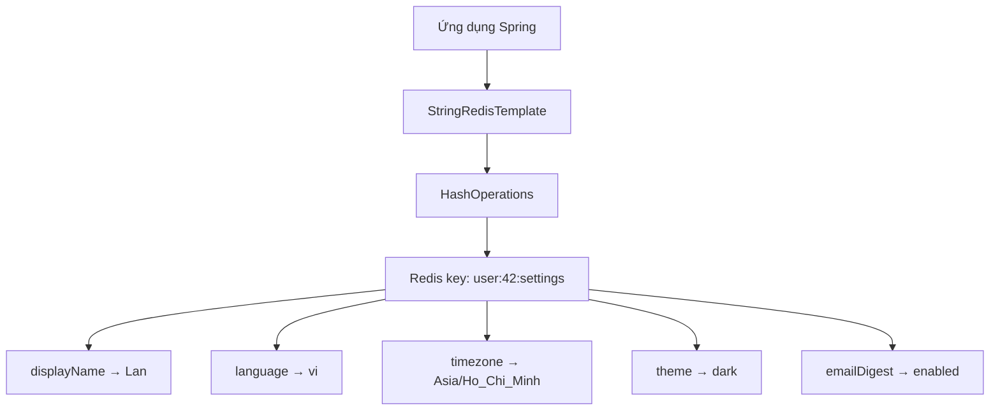
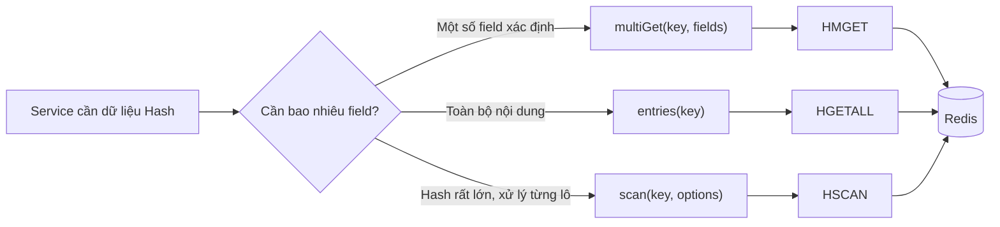

# Đọc nhiều trường và toàn bộ nội dung Hash trong Spring Data Redis

**Redis Hash** lưu nhiều cặp **field → value** bên trong **một Redis key**. Khi sử dụng Spring Data Redis, ta thường cần hai cách đọc khác nhau: **đọc một nhóm field đã biết** bằng `HashOperations.multiGet()` (tương ứng lệnh Redis `HMGET`), hoặc **đọc toàn bộ field và value** bằng `HashOperations.entries()` (tương ứng `HGETALL`). Ngoài ra còn có những API chỉ lấy tên field, chỉ lấy value, đếm số field và quét dần một Hash lớn.

Đây là bài thực hành về **đọc Hash bằng RedisTemplate**, nằm trong chủ đề Hash của Spring Data Redis. Mục tiêu là hiểu khi nào nên dùng `HMGET`, khi nào dùng `HGETALL`, cách diễn giải dữ liệu thiếu, cách chọn serializer và cách đọc Hash lớn mà không tạo chi phí bất thường. Các ví dụ dùng API đồng bộ phổ biến của Spring Boot 3.x/Spring Data Redis 3.x với `StringRedisTemplate`; hành vi cụ thể có thể thay đổi theo phiên bản thư viện và Redis server.

## 1. Một Redis Hash gồm một key và nhiều field

Giả sử ứng dụng lưu cài đặt người dùng:

```text
Redis key: user:42:settings
Redis TYPE: hash

field            value
-------------------------------
displayName      Lan
language         vi
timezone         Asia/Ho_Chi_Minh
theme            dark
emailDigest      enabled
```

Trong Redis, `user:42:settings` là **một key duy nhất**. Các chuỗi `displayName`, `language`... là **field** thuộc key đó. Redis không tự xem chúng là những key độc lập như `user:42:settings:language`.

Mô hình:



Có ba khái niệm cần phân biệt:

- **Redis key**: định danh của toàn bộ Hash, ví dụ `user:42:settings`.
- **Hash field**: tên một thuộc tính bên trong Hash, ví dụ `language`.
- **Hash value**: giá trị tương ứng của field, ví dụ `vi`. Redis lưu field/value dưới dạng byte; Spring sử dụng serializer để chuyển đổi chúng sang kiểu Java.

Một Hash thường phù hợp khi nhiều thuộc tính thuộc cùng một thực thể logic, cần đọc/ghi riêng từng thuộc tính hoặc nhiều thuộc tính cùng lúc. Redis Hash khác một Redis String chứa JSON: `HGET`, `HMGET` và `HGETALL` chỉ áp dụng cho key có Redis TYPE là `hash`.

## 2. Bản đồ các lệnh đọc Hash và API của Spring

| Nhu cầu | Lệnh Redis | `HashOperations<K, HK, HV>` | Kiểu kết quả thông thường |
|---|---|---|---|
| Đọc một field | `HGET key field` | `get(key, field)` | `HV` hoặc `null` |
| Đọc một nhóm field | `HMGET key f1 f2 ...` | `multiGet(key, fields)` | `List<HV>`, giữ vị trí tương ứng với đầu vào |
| Đọc tất cả field và value | `HGETALL key` | `entries(key)` | `Map<HK, HV>` |
| Chỉ lấy tên tất cả field | `HKEYS key` | `keys(key)` | `Set<HK>` |
| Chỉ lấy value của tất cả field | `HVALS key` | `values(key)` | `List<HV>` |
| Đếm số field | `HLEN key` | `size(key)` | `Long` |
| Kiểm tra một field | `HEXISTS key field` | `hasKey(key, field)` | `Boolean` |
| Đọc dần các field/value | `HSCAN key cursor ...` | `scan(key, scanOptions)` | `Cursor<Map.Entry<HK, HV>>` |

Trong các kiểu generic:

- `K`: kiểu của **Redis key**.
- `HK`: kiểu của **Hash field**.
- `HV`: kiểu của **Hash value**.

Ví dụ `HashOperations<String, String, String>` biểu thị Redis key, field và value đều được thao tác dưới dạng String. Điều này thường gặp với `StringRedisTemplate`. Nếu một ứng dụng có value là đối tượng Java, `HK` và `HV` có thể là những kiểu khác và phải được serialize tương thích.

**Hai đường đọc quan trọng nhất:**



## 3. Chuẩn bị `StringRedisTemplate` và dữ liệu mẫu

Với Gradle Groovy, khai báo:

```groovy
dependencies {
    implementation 'org.springframework.boot:spring-boot-starter-data-redis'
}
```

Ví dụ Redis standalone đang chạy trên máy phát triển:

```yaml
spring:
  data:
    redis:
      host: localhost
      port: 6379
      connect-timeout: 2s
      timeout: 3s
```

Spring Boot thường tự cung cấp `StringRedisTemplate` khi có Redis starter và cấu hình phù hợp. Để minh họa, hãy tạo một Hash bằng Spring Data Redis:

```java
import java.util.LinkedHashMap;
import java.util.Map;
import org.springframework.data.redis.core.HashOperations;
import org.springframework.data.redis.core.StringRedisTemplate;
import org.springframework.stereotype.Service;

@Service
public class UserSettingsWriter {
    private final HashOperations<String, String, String> hashes;

    public UserSettingsWriter(StringRedisTemplate redis) {
        this.hashes = redis.opsForHash();
    }

    public void seedUser42() {
        Map<String, String> fields = new LinkedHashMap<>();
        fields.put("displayName", "Lan");
        fields.put("language", "vi");
        fields.put("timezone", "Asia/Ho_Chi_Minh");
        fields.put("theme", "dark");
        fields.put("emailDigest", "enabled");

        hashes.putAll("user:42:settings", fields);
    }
}
```

`putAll()` ghi nhiều field vào **cùng một Hash**. Nó không tương đương với `ValueOperations.multiSet()` vốn ghi nhiều Redis String keys. Cũng không có TTL tự động trong ví dụ trên; nếu nghiệp vụ yêu cầu key hết hạn thì cần cấu hình expiry riêng.

Có thể tạo dữ liệu tương đương trong Redis CLI:

```bash
redis-cli HSET user:42:settings \
  displayName "Lan" \
  language "vi" \
  timezone "Asia/Ho_Chi_Minh" \
  theme "dark" \
  emailDigest "enabled"

redis-cli TYPE user:42:settings
# hash

redis-cli HLEN user:42:settings
# 5
```

Các ví dụ tiếp theo giả định Hash này đã tồn tại. Không nên xem các lệnh Redis CLI dưới đây là API Java; chúng giúp kiểm chứng trực tiếp hành vi của Redis.

## 4. Đọc một field với `get()` và `HGET`

Trước khi đọc nhiều field, cần nắm ý nghĩa của thao tác đọc một field:

```java
HashOperations<String, String, String> hashes =
    stringRedisTemplate.opsForHash();

String language = hashes.get(
    "user:42:settings",
    "language"
);
// "vi"
```

Lệnh Redis tương ứng:

```bash
redis-cli HGET user:42:settings language
# "vi"
```

Kết quả quan trọng:

1. Nếu Hash tồn tại và có field `language`, Redis trả value của field đó.
2. Nếu Hash tồn tại nhưng **không có** field được yêu cầu, Redis trả nil; `StringRedisTemplate` thông thường ánh xạ thành Java `null`.
3. Nếu **cả Hash key không tồn tại**, lệnh `HGET` cũng trả nil.
4. Nếu key đang có kiểu khác, chẳng hạn Redis String, lệnh `HGET` gặp lỗi `WRONGTYPE`. Đây là lỗi thao tác, không phải một value `null` hợp lệ.

Vì vậy, một lần `get(key, field) == null` không đủ để biết “key không tồn tại” hay “key có tồn tại nhưng thiếu field”. Nếu ứng dụng cần phân biệt hai trạng thái, phải có quy ước dữ liệu hoặc thực hiện những thao tác kiểm tra bổ sung, đồng thời hiểu rằng dữ liệu có thể thay đổi giữa các lệnh.

## 5. Đọc nhiều field đã biết với `multiGet()`

Khi giao diện chỉ cần `displayName`, `language` và `theme`, tải toàn bộ Hash có thể lãng phí nếu Hash chứa nhiều field khác. Sử dụng:

```java
import java.util.List;
import org.springframework.data.redis.core.HashOperations;
import org.springframework.data.redis.core.StringRedisTemplate;

HashOperations<String, String, String> hashes =
    stringRedisTemplate.opsForHash();

String key = "user:42:settings";
List<String> requested = List.of(
    "displayName",
    "language",
    "theme"
);

List<String> values = hashes.multiGet(key, requested);
// ["Lan", "vi", "dark"] nếu dữ liệu mẫu không thay đổi.
```

Redis CLI:

```bash
redis-cli HMGET user:42:settings displayName language theme
# 1) "Lan"
# 2) "vi"
# 3) "dark"
```

Redis dùng **`HMGET`**, một lệnh nhận một Hash key và danh sách field. Nó trả kết quả theo **thứ tự field được yêu cầu**.

### 5.1. Vị trí kết quả quan trọng hơn thứ tự lưu field

Nếu thay thứ tự đầu vào:

```java
List<String> requested = List.of("theme", "displayName");
List<String> values = hashes.multiGet(
    "user:42:settings",
    requested
);
// ["dark", "Lan"]
```

Sự tương ứng theo vị trí là:

```text
requested[0] = "theme"       --> values[0] = "dark"
requested[1] = "displayName" --> values[1] = "Lan"
```

Đừng dựa vào thứ tự mà Hash lưu field nội bộ hoặc thứ tự của `HGETALL`. Thứ tự của `HMGET` gắn với **danh sách field đầu vào**, không phải một trật tự mặc định của Redis Hash.

### 5.2. Khi một hoặc nhiều field không có

```java
List<String> requested = List.of(
    "displayName",
    "nickname",
    "timezone"
);

List<String> values = hashes.multiGet(
    "user:42:settings",
    requested
);
// ["Lan", null, "Asia/Ho_Chi_Minh"]
```

Trong trường hợp đọc đồng bộ thông thường với `StringRedisTemplate`, giá trị thiếu được thể hiện bằng một phần tử `null` tại vị trí đó. Không nên làm:

```java
// Sai: giả định mọi field đều có value và gọi method trên null
String nicknameUpper = values.get(1).toUpperCase();
```

Thay vào đó, xử lý field tùy tính chất của nó: bắt buộc, tùy chọn hoặc có default an toàn.

**Phân biệt value rỗng và field vắng mặt:**

- Field có value là chuỗi rỗng `""` → kết quả Java là `""`.
- Field không tồn tại → kết quả Java là `null`.
- Field được lưu chữ `"null"` → kết quả Java là **chuỗi bốn ký tự** `"null"`, không phải Java `null`.
- Redis connection/command lỗi → ném exception; không được tự diễn giải như một field vắng mặt.

Trong ngữ cảnh pipeline/transaction của Spring Data Redis, một số thao tác có thể **trả `null` tại thời điểm lệnh được queue** dù kết quả cuối cùng chỉ xuất hiện sau khi pipeline/transaction hoàn tất. Các ví dụ trong bài sử dụng lối gọi đồng bộ thông thường ngoài hai ngữ cảnh đó.

### 5.3. Ghép kết quả thành DTO mà vẫn giữ thứ tự

Nếu giao diện cần một object chứa ba field, code nên quy định rõ tên và vị trí:

```java
public record UserSettingsSummary(
    String displayName,
    String language,
    String theme
) {}

public UserSettingsSummary readSummary(String userId) {
    String key = "user:" + userId + ":settings";
    List<String> fields = List.of(
        "displayName",
        "language",
        "theme"
    );

    List<String> values = hashes.multiGet(key, fields);
    if (values == null) {
        throw new IllegalStateException(
            "Unexpected missing result outside pipeline/transaction"
        );
    }

    String name = values.get(0);
    String language = values.get(1);
    String theme = values.get(2);

    if (name == null || language == null) {
        throw new IllegalStateException("Required settings are missing");
    }

    return new UserSettingsSummary(
        name,
        language,
        theme == null ? "light" : theme
    );
}
```

Đoạn code này thuộc một service có field `hashes` kiểu `HashOperations<String, String, String>` như phần trên. `theme` được coi là tùy chọn và có default rõ ràng; `displayName`, `language` bắt buộc theo quy ước **của ví dụ**. Trong hệ thống thật, phải xác định default từ nghiệp vụ thay vì chọn tùy tiện khi dữ liệu thiếu.

Với danh sách field động, có thể ghép tên và value thành `LinkedHashMap`:

```java
import java.util.LinkedHashMap;
import java.util.List;
import java.util.Map;

public Map<String, String> readSelected(
        String key, List<String> fieldNames) {

    List<String> values = hashes.multiGet(key, fieldNames);
    if (values == null) {
        throw new IllegalStateException("No immediate Redis result");
    }

    Map<String, String> result = new LinkedHashMap<>();
    for (int i = 0; i < fieldNames.size(); i++) {
        result.put(fieldNames.get(i), values.get(i));
    }
    return result;
}
```

`LinkedHashMap` giúp giữ thứ tự field đầu vào khi lặp qua map. Nó cũng cho phép value `null` để thể hiện field thiếu; `Map.of(...)` thì **không cho phép value null**. Nếu danh sách đầu vào chứa field trùng tên, map chỉ giữ một entry cho tên đó; hãy dùng danh sách kết quả theo vị trí nếu cần bảo toàn bản ghi trùng.

## 6. Đọc toàn bộ Hash với `entries()` và `HGETALL`

Khi cần tất cả field và value của một Hash, sử dụng `HashOperations.entries(key)`:

```java
import java.util.Map;
import org.springframework.data.redis.core.HashOperations;

HashOperations<String, String, String> hashes =
    stringRedisTemplate.opsForHash();

Map<String, String> settings =
    hashes.entries("user:42:settings");

String displayName = settings.get("displayName");
String timezone = settings.get("timezone");
// Mọi cặp field/value hiện có đều nằm trong cùng một Map.
```

Lệnh Redis tương ứng:

```bash
redis-cli HGETALL user:42:settings
# Hiển thị từng field và value; thứ tự không được đảm bảo.
```

`HGETALL` trả toàn bộ field-value pairs của Hash. `StringRedisTemplate` giải mã và cung cấp một `Map<String, String>`.

### 6.1. Không có thứ tự đảm bảo

Một Redis Hash **không phải danh sách có thứ tự**. Redis không cam kết `HGETALL` trả field theo thứ tự tạo, alphabet hoặc theo thứ tự code gọi `putAll()`. `Map` nhận về cũng không nên được coi là thứ tự ổn định của dữ liệu Redis.

Nếu cần thứ tự hiển thị:

```java
import java.util.List;

List<String> displayOrder = List.of(
    "displayName",
    "language",
    "timezone",
    "theme"
);

for (String field : displayOrder) {
    String value = settings.get(field);
    if (value != null) {
        System.out.println(field + " = " + value);
    }
}
```

Ở đây thứ tự do **ứng dụng tự khai báo**, không đến từ Redis Hash. Nếu cần truy vấn có thứ tự theo điểm số hoặc thời gian, có thể dùng một cấu trúc Redis khác như Sorted Set bên cạnh Hash, nhưng phải thiết kế đồng bộ giữa các key.

### 6.2. Hash không tồn tại thì sao?

Trong lối gọi đồng bộ thông thường, `entries(key)` trả một map rỗng khi key Hash không tồn tại. Redis `HGETALL` với một key vắng mặt trả một tập cặp field-value rỗng.

```java
Map<String, String> missing =
    hashes.entries("user:does-not-exist:settings");

boolean noFields = missing.isEmpty();
// true
```

Redis không lưu một Hash trống như một key có nội dung: xóa field cuối cùng thường khiến key Hash không còn tồn tại. Vì vậy, một kết quả rỗng trong ngữ cảnh thông thường được hiểu là không có field nào để đọc. Nếu nghiệp vụ cần phân biệt “người dùng chưa được tạo” và “người dùng tồn tại nhưng chưa có cài đặt”, chỉ một Hash rỗng là **không đủ mô hình trạng thái**; cần marker key, nguồn dữ liệu chính hoặc quy ước rõ hơn.

### 6.3. HGETALL cho một góc nhìn tại thời điểm thực thi lệnh

Trên một Redis server, `HGETALL` là **một lệnh**. Trong khi server đang xử lý lệnh đó, các lệnh của client khác không xen vào giữa việc tạo reply. Kết quả phản ánh trạng thái Hash tại thời điểm lệnh được thực thi.

Nhưng điều này **không có nghĩa** dữ liệu Hash luôn đại diện cho một object nghiệp vụ được cập nhật atomically. Nếu writer cập nhật:

```java
hashes.put(key, "language", "en");
hashes.put(key, "timezone", "Europe/London");
```

thì đây là **hai lệnh**. Một `HGETALL` nằm giữa hai lệnh có thể đọc `language = en` nhưng `timezone` vẫn mang giá trị cũ.

Nếu nhiều field phải nhất quán cùng nhau, cân nhắc:

- `putAll(key, map)` để cập nhật các field đó trong **một lệnh Hash phù hợp**.
- Lua script hoặc Redis transaction khi cần kiểm tra điều kiện, cập nhật nhiều bước và kiểm soát xung đột.
- Lưu thêm `revision` và áp dụng protocol đọc/ghi có kiểm soát nếu yêu cầu consistency cao.

`HGETALL` cho snapshot của **một lệnh đọc**, không tạo transaction bao quanh toàn bộ nghiệp vụ.

## 7. Khi nào nên dùng `HMGET`, khi nào `HGETALL`?

| Khía cạnh | `HMGET` / `multiGet` | `HGETALL` / `entries` |
|---|---|---|
| Số field lấy | Chỉ những field được chỉ định | Tất cả field hiện có |
| Kết quả | Danh sách value theo thứ tự request | Map các field/value |
| Field không tồn tại | `null` tại vị trí tương ứng | Field không xuất hiện trong map |
| Khi Hash nhỏ | Phù hợp nếu chỉ cần ít field | Thuận tiện nếu cần toàn bộ |
| Khi Hash rất lớn | Thường ít dữ liệu truyền hơn nếu chọn ít field | Có thể tạo reply lớn và tốn bộ nhớ |
| Có phải một Redis key? | Có | Có |
| Tính nguyên tử của một lệnh | Đọc theo một lần thực thi command trên node | Đọc theo một lần thực thi command trên node |
| Trật tự field/value | Theo danh sách field của caller | Không hứa hẹn thứ tự |
| Mức độ phụ thuộc schema | Caller biết trước tên field cần đọc | Caller có thể duyệt toàn bộ field bất kể biết tên từ trước |

**Ví dụ chọn `HMGET`:** endpoint cần tên, ngôn ngữ và giao diện của một user trong Hash có 100 cài đặt.

**Ví dụ chọn `HGETALL`:** trang quản trị cần hiển thị toàn bộ cài đặt của một user mà Hash chỉ có khoảng 15 field; hoặc đoạn migration cần đọc hết field để chuyển cấu trúc.

Nếu Hash có vài trăm nghìn field, **không mặc định dùng `HGETALL`** chỉ vì muốn xử lý tất cả; nên chuyển sang `HSCAN`, xử lý theo lô hoặc thiết kế lại cách tổ chức dữ liệu nếu truy cập quá rộng và thường xuyên.

## 8. Chỉ đọc tên field, value hoặc số lượng field

Không phải lúc nào cũng cần cả map field-value. Spring Data Redis có các thao tác chuyên biệt.

### 8.1. `keys(key)` tương ứng `HKEYS`

```java
import java.util.Set;

Set<String> fieldNames = hashes.keys("user:42:settings");
// Ví dụ gồm displayName, language, timezone, theme, emailDigest.
```

Redis CLI:

```bash
redis-cli HKEYS user:42:settings
```

`HKEYS` trả toàn bộ tên field. Kết quả không có thứ tự được đảm bảo và **không chứa value**. Phù hợp khi cần biết Hash đang có những thuộc tính nào, nhưng có thể tốn bộ nhớ nếu Hash rất lớn.

### 8.2. `values(key)` tương ứng `HVALS`

```java
import java.util.List;

List<String> fieldValues =
    hashes.values("user:42:settings");
```

Redis CLI:

```bash
redis-cli HVALS user:42:settings
```

`HVALS` trả mọi value nhưng **không kèm tên field**. Không được gọi `keys()` và `values()` riêng rồi ghép phần tử cùng index để suy ra các cặp: hai lệnh có thể thấy những trạng thái khác nhau, và thứ tự không có hợp đồng ổn định.

Nếu cần quan hệ field → value, hãy dùng **`entries()`**, **`multiGet()` với danh sách field rõ ràng**, hoặc `scan()`.

### 8.3. `size(key)` tương ứng `HLEN`

```java
Long count = hashes.size("user:42:settings");
// 5 theo dữ liệu mẫu.
```

Redis CLI:

```bash
redis-cli HLEN user:42:settings
# 5
```

`HLEN` trả số field trong Hash, và trả `0` nếu key không tồn tại. Đây là cách trực tiếp để biết độ lớn theo **số field**, không phải theo số byte. Đừng dùng `hashes.entries(key).size()` chỉ để đếm: cách đó phải tải toàn bộ dữ liệu về ứng dụng.

### 8.4. `hasKey(key, field)` tương ứng `HEXISTS`

```java
Boolean exists = hashes.hasKey(
    "user:42:settings",
    "timezone"
);
// true với dữ liệu mẫu.
```

Redis CLI:

```bash
redis-cli HEXISTS user:42:settings timezone
# 1
```

`HEXISTS` hữu ích khi cần biết một field có tồn tại hay không mà không cần đọc value. Tuy nhiên, nếu sau đó dùng `HGET`, field vẫn có thể bị thay đổi/xóa **giữa hai lệnh**. Nếu mục tiêu chỉ là đọc value, một lần `HGET` thường đủ và tiết kiệm hơn cách `HEXISTS` rồi `HGET`.

## 9. Đọc Hash lớn từng phần với `HSCAN`

`HGETALL`, `HKEYS` và `HVALS` đều có thể tạo kết quả lớn tỷ lệ với số field của Hash. Khi Hash lớn hoặc cần xử lý theo luồng, Redis hỗ trợ `HSCAN` để duyệt dần các field/value.

Điểm rất quan trọng:

- `SCAN`: quét **các Redis key** trong keyspace.
- `HSCAN`: quét **các field và value của một Redis Hash key**.

Ví dụ:

```text
SCAN ... MATCH user:*             → tìm các Redis key như user:42:settings
HSCAN user:42:settings 0 ...     → tìm field/value bên trong đúng một Hash
```

### 9.1. Redis CLI: HSCAN với cursor

```bash
redis-cli HSCAN user:42:settings 0 COUNT 2
```

Reply gồm:

1. **Cursor tiếp theo** để tiếp tục quét.
2. **Các field/value** trả về trong lượt hiện tại.

Tiếp tục gọi `HSCAN key <cursor>` cho đến khi cursor trả về `0`. `COUNT 2` chỉ là **gợi ý số lượng phần tử cần duyệt ở mỗi bước**, không phải giới hạn cứng hai field; Redis có thể trả ít, nhiều hoặc không có field trong một lượt.

Ví dụ chỉ muốn xem các field có prefix `feature:`:

```bash
redis-cli HSCAN user:42:settings 0 MATCH 'feature:*' COUNT 100
```

`MATCH` lọc theo **tên field trong Hash**. Nó không lọc Redis key như `SCAN` và không tự tạo index cho field. Redis vẫn phải duyệt dữ liệu theo cách thức của scan; pattern không biến lệnh này thành một truy vấn có index theo prefix.

### 9.2. Spring Data Redis: `HashOperations.scan()`

`HashOperations.scan(key, ScanOptions)` trả một `Cursor`. Có thể duyệt và xử lý từng cặp field/value:

```java
import java.util.Map;
import org.springframework.data.redis.core.Cursor;
import org.springframework.data.redis.core.HashOperations;
import org.springframework.data.redis.core.ScanOptions;
import org.springframework.data.redis.core.StringRedisTemplate;
import org.springframework.stereotype.Service;

@Service
public class UserSettingsScanner {
    private final HashOperations<String, String, String> hashes;

    public UserSettingsScanner(StringRedisTemplate redis) {
        this.hashes = redis.opsForHash();
    }

    public void scanFeatures(String userId) {
        String key = "user:" + userId + ":settings";
        ScanOptions options = ScanOptions.scanOptions()
            .match("feature:*")
            .count(100)
            .build();

        try (Cursor<Map.Entry<String, String>> cursor =
                hashes.scan(key, options)) {
            while (cursor.hasNext()) {
                Map.Entry<String, String> entry = cursor.next();
                processFeature(entry.getKey(), entry.getValue());
            }
        }
    }

    private void processFeature(String field, String value) {
        // Thay bằng xử lý nghiệp vụ thực tế.
        System.out.println(field + " = " + value);
    }
}
```

Trong ví dụ trên, `processFeature()` chỉ minh họa. Trong môi trường production, hạn chế in raw dữ liệu người dùng ra log hoặc console; xử lý từng item và tổng hợp metric phù hợp. `try-with-resources` đóng cursor để giải phóng tài nguyên/connection được dùng bởi scan.

**HSCAN không phải một snapshot nhất quán tại một thời điểm**. Trong lúc quét:

- Một field có thể được thêm, sửa hoặc xóa.
- Một field có thể xuất hiện lặp lại trong các lượt quét.
- Các field tồn tại chỉ trong một phần thời gian quét có thể được thấy hoặc bỏ sót.
- Cursor có thể trả không có field ở một lượt nhưng vẫn chưa kết thúc.

Vì vậy, nếu cần thống kê hoặc migrate bằng HSCAN, nên xử lý **idempotent**, chịu được item lặp và có quy tắc điều phối writer trong thời gian quét. Dùng `HSCAN` để duyệt ít áp lực bộ nhớ hơn, **không để mặc định bảo đảm đọc được một phiên bản Hash bất biến**.

### 9.3. Giới hạn của HSCAN và quyết định thiết kế

`HSCAN` thường hữu ích để duyệt Hash lớn, nhưng bản chất vẫn phải xem qua các field, và một số Hash nhỏ/encoding đặc biệt có thể khiến một lần quét trả rất nhiều phần tử. `COUNT` chỉ là hint, nên vẫn cần giới hạn xử lý và giám sát tải.

Nếu ứng dụng thường xuyên hỏi “lấy 100 phần tử kế tiếp theo thời điểm tạo” hoặc “đọc 20 phần tử có score cao nhất”, Redis Hash và HSCAN **không cung cấp pagination/sort theo ngữ nghĩa đó**. Khi cần thứ tự có ý nghĩa nghiệp vụ, cân nhắc bổ sung Sorted Set hoặc cấu trúc dữ liệu/secondary index thích hợp.

## 10. Mẫu service đọc Hash hoàn chỉnh

Ví dụ sau gom các nhu cầu thường gặp vào một Spring service. API trả dữ liệu dưới dạng String vì đang dùng `StringRedisTemplate`.

```java
import java.util.List;
import java.util.Map;
import java.util.Set;
import org.springframework.data.redis.core.HashOperations;
import org.springframework.data.redis.core.StringRedisTemplate;
import org.springframework.stereotype.Service;

@Service
public class UserSettingsReadService {
    private final HashOperations<String, String, String> hashes;

    public UserSettingsReadService(StringRedisTemplate redis) {
        this.hashes = redis.opsForHash();
    }

    private String key(String userId) {
        if (userId == null || !userId.matches("[A-Za-z0-9_-]{1,80}")) {
            throw new IllegalArgumentException("Invalid user id");
        }
        return "user:" + userId + ":settings";
    }

    // Một field.
    public String readField(String userId, String field) {
        return hashes.get(key(userId), field);
    }

    // Nhiều field, trả theo thứ tự fieldNames.
    public List<String> readFields(
            String userId, List<String> fieldNames) {
        if (fieldNames == null || fieldNames.isEmpty()) {
            throw new IllegalArgumentException("Fields are required");
        }
        List<String> values =
            hashes.multiGet(key(userId), fieldNames);
        if (values == null) {
            throw new IllegalStateException("Unexpected deferred result");
        }
        return values;
    }

    // Toàn bộ các cặp field-value.
    public Map<String, String> readAll(String userId) {
        return hashes.entries(key(userId));
    }

    public Set<String> fieldNames(String userId) {
        return hashes.keys(key(userId));
    }

    public Long fieldCount(String userId) {
        return hashes.size(key(userId));
    }

    public Boolean containsField(String userId, String field) {
        return hashes.hasKey(key(userId), field);
    }
}
```

Lớp này có thể được inject vào controller hoặc một service nghiệp vụ khác. `key()` minh họa quy tắc xây key và giới hạn ID để tránh key ngoài namespace mong muốn. Trong ứng dụng thực tế, nên định nghĩa whitelist cho tên field mà một API công khai được phép đọc; **không nên cho phép caller tùy ý truy cập toàn bộ field** nếu Hash còn chứa thông tin nội bộ hoặc nhạy cảm.

Ví dụ cách gọi:

```java
String language = service.readField("42", "language");

List<String> values = service.readFields(
    "42",
    List.of("displayName", "theme", "timezone")
);

Map<String, String> allFields = service.readAll("42");

Long totalFields = service.fieldCount("42");
```

Khi `HashOperations` được sử dụng bên ngoài pipeline/transaction, các method thông thường chờ kết quả từ Redis hoặc ném exception. Nếu Redis đang mất kết nối, command timeout hay serializer lỗi, mã không nên trả một map rỗng để che giấu lỗi.

## 11. Đọc nhiều Hash key khác với đọc nhiều field của một Hash

Đây là khác biệt quan trọng khi dùng API có từ `multiGet`:

### Trường hợp A — Một Redis Hash có nhiều field

```text
user:42:settings (HASH)
    language → vi
    theme    → dark
```

API:

```java
hashes.multiGet(
    "user:42:settings",
    List.of("language", "theme")
);
```

Điển hình là **`HMGET`**: một Redis key, nhiều Hash fields.

### Trường hợp B — Hai Redis String keys độc lập

```text
user:42:language (STRING) → vi
user:42:theme    (STRING) → dark
```

API:

```java
stringRedisTemplate.opsForValue().multiGet(
    List.of("user:42:language", "user:42:theme")
);
```

Điển hình là **`MGET`**: nhiều Redis keys kiểu String.

Không thể thay `HashOperations.multiGet(hashKey, fields)` bằng `ValueOperations.multiGet(...)` chỉ bằng cách thay danh sách tên field vào chỗ key. Tên field không phải key Redis. Tương tự, `HGETALL user:42:settings` không có chức năng đọc tất cả key `user:42:*`.

### Nếu cần cùng một field của nhiều Hash

Ví dụ cần `language` của 1.000 Hash:

```text
user:1:settings → HGET language
user:2:settings → HGET language
...
user:1000:settings → HGET language
```

Không có `HMGET` duy nhất lấy một field từ 1.000 Hash key khác nhau. Có thể dùng nhiều lệnh `HGET` qua **pipeline** để giảm round trip hoặc xem xét mô hình lưu trữ khác nếu truy vấn dạng này là chủ đạo. Pipeline **không biến các lệnh thành một snapshot nguyên tử**.

## 12. Những ranh giới nhất quán cần lưu ý

### 12.1. Một lệnh Hash khác một chuỗi lệnh

`HMGET` và `HGETALL` là một lệnh Redis trên một key. Nếu request khác sửa Hash, nó được thực thi trước hoặc sau lệnh đọc đó trên server tương ứng. Nhưng gọi hai `HMGET` liên tiếp không tạo một transaction gồm hai lần đọc.

```text
t0: Hash language=vi, theme=dark
t1: Service A: HMGET language              → vi
t2: Service B: HSET language=en theme=light
t3: Service A: HMGET theme                 → light

Service A ghép (vi, light) từ hai thời điểm.
```

Nếu cần cùng hai giá trị ở một thời điểm, đọc cả hai trong **một `HMGET`**, hoặc dùng `HGETALL` nếu phải lấy toàn bộ.

### 12.2. HSCAN không thay thế một lần đọc nhất quán

Hash lớn có thể khiến `HGETALL` tốn kém; chuyển sang `HSCAN` giúp duyệt từng bước nhưng chấp nhận khả năng dữ liệu thay đổi trong quá trình quét. Nếu bài toán bắt buộc có snapshot chính xác của một tập dữ liệu lớn, cần thiết kế protocol riêng:

- Tạm ngừng writer trong cửa sổ đọc/migration được kiểm soát.
- Dùng revision và xác minh revision trước/sau khi xử lý, kèm quy tắc writer cập nhật revision một cách nguyên tử.
- Chuyển dữ liệu sang một cấu trúc snapshot/versioned namespace và đọc bản cố định.

Một so sánh revision ngoài transaction cũng có góc cạnh concurrency; phải phân tích cách writer cập nhật revision và thời điểm snapshot được chụp. Không tuyên bố “HSCAN + kiểm tra revision” tự bảo đảm snapshot nếu chưa có invariant tương ứng.

### 12.3. Lỗi Redis không phải dữ liệu trống

Ví dụ:

```java
import org.springframework.dao.DataAccessException;

public Map<String, String> readAllOrFail(String userId) {
    try {
        return hashes.entries("user:" + userId + ":settings");
    } catch (DataAccessException ex) {
        throw new IllegalStateException(
            "Redis settings are unavailable", ex
        );
    }
}
```

Đường error này giúp hệ thống phân biệt dữ liệu vắng mặt với Redis không khả dụng. Một số ứng dụng có thể lựa chọn fallback sang database khi Hash chỉ là cache; nhưng đó là quyết định của tầng nghiệp vụ, không phải hành vi mặc định của `entries()`.

## 13. Hiệu năng và độ phức tạp

Đọc Hash luôn có chi phí xử lý trên Redis, mạng và phía Java. Những lệnh trả toàn bộ dữ liệu có thể gây độ trễ đáng kể nếu Hash quá lớn.

| Lệnh | Chi phí theo số field | Dữ liệu trả về | Hướng dùng |
|---|---|---|---|
| `HGET` | Thường O(1) | Một value | Chỉ cần một field |
| `HMGET` | O(N), N là số field được yêu cầu | Tối đa N value | Biết rõ nhóm field cần đọc |
| `HGETALL` | O(N), N là tổng số field | Toàn bộ cặp field-value | Hash nhỏ/vừa, cần tất cả |
| `HKEYS` | O(N), N là tổng số field | Toàn bộ tên field | Chỉ cần danh sách field |
| `HVALS` | O(N), N là tổng số field | Toàn bộ value | Chỉ cần value |
| `HLEN` | O(1) | Một số đếm | Chỉ cần số lượng |
| `HEXISTS` | Thường O(1) | 0/1 | Kiểm tra một field |
| `HSCAN` | Từng bước; cả vòng O(N) kỳ vọng | Nhiều đợt field/value | Duyệt Hash lớn theo batch |

Chi phí thực tế còn phụ thuộc **kích thước mỗi field/value, encoding của Redis Hash, serializer, network latency và tải Redis server**. Một Hash chỉ có 100 field nhưng mỗi value vài MB vẫn có thể gây reply rất lớn.

### 13.1. Tại sao HGETALL có thể nguy hiểm trên Hash lớn?

Với `HGETALL`:

1. Redis phải chuẩn bị toàn bộ field/value cho reply.
2. Dữ liệu được truyền qua mạng.
3. Driver nhận và deserialize các phần tử.
4. Spring tạo map chứa các entry.
5. Service có thể tiếp tục tạo DTO/JSON response, làm phát sinh thêm bản sao dữ liệu trong bộ nhớ.

Khi có nhiều request đồng thời, những bước này làm tăng latency, memory footprint và GC pressure. Nếu chỉ cần ba field, `HMGET` thường có footprint dễ kiểm soát hơn.

### 13.2. Đọc dần không luôn có nghĩa xử lý không giới hạn

`HSCAN` giảm nhu cầu tải toàn bộ kết quả vào một map lớn, nhưng vẫn cần:

- Đóng cursor.
- Giới hạn tốc độ xử lý và concurrency.
- Xử lý item lặp khi cần.
- Không giả định `COUNT` là giới hạn cứng số item.
- Đảm bảo business logic chấp nhận dữ liệu thay đổi trong lúc quét.

Nếu cần tổng hợp toàn bộ vào một `List` ở cuối, bạn vẫn có thể dùng lượng bộ nhớ lớn tương đương `HGETALL`. Lợi ích chính của cursor chỉ đạt được khi xử lý theo luồng/từng lô và không giữ mọi item.

## 14. Serializer quyết định cách đọc field và value

Redis lưu byte, Spring Data Redis dùng serializer để biến byte thành Java values. Với `StringRedisTemplate`, field và value thông thường được serialize bằng UTF-8 String.

```text
Java field "language"      → UTF-8 bytes → Redis Hash field
Java value "vi"           → UTF-8 bytes → Redis Hash value
```

Nếu Hash được ghi bằng custom `RedisTemplate`:

```java
RedisTemplate<String, Object> template = new RedisTemplate<>();
template.setConnectionFactory(connectionFactory);
template.setKeySerializer(new StringRedisSerializer());
template.setHashKeySerializer(new StringRedisSerializer());
template.setHashValueSerializer(
    new GenericJackson2JsonRedisSerializer()
);
template.afterPropertiesSet();
```

thì field name có thể vẫn đọc được dưới dạng String, trong khi **mỗi hash value** được lưu thành JSON bytes. Đọc bằng `StringRedisTemplate` lúc này có thể cho ra chuỗi JSON thay vì đối tượng Java mong muốn, hoặc hiển thị sai nếu serializer khác/nhị phân.

Các serializer của `RedisTemplate` cần được phân biệt:

| Serializer | Chịu trách nhiệm |
|---|---|
| `keySerializer` | Redis key `user:42:settings` |
| `valueSerializer` | Redis String value, chẳng hạn `GET/SET` |
| `hashKeySerializer` | Hash field, chẳng hạn `language` |
| `hashValueSerializer` | Value của field, chẳng hạn `vi` hoặc JSON object |

**Đổi `valueSerializer` không nhất thiết đổi `hashValueSerializer`.** Khi debug `entries()` trả dữ liệu sai, kiểm tra cả cách Hash được tạo và serializer của các field/value.

Ví dụ cấu hình một Hash template rõ ràng với String key và JSON hash values:

```java
import org.springframework.context.annotation.Bean;
import org.springframework.context.annotation.Configuration;
import org.springframework.data.redis.connection.RedisConnectionFactory;
import org.springframework.data.redis.core.RedisTemplate;
import org.springframework.data.redis.serializer.GenericJackson2JsonRedisSerializer;
import org.springframework.data.redis.serializer.StringRedisSerializer;

@Configuration
public class HashJsonConfiguration {
    @Bean
    RedisTemplate<String, Object> hashJsonTemplate(
            RedisConnectionFactory factory) {
        RedisTemplate<String, Object> template = new RedisTemplate<>();
        template.setConnectionFactory(factory);
        template.setKeySerializer(new StringRedisSerializer());
        template.setHashKeySerializer(new StringRedisSerializer());
        template.setHashValueSerializer(
            new GenericJackson2JsonRedisSerializer()
        );
        template.afterPropertiesSet();
        return template;
    }
}
```

Với kiểu template này, kết quả từ `opsForHash().entries(key)` có thể chứa những Java object đã được JSON serializer đọc lại. Khi lưu dữ liệu qua serializer polymorphic, cần quản lý cấu hình type metadata và xem xét an toàn deserialization. Mã ví dụ là minh họa trách nhiệm serializer; contract value cụ thể phải được định nghĩa cho ứng dụng và giữ tương thích khi nâng cấp.

## 15. Redis Hash qua Template khác Hash của Redis Repository

Redis Repository thường sử dụng `@RedisHash` và `MappingRedisConverter` để ánh xạ entity Java thành các field, thêm metadata hoặc index khi cần. Ví dụ:

```java
import org.springframework.data.annotation.Id;
import org.springframework.data.redis.core.RedisHash;
import org.springframework.data.redis.core.index.Indexed;

@RedisHash("profiles")
public class ProfileEntity {
    @Id
    private String id;

    @Indexed
    private String language;

    private String displayName;

    // Constructors, getters, setters theo yêu cầu mapping.
}
```

Nếu Spring Data Redis Repository lưu entity vào keyspace `profiles`, key Hash có thể có tên như `profiles:42` và chứa các field do converter quyết định. Đọc thô bằng `StringRedisTemplate.opsForHash().entries("profiles:42")` **không bảo đảm** kết quả chính là DTO Java hoàn chỉnh:

- Hash có thể chứa metadata như `_class`.
- Nested properties có quy tắc mapping riêng.
- Field/value có thể không serialize thành String UTF-8 theo kỳ vọng.
- Redis Repository có thể duy trì secondary index, tập ID hoặc metadata TTL ngoài Hash chính.

Nếu cần load entity với contract của Repository, sử dụng `repository.findById(id)`. Nếu chỉ cần xem field thô để debug, có thể dùng `HGETALL` với hiểu biết rõ về representation.

Không nên tự `HSET` lên Hash do Repository sở hữu để cập nhật thuộc tính có `@Indexed`: việc thay raw Hash field **không tự cập nhật secondary index** do Repository quản lý. Điều này có thể khiến `findById` nhìn thấy dữ liệu mới nhưng truy vấn theo index lại cho kết quả cũ.

## 16. TTL, Redis Cluster và quyền truy cập

### 16.1. TTL thuộc Redis key

`EXPIRE user:42:settings 600` gắn thời gian sống cho **toàn bộ Hash key**:

```java
import java.time.Duration;

stringRedisTemplate.expire(
    "user:42:settings",
    Duration.ofMinutes(10)
);
```

Việc gọi `HMGET` hoặc `HGETALL` không tự gia hạn TTL theo kiểu sliding expiration. Nếu ứng dụng muốn mỗi lần đọc session làm mới thời hạn, phải có chính sách explicit và hiểu rằng thao tác `expire` thêm một lệnh mới.

Ở các Redis phiên bản mới có thể có lệnh dành cho hash-field expiration, nhưng đó là **khả năng phụ thuộc phiên bản Redis/server và API Spring Data Redis**. Đừng suy ra mọi field của Hash mặc nhiên có TTL độc lập; các ví dụ ở đây dùng TTL cấp key.

### 16.2. Redis Cluster và HMGET/HGETALL

`HMGET`, `HGETALL` và `HSCAN` tác động lên **một Redis key**, nên client định tuyến đến node sở hữu hash slot của key đó. Chúng không gặp vấn đề “nhiều key khác slot” chỉ vì có nhiều field.

Ngược lại, `ValueOperations.multiGet()` / Redis `MGET` đọc nhiều **Redis String keys**, có thể bị giới hạn bởi hash slot khi Redis chạy Cluster. Nhớ rằng field `language` và field `theme` cùng nằm trong một Hash, không phải hai Redis keys phân tán trên hai node.

Một Hash cực lớn dồn toàn bộ dữ liệu vào **một slot/một node**; điều đó có thể tạo điểm nóng, dù truy cập nhiều field chỉ cần một key. Redis Cluster không tự tách từng field của cùng Hash sang những node khác.

### 16.3. Quyền truy cập dữ liệu

`HGETALL` có thể vô tình đọc những field không cần thiết như token, trạng thái nội bộ hoặc cài đặt nhạy cảm. Redis ACL chủ yếu kiểm soát command/key patterns và không nên được giả định là cơ chế authorization field-level hoàn chỉnh cho mọi endpoint.

Nếu API chỉ được trả `displayName` và `theme`, hãy dùng `HMGET` với whitelist field hoặc map sang DTO đã kiểm soát. Không tự động đưa toàn bộ `entries()` của Hash vào HTTP response cho người dùng.

## 17. Những lỗi thường gặp và cách xử lý

| Hiện tượng | Nguyên nhân có thể | Hướng xử lý |
|---|---|---|
| `multiGet()` trả `null` ở một vị trí | Field hoặc Hash không tồn tại | Xác định required/optional fields; xem `HEXISTS` khi cần |
| `entries()` trả map rỗng | Hash key không tồn tại hoặc không có field | Kiểm tra quy ước key, TTL và nguồn dữ liệu |
| `HGETALL` báo `WRONGTYPE` | Key đang là String/List/Set thay vì Hash | Chạy `TYPE key`, xác định owner và key namespace |
| Đọc field ra chuỗi khó hiểu | Hash field/value serializer không khớp | Đối chiếu `hashKeySerializer`, `hashValueSerializer` và writer |
| `HGETALL` chậm, service tăng memory | Hash quá lớn, nhiều request đồng thời | Chỉ đọc field cần thiết bằng `HMGET` hoặc xử lý `HSCAN` |
| Lặp dữ liệu khi `HSCAN` | Dữ liệu thay đổi hoặc tính chất scan | Xử lý idempotent, không coi cursor là snapshot |
| Ghép `keys()` và `values()` sai | Hai lệnh riêng, thứ tự không được đảm bảo | Dùng `entries()` hoặc `multiGet()` |
| Lấy `entries().size()` chỉ để đếm | Tải mọi field/value không cần thiết | Dùng `size()` / `HLEN` |
| Đọc đúng field nhưng Repository query theo index sai | Hash do Repository quản lý bị sửa trực tiếp | Cập nhật qua Repository và duy trì index đúng |
| `HGET` nhận nil, tưởng Redis timeout | Nhầm missing value với lỗi truy cập | Phân biệt `null` hợp lệ và `DataAccessException` |
| Hash mất sau một thời gian | Key hết TTL hoặc bị xóa | Kiểm tra `TTL key`, writer/invalidation và quy tắc expiry |

### Quy trình debug nhanh với Redis CLI

```bash
# Kiểm tra key tồn tại và thuộc kiểu gì
redis-cli EXISTS user:42:settings
redis-cli TYPE user:42:settings

# Kiểm tra số field, field cụ thể và một nhóm field
redis-cli HLEN user:42:settings
redis-cli HEXISTS user:42:settings language
redis-cli HMGET user:42:settings language theme timezone

# Quan sát tất cả field/value (chỉ phù hợp Hash kích thước kiểm soát)
redis-cli HGETALL user:42:settings

# Khi Hash lớn, chuyển sang quét dần
redis-cli HSCAN user:42:settings 0 COUNT 100

# Kiểm tra TTL của toàn bộ Hash key
redis-cli TTL user:42:settings
```

Redis `TTL` trả số giây còn lại, `-1` nếu key có tồn tại nhưng không có TTL, và `-2` nếu key không tồn tại. Nếu cần quét **tên Redis key** theo pattern thì dùng `SCAN`, chẳng hạn:

```bash
redis-cli --scan --pattern 'user:*:settings'
```

`SCAN` chỉ trả tên key, không thay `HSCAN` bên trong từng Hash. Tránh `KEYS *` trên Redis production lớn vì có thể chặn server trong lúc duyệt keyspace.

## 18. Tình huống thực hành

### Tình huống A: Endpoint chỉ cần ba field

Một endpoint lấy `displayName`, `language` và `theme`. Hash người dùng có 60 field khác.

**Lựa chọn:** `multiGet(key, List.of(...))`. Dùng một `HMGET` để chỉ nhận ba value và map chúng vào DTO. Nếu một field có thể thiếu, định nghĩa default hoặc trả lỗi theo nghiệp vụ.

### Tình huống B: Trang quản trị cần xem toàn bộ cấu hình

Hash chỉ có khoảng 20 field và trang quản trị phải hiển thị tất cả.

**Lựa chọn:** `entries(key)` / `HGETALL`. Kiểm soát quyền truy cập và lọc những field nhạy cảm trước khi trả response; không dựa vào thứ tự map để hiển thị.

### Tình huống C: Hash có 200.000 field, cần xuất danh sách

`entries()` có thể tạo reply rất lớn và giữ toàn bộ map trong memory.

**Lựa chọn:** `scan(key, options)` rồi xử lý từng batch/item, giới hạn tải và đóng cursor. Nếu yêu cầu bản export nhất quán, phải bổ sung cơ chế snapshot/version/điều phối writer; `HSCAN` một mình không bảo đảm tính nhất quán.

### Tình huống D: Kiểm tra field có tồn tại

Nghiệp vụ chỉ cần biết field `twoFactorEnabled` đã được cấu hình hay chưa.

**Lựa chọn:** `hasKey(key, "twoFactorEnabled")` / `HEXISTS`. Nếu còn phải đọc value để phân biệt `true` và `false`, dùng `get()` một lần có thể đủ; field tồn tại không đồng nghĩa value mang ý nghĩa “đã bật”.

### Tình huống E: Đọc ngôn ngữ của 500 người dùng

Mỗi người có Hash riêng: `user:1:settings`, `user:2:settings`...

**Lựa chọn:** Không dùng một `HMGET` chung vì lệnh chỉ nhận **một key**. Có thể pipeline nhiều `HGET` hoặc cân nhắc mô hình dữ liệu khác khi nhu cầu đọc hàng loạt diễn ra thường xuyên. Nếu dùng Redis Cluster, các Hash key có thể ở nhiều node.

### Tình huống F: Thay đổi một field trên Hash do Repository quản lý

Ứng dụng dùng Redis Repository với `@Indexed` cho thuộc tính `language`. Developer muốn dùng `opsForHash().put()` để chỉnh field trực tiếp.

**Lựa chọn:** Cập nhật entity qua Repository hoặc dùng một adapter có khả năng duy trì toàn bộ mapping/index tương ứng. Thay Hash field thủ công không cập nhật index và có thể làm truy vấn theo thuộc tính trả sai dữ liệu.

## 19. Nguyên tắc chọn API đọc Hash

Trước khi đọc dữ liệu, hãy trả lời:

1. **Đang đọc một Redis Hash key hay nhiều Redis keys?** Nếu một Hash có nhiều field, dùng `HashOperations`.
2. **Đã biết chính xác những field cần lấy?** Dùng `multiGet()` để tránh tải dữ liệu không cần.
3. **Cần toàn bộ cặp field/value và Hash đủ nhỏ?** Dùng `entries()`.
4. **Chỉ cần tên field, value hay số lượng?** Dùng lần lượt `keys()`, `values()` hoặc `size()`, không tải mọi thứ bằng `entries()` nếu không cần.
5. **Hash rất lớn?** Cân nhắc `scan()`, giới hạn batch và xử lý dữ liệu thay đổi/lặp.
6. **Dữ liệu có serializer hoặc mapping riêng?** Xác định cách writer ghi Hash trước khi chọn reader.
7. **Có yêu cầu tính nhất quán, TTL, authorization hay hiệu năng đặc biệt?** Đưa chúng vào thiết kế API, không suy ra từ tên lệnh.

**`HashOperations.multiGet()` là cách đọc một nhóm field của một Hash, còn `HashOperations.entries()` đọc toàn bộ cặp field/value của Hash đó.** Cả hai là thao tác Redis đồng bộ trong các ví dụ trên; sự khác biệt nằm ở lượng dữ liệu cần lấy, cách trả kết quả và chi phí vận hành. Nắm chắc `HMGET`, `HGETALL`, `HSCAN` và ranh giới serializer giúp ứng dụng Spring Data Redis đọc Hash đúng, nhanh và rõ ràng hơn.
