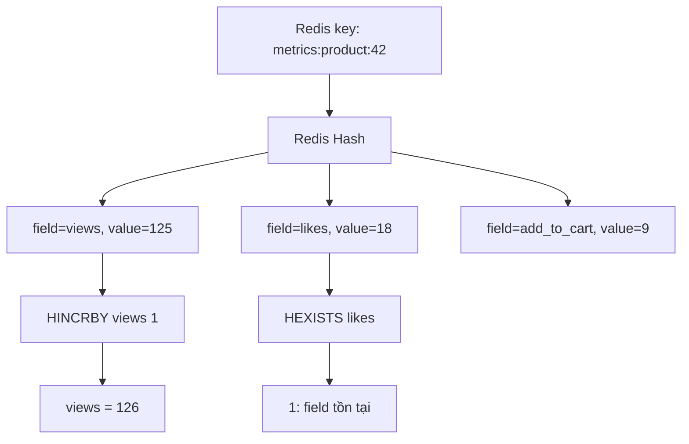

# Tăng giá trị số và kiểm tra sự tồn tại của trường

## 1. Bài toán: thao tác với một trường trong Redis Hash

Redis **Hash** lưu một tập hợp các cặp **field–value** dưới cùng một Redis key. Một Hash thường được dùng khi một đối tượng có nhiều thuộc tính nhỏ hoặc khi cần cập nhật độc lập từng bộ đếm, trạng thái hoặc thuộc tính mà không ghi lại toàn bộ đối tượng.

Ví dụ, ứng dụng muốn lưu số lượt xem, số lượt yêu thích và số lượt thêm vào giỏ của một sản phẩm:

```text
Redis key: metrics:product:42
Redis type: hash

Field           Value
-------------   -----
views           125
likes           18
add_to_cart     9
```

Khi một khách xem sản phẩm, ứng dụng muốn tăng `views` từ `125` lên `126`. Khi cần hiển thị thông tin, ứng dụng có thể hỏi field `likes` đã tồn tại trong Hash hay chưa. Đây là hai thao tác mà Redis hỗ trợ trực tiếp, không cần tải toàn bộ Hash về Java:

- **`HINCRBY`:** tăng hoặc giảm một field có giá trị số nguyên.
- **`HINCRBYFLOAT`:** tăng hoặc giảm một field có giá trị số thực.
- **`HEXISTS`:** kiểm tra field có tồn tại trong một Hash hay không.

Trong **Spring Data Redis**, các lệnh này được biểu diễn qua `HashOperations`:

```java
hashOperations.increment(redisKey, field, 1L);
hashOperations.increment(redisKey, field, 0.5d);
hashOperations.hasKey(redisKey, field);
```

Các lệnh trên có những quy tắc cần hiểu rõ: field chưa tồn tại có thể được tạo tự động khi tăng, kiểm tra tồn tại không kiểm tra giá trị, lệnh tăng một field là nguyên tử, và việc ghép `HEXISTS` với `HINCRBY` trong hai lời gọi không tự biến thành một thao tác nguyên tử.

## 2. Phân biệt Redis key, Hash field và Hash value

Cấu trúc một Hash gồm ba khái niệm:

| Thành phần | Ví dụ | Vai trò |
|---|---|---|
| **Redis key** | `metrics:product:42` | Tên của toàn bộ Hash trong keyspace Redis |
| **Hash field** | `views` | Tên trường bên trong Hash |
| **Hash value** | `125` | Giá trị được lưu cho trường |

Một Redis key có thể chứa nhiều field, mỗi field có value riêng:



**Key tồn tại** khác **field tồn tại**:

- `EXISTS metrics:product:42` kiểm tra top-level key.
- `HEXISTS metrics:product:42 views` kiểm tra field `views` nằm bên trong Hash đó.
- `HGET metrics:product:42 views` đọc value của field.
- `HLEN metrics:product:42` cho biết số field của Hash.

Trong Java, sự khác nhau tương ứng là:

```java
Boolean wholeHashExists = redis.hasKey("metrics:product:42");

Boolean viewsFieldExists =
        redis.opsForHash().hasKey("metrics:product:42", "views");
```

Hai phương thức đều có tên `hasKey` nhưng kiểm tra ở **hai cấp khác nhau**. Nếu Hash có field `likes` nhưng không có `views`, `redis.hasKey(...)` có thể trả `true` trong khi `redis.opsForHash().hasKey(..., "views")` trả `false`.

## 3. Thao tác Redis CLI: HINCRBY, HINCRBYFLOAT, HEXISTS

Trước khi dùng Spring Data Redis, hãy hiểu ngữ nghĩa của các lệnh Redis gốc.

### 3.1. HINCRBY: tăng hoặc giảm số nguyên

Cú pháp:

```redis
HINCRBY key field increment
```

Ví dụ:

```redis
HSET metrics:product:42 views 125
HINCRBY metrics:product:42 views 1
HINCRBY metrics:product:42 views 5
HINCRBY metrics:product:42 views -3
HGET metrics:product:42 views
```

Kết quả lần lượt của các lần tăng:

| Lệnh | Value trước | Delta | Value sau |
|---|---:|---:|---:|
| `HINCRBY ... views 1` | 125 | +1 | 126 |
| `HINCRBY ... views 5` | 126 | +5 | 131 |
| `HINCRBY ... views -3` | 131 | −3 | 128 |

`HINCRBY` trả về **giá trị mới sau khi tăng**, không phải giá trị cũ và cũng không chỉ là tín hiệu thành công/thất bại.

Giá trị field phải được Redis hiểu là một **số nguyên có dấu 64-bit** khi sử dụng `HINCRBY`. Nếu field đang chứa chuỗi không phải số nguyên, ví dụ `"active"` hoặc `"12.5"`, command sẽ báo lỗi. Nếu phép cộng vượt giới hạn số nguyên 64-bit, Redis cũng báo lỗi thay vì âm thầm tràn số theo ý muốn của ứng dụng.

Delta âm làm giảm value:

```redis
HINCRBY inventory:warehouse-1 sku-123 -2
```

Nhưng **lệnh giảm không tự kiểm tra value có bị âm hay không**. Với các quy tắc như “tồn kho không thể âm”, cần một thao tác có điều kiện và bảo đảm nguyên tử ở Redis hoặc hệ thống ghi dữ liệu gốc.

### 3.2. HINCRBY khi field chưa tồn tại

Nếu Redis key là Hash hợp lệ hoặc chưa tồn tại, nhưng field `views` chưa có, `HINCRBY` xem value ban đầu của field là `0`. Lệnh tạo field và ghi kết quả phép cộng:

```redis
HINCRBY metrics:product:100 views 1
HGET metrics:product:100 views
HEXISTS metrics:product:100 views
```

Kết quả mong đợi:

```text
HINCRBY ... views 1  -> 1
HGET ... views       -> "1"
HEXISTS ... views    -> 1
```

Điều này cũng áp dụng khi cả Hash key chưa tồn tại: Redis có thể tạo một Hash mới chứa field với giá trị đã tăng.

Một điểm dễ bỏ qua: ngay cả khi delta là `0`, `HINCRBY` trên field chưa có có thể **tạo field với value `0`**. Vì vậy, nếu chỉ muốn kiểm tra một field đã được khởi tạo hay chưa, hãy dùng `HEXISTS`, không dùng `HINCRBY ... 0` như một phép đọc không làm thay đổi trạng thái.

### 3.3. HINCRBYFLOAT: tăng hoặc giảm số thực

Cú pháp:

```redis
HINCRBYFLOAT key field increment
```

Ví dụ:

```redis
HSET metrics:product:42 rating_sum 4.5
HINCRBYFLOAT metrics:product:42 rating_sum 3.25
HINCRBYFLOAT metrics:product:42 rating_sum -0.5
HGET metrics:product:42 rating_sum
```

Sau hai lệnh tăng, giá trị cuối theo phép tính là `7.25`. Nếu field chưa tồn tại, Redis cũng xem giá trị ban đầu là `0` và tạo field tương ứng.

Cần thận trọng với số thực:

- Giá trị thực có thể gặp vấn đề **độ chính xác biểu diễn số thập phân**, đặc biệt khi quy đổi qua `double` của Java.
- Không dùng số thực để làm phép tính tiền tệ phải chính xác đến đơn vị nhỏ nhất. Với tiền, thường nên lưu số nguyên đơn vị nhỏ (ví dụ cents/đồng theo quy ước nghiệp vụ) và dùng `HINCRBY`, hoặc dùng hệ thống giao dịch phù hợp.
- Sau khi một field đã chứa số thập phân không phải số nguyên, gọi `HINCRBY` trên cùng field thường sẽ gặp lỗi vì Redis không còn xem value là số nguyên hợp lệ.
- Với dữ liệu làm mẫu số/bộ đếm thống kê, cần xác định rõ cách làm tròn, tổng hợp và giới hạn giá trị.

### 3.4. HEXISTS: kiểm tra đúng một field

Cú pháp:

```redis
HEXISTS key field
```

Ví dụ:

```redis
HSET metrics:product:42 views 0
HEXISTS metrics:product:42 views
HEXISTS metrics:product:42 shares
```

Redis trả:

```text
HEXISTS ... views   -> 1
HEXISTS ... shares  -> 0
```

`HEXISTS` kiểm tra **sự tồn tại**, không kiểm tra value có khác `0` hay khác chuỗi rỗng hay không:

```redis
HSET demo:flags enabled ""
HEXISTS demo:flags enabled
```

Dù value là chuỗi rỗng, field `enabled` vẫn tồn tại. Nếu cả Hash key không tồn tại, `HEXISTS` trả `0`. Nhưng nếu top-level key đang chứa kiểu Redis khác, ví dụ String thay vì Hash, lệnh có thể báo `WRONGTYPE`; đây không phải “field không tồn tại”.

### 3.5. Sự khác biệt quan trọng giữa HEXISTS và HGET

Với dữ liệu dạng số:

| Tình huống | `HEXISTS` | `HGET` | Ý nghĩa |
|---|---|---|---|
| Field chưa có | 0 | nil | Chưa khởi tạo giá trị |
| Field có value `0` | 1 | `"0"` | Đã khởi tạo và bằng 0 |
| Field có value `-5` | 1 | `"-5"` | Đã khởi tạo và âm |
| Field có value `"abc"` | 1 | `"abc"` | Field tồn tại nhưng không thể tăng bằng `HINCRBY` |
| Hash key không có | 0 | nil | Không có Hash/field |
| Key chứa kiểu Redis khác | Lỗi kiểu | Lỗi kiểu | Vi phạm hợp đồng keyspace |

Vì vậy, đừng triển khai `hasKey` bằng cách parse value và so sánh với 0. Một value bằng 0 vẫn là một field có tồn tại.

## 4. Spring Data Redis ánh xạ các lệnh ra sao?

Spring Data Redis cung cấp `HashOperations<H, HK, HV>` để đọc/ghi Hash theo các kiểu Java đã chọn. Các method trọng tâm:

```java
Long increment(H key, HK hashKey, long delta);
Double increment(H key, HK hashKey, double delta);
Boolean hasKey(H key, Object hashKey);
```

Trong đó:

- `key`: tên top-level Redis key chứa Hash.
- `hashKey`: field trong Hash, ví dụ `views`.
- `delta`: lượng cộng thêm, có thể âm để giảm.
- `Long` hoặc `Double`: giá trị **sau khi tăng**, tùy overload.
- `Boolean`: field có tồn tại hay không.

Các kiểu trả về là wrapper để phù hợp với contract của Spring Data Redis. Trong các ngữ cảnh như pipeline hoặc transaction, kết quả trực tiếp của method có thể là `null` vì phản hồi được xử lý sau. Với lời gọi đồng bộ thông thường, đừng nhầm `null` do pipeline với `false` của `HEXISTS`.

### 4.1. Khởi tạo Spring Boot

Với Gradle Groovy DSL:

```groovy
dependencies {
    implementation 'org.springframework.boot:spring-boot-starter-data-redis'
}
```

Cấu hình local minh họa:

```yaml
spring:
  data:
    redis:
      host: localhost
      port: 6379
      connect-timeout: 2s
      timeout: 2s
```

Spring Boot thường tự cấu hình `StringRedisTemplate` khi có Redis starter và connection factory phù hợp. Với dữ liệu số ở Hash, `StringRedisTemplate` là lựa chọn dễ hiểu: key, field và value dùng dạng chuỗi, Redis có thể đọc value dưới dạng số nguyên hoặc số thực khi thực thi `HINCRBY`/`HINCRBYFLOAT`.

Không cần bật `@EnableCaching` cho các thao tác Hash trực tiếp. `@EnableCaching` dành cho Spring Cache abstraction, không quyết định việc `opsForHash()` có hoạt động hay không.

### 4.2. Dùng HashOperations tăng giá trị số nguyên

```java
import org.springframework.data.redis.core.HashOperations;
import org.springframework.data.redis.core.StringRedisTemplate;
import org.springframework.stereotype.Service;

@Service
public class ProductMetricStore {

    private final HashOperations<String, String, String> hash;

    public ProductMetricStore(StringRedisTemplate redis) {
        this.hash = redis.opsForHash();
    }

    public long recordView(String productId) {
        Long updated = hash.increment(
                "metrics:product:" + productId,
                "views",
                1L);

        if (updated == null) {
            throw new IllegalStateException(
                    "Không có kết quả tăng bộ đếm Redis");
        }
        return updated;
    }

    public long addLikes(String productId, long delta) {
        Long updated = hash.increment(
                "metrics:product:" + productId,
                "likes",
                delta);

        if (updated == null) {
            throw new IllegalStateException(
                    "Không có kết quả cập nhật Redis");
        }
        return updated;
    }

    public boolean hasViewCounter(String productId) {
        return Boolean.TRUE.equals(
                hash.hasKey("metrics:product:" + productId, "views"));
    }
}
```

Ý nghĩa:

1. Service nhận `StringRedisTemplate` do Spring quản lý.
2. `redis.opsForHash()` cung cấp một `HashOperations` dùng lại serializer/cấu hình kết nối của template.
3. `increment(..., 1L)` ánh xạ tới thao tác tăng số nguyên của Redis, không phải `HGET` rồi `HSET`.
4. `increment(..., delta)` trả số mới, nên có thể trả thẳng về service gọi hoặc sử dụng để quyết định logic ở tầng phù hợp.
5. `hasKey(key, field)` kiểm tra field và trả Boolean; cách viết `Boolean.TRUE.equals(...)` tránh unboxing nếu API trả `null` trong ngữ cảnh đặc biệt.

Ví dụ gọi nhiều lần:

```java
productMetricStore.recordView("42"); // 1 nếu field chưa có.
productMetricStore.recordView("42"); // 2.
productMetricStore.addLikes("42", 10L); // 10 nếu field chưa có.
productMetricStore.addLikes("42", -3L); // 7.
productMetricStore.hasViewCounter("42"); // true khi field views tồn tại.
```

Kết quả ở các comment giả định namespace ban đầu chưa có dữ liệu liên quan và không có thao tác đồng thời khác. Trong thực tế nhiều instance có thể cùng tăng counter, nên kết quả sau mỗi lời gọi phụ thuộc thứ tự Redis xử lý các lệnh.

### 4.3. Dùng overload double cho số thực

Ví dụ hệ thống tính tổng trọng số của các tương tác:

```java
import org.springframework.data.redis.core.HashOperations;
import org.springframework.data.redis.core.StringRedisTemplate;
import org.springframework.stereotype.Service;

@Service
public class WeightedMetricStore {

    private final HashOperations<String, String, String> hash;

    public WeightedMetricStore(StringRedisTemplate redis) {
        this.hash = redis.opsForHash();
    }

    public double addWeight(String productId, double delta) {
        if (!Double.isFinite(delta)) {
            throw new IllegalArgumentException(
                    "delta phải là số hữu hạn");
        }

        Double updated = hash.increment(
                "metrics:weights:" + productId,
                "engagement_score",
                delta);

        if (updated == null) {
            throw new IllegalStateException(
                    "Không có kết quả tăng số thực");
        }
        return updated;
    }
}
```

Kiểu đối số quyết định overload: `1L` gọi phiên bản số nguyên, `1.0d` gọi phiên bản số thực. Điều này có thể ảnh hưởng cách Redis định dạng và diễn giải field value về sau. Với một field đã được quy định là số nguyên, đừng ngẫu nhiên chuyển giữa hai overload chỉ vì một caller dùng số literal `1.0`.

Kiểm tra `Double.isFinite` giúp loại bỏ `NaN` và số vô hạn từ input Java trước khi gửi lệnh. Đây chỉ là validation đầu vào; với giá trị lớn, biến đổi liên tục hoặc yêu cầu chính xác tuyệt đối, cần thiết kế định dạng số phù hợp hơn `double`.

### 4.4. Đọc bộ đếm sau khi tăng

Có thể dùng `hash.get(key, field)` để đọc value, nhưng với `StringRedisTemplate` nó trở về chuỗi:

```java
String raw = hash.get("metrics:product:42", "views");
Long count = raw == null ? null : Long.parseLong(raw);
```

Phải phân biệt ba tình huống:

- `raw == null`: field chưa tồn tại hoặc đã biến mất trước lúc đọc.
- `raw.equals("0")`: field tồn tại với giá trị 0.
- `Long.parseLong(raw)` ném lỗi: field chứa dữ liệu không phải số nguyên theo contract.

Nếu mục đích là lấy **giá trị mới sau một lần tăng**, không cần gọi thêm `HGET`: `increment(...)` đã trả về giá trị mới. Gọi thêm `HGET` sẽ tốn một round trip và có thể thấy value mới hơn vì một request khác đã tăng xen vào.

## 5. Ví dụ thực hành đầu cuối: Bộ đếm hoạt động sản phẩm

Ta muốn cung cấp ba hành động:

- Mỗi lần xem sản phẩm, tăng `views` một đơn vị.
- Mỗi lần yêu thích, tăng `likes` một đơn vị.
- API có thể trả trạng thái đã từng khởi tạo bộ đếm `views` chưa.

Thiết kế Redis:

```text
Key:   shop:product:42:metrics
Type:  HASH

Fields:
  views -> integer
  likes -> integer
```

Một service Spring:

```java
import org.springframework.data.redis.core.HashOperations;
import org.springframework.data.redis.core.StringRedisTemplate;
import org.springframework.stereotype.Service;

@Service
public class ProductActivityService {

    private final HashOperations<String, String, String> metrics;

    public ProductActivityService(StringRedisTemplate redis) {
        this.metrics = redis.opsForHash();
    }

    public long trackView(String productId) {
        return required(metrics.increment(
                key(productId), "views", 1L));
    }

    public long trackLike(String productId) {
        return required(metrics.increment(
                key(productId), "likes", 1L));
    }

    public boolean hasTrackedViews(String productId) {
        return Boolean.TRUE.equals(
                metrics.hasKey(key(productId), "views"));
    }

    public String currentViewCount(String productId) {
        return metrics.get(key(productId), "views");
    }

    private static long required(Long count) {
        if (count == null) {
            throw new IllegalStateException(
                    "Redis chưa trả kết quả bộ đếm");
        }
        return count;
    }

    private static String key(String productId) {
        return "shop:product:" + productId + ":metrics";
    }
}
```

Controller minh họa:

```java
import java.util.Map;
import org.springframework.web.bind.annotation.GetMapping;
import org.springframework.web.bind.annotation.PathVariable;
import org.springframework.web.bind.annotation.PostMapping;
import org.springframework.web.bind.annotation.RequestMapping;
import org.springframework.web.bind.annotation.RestController;

@RestController
@RequestMapping("/products")
public class ProductActivityController {

    private final ProductActivityService service;

    public ProductActivityController(ProductActivityService service) {
        this.service = service;
    }

    @PostMapping("/{id}/views")
    public Map<String, Long> recordView(@PathVariable String id) {
        return Map.of("views", service.trackView(id));
    }

    @PostMapping("/{id}/likes")
    public Map<String, Long> recordLike(@PathVariable String id) {
        return Map.of("likes", service.trackLike(id));
    }

    @GetMapping("/{id}/views/initialized")
    public Map<String, Boolean> isInitialized(@PathVariable String id) {
        return Map.of("initialized", service.hasTrackedViews(id));
    }
}
```

Đây là ví dụ phục vụ học kỹ thuật; API thực tế cần kiểm tra quyền truy cập, giới hạn request, chống ghi lặp và định nghĩa lượt xem hợp lệ. **Mỗi request `POST` đến đây đều tăng counter**, kể cả khi client gửi lại vì timeout; nếu cần “một lượt xem duy nhất”, cần thêm mô hình idempotency hoặc deduplication.

Sau khi gọi:

```text
POST /products/42/views -> {"views":1}
POST /products/42/views -> {"views":2}
POST /products/42/likes -> {"likes":1}
GET  /products/42/views/initialized -> {"initialized":true}
```

Có thể quan sát:

```redis
TYPE shop:product:42:metrics
HGET shop:product:42:metrics views
HGET shop:product:42:metrics likes
HEXISTS shop:product:42:metrics views
HGETALL shop:product:42:metrics
```

Lưu ý: ví dụ không tự đặt TTL. Nếu Hash này là chỉ số thống kê cần giữ dài hạn, phải thiết kế chính sách retention/backup phù hợp. Nếu chỉ là thống kê tạm thời, cần cấu hình expiration.

## 6. Tại sao HINCRBY an toàn hơn HGET rồi HSET khi nhiều request cùng tăng?

Giả sử hai instance cùng ghi lượt xem vào field có giá trị `100`.

### 6.1. Cách đọc rồi ghi dễ mất cập nhật

```text
Instance A                 Redis                  Instance B
    |                        |                         |
    |------ HGET views ----->|                         |
    |<------ "100" ----------|                         |
    |                        |<----- HGET views --------|
    |                        |------ "100" ------------>|
    | tính 100 + 1           |                tính 100 + 1
    |------ HSET 101 ------->|                         |
    |                        |<----- HSET 101 ----------|
    |                        |                         |
 Kết quả: 101, dù có hai thao tác tăng.
```

Đây là **lost update**: cả hai request đọc cùng giá trị cũ rồi ghi đè cùng kết quả.

Code gây vấn đề:

```java
String raw = metrics.get(key, "views");
long current = raw == null ? 0L : Long.parseLong(raw);
metrics.put(key, "views", Long.toString(current + 1));
```

Mỗi method riêng có thể đúng, nhưng chuỗi `HGET` → tính toán ở Java → `HSET` không nguyên tử. Redis xử lý được xen kẽ command từ những client khác.

### 6.2. HINCRBY cập nhật trong một lệnh nguyên tử

```text
Instance A                 Redis                  Instance B
    |                        |                         |
    |----- HINCRBY +1 ------>|                         |
    |<------ 101 ------------|                         |
    |                        |<----- HINCRBY +1 --------|
    |                        |------ 102 -------------->|
    |                        |                         |
 Kết quả: 102 sau hai thao tác tăng thành công.
```

`HINCRBY` là một command Redis nguyên tử cho field tương ứng. Nhiều instance có thể gửi lệnh đồng thời nhưng Redis xử lý mỗi lệnh theo ngữ nghĩa nguyên tử của nó. Vì vậy, với mục tiêu chỉ là cộng/trừ một con số, `HashOperations.increment` thường là giải pháp đúng và đơn giản nhất.

**Giới hạn cần nhớ:** tính nguyên tử của `HINCRBY` không tự bảo đảm yêu cầu như “chỉ tăng nếu user chưa xem”, “không bao giờ âm”, “tăng cùng lúc hai field và trả một snapshot bất biến” hoặc “đã tăng đúng một lần khi network timeout”. Những yêu cầu đó cần thêm quy tắc và kỹ thuật phù hợp.

## 7. HEXISTS không tạo ra thao tác kiểm tra rồi tăng nguyên tử

Nhiều người viết:

```java
if (Boolean.TRUE.equals(metrics.hasKey(key, "available"))) {
    metrics.increment(key, "available", -1L);
}
```

Mục đích có thể là “chỉ giảm field đã có”. Nhưng có một khoảng giữa `HEXISTS` và `HINCRBY`:

```text
Worker A                        Worker B
--------                        --------
HEXISTS available -> true
                                HDEL available
HINCRBY available -1 -> -1
```

`HINCRBY` tạo field mới nếu nó không tồn tại tại thời điểm chạy. Vì vậy, sau khi worker B xóa field, worker A vẫn có thể tạo field âm. Việc kiểm tra `HEXISTS` trước đó không giữ khóa hoặc snapshot cho các lệnh sau.

### 7.1. Khi nào cần kiểm tra tồn tại riêng?

`HEXISTS` phù hợp khi chỉ cần trả lời câu hỏi:

- Field đã được khởi tạo chưa?
- Một thuộc tính tùy chọn có được lưu trong Hash không?
- Dữ liệu đang ở trạng thái “chưa có” hay “đã có và bằng 0”?
- Có cần hiển thị lựa chọn cập nhật một field hay không, với điều kiện kết quả chỉ mang tính thời điểm?

Trong các trường hợp đó, `HEXISTS` là một lệnh đọc nhanh, rõ ngữ nghĩa.

### 7.2. Khi nào không đủ chỉ với HEXISTS?

Nếu yêu cầu là:

- Chỉ tăng khi field tồn tại **ngay tại thời điểm tăng**.
- Chỉ giảm nếu value đủ lớn.
- Kiểm tra nhiều điều kiện rồi cập nhật nhiều field.
- Đọc và cập nhật một phiên bản có điều kiện.
- Gắn khởi tạo, TTL và tăng trong cùng một thao tác.

thì cần thao tác server-side nguyên tử như Lua script, hoặc transaction với `WATCH` và xử lý retry, tùy hợp đồng nghiệp vụ.

## 8. Tăng một field chỉ khi field hiện hữu: Lua script

Khi muốn ngăn `HINCRBY` tự tạo field, có thể kết hợp `HEXISTS` và `HINCRBY` trong cùng Lua script:

```lua
-- KEYS[1]: top-level Hash key
-- ARGV[1]: field cần tăng
-- ARGV[2]: lượng tăng dạng chuỗi số nguyên

if redis.call('HEXISTS', KEYS[1], ARGV[1]) == 0 then
    return nil
end

return redis.call('HINCRBY', KEYS[1], ARGV[1], ARGV[2])
```

Redis thực thi script trên server theo ngữ nghĩa nguyên tử; các client khác không thể xen lệnh vào giữa `HEXISTS` và `HINCRBY` của script đang chạy. Lưu ý script chỉ kiểm tra **tồn tại**, không kiểm tra số sau khi giảm có âm hoặc không.

Tích hợp Spring Data Redis với `StringRedisTemplate`:

```java
import java.util.List;
import org.springframework.data.redis.core.StringRedisTemplate;
import org.springframework.data.redis.core.script.DefaultRedisScript;
import org.springframework.data.redis.core.script.RedisScript;
import org.springframework.stereotype.Service;

@Service
public class ExistingHashCounter {

    private static final RedisScript<Long> INCREMENT_IF_EXISTS =
            new DefaultRedisScript<>(
                    """
                    if redis.call('HEXISTS', KEYS[1], ARGV[1]) == 0 then
                        return nil
                    end
                    return redis.call('HINCRBY', KEYS[1], ARGV[1], ARGV[2])
                    """,
                    Long.class);

    private final StringRedisTemplate redis;

    public ExistingHashCounter(StringRedisTemplate redis) {
        this.redis = redis;
    }

    public Long incrementExisting(
            String key, String field, long delta) {

        return redis.execute(
                INCREMENT_IF_EXISTS,
                List.of(key),
                field,
                Long.toString(delta));
    }
}
```

Trong lời gọi đồng bộ bình thường:

- Nếu field tồn tại và chứa số nguyên hợp lệ, script trả value mới.
- Nếu field không tồn tại, Lua trả `nil` và Java thường nhận `null`.
- Nếu field đang chứa dữ liệu không phải số nguyên, Redis trả lỗi.
- Nếu xảy ra lỗi network hoặc timeout, kết quả vẫn có thể không xác định; không đồng nhất lỗi với “field không tồn tại”.

Một script dài, có vòng lặp nặng hoặc quét nhiều key có thể chặn Redis trong thời gian thực thi; nên giữ script nhỏ và tập trung vào bất biến cần bảo vệ.

## 9. Giảm tồn kho mà không để giá trị âm

Ứng dụng bán hàng không thể chỉ làm:

```java
metrics.increment("inventory:warehouse-1", "sku-123", -2L);
```

và mặc định giá trị tồn kho luôn hợp lệ. Nếu trước đó chỉ còn 1 sản phẩm, lệnh sẽ đưa giá trị xuống `-1`. Redis không tự hiểu ràng buộc “tồn kho không được âm”.

Một script có thể kiểm tra value rồi giảm nguyên tử:

```lua
-- KEYS[1] : Redis Hash chứa tồn kho
-- ARGV[1] : SKU
-- ARGV[2] : Số lượng muốn trừ, là số nguyên dương

local raw = redis.call('HGET', KEYS[1], ARGV[1])
if not raw then
    return -1  -- SKU chưa được khởi tạo trong Hash
end

local quantity = tonumber(ARGV[2])
local available = tonumber(raw)

if not quantity or quantity <= 0 or quantity % 1 ~= 0 then
    return redis.error_reply('INVALID_REQUESTED_QUANTITY')
end

if not available or available % 1 ~= 0 then
    return redis.error_reply('INVALID_STOCK_VALUE')
end

if available < quantity then
    return -2  -- Tồn kho không đủ
end

return redis.call('HINCRBY', KEYS[1], ARGV[1], -quantity)
```

Script minh họa cách đặt phép đọc–kiểm tra–ghi ở phía Redis trong một thao tác. Kết quả `-1` và `-2` là mã trạng thái do ví dụ quy định, còn số không âm là tồn kho mới. Với dữ liệu thực tế, cần xử lý giới hạn số nguyên và các ràng buộc nghiệp vụ khác.

**Quan trọng về kiến trúc:** Redis chỉ bảo vệ dữ liệu trong Redis. Nếu hệ thống còn ghi đơn hàng vào cơ sở dữ liệu quan hệ, phát sự kiện hoặc gọi thanh toán, script Redis không tự tạo một distributed transaction xuyên nhiều hệ thống. Để tránh oversell và giữ tính đúng đắn lâu dài, cần chọn nơi giữ nguồn sự thật tồn kho, cơ chế reservation, transaction/outbox và xử lý idempotency phù hợp.

## 10. Tính nguyên tử không có nghĩa thao tác an toàn trước retry

Giả sử một client gọi:

```java
Long count = metrics.increment("metrics:product:42", "views", 1L);
```

Redis có thể đã thực thi lệnh nhưng phản hồi bị mất do network timeout:

```text
Client                Redis
  |                     |
  |-- HINCRBY +1 ------>|
  |                     |  value 100 -> 101
  |<-- phản hồi mất -----X
  |
  +-- timeout
```

Nếu client retry ngay, `views` có thể tăng thành `102`. Cả hai lệnh đều nguyên tử, nhưng request nghiệp vụ đã bị ghi hai lần.

Điều đó dẫn đến hai khái niệm khác nhau:

- **Atomic increment:** một lần chạy thành công của `HINCRBY` không bị lost update do các command tăng cùng field cạnh tranh.
- **Exactly-once business effect:** một hành động nghiệp vụ được tính một lần dù có retry, timeout, message redelivery hoặc failover.

`HINCRBY` cung cấp điều thứ nhất trong phạm vi lệnh; điều thứ hai cần thêm idempotency key hoặc một cơ chế xác nhận trạng thái nghiệp vụ.

Ví dụ “mỗi lần client bấm xem sản phẩm” có thể chấp nhận đếm lặp ở mức thống kê. Nhưng “mỗi lần charge thẻ tăng số tiền đã thanh toán” không được phép coi `HINCRBY` đơn thuần là transaction kế toán.

### 10.1. Phát hiện duplicate cần thiết kế thêm dữ liệu

Một phương án xử lý thao tác có request ID:

```text
requestId = "view-request-abc123"

Nếu requestId chưa được ghi nhận:
    ghi nhận requestId
    tăng counter
Nếu requestId đã được ghi nhận:
    không tăng lại
```

Nếu hai bước “ghi nhận ID” và “tăng counter” thực hiện bằng nhiều lệnh độc lập, vẫn có nguy cơ tranh chấp hoặc lỗi giữa chừng. Cần đặt chúng trong một thao tác nguyên tử phù hợp, đồng thời giải quyết TTL/dung lượng của tập ID đã xử lý.

## 11. TTL áp dụng cho Hash key ra sao?

Với các lệnh cơ bản, TTL thông thường được áp dụng cho **top-level Redis key chứa cả Hash**. Trong ví dụ:

```text
Key: metrics:product:42
Fields: views, likes, add_to_cart
```

Khi gọi:

```redis
EXPIRE metrics:product:42 3600
```

toàn bộ Hash `metrics:product:42` có thời hạn 3.600 giây. Các lệnh `HINCRBY` và `HEXISTS` không phải lệnh tự đặt TTL cho key. Việc tăng field của một Hash đã có TTL không tự làm mới TTL theo mô hình expiration thông thường.

Ở các phiên bản Redis mới có API dành cho expiration ở cấp hash field, nhưng đó là **khả năng riêng theo phiên bản Redis và Spring Data Redis**, không nên trộn lẫn với `expire(key, duration)` của template. Trong các ví dụ cơ bản của bài này, ta làm việc với TTL của top-level Hash key.

### 11.1. Rủi ro khi field được tự tạo nhưng key không có TTL

Giả sử bộ đếm chỉ có ý nghĩa trong một giờ:

```java
Long value = hash.increment("metric:hour:2026-11-12T10", "views", 1L);
```

Nếu đây là lần ghi đầu tiên, Redis tạo cả Hash key mà không tự gắn TTL. Chỉ gọi `increment(...)` không đủ để đảm bảo dữ liệu sẽ tự hết hạn.

Cách đơn giản:

```java
Long value = hash.increment(key, "views", 1L);
redis.expire(key, Duration.ofHours(1));
```

Nhưng đây là hai lệnh riêng. Nếu ứng dụng lỗi sau khi tăng nhưng trước khi đặt TTL, key có thể tồn tại không có thời hạn. Ngoài ra, gọi `expire` mỗi request sẽ **làm mới TTL**; với yêu cầu “cửa sổ một giờ tính từ lúc khởi tạo” thì cách này không đúng.

### 11.2. Script tăng field và chỉ gắn TTL nếu key chưa có TTL

Ví dụ muốn mỗi Hash metric có TTL được bắt đầu tại lần tạo/ghi đầu, đồng thời vẫn cho phép nhiều field cùng tăng:

```lua
-- KEYS[1]: Hash key
-- ARGV[1]: field
-- ARGV[2]: delta nguyên
-- ARGV[3]: TTL giây, phải > 0

local count = redis.call('HINCRBY', KEYS[1], ARGV[1], ARGV[2])

if redis.call('TTL', KEYS[1]) == -1 then
    redis.call('EXPIRE', KEYS[1], ARGV[3])
end

return count
```

Hành vi:

1. Tăng hoặc tạo field nguyên tử bằng `HINCRBY`.
2. Nếu Hash key chưa có TTL, gắn TTL.
3. Nếu Hash key đã có TTL, giữ nguyên thời gian hết hạn còn lại.
4. Trả giá trị mới của field.

Hai bước tăng và gắn TTL chạy trong một Lua script nên client khác không xen lệnh vào giữa. Tuy nhiên, khi có nhiều loại metric ở cùng key, **các field cùng chia sẻ thời gian hết hạn của Hash**. Phải chọn key granularity theo cách tổ chức cửa sổ (theo giờ/ngày/user/sản phẩm) nếu mỗi metric có retention khác nhau.

Tích hợp bằng Spring Data Redis:

```java
import java.time.Duration;
import java.util.List;
import org.springframework.data.redis.core.StringRedisTemplate;
import org.springframework.data.redis.core.script.DefaultRedisScript;
import org.springframework.data.redis.core.script.RedisScript;
import org.springframework.stereotype.Service;

@Service
public class ExpiringHashCounter {

    private static final RedisScript<Long> ADD_WITH_INITIAL_TTL =
            new DefaultRedisScript<>(
                    """
                    local count = redis.call('HINCRBY', KEYS[1], ARGV[1], ARGV[2])
                    if redis.call('TTL', KEYS[1]) == -1 then
                        redis.call('EXPIRE', KEYS[1], ARGV[3])
                    end
                    return count
                    """,
                    Long.class);

    private final StringRedisTemplate redis;

    public ExpiringHashCounter(StringRedisTemplate redis) {
        this.redis = redis;
    }

    public long increment(
            String redisKey,
            String field,
            long delta,
            Duration ttl) {

        long ttlSeconds = ttl.getSeconds();
        if (ttlSeconds <= 0) {
            throw new IllegalArgumentException(
                    "ttl phải ít nhất một giây");
        }

        Long result = redis.execute(
                ADD_WITH_INITIAL_TTL,
                List.of(redisKey),
                field,
                Long.toString(delta),
                Long.toString(ttlSeconds));

        if (result == null) {
            throw new IllegalStateException(
                    "Redis không trả kết quả script");
        }

        return result;
    }
}
```

Vì `StringRedisTemplate` dùng serializer chuỗi cho key và argument, `ARGV[1]`/`ARGV[2]`/`ARGV[3]` được chuyển đúng thành field và các số dạng text mà script mong đợi. Với template khác serializer, phải xác nhận cách `RedisScript` serialize args, keys và result.

Không dùng script này cho một Hash vốn có yêu cầu giữ vĩnh viễn, vì nó sẽ gắn TTL vào key chưa có TTL. Namespace `metrics:expiring:*` nên được tách khỏi key lưu dữ liệu dài hạn.

## 12. HashOperations.hasKey và các thao tác tương tự

`HashOperations` có nhiều API, nhưng mỗi API trả lời một câu hỏi khác nhau:

| API | Câu hỏi | Hành vi đáng chú ý |
|---|---|---|
| `hasKey(key, field)` | Field đã được lưu chưa? | Không đọc value |
| `get(key, field)` | Field chứa value gì? | `null` khi không có field |
| `entries(key)` | Tất cả field và value của Hash là gì? | Trả cả Hash; có thể nặng nếu lớn |
| `size(key)` | Hash có bao nhiêu field? | Không nói field cụ thể nào tồn tại |
| `put(key, field, value)` | Ghi/ghi đè một field | Không phải phép cộng nguyên tử |
| `putIfAbsent(key, field, value)` | Chỉ ghi field nếu chưa tồn tại | Tương ứng ý tưởng `HSETNX` |
| `increment(key, field, delta)` | Tăng/giảm và trả giá trị mới | Tự tạo field khi thiếu |
| `delete(key, field...)` | Xóa các field được chọn | Field bị xóa không còn được `hasKey` tìm thấy |

### 12.1. HSETNX khác HINCRBY

`putIfAbsent` thường ánh xạ tới `HSETNX`:

```java
Boolean initialized = hash.putIfAbsent(
        "metrics:product:42",
        "views",
        "0");
```

Nếu field chưa tồn tại, Redis ghi `0`; nếu đã có, Redis giữ nguyên value. Lệnh này có ích khi cần một **giá trị khởi tạo cụ thể** mà không muốn ghi đè dữ liệu đã có.

Nhưng khi nhu cầu chỉ là tăng counter, không cần gọi `putIfAbsent(...,"0")` trước. `HINCRBY` tự bắt đầu từ `0` nếu field chưa có, giúp tránh một round trip và một bước có thể bị cạnh tranh.

### 12.2. Field value bằng 0 có phải field không tồn tại?

Không. Ví dụ:

```redis
HSET metrics:product:42 views 0
HEXISTS metrics:product:42 views
HGET metrics:product:42 views
```

`HEXISTS` trả 1 dù value bằng 0. Nếu muốn reset bộ đếm về 0 và tiếp tục giữ field, dùng `HSET` theo hợp đồng. Nếu muốn xóa hẳn trạng thái khởi tạo, dùng `HDEL`; sau đó `HEXISTS` trả 0 và lần `HINCRBY` kế tiếp sẽ bắt đầu từ 0.

Nhận thức này rất quan trọng với các hệ thống phân biệt “chưa từng ghi nhận” với “đã ghi nhận nhưng giá trị hiện bằng 0”.

## 13. Serializer quyết định field có được Redis hiểu là số hay không

Redis Hash lưu field value dưới dạng bytes. Để `HINCRBY` hoạt động, Redis phải diễn giải bytes của value là số nguyên hợp lệ.

### 13.1. StringRedisTemplate thuận tiện cho numeric Hash

`StringRedisTemplate` cấu hình string serializer cho key, hash key và hash value. Khi tạo field:

```java
redis.opsForHash().put(
        "metrics:product:42",
        "views",
        "125");
```

Redis có thể thực thi tiếp:

```java
Long value = redis.opsForHash().increment(
        "metrics:product:42",
        "views",
        1L);
```

Vì `"125"` được lưu dưới dạng chuỗi số, Redis hiểu value của field để cộng.

### 13.2. Không trộn nhầm JSON object hoặc JDK serialization vào cùng field

Ví dụ writer khác ghi value của `views` dưới dạng Java serialized `Long` hoặc JSON object như `{"count":125}`. Khi `HINCRBY` đọc raw value, Redis không thấy một chuỗi số nguyên hợp lệ, nên lệnh có thể thất bại.

Đây là lỗi hợp đồng dữ liệu, không phải `HashOperations.increment` tự động chuyển sang thuật toán khác.

Các nguyên tắc:

- Field sẽ tăng bằng `HINCRBY` nên có **value dạng số nguyên Redis hiểu được**, không dùng format serialized Java object.
- Field sẽ tăng bằng `HINCRBYFLOAT` cần value thuộc định dạng số thực Redis chấp nhận.
- Nếu một field dùng để lưu JSON object, cập nhật nó bằng cơ chế xử lý object hoặc script được thiết kế riêng; `HINCRBY` không thể tăng một thuộc tính nằm sâu bên trong JSON blob.
- Giữ serializer nhất quán giữa các service cùng thao tác một Hash.
- Không sửa serializer của singleton `RedisTemplate` theo từng request; tạo template/adapter riêng khi schema khác nhau.

### 13.3. Key serializer và hash key serializer cũng phải khớp

Từ Java, hai service đều dùng `"metrics:product:42"` và `"views"`, nhưng nếu một service dùng `StringRedisSerializer` còn service khác dùng `JdkSerializationRedisSerializer` cho key hoặc hash key, chúng có thể thao tác **những bytes khác nhau**. Khi đó, `hasKey` có thể báo field không tồn tại dù CLI thấy field tương tự bằng text.

Để thao tác số thuận tiện, thường chọn string serializer cho cả **top-level key** và **hash field**. Nếu bắt buộc dùng binary key/field, phải định nghĩa rõ cùng một byte format cho tất cả writer/reader.

## 14. Số nguyên, số thực và độ chính xác của dữ liệu

### 14.1. Khi nào dùng long?

Dùng `increment(..., long delta)` khi giá trị là:

- Số lượt xem, click, tương tác.
- Số sản phẩm (đơn vị nguyên).
- Bộ đếm thao tác hoặc sự kiện.
- Tổng tiền tính bằng đơn vị nhỏ nhất nếu miền giá trị phù hợp và nghiệp vụ cho phép lưu loại state này trong Redis.
- Các thống kê mà không cần phần lẻ.

Redis giới hạn `HINCRBY` trong miền số nguyên có dấu 64-bit. Nếu giá trị có thể rất lớn, cần kiểm soát overflow, phân vùng chỉ số hoặc thay đổi mô hình dữ liệu.

### 14.2. Khi nào dùng double?

Dùng `increment(..., double delta)` khi nghiệp vụ thực sự cho phép kết quả gần đúng, ví dụ cộng trọng số thống kê hoặc metric không đòi số thập phân chính xác tuyệt đối.

Không dùng `double` để biểu diễn giá trị tiền tệ chính xác. `0.1 + 0.2` trong số thực nhị phân có thể không mang tính chính xác mà hệ thống kế toán yêu cầu. `HINCRBYFLOAT` cũng không phải hệ thống decimal arithmetic nghiệp vụ có bảo đảm làm tròn theo tiền tệ.

Với giá trị tiền chính xác, có thể mã hóa về số nguyên đơn vị nhỏ và dùng `HINCRBY`, hoặc dùng `BigDecimal` cùng hệ lưu trữ/giao dịch thích hợp. Nếu dùng `BigDecimal` để thao tác qua Redis string, không có nghĩa Redis `HINCRBYFLOAT` trở thành phép toán `BigDecimal` của Java.

### 14.3. Giá trị âm

`HINCRBY` chấp nhận delta âm. Không có “giới hạn thấp = 0” mặc định.

Ví dụ:

```redis
HSET quota:user-7 remaining 1
HINCRBY quota:user-7 remaining -2
```

Kết quả có thể là `-1`. Nếu value âm không hợp lệ, phải chặn bằng logic nguyên tử phù hợp. Kiểm tra `HGET` rồi giảm không giải quyết được race nhiều instance.

### 14.4. Cập nhật số thực có thể làm thay đổi kiểu chuỗi của field

Một field trước đó là `"10"` có thể được dùng với `HINCRBYFLOAT` để tạo giá trị dạng thập phân. Sau đó, gọi overload `long` trên field này có thể báo lỗi nếu bytes không thể parse thành số nguyên.

Cần quy định rõ per-field:

```text
views            -> integer only
likes            -> integer only
rating_sum       -> floating point
engagement_score -> floating point
```

Không chọn overload dựa trên kiểu số ngẫu nhiên mà caller truyền vào.

## 15. Dùng BoundHashOperations khi thao tác nhiều lần trên cùng Hash

`HashOperations` yêu cầu truyền top-level Redis key ở mỗi lời gọi:

```java
hash.increment("metrics:product:42", "views", 1L);
hash.hasKey("metrics:product:42", "likes");
```

`BoundHashOperations` cho phép cố định Redis key để code gọn hơn:

```java
import org.springframework.data.redis.core.BoundHashOperations;
import org.springframework.data.redis.core.StringRedisTemplate;

public class ProductMetricReader {

    private final StringRedisTemplate redis;

    public ProductMetricReader(StringRedisTemplate redis) {
        this.redis = redis;
    }

    public boolean hasLikes(String productId) {
        BoundHashOperations<String, String, String> bound =
                redis.boundHashOps("metrics:product:" + productId);

        return Boolean.TRUE.equals(bound.hasKey("likes"));
    }

    public long addViews(String productId, long delta) {
        BoundHashOperations<String, String, String> bound =
                redis.boundHashOps("metrics:product:" + productId);

        Long count = bound.increment("views", delta);
        if (count == null) {
            throw new IllegalStateException("Không có kết quả Redis");
        }
        return count;
    }
}
```

Bound operations chỉ giúp giữ key cố định ở phía API. Nó **không tạo transaction**, **không giữ lock**, và **không đảm bảo các lệnh kế tiếp dùng một snapshot nhất quán**. Lệnh `hasKey` và lệnh `increment` tiếp tục là hai thao tác Redis độc lập trừ khi ứng dụng sử dụng cơ chế nguyên tử riêng.

## 16. Hướng dẫn quan sát và gỡ lỗi bằng redis-cli

Với Hash:

```redis
HSET metrics:product:42 views 100
HSET metrics:product:42 likes 0

TYPE metrics:product:42
HLEN metrics:product:42

HEXISTS metrics:product:42 views
HGET metrics:product:42 views

HINCRBY metrics:product:42 views 1
HINCRBY metrics:product:42 likes -1

HGETALL metrics:product:42
TTL metrics:product:42
```

Các lệnh giúp trả lời:

| Lệnh | Kiểm tra |
|---|---|
| `TYPE` | Key đang chứa Hash hay một kiểu Redis khác? |
| `HLEN` | Hash hiện có bao nhiêu field? |
| `HEXISTS` | Field cụ thể đã có chưa? |
| `HGET` | Value thực đang lưu là gì? |
| `HINCRBY` | Value có phải số nguyên hợp lệ và có thể cộng được không? |
| `HINCRBYFLOAT` | Value có hợp lệ cho phép tăng số thực không? |
| `HGETALL` | Các field và value đang có là gì? |
| `TTL` | Hash key có thời hạn hay không? |

Với Hash rất lớn, `HGETALL` trả toàn bộ field/value nên có thể gây tốn memory/băng thông. Có thể cân nhắc `HSCAN` để duyệt dần với cursor, đồng thời hiểu rằng `SCAN`/`HSCAN` có đặc tính lặp và kết quả có thể thay đổi khi dữ liệu bị cập nhật. Trong đường request thông thường, nên đọc những field cần thiết bằng `HGET`/`HMGET` hoặc thực hiện `HEXISTS` trực tiếp.

### 16.1. Truy vấn để phân biệt hai lỗi phổ biến

Giả sử code `hash.increment(key, "views", 1L)` báo lỗi.

**Trường hợp A: top-level key là String.**

```redis
TYPE metrics:product:42
```

Nếu trả `string`, Redis không thể chạy `HINCRBY` trên key đó. Đây là lỗi `WRONGTYPE` do keyspace ownership hoặc collision.

**Trường hợp B: top-level key là Hash, nhưng value không phải số.**

```redis
TYPE metrics:product:42
HGET metrics:product:42 views
```

Nếu value là `"many"` hoặc serialized bytes không phải số nguyên, `HINCRBY` báo lỗi dữ liệu số. Cần sửa writer/serializer hoặc có quy trình migration thay vì chỉ retry.

## 17. Phản hồi khi có lỗi và khi Redis không khả dụng

Hai API `increment` và `hasKey` thể hiện hành vi khác nhau khi hoạt động bình thường:

- Field không tồn tại: `hasKey` trả `false`, trong khi `increment` có thể tạo field và trả giá trị mới.
- Field có value không hợp lệ: `hasKey` vẫn có thể trả `true`; `increment` ném lỗi vì không thể parse số.
- Key có kiểu Redis khác: cả hai có thể báo lỗi kiểu.
- Redis mất kết nối hoặc timeout: Spring Data Redis có thể ném exception thuộc nhóm truy cập dữ liệu; không nên coi đó là field không tồn tại.

Một mẫu dễ sai:

```java
try {
    return hash.increment(key, field, 1L);
} catch (Exception error) {
    return 0L; // Sai nếu 0 được hiểu là counter thật.
}
```

Nếu Redis đang lỗi, trả 0 có thể khiến dashboard, quota hoặc giới hạn nghiệp vụ đưa ra kết luận không đúng. Chính sách xử lý phụ thuộc vai trò dữ liệu: metric thuần có thể chấp nhận bỏ một điểm đo (có log/metrics), nhưng số dư hoặc quota nghiêm ngặt không thể âm thầm giả định 0.

### 17.1. Pipeline/transaction và giá trị null

Ở ngữ cảnh Spring Data Redis pipelining hoặc transaction, kết quả trực tiếp của các operations có thể là `null` và giá trị thực được tổng hợp khi pipeline/transaction kết thúc. Do đó:

```java
Boolean exists = hash.hasKey(key, field);
if (Boolean.TRUE.equals(exists)) {
    // ...
}
```

chỉ có ý nghĩa theo kết quả đồng bộ thông thường; nếu gọi trong pipeline, không nên suy luận `null` là `false`. Kết quả cần được đọc từ danh sách phản hồi cuối của pipeline/transaction theo hợp đồng Spring Data Redis.

Tương tự, `Long`/`Double` trả từ `increment` có thể chưa khả dụng ngay trong một callback pipelined. Nếu code cần dùng giá trị mới để quyết định lệnh kế tiếp, pipeline không phải cách tự nhiên để truyền kết quả giữa hai lệnh; hãy dùng script server-side khi cần logic có điều kiện nguyên tử.

### 17.2. Đừng retry vô hạn

Khi Redis chậm hoặc mất kết nối, retry `HINCRBY` liên tục vừa có thể tăng trùng vừa làm hệ thống Redis chịu thêm tải sau khi khôi phục. Hãy đặt deadline, giới hạn retry, theo dõi lỗi và quyết định có thể bỏ điểm đo hay phải báo lỗi cho caller. Nếu nghiệp vụ đòi xử lý đúng một lần, cần gắn idempotency với sự kiện hoặc request ID theo hợp đồng đã thiết kế.

## 18. Hiệu năng và thiết kế keyspace

`HINCRBY` và `HEXISTS` là các thao tác tập trung vào một field; chúng thường có chi phí nhỏ hơn việc đọc rồi ghi toàn bộ Hash. Tuy nhiên, hiệu năng thực tế vẫn phụ thuộc số lượng field, kiểu encoding nội bộ, memory, network và tải đồng thời.

### 18.1. Một Hash lớn hay nhiều Hash nhỏ?

Ví dụ hai chiến lược:

```text
A. Một Hash cho toàn bộ metrics:
   metrics:all-products
       product:42:views -> 125
       product:43:views -> 80
       ...

B. Một Hash cho mỗi sản phẩm:
   metrics:product:42
       views -> 125
       likes -> 18

   metrics:product:43
       views -> 80
       likes -> 5
```

Phương án A có thể tạo một Hash rất lớn và một hot key, khó đặt retention khác nhau theo sản phẩm. Phương án B có nhiều top-level key hơn nhưng dễ đặt TTL, giới hạn kích thước mỗi Hash và phân phối key theo product khi dùng Redis Cluster.

Không có quy tắc tuyệt đối; chọn theo truy vấn thật, cardinality, access patterns, kích thước bộ nhớ và khả năng vận hành. Tránh dùng user input không giới hạn làm field key, gây tăng cardinality không kiểm soát.

### 18.2. Redis Cluster và hash slot

`HINCRBY key field delta` và `HEXISTS key field` chỉ liên quan **một top-level Redis key**, nên routing trong Redis Cluster dựa trên hash slot của key đó. Các field trong cùng Hash không được phân tán riêng tới nhiều node; một Hash quá nóng có thể tập trung tải lên một slot/node.

Nếu cần cập nhật nhiều Hash key trong một Lua script hoặc lệnh multi-key, phải xét yêu cầu cùng slot trên Redis Cluster. Dùng key hashtag có chủ đích có thể hỗ trợ nhóm key, nhưng cũng có thể gây mất cân bằng tải. Không dùng một Hash khổng lồ như giải pháp “gom mọi thứ lại để nhanh” khi chưa đánh giá hot key và quy mô dữ liệu.

### 18.3. Bộ nhớ, eviction và độ bền dữ liệu

Các counter được lưu trong Redis có thể mất do expiration, eviction, thao tác xóa hoặc sự cố phụ thuộc cấu hình persistence/replication. Nếu metric có thể dựng lại thì việc mất key có thể chấp nhận được. Nếu counter là dữ liệu nghiệp vụ không thể mất, cần kiến trúc lưu dữ liệu với độ bền và cơ chế reconciliation phù hợp.

Không xem `HINCRBY` là thao tác ghi bền vững tuyệt đối chỉ vì Redis trả về giá trị mới. Atomicity của lệnh và durability sau restart/failover là hai thuộc tính khác nhau.

## 19. Cách lựa chọn API cho một yêu cầu thực tế

| Yêu cầu | API Spring Data Redis | Điều cần thiết kế thêm |
|---|---|---|
| Tăng 1 lượt xem | `hash.increment(key, "views", 1L)` | Dedup nếu muốn tính lượt xem duy nhất |
| Giảm một counter | `hash.increment(key, field, -1L)` | Kiểm tra âm nếu có ràng buộc |
| Cộng 0,25 trọng số | `hash.increment(key, field, 0.25d)` | Độ chính xác số thực |
| Kiểm tra field đã được tạo chưa | `hash.hasKey(key, field)` | Không coi value 0 là vắng mặt |
| Chỉ tăng khi field vẫn tồn tại | Lua `HEXISTS` + `HINCRBY` | Giữ atomicity check-and-act |
| Trừ tồn kho khi đủ số lượng | Lua/transaction phù hợp | Bảo vệ bất biến và nguồn dữ liệu cuối |
| Tạo bộ đếm và TTL cùng lúc | Script `HINCRBY` + `EXPIRE` theo điều kiện | Chọn đúng phạm vi và thời điểm TTL |
| Reset field về 0 | `hash.put(key, field, "0")` | Ghi đè có thể cạnh tranh |
| Xóa trạng thái khởi tạo | `hash.delete(key, field)` | Field sẽ được tạo lại bởi lần tăng sau |
| Đọc value sau lần tăng | Dùng kết quả `increment(...)` | Tránh thêm lượt mạng không cần thiết |

Quy trình suy nghĩ khi thiết kế:

1. Xác định Redis key chứa Hash nào, field nào biểu diễn metric nào.
2. Quy định field chỉ chứa số nguyên hay số thực, chọn overload tương ứng.
3. Nếu field thiếu, quyết định có được phép tự tạo không. Nếu không, `HINCRBY` đơn lẻ chưa đủ.
4. Xác định value âm/overflow có hợp lệ không; nếu không, bổ sung atomic business rule.
5. Xác định TTL ở cấp Hash key và retention của dữ liệu.
6. Xem xét xử lý timeout/retry, idempotency và yêu cầu durability.
7. Chọn serializer nhất quán và kiểm tra bằng `TYPE`, `HEXISTS`, `HGET` khi gỡ lỗi.

## 20. Những nhầm lẫn cần tránh

| Nhầm lẫn | Cách hiểu chính xác |
|---|---|
| “`increment` chỉ tăng field đã tồn tại.” | `HINCRBY` có thể tự tạo field với giá trị ban đầu 0 rồi cộng delta. |
| “`hasKey` trả false nếu value là 0.” | `HEXISTS` kiểm tra field, không so sánh value. |
| “`redis.hasKey(key)` và `hash.hasKey(key, field)` giống nhau.” | Cái đầu kiểm tra top-level key; cái sau kiểm tra field trong Hash. |
| “Dùng `HGET` + `HSET` cũng an toàn như `HINCRBY`.” | Hai command có thể xen kẽ, gây lost update. |
| “`HEXISTS` rồi `HINCRBY` là check-and-act nguyên tử.” | Vẫn có race giữa hai lời gọi; cần script hoặc transaction phù hợp. |
| “Delta âm sẽ tự chặn ở 0.” | `HINCRBY` cho phép kết quả âm. |
| “`HINCRBYFLOAT` cho phép tính tiền chính xác.” | Số thực có sai số biểu diễn; tiền tệ cần định dạng/nguồn sự thật phù hợp. |
| “Bất kỳ RedisSerializer nào cũng tăng được.” | Value phải là bytes Redis parse được thành số theo lệnh tương ứng. |
| “`HINCRBY` tự tạo TTL.” | Lệnh tăng không tự gắn TTL theo mặc định. |
| “Atomicity của Redis tránh được ghi trùng do retry.” | Network timeout vẫn có thể làm client retry một lệnh đã thực thi. |
| “Có Hash là mọi field có TTL độc lập.” | TTL key-level và hash-field expiration là các cơ chế khác nhau, phụ thuộc phiên bản/API. |

## 21. Tổng kết

Trong Redis Hash, **`HINCRBY`** và **`HINCRBYFLOAT`** thay đổi trực tiếp một field số, còn **`HEXISTS`** kiểm tra field đã tồn tại hay chưa. Spring Data Redis cung cấp các thao tác tương ứng qua `HashOperations.increment(...)` và `HashOperations.hasKey(...)`.

Ba nguyên tắc quan trọng nhất:

- **Dùng một lệnh tăng nguyên tử** để tránh lost update khi nhiều request cùng cập nhật bộ đếm. Kết quả `increment` là giá trị mới.
- **Phân biệt tồn tại và giá trị:** field có value 0 vẫn tồn tại; field chưa có có thể được tạo khi tăng; top-level Hash key và Hash field là hai cấp kiểm tra khác nhau.
- **Thiết kế điều kiện nghiệp vụ ngoài phạm vi lệnh cơ bản:** kiểm tra rồi tăng, giới hạn giá trị, TTL khởi tạo và idempotency cần primitive hoặc script/transaction phù hợp.

Khi kết hợp đúng serializer chuỗi cho numeric field, cấu trúc key hợp lý và hiểu rõ ranh giới atomicity, người học có thể triển khai counter và trạng thái số trong Spring Data Redis vừa gọn vừa an toàn trước cạnh tranh đồng thời, đồng thời biết khi nào phải chuyển sang cơ chế có điều kiện mạnh hơn.

