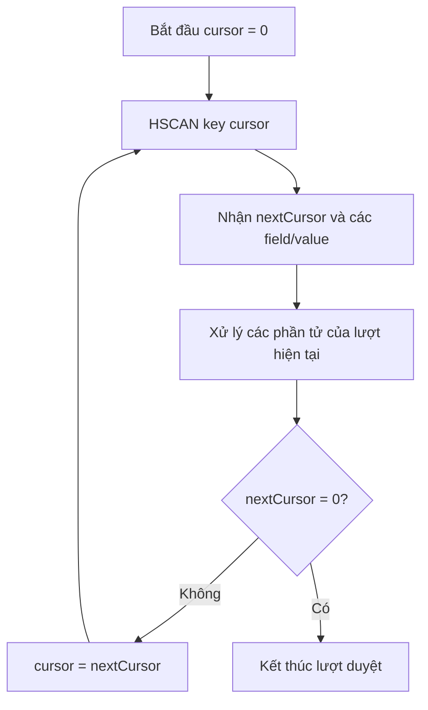

# Duyệt Hash bằng Cursor và HSCAN

## 1. Vì sao cần duyệt Redis Hash theo từng đợt?

Redis Hash lưu nhiều cặp **field–value** bên dưới **một Redis key**. Ví dụ ứng dụng Spring Boot lưu số lượng mặt hàng trong một giỏ hàng:

```text
Redis key: carts:items:v1:cart-42
Redis type: hash

Field          Value
--------------------
sku-1001       2
sku-1002       1
sku-1003       5
...
sku-850000     3
```

Với Hash chỉ có vài field, có thể lấy tất cả qua lệnh Redis `HGETALL` hoặc API Spring Data Redis:

```java
Map<String, String> allItems =
        redis.opsForHash().entries("carts:items:v1:cart-42");
```

Nhưng nếu Hash có hàng trăm nghìn field, cách này tạo ra nhiều vấn đề:

- Redis phải tạo phản hồi chứa toàn bộ field và value.
- Mạng phải truyền tất cả dữ liệu trong một lượt.
- Java phải nhận và giữ một `Map` lớn trong bộ nhớ trước khi xử lý.
- Một phản hồi lớn có thể tăng thời gian chờ, áp lực GC và nguy cơ hết bộ nhớ.
- Ứng dụng không thể sớm xử lý từng phần trong lúc toàn bộ dữ liệu chưa trả xong.

**`HSCAN`** là lệnh Redis để **duyệt tăng dần các field/value của một Hash thông qua con trỏ (cursor)**. Spring Data Redis cung cấp `HashOperations.scan(...)`, trả về `Cursor<Map.Entry<...>>` để Java tiêu thụ các phần tử lần lượt.

Điểm cốt lõi: `HSCAN` giúp **chia quá trình duyệt thành nhiều lượt trao đổi với Redis**, phù hợp cho tác vụ duyệt dữ liệu lớn, bảo trì, đối soát hoặc xử lý theo batch. Nó **không** tự tạo snapshot nhất quán, không cung cấp phân trang ổn định và không làm tổng số phần tử cần xử lý nhỏ đi.

## 2. Redis Hash, HGETALL, HKEYS, HVALS và HSCAN

Trước khi dùng Cursor, cần chọn đúng loại thao tác:

| Lệnh Redis | API Spring Data Redis thường gặp | Kết quả | Phù hợp khi |
|---|---|---|---|
| `HGET key field` | `opsForHash().get(key, field)` | Giá trị của một field | Biết chính xác field cần đọc |
| `HMGET key field...` | `opsForHash().multiGet(key, fields)` | Giá trị của danh sách field | Biết tập field cần đọc |
| `HGETALL key` | `opsForHash().entries(key)` | Toàn bộ các cặp field/value | Hash nhỏ, có giới hạn rõ |
| `HKEYS key` | `opsForHash().keys(key)` | Toàn bộ tên field | Hash nhỏ, chỉ cần tên |
| `HVALS key` | `opsForHash().values(key)` | Toàn bộ value | Hash nhỏ, chỉ cần giá trị |
| `HLEN key` | `opsForHash().size(key)` | Tổng số field hiện tại | Cần biết kích thước Hash |
| `HSCAN key cursor ...` | `opsForHash().scan(key, options)` | Các cặp field/value tăng dần theo cursor | Hash lớn, xử lý tuần tự, có kiểm soát |

`HLEN` chỉ trả về số field, không đọc nội dung. Một cách hiệu quả là đo hoặc kiểm soát số field dự kiến trước khi quyết định dùng `entries` hay `scan`. Tuy nhiên, với Hash biến động liên tục, số lượng field có thể thay đổi giữa các lời gọi.

Đừng nhầm `HSCAN` với `SCAN`:

- **`SCAN`** duyệt **các Redis key** trong keyspace hoặc trên các node liên quan.
- **`HSCAN`** duyệt **field và value trong đúng một Redis Hash key**.
- **`SSCAN`** duyệt thành viên Set; **`ZSCAN`** duyệt phần tử và điểm số của Sorted Set.

Nếu muốn tìm các key có tên bắt đầu bằng `carts:items:`, `HSCAN` không làm việc đó. Nếu đã biết key `carts:items:v1:cart-42` và muốn duyệt tất cả SKU trong Hash ấy, `HSCAN` là công cụ phù hợp.

## 3. HSCAN hoạt động ở mức giao thức Redis

Lệnh có dạng:

```text
HSCAN <hash-key> <cursor> [MATCH <pattern>] [COUNT <count>]
```

Ví dụ chạy từ Redis CLI:

```bash
redis-cli HSET carts:items:v1:cart-42 sku-1001 2 sku-1002 1 sku-1003 5
redis-cli HSCAN carts:items:v1:cart-42 0 COUNT 2
```

Phản hồi bao gồm **hai phần**:

1. **Cursor tiếp theo** do Redis trả về.
2. **Danh sách field/value** của lượt duyệt hiện tại.

Ví dụ minh họa (cursor và thứ tự field thực tế có thể khác):

```text
1) "3"
2) 1) "sku-1001"
   2) "2"
   3) "sku-1002"
   4) "1"
```

Ứng dụng tiếp tục gọi:

```bash
redis-cli HSCAN carts:items:v1:cart-42 3 COUNT 2
```

Khi Redis trả cursor **`"0"`**, một vòng duyệt đầy đủ đã kết thúc. Cursor **`0` ở lệnh đầu tiên** là điểm bắt đầu; **`0` trong phản hồi** là tín hiệu kết thúc.



**Không dùng số phần tử của một lượt để quyết định kết thúc.** Redis có thể trả về **0 phần tử nhưng cursor vẫn khác 0**. Chỉ khi cursor hoàn thành thì vòng quét mới kết thúc.

### 3.1. COUNT là gợi ý, không phải kích thước trang bắt buộc

`COUNT 100` không bảo đảm nhận đúng 100 field/value trong mỗi lượt. Redis dùng `COUNT` như một **gợi ý về lượng công việc quét**:

- Lượt quét có thể trả ít hơn, nhiều hơn hoặc không có field nào.
- Hash nhỏ có thể trả tất cả phần tử ngay trong một lượt, tùy biểu diễn nội bộ và phiên bản Redis.
- `COUNT` càng lớn thường có thể giảm số lượt network round trip nhưng tăng kích thước phản hồi, thời gian xử lý mỗi lượt và áp lực bộ nhớ.

Vì vậy không nên viết chương trình theo giả định “`COUNT 500` nghĩa là một trang có đúng 500 record”.

### 3.2. MATCH lọc tên field theo glob pattern

Ví dụ chỉ muốn những field có tiền tố `sku-active:`:

```bash
redis-cli HSCAN inventory:counts:v1:warehouse-1 0 MATCH 'sku-active:*' COUNT 200
```

`MATCH` áp dụng **cho tên field bên trong Hash**, không áp dụng cho Redis key và không lọc theo value. Cú pháp pattern là kiểu **glob** của Redis, chẳng hạn `*` và `?`; đây không phải SQL `LIKE` hay regex đầy đủ.

Redis vẫn cần duyệt cấu trúc Hash để xét các field phù hợp; `MATCH` **không tự tạo index tìm kiếm theo tiền tố**. Nếu chỉ có 1 field khớp trong một Hash rất lớn, ứng dụng vẫn có thể phải đi qua rất nhiều lượt trước khi tìm thấy nó. Khi biết chính xác field, hãy dùng `HGET`, đừng `HSCAN MATCH`.

## 4. API Spring Data Redis: HashOperations.scan()

Với `StringRedisTemplate`, API đồng bộ điển hình là:

```java
HashOperations<String, String, String> hash =
        stringRedisTemplate.opsForHash();

Cursor<Map.Entry<String, String>> cursor =
        hash.scan(hashKey, scanOptions);
```

Các lớp liên quan:

- `HashOperations<H, HK, HV>`: `H` là kiểu Redis key của Hash, `HK` là kiểu field, `HV` là kiểu value.
- `ScanOptions`: khai báo các tùy chọn quét, thường là `MATCH` và `COUNT`.
- `Cursor<T>`: trình lặp có trạng thái, trả từng phần tử và cần được đóng sau khi duyệt.
- `Map.Entry<HK,HV>`: mỗi phần tử ứng với **một field và giá trị** trong Hash.

Ví dụ hoàn chỉnh cho service Spring Boot:

```java
import java.util.Map;
import java.util.function.BiConsumer;

import org.springframework.data.redis.core.Cursor;
import org.springframework.data.redis.core.HashOperations;
import org.springframework.data.redis.core.StringRedisTemplate;
import org.springframework.data.redis.core.ScanOptions;
import org.springframework.stereotype.Service;

@Service
public class CartItemScanner {

    private final StringRedisTemplate redis;

    public CartItemScanner(StringRedisTemplate redis) {
        this.redis = redis;
    }

    public void forEachItem(
            String cartId,
            BiConsumer<String, Integer> processor) {

        String key = "carts:items:v1:" + cartId;
        HashOperations<String, String, String> hash =
                redis.opsForHash();

        ScanOptions options = ScanOptions.scanOptions()
                .count(200)
                .build();

        try (Cursor<Map.Entry<String, String>> cursor =
                     hash.scan(key, options)) {

            while (cursor.hasNext()) {
                Map.Entry<String, String> entry = cursor.next();
                int quantity = Integer.parseInt(entry.getValue());
                processor.accept(entry.getKey(), quantity);
            }
        }
    }
}
```

Ví dụ sử dụng:

```java
scanner.forEachItem("cart-42", (sku, quantity) -> {
    System.out.printf("%s: %d%n", sku, quantity);
});
```

Những điểm cần hiểu:

1. `hash.scan(key, options)` tạo API cursor cho **một Hash key**.
2. Vòng `while (cursor.hasNext())` cho phép driver/Spring Data Redis tiếp tục các lượt HSCAN khi cần.
3. Mỗi `cursor.next()` trả về một `Map.Entry`; không buộc chương trình gom tất cả vào một `Map` lớn.
4. `try-with-resources` bảo đảm `cursor.close()` được gọi dù vòng lặp kết thúc bình thường hoặc có exception.
5. `Integer.parseInt` chỉ đúng nếu giá trị field theo hợp đồng dữ liệu là số; dữ liệu lỗi hoặc bị thay đổi ngoài ứng dụng cần được xử lý theo nghiệp vụ.

Ở đây, xử lý phần tử ngay trong callback `processor` giúp giữ mức bộ nhớ tương đối nhỏ. Nếu callback lưu mọi entry vào một danh sách không giới hạn, lợi thế về bộ nhớ của `HSCAN` sẽ biến mất.

### 4.1. Dùng MATCH và COUNT trong Spring

```java
ScanOptions options = ScanOptions.scanOptions()
        .match("active:*")
        .count(500)
        .build();

try (Cursor<Map.Entry<String, String>> cursor =
             redis.opsForHash().<String, String>scan(
                     "users:preferences:v1:segment-7", options)) {

    while (cursor.hasNext()) {
        Map.Entry<String, String> entry = cursor.next();
        System.out.println(entry.getKey() + "=" + entry.getValue());
    }
}
```

Trong dự án thực, có thể khai báo trước biến `HashOperations<String,String,String>` để generic rõ ràng và dễ đọc hơn. Pattern `active:*` ở ví dụ này tìm **field name** bắt đầu bằng `active:`. Nó không tìm value chứa `active`.

### 4.2. RedisTemplate với DTO hoặc serializer khác

Ví dụ một `RedisTemplate<String, ProductAvailability>` có serializer JSON cho hash value. Khi Hash field là `String` và hash value là DTO, kiểu trả về có thể được khai báo:

```java
HashOperations<String, String, ProductAvailability> hashes =
        productRedisTemplate.opsForHash();

try (Cursor<Map.Entry<String, ProductAvailability>> cursor =
             hashes.scan("availability:by-sku:v1", options)) {
    while (cursor.hasNext()) {
        Map.Entry<String, ProductAvailability> entry = cursor.next();
        consume(entry.getKey(), entry.getValue());
    }
}
```

Đoạn này giả định `productRedisTemplate` và `ProductAvailability` đã được định nghĩa, với serializer value/hash-value tương thích. `HSCAN` nhận/trả byte ở giao thức Redis; Spring Data Redis giải mã chúng theo serializer mà template đang sử dụng. Nếu dữ liệu cũ được ghi bằng serializer khác, có thể gặp field/value không đọc được hoặc không khớp pattern.

## 5. Vòng đời Cursor và kết nối Redis

`Cursor` không chỉ là một `Iterator` Java duyệt một collection đã tải sẵn. Nó có thể **tiếp tục gửi lệnh quét tới Redis trong quá trình lặp**. Vì vậy vòng đời của cursor liên quan tới tài nguyên phía client, kết nối và trạng thái iteration.

```text
Mở Cursor
   |
   +-- nhận batch HSCAN đầu tiên
   |
   +-- hasNext()/next() --> dùng phần tử hiện tại
   |
   +-- hết batch --> HSCAN với nextCursor
   |
   +-- lặp lại cho tới cursor kết thúc
   |
Đóng Cursor --> giải phóng resource
```

**Luôn ưu tiên `try-with-resources`:**

```java
try (Cursor<Map.Entry<String, String>> cursor =
             hashOperations.scan(hashKey, ScanOptions.NONE)) {
    while (cursor.hasNext()) {
        handle(cursor.next());
    }
}
```

Nếu dừng giữa chừng, ví dụ chỉ cần kiểm tra phần tử đầu tiên phù hợp, vẫn cần đóng cursor:

```java
boolean found = false;
try (Cursor<Map.Entry<String, String>> cursor =
             hashOperations.scan(hashKey, options)) {
    while (cursor.hasNext()) {
        if (isRelevant(cursor.next())) {
            found = true;
            break;
        }
    }
}
// Cursor đã được đóng dù vòng quét chưa tới cuối.
```

Không trả một `Cursor` ra khỏi method rồi bỏ mặc trách nhiệm đóng cho phần code không rõ chủ sở hữu. Nếu API thật sự cần trả cursor cho caller, phải quy định rõ caller sở hữu resource và phải đóng nó, đồng thời tránh giữ cursor qua thời gian người dùng chờ một HTTP request khác.

### 5.1. Không dùng Cursor sau khi kết nối đã hết phạm vi

Một anti-pattern là tạo cursor trong callback nhận connection rồi trả cursor ra ngoài trong khi callback đã kết thúc:

```java
// Sai về ý tưởng quản lý tài nguyên:
Cursor<?> leakedCursor = redisTemplate.execute(connection -> {
    // Tạo một cursor low-level từ connection này...
    return cursorCreatedFrom(connection);
});
// Callback đã kết thúc; connection có thể đã được giải phóng.
// Việc dùng leakedCursor sau đó có thể lỗi hoặc rò resource.
```

Đây là **mã minh họa anti-pattern**, các hàm `cursorCreatedFrom` không phải API Spring thật. Nguyên tắc là không để một iterator phụ thuộc connection sống lâu hơn phạm vi sở hữu connection đó.

Đối với trường hợp bình thường, gọi `hashOperations.scan(...)` và xử lý/đóng cursor trong cùng method như ví dụ ở mục 4.

### 5.2. Không chia sẻ một Cursor giữa nhiều thread

`Cursor` biểu diễn một vị trí duyệt thay đổi dần. Việc cho nhiều thread đồng thời gọi `next()` trên cùng cursor có nguy cơ mất trật tự iteration và lỗi tương tranh; không được giả định cursor thread-safe.

Nếu cần xử lý các phần tử bằng nhiều worker, một cách an toàn hơn là:

1. Một thread **sở hữu cursor**, đọc các entry tuần tự.
2. Chuyển dữ liệu đã đọc sang một queue **có giới hạn** hoặc xử lý theo batch hữu hạn.
3. Các worker xử lý dữ liệu đã tách khỏi cursor.
4. Dùng giới hạn concurrency và cơ chế backpressure để không tích tụ lượng entry khổng lồ.
5. Đóng cursor sau khi đọc xong hoặc khi hủy tác vụ.

Đừng giữ cursor mở trong lúc chờ nhiều lời gọi HTTP chậm hoặc thao tác ngoài Redis. Nếu cần xử lý lâu, hãy tách bước lấy dữ liệu và xử lý theo từng batch giới hạn, thiết kế checkpoint theo **định danh field** hoặc trạng thái nghiệp vụ phù hợp.

## 6. HSCAN không bảo đảm snapshot nhất quán

Điểm quan trọng nhất khi thiết kế nghiệp vụ với `HSCAN`: **Hash có thể thay đổi giữa các lượt quét**.

Ví dụ:

```text
T0: Hash có field A, B, C, D
T1: HSCAN trả A và B, cursor tiếp theo
T2: Client khác thêm E, xóa C, đổi value của D
T3: HSCAN tiếp tục trên Hash đang thay đổi
```

Ứng dụng không thể coi chuỗi kết quả của T1 và T3 là một ảnh chụp dữ liệu tại T0 hay T3. Theo đặc tính iterator của Redis SCAN-family:

- Một **full iteration** trên dataset ổn định có thể duyệt các phần tử đã có xuyên suốt toàn bộ vòng quét.
- Một phần tử có thể **được trả lại nhiều lần** trong quá trình scan; xử lý nên idempotent hoặc có deduplication nếu cần.
- Các phần tử được thêm/xóa trong lúc quét có thể được nhìn thấy hoặc không.
- Giá trị của field có thể thay đổi giữa thời điểm nhận và thời điểm ứng dụng xử lý.
- Nếu Hash bị xóa, hết TTL hoặc đổi kiểu dữ liệu, các lượt tiếp theo có thể thấy tập rỗng hoặc lỗi liên quan, tùy thời điểm và trạng thái.

**Không áp dụng HSCAN cho công việc cần snapshot chính xác hoặc xuất dữ liệu tài chính/kiểm toán tại một thời điểm**, trừ khi ứng dụng bổ sung cơ chế nhất quán phù hợp.

### 6.1. Xử lý lặp bằng idempotency

Giả sử mục đích của worker là đồng bộ danh sách field tới hệ thống ngoài. Nếu một field được đọc hai lần, worker không nên thực hiện hai khoản thanh toán hoặc tăng bộ đếm hai lần.

Một số lựa chọn:

- Ghi bằng **upsert theo field ID**, ví dụ cập nhật giá trị cuối cùng cho `sku-1001`.
- Lưu **operation ID** hoặc version để hệ nhận bỏ qua sự kiện trùng.
- Dùng một tập `seen` để loại trùng trong một lượt khi Hash nhỏ đủ để giữ bộ nhớ, nhưng việc giữ tất cả ID trong RAM có thể làm mất lợi ích streaming.
- Phân chia trạng thái nghiệp vụ thành “chưa xử lý/đã xử lý” với cơ chế xác nhận rõ ràng thay vì lấy một vòng HSCAN làm bằng chứng duy nhất.

Nếu vừa scan vừa xóa/cập nhật field ngay trong chính Hash, hành vi quét có thể thay đổi. Với tác vụ dọn dẹp, ưu tiên quy tắc **idempotent**, kiểm tra điều kiện cập nhật/xóa hiện thời và chấp nhận rằng cần quét lại để đạt trạng thái mong muốn. Không giả định scan + delete là thao tác nguyên tử.

### 6.2. Không nhầm với phân trang ổn định cho giao diện

Redis trả cursor là **vị trí duyệt nội bộ**, không phải offset của kết quả đã sắp xếp:

- Không có ý nghĩa “trang số 5, mỗi trang 20 phần tử” cố định.
- Thứ tự field không được bảo đảm.
- Một trang có thể rỗng dù chưa tới cuối.
- Dữ liệu biến động có thể làm phần tử trùng hoặc bỏ sót so với kỳ vọng snapshot.
- Không nên sử dụng số cursor như một ID vĩnh viễn để tiếp tục quét sau nhiều ngày.

Nếu giao diện người dùng cần phân trang có thứ tự và ổn định, hãy thiết kế index riêng (ví dụ Sorted Set theo timestamp), dùng cơ sở dữ liệu hỗ trợ truy vấn có thứ tự, hoặc tạo một snapshot dữ liệu có version. `HSCAN` phù hợp hơn cho **duyệt kỹ thuật theo batch**.

## 7. MATCH, COUNT và serializer trong Spring Data Redis

### 7.1. Tên field là byte, MATCH hoạt động trên byte

Redis lưu field của Hash dưới dạng byte. `HashOperations` sử dụng **hash key serializer** để chuyển giữa đối tượng field Java và byte Redis.

Với `StringRedisTemplate`, field là chuỗi UTF-8. Pattern:

```java
ScanOptions options = ScanOptions.scanOptions()
        .match("sku-*")
        .count(100)
        .build();
```

thường phù hợp để lọc các field bắt đầu bằng `sku-`.

Nếu template dùng `JdkSerializationRedisSerializer` cho hash field, byte field có phần header nhị phân; pattern văn bản `sku-*` sẽ không nhất thiết khớp. Khi cần MATCH theo tiền tố, phải thống nhất serializer của field, key schema và dạng pattern. Việc đổi serializer trên dữ liệu cũ cần migration rõ ràng.

### 7.2. COUNT lớn hay nhỏ?

Đây là bài toán cân bằng **số lần round trip**, **thời gian mỗi lượt**, **bộ nhớ** và **độ trễ các request khác**.

| Giá trị COUNT | Ưu điểm tiềm năng | Chi phí và rủi ro |
|---|---|---|
| Nhỏ, ví dụ 10–50 | Ít công việc/response mỗi lượt, thuận tiện khi xử lý phần tử nặng | Nhiều lượt gọi Redis hơn, tổng network latency tăng |
| Trung bình, ví dụ 100–500 | Điểm bắt đầu thường dễ đo và điều chỉnh | Kích thước batch thực tế không chính xác bằng COUNT |
| Lớn, ví dụ 1.000–10.000 | Có thể giảm số lượt đi mạng | Response và CPU mỗi lượt lớn hơn, dễ gây spike hoặc block xử lý lâu |

Các con số trên chỉ là **tham số minh họa**, không phải khuyến nghị mặc định cho mọi hệ thống. Khi mỗi field có value dài vài KB, COUNT 1.000 có ý nghĩa tải rất khác so với value chỉ vài byte. Cần đo trên bộ dữ liệu thật và theo dõi p95/p99 của các lệnh Redis khác.

### 7.3. MATCH không tạo tối ưu truy vấn theo giá trị

`HSCAN MATCH 'active:*'` chỉ lọc **tên field**. Nếu muốn “tất cả đơn hàng có status = ACTIVE”, Redis Hash không có sẵn chỉ mục theo value cho câu hỏi đó. Duyệt và lọc ở Java có thể tốn thời gian `O(N)` trên tổng số field.

Với truy vấn nghiệp vụ thường xuyên theo một thuộc tính, cân nhắc thiết kế dữ liệu/index bổ sung (Set/ZSet), Redis Search nếu môi trường hỗ trợ phù hợp, hoặc một database có index/query thích hợp. Đừng sử dụng HSCAN như công cụ tìm kiếm cho request latency thấp trên Hash hàng triệu field.

## 8. Xử lý theo batch mà không gom toàn bộ Hash vào RAM

Đôi khi worker cần gửi dữ liệu ra hệ thống khác theo từng batch 100 bản ghi. Ta có thể dùng Cursor để đọc tăng dần và giữ **tối đa một batch** trong memory:

```java
import java.util.ArrayList;
import java.util.List;
import java.util.Map;

import org.springframework.data.redis.core.Cursor;
import org.springframework.data.redis.core.HashOperations;
import org.springframework.data.redis.core.ScanOptions;

public void exportInBatches(
        String hashKey,
        int batchSize,
        java.util.function.Consumer<List<Map.Entry<String, String>>> sink) {

    if (batchSize <= 0) {
        throw new IllegalArgumentException("batchSize phải dương");
    }

    HashOperations<String, String, String> hashes =
            redis.opsForHash();

    ScanOptions options = ScanOptions.scanOptions()
            .count(200)
            .build();

    List<Map.Entry<String, String>> batch =
            new ArrayList<>(batchSize);

    try (Cursor<Map.Entry<String, String>> cursor =
                 hashes.scan(hashKey, options)) {

        while (cursor.hasNext()) {
            Map.Entry<String, String> entry = cursor.next();
            batch.add(Map.entry(entry.getKey(), entry.getValue()));

            if (batch.size() == batchSize) {
                sink.accept(List.copyOf(batch));
                batch.clear();
            }
        }
    }

    if (!batch.isEmpty()) {
        sink.accept(List.copyOf(batch));
    }
}
```

Đây là ví dụ xử lý đồng bộ theo lô. Ý nghĩa của từng cơ chế:

- `COUNT 200` là gợi ý **bên Redis** cho mỗi lượt HSCAN.
- `batchSize` là kích thước **lô nghiệp vụ bên Java**, độc lập với COUNT.
- `List.copyOf(batch)` tạo một danh sách độc lập trước khi chuyển cho `sink`; mã callback không nên giữ tham chiếu tới danh sách mutable đang được tái sử dụng.
- `Map.entry(...)` tạo cặp field/value bất biến để tách khỏi đối tượng iterator; giả định field/value không null theo hợp đồng dữ liệu Hash đang dùng.
- Nếu `sink.accept(...)` ném exception, `try-with-resources` đóng cursor, nhưng những batch đã gửi trước đó **không tự rollback**. Nơi nhận nên hỗ trợ idempotency hoặc checkpoint nghiệp vụ.

Nếu `sink` thực hiện HTTP call chậm, đoạn này sẽ giữ cursor trong lúc chờ. Với workload lớn, có thể tách reader và worker bằng hàng đợi giới hạn hoặc thiết kế tiến trình quét theo các khoảng ngắn. Tuyệt đối tránh unbounded queue hoặc giữ toàn bộ kết quả trước khi gửi.

### 8.1. Cẩn thận với việc giữ lại `Map.Entry`

`Cursor` trả `Map.Entry`, nhưng tốt nhất không lưu trữ reference nội bộ của iterator trong cache/queue lâu dài khi không cần. Tạo bản sao đơn giản theo field/value nếu gửi sang thread hoặc batch khác. Lưu lượng lớn thì vẫn cần giới hạn số bản sao trong RAM.

### 8.2. Backpressure và giới hạn tốc độ

Một tác vụ quét Hash triệu field có thể cạnh tranh tài nguyên với request API Redis bình thường:

1. Giới hạn số worker HSCAN đồng thời.
2. Chọn COUNT và batch size theo tải Redis và độ dài value.
3. Theo dõi thời gian quét, timeout, network, CPU Redis và heap của service.
4. Cho phép dừng/hủy tác vụ và đóng Cursor nhanh chóng.
5. Không đặt retry vô hạn cho cả vòng quét khi server đang quá tải.

Mục tiêu không phải nhận mọi field nhanh nhất bằng mọi giá mà là duyệt hết với ảnh hưởng chấp nhận được tới hệ thống đang phục vụ người dùng.

## 9. Phân biệt Cursor của Spring với cursor số ở Redis CLI

Ở Redis CLI, caller nhìn thấy **cursor token** và tự gọi HSCAN tiếp theo. Trong Spring Data Redis, `Cursor<T>` che đi việc quản lý token và các lượt lệnh:

| Redis CLI | Spring Data Redis |
|---|---|
| Bắt đầu bằng `HSCAN key 0` | `hashOps.scan(key, options)` |
| Nhận token cursor tiếp theo | `Cursor` quản lý trạng thái nội bộ |
| Tự gọi lại `HSCAN key <cursor>` | `hasNext()/next()` tự tiếp tục khi cần |
| Tự tách danh sách field/value | Nhận từng `Map.Entry<HK,HV>` |
| Phải dừng khi cursor trả `0` | Vòng lặp kết thúc khi `hasNext()` là false |
| Tự xử lý việc đóng resource ở client | Dùng `try-with-resources` để đóng `Cursor` |

Đừng nhầm **cursor server trả về trong giao thức** với con trỏ Java có thể tùy ý lưu vào database để resume sau lần chạy khác. API `Cursor` được thiết kế cho một lượt duyệt trong một phạm vi kết nối cụ thể; nếu cần checkpoint sau restart, phải thiết kế một quy trình có khả năng khôi phục, dedupe và xử lý dữ liệu thay đổi.

## 10. Làm gì khi Hash thay đổi trong lúc quét?

### Tình huống: đồng bộ hàng triệu field sang database

Giả sử Redis Hash `metrics:counter:v1:2026-11-12` chứa bộ đếm theo key con. Worker quét HSCAN để ghi vào database sau mỗi phút. Trong khi worker quét, API vẫn tăng các bộ đếm.

Nếu worker ghi đè tổng số đếm dựa trên một lần scan, một field có thể đã tăng sau khi worker đọc. Kết quả database là **một trạng thái quan sát không đồng thời**, không phải ảnh chụp nguyên tử.

Các cách tiếp cận:

- **Chấp nhận eventual consistency:** lần đồng bộ kế tiếp sẽ cập nhật giá trị mới, và dùng upsert theo field để tránh tạo bản ghi trùng.
- **Gắn version hoặc timestamp:** chỉ áp dụng bản ghi có version mới hơn; cần nguồn cấp version có bảo đảm phù hợp.
- **Tách snapshot khi cần tính ổn định:** tạo cơ chế dữ liệu phiên bản/immutable hoặc dùng hệ lưu trữ hỗ trợ snapshot.
- **Ghi sự kiện/tác vụ ngay khi thay đổi:** nếu không thể chấp nhận bỏ sót thay đổi, dùng event log/outbox hoặc nguồn dữ liệu bền vững thay vì chỉ quét định kỳ.

**HSCAN là công cụ duyệt**, không phải cơ chế change-data-capture. Việc scan xong không chứng minh ứng dụng đã nhìn thấy mọi cập nhật xảy ra trong khoảng quét.

### Tình huống: xóa field đã hết hạn theo timestamp

Giả sử trong Hash, mỗi value chứa timestamp hết hạn của phần tử. Redis TTL thông thường áp dụng cho **cả Hash key**, không tự động cho từng field. Một worker có thể HSCAN để tìm những field có timestamp cũ rồi xóa.

Nhưng nếu worker đọc timestamp cũ, request khác cập nhật field sang timestamp mới ngay sau đó, thao tác `HDEL` mù quáng có thể xóa giá trị vừa được cập nhật. Một cách xử lý là **kiểm tra và xóa có điều kiện nguyên tử**, chẳng hạn bằng script Redis so sánh value/version hiện tại trước khi `HDEL`.

Ngoài ra, trong một số phiên bản Redis mới có hỗ trợ hết hạn cho từng hash field, nhưng phải xác nhận chính xác khả năng của server và API Spring Data Redis đang dùng. Không giả định mọi phiên bản đều hỗ trợ field-level TTL.

## 11. Redis Cluster, keyspace và bảo mật

### 11.1. HSCAN trong Redis Cluster

Redis Cluster phân bố các **Redis key** theo hash slot. Một **Hash key** là một Redis key, nên field bên trong Hash không bị phân bố thành các slot riêng chỉ vì có nhiều field.

Do đó:

- `HSCAN carts:items:v1:cart-42` duyệt field của **một Hash key** nằm trên node đang sở hữu slot của key đó.
- Nếu muốn quét **nhiều Redis key**, vấn đề chuyển sang `SCAN`/duyệt keyspace trên các node, chứ không dùng một HSCAN để đi qua cả cluster.
- Nếu slot di chuyển hoặc Redis failover khi đang scan, client có thể cần xử lý redirect/reconnect; một lượt scan có thể bị gián đoạn và phải khởi động lại với chiến lược idempotent.
- Một Hash có hàng triệu field vẫn nằm dưới **một key**, có thể tạo hotspot về bộ nhớ hoặc truy cập; HSCAN không tự shard các field giữa các node.

Nếu dữ liệu cần phân bố trên nhiều node, cân nhắc mô hình nhiều Hash key được phân vùng theo định danh hoặc thời gian, phù hợp với yêu cầu truy cập. Số Hash key và chiến lược shard nên được thiết kế trước khi dữ liệu tăng quá lớn.

### 11.2. Key, field và value đều cần được bảo vệ

Ví dụ `user:preferences:v1:42` là key dễ quan sát; field `language` hoặc `timezone` tương đối vô hại. Nhưng Hash cũng có thể chứa token, email hoặc dữ liệu cá nhân.

Khi dùng HSCAN:

- Không log mọi field/value ra console trong production.
- Không đưa secret vào key hoặc field name vì tên có thể lộ qua log/APM.
- Chỉ cấp ACL cho client được phép `HSCAN` keyspace cần thiết.
- Cấu hình TLS và authentication phù hợp môi trường.
- Giới hạn quyền của tác vụ export/maintenance và bảo vệ dữ liệu đã lấy ra khỏi Redis.

Thư viện Java trả dữ liệu ở dạng entry thuận tiện; điều đó không có nghĩa mọi dữ liệu được phép đưa ra API hoặc gửi sang hệ thống khác.

## 12. HSCAN, transaction và pipelining

`HSCAN` dùng mô hình lặp, nhiều lượt dựa vào cursor **tiếp theo**. Để gửi lệnh lượt sau, ứng dụng phải nhận cursor do lượt trước trả về. Vì thế không nên cố gói **toàn bộ quá trình HSCAN nhiều lượt** vào một pipeline như một danh sách lệnh đã biết trước.

### 12.1. Pipeline không biến nhiều lượt quét thành snapshot

Trong `RedisTemplate.executePipelined(...)`, các lời gọi trong callback thường chưa trả kết quả trực tiếp mà trả về sau khi đóng pipeline. Nếu thuật toán cần lấy cursor của lượt thứ nhất để gọi lượt thứ hai, pipeline kiểu “gửi tất cả lệnh rồi nhận kết quả” không thể xác định trước chuỗi cursor đó.

Với nhiều Hash key khác nhau, có thể có những batch lệnh độc lập phù hợp pipeline, nhưng cần kiểm tra API, serializer và cách thu kết quả của driver. Không đánh đồng tối ưu network của pipeline với kiểm soát nhất quán.

### 12.2. MULTI/EXEC cũng không làm một lượt scan kéo dài trở thành ảnh chụp

`MULTI/EXEC` được dùng để queue một nhóm lệnh Redis và thực thi theo ngữ nghĩa transaction của Redis. Nhưng `HSCAN` cần nhận cursor rồi mới quyết định lượt tiếp theo; không thể dùng một transaction Redis dài vô hạn để quét Hash lớn mà vẫn có được các cursor trung gian theo cách thông thường.

Gom hàng triệu field vào một thao tác nguyên tử chỉ để làm một báo cáo thường gây tải và ảnh hưởng latency. Khi cần snapshot chính xác, cần thiết kế mục tiêu nhất quán ở tầng dữ liệu (snapshot/version/nguồn giao dịch) thay vì giữ connection/transaction Redis quá lâu.

### 12.3. Không dùng @Transactional để giả định HSCAN nhất quán

Chú thích `@Transactional` của Spring không làm một chuỗi HSCAN trở thành truy vấn snapshot, kể cả khi RedisTemplate được cấu hình hỗ trợ transaction synchronization. Nếu có SQL database và Redis cùng tồn tại, không mặc nhiên có một transaction ACID xuyên cả hai.

Tác vụ quét lớn nên có phạm vi ngắn, kiểm soát timeout và tài nguyên; không giữ transaction database mở trong lúc hàng triệu field đang được scan và xử lý.

## 13. Lỗi và hiện tượng thường gặp

| Hiện tượng | Nguyên nhân có thể | Cách xử lý |
|---|---|---|
| Vòng lặp dừng sau một batch rỗng dù cursor chưa kết thúc | Coi batch rỗng là tín hiệu hoàn tất | Để `Cursor.hasNext()` điều phối hoặc dùng cursor Redis tới `0` |
| `COUNT 100` nhưng nhận hơn/ít hơn 100 phần tử | COUNT là gợi ý | Không dùng COUNT làm số bản ghi của trang bắt buộc |
| Field xuất hiện hai lần | HSCAN không hứa “exactly once” | Xử lý idempotent hoặc dedupe khi phù hợp |
| Không thấy field vừa thêm trong lúc quét | Dữ liệu thay đổi khi scan | Chấp nhận eventual consistency hoặc thiết kế nguồn thay đổi/snapshot |
| `MATCH sku:*` không trả field như mong đợi | Field serializer không phải UTF-8 text hoặc pattern khác dữ liệu thực | Kiểm tra hash key serializer và byte field |
| Java hết heap dù đã dùng HSCAN | Tích lũy mọi entry vào List/Map hoặc queue không giới hạn | Xử lý từng entry hoặc batch hữu hạn |
| Redis timeout khi quét Hash lớn | COUNT/batch quá cao, lệnh khác cạnh tranh, mạng chậm | Giảm tải, giới hạn concurrent scans, đo p95/p99 |
| Cursor/connection không được giải phóng | Không đóng cursor khi exception/break | Dùng `try-with-resources` |
| `WRONGTYPE` | Key được lưu thành String/List/Set, không phải Hash | Kiểm tra `TYPE` và key namespace |
| Người dùng yêu cầu “trang 5” nhưng kết quả không ổn định | HSCAN không có thứ tự và snapshot | Dùng index có sắp thứ tự hoặc database |
| Tác vụ cleanup xóa nhầm field mới cập nhật | Đọc rồi HDEL không có điều kiện | So sánh version/value và xóa nguyên tử |
| Sau failover lượt scan lỗi | Kết nối/topology thay đổi | Restart với idempotency và chiến lược checkpoint thích hợp |

## 14. Kiểm tra bằng Redis CLI trước khi tích hợp Java

Khi thử nghiệm cục bộ hoặc xử lý sự cố, nên xác định key là Hash và có bao nhiêu field:

```bash
redis-cli TYPE carts:items:v1:cart-42
redis-cli HLEN carts:items:v1:cart-42
redis-cli HGET carts:items:v1:cart-42 sku-1001
```

Sau đó thử HSCAN theo tiền tố:

```bash
redis-cli HSCAN carts:items:v1:cart-42 0 MATCH 'sku-*' COUNT 100
```

Lấy cursor tiếp theo từ phản hồi và gọi lại cho tới khi về `0`. Không đoán trước cursor, không tăng cursor theo kiểu `cursor + 1`, không giả định chúng tương ứng với số trang.

Nếu muốn kiểm tra một Hash nhỏ, `HGETALL` có thể thuận tiện, nhưng trên dữ liệu production lớn nên tránh lấy toàn bộ chỉ để xem vài field. Dùng `HLEN`, `HGET` theo field đã biết hoặc `HSCAN` có kiểm soát.

Trong Java, thay vì tự viết vòng lặp token giao thức Redis, phần lớn tình huống chỉ cần `HashOperations.scan(key, options)`, dùng `try-with-resources` và xử lý từng `Map.Entry`.

## 15. Tình huống lựa chọn: dùng HSCAN hay API khác?

| Nhu cầu | API nên cân nhắc | Giải thích |
|---|---|---|
| Đọc một field theo tên | `opsForHash().get(key, field)` | Truy cập trực tiếp, không phải duyệt |
| Đọc vài field đã biết | `opsForHash().multiGet(key, fields)` | Không quét những field không liên quan |
| Đếm field | `opsForHash().size(key)` | Trả số lượng, không tải dữ liệu |
| Lấy toàn bộ Hash nhỏ và có giới hạn | `opsForHash().entries(key)` | Thuận tiện khi bộ nhớ và response được kiểm soát |
| Duyệt Hash lớn để bảo trì/export | `opsForHash().scan(key, options)` | Tăng dần với cursor và batch |
| Chỉ quan tâm field có tiền tố | `scan(... MATCH prefix*)` | Hỗ trợ lọc đầu ra, nhưng vẫn có chi phí duyệt |
| Tìm theo giá trị hoặc nhiều điều kiện nghiệp vụ | Index/dataset phù hợp hơn | HSCAN không phải search engine |
| Phân trang ổn định theo thứ tự | Sorted Set hoặc database query | HSCAN không có thứ tự/trang số ổn định |
| Theo dõi mọi thay đổi đúng thứ tự | Stream/event log/outbox phù hợp | Scan không phải change-data-capture |
| Snapshot chính xác tại một thời điểm | Kho dữ liệu và cơ chế snapshot/transaction phù hợp | Nhiều lượt HSCAN không nhất quán theo thời điểm |

## 16. Bài thực hành nhỏ

**Mục tiêu:** viết một service duyệt các mục trong Redis Hash `reports:totals:v1:day-1`, chỉ xử lý field bắt đầu bằng `region:`, và không tải toàn bộ Hash vào RAM.

Bước 1 — Tạo dữ liệu demo:

```bash
redis-cli HSET reports:totals:v1:day-1 \
  region:north 125 region:south 92 region:central 41 \
  metadata:source api
```

Bước 2 — Thử lệnh HSCAN:

```bash
redis-cli HSCAN reports:totals:v1:day-1 0 MATCH 'region:*' COUNT 2
```

Bước 3 — Triển khai service Java:

```java
import java.util.Map;
import org.springframework.data.redis.core.Cursor;
import org.springframework.data.redis.core.HashOperations;
import org.springframework.data.redis.core.ScanOptions;
import org.springframework.data.redis.core.StringRedisTemplate;

public class RegionTotalReader {

    private final StringRedisTemplate redis;

    public RegionTotalReader(StringRedisTemplate redis) {
        this.redis = redis;
    }

    public void printRegionTotals() {
        String key = "reports:totals:v1:day-1";
        HashOperations<String, String, String> hash =
                redis.opsForHash();

        ScanOptions options = ScanOptions.scanOptions()
                .match("region:*")
                .count(2)
                .build();

        try (Cursor<Map.Entry<String, String>> cursor =
                     hash.scan(key, options)) {
            while (cursor.hasNext()) {
                Map.Entry<String, String> entry = cursor.next();
                System.out.println(
                        entry.getKey() + " -> " + entry.getValue());
            }
        }
    }
}
```

Bước 4 — Quan sát rằng `metadata:source` không thuộc pattern `region:*`. Lưu ý kết quả có thể được trả hết trong một batch dù đặt `COUNT 2`, đặc biệt với Hash nhỏ. Việc demo ra một batch không phủ định lợi ích của HSCAN trên Hash lớn.

Bước 5 — Thử cập nhật một field trong lúc quét một Hash lớn. Quan sát rằng các lần chạy có thể thấy dữ liệu khác nhau; không dựa vào lần chạy này để kết luận HSCAN có snapshot. Khi cần kết quả kinh doanh chính xác, thiết kế nguồn dữ liệu và ranh giới nhất quán từ trước.

## 17. Tóm lược nguyên tắc thiết kế

**HSCAN** duyệt field/value của **một Redis Hash** theo cursor; **`HashOperations.scan(key, ScanOptions)`** là API Spring Data Redis tương ứng. Nó giải quyết nhu cầu đọc tăng dần và kiểm soát bộ nhớ khi số lượng field lớn.

Khi triển khai, hãy nhớ:

1. Dùng `HGET`/`multiGet` nếu đã biết field; chỉ scan khi thật sự cần duyệt.
2. Xem `COUNT` là gợi ý, `MATCH` là lọc glob theo **field**; không nhầm với phân trang hoặc tìm kiếm theo value.
3. Duyệt tới khi cursor kết thúc, không dừng vì một batch rỗng.
4. Dùng `try-with-resources` để đóng `Cursor`, nhất là khi dừng sớm hoặc có lỗi.
5. Xử lý từng phần hoặc batch có giới hạn; đừng thu tất cả dữ liệu vào RAM.
6. Không giả định dữ liệu được đọc đúng một lần hoặc tại cùng thời điểm khi Hash đang biến động.
7. Thiết kế idempotency, điều kiện cập nhật và nguồn sự thật phù hợp với hậu quả nghiệp vụ.
8. Đo hiệu năng và giới hạn đồng thời để HSCAN phục vụ mục đích bảo trì mà không làm chậm Redis đang chạy production.

Với Spring Data Redis, một thiết kế dùng `Cursor<Map.Entry<...>>` đúng cách giúp thao tác trên Hash lớn trở nên kiểm soát được về bộ nhớ và tài nguyên. Sự chính xác của kết quả vẫn phụ thuộc yêu cầu nhất quán, cách dữ liệu thay đổi và quy tắc xử lý lặp của ứng dụng.
