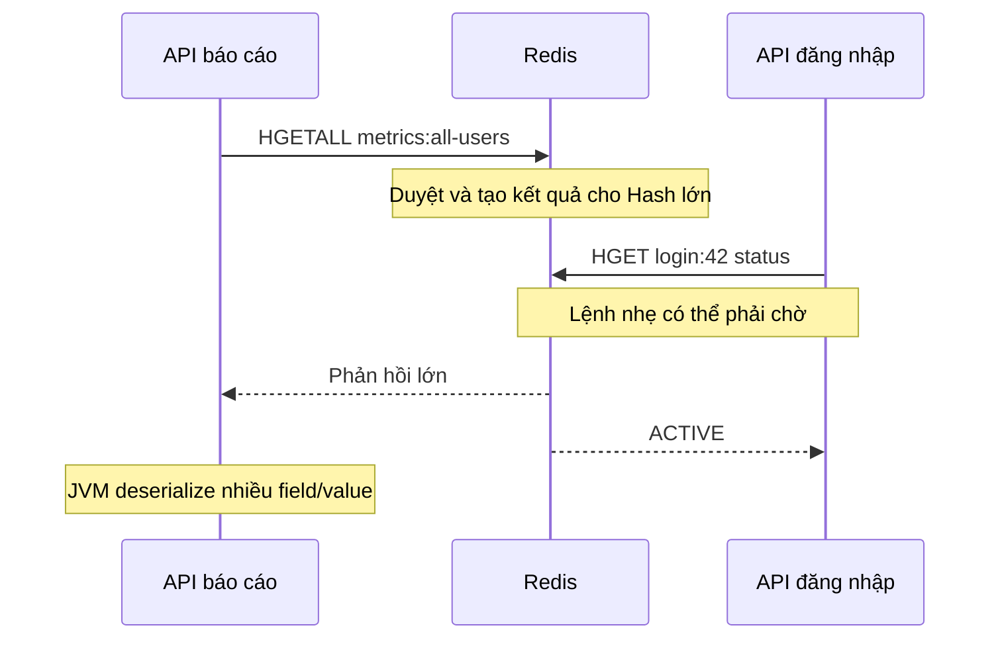

# Kiểm soát kích thước Hash và chi phí đọc toàn bộ trường

Redis Hash là cấu trúc lưu nhiều cặp **field → value** dưới một Redis key. Với Spring Data Redis, Hash rất tiện để quản lý thuộc tính người dùng, cấu hình, giỏ hàng hoặc trạng thái theo đối tượng. Tuy nhiên, sự tiện lợi của `opsForHash().entries(key)` có thể che giấu một vấn đề: khi Hash tăng tới hàng chục nghìn hoặc hàng triệu field, thao tác **lấy toàn bộ trường** tạo nhiều công việc trên Redis, truyền một phản hồi lớn và cấp phát nhiều đối tượng trên JVM.

Ví dụ, một API chỉ cần trường `status` nhưng dùng `HGETALL` để tải cả Hash chứa lịch sử thao tác sẽ trả về lượng dữ liệu không cần thiết. Độ trễ có thể tăng dần khi hệ thống vận hành lâu, mặc dù API và mã Java không thay đổi.

Bài học này tập trung vào cách đánh giá và kiểm soát **kích thước Redis Hash**, hiểu chi phí của `HGETALL` / `HKEYS` / `HVALS`, đọc đúng những field cần dùng qua Spring Data Redis, duyệt từng phần bằng `HSCAN`, chia nhỏ dữ liệu khi cần và quan sát chi phí ở cả Redis lẫn ứng dụng.

## 1. Hash là một key Redis chứa nhiều field

Giả sử một hệ thống lưu hồ sơ tài khoản:

```redis
HSET user:42 displayName "Nguyễn An" status "ACTIVE" locale "vi-VN"
HGET user:42 status
# "ACTIVE"
HLEN user:42
# 3
HGETALL user:42
# displayName, "Nguyễn An", status, "ACTIVE", locale, "vi-VN"
```

Mô hình logic:

```text
Redis database
└── key = user:42               (Redis type: hash)
    ├── displayName → "Nguyễn An"
    ├── status      → "ACTIVE"
    └── locale      → "vi-VN"
```

Một số khái niệm phải phân biệt:

- **Số key Redis**: `user:42` là **một** key, dù bên trong Hash có ba hay ba triệu field.
- **Số field**: `HLEN user:42` cho biết số cặp field/value hiện tại của Hash.
- **Kích thước field và value**: mỗi field name và value có số byte riêng. Hash ít field nhưng chứa các value vài MB vẫn có thể rất lớn.
- **Dung lượng chiếm trong Redis**: ngoài nội dung field/value còn có cấu trúc quản lý, cấp phát bộ nhớ và biểu diễn nội bộ, nên không chỉ bằng tổng độ dài chuỗi.
- **Dung lượng phản hồi khi đọc**: `HGETALL` cần gửi cả field name lẫn value qua mạng; phản hồi còn có overhead của giao thức RESP.
- **Dung lượng phía Java**: `RedisTemplate` phải decode và tạo một `Map` cùng các key/value được ánh xạ từ phản hồi.

Redis Hash phù hợp khi các field thuộc cùng một đối tượng và ứng dụng thường truy cập **một số field xác định**. Nó kém phù hợp nếu một key trở thành “kho chứa mọi sự kiện từng xảy ra” và mỗi request phải nạp toàn bộ.

## 2. Phân biệt số field, kích thước value và tốc độ tăng

Khi nói “Hash quá lớn”, cần xác định nó lớn theo chiều nào:

| Chiều kích thước | Ví dụ | Nguy cơ |
| --- | --- | --- |
| **Nhiều field** | 500.000 ID sản phẩm trong một Hash | `HGETALL` trả lượng phần tử lớn; xử lý và cấp phát nhiều entry |
| **Value lớn** | 50 field, mỗi value là JSON 1 MB | Ít field nhưng phản hồi có thể hàng chục MB |
| **Tên field dài** | Field name là URL hoặc identifier dài | Tăng bytes truyền và memory footprint |
| **Tăng không giới hạn** | Ghi thêm mỗi lần request, không xóa trường cũ | Dung lượng và thời gian đọc tăng theo tuổi dữ liệu |
| **Tần suất đọc cao** | Cùng một Hash lớn bị `HGETALL` hàng nghìn lần/phút | Tải CPU, mạng và JVM tăng dù Hash ít thay đổi |
| **Hot key trong Redis Cluster** | Một Hash chứa tất cả dữ liệu một nhóm người dùng | Lệnh tập trung lên một slot/node, khó chia tải |

Với mỗi loại Hash, nên có **giới hạn nghiệp vụ rõ ràng** về số field, kích thước mỗi value, tổng payload và vòng đời dữ liệu. Không có một con số “Hash tối đa hợp lý” đúng cho mọi hệ thống; giới hạn phải phụ thuộc vào cách truy vấn và mục tiêu độ trễ, bộ nhớ, throughput.

### Ước lượng bytes khi trả toàn bộ Hash

Đặt:

- `N`: số field trong Hash.
- `F`: số byte trung bình của field name sau serialization.
- `V`: số byte trung bình của value sau serialization.

Lượng dữ liệu field/value thô mà `HGETALL` cần trả xấp xỉ:

\\[
B_{\\text{raw}} \\approx N(F + V)
\\]

Đây là **ước lượng phần payload**, chưa gồm framing của giao thức RESP, cấu trúc bên trong Redis, bộ nhớ cấp phát để xử lý ở Java và các chi phí phát sinh khác.

Ví dụ: 200.000 field, mỗi tên field dài trung bình 16 byte và mỗi value 250 byte:

\\[
200{,}000 \\times (16 + 250) = 53{,}200{,}000\\text{ byte}
\\]

Như vậy **chỉ riêng field name và value** đã khoảng 53,2 MB (xấp xỉ 50,7 MiB). Nếu mỗi lần truy cập trang quản trị đều gọi `HGETALL`, ứng dụng phải chuyển và giải mã lượng dữ liệu lớn dù trang chỉ hiển thị 20 phần tử.

Một ví dụ ngược lại: Hash chỉ có 5 field nhưng mỗi field chứa JSON 4 MB thì payload cũng khoảng **20 MB**, dù `HLEN` trả 5. Bởi vậy `HLEN` là chỉ số rất hữu ích nhưng **không đủ** để kết luận một Hash nhỏ hay lớn.

## 3. Độ phức tạp của các lệnh Hash thường dùng

| Nhu cầu | Lệnh Redis | Chi phí điển hình | Chi phí trả dữ liệu |
| --- | --- | --- | --- |
| Đọc một field | `HGET key field` | `O(1)` trung bình theo mô tả API | Một value |
| Kiểm tra field tồn tại | `HEXISTS key field` | `O(1)` trung bình | Một kết quả |
| Đọc nhiều field đã biết | `HMGET key field1 ... fieldM` | `O(M)` với `M` là số field yêu cầu | Tối đa `M` value |
| Đếm field | `HLEN key` | `O(1)` | Một số nguyên |
| Lấy độ dài một value | `HSTRLEN key field` | `O(1)` trung bình | Một số nguyên |
| Ghi một field | `HSET key field value` | `O(1)` trung bình | Một số nguyên |
| Ghi nhiều field trong một lệnh | `HSET key f1 v1 ... fM vM` | `O(M)` | Kết quả gọn nhưng phải xử lý `M` cặp |
| Xóa một hoặc nhiều field | `HDEL key field...` | `O(M)` theo số field được yêu cầu xóa | Một số nguyên |
| Lấy toàn bộ field và value | `HGETALL key` | **`O(N)`** với `N` là tổng số field | **Toàn bộ field và value** |
| Lấy tên tất cả field | `HKEYS key` | **`O(N)`** | Toàn bộ field name |
| Lấy mọi value | `HVALS key` | **`O(N)`** | Toàn bộ value |
| Duyệt theo cursor | `HSCAN key cursor ...` | Thường gần `O(1)` amortized cho một bước, toàn vòng duyệt là `O(N)` | Một phần dữ liệu mỗi lượt, với ngoại lệ cần lưu ý |

Các độ phức tạp trên mô tả trường hợp điển hình. Hash nhỏ có thể được Redis lưu ở biểu diễn compact; chi tiết tra cứu trong biểu diễn nội bộ và chi phí chuyển đổi có thể khác nhau. Đối với thiết kế ứng dụng, sự khác biệt quan trọng nhất là **đọc một vài field** so với **buộc Redis duyệt và gửi toàn bộ `N` field**.

### Tại sao `HGETALL` có thể gây trễ dây chuyền?

Phần lớn việc thực thi lệnh trên một Redis instance/shard diễn ra tuần tự trên luồng xử lý chính. Một lệnh `HGETALL` quét Hash rất lớn có thể kéo dài thời gian xử lý và khiến lệnh khác tới sau phải chờ. Các bản Redis hiện đại có cơ chế I/O đa luồng hoặc công việc nền, nhưng điều đó không biến chi phí xử lý logic của một lệnh đọc toàn Hash thành bằng không.



Chậm ở phía client có nhiều thành phần:

```text
Thời gian request tại Spring Boot
 = chờ kết nối/pool
 + truyền yêu cầu đến Redis
 + Redis xếp hàng và xử lý lệnh
 + truyền response về ứng dụng
 + deserialize thành String/Map/DTO
 + xử lý nghiệp vụ trên dữ liệu đã nhận
```

`SLOWLOG` chỉ phản ánh thời gian thực thi lệnh trong Redis, **không** bao gồm mọi thời gian truyền mạng hoặc Java deserialize. Một `HGETALL` có thể không xuất hiện trong slowlog mà API vẫn chậm do response lớn, đợi connection hoặc cấp phát quá nhiều object.

## 4. Tương quan giữa lệnh Redis và Spring Data Redis

Spring Data Redis cung cấp `HashOperations` qua `RedisTemplate.opsForHash()` hoặc `StringRedisTemplate.opsForHash()`. Những tên phương thức tiện lợi bên Java vẫn tương ứng với chi phí thực tế của lệnh Redis.

| Mã Spring Data Redis | Lệnh Redis tương ứng về ngữ nghĩa | Phạm vi đọc |
| --- | --- | --- |
| `opsForHash().get(key, field)` | `HGET` | Một field |
| `opsForHash().multiGet(key, fields)` | `HMGET` | Những field được chọn |
| `opsForHash().hasKey(key, field)` | `HEXISTS` | Kiểm tra một field |
| `opsForHash().size(key)` | `HLEN` | Chỉ lấy số lượng |
| `opsForHash().lengthOfValue(key, field)` | `HSTRLEN` ở các phiên bản hỗ trợ | Chỉ lấy độ dài value |
| `opsForHash().entries(key)` | **`HGETALL`** | Toàn bộ Hash |
| `opsForHash().keys(key)` | **`HKEYS`** | Toàn bộ field name |
| `opsForHash().values(key)` | **`HVALS`** | Toàn bộ value |
| `opsForHash().scan(key, scanOptions)` | `HSCAN` | Duyệt qua nhiều đợt |

Phương thức `entries(key)` trả `Map<HK, HV>`. Điều đó có nghĩa bên Java phải có nơi chứa kết quả tương ứng với toàn bộ field được trả về. Nếu Hash lớn và serializer tạo nhiều đối tượng, áp lực heap và garbage collection có thể đáng kể.

Với `StringRedisTemplate`, key, hash field và hash value mặc định được diễn giải dưới dạng String. Với `RedisTemplate` có serializer JSON/JDK hoặc cấu hình riêng, object trong `Map` có thể còn tốn bộ nhớ hơn và có chi phí chuyển đổi lớn hơn. Khi so sánh hiệu năng, phải xét **đúng serializer** đang dùng.

## 5. Ví dụ sai: nạp toàn Hash để đọc một vài trường

Giả sử Hash `customer:42` chứa thông tin hồ sơ, tùy chọn ứng dụng và hàng nghìn field được ghi theo thời gian. API chỉ cần tên hiển thị và trạng thái.

**Cách làm tốn kém:**

```java
import java.util.Map;
import org.springframework.data.redis.core.StringRedisTemplate;

public class CustomerProfileService {
    private final StringRedisTemplate redis;

    public CustomerProfileService(StringRedisTemplate redis) {
        this.redis = redis;
    }

    public String getStatus(String customerId) {
        String key = "customer:" + customerId;
        Map<Object, Object> allFields =
                redis.opsForHash().entries(key);  // HGETALL
        return (String) allFields.get("status");
    }
}
```

Nếu Hash có 100.000 field, Redis vẫn phải đọc và trả về cả 100.000 field để Java lấy đúng một giá trị `status`.

**Cách phù hợp khi chỉ cần một field:**

```java
import org.springframework.data.redis.core.StringRedisTemplate;

public class CustomerProfileService {
    private final StringRedisTemplate redis;

    public CustomerProfileService(StringRedisTemplate redis) {
        this.redis = redis;
    }

    public String getStatus(String customerId) {
        return (String) redis.opsForHash().get(
                "customer:" + customerId, "status"
        );  // HGET
    }
}
```

Điểm khác biệt nằm ở **số field được yêu cầu từ Redis**, chứ không phải Java chọn giá trị bằng `Map.get(...)` nhanh hay chậm. `HGET` làm lượng response không tăng theo toàn bộ số field của Hash. Trường hợp value `status` chứa một payload cực lớn vẫn cần xem kích thước value riêng.

### Đọc nhiều trường đã biết: `HMGET`

Khi API cần `displayName`, `status` và `locale`, có thể yêu cầu đúng ba trường bằng một lệnh:

```java
import java.util.List;
import org.springframework.data.redis.core.HashOperations;
import org.springframework.data.redis.core.StringRedisTemplate;
import org.springframework.stereotype.Service;

@Service
public class CustomerSummaryService {

    private final HashOperations<String, String, String> hashes;

    public CustomerSummaryService(StringRedisTemplate redis) {
        this.hashes = redis.opsForHash();
    }

    public CustomerSummary load(String customerId) {
        String key = "customer:" + customerId;
        List<String> fields = List.of("displayName", "status", "locale");
        List<String> values = hashes.multiGet(key, fields); // HMGET

        return new CustomerSummary(
                customerId,
                values.get(0),
                values.get(1),
                values.get(2)
        );
    }

    public record CustomerSummary(
            String id,
            String displayName,
            String status,
            String locale
    ) {}
}
```

Trong lời gọi bình thường, danh sách kết quả giữ thứ tự của danh sách field yêu cầu; field không tồn tại có thể tương ứng với giá trị `null`. Ứng dụng cần quyết định cách xử lý dữ liệu thiếu hoặc key hết hạn. Ví dụ trên minh họa đọc có chọn lọc, còn nghiệp vụ thật có thể cần xác thực bắt buộc của `status`, kiểm tra giá trị enum và quyền truy cập.

**So sánh ba cách đọc:**

- Gọi `HGET` ba lần: chỉ đọc ba field, nhưng có thể phát sinh ba round trip nếu gửi tuần tự.
- Gọi `HMGET` một lần: đọc ba field trong một command, giảm round trip nhưng vẫn trả đúng dữ liệu cần thiết.
- Gọi `HGETALL`: một round trip, nhưng có thể trả hàng chục nghìn field không cần thiết.

Chỉ giảm số round trip không đủ để tối ưu nếu lượng dữ liệu trả về lại tăng quá lớn.

## 6. Khi nào `HGETALL` vẫn hợp lý?

Không nên coi `HGETALL` là lệnh luôn sai. Nó phù hợp khi:

- Hash có **số field nhỏ và được giới hạn trong thiết kế**, ví dụ 8–20 thuộc tính cố định của một profile.
- Ứng dụng thực sự cần đọc **tất cả** field trong một lần.
- Kích thước value được kiểm soát và đã đo response time / allocation trong tải mục tiêu.
- Cần một lần đọc nguyên tử dữ liệu Hash tại thời điểm server thực hiện lệnh. `HGETALL` là một command Redis đơn lẻ, vì vậy không có lệnh khác xen ngang giữa việc đọc từng field của chính command ấy.

Tuy nhiên, sau khi response rời Redis, các writer khác vẫn có thể thay đổi Hash. Một `HGETALL` không khóa dữ liệu để toàn bộ quy trình xử lý nghiệp vụ phía Java tiếp tục nhìn thấy snapshot mới nhất.

Nếu schema có 15 field nhưng mỗi value có thể là JSON 5 MB, việc “chỉ có 15 field” cũng không làm `HGETALL` rẻ. Nên cân nhắc giới hạn payload theo byte ngoài số lượng trường.

## 7. Duyệt Hash lớn bằng `HSCAN`

Khi thật sự cần đi qua nhiều field, ví dụ job phân tích hoặc bảo trì dữ liệu, `HSCAN` giúp **chia việc duyệt thành nhiều lần gọi**:

```redis
HSCAN customer:42 0 COUNT 200
# Redis trả về [cursor tiếp theo, các cặp field/value]

HSCAN customer:42 <cursor-tra-ve> COUNT 200
# Tiếp tục đến khi cursor trả về là 0
```

Có thể lọc tên field bằng `MATCH`:

```redis
HSCAN customer:42 0 MATCH "feature:*" COUNT 200
```

Điểm cần hiểu:

1. `COUNT 200` là **gợi ý về lượng công việc**, không cam kết luôn trả đúng 200 field hoặc tối đa 200 field.
2. Một lượt `HSCAN` có thể trả **không field nào** dù cursor chưa về `0`. Phải tiếp tục dùng cursor mới.
3. Tổng công việc để duyệt hết Hash vẫn tăng theo số field, thường là `O(N)`. Chia đợt giúp tránh một lệnh lớn, chứ không biến công việc toàn bộ thành hằng số.
4. Với Hash đang thay đổi trong lúc duyệt, kết quả **không phải snapshot nhất quán**. Một số field có thể xuất hiện lặp; field thêm/xóa trong lúc quét có thể có hành vi quan sát khác nhau theo thời điểm.
5. Với một số biểu diễn compact của tập dữ liệu nhỏ, Redis có thể trả toàn bộ tập phần tử trong **một** lượt scan dù đã khai báo `COUNT`.
6. `MATCH` lọc kết quả theo tên field, **không biến một mẫu field thành chỉ mục độc lập**. Chỉ khớp vài field chưa chắc đã giảm đáng kể tổng công việc phải duyệt.

Không dùng kết quả `HSCAN` như các “trang” 1, 2, 3 ổn định cho người dùng nếu nội dung Hash có thể thay đổi; cursor không có ngữ nghĩa offset paging của một bộ dữ liệu đã được sắp xếp.

### Đọc bằng `HashOperations.scan` trong Spring Data Redis

Ví dụ một job nền xử lý field dạng `setting:*` mà không tạo một `Map` chứa toàn bộ Hash:

```java
import java.util.Map;
import java.util.function.BiConsumer;
import org.springframework.data.redis.core.Cursor;
import org.springframework.data.redis.core.HashOperations;
import org.springframework.data.redis.core.ScanOptions;
import org.springframework.data.redis.core.StringRedisTemplate;
import org.springframework.stereotype.Service;

@Service
public class CustomerHashScanner {

    private final HashOperations<String, String, String> hashes;

    public CustomerHashScanner(StringRedisTemplate redis) {
        this.hashes = redis.opsForHash();
    }

    public void forEachSetting(
            String customerId,
            BiConsumer<String, String> processor
    ) {
        String key = "customer:" + customerId;
        ScanOptions options = ScanOptions.scanOptions()
                .match("setting:*")
                .count(200)
                .build();

        try (Cursor<Map.Entry<String, String>> cursor =
                     hashes.scan(key, options)) {
            while (cursor.hasNext()) {
                Map.Entry<String, String> entry = cursor.next();
                processor.accept(entry.getKey(), entry.getValue());
            }
        }
    }
}
```

`Cursor` cần được đóng bằng `try-with-resources` để giải phóng tài nguyên liên quan đến thao tác duyệt. Hàm `processor` trong ví dụ phải xử lý từng phần tử và **không** âm thầm cộng dồn tất cả field vào một danh sách lớn, vì như vậy lại chuyển vấn đề bộ nhớ từ `HGETALL` sang code Java.

Ví dụ này là một vòng duyệt đồng bộ từ đầu đến cuối, phù hợp với **tác vụ bảo trì có kiểm soát**. Nếu Hash cực lớn, cần bổ sung giới hạn tốc độ, thời gian chạy, retry/checkpoint ở cấp job và giám sát tác động. Đừng đặt nguyên vòng duyệt hàng triệu field vào một HTTP request có deadline ngắn.

### Không đánh đồng SCAN với phân trang nhất quán

Giả sử trang sản phẩm cần đúng 20 item theo thứ tự tạo mới nhất. Redis Hash không có thứ tự field được bảo đảm và `HSCAN` không bảo đảm “trang số 2” ổn định. Thiết kế phù hợp hơn là:

- Dùng **Sorted Set** làm chỉ mục item theo thời gian/score để lấy một đoạn có giới hạn.
- Sau khi lấy danh sách ID, dùng `HMGET` cho các field tương ứng trong Hash hoặc truy cập key theo từng ID.
- Xác định cách cập nhật đồng bộ giữa chỉ mục và dữ liệu, cũng như quy tắc xử lý ID không còn tồn tại.

Trường hợp cần export toàn Hash định kỳ, `HSCAN` phù hợp hơn, nhưng job phải chấp nhận hoặc xử lý vấn đề dữ liệu thay đổi trong lúc duyệt.

## 8. Kiểm tra dung lượng Hash thực tế

Redis cung cấp nhiều lệnh để quan sát kích thước theo các chiều khác nhau:

```redis
TYPE customer:42
HLEN customer:42
HSTRLEN customer:42 settingsJson
MEMORY USAGE customer:42
OBJECT ENCODING customer:42
TTL customer:42
```

| Chỉ số | Ý nghĩa | Giới hạn diễn giải |
| --- | --- | --- |
| `TYPE` | Kiểm tra key có phải `hash` không | Không nói được Hash lớn tới đâu |
| `HLEN` | Số field | Không nói value dài bao nhiêu byte |
| `HSTRLEN` | Số byte của value một field (theo dữ liệu Redis lưu) | Chỉ một field; cần chọn sample nếu nhiều field |
| `MEMORY USAGE` | Ước lượng byte bộ nhớ Redis dùng cho key/value và cấu trúc liên quan | Phụ thuộc allocator/encoding và chế độ sampling |
| `OBJECT ENCODING` | Biểu diễn nội bộ hiện tại của key, ví dụ compact hoặc hash table | Chi tiết triển khai, có thể khác theo Redis version |
| `TTL` / `PTTL` | Thời gian key còn hiệu lực | Không phải chỉ số kích thước; giúp thấy dữ liệu có vòng đời không |

`MEMORY USAGE` với collection có thể sử dụng **sampling** để ước lượng bộ nhớ. Redis hỗ trợ tùy chọn `SAMPLES`; ví dụ:

```redis
MEMORY USAGE customer:42 SAMPLES 5
MEMORY USAGE customer:42 SAMPLES 0
```

`SAMPLES 0` yêu cầu kiểm tra toàn bộ phần tử khi đánh giá cấu trúc có thành phần lồng nhau, có thể làm việc nhiều hơn đáng kể trên key lớn. Không lặp lệnh kiểm tra toàn bộ trên hot key production mà chưa đánh giá tác động.

### Xem big keys ở cấp database

`redis-cli --bigkeys` hữu ích để phát hiện những key có cardinality lớn theo kiểu dữ liệu. Công cụ thực hiện quá trình duyệt keyspace và vẫn tạo tải; nên chạy có kế hoạch, trên hệ thống thích hợp và theo dõi latency.

```bash
redis-cli --bigkeys
```

Kết quả bigkeys không thay thế cho:

- Kiểm tra kích thước byte bằng `MEMORY USAGE` hoặc công cụ quan sát tương đương.
- Thống kê độ dài value và payload trả về.
- Xác định **tần suất đọc** của key, vì một Hash trung bình bị đọc hàng nghìn lần mỗi giây cũng có thể là điểm nóng.

Trên hệ thống có Redis Cluster, phải xem số liệu trên **từng node** liên quan. Một Hash là một key và không được Redis Cluster tự chia field sang nhiều node; mọi field thuộc cùng key sẽ đặt trên một hash slot.

## 9. Biểu diễn nội bộ: Hash nhỏ không giống Hash lớn

Redis thường dùng biểu diễn **compact** cho Hash nhỏ có field/value đủ ngắn; khi vượt các ngưỡng kích thước hoặc số lượng, Redis có thể chuyển sang biểu diễn dạng hash table. Với các bản Redis 7.x phổ biến, các tùy chọn cấu hình cần biết gồm:

```redis
CONFIG GET hash-max-listpack-entries
CONFIG GET hash-max-listpack-value
OBJECT ENCODING customer:42
```

Tên và ngưỡng thực tế phụ thuộc phiên bản Redis/cấu hình triển khai; một số phiên bản cũ sử dụng encoding hoặc tên tham số khác. Không sao chép số ngưỡng mặc định từ tài liệu của phiên bản khác rồi coi là bất biến.

Biểu diễn compact giúp tiết kiệm overhead cho Hash nhỏ, nhưng khi field hoặc value lớn hơn ngưỡng, Redis có thể chuyển encoding để phục vụ quy mô khác. Từ góc nhìn ứng dụng:

- Đừng mặc định rằng “gom mọi field vào một Hash” **luôn tiết kiệm bộ nhớ** ở mọi quy mô.
- Đừng tự tăng các ngưỡng compact lên rất cao chỉ để giữ mãi encoding nhỏ: thao tác trên cấu trúc compact lớn có thể chịu chi phí CPU không mong muốn.
- Đừng dựa vào `OBJECT ENCODING` như giao diện nghiệp vụ: nó là thông tin triển khai để chẩn đoán.
- Đo memory và latency với **dữ liệu có kích thước thực tế** thay vì chỉ thử 5–10 field trên môi trường phát triển.

**Kết luận về encoding:** tối ưu cấu trúc dữ liệu phải bắt đầu từ nhu cầu truy vấn và giới hạn tăng trưởng; điều chỉnh cấu hình Redis là bước sau, dựa trên phép đo.

## 10. Kiểm soát kích thước Hash ngay từ thiết kế

### 10.1. Đặt trần số field theo nghiệp vụ

Ví dụ Hash `user:42:preferences` chỉ chứa các mục cấu hình được định nghĩa trong schema, tối đa 30 trường. Đây là trường hợp phù hợp với Hash. Ngược lại, nếu `user:42:history` thêm một field mới sau mỗi lượt truy cập, số field sẽ tăng không giới hạn nếu không có chính sách lưu giữ.

Có thể áp dụng:

1. **Danh sách field được phép** đối với cấu trúc có schema cố định; từ chối tên field không thuộc schema.
2. **Số lượng tối đa** đối với dữ liệu linh hoạt, chẳng hạn giỏ hàng tối đa một số item theo quy định nghiệp vụ.
3. **Chính sách xóa trường cũ** khi vượt giới hạn, dựa trên chỉ mục thứ tự hoặc thời gian riêng.
4. **Thời hạn lưu dữ liệu** cụ thể cho từng loại key/đối tượng.
5. **Giới hạn value** sau serialization, vì một field có thể chứa JSON lớn dù số field thấp.

Nếu phải đồng thời kiểm tra `HLEN` và thêm field mà vẫn giữ trần trong hệ thống nhiều writer, **`HLEN` rồi `HSET` là hai thao tác khác nhau**. Hai client có thể đều nhìn thấy Hash chưa đầy và cùng ghi vượt giới hạn. Cần logic nguyên tử trong Lua/Redis Functions hoặc mô hình ghi có điều phối khi trần là một bất biến bắt buộc.

### 10.2. Đặt ngân sách byte cho từng Hash

Ví dụ chính sách minh họa cho `session:context:{id}`:

```text
Tối đa 40 field
Tên field tối đa 64 byte UTF-8
Value tối đa 8 KiB mỗi field
Tổng payload cho một Hash tối đa 128 KiB
TTL cho key: 30 phút
Đường đọc thường xuyên: chỉ HGET/HMGET cho field cần thiết
```

Các giá trị này **không phải khuyến nghị chung cho mọi ứng dụng**; chúng diễn tả cách viết quy định có thể đo và kiểm soát. Bản thân Redis không tự áp đặt “tối đa 128 KiB mỗi Hash” theo ví dụ. Ứng dụng, script ghi hoặc tầng lưu trữ phải thực thi chính sách; cơ chế đo/cập nhật đồng thời cần được thiết kế nếu nhiều writer có thể ghi cùng key.

### 10.3. Tách trường lớn khỏi Hash chứa metadata

Một Hash có thể phù hợp cho trường ngắn:

```text
document:42:meta
  ownerId     -> u-42
  status      -> READY
  updatedAt   -> 2026-11-12T09:00:00Z
  contentType -> application/json
```

Nhưng nếu có field `body` là JSON 5 MB, mỗi lần `HGETALL document:42:meta` sẽ kéo theo body. Có thể cân nhắc:

```text
document:42:meta     (Redis Hash, nhiều metadata ngắn)
document:42:body     (Redis String hoặc hệ lưu object phù hợp)
```

Khi API chỉ cần metadata, nó không trả về body. Đổi lại, giờ có nhiều key nên cần tính đến TTL, nhất quán cập nhật/xóa và số thao tác truy cập. Nếu body rất lớn hoặc cần lưu bền lâu dài, Redis có thể không phải nơi thích hợp nhất để giữ bản gốc.

### 10.4. Chia Hash tăng không giới hạn thành nhóm nhỏ

Giả sử một Hash `customer:all-events` chứa dữ liệu của mọi khách hàng. Nó vừa là big key vừa là hot key và trong Redis Cluster không thể phân tán field của **cùng một Hash** qua nhiều node.

Thay vì một key:

```text
customer:all-events
  u-1:event-1 -> ...
  u-2:event-3 -> ...
  ...
```

có thể tách theo đối tượng hoặc khoảng thời gian:

```text
customer:u-1:events:2026-11
customer:u-2:events:2026-11
customer:u-1:events:2026-12
...
```

Hoặc dùng bucket được tính ổn định:

```text
customer:events:bucket:00
customer:events:bucket:01
...
customer:events:bucket:31
```

Lựa chọn tách key phụ thuộc truy vấn:

- Nếu thường đọc một user, tách theo **user ID** giúp biết trực tiếp key cần đọc.
- Nếu cần dữ liệu trong thời gian gần đây, tách theo **khoảng thời gian** tạo giới hạn tự nhiên cho kích thước/vòng đời.
- Nếu cần chia tải đều, bucket theo hàm băm ổn định có thể phân bố keys, nhưng các producer/consumer phải dùng cùng thuật toán và số bucket; tăng số bucket có thể yêu cầu migration.
- Nếu thường truy vấn theo score/thời gian với phân trang ổn định, cần một **chỉ mục thứ tự** (ví dụ sorted set) hoặc kho dữ liệu phù hợp, thay vì quét tất cả Hash.

Tách key có chi phí: thêm overhead metadata cho mỗi key, tăng số round trip nếu phải đọc nhiều key, làm phức tạp xóa/TTL và có thể mất tính nguyên tử khi cập nhật nhiều key trên nhiều slot Redis Cluster. Không nên chia quá vụn khi mỗi đối tượng chỉ có vài field cố định.

## 11. TTL, xóa dữ liệu và Hash lớn

Redis áp dụng TTL ở cấp **key** theo cơ chế chung. Nếu chạy:

```redis
HSET session:42 status "ACTIVE" locale "vi-VN"
EXPIRE session:42 1800
```

thì TTL truyền thống của key `session:42` áp dụng cho toàn bộ Hash. `HSET` cập nhật một field trong Hash đang tồn tại **không tự động bỏ TTL của key** theo cách mà `SET` ghi đè Redis String có thể làm. Tuy vậy, khi một key Hash mới được tạo bằng `HSET`, key đó không mặc nhiên có TTL nếu ứng dụng chưa đặt hạn dùng.

Ở các phiên bản Redis mới có thêm cơ chế TTL **cho từng hash field**, nhưng API, phiên bản server và khả năng hỗ trợ trong Spring Data Redis phải được kiểm tra trước khi chọn thiết kế đó. Không mặc định tất cả môi trường Redis đều hỗ trợ field-level expiration hoặc các thư viện client đều cung cấp cùng khả năng.

### Xóa field và xóa cả Hash là hai công việc khác nhau

```redis
HDEL customer:42 oldField1 oldField2
DEL customer:42
UNLINK customer:42
```

- `HDEL` xóa những field cụ thể; chi phí tăng theo số field được yêu cầu xóa.
- `DEL` xóa cả key và thực hiện công việc giải phóng bộ nhớ tương ứng. Với Hash rất lớn, phần giải phóng có thể kéo dài đáng kể.
- `UNLINK` tách key khỏi keyspace trên đường thực thi chính và chuyển phần giải phóng giá trị sang tác vụ nền. Phù hợp cân nhắc khi xóa Hash lớn, dù tổng chi phí tài nguyên không biến mất.

Trong Spring Data Redis, có thể dùng `redisTemplate.unlink(key)` hoặc API tương ứng khi Redis/driver hỗ trợ. Không dùng `DEL` hàng loạt với big keys trong luồng request có deadline thấp nếu có thể thiết kế job dọn dữ liệu thích hợp.

TTL giúp hạn chế Hash tồn tại vô hạn, nhưng **TTL không phải giới hạn kích thước** trong khoảng thời gian key đang sống. Một Hash có TTL một giờ vẫn có thể tích lũy hàng triệu field trong giờ đó.

## 12. Ghi nhiều field: đừng tạo một batch không giới hạn

Để giảm round trip, có thể dùng `HSET` với nhiều cặp field/value trong một lệnh hoặc pipeline theo batch. Nhưng một lệnh chứa hàng trăm nghìn field vẫn làm Redis phải xử lý và đọc toàn bộ payload đầu vào.

Ví dụ ghi một batch giới hạn bằng Spring Data Redis:

```java
import java.util.LinkedHashMap;
import java.util.Map;
import org.springframework.data.redis.core.HashOperations;
import org.springframework.data.redis.core.StringRedisTemplate;

public class BoundedHashWriter {
    private static final int MAX_BATCH_FIELDS = 200;
    private final HashOperations<String, String, String> hashes;

    public BoundedHashWriter(StringRedisTemplate redis) {
        this.hashes = redis.opsForHash();
    }

    public void saveBatch(String key, Map<String, String> fields) {
        if (fields.size() > MAX_BATCH_FIELDS) {
            throw new IllegalArgumentException("Too many fields in one batch");
        }

        Map<String, String> copy = new LinkedHashMap<>(fields);
        hashes.putAll(key, copy);
    }
}
```

Con số 200 là **giới hạn minh họa**, phải chọn theo payload bytes, tần suất ghi, mục tiêu latency và kết quả đo. Nếu mỗi value dài 1 MB thì 200 field vẫn là batch không hợp lý. Trong hệ thống nhiều writer, limit theo số field của **một batch** cũng không đảm bảo tổng số field của Hash được giữ dưới ngưỡng.

Pipelining các thao tác nhỏ giúp giảm số round trip, nhưng không làm tổng công việc Redis nhẹ hơn. Một pipeline khổng lồ có thể tăng bộ nhớ client/server và gây trễ các request khác; nên chia batch và áp dụng giới hạn concurrency.

## 13. Kiểm soát Hash qua số liệu vận hành

Muốn phát hiện vấn đề sớm, cần quan sát **kích thước dữ liệu** và **chi phí truy cập** cùng lúc.

### 13.1. Các chỉ số nên theo dõi

| Nhóm | Chỉ số gợi ý | Điều muốn phát hiện |
| --- | --- | --- |
| Hash cardinality | `HLEN` tại key đại diện, max/percentile theo loại key | Hash tăng vượt dự kiến |
| Dung lượng | `MEMORY USAGE`, phân bố kích thước value, payload response | Big key hoặc vài value quá lớn |
| Lệnh Redis | Số lần `HGETALL`, `HVALS`, `HKEYS`, `HSCAN`, `HGET`, `HMGET` | Pattern đọc toàn bộ xuất hiện ngày càng nhiều |
| Latency server | `SLOWLOG`, `INFO commandstats`, latency monitoring | Lệnh mất nhiều thời gian xử lý |
| Latency client | p50/p95/p99 Redis call, pool wait, timeout, retries | Trễ do mạng, ứng dụng hay backend |
| JVM | Heap, allocations, GC pauses, số lượng Map/object | Deserialize và giữ dữ liệu quá lớn |
| Mạng | Response bytes/giây và peak response size | Trả quá nhiều dữ liệu ở giờ cao điểm |
| Redis node | CPU, memory, network, hot key, client count | Tác động đến dịch vụ khác, mất cân bằng cluster |

Tùy Redis version và cách tích hợp metric, `INFO commandstats` tổng hợp theo loại command (và có thể có phần thống kê bổ sung); nó **không tự cho biết chính xác key nào bị `HGETALL` nhiều nhất**. Để tìm key nóng cần kết hợp tracing phía ứng dụng, telemetry client và công cụ chẩn đoán thích hợp.

Các lệnh quan sát minh họa:

```redis
INFO commandstats
INFO memory
INFO stats
SLOWLOG GET 20
LATENCY LATEST
```

`SLOWLOG` đo thời gian thực thi ở Redis và bỏ qua phần lớn thời gian mạng; một số chức năng `LATENCY` cần bật/cấu hình latency monitoring mới có sự kiện. Đừng suy luận hệ thống chắc chắn khỏe chỉ vì slowlog trống.

### 13.2. Đo theo dữ liệu và tải thực tế

Một phép benchmark hữu ích cần so sánh cùng cấu hình, cùng Redis node/đường mạng, và cùng số client với các mốc dữ liệu:

| Bộ dữ liệu | Hành vi thử nghiệm |
| --- | --- |
| Hash 20 field ngắn | `HGETALL` và `HMGET` đều có thể rất nhanh |
| Hash 2.000 field | Bắt đầu đo response bytes, p95/p99 và allocation |
| Hash 200.000 field | Đo riêng `HGETALL` với tải an toàn; đối chiếu truy vấn có chọn lọc |
| Hash ít field nhưng value lớn | Đo truyền mạng và deserialize, không chỉ đếm `HLEN` |

Không có số liệu tuyệt đối “Hash 2.000 field luôn an toàn” hay “200.000 field luôn chậm”. Payload size, hạ tầng, Redis version, serializer và cạnh tranh tài nguyên làm thay đổi kết quả. Bảng này chỉ là **các cấp độ khảo sát**, không phải ranh giới hiệu năng chính thức.

### 13.3. Giám sát tăng trưởng và cảnh báo

Ví dụ một nhóm key `cart:{userId}:items` có giới hạn nghiệp vụ 500 item. Có thể đặt các ngưỡng cảnh báo dựa trên phần trăm giới hạn đã xác lập:

- Khi một Hash chạm 70% giới hạn: ghi nhận xu hướng tăng và tần suất xuất hiện.
- Khi chạm 90%: cảnh báo, kiểm tra có hành vi tích lũy bất thường.
- Khi chạm 100%: áp dụng chính sách từ chối thêm mới, thay đổi kiểu lưu trữ hoặc dọn dữ liệu theo thiết kế.

Các tỷ lệ 70/90/100% là **ví dụ chính sách**, không phải quy tắc Redis. Trong môi trường nhiều writer, việc chặn thêm field phải dùng cơ chế đủ nguyên tử nếu yêu cầu không bao giờ vượt giới hạn.

Nếu theo dõi `HLEN` của nhiều triệu key, bản thân công việc đo đạc có thể tạo tải. Cần sampling, phân nhóm và lập lịch kiểm tra thay vì liên tục quét mọi key từ request thông thường.

## 14. Tình huống thực tế: một API danh sách chậm dần

Một dịch vụ lưu giỏ hàng của người dùng bằng Hash:

```text
cart:user-42:items
  product-1   -> {"qty":1,"name":"...","price":...}
  product-2   -> {"qty":2,"name":"...","price":...}
  ...
```

Ban đầu giỏ hàng chỉ có 10 sản phẩm. Sau một thời gian, ứng dụng chuyển sang dùng cùng Hash để lưu cả **lịch sử sản phẩm từng thêm**, nên số field lên 80.000. Một endpoint lấy “10 sản phẩm mới nhất” vẫn viết:

```java
Map<Object, Object> items =
        stringRedisTemplate.opsForHash().entries("cart:user-42:items");

// Sau đó mới sort, filter và lấy 10 item tại Java.
```

API chậm dần vì:

1. Redis duyệt toàn bộ 80.000 field/value.
2. Response gửi qua mạng lớn hơn nhiều so với 10 item cần hiển thị.
3. JVM cấp phát `Map` và các String, parse các payload không cần dùng.
4. Phân loại/sắp xếp trong Java làm phát sinh thêm CPU và bộ nhớ.
5. Nếu nhiều người dùng truy cập endpoint cùng lúc, Redis và network chịu tải lặp lại.

### Thiết kế lại dựa trên nhu cầu truy vấn

Nếu nghiệp vụ cần 10 sản phẩm mới nhất và giữ thông tin mỗi sản phẩm:

```text
cart:user-42:items          (Hash: productId -> JSON item)
cart:user-42:recent         (Sorted Set: productId -> updatedAtScore)
```

Quy trình đọc:

1. Dùng `ZREVRANGE`/API sorted set tương ứng để lấy tối đa 10 `productId` có score cao nhất.
2. Dùng `HMGET cart:user-42:items` với 10 ID đó.
3. Bỏ qua hoặc xử lý ID không còn tồn tại nếu chỉ mục và Hash không được cập nhật nguyên tử.
4. Quyết định rõ giới hạn số item, chính sách dọn lịch sử và TTL của từng key.

Ví dụ Spring Data Redis:

```java
import java.util.ArrayList;
import java.util.List;
import java.util.Set;
import org.springframework.data.redis.core.StringRedisTemplate;

public class RecentCartReader {
    private final StringRedisTemplate redis;

    public RecentCartReader(StringRedisTemplate redis) {
        this.redis = redis;
    }

    public List<String> recentItemJson(String userId) {
        Set<String> ids = redis.opsForZSet().reverseRange(
                "cart:" + userId + ":recent", 0, 9
        );
        if (ids == null || ids.isEmpty()) {
            return List.of();
        }

        // HMGET giữ thứ tự của danh sách field yêu cầu.
        List<String> jsonValues = redis.<String, String>opsForHash()
                .multiGet("cart:" + userId + ":items",
                          new ArrayList<>(ids));

        // Hash field có thể đã bị xóa; không trả phần tử null.
        List<String> present = new ArrayList<>();
        for (String json : jsonValues) {
            if (json != null) {
                present.add(json);
            }
        }
        return present;
    }
}
```

Một request điển hình giờ chỉ cần dữ liệu cho tối đa 10 sản phẩm, không tải cả 80.000 field. Đổi lại, việc ghi/xóa item cần quản lý nhất quán giữa Hash và Sorted Set; có thể dùng transaction/Lua khi cần tính nguyên tử và các key thuộc cùng slot trong Redis Cluster. Việc phân trang hoặc thứ tự khi có nhiều phần tử cùng score cũng cần được định nghĩa.

Nếu mục tiêu thực sự là phân tích lịch sử nhiều năm, nên cân nhắc lưu dữ liệu gốc trong hệ lưu trữ bền vững có khả năng truy vấn/lập chỉ mục phù hợp rồi cache phần đang dùng trong Redis. Redis không nên bị ép đóng vai trò bảng lịch sử tăng vô hạn chỉ vì có thể thêm field thuận tiện.

## 15. Các sai lầm dễ gặp

| Cách hiểu sai | Vì sao có vấn đề | Cách tiếp cận |
| --- | --- | --- |
| “Hash là một Redis key nên `HGETALL` luôn là một thao tác nhẹ.” | Một key có thể chứa hàng triệu field. | Xem `HLEN`, bytes và chi phí lệnh `O(N)`. |
| “Đếm field bằng `HLEN` là đủ đánh giá kích thước.” | Một value duy nhất có thể rất lớn. | Đo value bytes và `MEMORY USAGE`. |
| “API cần ba field nhưng gọi `entries` rồi lấy ba field ở Java.” | Redis vẫn gửi toàn bộ Hash. | Dùng `HGET` hoặc `HMGET`. |
| “`HSCAN COUNT 100` luôn trả đúng tối đa 100 field.” | COUNT chỉ là hint; compact encoding có thể trả nhiều hơn. | Xử lý theo cursor, giới hạn job và bộ nhớ tiêu thụ. |
| “`HSCAN` là công cụ phân trang ổn định.” | Hash không có thứ tự field và scan không có snapshot cố định. | Dùng chỉ mục có thứ tự hoặc thiết kế API paging riêng. |
| “Tăng timeout sẽ sửa `HGETALL` chậm.” | Căn nguyên là truy vấn và dữ liệu tăng không giới hạn. | Giảm payload và chia cấu trúc theo nhu cầu. |
| “Bật pipeline xong mọi thao tác lớn đều rẻ.” | Pipeline giảm round trip nhưng không giảm tổng công việc và bytes. | Batch có giới hạn và thiết kế truy vấn đúng. |
| “Hash có TTL nên không thể quá lớn.” | Key vẫn có thể phình rất nhanh trước khi hết TTL. | Giới hạn field/value và chính sách dọn dữ liệu. |
| “Redis Cluster tự chia field của một Hash.” | Một Hash là một key thuộc một hash slot. | Phân chia dữ liệu thành các key phù hợp nếu cần phân tải. |
| “`HGETALL` không có trong slowlog nên không gây chậm.” | Network và JVM decode không nằm trọn trong slowlog. | Đo latency end-to-end và lượng response. |

## 16. Câu hỏi tự luyện

**Câu 1.** Hash `customer:42` có 200.000 field. Service chỉ cần `status` và `locale`. Nên dùng `HGETALL` hay `HMGET`? Vì sao?

*Gợi ý:* so số field Redis phải trả, payload mạng và bộ nhớ JVM.

**Câu 2.** Một Hash chỉ chứa 6 field nhưng mỗi value có kích thước 3 MB. Vì sao `HLEN` không đủ để kết luận Hash nhỏ?

*Gợi ý:* phân biệt cardinality và kích thước byte.

**Câu 3.** Job dùng `HSCAN key 0 COUNT 100` nhưng nhận 0 field và cursor khác 0. Có được dừng không?

*Gợi ý:* số field trả về mỗi lượt không quyết định việc kết thúc vòng quét.

**Câu 4.** Vì sao hai request cùng kiểm tra `HLEN < 500` rồi gọi `HSET` vẫn có thể tạo Hash vượt 500 field?

*Gợi ý:* kiểm tra và ghi ở các command riêng; cần xử lý race condition nếu trần bắt buộc.

**Câu 5.** Một hệ thống cần trang “20 mục mới nhất” được đọc liên tục. Vì sao dùng `HSCAN` để lấy “trang thứ hai” không phù hợp?

*Gợi ý:* thứ tự Hash và tính nhất quán trong lúc dữ liệu thay đổi.

**Câu 6.** Một Hash có TTL 30 phút và đang được bổ sung 10.000 field/phút. Có thể xem TTL là đủ để ngăn Hash trở thành big key không?

*Gợi ý:* 30 phút vẫn có thể chứa hàng trăm nghìn field và tạo đỉnh bộ nhớ/response lớn trước khi hết hạn.

**Câu 7.** Redis Cluster có bốn primary, nhưng một Hash khổng lồ làm một node chịu tải cao. Vì sao thêm primary chưa chắc tự khắc phục?

*Gợi ý:* Hash nằm trong một key và một hash slot; cần chia key và xây lại cách truy vấn nếu muốn phân tán dữ liệu.

**Câu 8.** `SLOWLOG` không hiển thị lệnh đọc dài nhưng API vẫn mất 400 ms khi tải Hash. Nên đo tiếp những thành phần nào?

*Gợi ý:* response bytes, network, chờ pool, Java deserialization, allocations/GC, số lệnh trong một request.

## 17. Ghi nhớ

**Redis Hash giúp truy cập field hiệu quả khi số lượng và kích thước dữ liệu được kiểm soát.** `HGET` đọc một field, `HMGET` đọc những field đã chọn, còn `HGETALL`, `HKEYS` và `HVALS` phải xử lý dữ liệu theo **toàn bộ số field**. Với Spring Data Redis, `opsForHash().entries(key)` tương ứng với `HGETALL`: một phương thức Java ngắn vẫn có thể tạo response rất lớn.

Để kiểm soát chi phí, hãy thiết kế Hash có giới hạn tăng trưởng, đo cả `HLEN` và kích thước bytes, chỉ đọc field thực sự cần, dùng `HSCAN` cho tác vụ duyệt theo đợt và tách dữ liệu thành nhiều key hoặc bổ sung chỉ mục khi yêu cầu truy vấn đòi hỏi. Cuối cùng, đo độ trễ ở **Redis, mạng và JVM** trên dữ liệu đủ lớn. Việc giới hạn payload từ thiết kế thường hiệu quả hơn tăng timeout hoặc pool khi nguyên nhân thực sự là đọc toàn bộ Hash ngày càng phình to.
