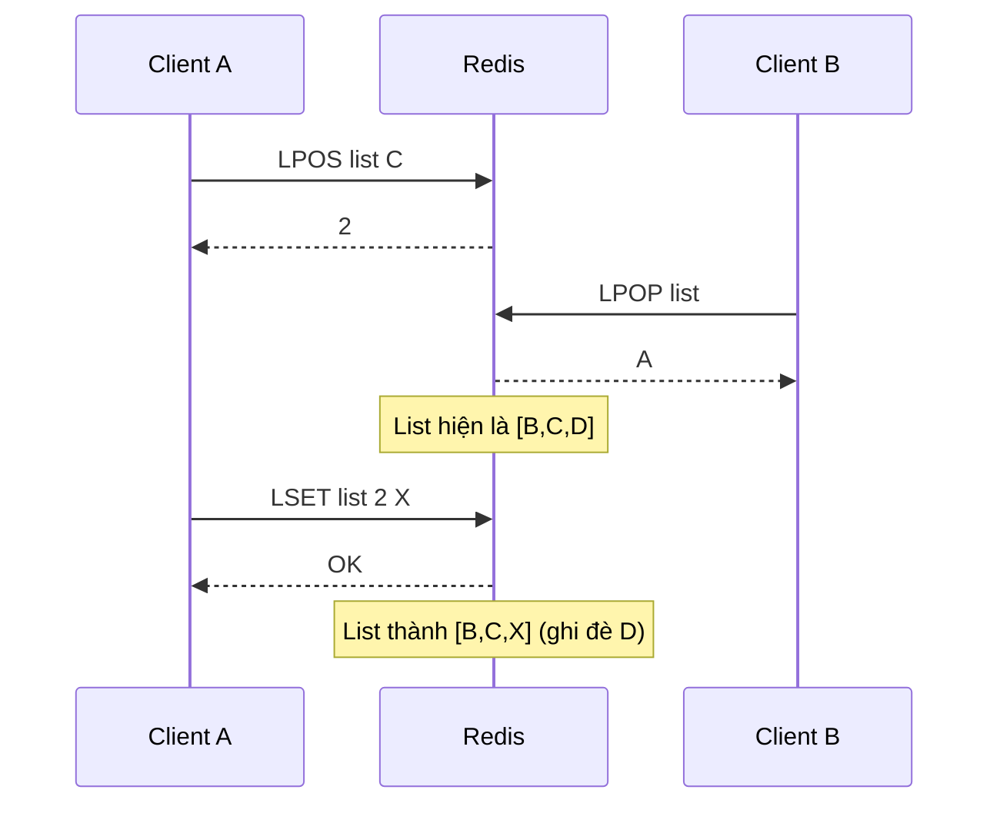

# Cập nhật, tìm vị trí và xóa phần tử

Redis List là cấu trúc lưu **một chuỗi có thứ tự** các phần tử. Trong Spring Data Redis, ta thao tác với List qua `ListOperations<K, V>` lấy từ `RedisTemplate` hoặc `StringRedisTemplate`. Sau khi đã thêm các phần tử bằng `leftPush` hoặc `rightPush`, ứng dụng thường cần sửa phần tử ở một vị trí, tìm nơi xuất hiện của một giá trị, xóa các giá trị trùng nhau hoặc giữ lại một đoạn của danh sách.

Các thao tác này có những đặc điểm dễ bị hiểu nhầm:

- **Chỉ số List bắt đầu từ 0**, chỉ số âm được tính từ cuối danh sách.
- **Cập nhật theo chỉ số** khác với **chèn phần tử** hoặc **tìm phần tử theo giá trị**.
- Redis cho phép **giá trị trùng lặp**, nên phải nói rõ xóa một lần xuất hiện, xóa từ đầu/cuối hay xóa tất cả.
- Mỗi lệnh Redis riêng lẻ được xử lý nguyên tử, nhưng **“tìm chỉ số → cập nhật/xóa” bằng nhiều lệnh không tự động nguyên tử**.
- Giá trị trả về từ Spring Data Redis có thể khác khi thực hiện trực tiếp, trong pipeline hoặc transaction.

Bài học giải thích các thao tác từ Redis CLI đến API Java, kèm ví dụ dữ liệu và lựa chọn công cụ khi danh sách được nhiều client cùng sửa.

## 1. Redis List, thứ tự và chỉ số

### 1.1. Tạo một danh sách mẫu

Dùng Redis CLI:

```redis
DEL course:topics
RPUSH course:topics basics strings lists streams
LRANGE course:topics 0 -1
```

Kết quả logic:

```text
Key: course:topics

Index:        0         1         2         3
Element:   basics    strings    lists    streams
```

`RPUSH` thêm vào **bên phải**, nên thứ tự các phần tử giống thứ tự truyền vào. Với `LPUSH course:topics basics strings lists streams`, các phần tử sẽ lần lượt được thêm vào đầu và thứ tự cuối là ngược lại.

Redis List không có một “ID phần tử” riêng như primary key trong bảng quan hệ. Nó biết **vị trí** và **giá trị byte** của từng phần tử. Vì thế phần tử thứ 2 có thể đổi thành phần tử khác sau khi một client `LPOP` ở đầu danh sách.

### 1.2. Chỉ số dương và âm

Chỉ số âm là cách chỉ vị trí tính từ **cuối danh sách**:

| Chỉ số | Vị trí trong danh sách bốn phần tử |
|---|---|
| `0` | `basics`, đầu danh sách |
| `1` | `strings` |
| `2` | `lists` |
| `3` | `streams`, cuối danh sách |
| `-1` | `streams`, phần tử cuối |
| `-2` | `lists` |
| `-3` | `strings` |
| `-4` | `basics`, phần tử đầu |
| `4` hoặc `-5` | Nằm ngoài phạm vi |

Cách hiểu này áp dụng cho các lệnh như `LINDEX`, `LSET`, `LRANGE` và `LTRIM`, nhưng **cách xử lý chỉ số không hợp lệ tùy lệnh**. Chẳng hạn, `LINDEX` có thể trả nil khi chỉ số ngoài phạm vi, còn `LSET` trả lỗi.

### 1.3. Map từ Redis sang Spring Data Redis

```java
import org.springframework.data.redis.core.ListOperations;
import org.springframework.data.redis.core.StringRedisTemplate;

ListOperations<String, String> lists = stringRedisTemplate.opsForList();
```

| Nhu cầu | Redis command | Spring Data Redis `ListOperations` |
|---|---|---|
| Đọc phần tử theo vị trí | `LINDEX` | `index(key, index)` |
| Ghi đè phần tử theo vị trí | `LSET` | `set(key, index, value)` |
| Tìm lần xuất hiện đầu của giá trị | `LPOS` | `indexOf(key, value)` |
| Tìm lần xuất hiện cuối của giá trị | `LPOS ... RANK -1` | `lastIndexOf(key, value)` |
| Chèn trước một giá trị mốc | `LINSERT ... BEFORE` | `leftPush(key, pivot, value)` |
| Chèn sau một giá trị mốc | `LINSERT ... AFTER` | `rightPush(key, pivot, value)` |
| Xóa các lần xuất hiện của một giá trị | `LREM` | `remove(key, count, value)` |
| Lấy và xóa phần tử đầu | `LPOP` | `leftPop(key)` |
| Lấy và xóa phần tử cuối | `RPOP` | `rightPop(key)` |
| Chỉ giữ lại một đoạn | `LTRIM` | `trim(key, start, end)` |
| Đọc một đoạn không sửa dữ liệu | `LRANGE` | `range(key, start, end)` |
| Đếm số phần tử | `LLEN` | `size(key)` |

Lưu ý `ListOperations` sử dụng tên **`leftPush(key, pivot, value)`** và **`rightPush(key, pivot, value)`** cho thao tác chèn theo pivot. Hai overload này có semantics khác `leftPush(key, value)` và `rightPush(key, value)` vốn thêm vào đầu hoặc cuối.

## 2. Cập nhật một phần tử theo vị trí bằng LSET

### 2.1. Cách hoạt động của `LSET`

Giả sử danh sách đang có:

```text
[basics, strings, lists, streams]
```

Muốn sửa `strings` thành `redis-strings` tại chỉ số 1:

```redis
LSET course:topics 1 redis-strings
LRANGE course:topics 0 -1
```

Kết quả:

```text
[basics, redis-strings, lists, streams]
```

`LSET` **thay giá trị của phần tử hiện tại**. Danh sách vẫn có bốn phần tử; nó không chèn thêm phần tử mới.

Đổi phần tử cuối bằng chỉ số âm:

```redis
LSET course:topics -1 pubsub
LRANGE course:topics 0 -1
```

Kết quả:

```text
[basics, redis-strings, lists, pubsub]
```

### 2.2. Gọi từ Spring Data Redis

```java
import org.springframework.data.redis.core.StringRedisTemplate;
import org.springframework.stereotype.Service;

@Service
public class TopicListEditor {

    private final StringRedisTemplate redis;

    public TopicListEditor(StringRedisTemplate redis) {
        this.redis = redis;
    }

    public void replaceSecond(String newValue) {
        redis.opsForList().set("course:topics", 1, newValue);
    }

    public void replaceLast(String newValue) {
        redis.opsForList().set("course:topics", -1, newValue);
    }
}
```

Chữ ký API:

```java
void set(K key, long index, V value);
```

`set(...)` trả `void`, không trả số phần tử đã thay hay phần tử cũ. Khi cần đọc giá trị tại vị trí nào đó, dùng `index(...)` riêng:

```java
String oldValue = redis.opsForList().index("course:topics", 1);
```

Tuy nhiên, gọi `index` rồi `set` **không phải một compare-and-set nguyên tử**. Một client khác có thể thay đổi danh sách giữa hai lệnh.

### 2.3. `LSET` không tự mở rộng danh sách

Redis không xử lý `LSET` như phép gán vào mảng có thể tự tăng kích thước. Nếu List dài 4 mà gọi:

```redis
LSET course:topics 10 advanced
```

Redis trả:

```text
(error) ERR index out of range
```

Điều tương tự xảy ra với `LSET` trên key chưa tồn tại, vì không có phần tử nào để cập nhật. Một lỗi server được driver/Spring Data Redis chuyển thành exception thích hợp.

Nếu yêu cầu **thêm phần tử mới**, dùng `LPUSH`, `RPUSH` hoặc `LINSERT`. Nếu yêu cầu thay một phần tử hiện hữu, dùng `LSET` và phải chấp nhận rằng vị trí có thể không còn hợp lệ.

### 2.4. `LSET` có làm mất TTL không?

Không giống `SET` của Redis String ghi đè toàn bộ giá trị key, `LSET` thay một phần tử **trong Redis List hiện hữu**. Khi List vẫn tồn tại, TTL hiện có của key được giữ; `LSET` không tự đặt hoặc xóa TTL.

Ví dụ:

```redis
DEL lab:lset:ttl
RPUSH lab:lset:ttl a b c
EXPIRE lab:lset:ttl 120
LSET lab:lset:ttl 1 B
TTL lab:lset:ttl
```

Giá trị `TTL` vẫn dương và giảm dần theo thời gian, không chuyển thành `-1` chỉ vì đã dùng `LSET`.

Nếu cần gia hạn TTL theo chính sách ứng dụng, đó là một thao tác khác, chẳng hạn `EXPIRE`; phải xét tính nguyên tử nếu yêu cầu cập nhật và gia hạn đi cùng nhau.

## 3. Đọc theo chỉ số và tìm vị trí theo giá trị là hai việc khác nhau

### 3.1. `LINDEX`: biết vị trí, cần lấy giá trị

```redis
DEL lab:lookup
RPUSH lab:lookup alpha beta gamma beta delta beta

LINDEX lab:lookup 0
LINDEX lab:lookup 3
LINDEX lab:lookup -1
LINDEX lab:lookup 99
```

Các kết quả lần lượt là `alpha`, `beta`, `beta` và nil/null reply cho chỉ số 99 ngoài phạm vi.

Trong Spring:

```java
String atThree = redis.opsForList().index("lab:lookup", 3);
String atLast = redis.opsForList().index("lab:lookup", -1);
```

`index(key, position)` trả dữ liệu đã được deserialize hoặc có thể là `null` khi không có phần tử tại vị trí cần đọc. Trong pipeline hoặc transaction, `null` còn có thể chỉ là kết quả chưa sẵn sàng; cần xem ngữ cảnh thực thi.

### 3.2. `LPOS`: biết giá trị, cần biết vị trí

Khi danh sách có phần tử trùng lặp:

```text
Index:    0       1      2      3      4      5
Value:  alpha    beta   gamma   beta  delta   beta
```

Lệnh:

```redis
LPOS lab:lookup beta
```

trả `1` vì đó là **lần xuất hiện đầu tiên theo hướng từ trái sang phải**.

Tìm lần thứ hai:

```redis
LPOS lab:lookup beta RANK 2
```

trả `3`.

Tìm từ cuối về đầu:

```redis
LPOS lab:lookup beta RANK -1
```

trả `5`. Chú ý rằng **chỉ số trả về vẫn tính từ đầu danh sách**, dù hướng tìm là từ cuối. `RANK -2` sẽ trả `3`, không phải chỉ số âm.

Tìm tất cả vị trí:

```redis
LPOS lab:lookup beta COUNT 0
```

trả mảng vị trí tương đương `[1, 3, 5]`.

### 3.3. Spring Data Redis `indexOf` và `lastIndexOf`

```java
Long first = redis.opsForList().indexOf("lab:lookup", "beta");
Long last = redis.opsForList().lastIndexOf("lab:lookup", "beta");

// Trong lời gọi đồng bộ bình thường, với dữ liệu mẫu:
// first == 1L
// last  == 5L
```

`ListOperations.indexOf(...)` và `lastIndexOf(...)` có từ Spring Data Redis 2.4 và yêu cầu Redis Server hỗ trợ `LPOS`, tức **Redis Open Source 6.0.6 trở lên**.

Khi không tìm thấy:

```java
Long missing = redis.opsForList().indexOf("lab:lookup", "omega");
// missing == null trong lời gọi đồng bộ thông thường
```

Đây là khác biệt quan trọng với `LREM`, nơi “không có phần tử nào bị xóa” thường được biểu diễn bằng `0L`. Không kiểm tra `indexOf(...) == -1`: API Spring Data Redis sử dụng `null` để biểu diễn kết quả không tìm thấy theo hợp đồng của nó.

Cũng không tự unbox `Long` khi chưa kiểm tra `null`:

```java
Long position = redis.opsForList().indexOf("lab:lookup", "beta");
if (position != null) {
    System.out.println("Found at " + position);
}
```

Trong **pipeline/transaction**, kết quả `null` của method có thể xuất hiện trước khi Redis trả phản hồi; code cần lấy kết quả sau khi pipeline/transaction hoàn tất.

### 3.4. Tùy chọn RANK, COUNT và MAXLEN

`LPOS` có các tùy chọn hữu ích:

| Tùy chọn | Ý nghĩa |
|---|---|
| `RANK 1` | Trả lần xuất hiện đầu từ bên trái, mặc định. |
| `RANK 2` | Trả lần xuất hiện thứ hai từ bên trái. |
| `RANK -1` | Trả lần xuất hiện cuối cùng, tìm từ phải sang trái. |
| `COUNT 2` | Trả vị trí của tối đa hai lần xuất hiện từ hướng tìm đã chọn. |
| `COUNT 0` | Trả tất cả vị trí khớp mà quá trình tìm xác định. |
| `MAXLEN 1000` | So sánh không quá 1.000 phần tử theo hướng tìm, giới hạn công việc tìm kiếm. |

Ví dụ:

```redis
LPOS lab:lookup beta RANK -1 COUNT 2
```

trả các chỉ số `[5, 3]`: bắt đầu từ lần xuất hiện cuối rồi lùi về phía trước.

`MAXLEN` rất hữu ích nếu List có thể rất dài và ứng dụng chỉ muốn tìm trong một vùng giới hạn. Khi giới hạn tìm kiếm, **không tìm thấy trong vùng đã quét không chứng minh giá trị không tồn tại ở phần còn lại**.

Spring Data Redis `ListOperations` cấp cao cung cấp `indexOf` và `lastIndexOf` cho hai trường hợp phổ biến. Khi cần mọi tùy chọn `LPOS` nâng cao như `COUNT` và `MAXLEN`, kiểm tra API thấp hơn của driver/Redis connection tương ứng phiên bản đang sử dụng; không tự suy ra `indexOf` có các overload này.

## 4. Xóa các phần tử theo giá trị bằng LREM

### 4.1. Quy tắc của tham số count

`LREM` xóa những phần tử có **giá trị bằng nhau** với giá trị cần xóa. Tham số `count` điều khiển số lần xuất hiện và hướng tìm.

```redis
LREM key count element
```

| `count` | Hành vi |
|---|---|
| `count > 0` | Duyệt từ **đầu đến cuối**, xóa tối đa `count` phần tử khớp. |
| `count < 0` | Duyệt từ **cuối về đầu**, xóa tối đa `abs(count)` phần tử khớp. |
| `count = 0` | Xóa **tất cả** phần tử khớp trong danh sách. |

`LREM` trả về **số phần tử thực tế đã xóa**; nếu key không tồn tại hoặc không có giá trị khớp, trả 0.

Ví dụ List ban đầu:

```text
[alpha, beta, gamma, beta, delta, beta]
```

Nếu chạy:

```redis
LREM lab:lookup 1 beta
```

List mới:

```text
[alpha, gamma, beta, delta, beta]
```

Nếu reset lại danh sách mẫu, rồi dùng:

```redis
LREM lab:lookup -1 beta
```

List mới:

```text
[alpha, beta, gamma, beta, delta]
```

Nếu reset rồi:

```redis
LREM lab:lookup 0 beta
```

List mới:

```text
[alpha, gamma, delta]
```

Những ví dụ trên là **ba trường hợp độc lập**. Nếu chạy liên tục trên cùng một key mà không reset, kết quả từng thao tác sẽ khác.

### 4.2. Gọi từ Spring Data Redis

```java
import org.springframework.data.redis.core.StringRedisTemplate;
import org.springframework.stereotype.Service;

@Service
public class ListValueRemover {

    private final StringRedisTemplate redis;

    public ListValueRemover(StringRedisTemplate redis) {
        this.redis = redis;
    }

    public long removeFirstBeta() {
        Long removed = redis.opsForList()
                .remove("lab:lookup", 1, "beta");

        if (removed == null) {
            throw new IllegalStateException("No Redis result available yet");
        }

        return removed;
    }

    public long removeLastBeta() {
        Long removed = redis.opsForList()
                .remove("lab:lookup", -1, "beta");

        if (removed == null) {
            throw new IllegalStateException("No Redis result available yet");
        }

        return removed;
    }

    public long removeAllBeta() {
        Long removed = redis.opsForList()
                .remove("lab:lookup", 0, "beta");

        if (removed == null) {
            throw new IllegalStateException("No Redis result available yet");
        }

        return removed;
    }
}
```

Chữ ký:

```java
Long remove(K key, long count, Object value);
```

Điểm khác với `LSET`: `remove` trả số phần tử đã xóa. Nếu giá trị không có trong List, kết quả là `0L` trong lời gọi đồng bộ thông thường. Giá trị `null` xuất hiện khi kết quả chưa sẵn sàng trong pipeline/transaction, nên không nên âm thầm coi `null` là 0.

### 4.3. Redis so sánh giá trị theo byte

Khi lưu bằng `StringRedisTemplate`, so sánh thường dựa trên UTF-8 bytes của chuỗi. Redis không tự hiểu Unicode normalization, JSON field, class Java hoặc quy tắc `equals()` của object Java.

Giả sử một service lưu:

```json
{"id":7,"status":"NEW"}
```

Service khác tìm/xóa:

```json
{"status":"NEW","id":7}
```

Hai JSON trên có thể tương đương về nội dung object nhưng **khác chuỗi byte**. `LREM` không tự hiểu chúng là cùng object. Ngay cả khi serializer tạo JSON, cách ghi field, giá trị default, type metadata và schema có thể thay đổi giữa các phiên bản.

Khi cần xóa “phần tử có id = 7”, việc gọi `remove(key, 0, một object tự dựng lại)` chỉ đáng tin nếu toàn bộ byte serialization được xác định và giống tuyệt đối.

### 4.4. Nếu List chứa bản ghi trùng nhau

Ví dụ:

```text
[task-1, task-2, task-1, task-3, task-1]
```

`remove(key, 1, "task-1")` chỉ xóa lần đầu, còn hai bản sao. `remove(key, 0, "task-1")` xóa tất cả. Nếu nghiệp vụ không cho phép trùng ID, Redis Set hoặc một mô hình có Hash lưu object và List lưu ID có thể phù hợp hơn, tùy yêu cầu thứ tự và tính nhất quán.

**Không suy ra rằng xóa được một lần xuất hiện sẽ xóa mọi bản sao.** Ngược lại, `count=0` có thể xóa nhiều hơn mong muốn nếu các giá trị trùng là hợp lệ.

## 5. Xóa từ đầu/cuối bằng LPOP và RPOP

`LREM` xóa theo **giá trị**, trong khi `LPOP` và `RPOP` lấy và xóa phần tử ở **đầu hoặc cuối** List.

### 5.1. Ví dụ CLI

```redis
DEL lab:pop
RPUSH lab:pop A B C D

LPOP lab:pop
RPOP lab:pop
LRANGE lab:pop 0 -1
```

Kết quả lần lượt:

```text
LPOP -> A
RPOP -> D
List còn -> [B, C]
```

Trong Spring:

```java
String first = redis.opsForList().leftPop("lab:pop");
String last = redis.opsForList().rightPop("lab:pop");
```

Đây là thao tác **destructive read**: lấy ra phần tử đồng thời xóa nó khỏi Redis trong cùng một lệnh. Nếu chỉ muốn xem phần tử đầu/cuối mà không xóa, dùng `index(key, 0)` hoặc `index(key, -1)`.

### 5.2. Xóa nhiều phần tử cùng lúc

Các phiên bản Redis hiện đại hỗ trợ biến thể `LPOP key count` và `RPOP key count`. Spring Data Redis có API:

```java
List<String> firstThree = redis.opsForList().leftPop("lab:pop", 3);
List<String> lastTwo = redis.opsForList().rightPop("lab:pop", 2);
```

Danh sách kết quả là các phần tử **được pop theo thứ tự của thao tác**, có thể khác với thứ tự nhìn từ trái sang phải trước khi pop. Hãy kiểm tra thứ tự với `RPOP` khi nghiệp vụ cần xử lý theo FIFO/LIFO.

Khi List rỗng hoặc key không tồn tại, các thao tác pop có thể trả `null`. Trường hợp đang pipeline/transaction, cần tách biệt “không có phần tử” với “kết quả chưa được trả” theo ngữ cảnh API.

### 5.3. Khi pop phần tử cuối cùng

Redis xóa key khi List không còn phần tử. Ví dụ:

```redis
DEL lab:one
RPUSH lab:one only
LPOP lab:one
EXISTS lab:one
```

`EXISTS` trả 0. Đây là hành vi bình thường: **Redis không giữ một List rỗng dưới dạng key tồn tại**. Nếu cần lưu trạng thái “danh sách đã được khởi tạo nhưng chưa có phần tử”, phải dùng key metadata riêng.

### 5.4. Đừng nhầm pop với xóa có xác nhận xử lý

Trong mô hình hàng đợi đơn giản, `LPOP` lấy và xóa job trước khi worker hoàn tất xử lý. Nếu worker chết sau khi pop, job có thể bị mất khỏi List.

Với xử lý job cần xác nhận, retry và consumer coordination, cân nhắc Redis Streams với consumer groups, hoặc mô hình reliable queue phù hợp. Bài học này chỉ tập trung vào hành vi cập nhật, tìm và xóa phần tử trong Redis List.

## 6. Giữ lại một đoạn bằng LTRIM

### 6.1. `LTRIM` chỉ giữ các phần tử trong khoảng

`LTRIM key start stop` **xóa các phần tử nằm ngoài khoảng** `[start, stop]`. Chỉ số `stop` là **bao gồm** (inclusive).

Ví dụ:

```redis
DEL lab:trim
RPUSH lab:trim A B C D E F
LTRIM lab:trim 1 3
LRANGE lab:trim 0 -1
```

List sau khi trim:

```text
[B, C, D]
```

Chỉ số 1 là `B`, 3 là `D`; cả hai đầu đều được giữ.

Muốn giữ ba phần tử cuối:

```redis
LTRIM lab:trim -3 -1
```

Nếu danh sách trước đó là `[A, B, C, D, E, F]`, kết quả là `[D, E, F]`. Với chuỗi đã trim `[B, C, D]`, kết quả chỉ là chính `[B, C, D]`; cần xác định trạng thái đầu vào khi thực hành.

### 6.2. Dùng từ Spring

```java
// Giữ tối đa 100 phần tử đầu của List hiện tại:
redis.opsForList().trim("feed:recent", 0, 99);

// Giữ tối đa 100 phần tử cuối của List hiện tại:
redis.opsForList().trim("feed:recent", -100, -1);
```

Chữ ký:

```java
void trim(K key, long start, long end);
```

`trim` là **thao tác thay đổi dữ liệu**, khác `range` chỉ đọc. Không gọi `trim` để “lấy một đoạn” khi bạn không muốn xóa phần còn lại; dùng `range(key, start, end)`.

### 6.3. Khoảng rỗng và index vượt phạm vi

`LTRIM` không nhất thiết báo lỗi khi khoảng được chọn nằm ngoài List. Nó có thể giữ lại ít hơn số phần tử yêu cầu. Khi khoảng không còn phần tử nào, Redis xóa key List đó.

Ví dụ:

```redis
DEL lab:trim:empty
RPUSH lab:trim:empty A B
LTRIM lab:trim:empty 4 10
EXISTS lab:trim:empty
```

`EXISTS` trả 0. Nếu List đã rỗng do trim, các thao tác `indexOf`, `leftPop` sau đó sẽ xử lý như key không tồn tại.

### 6.4. Pattern danh sách giới hạn chiều dài

Một mẫu phổ biến cho “100 sự kiện mới nhất”:

```redis
LPUSH feed:recent event-123
LTRIM feed:recent 0 99
```

Ở đây `LPUSH` thêm sự kiện mới nhất vào đầu; `LTRIM 0 99` giữ 100 sự kiện mới nhất theo thứ tự hiện tại.

Trong Java:

```java
redis.opsForList().leftPush("feed:recent", eventId);
redis.opsForList().trim("feed:recent", 0, 99);
```

Hai dòng Java **là hai lệnh riêng**. Nếu nhiều producer cùng thao tác, một producer khác có thể thêm hoặc trim xen giữa; nếu process chết sau push nhưng trước trim, list có thể tạm vượt giới hạn. Nếu yêu cầu “thêm và giữ đúng tối đa 100 phần tử” được bảo đảm nguyên tử, có thể dùng Lua script:

```lua
-- KEYS[1] = list key
-- ARGV[1] = event value
-- ARGV[2] = maximum length (positive integer)

redis.call('LPUSH', KEYS[1], ARGV[1])
redis.call('LTRIM', KEYS[1], 0, tonumber(ARGV[2]) - 1)
return redis.call('LLEN', KEYS[1])
```

Nên kiểm tra `ARGV[2]` là số nguyên dương **trước khi gọi script** ở phía ứng dụng hoặc bổ sung validation trong script. Nếu chạy trên Redis Cluster, key mà script truy cập phải tuân thủ quy tắc slot phù hợp.

## 7. Chèn trước hoặc sau phần tử mốc bằng LINSERT

Một nhu cầu liên quan cập nhật là **đặt phần tử mới vào gần một phần tử có sẵn**, thay vì ghi đè.

### 7.1. LINSERT không phải LSET

Giả sử:

```text
[A, C, D]
```

Muốn thêm `B` trước `C`:

```redis
LINSERT lab:insert BEFORE C B
```

Kết quả:

```text
[A, B, C, D]
```

Không dùng `LSET 1 B` vì sẽ thay `C` bằng `B` và **làm mất C**, thay vì chèn thêm.

### 7.2. Spring Data Redis hỗ trợ qua overload có pivot

```java
Long lengthAfterInsert = redis.opsForList()
        .leftPush("lab:insert", "C", "B");
```

Tương ứng `LINSERT ... BEFORE C B`.

Để chèn sau `C`:

```java
Long lengthAfterInsert = redis.opsForList()
        .rightPush("lab:insert", "C", "B");
```

Tương ứng `LINSERT ... AFTER C B`.

Với Redis `LINSERT`:

- Khi chèn thành công, trả độ dài List mới.
- Nếu key tồn tại nhưng pivot không tìm thấy, trả `-1`.
- Nếu key không tồn tại, trả `0`.
- Khi key chứa kiểu Redis khác List, trả lỗi `WRONGTYPE`.

Spring method trả `Long`; trong pipeline/transaction có thể trả `null` khi chưa có phản hồi. Không dùng `Long` này như chỉ số phần tử vừa thêm: nó là **độ dài mới**.

Nếu có nhiều pivot trùng giá trị, `LINSERT` chọn một lần xuất hiện theo semantics của lệnh, không chèn vào **tất cả** các phần tử bằng pivot. Khi cần chèn vào đúng một “đối tượng có ID” trong danh sách có giá trị trùng nhau, hãy thiết kế dữ liệu tránh mơ hồ.

## 8. Có thể xóa đúng một chỉ số không?

Redis có `LSET key index value` để **thay** một phần tử theo chỉ số, nhưng không cung cấp một lệnh Redis List cơ bản tên là `LDELETE key index` tương đương “xóa đúng chỉ số đó”.

Các lệnh liên quan có semantics khác nhau:

| Lệnh | Xóa theo tiêu chí nào? |
|---|---|
| `LREM` | Giá trị byte trùng với `element`, có hướng và số lần xóa. |
| `LPOP` / `RPOP` | Phần tử ở đầu hoặc cuối List. |
| `LTRIM` | Toàn bộ các phần tử **ngoài** đoạn muốn giữ. |
| `LSET` | **Không xóa**, chỉ ghi đè tại chỉ số. |

### 8.1. Vì sao “LSET sentinel rồi LREM” có rủi ro?

Một mẹo đôi khi xuất hiện:

```redis
LSET mylist 3 __DELETE_ME__
LREM mylist 1 __DELETE_ME__
```

Ý tưởng là thay phần tử ở vị trí 3 bằng một marker rồi xóa marker theo giá trị. Nhưng có những rủi ro:

1. **Hai lệnh không nguyên tử** nếu gửi riêng. Client khác có thể sửa list giữa chúng.
2. Marker có thể **trùng với dữ liệu thật**, làm xóa sai phần tử.
3. Nếu process chết sau `LSET`, marker có thể còn lại trong dữ liệu.
4. Nếu list bị push/pop giữa lúc tính index và lúc LSET, phần tử tại index 3 có thể đã đổi.

Do đó, không coi đây là API xóa theo index đáng tin cậy mặc định. Với một List ngắn và ứng dụng kiểm soát hoàn toàn dữ liệu, có thể xây dựng Lua script nguyên tử có kiểm tra chỉ số và marker bảo đảm không trùng, nhưng vẫn phải xác định semantics khi có các producer khác.

### 8.2. Nếu muốn xóa theo ID, nên lưu gì?

Nếu từng phần tử là object như:

```json
{"taskId":"t-100","status":"PENDING"}
```

`LREM` yêu cầu **toàn bộ giá trị serialized** khớp, không chỉ `taskId`. Để hỗ trợ xóa/update theo ID ổn định, cân nhắc mô hình:

```text
Redis List  : order:task-ids       → [t-100, t-200, t-300]
Redis Hash  : task:by-id:<taskId>  → object/payload của từng task
```

Khi đó `LREM` theo ID chính xác sẽ dễ hơn so với xóa JSON hoàn chỉnh. Tuy nhiên, **List và Hash là các key khác nhau**; nếu thao tác cần đồng bộ giữa chúng, phải thiết kế transaction/Lua hoặc quy trình có xử lý dữ liệu mồ côi. Nếu yêu cầu truy cập/xóa nhiều theo ID, Redis Set, Sorted Set hoặc cơ sở dữ liệu khác cũng có thể phù hợp hơn tùy mục tiêu thứ tự.

## 9. Đồng thời: index có thể đổi trước khi cập nhật

### 9.1. Tình huống race condition

Giả sử List:

```text
[A, B, C, D]
```

Client A muốn thay `C` bằng `X`. A tìm được `C` ở index 2. Trong khi đó client B `LPOP`, danh sách trở thành `[B, C, D]`, nên index 2 giờ là `D`.



Từng lệnh `LPOS`, `LPOP` và `LSET` đều được Redis thực hiện riêng rẽ, nhưng tổ hợp “tìm rồi set” **không nguyên tử**.

Đây là điểm khác nhau giữa:

- **Atomic command:** một lệnh Redis thực hiện trọn vẹn logic của chính lệnh đó.
- **Atomic workflow:** một chuỗi lệnh phải có điều kiện và kết quả nhất quán, cần một cơ chế điều phối phù hợp.

### 9.2. Lua script cho cập nhật khi phần tử còn đúng

Khi yêu cầu nghiệp vụ là “thay phần tử ở index i **nếu nó vẫn bằng expected value**”, một script Lua có thể kiểm tra và ghi trong cùng một lần thực thi:

```lua
-- KEYS[1] = list key
-- ARGV[1] = index, zero-based hoặc âm
-- ARGV[2] = expected serialized value
-- ARGV[3] = new serialized value

local current = redis.call('LINDEX', KEYS[1], tonumber(ARGV[1]))

if not current then
    return 0  -- index không tồn tại
end

if current ~= ARGV[2] then
    return 0  -- index đã đổi sang giá trị khác
end

redis.call('LSET', KEYS[1], tonumber(ARGV[1]), ARGV[3])
return 1
```

Script tránh việc client khác chen **giữa phép kiểm tra và ghi của script**. Tuy nhiên, nếu nhiều phần tử có cùng serialized value, kiểm tra bằng value vẫn chưa tạo ra **danh tính ổn định** cho một phần tử: có thể xuất hiện một phần tử khác nhưng có cùng value tại index đó. Với yêu cầu nghiêm ngặt theo ID, phải dùng ID ổn định trong mô hình dữ liệu.

### 9.3. Tìm rồi xóa theo giá trị có khác không?

Nếu A gọi `indexOf(key, "B")` rồi sau đó `remove(key, 1, "B")`, lệnh `remove` **không dùng chỉ số đã tìm**; nó tự duyệt từ đầu và xóa lần khớp đầu tại thời điểm thực thi.

Điều này có thể chấp nhận được nếu nghiệp vụ muốn “xóa một phần tử có giá trị B”, không quan tâm nó nằm ở đâu. Nhưng nếu ứng dụng muốn “xóa đúng occurrence thứ hai trong ba phần tử B”, `LREM count=1` không thể xác định lần xuất hiện đó. Khi có duplicate và concurrency, cần thiết kế khác.

## 10. TTL, kiểu key và kết quả khi danh sách rỗng

### 10.1. TTL khi sửa hoặc xóa bớt phần tử

Redis List key có thể được gắn TTL:

```redis
RPUSH lab:ttl A B C
EXPIRE lab:ttl 120
LSET lab:ttl 1 b
LREM lab:ttl 1 A
TTL lab:ttl
```

`LSET` và `LREM` thao tác **bên trong List** và thường giữ thời hạn hết hạn đang có khi key vẫn tồn tại. Nếu xóa hết phần tử bằng `LREM` hoặc `LPOP`, Redis xóa key; khi đó `TTL` trả `-2` vì key không còn.

Không nhầm với `SET` của Redis String: `SET` thành công không kèm tùy chọn giữ expiry thường xóa TTL cũ.

### 10.2. Key không tồn tại

| Lệnh | Hành vi khi key List không tồn tại |
|---|---|
| `LINDEX` | Trả nil/null reply |
| `LPOS` | Trả nil khi không có `COUNT`; không tìm thấy giá trị |
| `LREM` | Trả 0 |
| `LPOP` / `RPOP` | Trả nil/null reply |
| `LRANGE` | Trả danh sách rỗng |
| `LLEN` | Trả 0 |
| `LSET` | Trả lỗi `index out of range` |
| `LTRIM` | Không tạo ra List mới |

Trong Spring Data Redis, một số method có thể trả `null` ngay cả khi lệnh được queue trong pipeline/transaction. Giá trị trả về phải được hiểu theo **API và ngữ cảnh thực thi**, không chỉ theo phản hồi Redis gốc.

### 10.3. Sai kiểu key

Nếu `course:topics` đang là Redis String mà code gọi ListOperations:

```redis
SET course:topics hello
LRANGE course:topics 0 -1
```

Redis sẽ trả lỗi kiểu `WRONGTYPE Operation against a key holding the wrong kind of value`. Đó là lỗi cấu trúc dữ liệu, không phải bằng chứng List rỗng. Có thể dùng `TYPE course:topics` trong môi trường điều tra.

Đặt namespace rõ, ví dụ `list:topic-order:<courseId>`, giúp tránh trùng key giữa String, Hash và List.

## 11. Serialization ảnh hưởng tìm kiếm và xóa ra sao?

### 11.1. Các phần tử được so sánh bằng dữ liệu serialized

Với `StringRedisTemplate`, mỗi phần tử List có thể là chuỗi UTF-8. Với `RedisTemplate<String, Task>` và JSON serializer, mỗi phần tử là một chuỗi byte thể hiện `Task` sau serialization.

`LPOS` và `LREM` không hiểu `equals()` của Java. Chúng xử lý đối số value sau serializer; muốn tìm/xóa trúng, byte của value truyền vào phải tương thích với byte đã lưu.

Ví dụ hai object cùng ID nhưng khác trạng thái:

```json
{"id":"t-1","status":"NEW"}
```

```json
{"id":"t-1","status":"DONE"}
```

Đối với Redis List, đây là hai giá trị khác nhau. `remove(key, 0, taskWithStatusDone)` sẽ không xóa bản ghi NEW chỉ vì ID giống nhau.

### 11.2. Đừng coi List là collection Java tham chiếu đến object

Một phần tử đã được lưu thành byte trong Redis. Nếu code Java thay đổi object trong RAM sau khi `rightPush`, Redis **không tự cập nhật phần tử đã lưu**. Muốn ghi lại, cần explicit command như `LSET` hoặc chiến lược lưu object theo ID.

Ví dụ:

```java
Task task = new Task("t-1", "NEW");
redis.opsForList().rightPush("task:list", task);

task.setStatus("DONE");
// Redis vẫn lưu bytes của trạng thái cũ cho đến khi có lệnh ghi mới.
```

Đoạn minh họa giả định `RedisTemplate` đã có serializer cho `Task`. Nếu dữ liệu nhiều service cùng đọc, cần phiên bản schema và quy tắc xử lý nullable field, enum, timestamp tương thích.

### 11.3. Redis Hash + List có thể tách thứ tự và nội dung

Khi chỉ cần List bảo đảm thứ tự các ID, trong khi nội dung thay đổi thường xuyên, có thể thiết kế:

```text
List: tasks:order       [task-1, task-2, task-3]
Hash/String: task:1     {"status":"DONE", ...}
Hash/String: task:2     {"status":"NEW", ...}
Hash/String: task:3     {"status":"NEW", ...}
```

Ứng dụng cập nhật `task:1` mà không cần tìm `LPOS` rồi `LSET` object JSON trong List. Nhược điểm là phải duy trì tính nhất quán giữa key thứ tự và key dữ liệu, xử lý orphan và rollback theo nhu cầu nghiệp vụ.

## 12. Hiệu năng: không phải thao tác theo chỉ số nào cũng O(1)

Redis List được tối ưu cho nhiều thao tác tại **hai đầu**, nhưng chi phí truy cập/vị trí ở giữa có thể phụ thuộc độ dài danh sách.

| Lệnh | Đặc điểm độ phức tạp thường gặp | Hệ quả |
|---|---|---|
| `LPUSH` / `RPUSH` | O(1) cho một phần tử | Phù hợp thêm đầu/cuối. |
| `LPOP` / `RPOP` | O(1) khi pop một phần tử | Phù hợp queue/stack đơn giản. |
| `LINDEX` | O(N) trong trường hợp tổng quát; phần tử sát đầu/cuối thường nhanh | Không dùng liên tục để duyệt List lớn từng vị trí. |
| `LSET` | O(N) trong trường hợp tổng quát; sửa đầu/cuối thường O(1) | Ghi theo index sâu trong List dài có thể tốn chi phí. |
| `LPOS` | O(N) khi phải quét danh sách; `MAXLEN` có thể giới hạn vùng quét | Không dùng làm index tìm kiếm thường xuyên trên List cực lớn. |
| `LREM` | Phụ thuộc chiều dài List và số phần tử cần xóa | Xóa nhiều bản sao có thể tốn quét. |
| `LTRIM` | Phụ thuộc số phần tử cần loại bỏ | Dùng tốt với danh sách giới hạn, nhưng nên đo tải thực tế. |

Ở đây `N` là số phần tử List hoặc lượng phần tử cần quét, tùy lệnh. Chưa tính RTT mạng, serialization và tải Redis.

### 12.1. Đừng duyệt danh sách lớn bằng nhiều LINDEX

Ví dụ Java:

```java
Long size = redis.opsForList().size(key);
for (long index = 0; index < size; index++) {
    String element = redis.opsForList().index(key, index);
    // xử lý element
}
```

Cách này tạo nhiều round-trip và truy cập theo index; trên List lớn có thể rất chậm. Nếu chỉ cần đọc một đoạn, dùng:

```java
List<String> firstPage = redis.opsForList().range(key, 0, 99);
```

`LRANGE` tránh phải gửi một request `LINDEX` riêng cho từng phần tử. Nếu danh sách đổi liên tục, phân trang dựa trên offset có thể gặp lặp/mất phần tử giữa các lần đọc. Khi yêu cầu phân trang ổn định, cân nhắc data model khác (ví dụ Sorted Set với score/ID và cursor).

### 12.2. Khi nào Redis List không còn phù hợp?

Nếu yêu cầu chủ yếu là:

- tìm object theo ID;
- xóa đúng một ID bất kỳ trong danh sách dài;
- cập nhật field của object liên tục;
- tìm theo nhiều thuộc tính;
- phân trang ổn định với tải ghi lớn;

thì List có thể không phải cấu trúc chính phù hợp. Có thể dùng Redis Hash lưu object theo ID, Sorted Set cho thứ tự có score, Set cho membership, hoặc Redis Streams cho message processing có consumer group. Chọn theo semantics nghiệp vụ, không chỉ bởi Redis List dễ thêm phần tử.

## 13. Ví dụ service kết hợp các thao tác

Giả sử ứng dụng có danh sách các bước của một bài học:

```text
Key: lesson:steps:<lesson-id>
Value: Redis List chứa các bước dạng String
```

Các thao tác cần có:

1. Thêm bước vào cuối.
2. Đọc bước theo vị trí.
3. Sửa bước theo vị trí.
4. Tìm vị trí đầu/cuối của một bước.
5. Xóa một hoặc tất cả các bước có cùng nội dung.
6. Giữ tối đa một số bước đầu để làm gọn.

```java
import java.util.List;
import java.util.Objects;

import org.springframework.data.redis.core.ListOperations;
import org.springframework.data.redis.core.StringRedisTemplate;
import org.springframework.stereotype.Service;

@Service
public class LessonStepListService {

    private final ListOperations<String, String> lists;

    public LessonStepListService(StringRedisTemplate redis) {
        this.lists = redis.opsForList();
    }

    public long append(String lessonId, String step) {
        Long newSize = lists.rightPush(key(lessonId), requireStep(step));

        if (newSize == null) {
            throw new IllegalStateException("List length not available yet");
        }
        return newSize;
    }

    public String getAt(String lessonId, long index) {
        return lists.index(key(lessonId), index);
    }

    public void replaceAt(String lessonId, long index, String newStep) {
        // Server sẽ báo lỗi nếu chỉ số ngoài phạm vi.
        lists.set(key(lessonId), index, requireStep(newStep));
    }

    public Long findFirst(String lessonId, String step) {
        // null = không thấy trong lời gọi đồng bộ thông thường.
        return lists.indexOf(key(lessonId), requireStep(step));
    }

    public Long findLast(String lessonId, String step) {
        return lists.lastIndexOf(key(lessonId), requireStep(step));
    }

    public long removeFirst(String lessonId, String step) {
        return completed(lists.remove(key(lessonId), 1, requireStep(step)));
    }

    public long removeLast(String lessonId, String step) {
        return completed(lists.remove(key(lessonId), -1, requireStep(step)));
    }

    public long removeAll(String lessonId, String step) {
        return completed(lists.remove(key(lessonId), 0, requireStep(step)));
    }

    public List<String> readAll(String lessonId) {
        return lists.range(key(lessonId), 0, -1);
    }

    public void keepFirst(String lessonId, int maxItems) {
        if (maxItems < 1) {
            throw new IllegalArgumentException("maxItems must be positive");
        }
        lists.trim(key(lessonId), 0, maxItems - 1L);
    }

    private static String key(String lessonId) {
        if (lessonId == null || lessonId.isBlank()) {
            throw new IllegalArgumentException("lessonId is blank");
        }
        return "lesson:steps:" + lessonId;
    }

    private static String requireStep(String step) {
        Objects.requireNonNull(step, "step");
        return step;
    }

    private static long completed(Long result) {
        if (result == null) {
            throw new IllegalStateException(
                    "Redis result not available in pipeline/transaction");
        }
        return result;
    }
}
```

Service minh họa được thiết kế cho **lời gọi đồng bộ trực tiếp**, không nằm trong pipeline hoặc transaction. Khi không tìm được giá trị, `findFirst` và `findLast` trả `null` theo API; các method `remove...` trả số phần tử bị xóa.

Các bước ở đây được định danh bằng **nội dung chuỗi**. Nếu nhiều bước có cùng text hoặc cần thao tác chính xác theo ID riêng, nên lưu ID ổn định thay vì lấy `step text` làm identity.

### 13.1. Luồng sử dụng ví dụ

```java
service.append("redis-intro", "Overview");
service.append("redis-intro", "Strings");
service.append("redis-intro", "Lists");
service.append("redis-intro", "Strings");

Long first = service.findFirst("redis-intro", "Strings");
Long last  = service.findLast("redis-intro", "Strings");
// Trong môi trường không có thao tác khác: first = 1, last = 3

service.replaceAt("redis-intro", 2, "Redis Lists");

// Xóa lần xuất hiện đầu tiên:
long removed = service.removeFirst("redis-intro", "Strings");
// removed = 1

List<String> result = service.readAll("redis-intro");
// [Overview, Redis Lists, Strings]
```

Đây là ví dụ kỳ vọng khi Redis đã sạch ở namespace bài học và không có client khác sửa cùng key. Trong thực tế, dữ liệu lưu từ lần chạy trước hoặc các request đồng thời có thể làm khác kết quả. Nếu cần thực hành xác định, nên xóa key demo riêng trước khi chạy.

## 14. Thực hành CLI theo từng thao tác

Có thể chạy toàn bộ phần này với Redis local và `redis-cli`. Chọn namespace `lab:list129:...` để tránh dữ liệu nghiệp vụ.

### 14.1. Cập nhật chỉ số

```bash
redis-cli DEL lab:list129:edit
redis-cli RPUSH lab:list129:edit a b c d
redis-cli LSET lab:list129:edit 1 B
redis-cli LSET lab:list129:edit -1 D
redis-cli LRANGE lab:list129:edit 0 -1
```

Kết quả dự kiến:

```text
[a, B, c, D]
```

Hãy thử thêm lệnh `LSET lab:list129:edit 99 X` để quan sát `index out of range`; đó là lỗi hợp lệ, không phải Redis bị hỏng.

### 14.2. Tìm vị trí giá trị trùng

```bash
redis-cli DEL lab:list129:find
redis-cli RPUSH lab:list129:find a b a c a d
redis-cli LPOS lab:list129:find a
redis-cli LPOS lab:list129:find a RANK 2
redis-cli LPOS lab:list129:find a RANK -1
redis-cli LPOS lab:list129:find a COUNT 0
```

Kết quả lần lượt `0`, `2`, `4` và các vị trí `[0, 2, 4]`. Nếu môi trường Redis Server cũ hơn **6.0.6**, `LPOS` có thể không được nhận biết; cần sử dụng phiên bản phù hợp.

### 14.3. Xóa theo giá trị và hướng

```bash
redis-cli DEL lab:list129:remove
redis-cli RPUSH lab:list129:remove a b a c a d
redis-cli LREM lab:list129:remove 1 a
redis-cli LRANGE lab:list129:remove 0 -1
```

Còn:

```text
[b, a, c, a, d]
```

Thực hành trường hợp xóa từ cuối bằng cách tạo lại:

```bash
redis-cli DEL lab:list129:remove
redis-cli RPUSH lab:list129:remove a b a c a d
redis-cli LREM lab:list129:remove -1 a
redis-cli LRANGE lab:list129:remove 0 -1
```

Còn:

```text
[a, b, a, c, d]
```

Thực hành xóa tất cả:

```bash
redis-cli DEL lab:list129:remove
redis-cli RPUSH lab:list129:remove a b a c a d
redis-cli LREM lab:list129:remove 0 a
redis-cli LRANGE lab:list129:remove 0 -1
```

Còn:

```text
[b, c, d]
```

### 14.4. Cắt danh sách và quan sát key biến mất

```bash
redis-cli DEL lab:list129:trim
redis-cli RPUSH lab:list129:trim A B C D E
redis-cli LTRIM lab:list129:trim 0 2
redis-cli LRANGE lab:list129:trim 0 -1

redis-cli LTRIM lab:list129:trim 5 9
redis-cli EXISTS lab:list129:trim
```

Đầu tiên List còn `[A, B, C]`. Lần trim tiếp theo chọn khoảng ngoài phạm vi nên List rỗng và Redis xóa key; `EXISTS` trả 0.

## 15. Những lỗi dễ gặp

| Hiện tượng | Nguyên nhân có thể | Cách xử lý |
|---|---|---|
| `LSET` báo `index out of range` | List không tồn tại, đã ngắn đi hoặc index không hợp lệ | Kiểm tra phạm vi; không giả định key tồn tại; với concurrency dùng mô hình/cơ chế kiểm tra nguyên tử phù hợp. |
| `indexOf` trả `null` | Không tìm thấy phần tử, hoặc đang pipeline/transaction | Phân biệt ngữ cảnh và thời điểm đọc phản hồi. |
| `remove` trả `0` | Không có giá trị byte nào khớp hoặc key vắng mặt | Kiểm tra serializer, duplicate và trạng thái key. |
| `LREM` xóa nhiều hơn dự kiến | Dùng `count=0` hoặc nhiều giá trị trùng | Chọn đúng count/hướng, dùng ID ổn định nếu cần. |
| `LREM` không xóa object cùng ID | Redis so sánh serialized bytes, không so field ID | Lưu ID riêng hoặc dùng codec/schema nhất quán. |
| `LTRIM` làm mất dữ liệu | Nhầm `trim` là phép đọc hoặc nhầm end exclusive | Dùng `range` để đọc; nhớ end **inclusive**. |
| Key biến mất sau pop/trim/removal | Redis xóa List khi không còn phần tử | Nếu cần trạng thái “đã tạo nhưng rỗng”, lưu metadata riêng. |
| `WRONGTYPE` | Key đang chứa String/Hash thay vì List | Kiểm tra `TYPE` và namespace, không đè dữ liệu khác. |
| Sửa sai phần tử khi có nhiều client | Đọc index rồi cập nhật trong nhiều lệnh | Dùng ID ổn định, Lua hoặc transaction phù hợp. |
| Lệnh LPOS không tồn tại | Redis Server quá cũ | Redis `LPOS` có từ 6.0.6; kiểm tra phiên bản server. |
| List lớn đọc/chỉnh chậm | Quét O(N), nhiều round-trip hoặc serializer tốn chi phí | Đo latency, dùng `LRANGE` cho batch và xem lại data model. |

## 16. Câu hỏi luyện tập

**Câu 1.** List ban đầu là `[A, B, C, D]`. Sau `LSET key -2 X`, List là gì?

Đáp án: `[A, B, X, D]`. `-2` là phần tử áp cuối.

**Câu 2.** List `[A, B, A, C, A]`, `LPOS key A RANK -1` trả bao nhiêu?

Đáp án: `4`. Tìm từ cuối nhưng chỉ số vẫn được tính từ trái sang phải, bắt đầu 0.

**Câu 3.** List `[A, B, A, C, A]`, `LREM key -2 A` xóa phần tử nào?

Đáp án: xóa **hai lần xuất hiện A cuối**, List còn `[A, B, C]`.

**Câu 4.** Muốn xem các phần tử từ index 2 đến 5 mà không thay đổi List, nên dùng `trim` hay `range`?

Đáp án: `range(key, 2, 5)`, vì `trim` sẽ xóa phần tử nằm ngoài đoạn.

**Câu 5.** Một client tìm `LPOS key C` được index 2, sau đó client khác `LPOP`. Gọi `LSET key 2 X` có chắc thay `C` không?

Đáp án: không. Chỉ số có thể đã dịch; cần xử lý cạnh tranh hoặc định danh phần tử bằng ID ổn định.

**Câu 6.** Có thể xóa đúng phần tử thứ ba của Redis List chỉ bằng `LREM key 1 value` không?

Đáp án: không đảm bảo. `LREM` xóa theo **giá trị và hướng duyệt**, không theo index. Nếu giá trị trùng, nó có thể xóa occurrence khác.

**Câu 7.** Khi List chỉ có một phần tử, gọi `LPOP` thì `EXISTS key` trả gì?

Đáp án: 0. Sau khi pop phần tử cuối, Redis không giữ lại key List rỗng.

**Câu 8.** Tại sao `indexOf(key, object)` có thể không tìm thấy một object có cùng ID Java?

Đáp án: Redis so sánh byte đã serialize; khác thứ tự field JSON, trạng thái hoặc metadata có thể khiến value khác nhau.

## 17. Kết luận kỹ thuật

Để làm việc đúng với Redis List qua Spring Data Redis, hãy phân biệt rõ **ba loại hành động**:

1. **Cập nhật theo vị trí:** `set(key, index, value)` tương ứng `LSET`. Thao tác thay một phần tử hiện có và báo lỗi nếu index không hợp lệ.
2. **Tìm theo giá trị:** `indexOf` / `lastIndexOf` tương ứng `LPOS`. Chỉ số trả về bắt đầu từ 0, và `null` có thể biểu thị không tìm thấy trong lời gọi đồng bộ.
3. **Xóa theo ý nghĩa cụ thể:** `remove(key, count, value)` xóa theo giá trị; `leftPop/rightPop` lấy và xóa ở hai đầu; `trim` chỉ giữ một đoạn, xóa các phần tử ngoài đoạn.

Redis List cho phép trùng giá trị, chỉ số có thể dịch khi có push/pop và Redis không tự cung cấp identity cho mỗi phần tử. Vì vậy, khi yêu cầu “sửa/xóa đúng object theo ID” hoặc cần nhất quán giữa nhiều client, hãy thiết kế cách định danh dữ liệu và thao tác nguyên tử trước khi chọn lệnh.

### Tài liệu chính thức

- [Spring Data Redis — ListOperations API](https://docs.spring.io/spring-data/redis/reference/api/java/org/springframework/data/redis/core/ListOperations.html): `set`, `index`, `indexOf`, `lastIndexOf`, `remove`, `trim`, `leftPop` và `rightPop`.
- [Spring Data Redis — RedisTemplate](https://docs.spring.io/spring-data/redis/reference/redis/template.html): serializer, pipeline và transaction.
- [Redis — LSET](https://redis.io/docs/latest/commands/lset/): cập nhật phần tử tại chỉ số.
- [Redis — LINDEX](https://redis.io/docs/latest/commands/lindex/): đọc phần tử theo chỉ số.
- [Redis — LPOS](https://redis.io/docs/latest/commands/lpos/): tìm vị trí, `RANK`, `COUNT`, `MAXLEN`, yêu cầu Redis 6.0.6+.
- [Redis — LREM](https://redis.io/docs/latest/commands/lrem/): xóa theo giá trị, số lần và hướng.
- [Redis — LTRIM](https://redis.io/docs/latest/commands/ltrim/): giữ đoạn và xử lý khoảng ngoài phạm vi.
- [Redis — LINSERT](https://redis.io/docs/latest/commands/linsert/): chèn trước/sau pivot.
- [Redis — LPOP](https://redis.io/docs/latest/commands/lpop/) và [RPOP](https://redis.io/docs/latest/commands/rpop/): lấy đồng thời xóa đầu/cuối.
- [Redis — Lists](https://redis.io/docs/latest/develop/data-types/lists/): chọn List và hiểu công dụng của cấu trúc dữ liệu.
