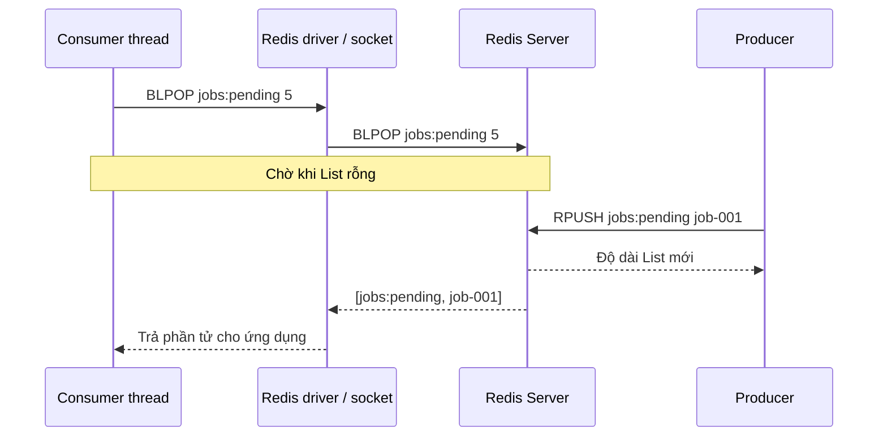

# Lệnh lấy phần tử có chặn và nhu cầu kết nối chuyên biệt

Redis List thường được dùng để xây dựng hàng đợi công việc đơn giản: một tiến trình **producer** đẩy phần tử vào danh sách, các tiến trình **consumer** lấy phần tử ra để xử lý. Nếu danh sách đang rỗng, consumer có thể liên tục gọi `LPOP`/`RPOP` rồi ngủ, hoặc sử dụng các lệnh có chặn (**blocking pop**) như `BLPOP` và `BRPOP`.

Với blocking pop, Redis có thể **giữ yêu cầu đang chờ** cho tới khi có phần tử hoặc hết thời gian chờ. Điều này giúp giảm việc gửi lệnh kiểm tra danh sách rỗng lặp đi lặp lại. Tuy nhiên, trong Spring Data Redis, một lời gọi blocking không chỉ liên quan đến List: nó còn chiếm thời gian của luồng xử lý và có thể cần **một native connection riêng** ở tầng Redis driver.

Đây là lý do cần học song song hai khái niệm:

1. **Ngữ nghĩa của lệnh List có chặn:** chờ khi rỗng, lấy phần tử từ đầu/cuối, timeout, tính nguyên tử và hành vi khi có nhiều consumer.
2. **Vòng đời kết nối:** vì sao `RedisTemplate` có thể dùng kết nối chia sẻ cho `GET`/`SET` thông thường, nhưng driver thường phải cấp kết nối chuyên biệt cho một lượt `BLPOP`/`BRPOP` đang chờ.

> **“Blocking” ở đây có hai tầng:** Redis Server giữ một client chờ điều kiện dữ liệu; ở API đồng bộ của Spring Data Redis, thread gọi lệnh cũng chờ kết quả. Redis vẫn phục vụ các client khác trong lúc một client bị chặn.

## 1. Từ hàng đợi List thông thường đến blocking pop

### 1.1. Hai đầu của Redis List

Redis List là dãy phần tử có thứ tự. Các lệnh thường dùng:

| Lệnh | Ý nghĩa |
|---|---|
| `LPUSH key value [value ...]` | Thêm phần tử vào **đầu trái** |
| `RPUSH key value [value ...]` | Thêm phần tử vào **đầu phải** |
| `LPOP key` | Lấy và loại bỏ phần tử ở đầu trái |
| `RPOP key` | Lấy và loại bỏ phần tử ở đầu phải |
| `LLEN key` | Đếm số phần tử còn trong List |
| `BLPOP key [key ...] timeout` | Nếu List rỗng thì chờ; khi có dữ liệu, lấy bên trái |
| `BRPOP key [key ...] timeout` | Nếu List rỗng thì chờ; khi có dữ liệu, lấy bên phải |
| `BLMOVE source destination LEFT\|RIGHT LEFT\|RIGHT timeout` | Chờ phần tử tại source rồi **chuyển nguyên tử** sang destination |

Một hàng đợi FIFO (*first in, first out*) có thể dùng một trong hai cặp lệnh:

- **Producer `RPUSH` → consumer `BLPOP`:** Thêm bên phải, lấy phần tử cũ nhất ở bên trái.
- **Producer `LPUSH` → consumer `BRPOP`:** Thêm bên trái, lấy phần tử cũ nhất ở bên phải.

Hai quy ước đều có thể thực hiện FIFO. Cần thống nhất **một quy ước cho mỗi queue**; nếu producer và consumer tùy ý đảo đầu thì thứ tự sẽ thay đổi.

### 1.2. Vì sao không nên tự polling quá dày?

Với `LPOP` thông thường:

```text
Consumer:
  LPOP jobs:pending → nil
  đợi 100 ms
  LPOP jobs:pending → nil
  đợi 100 ms
  LPOP jobs:pending → nil
  ...
```

Ưu điểm của polling là chủ động chu kỳ kiểm tra, nhưng khi queue rỗng nó vẫn phát sinh round trip mạng và lệnh Redis liên tục. Nếu ngủ lâu, consumer phản ứng chậm với phần tử mới; nếu ngủ ngắn, lượng lệnh vô ích tăng theo số consumer.

Với `BLPOP`:

```text
Consumer: BLPOP jobs:pending 5 ────────────────┐
                                               │ Redis giữ client chờ
Producer: RPUSH jobs:pending "job-001"          │
                                               ▼
Consumer nhận ["jobs:pending", "job-001"] ◄──────┘
```

Consumer vẫn phải duy trì request/kết nối trong khoảng chờ. **Giảm polling không đồng nghĩa chi phí tài nguyên bằng 0:** một client đang chờ vẫn tiêu thụ tài nguyên kết nối và ở đường gọi đồng bộ thì còn giữ một thread phía ứng dụng.

## 2. `BLPOP`: lấy từ bên trái và chờ khi rỗng

### 2.1. Cú pháp

```redis
BLPOP key [key ...] timeout
```

Trong đó:

- `key` là một hoặc nhiều tên Redis List muốn theo dõi.
- `timeout` là khoảng thời gian Redis sẵn sàng chờ, theo giây. `0` có nghĩa **chờ vô thời hạn ở phía Redis**, nếu kết nối vẫn tồn tại và không có giới hạn khác cắt lệnh.
- Nếu List đã có phần tử, Redis trả kết quả **ngay**, không cần đợi đến khi timeout.
- Nếu hết thời gian chờ mà vẫn không có phần tử, kết quả Redis là `nil`.
- Khi lấy được phần tử, Redis trả một cặp gồm **tên List đã được lấy** và **giá trị phần tử**.

Ví dụ:

```redis
RPUSH jobs:pending "job-001" "job-002" "job-003"
BLPOP jobs:pending 5
# 1) "jobs:pending"
# 2) "job-001"

LRANGE jobs:pending 0 -1
# 1) "job-002"
# 2) "job-003"
```

Nếu List đang rỗng:

```redis
DEL jobs:pending
BLPOP jobs:pending 3
# Redis chờ tối đa khoảng 3 giây rồi trả nil nếu không có producer
```

Lệnh không tạo một hàng đợi chờ riêng nằm trong Redis keyspace. Redis quản lý thông tin về **client đang chờ** ở phía server; key List có thể chưa tồn tại trong khi consumer chờ.

### 2.2. Hai terminal minh họa

**Terminal A — consumer:**

```bash
redis-cli BLPOP jobs:pending 0
```

Lúc này terminal A có thể đứng chờ. **Terminal B — producer:**

```bash
redis-cli RPUSH jobs:pending "job-100"
```

Terminal A nhận về tên key và phần tử `job-100` rồi kết thúc lệnh. Muốn tiếp tục nghe các công việc tiếp theo, consumer cần **gọi lại** `BLPOP` trong một vòng lặp hoặc worker lifecycle. Một lệnh `BLPOP` chỉ lấy **một phần tử** mỗi lần thành công.

Trên môi trường thực tế, `timeout 0` có thể làm consumer khó dừng hoặc phản ứng với thay đổi cấu hình. Timeout hữu hạn thường giúp worker có cơ hội kiểm tra trạng thái shutdown.

### 2.3. Khi theo dõi nhiều List

```redis
BLPOP jobs:critical jobs:normal 5
```

Nếu cả hai List đã có phần tử khi lệnh được thực thi, Redis ưu tiên **key đứng trước** trong danh sách tham số (ở ví dụ là `jobs:critical`). Khi các List đang rỗng rồi có producer mới ghi, hành vi đánh thức phụ thuộc thứ tự Redis xử lý thao tác ghi và những client đang bị chặn.

Đừng coi cách đặt thứ tự key là một scheduler ưu tiên tuyệt đối. Nếu `jobs:critical` liên tục có dữ liệu, công việc thường có thể bị đói (*starvation*). Cần thiết kế cơ chế công bằng, phân bổ worker hoặc giới hạn ưu tiên khi đó là yêu cầu nghiệp vụ.

Trong Redis Cluster, thao tác liên quan nhiều key phải tuân thủ quy tắc hash slot của Cluster. Không mặc định `BLPOP listA listB` có thể chờ trên hai List ở hai hash slot khác nhau; có thể cần đặt hash tag phù hợp hoặc tách consumer theo từng queue/slot.

## 3. `BRPOP`: lấy từ bên phải và chờ khi rỗng

`BRPOP` giống `BLPOP` về cơ chế chờ/timeout, chỉ khác **đầu List được lấy**.

Ví dụ theo quy ước `LPUSH` + `BRPOP` cho FIFO:

```redis
LPUSH jobs:pending "job-001"
LPUSH jobs:pending "job-002"
LPUSH jobs:pending "job-003"

LRANGE jobs:pending 0 -1
# "job-003", "job-002", "job-001"

BRPOP jobs:pending 5
# "jobs:pending", "job-001"

BRPOP jobs:pending 5
# "jobs:pending", "job-002"
```

Sơ đồ:

```text
LPUSH job-001     [job-001]
LPUSH job-002     [job-002, job-001]
LPUSH job-003     [job-003, job-002, job-001]
                    trái             phải
BRPOP             ─────────────────► lấy job-001 trước
```

Chọn `BLPOP` hay `BRPOP` tùy theo quy ước producer. Hai lệnh đều **loại phần tử khỏi List** ngay khi trả kết quả thành công; điều này quan trọng đối với xử lý lỗi của worker.

## 4. Redis xử lý blocking pop như thế nào?

### 4.1. Chặn client đang chờ, không chặn toàn bộ Redis Server

Redis Server có thể ghi nhận một kết nối client đang ở trạng thái blocked khi thực hiện `BLPOP` trên List rỗng. Khi client khác đẩy phần tử phù hợp vào List, Redis đánh thức consumer và trả dữ liệu.



Trong lúc consumer bị chặn, Redis vẫn xử lý lệnh từ các client khác. “Blocking” nói về **yêu cầu của một client** và **thread đang chờ kết quả**, không phải việc khóa toàn server trong toàn bộ thời gian timeout.

### 4.2. Một phần tử không được phát cho mọi consumer

Giả sử hai consumer đều chờ trên cùng List:

```text
Consumer A: BLPOP jobs:pending 10 ── đang chờ
Consumer B: BLPOP jobs:pending 10 ── đang chờ
Producer:   RPUSH jobs:pending job-001
```

Chỉ **một** consumer lấy được `job-001` vì thao tác pop loại phần tử khỏi List. Consumer còn lại tiếp tục chờ phần tử tiếp theo hoặc hết timeout.

Redis có các quy tắc phục vụ client đang chờ theo thứ tự, nhưng một hệ thống nhiều producer/consumer vẫn không nên suy ra **thứ tự hoàn thành nghiệp vụ**, công bằng tuyệt đối hoặc exactly-once processing. Worker có tốc độ xử lý, lỗi mạng và thời điểm gọi lệnh khác nhau.

### 4.3. Tính nguyên tử của thao tác pop

Mỗi lệnh `BLPOP`/`BRPOP` được Redis xử lý như một thao tác pop duy nhất khi phần tử sẵn sàng. Không có khoảng hở giữa “kiểm tra List có dữ liệu” và “lấy phần tử” ở cấp lệnh Redis như mẫu:

```text
LLEN key → 1
// Client khác có thể lấy phần tử tại đây
LPOP key  → nil
```

Do đó, đừng dùng `LLEN` để quyết định chắc chắn một `LPOP` sau đó sẽ lấy được dữ liệu. Chỉ kết quả pop mới là sự thật tại thời điểm lệnh được thực thi.

### 4.4. Các kết quả khác nhau cần phân biệt

| Trường hợp | Điều quan sát được |
|---|---|
| List có phần tử khi gọi | Pop ngay, trả phần tử và tên key ở Redis protocol |
| List rỗng, producer push trước timeout | Consumer được đánh thức và nhận phần tử |
| List rỗng đến hết timeout | Redis trả `nil`, Spring thường ánh xạ thành `null` trong API tương ứng |
| Kết nối bị ngắt hoặc lỗi xác thực | Có exception/lỗi vận hành, không nên xem như timeout bình thường |
| Key có kiểu dữ liệu không phải List | Lỗi `WRONGTYPE` |
| Consumer bị dừng trong khi chờ | Lệnh/connection cần được hủy hoặc chờ timeout; phụ thuộc driver/lifecycle |

Khi key rỗng sau khi pop phần tử cuối, Redis có thể loại key List khỏi keyspace. `LLEN` sẽ trả 0 khi không còn phần tử; không nên dùng sự tồn tại của key làm dấu hiệu “queue đã được khởi tạo”.

## 5. Timeout của Redis khác timeout của driver

### 5.1. Timeout bên trong lệnh Redis

```redis
BLPOP jobs:pending 5
```

Redis được yêu cầu chờ tối đa khoảng 5 giây nếu chưa có phần tử. Timeout này điều khiển **thời gian một lệnh blocking chờ tại server**.

`BLPOP jobs:pending 0` yêu cầu chờ vô thời hạn ở phía Redis. Tuy nhiên, kết nối TCP hoặc driver vẫn có thể bị ngắt do mạng, restart server, command timeout hoặc vòng đời ứng dụng. Vì vậy “0” không phải lời hứa ứng dụng sẽ chờ thành công vĩnh viễn.

### 5.2. Timeout ở Redis client/driver

Lettuce/Jedis và cấu hình Spring có thể đặt thêm command timeout, connect timeout hoặc timeout khi mượn connection từ pool. Nếu driver chỉ chờ phản hồi 2 giây trong khi lệnh Redis được yêu cầu chờ 10 giây, ứng dụng có thể thấy **lỗi timeout phía client trước** khi Redis trả `nil` do hết timeout server.

| Thời hạn | Áp dụng ở đâu? | Hết hạn có thể dẫn đến |
|---|---|---|
| Redis blocking timeout | `BLPOP`/`BRPOP`/`BLMOVE` ở server | Kết quả rỗng (`nil`) nếu không có phần tử |
| Driver command timeout | Client Lettuce/Jedis | Exception hoặc kết thúc thao tác ở client |
| Pool borrow wait | Pool kết nối | Không mượn được kết nối, lỗi/timeout trước khi lệnh được gửi |
| Connect/network timeout | Lập kết nối và truyền thông | Exception về kết nối |
| Application shutdown deadline | Vòng đời worker/app | Yêu cầu worker dừng, hủy/chờ lệnh tùy cơ chế |

Timeout chờ dữ liệu **không phải lỗi kết nối**. Ứng dụng nên phân biệt `null` do queue rỗng với exception do driver và có metric riêng.

### 5.3. Vì sao nên chọn timeout hữu hạn?

Một worker chạy dài hạn thường có vòng lặp:

```text
while applicationIsRunning:
    BLPOP queue 3
    if timeout:
        kiểm tra tín hiệu dừng rồi thử lại
    else:
        xử lý công việc
```

Timeout 2–5 giây là một lựa chọn minh họa để cân bằng khả năng phản ứng shutdown và tần suất gọi lại; giá trị phù hợp còn phụ thuộc nhu cầu latency, cấu hình driver, số worker và hạ tầng. Giữ **client command timeout lớn hơn thời gian blocking Redis**, có biên độ cho network/scheduling, và không cấu hình timeout theo một con số đoán mò.

## 6. Thực hiện blocking pop với Spring Data Redis

### 6.1. `ListOperations` trong `StringRedisTemplate`

Spring Data Redis hỗ trợ các thao tác List qua:

```java
ListOperations<String, String> listOps = stringRedisTemplate.opsForList();
```

Các overload thường dùng của `ListOperations`:

```java
// Pop ngay: không chờ khi queue rỗng.
String immediate = listOps.leftPop("jobs:pending");

// Pop có chặn: chờ tối đa thời lượng khai báo.
String fromLeft = listOps.leftPop(
    "jobs:pending", Duration.ofSeconds(3));

String fromRight = listOps.rightPop(
    "jobs:pending", Duration.ofSeconds(3));
```

Với Spring Data Redis, overload có `Duration` tương ứng với blocking pop ở tầng Redis. API có overload cũ dùng `long timeout, TimeUnit unit`, nhưng trong code mới `Duration` giúp thể hiện đơn vị thời gian rõ ràng hơn.

Khi không có phần tử trước timeout, phương thức có thể trả `null`. Nếu hoạt động nằm trong pipeline/transaction, hợp đồng một số method Spring Data có thể trả `null` vì kết quả được hoãn, nên **không dùng kết quả `null` trong ngữ cảnh đó để kết luận chỉ do queue rỗng**. Blocking pop cũng không phù hợp để vận hành bên trong pipeline/transaction như một worker chờ độc lập.

### 6.2. Producer và consumer tối thiểu

```java
package com.example.redis.queue;

import java.time.Duration;
import org.springframework.data.redis.core.StringRedisTemplate;
import org.springframework.stereotype.Service;

@Service
public class SimpleJobQueue {

    private static final String PENDING = "jobs:pending";

    private final StringRedisTemplate redis;

    public SimpleJobQueue(StringRedisTemplate redis) {
        this.redis = redis;
    }

    public void submit(String jobId) {
        // LPUSH + BRPOP tạo thứ tự FIFO cho mỗi List.
        redis.opsForList().leftPush(PENDING, jobId);
    }

    public String takeOnce() {
        // Chỉ gọi từ luồng worker chuyên xử lý queue.
        return redis.opsForList()
                .rightPop(PENDING, Duration.ofSeconds(3));
    }

    public Long pendingCount() {
        return redis.opsForList().size(PENDING);
    }
}
```

Đoạn service chỉ trình bày cách gọi Redis; `takeOnce()` **là lời gọi đồng bộ có thể chờ tối đa 3 giây**. Nó thích hợp cho worker, không nên bị gọi từ request HTTP cần phản hồi ngay.

Ví dụ sử dụng:

```java
jobQueue.submit("job-101");
jobQueue.submit("job-102");

String first = jobQueue.takeOnce();
// "job-101" khi chưa có consumer nào khác lấy trước.
```

Không dựa vào `pendingCount()` để bảo đảm một `takeOnce()` sau đó có dữ liệu: các consumer khác có thể đã lấy phần tử.

### 6.3. Vòng đời worker có thể dừng được

Một cách minh họa là để một executor chuyên dụng thực hiện blocking pop; mỗi lần chờ dùng timeout hữu hạn để có thể kiểm tra tín hiệu dừng.

```java
package com.example.redis.queue;

import java.util.concurrent.ExecutorService;
import java.util.concurrent.Executors;
import java.util.concurrent.TimeUnit;
import java.util.concurrent.atomic.AtomicBoolean;
import jakarta.annotation.PreDestroy;
import org.slf4j.Logger;
import org.slf4j.LoggerFactory;
import org.springframework.boot.context.event.ApplicationReadyEvent;
import org.springframework.context.event.EventListener;
import org.springframework.stereotype.Component;

@Component
public class SimpleJobWorker {

    private static final Logger log =
        LoggerFactory.getLogger(SimpleJobWorker.class);

    private final SimpleJobQueue queue;
    private final ExecutorService executor =
        Executors.newSingleThreadExecutor();
    private final AtomicBoolean running = new AtomicBoolean(false);

    public SimpleJobWorker(SimpleJobQueue queue) {
        this.queue = queue;
    }

    @EventListener(ApplicationReadyEvent.class)
    public void start() {
        if (running.compareAndSet(false, true)) {
            executor.submit(this::loop);
        }
    }

    private void loop() {
        while (running.get() && !Thread.currentThread().isInterrupted()) {
            try {
                String jobId = queue.takeOnce();
                if (jobId != null) {
                    process(jobId);
                }
            } catch (RuntimeException ex) {
                log.warn("Redis worker failed; retrying after backoff", ex);
                try {
                    TimeUnit.SECONDS.sleep(1);
                } catch (InterruptedException interrupted) {
                    Thread.currentThread().interrupt();
                    break;
                }
            }
        }
    }

    private void process(String jobId) {
        // Logic nghiệp vụ minh họa.
        log.info("Received job {}", jobId);
    }

    @PreDestroy
    public void stop() {
        running.set(false);
        executor.shutdownNow();
    }
}
```

Ví dụ có một worker và executor riêng để dễ quan sát. Trong production cần quản lý số worker, lifecycle, backpressure, dead-letter/retry và lỗi xử lý nghiệp vụ. **Đặc biệt:** với `BRPOP`, phần tử đã bị loại khỏi List trước khi `process()` chạy; nếu xử lý lỗi hoặc process chết giữa chừng, công việc có thể **mất khỏi queue**. Vì thế code này chỉ phù hợp cho bài toán chấp nhận mất công việc, hoặc khi có một cơ chế khôi phục riêng ngoài ví dụ.

Đối với hệ thống yêu cầu “nhận rồi mới xác nhận”, phần tiếp theo giới thiệu mẫu chuyển phần tử từ queue chờ sang queue đang xử lý.

## 7. Vì sao blocking pop cần kết nối chuyên biệt?

### 7.1. Kết nối logic của Spring và native connection

Khi gọi `redis.opsForList().rightPop(key, Duration.ofSeconds(3))`:

1. `RedisTemplate` yêu cầu kết nối từ `RedisConnectionFactory`.
2. Spring Data sử dụng một đối tượng `RedisConnection` để phát lệnh Redis.
3. Driver (chẳng hạn Lettuce hoặc Jedis) gửi `BRPOP` qua native connection/socket.
4. Socket này đang chờ Redis phản hồi cho tới khi có phần tử, timeout hoặc kết nối bị kết thúc.
5. Sau khi lệnh xong, Spring giải phóng **vòng đời kết nối logic**; driver có thể giữ lại native connection để tái sử dụng.

Đối tượng `RedisConnection` ở tầng Spring là một abstraction/wrapper; một lượt lấy `RedisConnection` **không nhất thiết tạo một TCP socket mới**. Điều quyết định nằm ở cấu hình factory, driver và loại lệnh.

### 7.2. Vấn đề nếu dùng socket chung cho lệnh đang chờ

Một native connection Lettuce thường có thể gửi nhiều lệnh thông thường thông qua cơ chế bất đồng bộ/multiplexing. Nhưng blocking pop có ngữ nghĩa **đưa phiên client vào trạng thái chờ dữ liệu**. Khi server đang chặn phiên đó, không nên dùng cùng phiên như một đường truyền chung cho các lệnh không liên quan cần phản hồi ngay.

```text
Không phù hợp để chia sẻ cùng một Redis client session:

Thread consumer ── BRPOP key 30 ─┐
                                 ├── Cùng socket S1 ── Redis
Thread API      ── GET key ──────┘
                    ↑ Có nguy cơ chờ phía sau lệnh blocking

Tách đúng nguồn kết nối:

Thread API      ── GET key ─────── Shared native connection S1 ── Redis

Thread consumer ── BRPOP key 30 ── Dedicated native connection S2 ── Redis
```

Trong mô hình LettuceConnectionFactory thông dụng:

- `shareNativeConnection = true` cho phép những lệnh Redis thông thường, không blocking, dùng native connection được chia sẻ.
- Các thao tác blocking và transaction thường lấy **native connection chuyên biệt** qua connection provider, thay vì chiếm kết nối dùng chung cho các lệnh bình thường.
- Kết nối chuyên biệt có thể được cấp riêng hoặc mượn từ pool, tùy cấu hình và implementation.

Sơ đồ trên minh họa hai socket vật lý S1/S2. Trong thực tế Redis Cluster, Sentinel, Pub/Sub, nhiều pool hoặc nhiều client factory có thể tạo thêm kết nối.

### 7.3. Số consumer đang chờ ảnh hưởng đến số kết nối

Giả sử:

- Có 20 worker đồng thời chờ `BRPOP`.
- Mỗi worker cần một native connection chuyên biệt trong suốt thời gian chờ.
- Pool dành cho đường kết nối chuyên biệt chỉ cho phép mượn đồng thời 8 connection.

Hệ quả có thể là:

```text
20 worker threads
       │
       ├── 8 worker mượn được native connection
       │      └── 8 BLPOP/BRPOP đang chờ ở Redis
       │
       └── 12 worker còn lại
              └── chờ pool cấp connection / gặp borrow timeout
```

Kết quả không có nghĩa Redis chỉ có 8 consumer theo thiết kế; đó có thể là **giới hạn do pool phía client**. Đồng thời, server còn có thể có các kết nối khác dùng cho lệnh thông thường, monitoring và client bên ngoài.

Số liệu trên là minh họa cho một pool; không có công thức cố định “số socket Redis = max-active” vì pool chỉ quản lý các connection thuộc phạm vi của nó.

### 7.4. Lettuce và Jedis có chiến lược khác nhau

| Khía cạnh | Lettuce | Jedis |
|---|---|---|
| Factory trong Spring Data Redis | `LettuceConnectionFactory` | `JedisConnectionFactory` |
| Native connection cho lệnh thông thường | Có thể chia sẻ nếu cấu hình cho phép | Thường quản lý qua những tài nguyên kết nối phù hợp/pool |
| Native connection cho blocking pop | Thường được cấp riêng qua connection provider | Mượn/giữ một kết nối Jedis phù hợp trong thời gian chờ |
| Thread chạy blocking API đồng bộ | Chờ kết quả | Chờ kết quả |
| Trả kết nối sau khi lệnh kết thúc | Driver/provider quyết định tái sử dụng hoặc đóng | Driver/pool quyết định tái sử dụng hoặc đóng |

Không dùng một instance `RedisConnection` của Spring Data Redis như một đối tượng singleton chia sẻ giữa nhiều thread. `RedisTemplate` là abstraction được thiết kế để tái sử dụng an toàn sau khi cấu hình; connection do nó mượn có vòng đời riêng. Cũng không nên suy từ việc native Lettuce connection có khả năng sử dụng đa luồng thành kết luận mọi wrapper `RedisConnection` đều thread-safe.

## 8. Connection pool cho consumer có chặn

### 8.1. Tính toán theo số lời gọi đang chờ

Khi có `N` consumer độc lập đang chờ blocking pop, đường kết nối chuyên biệt cần đủ tài nguyên cho **số lệnh có chặn đồng thời**, cộng với các tác vụ khác cần cùng loại kết nối nếu dùng chung pool.

Một cách ước lượng ban đầu:

```text
pool demand ≈ số blocking consumers đồng thời
             + số transaction/operation khác mượn dedicated connection
             + khoảng dự phòng theo tải quan sát
```

Đây là định hướng lập kế hoạch, không phải giá trị cấu hình tối ưu sẵn có. Kích thước pool còn phải phù hợp giới hạn tài nguyên Redis Server, số application instance, số worker trên mỗi instance, độ trễ xử lý và topology Redis.

Đặc biệt, nếu dùng **một pool chung** cho consumer chờ lâu và các thao tác Redis cần kết nối riêng khác, consumer có thể giữ hết connection khiến các thao tác còn lại không mượn được. Khi mức cô lập quan trọng, cân nhắc cấp client/factory hoặc pool chuyên trách cho worker queue.

### 8.2. Cấu hình pool Lettuce qua Spring Boot

Ví dụ cấu hình dành cho một ứng dụng Spring Boot dùng Lettuce:

```groovy
dependencies {
    implementation 'org.springframework.boot:spring-boot-starter-data-redis'
    implementation 'org.apache.commons:commons-pool2'
}
```

```yaml
spring:
  data:
    redis:
      host: localhost
      port: 6379
      lettuce:
        pool:
          enabled: true
          max-active: 12
          max-idle: 12
          min-idle: 0
          max-wait: 2s
```

Ý nghĩa:

- `max-active`: giới hạn số connection đang được **mượn** đồng thời từ pool này.
- `max-idle` / `min-idle`: các mục tiêu/giới hạn về connection rảnh theo pool implementation.
- `max-wait`: thời gian chờ để **mượn** connection khi pool bận; không phải timeout chờ phần tử của Redis List.

Trong `LettuceConnectionFactory` với `shareNativeConnection=true`, các lệnh thông thường có thể vẫn dùng native connection chia sẻ; bật pool **không bắt buộc mọi `GET`/`SET` phải mượn một socket từ pool**.

Nếu worker thường xuyên phải chờ lâu, pool nên được thiết kế từ **mức đồng thời của worker**, chứ không chỉ từ số request HTTP mỗi giây. Không tăng pool vô hạn: mỗi connection phía Redis Server vẫn tiêu tốn tài nguyên và bị giới hạn bởi cấu hình server.

### 8.3. Khi nào cần client/factory riêng cho queue?

Một factory chuyên trách có thể hữu ích nếu:

- Số consumer lớn, mức độ blocking cao.
- Queue và cache cùng chạy trên Redis nhưng có mục tiêu latency khác nhau.
- Không muốn việc pool của consumer ảnh hưởng đến request web.
- Cần thiết lập timeout, client name hoặc metrics riêng cho queue.
- Có kế hoạch scaling worker độc lập với API application.

Có thể cung cấp một `StringRedisTemplate` riêng được cấu hình với `RedisConnectionFactory` dành cho worker. Tuy nhiên, tự tạo nhiều bean cùng loại cần quản lý `@Qualifier`/`@Primary` và lifecycle rõ ràng. Một template riêng **chỉ thực sự cách ly nguồn kết nối khi nó dùng factory/client/pool được cấu hình tách biệt**; hai template cùng dùng một factory vẫn dùng chung nền kết nối tương ứng.

Trong hệ thống lớn, tách worker thành tiến trình triển khai riêng thường còn giúp kiểm soát concurrency, autoscaling và shutdown mà không làm luồng API bị chặn.

## 9. Giới hạn của `BLPOP`/`BRPOP`: phần tử đã bị xóa trước khi xử lý

`BRPOP` xử lý việc **nhận và loại bỏ phần tử** nguyên tử tại Redis. Nó không giữ phần tử cho đến khi ứng dụng gửi “đã xử lý xong”.

```text
Pending list: [job-101, job-102]
                    │
Consumer BRPOP ─────┘
          │
          ▼
job-101 đã bị xóa khỏi pending
          │
          ▼
Ứng dụng xử lý job-101
          │
          ├── thành công
          └── process chết / exception trước khi hoàn tất
                         └── job-101 không tự quay lại pending
```

Mẫu này phù hợp cho các công việc có thể mất hoặc có nguồn khác tái dựng. Với tác vụ quan trọng, cần một cơ chế **pending → processing → acknowledge**, hoặc sử dụng hàng đợi có consumer group/ack như Redis Streams nếu phù hợp.

Một điểm cần tách biệt:

- **Atomic pop:** một phần tử không bị hai consumer cùng pop thành công từ cùng trạng thái List.
- **Reliable processing:** công việc được xử lý thành công hoặc có khả năng phục hồi khi worker chết.

Atomic pop **không tự bảo đảm reliable processing hoặc exactly-once**.

## 10. `BLMOVE`: chặn và chuyển phần tử sang List đang xử lý

Redis hỗ trợ `BLMOVE` để di chuyển một phần tử từ List nguồn sang List đích **trong một lệnh nguyên tử**. Đây là phiên bản blocking của `LMOVE`; lệnh cũ `BRPOPLPUSH` được xem là deprecated từ Redis 6.2 và có thể thay bằng `BLMOVE ... RIGHT LEFT ...`.

### 10.1. Cú pháp

```redis
BLMOVE source destination LEFT|RIGHT LEFT|RIGHT timeout
```

Các tham số:

- `source`: List chờ công việc.
- `destination`: List giữ các công việc đã được consumer nhận để xử lý.
- `LEFT|RIGHT` đầu tiên: lấy phần tử từ đầu nào của `source`.
- `LEFT|RIGHT` thứ hai: thêm phần tử sang đầu nào của `destination`.
- `timeout`: số giây chờ khi source rỗng; `0` chờ không giới hạn ở Redis Server.

Ví dụ giữ FIFO cùng quy ước `LPUSH`:

```redis
LPUSH jobs:pending "job-101"
LPUSH jobs:pending "job-102"

BLMOVE jobs:pending jobs:processing RIGHT LEFT 5
# "job-101"

LRANGE jobs:pending 0 -1
# "job-102"

LRANGE jobs:processing 0 -1
# "job-101"
```

Điểm khác biệt quan trọng: `job-101` **không còn ở pending** nhưng đã hiện diện trong **processing** trước khi consumer bắt đầu xử lý. Nếu kết nối consumer gặp lỗi sau khi Redis di chuyển phần tử nhưng trước khi client nhận phản hồi, công việc có thể đã nằm trong processing mà worker chưa biết chắc đã nhận. Thiết kế phục hồi cần tính đến trường hợp phản hồi mơ hồ này.

### 10.2. Xác nhận hoàn tất

Sau khi xử lý thành công, ứng dụng có thể xóa phần tử tương ứng khỏi processing:

```redis
LREM jobs:processing 1 "job-101"
```

`LREM` xóa một số phần tử trùng giá trị. Vì vậy **nội dung phần tử phải nhận diện duy nhất một công việc** nếu muốn việc xác nhận chính xác. Ví dụ nên dùng một job ID duy nhất thay vì hai payload giống hệt nhau mà không phân biệt được.

Nếu nhiều worker dùng chung `jobs:processing`, application còn phải phân biệt job nào do worker nào nhận, trạng thái lease và thời điểm hết hạn xử lý. Bản thân Redis List **không tự cấp lease timeout hoặc tự phát lại** một phần tử đang ở processing.

### 10.3. Công việc bị treo phải được xử lý thế nào?

Mẫu processing list thường cần một thành phần **recovery/sweeper**:

1. Khi worker nhận job, lưu metadata job ID, owner/attempt và thời điểm bắt đầu hoặc deadline xử lý.
2. Worker xử lý xong thì acknowledge và dọn metadata.
3. Nếu worker chết, sweeper xác định công việc đang ở processing quá lâu mà chưa được hoàn tất.
4. Sweeper chuyển công việc trở lại pending hoặc đưa sang dead-letter theo chính sách retry.
5. Các bước chuyển và cập nhật metadata cần được đồng bộ an toàn khi nhiều worker/sweeper chạy cùng lúc.

Không nên dùng riêng `LRANGE jobs:processing` rồi `LPUSH jobs:pending` rồi `LREM jobs:processing` như ba lệnh tách rời mà không xem xét xung đột; công việc có thể bị phát trùng hoặc mất trạng thái. Có thể dùng script/Redis Functions hoặc một thiết kế dữ liệu và giao thức nhất quán phù hợp.

Mẫu này thường cho khả năng **at-least-once** khi phục hồi được triển khai đúng: một công việc có thể được giao lại nếu worker đã hoàn tất side effect nhưng chết trước lúc acknowledge. Vì thế **handler phải idempotent** hoặc có khóa idempotency phía nguồn dữ liệu chính. Không tuyên bố exactly-once chỉ nhờ `BLMOVE` và `LREM`.

### 10.4. Spring Data Redis và `BLMOVE`

API `ListOperations` ở các phiên bản Spring Data Redis hỗ trợ thao tác di chuyển với hướng lấy và hướng thêm. Ví dụ với những phiên bản có overload blocking dùng `Duration`:

```java
import java.time.Duration;
import org.springframework.data.redis.connection.RedisListCommands.Direction;
import org.springframework.data.redis.core.StringRedisTemplate;

public class ReliableQueueReceiver {
    private final StringRedisTemplate redis;

    public ReliableQueueReceiver(StringRedisTemplate redis) {
        this.redis = redis;
    }

    public String takeIntoProcessing() {
        return redis.opsForList().move(
            "jobs:pending",
            Direction.RIGHT,
            "jobs:processing",
            Direction.LEFT,
            Duration.ofSeconds(3)
        );
    }
}
```

Mẫu này thể hiện cùng ý nghĩa với `BLMOVE jobs:pending jobs:processing RIGHT LEFT 3`. API cụ thể và việc hỗ trợ overload phụ thuộc version Spring Data Redis đang dùng; khi dự án nâng cấp, cần đối chiếu tài liệu API của version đó. **Không** suy từ kết quả `null` rằng chắc chắn không có công việc nếu lệnh chạy trong một ngữ cảnh pipeline/transaction hoãn kết quả.

Để xử lý ở mức cao hơn, nên đóng gói thao tác receive/ack/retry trong một service sở hữu cả các List và metadata liên quan, thay vì cho nhiều lớp tự thao tác `LREM`/`LPUSH`.

## 11. `BLMPOP` và nhiều List (khái niệm mở rộng)

Redis 7 trở lên bổ sung `BLMPOP` cho trường hợp cần chờ **nhiều List** và lấy một nhóm phần tử trong một lệnh. Cú pháp:

```redis
BLMPOP timeout numkeys key [key ...] LEFT|RIGHT [COUNT count]
```

Ví dụ:

```redis
BLMPOP 5 2 jobs:critical jobs:normal LEFT COUNT 3
```

Lệnh chờ trên hai List, ưu tiên thứ tự key theo ngữ nghĩa lệnh và có thể trả về nhiều phần tử từ List được chọn (tối đa số `COUNT` yêu cầu, tùy dữ liệu sẵn có).

Lưu ý:

- Không giống việc chờ một phần tử bằng `BLPOP`/`BRPOP`, dạng trả về có thể gồm **tên List và một mảng phần tử**.
- Lấy một nhóm phần tử không tự có cơ chế acknowledge hoặc recovery; nhiều phần tử có thể mất khỏi pending khi consumer lỗi.
- Không dùng `BLMPOP` trên Redis Server không hỗ trợ lệnh đó. Khi tích hợp qua Spring Data Redis, kiểm tra phiên bản library và command API/driver phù hợp.
- Trên Redis Cluster, các key trong một lệnh đa key vẫn chịu quy tắc về slot.

Chỉ chọn batch blocking pop khi nhu cầu throughput/định dạng result thực sự phù hợp và đã thiết kế xử lý lỗi cho cả nhóm phần tử.

## 12. Blocking pop và transaction, pipeline, reactive API

### 12.1. Không vận hành consumer blocking trong Redis transaction

Redis transaction `MULTI`/`EXEC` đưa các lệnh vào hàng đợi để thực thi khi `EXEC`; Redis không cung cấp ngữ nghĩa “giữ transaction mở và đợi phần tử xuất hiện” giống consumer blocking độc lập. Các lệnh blocking trong transaction không hoạt động như một consumer chờ thông thường khi List rỗng.

Trong Spring Data Redis, `SessionCallback` phục vụ nhóm lệnh trong cùng phiên, nhưng **không phải cơ chế để một worker ngủ chờ trong `MULTI/EXEC`**. Dùng các lời gọi blocking riêng ngoài transaction, sau đó thực hiện bước xử lý/ack bằng giao thức riêng.

### 12.2. Pipeline nhằm gửi nhiều lệnh, không phải giữ worker chờ

Redis pipeline gửi nhiều lệnh mà không đợi từng phản hồi ngay lập tức. Lệnh blocking đang chờ có thể làm việc thu thập các phản hồi theo lô trở nên khó dự đoán hoặc gây trì hoãn các lệnh phía sau. Một worker queue không nên đặt `BLPOP` vào pipeline cùng những lệnh độc lập rồi kỳ vọng tất cả hoàn tất nhanh.

### 12.3. Reactive không làm Redis Server hết chặn client

Với Spring Data Redis Reactive và driver hỗ trợ, luồng xử lý phía ứng dụng có thể không giữ một Java thread chờ theo mô hình blocking API đồng bộ. Tuy nhiên, **lệnh Redis có blocking semantics vẫn khiến kết nối/phiên client tương ứng chờ dữ liệu ở server**. “Reactive” mô tả cách ứng dụng điều phối I/O, không biến `BLPOP` thành một thao tác tức thời tại Redis.

Không gọi blocking API đồng bộ như `StringRedisTemplate.opsForList().rightPop(key, timeout)` trực tiếp trên thread event-loop của WebFlux. Cách này có thể chặn event-loop. Nếu hệ thống thực sự cần reactive consumer, hãy dùng API reactive và chiến lược kết nối/subscription tương thích hoặc tách worker ra thread/process riêng.

## 13. Quan sát số client đang bị chặn

Redis cho phép xem số kết nối client hiện tại và số client đang ở trạng thái blocked:

```redis
INFO clients
CLIENT LIST
```

Các trường hữu ích:

| Quan sát | Ý nghĩa |
|---|---|
| `connected_clients` | Số client connection Redis Server ghi nhận hiện tại |
| `blocked_clients` | Số client đang chờ trên lệnh chặn được Redis Server ghi nhận |
| `CLIENT LIST` | Thông tin từng client (địa chỉ, tên, cờ trạng thái, lệnh gần đây tùy version) |
| `LLEN jobs:pending` | Số phần tử còn trong pending tại thời điểm truy vấn |
| Metrics của pool | Số connection active/idle, thời gian chờ mượn, borrow timeout |
| Latency và lỗi command | Giúp phân biệt timeout chờ dữ liệu với lỗi mạng/client |

Một ví dụ quan sát:

1. Chạy Redis dùng riêng cho bài thực hành.
2. Mở ba terminal, mỗi terminal chạy `redis-cli BLPOP jobs:pending 30` khi queue rỗng.
3. Trong terminal thứ tư, chạy `INFO clients` và tìm `blocked_clients`.
4. Push một phần tử, quan sát một consumer nhận dữ liệu; hai consumer còn lại vẫn có thể chờ.
5. Đợi các consumer còn lại timeout hoặc push thêm phần tử rồi so sánh số blocked clients.

Những client của `redis-cli` dùng để giám sát cũng được tính trong `connected_clients`. Nếu hệ thống có Lettuce pool, Redis Insight, health check và nhiều application instance, số connected clients không bằng chính xác số worker Java. Theo dõi **giá trị theo thời gian** và phân biệt các nguồn kết nối.

### Khi gặp lỗi pool exhausted

Giả sử worker báo không mượn được connection:

1. Đếm số tác vụ blocking đồng thời trên mỗi ứng dụng và tổng số instance.
2. Xem cấu hình pool/provider của factory thực sự được worker dùng.
3. So sánh số connection active, thời gian giữ connection và `max-wait`.
4. Kiểm tra có transaction hoặc thao tác khác cùng mượn dedicated connection hay không.
5. Xem Redis Server có tiến gần giới hạn số client, CPU/RAM hoặc gặp network issue không.
6. Điều chỉnh mức concurrency hoặc tách pool/factory khi cần; chỉ tăng pool sau khi xác định rõ nút thắt.

Một queue rỗng nhưng có 100 worker chờ `BLPOP` có thể tạo 100 kết nối đang bị chặn. **Đó không phải bằng chứng Redis bị treo**: đây có thể là trạng thái làm việc bình thường, nhưng cần đủ tài nguyên kết nối.

## 14. Những tình huống lỗi và cách xử lý

### 14.1. Timeout chờ phần tử

`StringRedisTemplate` trả `null` sau khoảng chờ hữu hạn nếu không lấy được phần tử. Worker nên tiếp tục chờ ở vòng lặp sau hoặc kiểm tra yêu cầu shutdown. Không ghi log ERROR mỗi lần timeout bình thường của queue rỗng.

### 14.2. Lỗi mạng giữa lúc lấy phần tử

Khi kết nối bị ngắt, client có thể không biết Redis đã thực thi pop hay chưa. Không nên lập tức giả định “chưa lấy được, retry chắc chắn an toàn”. Với `BRPOP`, điều đó có thể dẫn đến trạng thái mất công việc; với `BLMOVE`, cần kiểm tra processing và khôi phục theo job ID.

### 14.3. Redis restart hoặc failover

Connection đang chờ có thể bị ngắt. Driver có thể tự kết nối lại theo cấu hình nhưng **một lệnh blocking cũ không nhất thiết được khôi phục như chưa từng xảy ra gián đoạn**. Worker cần vòng lặp reconnect có backoff và cơ chế giải quyết kết quả mơ hồ nếu yêu cầu tin cậy cao.

### 14.4. Consumer xử lý quá chậm

`BLPOP` chỉ giảm chờ rỗng; nó không tự giới hạn producer. Nếu producer gửi nhanh hơn tốc độ xử lý, `LLEN jobs:pending` có thể tăng không giới hạn. Cần đo độ dài hàng đợi, thông lượng và độ trễ từ lúc enqueue đến hoàn thành, đồng thời thiết kế backpressure, số worker và cách lưu payload.

### 14.5. Có nhiều consumer nhưng thứ tự hoàn thành khác thứ tự enqueue

Lệnh pop lấy theo thứ tự List trong điều kiện phù hợp, nhưng hai worker nhận `job-1` và `job-2` có thể hoàn thành theo thứ tự ngược vì thời gian xử lý khác nhau. Nếu cần **đảm bảo xử lý tuần tự** cho một khóa nghiệp vụ, phải giới hạn concurrency theo nhóm hoặc chọn mô hình partition/ordering phù hợp; không dựa riêng vào tính FIFO của List.

### 14.6. Redis List biến mất khi rỗng

Khi phần tử cuối bị pop, Redis có thể xóa key vì List đã rỗng. Lệnh `BLPOP` sau đó vẫn có thể chờ theo tên key; không cần “tạo List rỗng” trước. Nếu dùng TTL trên key List, phải hiểu rằng key được tạo lại sau khi rỗng có thể không giữ TTL cũ.

### 14.7. Lệnh trả lỗi `WRONGTYPE`

Một key được dùng làm List nhưng ứng dụng khác đã lưu String/Hash cùng tên. Dùng namespace/key convention rõ ràng và kiểm tra:

```redis
TYPE jobs:pending
```

Không tự `DEL` key trên production nếu chưa xác minh chủ sở hữu và dữ liệu; xóa key do service khác sử dụng có thể gây mất dữ liệu.

## 15. Khi nào nên chọn Redis Streams?

Redis List cùng blocking pop rất hữu ích cho queue đơn giản, nhưng không có sẵn tất cả đặc tính của message broker.

| Yêu cầu | Redis List + blocking pop | Redis Streams |
|---|---|---|
| Chờ tới khi có dữ liệu | `BLPOP`/`BRPOP`, `BLMOVE` | `XREAD BLOCK`, `XREADGROUP BLOCK` |
| FIFO đơn giản | Có, khi thống nhất đầu push/pop | Có thứ tự ID message trong stream |
| Lấy một phần tử và xóa khỏi pending | Có | Consumer group không xóa message ngay chỉ vì đã nhận |
| Nhóm consumer và pending entries | Phải tự thiết kế nếu dùng processing List | Consumer groups có pending entries list |
| Acknowledge xử lý | Phải tự triển khai qua List/metadata | `XACK` hỗ trợ ack trong consumer group |
| Claim/retry sau consumer lỗi | Cần sweeper/lease riêng | Có công cụ như `XAUTOCLAIM`, vẫn cần policy xử lý |
| Retention và số lượng message | Tự quản lý bằng List/TTL/cấu trúc khác | Có cơ chế trim stream, cần cấu hình và vận hành |
| Exactly-once side effect với database khác | Không tự bảo đảm | Cũng không tự bảo đảm; cần idempotency/giao thức nghiệp vụ |

Nếu yêu cầu chỉ là “một worker chờ một tín hiệu ngắn, chấp nhận mất khi worker chết”, Redis List có thể đủ. Nếu công việc cần retry, ack, phân phối nhiều consumer và kiểm soát pending lâu dài, Redis Streams thường có mô hình thuận tiện hơn. Lựa chọn cuối cùng vẫn phụ thuộc thứ tự, lưu bền vững, lưu lượng và mức bảo đảm nghiệp vụ.

## 16. Thực hành hoàn chỉnh trên Redis CLI

Thí nghiệm này nên chạy trong Redis dành riêng cho học tập.

**Bước 1 — Tạo queue FIFO:**

```redis
DEL lab:pending lab:processing
LPUSH lab:pending "job-A"
LPUSH lab:pending "job-B"
LRANGE lab:pending 0 -1
# "job-B", "job-A"
```

**Bước 2 — Consumer lấy bên phải:**

```redis
BRPOP lab:pending 3
# "lab:pending", "job-A"

BRPOP lab:pending 3
# "lab:pending", "job-B"

BRPOP lab:pending 3
# Chờ rồi trả nil khi không có job mới
```

**Bước 3 — Chờ trên List rỗng:**

Terminal A:

```bash
redis-cli BLPOP lab:pending 10
```

Terminal B (trong 10 giây):

```bash
redis-cli RPUSH lab:pending "job-C"
```

Quan sát terminal A nhận `lab:pending` và `job-C`.

**Bước 4 — Quan sát blocked clients:**

Trong lúc terminal A đang chờ (trước khi push), chạy:

```redis
INFO clients
CLIENT LIST
```

Quan sát `blocked_clients`. Nếu consumer đã timeout hoặc nhận job, chỉ số này có thể giảm.

**Bước 5 — Chuyển nguyên tử sang processing:**

```redis
DEL lab:pending lab:processing
LPUSH lab:pending "job-D"
BLMOVE lab:pending lab:processing RIGHT LEFT 3
# "job-D"

LRANGE lab:pending 0 -1
# empty

LRANGE lab:processing 0 -1
# "job-D"
```

**Bước 6 — Acknowledge sau xử lý thành công:**

```redis
LREM lab:processing 1 "job-D"
# (integer) 1

LLEN lab:processing
# (integer) 0
```

Đây là bước xác nhận thủ công. Trong sản phẩm thật, cần mã công việc duy nhất và recovery cho processing entries không được ack.

**Bước 7 — Dọn đúng phạm vi thử nghiệm:**

```redis
DEL lab:pending lab:processing
```

Không chạy `FLUSHDB` hoặc `FLUSHALL` trên một Redis chia sẻ chỉ để dọn queue thực hành.

## 17. Checklist thiết kế worker dùng blocking List

Trước khi triển khai, cần trả lời:

1. **Thứ tự queue:** Producer dùng `LPUSH` hay `RPUSH`? Consumer chọn `BLPOP`/`BRPOP` tương ứng ra sao?
2. **Bảo đảm xử lý:** Có chấp nhận mất job sau pop không? Nếu không, `BLMOVE`, processing/ack/recovery hoặc Streams có phù hợp hơn?
3. **Số consumer:** Bao nhiêu worker chờ đồng thời trên mỗi instance và trên toàn deployment?
4. **Nguồn kết nối:** Driver nào, factory nào, connection chia sẻ hay riêng, pool có bao nhiêu slot?
5. **Timeout:** Blocking timeout, driver command timeout, pool wait và shutdown timeout có tương thích?
6. **Thời gian xử lý:** Tác vụ kéo dài bao lâu, có giới hạn concurrency và khả năng backpressure không?
7. **Idempotency:** Khi nhận lại job sau retry/failover, tác dụng phụ có thể được thực hiện trùng không?
8. **Tác vụ nền:** Có chạy trên worker thread/process chuyên dụng, tránh chặn HTTP/event-loop không?
9. **Quan sát:** Có metric pending length, processing length, blocked clients, pool borrow và xử lý thành công/thất bại không?
10. **Tính bền vững:** Redis persistence, failover, khôi phục queue và nguồn dữ liệu chính đã phù hợp với yêu cầu chưa?

## 18. Câu hỏi tự kiểm tra

**1. `BLPOP` khác `LPOP` ở điểm nào?**  
`BLPOP` có thể chờ khi List rỗng cho đến khi có phần tử hoặc hết timeout; `LPOP` trả về ngay khi List rỗng.

**2. Với producer `LPUSH`, consumer nên chọn `BRPOP` hay `BLPOP` để FIFO?**  
Chọn `BRPOP` để lấy phần tử cũ nhất ở bên phải khi producer liên tục thêm bên trái.

**3. Vì sao một consumer đang chờ `BRPOP` có thể cần native connection riêng dù các lệnh `GET` thường dùng connection chia sẻ?**  
Vì Redis giữ phiên client của lệnh blocking trong trạng thái chờ. Cấp kết nối riêng giúp tránh làm những lệnh khác đi cùng phiên đó bị trì hoãn và cho phép quản lý tài nguyên của worker độc lập.

**4. `BRPOP key 0` có chắc worker Java sẽ chờ vĩnh viễn không?**  
Không. Redis được yêu cầu chờ không giới hạn, nhưng timeout phía driver, mất mạng, failover, hủy lệnh hoặc shutdown vẫn có thể kết thúc thao tác.

**5. Một pool có 8 connection, 20 consumer đồng thời chờ dài hạn sẽ ra sao?**  
Nếu mọi consumer đều cần dedicated connection từ chính pool đó, khoảng 8 consumer có thể mượn connection; những consumer khác có thể chờ hoặc gặp borrow timeout, tùy cấu hình.

**6. `BRPOP` thành công rồi worker chết trước khi xử lý xong. Redis tự phát lại phần tử không?**  
Không. `BRPOP` đã loại phần tử khỏi List. Muốn khôi phục cần thiết kế xử lý tin cậy khác.

**7. `BLMOVE pending processing RIGHT LEFT 3` giải quyết được điểm gì?**  
Nó chuyển phần tử từ pending sang processing nguyên tử, cho phép hệ thống tiếp tục quan sát một công việc đã được nhận nhưng chưa ack. Nó không tự triển khai lease, retry hoặc exactly-once.

**8. Vì sao `LREM processing 1 payload` có thể nguy hiểm nếu hai job có payload giống hệt?**  
Vì `LREM` dựa trên giá trị phần tử, có thể xóa một occurrence không đúng job cần ack. Nên đưa ID duy nhất vào mỗi entry và thiết kế ownership/ack rõ ràng.

**9. Gọi `BLPOP` bên trong `MULTI/EXEC` có biến transaction thành consumer chờ không?**  
Không. Blocking commands không có ngữ nghĩa chờ như consumer bình thường trong transaction; hãy tách giai đoạn nhận việc khỏi transaction xử lý/ack.

**10. Tại sao ứng dụng WebFlux không nên gọi đồng bộ `StringRedisTemplate.opsForList().rightPop(key, timeout)` trên event-loop?**  
Vì lời gọi đồng bộ có thể chặn thread event-loop trong thời gian chờ, làm chậm các request khác; cần dùng API reactive thích hợp hoặc worker thread/process riêng.

**11. Redis báo `blocked_clients` tăng, có phải Redis Server bị treo?**  
Không nhất thiết. Đó có thể là số worker đang chờ List rỗng như thiết kế. Cần kết hợp độ dài queue, lỗi, latency, số connection và giới hạn tài nguyên.

**12. Dùng Redis Streams có mặc nhiên bảo đảm exactly-once không?**  
Không. Streams có consumer groups và acknowledge, nhưng side effect lên hệ thống khác vẫn cần idempotency và cơ chế nghiệp vụ tương ứng.

## 19. Ghi nhớ

- **`BLPOP` và `BRPOP`** là những lệnh pop có chặn: chỉ chờ khi List rỗng, trả phần tử khi có dữ liệu hoặc trả rỗng khi hết thời gian chờ.
- **FIFO phụ thuộc đầu push và đầu pop.** `RPUSH + BLPOP` hoặc `LPUSH + BRPOP` là hai quy ước thường dùng.
- **Blocking pop không chặn toàn Redis Server**, nhưng giữ phiên client và có thể giữ một thread phía Spring Data Redis đồng bộ.
- **Lettuce thường cấp native connection riêng cho blocking commands**, dù các lệnh thông thường có thể dùng shared native connection. Driver, pool và topology quyết định số socket thực tế.
- **Số consumer chờ đồng thời có thể trở thành nhu cầu connection thực tế**. Pool borrow timeout khác timeout chờ List.
- **`BLPOP`/`BRPOP` loại phần tử trước khi ứng dụng xử lý**, nên không tự bảo đảm xử lý tin cậy.
- **`BLMOVE` chuyển nguyên tử pending → processing**, nhưng acknowledge, recovery, retry và idempotency vẫn do ứng dụng thiết kế.
- Khi cần consumer groups, pending entries và ack tích hợp, cân nhắc **Redis Streams**.

Khi viết consumer bằng Spring Data Redis, hãy xem **ngữ nghĩa List** và **chi phí kết nối chuyên biệt** là hai phần của cùng một quyết định kiến trúc. Nhờ đó hệ thống có thể chờ dữ liệu hiệu quả, không làm nghẽn các request khác và phục hồi công việc đúng mức mà nghiệp vụ yêu cầu.
