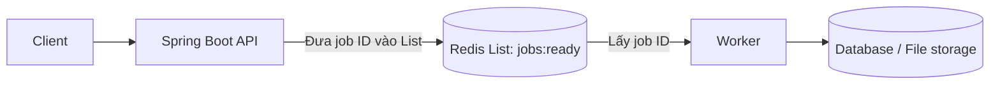
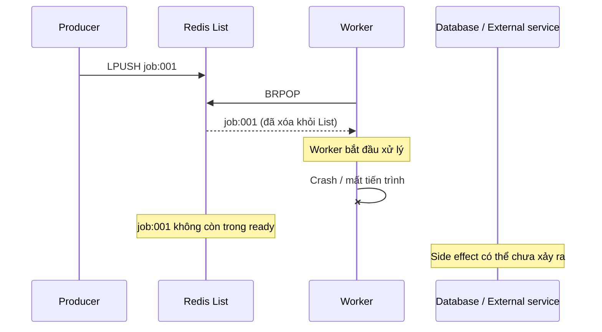
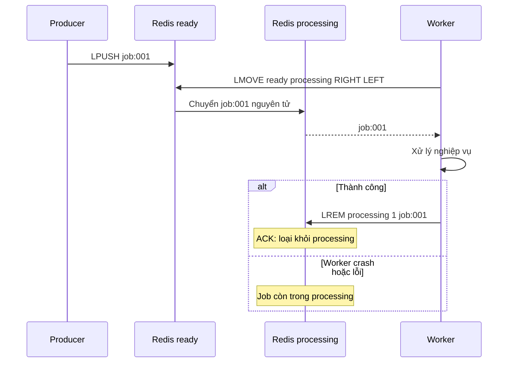
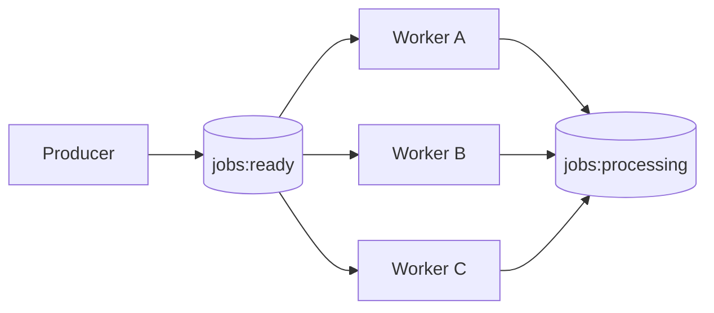

# Mô hình hàng đợi đơn giản và rủi ro mất việc sau khi lấy phần tử

Redis List có thể được dùng làm **hàng đợi công việc (work queue)**: producer thêm một phần tử vào List, worker lấy một phần tử ra rồi xử lý. Trong Spring Data Redis, cách này thường được triển khai bằng `StringRedisTemplate.opsForList()` với các thao tác như `leftPush`, `rightPop` hoặc `rightPop` có thời gian chờ.

Mô hình rất dễ bắt đầu, nhưng có một rủi ro lớn: **lệnh lấy phần tử kiểu `POP` đồng thời loại bỏ công việc khỏi List**. Nếu worker gặp lỗi sau khi lấy nhưng trước khi hoàn thành xử lý, Redis không còn phần tử đó trong hàng đợi. Công việc có thể mất mà không có cơ chế tự động đưa trở lại.

Bài học tập trung vào cách hoạt động của List queue, thời điểm gây mất việc, mô hình chuyển phần tử sang danh sách `processing`, cách ACK/khôi phục, các tình huống xử lý trùng, và khi nào nên chuyển từ Redis List sang Redis Streams hoặc hệ thống hàng đợi chuyên dụng.

## 1. Bài toán: đẩy công việc sang worker

Giả sử API của một ứng dụng Spring Boot nhận yêu cầu tạo báo cáo. Việc tạo báo cáo có thể mất vài giây hoặc vài phút, nên API không muốn giữ kết nối HTTP cho đến khi tính toán xong.

Một thiết kế đơn giản:



Luồng nghiệp vụ:

1. API nhận yêu cầu, tạo định danh công việc như `job:001`.
2. Producer thêm `job:001` vào hàng đợi Redis.
3. Worker đang chờ hàng đợi lấy `job:001`.
4. Worker đọc dữ liệu liên quan, tạo báo cáo, ghi kết quả và cập nhật trạng thái.
5. Client hỏi trạng thái công việc qua API hoặc nhận thông báo khi hoàn thành.

Một Redis List chỉ giữ **danh sách phần tử có thứ tự**. Nó không tự cung cấp khái niệm trạng thái nghiệp vụ `PENDING`, `PROCESSING`, `SUCCEEDED`, `FAILED`, không tự retry công việc và cũng không tự biết một job đã xử lý thành công.

**Lưu ý:** Redis List queue phù hợp cho công việc đơn giản, dữ liệu tạm, nhiệm vụ có thể tạo lại hoặc môi trường học tập. Đối với công việc quan trọng, cần xác định rõ yêu cầu bảo đảm giao nhận, idempotency, persistence, giám sát và phục hồi trước khi chọn kiến trúc.

## 2. Redis List hỗ trợ hàng đợi như thế nào?

Redis List lưu các phần tử theo thứ tự. Hai đầu List thường được gọi là **LEFT (đầu)** và **RIGHT (cuối)**.

Các lệnh phổ biến:

| Lệnh Redis | Vai trò | Hiệu ứng |
|---|---|---|
| `LPUSH key value` | Thêm công việc ở đầu List | List dài thêm nếu ghi thành công |
| `RPUSH key value` | Thêm công việc ở cuối List | List dài thêm nếu ghi thành công |
| `LPOP key` | Lấy và xóa phần tử đầu | Trả phần tử hoặc nil khi rỗng |
| `RPOP key` | Lấy và xóa phần tử cuối | Trả phần tử hoặc nil khi rỗng |
| `BLPOP` / `BRPOP` | Đợi rồi lấy phần tử từ đầu/cuối | Chặn lời gọi tới khi có phần tử hoặc hết timeout |
| `LLEN key` | Đếm phần tử trong List | Hữu ích cho quan sát backlog |
| `LRANGE key start stop` | Đọc một khoảng, không xóa | Hữu ích để kiểm tra mẫu dữ liệu |
| `LMOVE` / `BLMOVE` | Chuyển phần tử giữa hai List | Có thể dùng để xây dựng bước reserve an toàn hơn |

Một quy ước FIFO dễ nhớ là **`LPUSH` để thêm, `RPOP` để lấy**.

```text
Ban đầu:  [ ]
LPUSH A:  [A]
LPUSH B:  [B, A]
LPUSH C:  [C, B, A]

RPOP  → A
Còn:    [C, B]
RPOP  → B
Còn:    [C]
RPOP  → C
Còn:    [ ]
```

Trong Redis CLI:

```redis
DEL demo:jobs:ready
LPUSH demo:jobs:ready job:A
LPUSH demo:jobs:ready job:B
LPUSH demo:jobs:ready job:C
LRANGE demo:jobs:ready 0 -1
RPOP demo:jobs:ready
RPOP demo:jobs:ready
RPOP demo:jobs:ready
```

Các lần `RPOP` lần lượt trả `job:A`, `job:B`, `job:C`, vì vậy queue có hành vi FIFO theo **thứ tự lệnh được Redis xử lý**. Khi nhiều producer gửi yêu cầu đồng thời, thứ tự đó có thể khác thứ tự thời gian thực mà người dùng kỳ vọng; Redis không tự giải quyết ưu tiên hay thứ tự nghiệp vụ xuyên nhiều nguồn.

### 2.1. Vì sao `LPUSH` và `RPOP` kết hợp được?

Nếu cùng thêm và lấy ở bên trái (`LPUSH`/`LPOP`), kết quả có hành vi **LIFO**, gần giống stack. Nếu thêm ở bên phải và lấy ở bên trái (`RPUSH`/`LPOP`), đó cũng là một cách tạo FIFO.

| Producer | Consumer | Trật tự điển hình |
|---|---|---|
| `LPUSH` | `RPOP` | FIFO |
| `RPUSH` | `LPOP` | FIFO |
| `LPUSH` | `LPOP` | LIFO |
| `RPUSH` | `RPOP` | LIFO |

Đối với một queue, hãy chọn một quy ước nhất quán và dùng cùng quy ước trong producer, worker, công cụ vận hành và quy trình retry.

## 3. Dùng `StringRedisTemplate` để tạo queue đơn giản

Giả sử Redis đang chạy ở máy phát triển và ứng dụng Spring Boot dùng starter Redis.

Với Gradle Groovy DSL:

```groovy
dependencies {
    implementation 'org.springframework.boot:spring-boot-starter-data-redis'
}
```

Ví dụ cấu hình cho Spring Boot 3.x:

```yaml
spring:
  data:
    redis:
      host: ${REDIS_HOST:127.0.0.1}
      port: ${REDIS_PORT:6379}
      timeout: 2s
```

`StringRedisTemplate` thao tác key và value kiểu chuỗi, tiện để đưa một `jobId` vào Redis List mà không phải cấu hình serializer object.

```java
package example.queue;

import java.time.Duration;

import org.springframework.data.redis.core.StringRedisTemplate;
import org.springframework.stereotype.Service;

@Service
public class SimpleListQueue {

    private static final String READY = "demo:jobs:ready";

    private final StringRedisTemplate redis;

    public SimpleListQueue(StringRedisTemplate redis) {
        this.redis = redis;
    }

    public void enqueue(String jobId) {
        redis.opsForList().leftPush(READY, jobId);
    }

    public String takeNow() {
        // RPOP: trả về null khi List rỗng.
        return redis.opsForList().rightPop(READY);
    }

    public String waitAndTake() {
        // Chờ tối đa 5 giây, rồi trả về null nếu không có job.
        return redis.opsForList().rightPop(
                READY, Duration.ofSeconds(5)
        );
    }

    public Long queuedCount() {
        return redis.opsForList().size(READY);
    }
}
```

Tương ứng:

```text
enqueue(jobId) → LPUSH demo:jobs:ready <jobId>
takeNow()      → RPOP demo:jobs:ready
waitAndTake()  → BRPOP demo:jobs:ready 5
queuedCount()  → LLEN demo:jobs:ready
```

Tên và signature của một số API có thể khác theo phiên bản Spring Data Redis; ví dụ sử dụng phong cách `Duration` của các dòng Spring Data Redis hiện đại.

### 3.1. Tại sao chỉ đẩy `jobId` thay vì cả object?

Bạn có thể đưa chuỗi JSON vào List, nhưng đối với công việc quan trọng, việc đưa **định danh ổn định** thường thuận tiện hơn:

```text
Job ID trong Redis List: "job:001"

Thông tin nghiệp vụ tại database:
    id          = job:001
    type        = GENERATE_REPORT
    inputRef    = report-request:448
    status      = PENDING
    createdAt   = ...
```

Lợi ích là worker có thể đọc payload từ nguồn có độ bền được thiết kế rõ, cập nhật trạng thái và kiểm tra trùng bằng ID. Một List đơn thuần không có cơ chế phân biệt các JSON payload giống nhau hoặc cung cấp chỉ mục riêng theo `jobId`.

Nếu chỉ đưa job ID vào Redis mà **chưa lưu bản ghi công việc ở nơi bền vững**, việc mất Redis vẫn có thể làm mất danh sách việc cần làm. Đây là một quyết định kiến trúc riêng, không tự được giải quyết bằng việc chọn `StringRedisTemplate`.

## 4. Worker xử lý một phần tử

Worker có thể lấy job rồi gọi hàm xử lý nghiệp vụ:

```java
package example.queue;

import java.util.function.Consumer;

import org.springframework.stereotype.Service;

@Service
public class SimpleQueueConsumer {

    private final SimpleListQueue queue;

    public SimpleQueueConsumer(SimpleListQueue queue) {
        this.queue = queue;
    }

    public void processNext(Consumer<String> jobHandler) {
        String jobId = queue.waitAndTake();

        if (jobId == null) {
            // Hàng đợi rỗng trong khoảng chờ.
            return;
        }

        // Giả định jobHandler làm một tác vụ có thể phát sinh lỗi.
        jobHandler.accept(jobId);
    }
}
```

Ví dụ này cho phép bên gọi truyền logic xử lý qua `Consumer<String>`. Ứng dụng thật nên quản lý worker lifecycle, số luồng, shutdown và giới hạn concurrency. Không cần tạo thread mới ở mỗi HTTP request; thông thường job worker chạy trên executor hoặc process riêng.

Trong mô hình trên, Redis chỉ biết rằng `RPOP` đã lấy phần tử ra. Redis **không biết** `jobHandler.accept(jobId)` đang chạy, đã thành công hay đã thất bại.

## 5. Khoảng mất việc sau khi lấy phần tử

Đây là rủi ro cốt lõi của queue sử dụng `RPOP`/`BRPOP`.



Thứ tự thời điểm:

```text
T0  Redis: jobs:ready = [job:001]
T1  Worker gọi RPOP.
T2  Redis trả job:001 và xóa nó khỏi List.
T3  Worker chuẩn bị xử lý job:001.
T4  Worker crash trước khi lưu kết quả.
T5  Worker khác gọi RPOP nhưng queue đã rỗng.
```

**Job bị mất khỏi queue**, vì không có bản sao hay trạng thái `unacknowledged` nào trong Redis List đơn giản. Việc Redis vẫn đang hoạt động, đã bật persistence hay có replica không khiến một lệnh `POP` được hoàn tác tự động.

### 5.1. Các thời điểm lỗi và hậu quả

| Thời điểm worker lỗi | Trạng thái List đơn giản | Hậu quả có thể xảy ra |
|---|---|---|
| Trước khi gọi `RPOP` | Job còn trong ready | Worker khác vẫn có thể lấy |
| Sau khi Redis nhận `RPOP` nhưng trước khi client nhận phản hồi | Redis có thể đã xóa job | Client không biết chắc job đã được lấy; có nguy cơ mất |
| Sau khi nhận job nhưng trước khi xử lý | Job đã rời ready | Mất công việc nếu không có nguồn khôi phục khác |
| Đang gọi database/API bên ngoài | Job đã rời ready | Side effect có thể chưa xảy ra, xảy ra một phần hoặc đã hoàn tất |
| Xử lý thành công nhưng worker chết trước khi ghi trạng thái | Job đã rời ready | Kết quả có thể đã xảy ra nhưng hệ thống chưa ghi nhận; khôi phục cần đối soát |
| Sau khi xử lý và ghi trạng thái thành công | Job đã rời ready | Có thể chấp nhận được nếu nguồn trạng thái bền vững đã xác nhận hoàn tất |

Một điểm khó là lỗi mạng: **timeout không chứng minh Redis chưa chạy lệnh**. Worker có thể không nhận được kết quả `BRPOP`, trong khi Redis đã lấy một job ra khỏi queue. Đây là một nguyên nhân làm mất việc ngay cả khi tiến trình worker chưa crash.

### 5.2. `BRPOP` không làm queue đáng tin cậy hơn `RPOP`

`BRPOP` là **blocking pop**: nếu List rỗng thì chờ tới khi có phần tử hoặc hết timeout. Khi có phần tử, lệnh vẫn **lấy và xóa** nó.

```text
RPOP:
  List rỗng → trả nil ngay.

BRPOP:
  List rỗng → chờ.
  Có phần tử → lấy và xóa.
```

Blocking giúp giảm polling liên tục và độ trễ nhận việc, nhưng **không tạo cơ chế ACK, pending, retry hay khôi phục**.

### 5.3. Vì sao AOF/RDB không cứu được job đã POP?

RDB và AOF là các cơ chế persistence của **trạng thái Redis**. Khi Redis đã thực thi `RPOP`, trạng thái queue mới là trạng thái **không còn job đó**. Persistence có thể lưu và khôi phục chính trạng thái này.

Nếu crash xảy ra trong khoảng chưa đồng bộ dữ liệu ra đĩa, trạng thái sau restart còn tùy cấu hình và thời điểm lỗi; một job thậm chí có thể xuất hiện lại do một thao tác đã nhận phản hồi nhưng chưa được ghi bền vững. Vì vậy:

- Persistence **không thay thế ACK** của worker.
- Replication/failover không tự bảo đảm job không mất hoặc không xuất hiện lại.
- Cần xác định RPO/RTO và thiết kế xử lý duplicate nếu queue quan trọng.

## 6. At-most-once, at-least-once và exactly-once

Khi thiết kế hệ thống hàng đợi, cần phân biệt **giao nhận** và **hiệu ứng nghiệp vụ**.

### 6.1. At-most-once: có thể mất, ít nguy cơ xử lý lại tự động

Mô hình `RPOP` rồi xử lý thường có hành vi gần **at-most-once delivery** nếu không retry/khôi phục: một phần tử bị xóa ngay khi giao cho consumer. Nếu consumer chết, job mất khỏi queue.

Phù hợp khi mất một công việc không nghiêm trọng, ví dụ cập nhật gợi ý có thể tính lại, số liệu tạm hoặc tín hiệu không bắt buộc phải xử lý.

### 6.2. At-least-once: cố gắng xử lý lại cho đến khi ACK

Mô hình có **pending/in-flight** và cơ chế retry có thể đưa job chưa ACK trở về ready, giúp giảm nguy cơ mất việc sau khi worker crash.

Đổi lại, một job có thể được giao và xử lý **nhiều lần**. Đây là lý do phải xây dựng idempotency ở tầng nghiệp vụ.

### 6.3. Exactly-once là mục tiêu nghiệp vụ phức tạp

Một thao tác trên Redis có thể nguyên tử, nhưng không tự đảm bảo **exactly-once effect** khi có thêm database, API thanh toán, email hoặc hệ thống ngoài Redis.

Ví dụ worker gửi email thành công nhưng crash trước ACK. Job được khôi phục rồi gửi lại, dẫn tới hai email nếu dịch vụ không có cơ chế chống trùng.

Đối với hệ thống quan trọng, thường phải kết hợp:

- Định danh công việc ổn định và duy nhất.
- Trạng thái công việc bền vững.
- Idempotency/deduplication tại nơi phát sinh side effect.
- Quy tắc retry có giới hạn và dead-letter handling.
- Quy trình đối soát kết quả không chắc chắn sau timeout.

## 7. Cải tiến: chuyển việc từ `ready` sang `processing`

Một mẫu dựa trên Redis List là tách hai danh sách:

```text
jobs:ready       → công việc chưa được nhận
jobs:processing  → công việc đã được worker nhận, chưa ACK
```

Thay vì `RPOP` xóa job ra khỏi queue, worker **chuyển phần tử** sang List khác trong một lệnh Redis:

```redis
LMOVE jobs:ready jobs:processing RIGHT LEFT
```

Với Redis hỗ trợ lệnh từ phiên bản 6.2, `LMOVE` thực hiện việc lấy ở RIGHT của source và đưa vào LEFT của destination **một cách nguyên tử trên Redis**. Nếu `ready` trống, lệnh không chuyển được phần tử.



Ưu điểm quan trọng: nếu worker chết sau khi đã reserve nhưng trước ACK, job **vẫn được lưu trong `jobs:processing`**. Hệ thống có chỗ để tìm lại và quyết định requeue.

**Điều kiện:** hai key phải là Redis Lists; trong Redis Cluster, thao tác nhiều key phải tuân thủ quy tắc hash slot. Nếu các key nằm ở slot khác nhau, lệnh có thể gặp `CROSSSLOT`. Mục Redis Cluster ở phần sau sẽ giải thích cách bố trí.

### 7.1. Chờ bằng `BLMOVE`

Nếu muốn đợi công việc như `BRPOP`:

```redis
BLMOVE jobs:ready jobs:processing RIGHT LEFT 5
```

Ý nghĩa: chờ tối đa khoảng 5 giây để có phần tử ở `ready`; khi có thì chuyển sang `processing` và trả phần tử về worker.

Nếu timeout, kết quả rỗng/nil; không có job nào được chuyển.

Các tài liệu Redis cũ có thể minh họa:

```redis
RPOPLPUSH jobs:ready jobs:processing
BRPOPLPUSH jobs:ready jobs:processing 5
```

Hai lệnh này diễn đạt cùng ý tưởng lấy ở RIGHT và thêm vào LEFT, nhưng từ Redis 6.2, **`LMOVE`/`BLMOVE` là các lựa chọn được khuyến nghị thay thế**. Khi dùng Spring Data Redis, hãy kiểm tra method và phiên bản tương ứng; có thể có cả API `rightPopAndLeftPush` tương thích cũ và API `move` mới.

### 7.2. ACK bằng cách xóa phần tử khỏi `processing`

Sau khi xử lý xong:

```redis
LREM jobs:processing 1 job:001
```

`LREM key 1 value` xóa một phần tử khớp với `value` theo hướng tìm của Redis. Kết quả là số phần tử bị xóa.

Đây là mẫu đơn giản, **không có ACK ID chuyên biệt**. Nếu cùng một value xuất hiện nhiều lần trong `processing`, hoặc hai worker xử lý cùng job do cơ chế recovery, `LREM` có thể xóa một bản ghi không tương ứng với lần nhận việc đang được ACK.

Để hạn chế rủi ro trong bài minh họa:

- Mỗi queue entry có **ID duy nhất**.
- Không cố ý thêm cùng một entry nhiều lần.
- Cơ chế recovery không requeue một job khi worker hợp lệ vẫn đang xử lý.
- Khi cần đảm bảo ownership/claim rõ ràng, thiết kế state/lease riêng hoặc dùng hệ thống queue có pending/ack semantics mạnh hơn.

## 8. Minh họa `ready → processing → ACK` trong Spring Data Redis

Một service quản lý queue bằng `StringRedisTemplate`:

```java
package example.queue;

import java.time.Duration;

import org.springframework.data.redis.connection.RedisListCommands.Direction;
import org.springframework.data.redis.core.StringRedisTemplate;
import org.springframework.stereotype.Service;

@Service
public class ReservableListQueue {

    private static final String READY = "demo:jobs:ready";
    private static final String PROCESSING = "demo:jobs:processing";

    private final StringRedisTemplate redis;

    public ReservableListQueue(StringRedisTemplate redis) {
        this.redis = redis;
    }

    public void enqueue(String jobId) {
        redis.opsForList().leftPush(READY, jobId);
    }

    public String reserveNext() {
        // Spring Data Redis / Redis hỗ trợ LMOVE/BLMOVE.
        // Di chuyển RIGHT của ready sang LEFT của processing.
        return redis.opsForList().move(
                READY, Direction.RIGHT,
                PROCESSING, Direction.LEFT,
                Duration.ofSeconds(5)
        );
    }

    public boolean acknowledge(String jobId) {
        Long removed = redis.opsForList().remove(
                PROCESSING, 1, jobId
        );
        return Long.valueOf(1L).equals(removed);
    }

    public Long readyCount() {
        return redis.opsForList().size(READY);
    }

    public Long processingCount() {
        return redis.opsForList().size(PROCESSING);
    }
}
```

Ý nghĩa:

- `enqueue`: producer thêm job ID vào List ready.
- `reserveNext`: worker nhận job bằng **chuyển List nguyên tử**, không làm phần tử biến mất khỏi toàn bộ hệ thống queue.
- `acknowledge`: xóa một phần tử trùng ID khỏi processing sau khi xử lý thành công.
- `readyCount`/`processingCount`: cung cấp số liệu cơ bản cho monitoring.

Lệnh `move(..., Duration)` trong ví dụ dùng API phiên bản Spring Data Redis hỗ trợ chuyển List dạng blocking, và Redis server cần hỗ trợ lệnh `BLMOVE`. Nếu dự án dùng phiên bản cũ, cần xem API hiện có (`rightPopAndLeftPush`) và semantics lệnh cũ tương ứng; không tự thay bằng `rightPop` rồi `leftPush`, vì **hai lời gọi riêng biệt vẫn tạo khoảng mất việc**.

### 8.1. Worker chỉ ACK sau khi xử lý thành công

Định nghĩa giao diện xử lý nghiệp vụ:

```java
package example.queue;

public interface JobHandler {
    void handle(String jobId) throws Exception;
}
```

Worker:

```java
package example.queue;

import org.slf4j.Logger;
import org.slf4j.LoggerFactory;
import org.springframework.stereotype.Service;

@Service
public class ReservingWorker {

    private static final Logger log =
            LoggerFactory.getLogger(ReservingWorker.class);

    private final ReservableListQueue queue;
    private final JobHandler handler;

    public ReservingWorker(
            ReservableListQueue queue,
            JobHandler handler
    ) {
        this.queue = queue;
        this.handler = handler;
    }

    public void processOne() {
        String jobId = queue.reserveNext();
        if (jobId == null) {
            return;
        }

        try {
            handler.handle(jobId);
        } catch (Exception ex) {
            log.error("Job {} failed; remains in processing", jobId, ex);
            return;
        }

        boolean acknowledged = queue.acknowledge(jobId);
        if (!acknowledged) {
            log.warn(
                    "Job {} completed, but no matching processing entry was removed",
                    jobId
            );
        }
    }
}
```

Đây là **ví dụ minh họa cơ chế reserve/ACK**, chưa phải một hệ thống queue production hoàn chỉnh:

- `JobHandler` cần một implementation thực tế được Spring quản lý.
- Cần worker lifecycle, giới hạn số luồng và shutdown hợp lý.
- Job xử lý lỗi vẫn nằm trong processing; phải có đường xử lý retry/recovery.
- Lệnh ACK có thể lỗi hoặc trả kết quả không chắc chắn khi mất kết nối.
- Nhiều worker và các bản ghi trùng ID cần xử lý ownership riêng.
- Side effect thành công nhưng ACK thất bại sẽ có nguy cơ **xử lý lại** khi job được khôi phục.

### 8.2. Vì sao cần đặt ACK sau khi xử lý?

So sánh hai thứ tự:

```text
Sai nếu công việc không được phép mất:
  Reserve → ACK → Xử lý
             ↑
             nếu crash sau ACK, job mất

Thông dụng với at-least-once:
  Reserve → Xử lý thành công → ACK
                 ↑
                 nếu crash trước ACK, job có thể được retry
```

Đặt ACK sau xử lý giúp tránh mất job do xóa quá sớm, nhưng tạo **khoảng xử lý trùng** nếu crash sau side effect và trước ACK.

Đây là đánh đổi cơ bản: không thể loại bỏ đồng thời cả mất việc và xử lý trùng chỉ bằng cách chọn thứ tự hai thao tác nằm trên các hệ thống khác nhau.

## 9. Mô hình `processing` có tự khôi phục được không?

**Không.** Redis List không có cơ chế tự động biết worker nào đã chết hoặc job nào đang chờ quá lâu. Chuyển sang processing chỉ giải quyết việc **giữ lại dấu vết job chưa ACK**.

Ví dụ:

```text
jobs:ready      = [job:004, job:003]
jobs:processing = [job:002, job:001]
```

Nếu worker xử lý `job:001` đã chết, cần một cơ chế khác xác định điều đó và đưa job trở lại ready.

Một recovery service thường phải có thêm metadata như:

```text
jobId
claimedBy
claimedAt
leaseUntil
attemptCount
lastError
status
```

Các thông tin này có thể đặt ở database, một cấu trúc Redis riêng hoặc queue system cung cấp trực tiếp. Thiết kế tùy mức độ tin cậy cần đạt.

### 9.1. Tại sao không cứ quét `processing` rồi requeue tất cả?

Giả sử worker A đang xử lý job mất 60 giây. Một watchdog quét `processing` sau 10 giây rồi đưa job vào ready. Worker B nhận job và cũng xử lý.

```text
Worker A ─────────────── xử lý job:001 ───────────────
Watchdog       requeue job:001
Worker B             ───────── xử lý job:001 ────────
```

Có hai worker cùng thực hiện side effect. Nếu job là gửi email hoặc trừ hàng tồn, hậu quả có thể nghiêm trọng.

Cần ít nhất một chiến lược xác định **job đã mất chủ sở hữu hay chỉ xử lý chậm**: heartbeat, lease có hạn, trạng thái worker, timeout theo loại job, hoặc cơ chế được broker quản lý.

### 9.2. Lease và heartbeat

Một cách tổ chức:

```text
jobs:ready                   Redis List
jobs:processing              Redis List
job:lease:<jobId>            TTL, owner token
job:state:<jobId>            trạng thái bền vững / attempt
```

Khi worker reserve job, hệ thống ghi owner token và lease; worker có thể gia hạn lease trong lúc chạy. Watchdog chỉ cân nhắc requeue khi lease hết hạn và trạng thái nghiệp vụ cho phép.

Tuy nhiên, nếu reserve bằng `BLMOVE` rồi mới đặt lease như **hai lệnh tách biệt**, worker có thể crash ở giữa, khiến job ở processing nhưng chưa có lease. Recovery phải xử lý cả trạng thái này. Nếu cần bất biến chặt, thường phải dùng một giao thức nguyên tử phù hợp, thiết kế metadata/claim cẩn thận hoặc chọn công nghệ queue có quản lý pending sẵn.

Ngay cả khi lease hết hạn, worker cũ có thể vẫn chạy và tiếp tục ghi kết quả. Với side effect quan trọng, **fencing token** hoặc điều kiện ghi tại nguồn dữ liệu chính có thể cần thiết để ngăn worker cũ thực hiện cập nhật sau khi quyền sở hữu đã chuyển.

### 9.3. Retry với backoff và giới hạn số lần

Không nên lập tức requeue vô hạn mọi job lỗi. Nếu upstream API đang hỏng, việc retry liên tục tạo thêm tải và làm backlog phình to.

Một chính sách có thể gồm:

- `attemptCount` và giới hạn tối đa.
- `nextRetryAt`/backoff tăng dần, có jitter khi phù hợp.
- Phân biệt lỗi tạm thời (`timeout`, HTTP 503) và lỗi không thể sửa bằng retry (input không hợp lệ).
- Đưa job vượt giới hạn sang dead-letter queue để điều tra hoặc xử lý thủ công.
- Metric về số job thất bại, thời gian chờ và tổng số lần thử.

Redis List không tự có delayed delivery hoặc dead-letter semantics; các chức năng này phải được triển khai thêm hoặc giao cho nền tảng queue khác.

## 10. Requeue một phần tử: cần tránh khoảng mất việc mới

Giả sử watchdog đã xác minh `job:001` thật sự cần retry. Cách viết hai lệnh:

```redis
LREM jobs:processing 1 job:001
LPUSH jobs:ready job:001
```

có một khoảng lỗi: nếu Redis xử lý `LREM` thành công nhưng client chết trước `LPUSH`, job biến mất khỏi cả hai List. Đây chính là **rủi ro mất việc được lặp lại ở bước recovery**.

Có thể dùng một Lua script cho thao tác **gỡ khỏi processing rồi thêm vào ready trong một lượt xử lý**:

```lua
-- KEYS[1]: processing list
-- KEYS[2]: ready list
-- ARGV[1]: job ID đã được xác nhận cần requeue

local removed = redis.call('LREM', KEYS[1], 1, ARGV[1])

if removed == 1 then
    redis.call('LPUSH', KEYS[2], ARGV[1])
end

return removed
```

Khi chạy trong Redis, việc kiểm tra giá trị xóa và việc thêm lại được phối hợp trong script, tránh cửa sổ mất việc **giữa hai lệnh client riêng rẽ**.

Nhưng script chỉ giải quyết **tính nguyên tử của thao tác requeue**. Nó **không xác định được** job đã thật sự hết lease hay chưa, worker cũ còn chạy không, hoặc side effect đã được thực hiện một phần. Những điều kiện đó phải được đưa vào giao thức recovery và trạng thái authoritative trước khi gọi script.

Trong Redis Cluster, các key mà script thao tác cần được truy cập theo quy tắc hash slot; một script nhiều key thường yêu cầu các key ở cùng slot.

### 10.1. Requeue làm thay đổi thứ tự FIFO

Nếu `LPUSH` job retry vào ready List, job được đưa lên đầu. Với consumer `RPOP`, nó có thể được lấy sau những job khác đang ở cuối List.

Nếu dùng `RPUSH`, job retry được đưa về cuối và có thể được lấy sớm hơn. Hai cách có **semantics fairness** khác nhau; không có một lựa chọn đúng cho mọi queue.

Với job có độ ưu tiên hoặc yêu cầu trì hoãn retry, dùng List thuần có thể không còn phù hợp. Có thể cần nhiều queue theo priority, Sorted Set theo thời điểm retry hoặc một message broker có khả năng quản lý lịch giao việc.

## 11. Idempotency: xử lý cùng một job nhiều lần vẫn phải an toàn

At-least-once delivery chấp nhận khả năng xử lý lại. Nhiệm vụ của ứng dụng là bảo đảm **side effect** không bị nhân lên.

Giả sử job `job:invoice:001` tạo một hóa đơn. Hai lần xử lý cùng ID không nên tạo hai hóa đơn.

Một mô hình nghiệp vụ trong database:

```text
jobs
  id              unique
  status
  attempts
  completed_at

invoices
  id
  source_job_id    unique
```

Phía worker có thể gọi transaction để:

1. Kiểm tra job đã hoàn thành hay chưa.
2. Nếu đã hoàn thành, bỏ qua side effect và tiến hành ACK.
3. Nếu chưa, thực hiện cập nhật nghiệp vụ và ghi trạng thái `SUCCEEDED` trong transaction phù hợp.
4. Cam kết ràng buộc duy nhất ở database, tránh hai worker tạo hai kết quả dù chạy đồng thời.
5. Chỉ ACK queue sau khi có bằng chứng nghiệp vụ hoàn thành.

Ví dụ ý tưởng:

```java
@Transactional
public void process(String jobId) {
    JobEntity job = repository.lockJob(jobId);

    if (job.isSucceeded()) {
        return;
    }

    // Tạo hoặc cập nhật kết quả dựa trên khóa duy nhất của job.
    businessService.applyEffect(jobId);

    job.markSucceeded();
}
```

Đây là **mô tả cấu trúc nghiệp vụ**, không phải mã có thể chạy độc lập: `JobEntity`, repository và service là các abstraction phải tự triển khai theo database/cơ chế khóa thực tế.

Cần phân biệt: `@Transactional` của database **không tự bao trùm Redis**. Nếu DB commit thành công nhưng ACK trên Redis lỗi, job vẫn có thể được retry; chính nhờ idempotency mà lần xử lý sau nhận biết nó đã hoàn thành và không lặp side effect.

### 11.1. `SETNX` một lần có đủ làm dedup không?

Redis có thao tác kiểu:

```redis
SET job:processed:001 yes NX EX 3600
```

Đây là cơ chế kiểm tra/tạo key nguyên tử và có thể hỗ trợ dedup tạm thời. Nhưng nó chưa đủ trong mọi tình huống:

- Nếu đánh dấu đã xử lý **trước** side effect, worker crash có thể khiến job bị bỏ qua vĩnh viễn trong thời gian TTL.
- Nếu đánh dấu **sau** side effect, worker crash ở giữa có thể tạo side effect lặp khi retry.
- Key dedup có TTL có thể hết hạn, trong khi job bị gửi lại sau khoảng thời gian dài.
- Redis persistence/failover có thể làm mất dấu đã xử lý tùy cấu hình.
- Dấu dedup trong Redis không nằm trong cùng transaction với nguồn dữ liệu nghiệp vụ.

Với side effect quan trọng, ràng buộc/transaction tại hệ thống thực hiện side effect thường là lớp bảo vệ quyết định.

## 12. Nhiều worker cùng dùng một queue

Redis xử lý lệnh `RPOP` hoặc `BLMOVE` một cách nguyên tử ở phía server. Khi nhiều worker cùng lấy từ List, một queue entry cụ thể thường được giao cho **một lời gọi lấy thành công**, theo thứ tự Redis xử lý lệnh.



Dù vậy:

- Nhiều worker **không đồng nghĩa** kết quả được hoàn thành theo thứ tự FIFO. Job B ngắn có thể hoàn thành trước job A dài.
- Hệ thống cần xác định số job chạy đồng thời để không vượt khả năng database/API phụ thuộc.
- Một job ID xuất hiện hai lần trong ready do producer retry có thể được hai worker nhận ở hai lượt khác nhau.
- Recovery sai có thể khiến cùng job được nhận lại khi worker cũ còn sống.
- Dùng một `processing` List chung khiến việc gắn ownership khó hơn; có thể cần metadata per job hoặc mô hình khác.

Không dùng `synchronized` của một JVM để giả định bảo đảm thứ tự/xử lý duy nhất trên nhiều Spring Boot instance. Lệnh Redis và các ràng buộc ở nguồn dữ liệu nghiệp vụ phải giải quyết yêu cầu phân tán.

## 13. Spring Data Redis: `ListOperations` và các thao tác liên quan

Các API hay gặp:

| API Spring Data Redis | Redis command / ý nghĩa | Cần lưu ý |
|---|---|---|
| `opsForList().leftPush(key, value)` | `LPUSH` | Dùng cùng `rightPop` cho FIFO |
| `opsForList().rightPush(key, value)` | `RPUSH` | Dùng cùng `leftPop` cho FIFO |
| `opsForList().rightPop(key)` | `RPOP` | Xóa job khỏi queue ngay |
| `opsForList().rightPop(key, timeout)` | Blocking `BRPOP` | Vẫn xóa job ngay khi giao |
| `opsForList().move(source, RIGHT, dest, LEFT)` | `LMOVE` | Reserve sang List khác trong một lệnh |
| `opsForList().move(..., Duration)` | `BLMOVE` | Chờ và reserve khi có job |
| `opsForList().remove(key, 1, value)` | `LREM` | Dùng ACK đơn giản; cần tránh duplicate value |
| `opsForList().size(key)` | `LLEN` | Chỉ cho biết số phần tử, chưa phản ánh age |
| `opsForList().range(key, start, end)` | `LRANGE` | Chỉ đọc, không xóa; tránh range không giới hạn |

Một điểm quan trọng của `StringRedisTemplate`: **giá trị trong List là chuỗi**, nhưng Redis List vẫn chứa các byte. Nếu dùng `RedisTemplate` với serializer Java mặc định hoặc cấu hình riêng, key/value có thể là dữ liệu nhị phân khác với nội dung CLI nhìn thấy.

Giữ thống nhất serializer giữa producer và worker; nếu producer ghi String còn consumer đọc bằng Java object serializer, queue có thể trả dữ liệu không giải mã được.

### 13.1. `RedisTemplate` có thread-safe không?

Template đã cấu hình được thiết kế để dùng chung giữa nhiều request/worker thread. Không giữ một `RedisConnection` của Spring Data Redis trong singleton service rồi dùng đồng thời qua các luồng.

Đối với `BRPOP`/`BLMOVE`, lời gọi blocking cần dùng kết nối phù hợp do client/factory quản lý. Nếu có nhiều consumer blocking, cần quan sát giới hạn connection pool, số thread chờ và shutdown.

### 13.2. Không đặt TTL bừa lên queue List

Nếu gọi:

```java
redis.expire("jobs:ready", Duration.ofMinutes(5));
```

TTL áp dụng cho **toàn bộ List key**, không phải từng job ID. Khi hết hạn, **tất cả job đang ở List đó** sẽ biến mất. Một queue công việc không nên dùng TTL cấp List theo cách này nếu nghiệp vụ kỳ vọng các job còn chờ được xử lý.

Muốn job hết hạn theo từng công việc, lưu deadline trong metadata và dùng quy tắc đọc/hủy/retry theo job, hoặc dùng hệ thống queue có chính sách retention phù hợp.

## 14. Tính nhất quán giữa API, database và hàng đợi

Một vấn đề khác nằm ở **phía producer**: API tạo bản ghi job trong database, rồi đưa job ID vào Redis.

```text
Bước 1: INSERT jobs(id, status=PENDING)
Bước 2: LPUSH jobs:ready id
```

Nếu process crash sau bước 1 nhưng trước bước 2, database có job `PENDING` nhưng Redis không có phần tử tương ứng. Đây là **khoảng mất tín hiệu enqueue**, khác với khoảng mất việc sau `RPOP`.

Ngược lại, nếu đưa job vào Redis trước khi database commit, worker có thể lấy ID nhưng chưa tìm thấy bản ghi hoặc đọc được trạng thái chưa hoàn chỉnh.

### 14.1. Transactional outbox

Với job quan trọng, có thể dùng **transactional outbox** tại database:

```text
Database transaction:
  INSERT job
  INSERT outbox_event(jobId, type=QUEUE_JOB)
  COMMIT

Publisher nền:
  đọc outbox chưa phát
  LPUSH jobId vào Redis
  đánh dấu outbox đã phát
```

Nếu publisher chết, sự kiện outbox còn để thử lại. Tuy nhiên, crash sau `LPUSH` nhưng trước đánh dấu outbox có thể **enqueue hai lần**, nên worker và hệ thống job vẫn phải có idempotency.

Outbox giải quyết việc phối hợp **ghi database và phát sự kiện**; nó không tự giải quyết mất việc sau khi worker đã `POP` từ một Redis List đơn giản. Để có luồng end-to-end đáng tin, cả producer, queue, worker và side effect đều phải có chiến lược phục hồi.

## 15. Redis persistence, memory policy và độ bền queue

List queue có thể mất dữ liệu ngay cả khi worker chưa pop nếu Redis gặp sự cố và dữ liệu chưa được lưu bền vững. Các cơ chế liên quan:

| Cơ chế | Công dụng | Giới hạn |
|---|---|---|
| RDB snapshot | Khôi phục ảnh chụp theo thời điểm | Các ghi sau snapshot có thể mất |
| AOF | Ghi lại thao tác thay đổi dữ liệu | Rủi ro mất dữ liệu tùy chính sách fsync và sự cố |
| Replication | Có bản sao dữ liệu ở replica | Replication thường bất đồng bộ, failover có thể mất ghi |
| Sentinel / Cluster | Tăng khả năng sẵn sàng theo topology | Không tự tạo exactly-once semantics |
| `maxmemory-policy` | Quyết định eviction khi gần giới hạn RAM | Nếu policy cho phép xóa queue key, công việc có thể mất |
| Monitoring và backup | Phát hiện bất thường, hỗ trợ khôi phục | Không thay thế ACK/idempotency |

Queue khác cache ở chỗ mất một phần tử có thể đồng nghĩa mất yêu cầu nghiệp vụ. Nếu Redis cùng instance với cache sử dụng chính sách eviction, cần đặc biệt xem xét việc key queue bị loại bỏ khi RAM thiếu.

Không coi lệnh Redis thành công là bằng chứng mọi replica đã nhận dữ liệu hoặc đã fsync vào đĩa trong mọi cấu hình. Các lệnh/sự lựa chọn bổ sung về độ bền có thể tồn tại, nhưng phải hiểu giới hạn và SLA cụ thể, không thay thế được cơ chế xử lý lại.

## 16. Redis Cluster và thao tác chuyển giữa hai List

`LMOVE ready processing` là thao tác **hai key**. Trong Redis Cluster, các key dùng trong một lệnh nhiều key thường phải thuộc **cùng hash slot**.

Đặt tên như:

```text
{jobs:report}:ready
{jobs:report}:processing
```

Cả hai có hash tag `{jobs:report}`, nên được tính cùng slot. Từ đó `LMOVE`/`BLMOVE` giữa hai key có thể hợp lệ theo yêu cầu slot, khi Redis topology và client được cấu hình phù hợp.

Tuy nhiên:

- Đặt mọi queue vào cùng một hash tag sẽ dồn chúng vào cùng một slot, có thể tạo tải nóng.
- Một List rất lớn vẫn thuộc một key/slot; Redis Cluster không tự chia nội dung List giữa nhiều node.
- Nếu cần nhiều queue partition theo tenant hoặc shard, cần thiết kế hash tag theo từng phân vùng và tránh chuyển phần tử trực tiếp qua các slot khác nhau.
- Redis Cluster không tự quản lý trạng thái in-flight, ACK hoặc retry cho List.

Nên chọn partition theo nhu cầu nghiệp vụ, số worker và khả năng mở rộng trước khi cố tối ưu hash tag.

## 17. Điều gì xảy ra khi Redis client timeout hoặc kết nối đứt?

Giả sử worker gửi:

```redis
BLMOVE jobs:ready jobs:processing RIGHT LEFT 5
```

Redis có thể đã chuyển một job, nhưng kết nối đứt trước khi worker nhận kết quả. Khi đó:

```text
Redis processing: có job
Worker: không biết chắc job nào được reserve
```

Mô hình reserve giúp **giữ lại job** ở processing, nhưng worker vẫn cần một cơ chế recovery để xác định chủ sở hữu và phát lại job theo chính sách.

Ngược lại, khi worker gửi `LREM` để ACK:

```text
Redis xóa job khỏi processing
Response bị mất trên đường mạng
Worker không biết ACK đã thành công chưa
```

Không tự động ACK lặp một cách thiếu kiểm soát rồi coi kết quả `0` là job chưa xử lý. ACK lặp có thể hợp lệ trong mô hình idempotent, nhưng phải hiểu ý nghĩa của ID và ownership.

Timeout cho biết **client không có phản hồi đáng tin trong thời hạn**, không cho biết chắc chắn Redis đã thực thi hay chưa. Đây là nguyên nhân nhiều hệ thống queue chọn at-least-once kèm idempotency thay vì cố giả định mỗi lệnh chỉ xảy ra một lần.

## 18. Quan sát và vận hành queue List

Một queue muốn vận hành được cần nhiều hơn `LLEN`.

### 18.1. Chỉ số quan trọng

| Metric | Ý nghĩa |
|---|---|
| `ready_count` | Số job đang chờ nhận |
| `processing_count` | Số job đã reserve, chưa ACK |
| `oldest_ready_age` | Thời gian job lâu nhất đang chờ |
| `processing_age` | Thời gian một job đã nằm trong xử lý |
| `jobs_enqueued_total` | Số job producer đã đưa vào queue |
| `jobs_reserved_total` | Số job worker đã nhận |
| `jobs_completed_total` | Số job đã hoàn thành nghiệp vụ |
| `jobs_failed_total` | Số job xử lý lỗi |
| `jobs_retried_total` | Số lượt retry |
| `dead_letter_count` | Số job cần can thiệp sau khi vượt giới hạn |
| `worker_heartbeat_age` | Mức độ hoạt động của worker |
| `redis_latency` | Độ trễ thao tác Redis, timeout và lỗi kết nối |

Một `processing_count` tăng liên tục có thể cho thấy worker crash mà không ACK, xử lý kéo dài hoặc logic ACK gặp lỗi. Một `ready_count` bằng 0 **không chứng minh** hệ thống đã xử lý hết việc; job có thể bị POP mất hoặc nằm trong processing.

### 18.2. Dùng Redis CLI để quan sát

Trong môi trường development:

```redis
LLEN demo:jobs:ready
LLEN demo:jobs:processing
LRANGE demo:jobs:ready 0 9
LRANGE demo:jobs:processing 0 9
TYPE demo:jobs:ready
```

`LRANGE ... 0 9` chỉ đọc một phần nhỏ. Không thường xuyên `LRANGE key 0 -1` trên List có hàng triệu phần tử: phản hồi rất lớn có thể gây tăng latency, network và memory ở client.

Cần lấy metadata thời điểm enqueue/claim từ nơi lưu riêng; `LLEN` không thể tính age của job nếu List chỉ chứa ID.

### 18.3. Alert và hành động khi nghẽn

Có thể đặt cảnh báo khi:

- Ready backlog vượt ngưỡng lâu hơn khoảng thời gian bình thường.
- Job nằm ở processing lâu hơn SLA của loại công việc đó.
- Tỷ lệ lỗi/retry tăng bất thường.
- Worker heartbeat không được cập nhật.
- Redis timeout, memory pressure hoặc connection exhaustion tăng.
- Outbox/job database có bản ghi PENDING quá hạn nhưng không thấy tiến triển.

Không tự động requeue hàng loạt chỉ dựa trên `processing_count` cao, vì đó có thể là các tác vụ dài vẫn hợp lệ. Cần phân biệt **stuck** và **slow** theo tín hiệu của từng loại job.

## 19. Khi nào Redis List queue còn phù hợp?

| Tình huống | Redis List đơn giản | Nhận xét |
|---|---|---|
| Công việc thử nghiệm, có thể mất | Phù hợp | `LPUSH`/`RPOP` dễ hiểu |
| Tín hiệu cập nhật cache có thể tái tạo | Có thể phù hợp | Chấp nhận mất thông báo hoặc có fallback |
| Công việc cần ít nhất một lần xử lý | Cần thiết kế thêm | Reserve + processing + ACK + recovery + idempotency |
| Nhiều worker, cần biết việc nào đang pending | List thuần thiếu sẵn metadata | Tự xây hoặc dùng Stream |
| Cần retry, backoff, dead-letter, metrics rõ | List trở nên phức tạp | Đánh giá broker chuyên dụng |
| Thanh toán, tạo hóa đơn, trừ tồn kho | List đơn giản thường không đủ | Nguồn nghiệp vụ bền vững và dedup bắt buộc |
| Event log có nhiều consumer group độc lập | List không phải abstraction phù hợp | Redis Streams/broker theo yêu cầu |
| Hệ thống có SLA khắt khe về durability/failover | Cần đánh giá toàn kiến trúc | Redis List queue không tự cung cấp mọi bảo đảm |

Nếu chỉ cần một vòng thử nghiệm nội bộ, List là điểm bắt đầu tốt. Nếu đã phải tự xây pending, lease, ACK, timeout, retry, dedup, dead-letter, metrics và replay, cần cân nhắc liệu Redis List còn là lựa chọn tiết kiệm công sức bảo trì hay không.

## 20. Khi nào nên dùng Redis Streams?

Redis Streams được thiết kế gần hơn với nhu cầu xử lý sự kiện/công việc có trạng thái tiêu thụ. Các lệnh và khái niệm quan trọng:

- `XADD`: thêm entry vào Stream.
- `XGROUP`: tạo/quản lý consumer group.
- `XREADGROUP`: consumer đọc entry thông qua group.
- **Pending Entries List (PEL):** nhóm entry đã giao nhưng chưa ACK.
- `XACK`: xác nhận đã xử lý entry.
- `XPENDING`: kiểm tra pending.
- `XAUTOCLAIM`/`XCLAIM`: hỗ trợ chuyển quyền nhận các entry pending theo điều kiện.
- `XTRIM` hoặc giới hạn khi ghi: quản lý retention.

So sánh:

| Đặc điểm | Redis List queue | Redis Streams + consumer group |
|---|---|---|
| Đưa công việc vào | `LPUSH`/`RPUSH` | `XADD` |
| Lấy công việc | `RPOP`/`BRPOP` | `XREADGROUP` |
| Theo dõi pending | Phải tự thiết kế | Có PEL của consumer group |
| ACK | Thường tự làm bằng `LREM`/trạng thái riêng | `XACK` |
| Claim công việc pending | Phải tự thiết kế | Có cơ chế `XCLAIM`/`XAUTOCLAIM` |
| Retry/backoff và dead-letter | Tự xây | Vẫn cần thiết kế chính sách nghiệp vụ |
| Giữ lịch sử entry | Không nếu đã POP | Có theo retention/trimming |
| Exactly-once side effect | Không tự có | **Cũng không tự có** |

Streams giúp bớt một phần cơ chế pending/ack thủ công, nhưng không giải quyết mọi bài toán: vẫn cần giám sát consumer, retention, retry, idempotency và phối hợp với database. Một broker như RabbitMQ hay Kafka có thể thích hợp hơn tùy nhu cầu delivery, throughput, retention, consumer groups và vận hành.

### 20.1. `XACK` không có nghĩa "side effect chỉ xảy ra một lần"

Một consumer có thể ghi database thành công rồi crash trước `XACK`. Entry vẫn ở trạng thái pending và được claim lại. Dù dùng Streams, side effect **vẫn phải idempotent** hoặc được bảo vệ bằng ràng buộc tại nguồn dữ liệu nghiệp vụ.

Không nên quảng bá Redis Streams như giải pháp exactly-once tự động.

## 21. Bài thực hành: tự quan sát khoảng mất việc

Thực hiện trên Redis **dành riêng cho development**, không dùng queue production. Các ví dụ sử dụng namespace `demo:jobs:`.

### 21.1. Kiểm tra FIFO

```redis
DEL demo:jobs:ready demo:jobs:processing
LPUSH demo:jobs:ready job:001 job:002 job:003
LRANGE demo:jobs:ready 0 -1
RPOP demo:jobs:ready
LLEN demo:jobs:ready
```

Chú ý: nếu `LPUSH` nhận nhiều giá trị trong **một lệnh**, chúng được thêm lần lượt về bên trái. Với ba giá trị `job:001 job:002 job:003`, sau lệnh, List hiển thị từ trái sang phải là `job:003, job:002, job:001`; do đó `RPOP` trả `job:001`.

### 21.2. Mô phỏng mất việc bằng `RPOP`

```redis
DEL demo:jobs:ready demo:jobs:processing
LPUSH demo:jobs:ready job:crash-demo
RPOP demo:jobs:ready
LLEN demo:jobs:ready
```

Giả sử worker nhận `job:crash-demo` rồi crash trước khi xử lý. `LLEN` trả `0`; một worker khác không thể lấy lại job từ List. Redis không có bản ghi processing trong ví dụ này.

### 21.3. So sánh bằng `LMOVE`

```redis
DEL demo:jobs:ready demo:jobs:processing
LPUSH demo:jobs:ready job:recoverable
LMOVE demo:jobs:ready demo:jobs:processing RIGHT LEFT
LLEN demo:jobs:ready
LLEN demo:jobs:processing
LRANGE demo:jobs:processing 0 9
```

Kết quả mong đợi:

```text
ready_count      = 0
processing_count = 1
processing List chứa job:recoverable
```

Giả sử worker crash, **không ACK**. Job vẫn nằm trong processing để watchdog/operator xem xét.

### 21.4. ACK sau xử lý

Sau khi mô phỏng xử lý thành công:

```redis
LREM demo:jobs:processing 1 job:recoverable
LLEN demo:jobs:processing
```

Kết quả `LLEN` là `0` nếu chỉ có một bản ghi và đã xóa thành công.

Nếu worker bị lỗi trước ACK, **đừng gọi `LREM`**; hãy để hệ thống recovery quyết định sau khi kiểm tra claim/lease.

### 21.5. Dọn dữ liệu thực hành

```redis
DEL demo:jobs:ready demo:jobs:processing
```

Chỉ xóa key `demo:` đã tạo trong bài. Không dùng `FLUSHALL` trên instance Redis có thể đang phục vụ ứng dụng khác.

## 22. Những hiểu lầm thường gặp

**“`BRPOP` chờ nên sẽ không mất job khi worker lỗi.”** Không. Nó chỉ chờ List có dữ liệu; khi trả job, phần tử đã bị xóa khỏi List.

**“Redis có AOF là job `RPOP` sẽ quay lại khi worker chết.”** Không. Worker crash và Redis crash là hai sự kiện khác nhau. AOF lưu trạng thái Redis theo chính sách persistence, không theo tiến độ nghiệp vụ của worker.

**“`LMOVE` giúp bảo đảm xử lý đúng một lần.”** Không. Nó giữ job lại trong processing; xử lý trùng vẫn có thể xảy ra khi crash/retry hoặc requeue nhầm.

**“Có `processing` List thì Redis sẽ tự retry.”** Không. Redis không biết job nào đã chết hoặc quá hạn. Cần recovery mechanism và policy cụ thể.

**“ACK nên gọi ngay khi reserve để queue gọn.”** Nếu job chưa xử lý, ACK sớm tạo khoảng mất việc. ACK thường đặt sau khi side effect đã được xác nhận thành công.

**“Nếu ACK sau xử lý thì hoàn toàn hết lỗi.”** Không. Worker có thể crash sau side effect nhưng trước ACK, khiến job được retry và xử lý lại. Cần idempotency.

**“Chỉ cần dùng UUID là không có duplicate job.”** UUID giúp có ID riêng, nhưng producer retry, recovery và worker trùng vẫn có thể tạo nhiều lần giao cùng một nghiệp vụ. Cần ràng buộc theo business operation ID.

**“Một List queue lớn có thể phân bổ tự động lên mọi Redis Cluster shard.”** Không. Một Redis key nằm trên một hash slot; phải thiết kế partition theo nhiều key nếu cần mở rộng.

**“Queue List có TTL 1 ngày sẽ tự hết hạn từng job sau 1 ngày.”** Không. TTL cấp key sẽ xóa **cả List**, không phải từng phần tử.

**“Chuyển sang Redis Streams là không còn cần deduplication.”** Không. Stream consumer group vẫn có thể giao lại entry chưa ACK; side effect nghiệp vụ vẫn phải an toàn khi thử lại.

## 23. Chọn cách triển khai theo yêu cầu nghiệp vụ

Trước khi chọn một mô hình queue, làm rõ:

1. **Mất việc có chấp nhận được không?** Nếu không, tránh mô hình POP đơn giản không có bản ghi phục hồi.
2. **Xử lý trùng có gây hậu quả gì?** Nếu nghiêm trọng, phải có idempotency/constraint ở nơi thực hiện side effect.
3. **Cần bao nhiêu worker và mức concurrency bao nhiêu?** Xác định backpressure và giới hạn tài nguyên.
4. **Có job dài hay không?** Cần lease/heartbeat và timeout theo loại job.
5. **Cần retry sau bao lâu?** Xác định backoff, max attempts và dead-letter.
6. **Cần theo dõi pending/claim không?** Nếu có, List queue thuần thường cần nhiều metadata tự xây.
7. **Nguồn dữ liệu công việc nằm ở đâu?** Nếu ở database, cân nhắc outbox và reconcile.
8. **Redis có thể evict queue hoặc mất ghi khi failover không?** Chọn persistence/HA theo RPO/RTO.
9. **Cần bao nhiêu ngày giữ lịch sử?** List POP không giữ event history; Stream hoặc broker có retention rõ ràng hơn.
10. **Thử nghiệm nào chứng minh hệ thống xử lý đúng khi crash?** Xác định các điểm crash trong producer, reserve, side effect, ACK và recovery.

Một quyết định phổ biến:

```text
Công việc có thể mất, dễ tái tạo
    → Redis List LPUSH/RPOP có thể đủ.

Cần retry và ít nhất một lần xử lý
    → Cần pending + ACK + recovery + idempotency;
       Redis Streams thường thuận tiện hơn tự xây trên List.

Cần giao hàng nghiêm ngặt, scheduling/retention phức tạp,
consumer lớn hoặc yêu cầu vận hành chuyên biệt
    → Đánh giá message broker/queue chuyên dụng
       cùng transaction và idempotency nghiệp vụ.
```

## Kết luận

Redis List cho phép dựng một hàng đợi FIFO rất nhanh bằng `LPUSH` kết hợp `RPOP` hoặc `BRPOP`. Nhưng **lệnh POP xóa công việc khỏi hàng đợi trước khi worker chứng minh đã xử lý xong**. Nếu worker crash ở khoảng giữa, job có thể bị mất khỏi queue và không được xử lý lại.

Mô hình `ready → processing → ACK` dùng `LMOVE`/`BLMOVE` giữ phần tử chưa xác nhận ở một danh sách khác, tạo điều kiện recovery. Nó vẫn đòi hỏi cơ chế phát hiện job treo, lease, retry, idempotency và cách phối hợp side effect với database. Khi những yêu cầu này trở thành cốt lõi của ứng dụng Spring Data Redis, nên cân nhắc **Redis Streams với consumer group** hoặc một nền tảng queue phù hợp hơn, thay vì mặc định List đơn giản đã có đầy đủ bảo đảm giao nhận.

