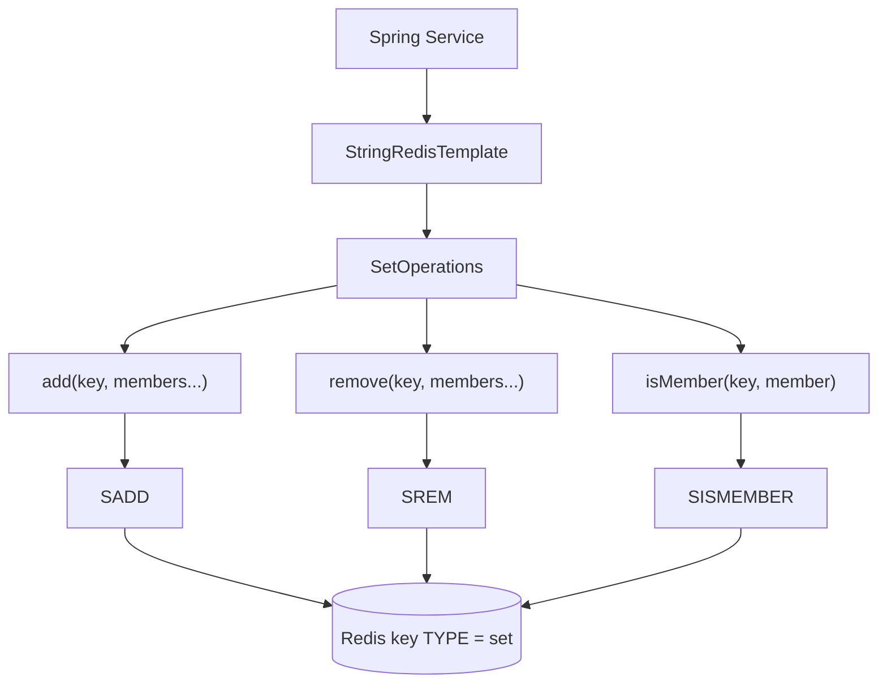
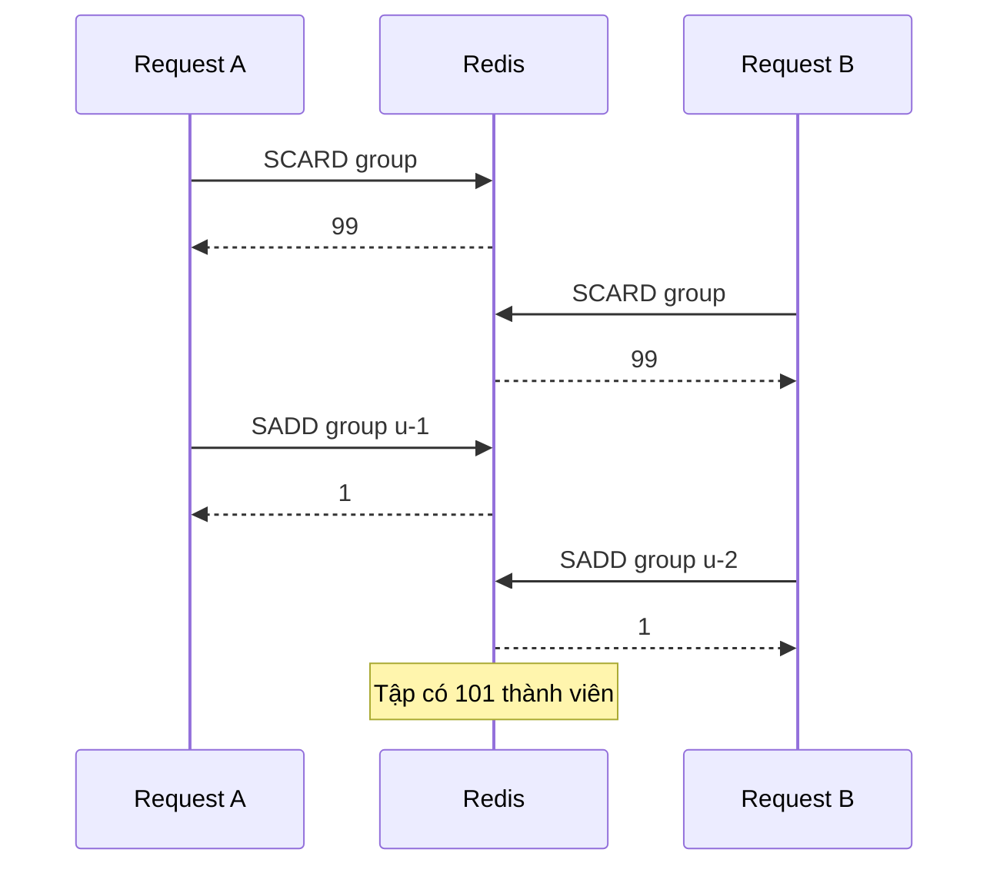
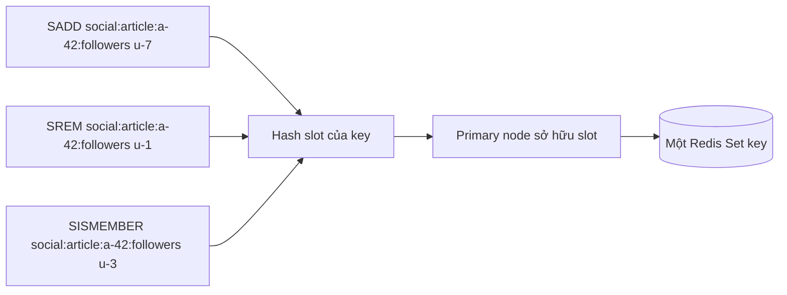

# Thêm, xóa và kiểm tra thành viên của Set trong Spring Data Redis

Trong Redis, **Set** là một tập hợp các phần tử **không trùng lặp** và **không bảo đảm thứ tự**. Một Redis key có kiểu `set` có thể chứa nhiều thành viên (*members*), chẳng hạn tập ID người dùng theo dõi một bài viết, tập mã sản phẩm đang được gắn thẻ hoặc tập định danh đã được xử lý. Trong ứng dụng Spring Data Redis, các thao tác cốt lõi với kiểu dữ liệu này được cung cấp bởi `SetOperations`, thường truy cập qua `RedisTemplate.opsForSet()` hoặc `StringRedisTemplate.opsForSet()`.

Bài học tập trung vào ba nhóm thao tác cơ bản và quan trọng nhất:

1. **Thêm** một hoặc nhiều thành viên bằng `SADD` / `SetOperations.add()`.
2. **Xóa** một hoặc nhiều thành viên cụ thể bằng `SREM` / `SetOperations.remove()`.
3. **Kiểm tra một thành viên có thuộc tập hợp không** bằng `SISMEMBER` / `SetOperations.isMember()`.

Kèm theo đó là cách đọc kết quả, ứng xử khi key vắng mặt, tính nguyên tử của một lệnh Redis, TTL, serializer, hiệu năng và các ví dụ ứng dụng thực tế. Ví dụ được trình bày cho **Spring Boot 3.x, Spring Data Redis 3.x**, với driver Redis được Spring Boot cấu hình phù hợp. Những hành vi phụ thuộc phiên bản hoặc Redis topology sẽ được ghi rõ.

## 1. Set khác List và Sorted Set như thế nào?

Giả sử cần quản lý các mã thẻ của sản phẩm `p-42`:

```text
Redis key: catalog:product:p-42:tags
Redis TYPE: set

Các thành viên:
    keyboard
    gaming
    wireless
```

Nếu thêm `wireless` lần thứ hai, Redis **không tạo thêm một bản sao**. Nếu xóa `gaming`, các thành viên còn lại vẫn nằm trong tập hợp. Redis không cam kết `keyboard` sẽ được trả trước `wireless` khi liệt kê kết quả.

| Cấu trúc Redis | Có phần tử trùng? | Có thứ tự theo ý nghĩa dữ liệu? | Thao tác tiêu biểu |
|---|---|---|---|
| **Set** | Không | Không | `SADD`, `SREM`, `SISMEMBER`, `SCARD` |
| List | Có thể có | Có thứ tự theo vị trí | `LPUSH`, `RPUSH`, `LPOP`, `LRANGE` |
| Sorted Set | Không trùng member | Có thứ tự theo score và quy tắc tie-break | `ZADD`, `ZRANGE`, `ZSCORE` |
| Hash | Field name không trùng | Không phải cấu trúc thứ tự | `HSET`, `HGET`, `HEXISTS` |

**Set phù hợp khi câu hỏi chính là “thành viên này có thuộc nhóm không?”**, chứ không phải “thành viên này nằm ở vị trí nào?” hoặc “thành viên nào có điểm cao nhất?”.

Redis Set được lưu dưới **một Redis key**. Ví dụ `catalog:product:p-42:tags` là key; `gaming` là member bên trong key đó. Việc thêm một member không tạo ra một Redis key mới tên `gaming`.

### Bản đồ từ Java xuống Redis



Trong đó:

- `StringRedisTemplate` xác định cách serialize tên key và các member dạng chuỗi.
- `SetOperations` cung cấp các API mang ngữ nghĩa Set.
- Redis server thực thi lệnh và lưu tập hợp các member theo byte đã được serialize.

## 2. Chuẩn bị môi trường Spring Data Redis

Ví dụ với Gradle:

```groovy
dependencies {
    implementation 'org.springframework.boot:spring-boot-starter-data-redis'
}
```

Ví dụ `application.yml` khi Redis standalone chạy trên máy phát triển:

```yaml
spring:
  data:
    redis:
      host: localhost
      port: 6379
      connect-timeout: 2s
      timeout: 3s
```

Starter cho Spring Data Redis cung cấp hạ tầng kết nối Redis phù hợp khi ứng dụng có đủ dependency và cấu hình. Với `StringRedisTemplate`, key và member thường được ghi theo UTF-8, vì vậy dễ quan sát bằng Redis CLI. Dữ liệu Redis không tự xuất hiện chỉ từ YAML; Redis server phải đang chạy và có thể truy cập từ nơi ứng dụng được triển khai.

Ví dụ inject một template:

```java
import org.springframework.data.redis.core.SetOperations;
import org.springframework.data.redis.core.StringRedisTemplate;
import org.springframework.stereotype.Service;

@Service
public class ProductTagService {
    private final SetOperations<String, String> sets;

    public ProductTagService(StringRedisTemplate redis) {
        this.sets = redis.opsForSet();
    }
}
```

Đây là cấu trúc ban đầu; các phương thức cụ thể sẽ được bổ sung ở phần sau. Spring bean `StringRedisTemplate` thông thường được chia sẻ giữa nhiều service sau khi cấu hình hoàn chỉnh. Không cần tự mở/đóng Redis connection trong từng phương thức nghiệp vụ.

## 3. Thêm thành viên bằng `SADD` và `add()`

Lệnh Redis:

```redis
SADD catalog:product:p-42:tags keyboard gaming wireless
```

Trên Spring Data Redis:

```java
Long addedCount = sets.add(
    "catalog:product:p-42:tags",
    "keyboard",
    "gaming",
    "wireless"
);
```

`SetOperations.add(key, values...)` nhận **một Redis key** và một hoặc nhiều member cần thêm. Redis thêm những member chưa có trong Set; member đã tồn tại không được nhân đôi.

### 3.1. Giá trị trả về của `add()` là gì?

Điểm quan trọng: `SADD` trả về **số member mới thực sự được thêm**, **không phải tổng số member sau thao tác** và cũng không nhất thiết bằng số argument.

Ví dụ trên một key ban đầu chưa tồn tại:

```text
SADD product:42:tags keyboard gaming wireless
→ 3

SADD product:42:tags gaming
→ 0

SADD product:42:tags gaming premium
→ 1

SCARD product:42:tags
→ 4
```

Ở bước cuối, Set có bốn member, nhưng lần `SADD` thứ ba chỉ trả `1` vì chỉ có `premium` là mới.

| Trạng thái trước lệnh | Lệnh | Số member mới | Trạng thái sau |
|---|---|---|---|
| Key chưa tồn tại | `SADD k a b` | 2 | `{a,b}` |
| `{a,b}` | `SADD k a` | 0 | `{a,b}` |
| `{a,b}` | `SADD k b c d` | 2 | `{a,b,c,d}` |
| `{a,b,c,d}` | `SADD k c d` | 0 | `{a,b,c,d}` |

Trong đường gọi đồng bộ bình thường, `add()` trả một `Long` biểu thị số lượng đó. Với pipeline/transaction, một số API Spring Data Redis có thể trả `null` tại thời điểm lệnh được queue và kết quả chỉ xuất hiện sau khi thực thi/xử lý pipeline.

### 3.2. Thêm một member và biết đây có phải lần đầu

```java
public boolean addTag(String productId, String tag) {
    String key = "catalog:product:" + productId + ":tags";
    Long added = sets.add(key, tag);
    return added != null && added == 1L;
}
```

Ý nghĩa:

- `true`: tại thời điểm lệnh `SADD` được Redis thực thi, member trước đó **chưa tồn tại** và vừa được thêm.
- `false` với kết quả `0`: member đã có.
- Nếu Redis lỗi, thao tác có thể ném exception; **không nên** bắt mọi exception rồi trả `false` vì “lỗi mạng” khác “member đã có”.

Đây là cách tránh race condition cho câu hỏi *“tôi vừa thêm mới hay không?”*. Đừng viết:

```java
// Dễ phát sinh race khi nhiều request chạy đồng thời.
if (!Boolean.TRUE.equals(sets.isMember(key, member))) {
    sets.add(key, member);
}
```

Giữa `isMember` và `add`, một request khác có thể đã thêm member. Nếu chỉ cần tạo thành viên khi vắng mặt, **một lệnh `SADD` đã đủ atomic** và kết quả số lượng mới thêm cung cấp thông tin cần thiết.

### 3.3. Một lần thêm nhiều member hay nhiều lần thêm từng member?

```java
// Một lời gọi tạo một lệnh SADD có nhiều member (thông thường).
sets.add(key, "a", "b", "c");

// Ba Redis operations riêng.
sets.add(key, "a");
sets.add(key, "b");
sets.add(key, "c");
```

Với Redis standalone, một lệnh `SADD key a b c` được Redis thực thi nguyên tử ở cấp lệnh: không có client khác quan sát trạng thái “đã thêm a nhưng chưa thêm b/c” **ở giữa cùng lệnh SADD**.

Ba lời gọi riêng biệt là ba Redis commands; request khác có thể xen vào giữa các lần gọi. Trong trường hợp kết nối hỏng giữa chừng, chỉ một phần các lời gọi có thể thành công.

Tuy nhiên, khi cần kiểm tra ràng buộc phức tạp như **“chỉ được thêm thành viên nếu Set có ít hơn 100 người”**, chỉ `SADD` không đủ vì phải kết hợp kiểm tra số lượng và ghi. Khi ấy cần một cơ chế atomic phù hợp như Lua script hoặc transaction với optimistic concurrency.

## 4. Xóa thành viên bằng `SREM` và `remove()`

Để xóa **những member cụ thể** khỏi Set, dùng `SREM`:

```redis
SREM catalog:product:p-42:tags gaming
```

Spring Data Redis:

```java
Long removedCount = sets.remove(
    "catalog:product:p-42:tags",
    "gaming"
);
```

`SetOperations.remove(key, members...)` không xóa Redis key một cách vô điều kiện. Nó xóa **các member được chỉ định** nếu chúng đang nằm trong Set.

### 4.1. Kết quả của `remove()`

Redis `SREM` trả về **số member thực sự bị xóa**:

```text
Set ban đầu: {keyboard, gaming, wireless}

SREM key gaming
→ 1
Set còn: {keyboard, wireless}

SREM key gaming
→ 0
Set vẫn: {keyboard, wireless}

SREM key wireless keyboard missing
→ 2
Set trở nên rỗng
```

Một lệnh `SREM` có thể yêu cầu xóa nhiều member, nhưng member chưa có không làm lệnh thất bại. Xóa lại cùng member thường là operation **idempotent về trạng thái cuối**: sau lần xóa đầu, member không còn; các lần sau trả `0`.

### 4.2. Xóa và biết mình có vừa thay đổi dữ liệu không

```java
public boolean removeTag(String productId, String tag) {
    String key = "catalog:product:" + productId + ":tags";
    Long removed = sets.remove(key, tag);
    return removed != null && removed == 1L;
}
```

Nếu mục đích là “chỉ gửi sự kiện khi một member vừa được xóa thành công”, số lượng trả về là tín hiệu tốt hơn `isMember` trước rồi mới `remove`, vì tránh được một **bước kiểm tra dễ race**.

Dẫu vậy, gửi sự kiện tới hệ thống bên ngoài sau `SREM` vẫn là **hai hành động không nằm chung transaction**. Nếu Redis xóa thành công rồi gửi sự kiện thất bại, cần cơ chế ghi nhận/retry có kiểm soát nếu business workflow cần bảo đảm sự kiện không bị mất.

### 4.3. SREM khác DEL và SPOP

| Lệnh | Ý nghĩa |
|---|---|
| `SREM key member` | Xóa member cụ thể khỏi Set |
| `DEL key` | Xóa **toàn bộ Redis key**, đồng nghĩa toàn bộ Set biến mất |
| `UNLINK key` | Gỡ toàn bộ key, để Redis giải phóng memory theo cơ chế bất đồng bộ phía server |
| `SPOP key` | Lấy ra và xóa **member ngẫu nhiên** (không phải member do caller chỉ định) |

Đừng dùng `DEL` để “rời khỏi một nhóm” nếu key Set đang chứa thành viên của **nhiều** người. `DEL` xóa cả tập hợp, ảnh hưởng tất cả member.

### 4.4. Xóa thành viên cuối cùng thì sao?

Redis không duy trì một key kiểu Set trống như một entity độc lập. Khi `SREM` xóa member cuối cùng, Redis key Set thường **không còn tồn tại**:

```bash
redis-cli SADD demo:set only
# (integer) 1

redis-cli SREM demo:set only
# (integer) 1

redis-cli EXISTS demo:set
# (integer) 0
```

Vì vậy, ở tầng ứng dụng cần phân biệt:

- **Set không có member**: Redis có thể biểu diễn bằng **key không tồn tại**.
- **Entity/business group không tồn tại**: là một trạng thái nghiệp vụ khác, không thể suy ra chắc chắn chỉ bằng Set rỗng.

Nếu “nhóm đã được tạo nhưng chưa có thành viên” phải khác “nhóm chưa từng được tạo”, hãy lưu thêm metadata hoặc marker dưới một key riêng. Không dùng việc Set có/không có key làm model trạng thái duy nhất khi nghiệp vụ có phân biệt như vậy.

## 5. Kiểm tra thành viên với `SISMEMBER` và `isMember()`

Khi cần trả lời “một member có thuộc Set này không?”, sử dụng:

```redis
SISMEMBER catalog:product:p-42:tags keyboard
```

Hoặc:

```java
Boolean present = sets.isMember(
    "catalog:product:p-42:tags",
    "keyboard"
);
```

Redis trả `1` nếu có, `0` nếu không. Ở Spring Data Redis, `isMember()` trả `Boolean`, nên thường dùng:

```java
public boolean hasTag(String productId, String tag) {
    String key = "catalog:product:" + productId + ":tags";
    return Boolean.TRUE.equals(sets.isMember(key, tag));
}
```

Cách `Boolean.TRUE.equals(...)` an toàn hơn việc unbox trực tiếp `Boolean` khi API có khả năng trả `null` ở ngữ cảnh đặc biệt như pipeline hoặc transaction. Tuy nhiên, **một kết quả `null` bất thường trong lối gọi đồng bộ không nên tự mặc định thành “không có quyền” hoặc “Set rỗng”**; điều đó cần chính sách lỗi rõ ràng.

### 5.1. Set không có key hoặc member vắng mặt

| Tình huống | Redis `SISMEMBER` | `isMember()` thông thường |
|---|---|---|
| Key là Set và member có trong Set | `1` | `true` |
| Key là Set nhưng member không có | `0` | `false` |
| Redis key không tồn tại | `0` | `false` |
| Key tồn tại nhưng kiểu Redis khác Set | `WRONGTYPE` | Exception được chuyển qua tầng Spring Data Redis |
| Redis server không truy cập được | Lỗi kết nối/timeout | Exception, không phải `false` hợp lệ |

Điểm đặc biệt: Redis trả `false` khi key Set không tồn tại. Nó **không** phân biệt “key Set chưa được tạo” với “member này không nằm trong key Set đã có”. Nếu nghiệp vụ cần biết key có tồn tại, có thể kiểm tra `EXISTS`/`hasKey`, nhưng hai thao tác riêng có thể nhìn hai thời điểm khác nhau khi có concurrent writers.

### 5.2. Vì sao kiểm tra trước rồi hành động có thể sai?

Giả sử workflow:

```text
T1: isMember(group, "u-42") → true
T2: another request removes "u-42"
T3: service continues because earlier check returned true
```

`SISMEMBER` trả kết quả **đúng tại thời điểm lệnh chạy**, không khóa member cho các thao tác sau. Nếu membership là điều kiện bảo vệ một mutation quan trọng, bạn cần định nghĩa invariant và cơ chế atomic kiểm tra-thực hiện phù hợp (script, transaction, hoặc xác thực tại nguồn dữ liệu authoritative).

Ví dụ quyền truy cập một tài nguyên: kiểm tra Set membership riêng rồi cập nhật dữ liệu ở database không tạo transaction xuyên Redis và database. Redis Set có thể hữu ích như cache hoặc index quyền, nhưng quyết định bảo mật cuối cùng cần chính sách quản lý nguồn sự thật và trường hợp cache stale/failure.

## 6. Tương tác trong Redis CLI

Có thể chạy các lệnh minh họa:

```bash
# Tạo Set; SADD trả số phần tử vừa được thêm.
redis-cli SADD demo:members alice bob carol
# (integer) 3

# Thêm trùng không làm tăng kích thước.
redis-cli SADD demo:members bob
# (integer) 0

# Kiểm tra thành viên.
redis-cli SISMEMBER demo:members alice
# (integer) 1
redis-cli SISMEMBER demo:members dave
# (integer) 0

# Đếm thành viên.
redis-cli SCARD demo:members
# (integer) 3

# Xóa một người.
redis-cli SREM demo:members bob
# (integer) 1

# Xóa lại thành viên đã mất.
redis-cli SREM demo:members bob
# (integer) 0

# Xem toàn bộ thành viên; thứ tự không cố định.
redis-cli SMEMBERS demo:members

# Kiểm tra kiểu Redis.
redis-cli TYPE demo:members
# set
```

Khi thử nghiệm nhiều lần, key có thể đã tồn tại từ lần trước. Nếu muốn quan sát chính xác kết quả `3` khi thêm lần đầu, hãy dùng key demo mới hoặc xóa **đúng key thử nghiệm**:

```bash
redis-cli DEL demo:members
```

Không dùng `FLUSHDB` hay `FLUSHALL` để dọn một key demo trên Redis có dữ liệu của ứng dụng khác.

## 7. Service đầy đủ: quản lý người theo dõi một bài viết

Một use case thực tế: lưu tập ID người theo dõi mỗi bài viết. Các yêu cầu:

- Một người không được tính thành hai thành viên trùng nhau.
- Có thể thêm/xóa ID người theo dõi.
- Kiểm tra user có đang theo dõi hay không.
- Lấy số lượng người theo dõi khi cần.
- Không cho dữ liệu đầu vào tùy ý phá quy ước key.

### 7.1. Thiết kế key

```text
social:article:<articleId>:followers
```

Ví dụ:

```text
social:article:a-42:followers
    -> "u-1"
    -> "u-7"
    -> "u-19"
```

### 7.2. Cài đặt bằng `SetOperations`

```java
import java.util.Objects;
import org.springframework.data.redis.core.SetOperations;
import org.springframework.data.redis.core.StringRedisTemplate;
import org.springframework.stereotype.Service;

@Service
public class ArticleFollowStore {
    private final SetOperations<String, String> sets;

    public ArticleFollowStore(StringRedisTemplate redis) {
        this.sets = redis.opsForSet();
    }

    public boolean follow(String articleId, String userId) {
        String key = followersKey(articleId);
        String member = userMember(userId);

        Long added = sets.add(key, member);
        return requireCount(added) == 1L;
    }

    public boolean unfollow(String articleId, String userId) {
        String key = followersKey(articleId);
        String member = userMember(userId);

        Long removed = sets.remove(key, member);
        return requireCount(removed) == 1L;
    }

    public boolean isFollowing(String articleId, String userId) {
        String key = followersKey(articleId);
        String member = userMember(userId);

        Boolean present = sets.isMember(key, member);
        return Objects.requireNonNull(
            present, "Unexpected deferred Redis result"
        );
    }

    public long followerCount(String articleId) {
        Long count = sets.size(followersKey(articleId));
        return requireCount(count);
    }

    private static long requireCount(Long count) {
        return Objects.requireNonNull(
            count, "Unexpected deferred Redis result"
        );
    }

    private static String followersKey(String articleId) {
        return "social:article:" + requireId(articleId) + ":followers";
    }

    private static String userMember(String userId) {
        return requireId(userId);
    }

    private static String requireId(String id) {
        if (id == null || !id.matches("[A-Za-z0-9_-]{1,80}")) {
            throw new IllegalArgumentException("Invalid identifier");
        }
        return id;
    }
}
```

**Diễn giải kết quả:**

```java
boolean firstFollow = store.follow("a-42", "u-7");
// true nếu tại thời điểm SADD, u-7 chưa thuộc Set.

boolean secondFollow = store.follow("a-42", "u-7");
// false vì không thêm member mới.

boolean currentlyFollowing = store.isFollowing("a-42", "u-7");
// true nếu không có thao tác concurrent xóa member trước SISMEMBER.

long count = store.followerCount("a-42");
// Số member hiện có trong Set tại thời điểm SCARD.

boolean removed = store.unfollow("a-42", "u-7");
// true nếu SREM thực sự xóa member.
```

Code giả định gọi `store` từ một client có bean `ArticleFollowStore` được inject; biến `store` trong ví dụ không phải biến global mặc định.

Lưu ý: `follow` và `unfollow` ở đây quản lý membership trên Redis, **không tự làm cho database nghiệp vụ, hàng đợi sự kiện hoặc email notification nhất quán**. Nếu yêu cầu chỉ tính một lần cho mỗi follow event và có khả năng retry sau network timeout, cần thêm operation ID hoặc reconciliation với nguồn dữ liệu chính.

### 7.3. Tại sao có `requireCount`?

Trong các lời gọi `RedisTemplate` đồng bộ thông thường, `SADD`/`SREM`/`SCARD` trả kết quả. Nhưng ở một số ngữ cảnh command được queue (ví dụ pipeline/transaction), Spring Data Redis có thể trả `null` ngay trong callback. Việc fail sớm thay vì âm thầm hiểu null là `0` giúp service đồng bộ không che khuất việc dùng sai ngữ cảnh.

Nói cách khác, **`null` từ một API tại thời điểm queue không chứng minh member vắng mặt**. Đường xử lý pipeline/transaction cần đọc kết quả sau khi thực thi và deserialize đúng.

## 8. Thêm hoặc xóa nhiều thành viên trong cùng một lệnh

`SetOperations.add()` và `remove()` đều chấp nhận nhiều member:

```java
Long added = sets.add(
    "social:article:a-42:followers",
    "u-1", "u-2", "u-3"
);

Long removed = sets.remove(
    "social:article:a-42:followers",
    "u-2", "u-9"
);
```

Nếu trước đó Set chưa có ai:

```text
SADD followers u-1 u-2 u-3 → 3
SREM followers u-2 u-9   → 1
Set còn u-1, u-3
```

Với một Redis key và một Redis server, Redis thực thi các member của **một lệnh** `SADD` hoặc `SREM` atomically. Điều này khác với việc vòng lặp Java gửi nhiều lời gọi riêng:

```java
for (String userId : userIds) {
    sets.add(key, userId);
}
```

Vòng lặp gửi nhiều commands; lỗi mạng giữa chừng có thể khiến một phần các phần tử được thêm. Một lệnh `SADD` có nhiều members thường giảm round trips và phù hợp hơn khi nghiệp vụ yêu cầu thêm một nhóm member cùng lúc.

Tuy nhiên, danh sách quá lớn cũng có thể tạo request lớn và chiếm nhiều thời gian/memory. Với hàng trăm nghìn member, cần chia batch có kiểm soát, quan sát độ trễ và thiết kế việc xử lý partial progress khi chạy nhiều batch.

## 9. Một lần SADD/SREM nguyên tử nhưng không phải toàn bộ workflow nguyên tử

Điều Redis bảo đảm tại lệnh:

```text
SADD group u-7
→ thêm nếu chưa có, trả 1
→ nếu đã có, trả 0
```

Điều Redis **không tự bảo đảm** khi code tách thành nhiều lệnh:

```java
if (sets.size(key) < 100) {
    sets.add(key, member);
}
```

Giả sử Set đang có 99 người và hai request chạy đồng thời:



Hai lệnh `SCARD` đều chính xác ở thời điểm riêng, hai lệnh `SADD` cũng atomic, nhưng **điều kiện tối đa 100 member bị phá vỡ** vì kiểm tra và cập nhật không nằm cùng transaction/script.

### Giải pháp bằng Lua khi cần kiểm tra và thêm atomically

Một script minh họa:

```lua
-- KEYS[1]: Redis Set key
-- ARGV[1]: member cần thêm
-- ARGV[2]: số thành viên tối đa

if redis.call('SISMEMBER', KEYS[1], ARGV[1]) == 1 then
    return 0  -- đã thuộc Set, không cần thêm
end

if redis.call('SCARD', KEYS[1]) >= tonumber(ARGV[2]) then
    return -1 -- Set đã đạt giới hạn
end

return redis.call('SADD', KEYS[1], ARGV[1])
```

Vì các lời gọi Redis trong script được thực thi như một đơn vị atomic trên server, hai request không thể xen vào giữa bước kiểm tra và thêm của **script này trên cùng Redis key**.

Kết quả:

- `1`: thêm member mới.
- `0`: member đã tồn tại trước khi chạy script.
- `-1`: chưa có member nhưng Set đã đủ giới hạn.

Script này minh họa giải pháp cho invariant *“không vượt quá số thành viên tối đa”*; ứng dụng phải triển khai script qua `RedisScript`/`RedisTemplate.execute` với key và arguments đúng, cộng thêm chính sách lỗi, monitoring và giới hạn tải. Không dùng script cho mọi lần `SADD` đơn giản khi không có ràng buộc bổ sung.

## 10. TTL của Redis Set khi thêm hoặc xóa thành viên

TTL thuộc **Redis key**, không mặc định thuộc từng member.

Ví dụ:

```bash
redis-cli SADD online:room:42 u-7 u-8
redis-cli EXPIRE online:room:42 60
redis-cli TTL online:room:42
```

Ở đây toàn bộ Set `online:room:42` hết hạn sau khoảng 60 giây. `SISMEMBER` không tự gia hạn TTL; `SADD`/`SREM` đối với key Set đang tồn tại thông thường **không tự reset TTL**.

### 10.1. Key mới có TTL mặc định không?

Không. `SADD` tạo một Set key mới nếu key chưa tồn tại, nhưng không tự gắn TTL. Nếu cần key sống 60 giây, phải khai báo:

```java
String key = "online:room:42";
sets.add(key, "u-7");
Boolean expiring = redis.expire(
    key, java.time.Duration.ofSeconds(60)
);
```

Hai lời gọi `SADD` và `EXPIRE` riêng biệt có một khoảng thời gian ở giữa. Nếu ứng dụng crash sau `SADD` mà trước `EXPIRE`, key có thể không có TTL. Nếu yêu cầu “thêm member và gắn TTL **atomically**”, cần một cơ chế thích hợp như Lua script hoặc một transaction Redis phù hợp.

### 10.2. Sliding expiration không phải hành vi mặc định

Ví dụ Set quản lý user online với yêu cầu “mỗi lần ghi nhận hoạt động mới thì gia hạn 60 giây”:

```text
t=0:   SADD u-7; EXPIRE 60s
t=30:  SADD u-8; nếu không gọi EXPIRE, hạn của Set vẫn gần t=60
t=61:  Set có thể đã hết hạn, dù u-8 hoạt động ở t=30
```

Để có sliding expiration, ứng dụng phải **chủ động** refresh TTL theo policy. Nhưng TTL cấp Set có nghĩa mỗi lần gia hạn cho một member sẽ kéo dài vòng đời **của tất cả members**, không thể suy ra mỗi user có thời gian online riêng.

Nếu nghiệp vụ muốn từng user có last-seen/timeout độc lập, một Set chung với TTL cấp key không đủ. Có thể cân nhắc Sorted Set lưu timestamp theo member, kèm cơ chế loại bỏ member hết hạn, hoặc một schema khác phù hợp.

### 10.3. Key bị xóa khi không còn member và việc tạo lại

Khi `SREM` xóa member cuối cùng, Set key biến mất. Nếu sau đó `SADD` tạo lại key, TTL từ lần tạo trước không “trở về” theo key name. Cần áp dụng expiry cho key mới theo policy.

Ngoài ra, nếu Redis Set đóng vai trò dữ liệu authoritative cần giữ lâu dài, đừng gắn TTL chỉ để “dọn memory” mà không xét việc mất dữ liệu. TTL là quyết định nghiệp vụ, không phải phần bắt buộc của `SetOperations`.

## 11. Serializer: Redis so sánh member theo byte

Redis không biết một Java object bằng một object khác theo `equals()`/`hashCode()`. Nó so sánh **representation bytes của member** bên trong Redis Set.

Với `StringRedisTemplate`:

```text
Java "u-7"
    |
    v
StringRedisSerializer (UTF-8)
    |
    v
byte[] của "u-7"
    |
    v
Redis Set member
```

Nếu code khác dùng serializer nhị phân hoặc JDK serialization để ghi cùng key, hai đoạn code có thể nhìn thấy các member khác nhau dù cùng biểu diễn “user u-7” trong Java.

### 11.1. Cấu hình RedisTemplate riêng cho String Set

`StringRedisTemplate` đã đơn giản hóa bài toán khi key/member đều là String. Với một `RedisTemplate` tự tạo, nên cấu hình rõ ràng:

```java
import org.springframework.context.annotation.Bean;
import org.springframework.context.annotation.Configuration;
import org.springframework.data.redis.connection.RedisConnectionFactory;
import org.springframework.data.redis.core.RedisTemplate;
import org.springframework.data.redis.serializer.StringRedisSerializer;

@Configuration
class RedisSetConfiguration {

    @Bean
    RedisTemplate<String, String> stringSetTemplate(
            RedisConnectionFactory factory) {
        RedisTemplate<String, String> template = new RedisTemplate<>();
        template.setConnectionFactory(factory);
        template.setKeySerializer(new StringRedisSerializer());
        template.setValueSerializer(new StringRedisSerializer());
        template.afterPropertiesSet();
        return template;
    }
}
```

`SetOperations` sử dụng serializer của key và value trên template thích hợp; **không dùng `hashKeySerializer` để serialize member của Redis Set**. Hash serializers chỉ áp dụng cho thao tác với Redis Hash.

### 11.2. Chuẩn hóa input trước khi lưu

Redis Set phân biệt chính xác bytes của các member:

```text
"Admin" != "admin"
"u-7"   != "u-7 "
```

Với Unicode, những chuỗi trông giống nhau có thể có nhiều biểu diễn code point. Nếu key/member mang ý nghĩa nhận dạng logic, phải quy định chuẩn hóa (chữ hoa/thường, khoảng trắng, Unicode normalization, ID canonical) **ngay ở boundary của ứng dụng**, và áp dụng quy tắc giống nhau khi `add`, `remove` và `isMember`.

Ví dụ:

```java
import java.util.Locale;

public static String normalizeTag(String raw) {
    if (raw == null) {
        throw new IllegalArgumentException("Tag is required");
    }
    String result = raw.trim().toLowerCase(Locale.ROOT);
    if (!result.matches("[a-z0-9_-]{1,40}")) {
        throw new IllegalArgumentException("Invalid tag");
    }
    return result;
}
```

Đây là một quy tắc dành riêng cho **tag chỉ chứa ASCII** trong ví dụ. Nếu hệ thống hỗ trợ tag tiếng Việt hoặc Unicode, cần quy định và triển khai normalization phù hợp, không đơn giản loại bỏ mọi ký tự ngoài ASCII.

## 12. Kiểm tra nhiều thành viên: những lựa chọn

Đôi khi ứng dụng cần biết hàng chục user có thuộc cùng Set hay không. Redis có lệnh **`SMISMEMBER`** (có từ Redis 6.2) để kiểm tra nhiều member của **một Set key** trong một lần:

```redis
SMISMEMBER social:article:a-42:followers u-1 u-7 u-19
```

Reply có các giá trị 0/1 tương ứng với vị trí member đầu vào.

Trong Spring Data Redis, `SetOperations.isMember(key, member)` là API rõ ràng cho trường hợp **một** member. Một số phiên bản có các API nhiều-member hoặc low-level commands tương ứng; hãy kiểm tra version thực tế để chọn overload đúng, thay vì suy đoán method name từ Redis command.

Nếu API hiện tại không cung cấp phương thức bulk thích hợp, có thể:

- Gửi nhiều `SISMEMBER` bằng pipeline khi hỗ trợ và muốn giảm round trips.
- Dùng lệnh thấp tầng hỗ trợ `SMISMEMBER` nếu Redis server và driver có capability đó.
- Với Set nhỏ và các member cần kiểm tra chiếm phần lớn tập, đọc tất cả member bằng `members(key)` rồi kiểm tra trong bộ nhớ — **chỉ khi kích thước được kiểm soát**.

Mỗi cách có trade-off. Không nên gọi `SMEMBERS` chỉ để kiểm tra hai member khi Set có hàng triệu phần tử.

## 13. Đếm, liệt kê và quét Set — công cụ bổ trợ

Mặc dù trọng tâm là thêm/xóa/kiểm tra, một số thao tác khác giúp hiểu kết quả:

### 13.1. Đếm với `SCARD` và `size()`

```java
Long count = sets.size("social:article:a-42:followers");
```

`SCARD` trả số member; nếu key không tồn tại, Redis trả `0`. Dùng `size()` thay vì tải toàn bộ member rồi gọi `Set.size()` chỉ để đếm.

### 13.2. Liệt kê với `SMEMBERS` và `members()`

```java
import java.util.Set;

Set<String> members = sets.members(
    "social:article:a-42:followers"
);
```

`SMEMBERS` trả toàn bộ member, **không hứa hẹn thứ tự**. Với Set rất lớn, nó có thể tạo reply lớn, dùng nhiều memory và làm tăng latency. Đừng serialize toàn bộ Set thành response HTTP nếu người dùng chỉ cần số lượng hoặc chỉ cần kiểm tra membership.

### 13.3. Duyệt dần với `SSCAN` và `scan()`

Redis có `SSCAN` để quét member theo cursor. Spring Data Redis hỗ trợ `SetOperations.scan()`:

```java
import org.springframework.data.redis.core.Cursor;
import org.springframework.data.redis.core.ScanOptions;

ScanOptions options = ScanOptions.scanOptions()
    .count(200)
    .build();

try (Cursor<String> cursor = sets.scan(
        "social:article:a-42:followers", options)) {
    while (cursor.hasNext()) {
        String member = cursor.next();
        // Xử lý lần lượt, không giữ toàn bộ Set trong memory.
        System.out.println(member);
    }
}
```

`COUNT` là gợi ý, không phải giới hạn cứng số member được trả mỗi đợt. `SSCAN` **không cung cấp snapshot bất biến** khi Set đang bị cập nhật: có thể thấy member lặp, bỏ qua member tồn tại chỉ trong một phần thời gian quét hoặc gặp kết quả khác do concurrent writes.

Với migration, export hoặc công việc dọn dữ liệu, xử lý idempotent và đóng cursor đúng cách. `SSCAN` duyệt **member bên trong một Set key**; khác với `SCAN` dùng để duyệt **tên các Redis keys**.

## 14. Redis Cluster: một Set key, một hash slot

`SADD`, `SREM` và `SISMEMBER` đều tác động lên **một Redis key**, vì vậy trong Redis Cluster chúng được định tuyến đến node sở hữu hash slot của key đó. Việc Set chứa hàng nghìn member không có nghĩa member được chia đều sang nhiều slot.



Điều này có hai mặt:

- **Ưu điểm:** thao tác một Set key không gặp hạn chế `CROSSSLOT` chỉ vì có nhiều member.
- **Giới hạn:** một Set key cực lớn hoặc rất “nóng” tập trung thao tác vào một node; Redis Cluster không tự phân phối member của cùng một Set sang nhiều shard.

Nếu cần kiểm tra membership đồng thời trên nhiều Set keys hoặc thực hiện phép toán như giao, hợp và hiệu của nhiều Sets, lệnh multi-key có thể chịu ràng buộc cùng hash slot. Khi ấy mới cần cân nhắc thiết kế hash tag, locality hoặc thay đổi mô hình dữ liệu.

Không đặt hash tag chung cho mọi Set như `{all-social-data}` một cách máy móc: điều đó dồn nhiều key vào cùng slot và có thể gây hotspot.

## 15. Các lỗi thường gặp

| Hiện tượng | Nguyên nhân có thể | Cách xác định/xử lý |
|---|---|---|
| `add()` trả `0` dù đã truyền member | Member đã tồn tại | Kiểm tra số lượng mới thêm, không nhầm với tổng số |
| `remove()` trả `0` | Member không thuộc Set hoặc key không tồn tại | Đây có thể là kết quả hợp lệ, không nhất thiết lỗi |
| `isMember()` trả `false` | Member vắng mặt hoặc key Set không tồn tại | Nếu cần phân biệt, dùng quy ước/metadata riêng |
| `isMember()` ném exception | Mạng, timeout, serializer hoặc key sai TYPE | Xem exception/cause chain, không đổi thành false tùy tiện |
| `WRONGTYPE` | Key đã được ghi bằng String/Hash/List | Chạy `TYPE key`, tránh trùng namespace |
| Member trông giống nhau nhưng được thêm hai lần | Khác chữ hoa/thường, khoảng trắng, Unicode hoặc serializer | Chuẩn hóa member và thống nhất serializer |
| Set biến mất sau xóa | Đã xóa member cuối cùng | Redis không giữ key Set rỗng |
| Set biến mất sau thời gian | Key có TTL và đã hết hạn | Dùng `TTL key` và xem chính sách expiry |
| SADD thêm member nhưng thiếu TTL | Tạo key mới không tự đặt expiry | Gắn TTL theo policy; dùng atomic script khi cần |
| Lấy `members()` rất chậm | Set quá lớn, reply quá nhiều dữ liệu | Dùng `size()`/`isMember()`/`SSCAN` đúng mục đích |
| Sau `SISMEMBER` trả true, thao tác sau vẫn thất bại | Concurrency: member bị xóa hoặc trạng thái khác thay đổi | Dùng atomic check-and-act khi nghiệp vụ yêu cầu |
| Retry sau timeout cho kết quả không chắc chắn | Redis có thể đã xử lý lệnh nhưng reply bị mất | Thiết kế idempotency, theo dõi kết quả và nguồn sự thật |

### Debug từ Redis CLI

```bash
# Xác định key thuộc kiểu nào.
redis-cli TYPE social:article:a-42:followers

# Kiểm tra vài thành viên.
redis-cli SISMEMBER social:article:a-42:followers u-7

# Đếm và kiểm tra TTL.
redis-cli SCARD social:article:a-42:followers
redis-cli TTL social:article:a-42:followers

# Quan sát các thành viên khi biết Set có kích thước nhỏ.
redis-cli SMEMBERS social:article:a-42:followers

# Duyệt dần khi Set lớn.
redis-cli SSCAN social:article:a-42:followers 0 COUNT 100
```

`TTL` trả số giây còn lại khi có expiration, `-1` nếu key tồn tại mà không có TTL, và `-2` nếu key không tồn tại. Nếu chỉ muốn tìm **tên Redis key** có prefix `social:article:`, dùng `SCAN`; không dùng `SSCAN` cho nhiệm vụ đó.

## 16. Tình huống thiết kế nghiệp vụ

### Tình huống A — Gắn thẻ sản phẩm

Mỗi sản phẩm có một Set các tag:

```text
catalog:product:p-42:tags -> {gaming, keyboard, wireless}
```

Chọn `SADD` để thêm tag, `SREM` để bỏ tag và `SISMEMBER` để kiểm tra “sản phẩm có tag `gaming` không?”. Nếu cần tìm **tất cả sản phẩm có tag `gaming`**, mô hình một Set theo product ID **chưa đủ để query ngược hiệu quả**. Cân nhắc duy trì thêm Set theo tag (ví dụ `catalog:tag:gaming:products`) hoặc một index phù hợp, đồng thời thiết kế nhất quán giữa hai chiều.

### Tình huống B — User theo dõi bài viết

Key `social:article:a-42:followers` chứa user IDs.

- `follow()` gọi `SADD`: không tạo follower trùng.
- `unfollow()` gọi `SREM`: xóa member cụ thể.
- `isFollowing()` gọi `SISMEMBER`: trả kết quả membership tại thời điểm đọc.
- `SCARD` đếm follower theo trạng thái hiện tại của Redis.

Nếu hệ thống còn ghi một bảng quan hệ trong database, hãy xác định **nguồn sự thật** để giải quyết khi hai nơi lệch nhau. Set chỉ phản ánh dữ liệu hiện tại của Redis, không tự sửa database.

### Tình huống C — Danh sách member của phòng chat

Với phòng chat, `SADD`/`SREM` thích hợp để quản lý người tham gia, nhưng phải phân biệt “đã tham gia phòng” và “đang online”. Online có đặc tính hết hạn theo thời điểm; TTL của một Set chung **không tự theo dõi expiry từng thành viên**. Đừng nhầm hai nhu cầu.

### Tình huống D — Ghi nhận đã xử lý một sự kiện

`SADD processed:eventIds evt-123` trả `1` nếu ID chưa có và `0` nếu đã có. Đây có thể là một tín hiệu chống trùng **trong Redis**, nhưng nếu xử lý nghiệp vụ ở database xảy ra sau đó, tình huống “SADD thành công, xử lý database thất bại” có thể làm sự kiện bị coi là đã xử lý dù chưa hoàn tất. Cần trạng thái xử lý, outbox/inbox hoặc transaction/idempotency đúng chỗ theo yêu cầu.

### Tình huống E — Danh sách vai trò người dùng

`user:42:roles` có thể là Set như `{reader, editor}`. `SISMEMBER` dễ trả lời vai trò hiện có, nhưng **không tự bảo đảm phân quyền an toàn** nếu Redis chỉ là cache hoặc dữ liệu có thể stale. Với quyết định bảo mật, cần rõ nguồn dữ liệu authoritative, TTL/invalidation và hành vi fail-closed khi Redis không khả dụng.

### Tình huống F — Giới hạn 100 thành viên

Nếu cần “Set có tối đa 100 người”, không dùng riêng `SCARD` rồi `SADD` theo hai lệnh khi có concurrency. Dùng atomic check-and-add bằng script/transaction thích hợp, hoặc giải quyết giới hạn tại nguồn dữ liệu lưu trữ bảo đảm invariant.

## 17. Những nhầm lẫn phổ biến về SetOperations

| Nhầm lẫn | Hiểu đúng |
|---|---|
| “`SADD` chỉ thêm một phần tử.” | Một lệnh có thể thêm nhiều member. |
| “`add()` trả về kích thước Set.” | Trả số member **mới** được thêm. Kích thước dùng `SCARD`/`size()`. |
| “`SREM` xóa Redis key.” | Nó xóa member được chỉ định; key có thể biến mất khi member cuối cùng bị xóa. |
| “SISMEMBER false chứng minh key Set tồn tại nhưng không có member.” | False cũng xuất hiện khi cả key không tồn tại. |
| “Set nhớ thứ tự thêm.” | Set không có thứ tự được bảo đảm; muốn thứ tự dùng cấu trúc khác. |
| “SADD rồi EXPIRE là một thao tác nguyên tử.” | Hai lời gọi riêng có thể thất bại ở giữa. |
| “Một Set key có TTL riêng cho mỗi member.” | TTL mặc định nằm ở cấp key. |
| “Đã kiểm tra membership là true thì một thao tác sau vẫn chắc chắn hợp lệ.” | Thành viên có thể bị thay đổi giữa hai Redis commands. |
| “`StringRedisTemplate` và template serializer khác nhau thấy cùng member.” | Redis so sánh bytes; serializer phải tương thích. |
| “Mỗi member được phân tán sang node Redis Cluster khác nhau.” | Một Set là một Redis key thuộc một slot. |
| “`SMEMBERS` phù hợp cho mọi Set.” | Set lớn có thể làm reply rất nặng; dùng `SISMEMBER`/`SSCAN` đúng mục đích. |

## 18. Nguyên tắc lựa chọn API

Khi code với Redis Set, hãy quyết định theo câu hỏi thực tế:

1. **Muốn thêm một hay nhiều member?** Dùng `sets.add(key, values...)`, kiểm tra số member mới thêm.
2. **Muốn xóa member cụ thể?** Dùng `sets.remove(key, members...)`, kiểm tra số member thực sự bị xóa.
3. **Chỉ cần biết một member có thuộc Set không?** Dùng `sets.isMember(key, member)`; không tải toàn bộ Set.
4. **Chỉ cần số lượng?** Dùng `sets.size(key)`, không dùng `members().size()`.
5. **Set lớn và muốn duyệt?** Dùng `scan()` có xử lý cursor, idempotency và data churn.
6. **Key có cần TTL không?** Quy định TTL ở cấp key và tránh khoảng lỗi giữa tạo key với cấp TTL khi yêu cầu atomicity.
7. **Có thao tác kiểm tra rồi cập nhật?** Phân tích concurrency; một lệnh Redis atomic không tự làm cả workflow nhiều lệnh atomic.
8. **Có ý nghĩa nghiệp vụ của thứ tự hoặc timestamp?** Nếu có, Set chưa chắc là kiểu dữ liệu phù hợp.

**`SADD`, `SREM` và `SISMEMBER` tạo nên bộ thao tác nền tảng cho Redis Set:** thêm duy nhất, xóa đúng thành viên và kiểm tra membership. Spring Data Redis đưa chúng vào `SetOperations` với cú pháp Java dễ sử dụng, nhưng tính đúng đắn vẫn phụ thuộc vào việc hiểu return value, serializer, TTL, race condition và quyền sở hữu dữ liệu. Nếu nắm rõ từng lệnh và ranh giới atomicity, ta có thể dùng Redis Set hiệu quả để quản lý membership mà không biến nó thành một mô hình dữ liệu chứa những giả định sai.
