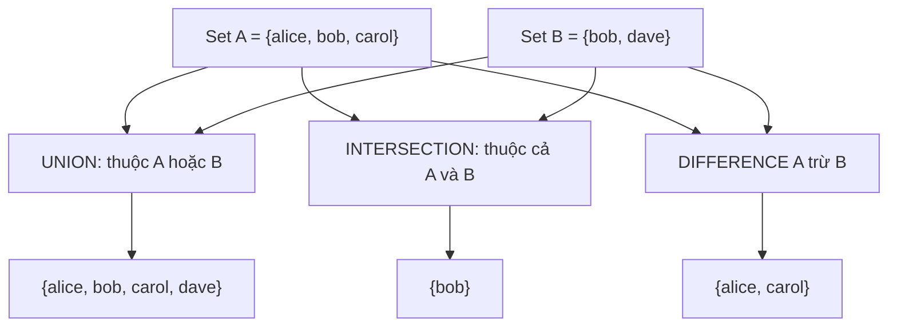

# Phép hợp, giao và hiệu giữa các tập

## 1. Vì sao cần phép toán tập hợp trong Redis?

Trong Spring Data Redis, **Redis Set** là một kiểu dữ liệu lưu các phần tử **không trùng lặp** và **không bảo đảm thứ tự**. Mỗi phần tử trong Set là một member, Redis so sánh member theo chuỗi byte mà ứng dụng gửi xuống. Khi nghiệp vụ cần kết hợp nhiều danh sách member, Redis có thể thực hiện trực tiếp **phép hợp (union), phép giao (intersection) và phép hiệu (difference)** mà không cần tải tất cả các Set về Java rồi xử lý.

Ví dụ, một cửa hàng có ba nhóm khách hàng:

- `campaign:email`: khách đã đăng ký nhận email.
- `campaign:app`: khách đã bật thông báo trong ứng dụng.
- `campaign:blocked`: khách không được nhận chiến dịch theo chính sách hiện hành.

Những câu hỏi nghiệp vụ xuất hiện ngay:

- Ai thuộc **ít nhất một** trong hai kênh email hoặc app? → **Phép hợp**.
- Ai thuộc **cả hai** kênh? → **Phép giao**.
- Ai thuộc nhóm được liên hệ nhưng **không** có trong nhóm bị chặn? → **Phép hiệu**.

Redis hỗ trợ trực tiếp các lệnh `SUNION`, `SINTER` và `SDIFF`. Spring Data Redis cung cấp cùng ý tưởng qua `SetOperations.union(...)`, `intersect(...)` và `difference(...)`.

Nhờ đó, phép toán chạy ở phía Redis trên các key đã có. Ứng dụng chỉ nhận lại kết quả hoặc yêu cầu Redis lưu kết quả vào một key khác khi cần sử dụng tiếp.

### Dữ liệu ví dụ dùng xuyên suốt

Giả sử hai tập:

```text
A = campaign:email = {alice, bob, carol}
B = campaign:app   = {bob, dave}
```

Kết quả:

| Phép toán | Ký hiệu | Thành viên kết quả |
|---|---|---|
| Hợp | `A ∪ B` | `{alice, bob, carol, dave}` |
| Giao | `A ∩ B` | `{bob}` |
| Hiệu A trừ B | `A \ B` | `{alice, carol}` |
| Hiệu B trừ A | `B \ A` | `{dave}` |

Đây là kết quả xét theo **tư cách thành viên**, không phải thứ tự nhập. Redis Set không tự bảo đảm member đầu tiên là `alice`, và Java `Set` trả về cũng không được dùng như một danh sách có thứ tự cố định.

## 2. Ôn lại đặc tính của Redis Set

Một Redis Set có các đặc điểm then chốt:

1. **Không trùng member:** thêm `bob` hai lần không làm xuất hiện hai `bob`.
2. **Không có vị trí index:** không đọc phần tử “thứ ba” theo nghĩa của List; muốn sắp xếp cần thực hiện riêng hoặc dùng Sorted Set cho dữ liệu có score.
3. **Member được so sánh theo byte:** `Bob` khác `bob`, và serializer khác nhau có thể tạo member khác nhau từ ý nghĩa Java tưởng như giống nhau.
4. **Phép hợp/giao/hiệu trả về Set mới về mặt toán học:** dữ liệu nguồn không đổi khi dùng các lệnh đọc `SUNION`, `SINTER`, `SDIFF`.
5. **Có biến thể ghi kết quả vào Redis:** `SUNIONSTORE`, `SINTERSTORE`, `SDIFFSTORE` làm thay đổi key đích.
6. **TTL thường áp dụng cho Redis key chứa cả Set:** kết quả toán học không tự mang TTL từ các key nguồn sang key đích.

Dữ liệu mẫu trong Redis CLI:

```redis
SADD campaign:email alice bob carol
SADD campaign:app bob dave

SMEMBERS campaign:email
SMEMBERS campaign:app
SCARD campaign:email
SISMEMBER campaign:email bob
```

`SADD` thêm các member, `SMEMBERS` đọc các member, `SCARD` cho biết số member không trùng, còn `SISMEMBER` kiểm tra một member cụ thể.

Nếu một top-level key đang là Hash, String hay List, gọi các lệnh Set lên key đó có thể gây lỗi `WRONGTYPE`. Redis không tự đổi kiểu của key chỉ vì người dùng gọi `SINTER` hoặc `SUNION`.

## 3. Phép hợp: SUNION

**Phép hợp** lấy tất cả member xuất hiện trong **ít nhất một** tập đầu vào. Với tập A và B:

\[
A \cup B = \{x \mid x \in A \text{ hoặc } x \in B\}
\]

Ví dụ:

```redis
SUNION campaign:email campaign:app
```

Các member kết quả là:

```text
alice
bob
carol
dave
```

Thứ tự hiển thị thực tế có thể khác. `bob` thuộc cả hai Set nhưng chỉ xuất hiện một lần.

### 3.1. Hợp của nhiều hơn hai tập

Giả sử bổ sung nhóm khách trên website:

```redis
SADD campaign:web carol erin
SUNION campaign:email campaign:app campaign:web
```

Kết quả chứa `alice`, `bob`, `carol`, `dave`, `erin`, mỗi người một lần.

`SUNION` chấp nhận nhiều key. Redis lấy member từ tất cả các Set đầu vào, loại trùng và trả kết quả. Đây là phép toán **giao hoán** và **kết hợp** về mặt tập hợp:

\[
A \cup B = B \cup A
\]

\[
(A \cup B) \cup C = A \cup (B \cup C)
\]

Thứ tự key không làm thay đổi **thành phần member** trong kết quả hợp, dù thứ tự member Redis trả về vẫn không được bảo đảm.

### 3.2. Bài toán dùng union

Union phù hợp để gom người dùng từ nhiều nguồn, hợp các quyền hoặc nhãn, hợp danh sách thiết bị đang đăng ký một trong các kênh, hoặc tìm sản phẩm nằm trong ít nhất một danh sách gợi ý.

Ví dụ:

```text
followers:author:1 = {u1, u2, u3}
followers:author:2 = {u2, u4}

SUNION -> {u1, u2, u3, u4}
```

Với API hiển thị danh sách, hãy nhớ kết quả Redis **không có thứ tự ưu tiên**. Muốn xếp theo thời gian theo dõi, độ liên quan hay điểm số, phải có dữ liệu sắp xếp riêng.

## 4. Phép giao: SINTER

**Phép giao** lấy những member xuất hiện trong **tất cả** các tập đầu vào:

\[
A \cap B = \{x \mid x \in A \text{ và } x \in B\}
\]

Với dữ liệu ví dụ:

```redis
SINTER campaign:email campaign:app
```

Kết quả chỉ có:

```text
bob
```

`alice` chỉ có trong email, `dave` chỉ có trong app; cả hai không thuộc phép giao.

### 4.1. Giao của nhiều tập

```redis
SADD campaign:vip bob alice
SINTER campaign:email campaign:app campaign:vip
```

`bob` là thành viên xuất hiện đồng thời trong ba nhóm nên được giữ lại.

Phép giao thỏa mãn:

\[
A \cap B = B \cap A
\]

\[
(A \cap B) \cap C = A \cap (B \cap C)
\]

Nếu **bất kỳ** tập đầu vào nào rỗng hoặc key Set đó không tồn tại, giao của các tập sẽ rỗng. Điều này rất hữu ích khi lọc theo nhiều điều kiện bắt buộc.

### 4.2. Dùng intersection trong phân quyền và phân khúc

Giả sử:

```text
users:paid       = {u1, u2, u3}
users:newsletter = {u2, u3, u4}
users:active     = {u2, u5}
```

`SINTER users:paid users:newsletter users:active` cho kết quả `{u2}`: chỉ người dùng đồng thời đang trả phí, đăng ký newsletter và hoạt động.

Intersection thuận tiện để tạo các tập phân khúc đã có sẵn. Tuy nhiên, nếu kết quả quyết định quyền truy cập nhạy cảm hoặc giao dịch quan trọng, cần đánh giá tính mới, độ bền và vai trò nguồn sự thật của Redis. Một Set phân quyền bị cập nhật trễ hoặc bị eviction có thể đưa ra quyết định không đúng mong muốn nếu ứng dụng chỉ dựa vào nó.

## 5. Phép hiệu: SDIFF

**Phép hiệu** giữ các member có trong tập đầu tiên nhưng **không** xuất hiện trong các tập theo sau:

\[
A \setminus B = \{x \mid x \in A \text{ và } x \notin B\}
\]

Ví dụ:

```redis
SDIFF campaign:email campaign:app
```

Kết quả là:

```text
alice
carol
```

Đổi thứ tự hai key:

```redis
SDIFF campaign:app campaign:email
```

Kết quả:

```text
dave
```

**Đây là điểm khác biệt quan trọng nhất so với hợp và giao: phép hiệu không giao hoán.**

\[
A \setminus B \ne B \setminus A
\]

Trừ trường hợp đặc biệt khiến hai kết quả tình cờ bằng nhau, đảo thứ tự key sẽ thay đổi ý nghĩa nghiệp vụ.

### 5.1. SDIFF với nhiều tập

Redis cho phép cú pháp:

```redis
SDIFF keyA keyB keyC
```

Ý nghĩa:

\[
A \setminus (B \cup C)
\]

Tức là lấy member thuộc A rồi loại mọi member xuất hiện trong **B hoặc C**.

Ví dụ:

```redis
SADD campaign:blocked carol dave
SDIFF campaign:email campaign:app campaign:blocked
```

Kết quả chỉ còn `alice`. Lệnh giữ member từ `campaign:email` nhưng loại người thuộc `campaign:app` **hoặc** `campaign:blocked`.

Cần đọc kỹ tên key và mục tiêu nghiệp vụ: nếu muốn **mọi người ở email hoặc app trừ người bị chặn**, biểu thức đúng là:

\[
(A \cup B) \setminus C
\]

Không thể dùng `SDIFF A B C` vì lệnh đó sẽ loại hẳn toàn bộ thành viên B khỏi A trước khi áp dụng C.

Một cách triển khai trên Redis là tạo tập hợp nguồn trước rồi tính hiệu, hoặc thiết kế Lua/script phù hợp nếu yêu cầu toàn bộ quá trình phải nguyên tử. Phần biến thể STORE sẽ minh họa cách lưu kết quả trung gian.

### 5.2. Bài toán phổ biến của difference

- Người dùng **có quyền ứng tuyển** trừ người đã ứng tuyển.
- Người được nhận chiến dịch trừ người từ chối nhận thông báo.
- Người đăng ký sự kiện trừ người đã check-in.
- Sản phẩm trong danh mục trừ sản phẩm đang bị ẩn.
- Những người theo dõi A nhưng chưa theo dõi B.

Với mọi ví dụ, hãy ghi rõ bên **còn lại** và bên **bị loại**, vì đây là lỗi rất dễ phát sinh khi sửa thứ tự tham số trong `difference(key, otherKey)`.

## 6. So sánh nhanh ba phép toán

| Đặc điểm | Hợp | Giao | Hiệu |
|---|---|---|---|
| Lệnh đọc Redis | `SUNION` | `SINTER` | `SDIFF` |
| Phương thức Spring | `union` | `intersect` | `difference` |
| Ý nghĩa | Thuộc ít nhất một tập | Thuộc tất cả tập | Thuộc tập đầu tiên, loại những tập sau |
| Giao hoán A/B? | Có | Có | Không |
| Kết quả khi một đầu vào rỗng | Bằng tập còn lại với hai đầu vào | Rỗng | Phụ thuộc tập nào rỗng |
| Có thứ tự member? | Không | Không | Không |
| Lệnh ghi kết quả | `SUNIONSTORE` | `SINTERSTORE` | `SDIFFSTORE` |

Sơ đồ luồng khái niệm:



Sơ đồ chỉ biểu diễn tập phần tử, không biểu diễn thứ tự duyệt hay thứ tự trả về từ Redis.

## 7. Spring Data Redis: dùng SetOperations

Trong Spring Boot, `RedisTemplate` hoặc `StringRedisTemplate` cung cấp `opsForSet()`. Nếu dữ liệu là user ID, SKU hoặc tag dưới dạng chuỗi, `StringRedisTemplate` thường giúp byte format dễ đọc và tương tác được với `redis-cli`.

Dependency (Gradle Groovy):

```groovy
dependencies {
    implementation 'org.springframework.boot:spring-boot-starter-data-redis'
}
```

Ví dụ cấu hình Redis local trong Spring Boot 3.x:

```yaml
spring:
  data:
    redis:
      host: localhost
      port: 6379
      connect-timeout: 2s
      timeout: 2s
```

Service có thể truy cập Set operations:

```java
import org.springframework.data.redis.core.SetOperations;
import org.springframework.data.redis.core.StringRedisTemplate;
import org.springframework.stereotype.Service;

@Service
public class AudienceSetService {

    private final SetOperations<String, String> sets;

    public AudienceSetService(StringRedisTemplate redis) {
        this.sets = redis.opsForSet();
    }

    public void addToEmailAudience(String userId) {
        sets.add("campaign:email", userId);
    }

    public void addToAppAudience(String userId) {
        sets.add("campaign:app", userId);
    }
}
```

`SetOperations<String, String>` có hai kiểu quan trọng:

- Kiểu đầu tiên `String`: top-level Redis key.
- Kiểu thứ hai `String`: member của Redis Set.

Set không có hash field. Phương thức `opsForSet()` dùng serializer cho **key** và **member** theo hợp đồng của RedisTemplate; không có hash key serializer trong những thao tác này.

### 7.1. Viết service cho ba phép toán

```java
import java.util.Set;
import org.springframework.data.redis.core.SetOperations;
import org.springframework.data.redis.core.StringRedisTemplate;
import org.springframework.stereotype.Service;

@Service
public class AudienceAlgebraService {

    private final SetOperations<String, String> sets;

    public AudienceAlgebraService(StringRedisTemplate redis) {
        this.sets = redis.opsForSet();
    }

    public Set<String> usersInEitherChannel() {
        return requireResult(sets.union(
                "campaign:email",
                "campaign:app"));
    }

    public Set<String> usersInBothChannels() {
        return requireResult(sets.intersect(
                "campaign:email",
                "campaign:app"));
    }

    public Set<String> emailOnlyUsers() {
        return requireResult(sets.difference(
                "campaign:email",
                "campaign:app"));
    }

    public Set<String> appOnlyUsers() {
        return requireResult(sets.difference(
                "campaign:app",
                "campaign:email"));
    }

    private static Set<String> requireResult(Set<String> members) {
        if (members == null) {
            throw new IllegalStateException(
                    "Không có kết quả trực tiếp từ Redis");
        }
        return members;
    }
}
```

Ánh xạ theo lệnh:

```text
sets.union(A, B)      -> SUNION A B
sets.intersect(A, B)  -> SINTER A B
sets.difference(A, B) -> SDIFF A B
```

Trong các lời gọi đồng bộ thông thường, một phép toán không có member phù hợp cho kết quả là Set rỗng. `SetOperations` có thể trả `null` khi được sử dụng trong pipeline hoặc transaction bởi kết quả được tổng hợp sau; helper `requireResult` ở ví dụ này dành cho đường gọi đồng bộ trực tiếp, không dùng trong callback pipelined.

**Không phụ thuộc vào thứ tự của `Set<String>`**. Nếu API cần kết quả theo alphabet, có thể sắp xếp **sau khi** nhận kết quả, với điều kiện kích thước kết quả đủ nhỏ để giữ trong bộ nhớ.

### 7.2. Gọi với nhiều key

Khi muốn hợp/giao/hiệu qua nhiều Set, `SetOperations` cung cấp overload nhận tập hợp key bổ sung:

```java
import java.util.List;
import java.util.Set;

// Hợp email + app + web.
Set<String> anyChannel = sets.union(
        "campaign:email",
        List.of("campaign:app", "campaign:web"));

// Giao đồng thời cả ba nhóm.
Set<String> allChannels = sets.intersect(
        "campaign:email",
        List.of("campaign:app", "campaign:web"));

// Giữ thành viên email, loại app và blocked.
Set<String> emailWithoutOthers = sets.difference(
        "campaign:email",
        List.of("campaign:app", "campaign:blocked"));
```

Tham số đầu tiên của `difference` là **tập bị trừ**; danh sách theo sau là **các tập dùng để loại member**. Với union và intersection, đổi thứ tự key không đổi tập kết quả về mặt toán học.

Khi danh sách key lấy từ input động, hãy kiểm tra số lượng key, quyền truy cập namespace và điều kiện Redis Cluster. Không cho client gửi tùy ý hàng nghìn tên key vào một command trên đường request nóng.

### 7.3. API trả về Set không phải bản sao trực tiếp của Spring entity

Kết quả là một tập các member đã được template deserialize. Nếu Redis lưu JSON object dưới dạng member, kết quả có thể là `Set<MyDto>` khi cấu hình `RedisTemplate<String, MyDto>` phù hợp, nhưng cần định nghĩa rõ **equality và định dạng byte ổn định**. Hai object Java được coi là giống nhau bằng `equals()` vẫn có thể tạo JSON bytes khác nhau do thứ tự field, formatting hoặc schema, khiến Redis xem là hai member khác nhau.

Với danh sách người dùng/sản phẩm, thường nên dùng **ID ổn định dưới dạng chuỗi** thay vì serialize toàn bộ entity vào Redis Set.

## 8. Minh họa dữ liệu thực từ Java

Giả sử service có một tác vụ chuẩn bị dữ liệu demo:

```java
import org.springframework.data.redis.core.SetOperations;
import org.springframework.data.redis.core.StringRedisTemplate;
import org.springframework.stereotype.Component;

@Component
public class AudienceSeedExample {

    private final StringRedisTemplate redis;

    public AudienceSeedExample(StringRedisTemplate redis) {
        this.redis = redis;
    }

    public void seedDemo() {
        SetOperations<String, String> sets = redis.opsForSet();

        // Chỉ dùng cho dữ liệu demo hoặc key có ownership rõ ràng.
        redis.delete("campaign:email");
        redis.delete("campaign:app");
        redis.delete("campaign:blocked");

        sets.add("campaign:email", "alice", "bob", "carol");
        sets.add("campaign:app", "bob", "dave");
        sets.add("campaign:blocked", "carol", "dave");
    }
}
```

Sau khi seed:

```text
campaign:email   = {alice, bob, carol}
campaign:app     = {bob, dave}
campaign:blocked = {carol, dave}
```

Các phép toán cơ bản:

```java
SetOperations<String, String> sets = redis.opsForSet();

Set<String> union = sets.union("campaign:email", "campaign:app");
// {alice, bob, carol, dave}

Set<String> intersection =
        sets.intersect("campaign:email", "campaign:app");
// {bob}

Set<String> difference =
        sets.difference("campaign:email", "campaign:app");
// {alice, carol}
```

Chú thích thể hiện **nội dung tập**, không phải thứ tự iteration. Trong hệ thống thực tế, không gọi `redis.delete(...)` trên key dùng chung khi application startup mà không có quyền sở hữu dữ liệu: ví dụ seed được dành cho dữ liệu demo.

### Khi nào nên dùng kết quả Set ở Java?

- Khi cần chuyển một nhóm member nhỏ thành DTO để trả API.
- Khi muốn làm thêm phép biến đổi Java ngoài các phép toán Redis hỗ trợ.
- Khi business rule cần nhìn danh sách member tại một thời điểm và kích thước danh sách được giới hạn rõ.

Nếu Set có hàng triệu member, `sets.union(...)` hoặc `sets.intersect(...)` phải truyền kết quả lớn từ Redis sang JVM, gây áp lực memory và network. Khi chỉ cần thành viên có tồn tại trong một Set, ưu tiên `isMember(...)`; khi cần count, cân nhắc lệnh đếm thích hợp; khi cần duyệt tập lớn, dùng scan/cursor theo hợp đồng.

## 9. Các lệnh STORE: lưu kết quả phép toán vào Redis

Ba lệnh `SUNION`, `SINTER` và `SDIFF` trả kết quả cho caller mà không đổi các key nguồn. Redis còn cung cấp biến thể **STORE** để ghi tập kết quả vào key đích:

```redis
SUNIONSTORE destination source1 source2 ...
SINTERSTORE destination source1 source2 ...
SDIFFSTORE destination source1 source2 ...
```

Lệnh STORE:

1. Tính kết quả từ các Set nguồn.
2. **Ghi/ghi đè key đích** thành Redis Set chứa kết quả.
3. Trả về **số lượng member** của tập đã lưu.

Ví dụ:

```redis
SUNIONSTORE campaign:eligible:any campaign:email campaign:app
SINTERSTORE campaign:eligible:both campaign:email campaign:app
SDIFFSTORE campaign:eligible:email-only campaign:email campaign:app
```

Đọc kết quả:

```redis
SMEMBERS campaign:eligible:any
SMEMBERS campaign:eligible:both
SMEMBERS campaign:eligible:email-only
```

Một điểm quan trọng: **STORE tạo snapshot tính toán tại thời điểm lệnh chạy**, không phải một view tự cập nhật. Nếu người dùng mới được thêm vào `campaign:email` sau đó, `campaign:eligible:any` không tự thay đổi cho tới khi được tính lại hoặc cập nhật bằng một cơ chế khác.

### 9.1. Spring Data Redis: unionAndStore, intersectAndStore, differenceAndStore

`SetOperations` có các method tương ứng:

```java
import org.springframework.data.redis.core.SetOperations;
import org.springframework.data.redis.core.StringRedisTemplate;
import org.springframework.stereotype.Service;

@Service
public class AudienceMaterializationService {

    private final SetOperations<String, String> sets;

    public AudienceMaterializationService(StringRedisTemplate redis) {
        this.sets = redis.opsForSet();
    }

    public long materializeAnyChannel() {
        Long size = sets.unionAndStore(
                "campaign:email",
                "campaign:app",
                "campaign:eligible:any");

        return requireCount(size);
    }

    public long materializeBothChannels() {
        Long size = sets.intersectAndStore(
                "campaign:email",
                "campaign:app",
                "campaign:eligible:both");

        return requireCount(size);
    }

    public long materializeEmailOnly() {
        Long size = sets.differenceAndStore(
                "campaign:email",
                "campaign:app",
                "campaign:eligible:email-only");

        return requireCount(size);
    }

    private static long requireCount(Long count) {
        if (count == null) {
            throw new IllegalStateException(
                    "Không có kết quả trực tiếp từ Redis");
        }
        return count;
    }
}
```

So sánh:

| API Spring | Lệnh Redis | Giá trị trả về |
|---|---|---|
| `union(A, B)` | `SUNION A B` | `Set<V>` chứa member kết quả |
| `intersect(A, B)` | `SINTER A B` | `Set<V>` chứa member kết quả |
| `difference(A, B)` | `SDIFF A B` | `Set<V>` chứa member kết quả |
| `unionAndStore(A, B, D)` | `SUNIONSTORE D A B` | `Long` số member đã lưu |
| `intersectAndStore(A, B, D)` | `SINTERSTORE D A B` | `Long` số member đã lưu |
| `differenceAndStore(A, B, D)` | `SDIFFSTORE D A B` | `Long` số member đã lưu |

`unionAndStore` không trả lại toàn bộ member trong Java; nó trả **cardinality của kết quả**. Khi muốn đọc member đã materialize, sử dụng `members(destination)` hoặc API truy vấn khác. Cách STORE có thể giảm lượng dữ liệu truyền về client khi chỉ cần lưu kết quả để Redis dùng tiếp.

### 9.2. STORE với nhiều key

Khi tính hợp của nhiều hơn hai nguồn, có thể dùng overload nhận `Collection<K>`:

```java
import java.util.List;

Long count = sets.unionAndStore(
        "campaign:email",
        List.of("campaign:app", "campaign:web"),
        "campaign:eligible:all-channels");
```

Tương tự, có overload `intersectAndStore(...)` và `differenceAndStore(...)`. Với phép hiệu, thứ tự vẫn được bảo toàn về ngữ nghĩa: **tập đầu tiên trừ tất cả các tập còn lại**, lưu vào destination.

### 9.3. Destination có dữ liệu cũ sẽ bị ghi đè

Giả sử `campaign:eligible:any` đã chứa dữ liệu từ lần chạy trước. Khi gọi `SUNIONSTORE` lần nữa, Redis ghi đè nội dung key đích bằng kết quả mới. Đây là cơ chế **replace**, không phải tự động thêm member mới vào kết quả cũ.

Nếu phép toán cho kết quả rỗng, destination không còn chứa một Set có member; với các lệnh STORE, destination có thể bị xóa khỏi keyspace khi tập kết quả rỗng. Khi đọc `members(destination)`, ứng dụng cần coi kết quả rỗng theo đúng hợp đồng thay vì kết luận mọi trường hợp “không có key” là lỗi.

Đặc biệt, nếu destination trùng tên với source, phải hiểu rõ tác động ghi đè và key ownership; thường nên dùng namespace riêng cho kết quả tính toán để tránh mất nguồn dữ liệu.

## 10. TTL của Set nguồn và Set kết quả

TTL gắn với **key Redis**, không gắn với phép toán trên Java.

Ví dụ:

```redis
EXPIRE campaign:email 3600
TTL campaign:email
SUNIONSTORE campaign:eligible:any campaign:email campaign:app
TTL campaign:eligible:any
```

Không được giả định TTL của `campaign:email` tự chuyển sang `campaign:eligible:any`. Lệnh `SUNIONSTORE` tạo/ghi đè key đích theo cách của Redis; key đích phải có **chính sách expiration riêng** nếu ứng dụng muốn kết quả tạm.

Trong Spring Data Redis:

```java
import java.time.Duration;

Long count = sets.unionAndStore(
        "campaign:email",
        "campaign:app",
        "campaign:eligible:any");

Boolean ttlApplied = redis.expire(
        "campaign:eligible:any",
        Duration.ofMinutes(5));
```

Ở đây `redis` là `StringRedisTemplate`. Hai lời gọi `unionAndStore` và `expire` **không nguyên tử như một khối**. Nếu ứng dụng lỗi ngay sau STORE, key đích có thể tồn tại mà chưa có TTL.

Khi yêu cầu “lưu snapshot và đặt TTL cùng lúc” là một bất biến quan trọng, có thể đặt hai lệnh trong transaction Redis có kiểm soát hoặc dùng Lua script/server-side function theo khả năng triển khai. Việc dùng script với nhiều key còn phải tuân giới hạn Redis Cluster và chính sách key naming.

**Đừng nhầm TTL với freshness.** Kể cả khi key snapshot còn TTL 5 phút, nguồn `campaign:email` có thể đã thay đổi ngay sau lệnh STORE. TTL chỉ đặt thời hạn giữ kết quả, không tự làm mới kết quả khi nguồn đổi.

### 10.1. Chiến lược giữ kết quả luôn mới

Nếu muốn một tập kết quả luôn phản ánh các tập nguồn, có ba hướng phổ biến:

- **Tính khi đọc:** gọi `SUNION`/`SINTER`/`SDIFF` mỗi lần cần; không quản lý snapshot nhưng có thể tốn tài nguyên nếu Set lớn.
- **Tính định kỳ:** dùng `*STORE` theo lịch hoặc khi có sự kiện thay đổi; chấp nhận khoảng thời gian stale.
- **Cập nhật gia tăng:** theo dõi sự kiện thêm/xóa member rồi cập nhật tập kết quả; phức tạp hơn vì phải xử lý retry, race và logic giao/hiệu đúng khi một member thuộc nhiều nguồn.

Chọn cách nào phụ thuộc kích thước Set, tần suất cập nhật, khả năng chấp nhận dữ liệu cũ và độ chính xác nghiệp vụ.

## 11. Một bài toán có ba bước: liên hệ được nhưng không bị chặn

Ta muốn lấy:

\[
(\text{Email} \cup \text{App}) \setminus \text{Blocked}
\]

Đây là bài toán thường gặp khi lập danh sách gửi thông báo, nhưng phải phân biệt phép toán tập hợp với quyết định gửi thật: các yêu cầu đồng ý nhận thông báo, quyền riêng tư và trạng thái opt-out có thể thay đổi giữa lúc tính toán và lúc gửi.

Dữ liệu:

```text
Email   = {alice, bob, carol}
App     = {bob, dave}
Blocked = {carol, dave}

Email ∪ App            = {alice, bob, carol, dave}
(Email ∪ App) \ Blocked = {alice, bob}
```

### 11.1. Cách làm bằng biến thể STORE

```redis
SUNIONSTORE campaign:tmp:all campaign:email campaign:app
SDIFFSTORE campaign:eligible:send campaign:tmp:all campaign:blocked
EXPIRE campaign:tmp:all 60
EXPIRE campaign:eligible:send 300

SMEMBERS campaign:eligible:send
```

Kết quả tập cuối: `{alice, bob}`.

Trong Java:

```java
import java.time.Duration;
import org.springframework.data.redis.core.SetOperations;
import org.springframework.data.redis.core.StringRedisTemplate;
import org.springframework.stereotype.Service;

@Service
public class EligibleAudienceService {

    private final StringRedisTemplate redis;
    private final SetOperations<String, String> sets;

    public EligibleAudienceService(StringRedisTemplate redis) {
        this.redis = redis;
        this.sets = redis.opsForSet();
    }

    public long recomputeEligibleAudience() {
        String intermediate = "campaign:tmp:all";
        String destination = "campaign:eligible:send";

        sets.unionAndStore(
                "campaign:email",
                "campaign:app",
                intermediate);

        Long resultCount = sets.differenceAndStore(
                intermediate,
                "campaign:blocked",
                destination);

        // TTL phải được quản lý theo chính sách snapshot của ứng dụng.
        redis.expire(intermediate, Duration.ofMinutes(1));
        redis.expire(destination, Duration.ofMinutes(5));

        if (resultCount == null) {
            throw new IllegalStateException(
                    "Không có kết quả trực tiếp từ Redis");
        }
        return resultCount;
    }
}
```

Ví dụ cố tình thể hiện từng bước rõ ràng. **Không coi toàn bộ `recomputeEligibleAudience()` là transaction nguyên tử.** Nguồn có thể thay đổi giữa `SUNIONSTORE` và `SDIFFSTORE`; nếu hai job chạy song song dùng chung intermediate key, chúng có thể đọc/ghi đè kết quả của nhau.

Khi triển khai thực tế, cần dùng **tên intermediate duy nhất theo job/run** hoặc quy trình đồng bộ phù hợp, TTL ngay sau tạo, cleanup khi exception và một cơ chế publish kết quả nhất quán nếu nhiều consumer sử dụng. Nếu cần loại người đã opt-out ngay trước khi gửi, bước gửi còn phải xác minh trạng thái cuối cùng theo nguồn dữ liệu có thẩm quyền.

### 11.2. Tại sao không dùng SDIFF Email App Blocked?

Lệnh:

```redis
SDIFF campaign:email campaign:app campaign:blocked
```

thực hiện:

\[
\text{Email} \setminus (\text{App} \cup \text{Blocked})
\]

Do đó `bob` sẽ bị loại vì cũng thuộc App, dù người đó thực ra vẫn đủ điều kiện liên hệ theo phép hợp. Sai lầm này xảy ra khi người lập trình nhầm rằng Redis “tự tính hợp các nguồn đầu tiên rồi mới trừ”. `SDIFF` không có ngữ nghĩa đó.

## 12. Phép toán trên Set có nguyên tử không?

Một lệnh Redis như:

```redis
SINTER campaign:email campaign:app
```

được Redis xử lý như **một command**. Kết quả phản ánh trạng thái các key khi command đó chạy theo ngữ nghĩa xử lý của Redis; các command khác không xen vào giữa những bước nội bộ của cùng lệnh thông thường.

Tương tự, `SINTERSTORE` tính và lưu kết quả trong một command Redis. Điều này giúp tránh trường hợp trong một **lệnh duy nhất** ứng dụng phải đọc A, đọc B, tự tính giao ở Java rồi có thao tác khác chen vào giữa hai lần đọc.

Tuy nhiên, tính nguyên tử này có các giới hạn:

- Một **chuỗi nhiều command** `SUNIONSTORE` → `SDIFFSTORE` → `EXPIRE` không tự thành một transaction.
- Kết quả phép toán có thể trở nên cũ ngay sau command khi source Set thay đổi.
- Lệnh STORE không tự tạo giao dịch xuyên Redis và cơ sở dữ liệu khác.
- Nếu kết quả đã dùng để quyết định tác vụ bên ngoài như gửi email hay thanh toán, trạng thái có thể thay đổi trước khi side effect xảy ra.
- Timeout không cho biết chắc Redis chưa chạy command, đặc biệt với lệnh STORE có thay đổi destination.

Nếu cần “đọc các Set, tính kết quả, kiểm tra điều kiện và cập nhật key khác” như một bất biến, phải thiết kế bằng primitive Redis, Lua/server-side logic hoặc transaction phù hợp, đồng thời lưu ý giới hạn cross-key/cross-slot trong Redis Cluster.

## 13. Redis Cluster và điều kiện cùng hash slot

Redis Cluster phân phối các top-level key theo **hash slot**. Các phép `SUNION`, `SINTER`, `SDIFF` và những biến thể STORE sử dụng nhiều key, nên trong Redis Cluster cần các key liên quan **nằm cùng hash slot** đối với lệnh multi-key yêu cầu như vậy.

Nếu các key phân tán qua slot khác nhau, Redis có thể trả lỗi `CROSSSLOT`. Khi chạy standalone Redis thì vấn đề cross-slot không xuất hiện, nên lỗi này thường chỉ lộ khi chuyển topology sang Redis Cluster.

### 13.1. Dùng key hash tag khi thực sự cần

Redis Cluster hỗ trợ hash tag bằng cặp ngoặc nhọn `{...}` để xác định phần dùng tính slot. Ví dụ:

```text
campaign:{black-friday}:email
campaign:{black-friday}:app
campaign:{black-friday}:blocked
campaign:{black-friday}:eligible
```

Các key trên cùng chứa tag `{black-friday}` nên được map về cùng hash slot, cho phép thực hiện một số multi-key operation liên quan theo đúng yêu cầu của Redis Cluster.

Ví dụ:

```redis
SUNION campaign:{black-friday}:email campaign:{black-friday}:app
SDIFFSTORE campaign:{black-friday}:eligible campaign:{black-friday}:email campaign:{black-friday}:blocked
```

**Không đặt cùng một hash tag cho toàn bộ key của cả hệ thống.** Điều đó có thể dồn quá nhiều dữ liệu và traffic lên một slot/node, làm mất lợi ích phân phối của Redis Cluster. Chỉ nhóm những key thực sự cần tham gia multi-key command, theo phạm vi như campaign hoặc tenant phù hợp với workload.

### 13.2. Không nhầm cú pháp {tag} với dữ liệu member

`campaign:{black-friday}:email` là một **tên key**. Các member `alice`, `bob` vẫn là dữ liệu trong Redis Set, không có hash slot riêng. Redis không phân chia các member bên trong một Set sang các node khác nhau.

Nếu một Set rất lớn hoặc quá nóng, key đó vẫn là một đơn vị phân phối và có thể tập trung tải trên một node.

## 14. Serializer ảnh hưởng trực tiếp đến tính đúng đắn của phép tập hợp

Redis Set so sánh các member theo **byte**. Đây là yếu tố quan trọng khi nhiều Spring service cùng thao tác một Set.

Với `StringRedisTemplate`:

```java
redis.opsForSet().add(
        "campaign:email",
        "alice",
        "bob");
```

Key và member thường được mã hóa bằng `StringRedisSerializer` thành UTF-8, nên Redis CLI có thể đọc đúng member:

```redis
SMEMBERS campaign:email
SISMEMBER campaign:email alice
```

### 14.1. Hai Java object giống nhau chưa chắc là cùng Redis member

Nếu dùng `RedisTemplate<String, Customer>` với JSON serializer, hai object cùng ID có thể tạo các chuỗi JSON khác nhau do field thay đổi, thứ tự serialization hoặc khác phiên bản schema. Redis xem các byte khác nhau là **hai member khác nhau**.

Ví dụ:

```json
{"id":"42","name":"Alice"}
```

và:

```json
{"id":"42","name":"Alice","status":"ACTIVE"}
```

có byte khác nhau, nên có thể cùng tồn tại trong một Set. Phép giao giữa hai Set lưu hai định dạng này sẽ không coi chúng là cùng một người chỉ vì cùng `id`.

**Gợi ý thiết kế:** để lưu membership, nên đặt **ID bất biến** vào Redis Set; thông tin đối tượng đầy đủ đặt ở một nguồn dữ liệu hoặc key khác. Khi cần thêm nội dung, dùng ID để truy vấn nơi lưu nội dung tương ứng.

### 14.2. Chuẩn hóa member giữa các dịch vụ

Những thỏa thuận nên xác định:

- Chữ hoa/chữ thường: `Alice` khác `alice`.
- Unicode normalization nếu dữ liệu có dấu, khoảng trắng và ký tự đặc biệt.
- Prefix namespace cho member nếu nhiều loại ID được trộn.
- Encoding/key serializer/value serializer.
- Cách thêm/xóa member và chính sách xóa theo yêu cầu.
- Một người có thể có nhiều ID hay không, và ID nào được dùng chung.

Một phép `SINTER` trả tập rỗng có thể là kết quả **đúng theo byte** nhưng **sai theo mong đợi nghiệp vụ** nếu service A dùng email viết hoa còn service B dùng email viết thường.

## 15. Hợp, giao, hiệu với key rỗng hoặc không tồn tại

Redis xử lý một Set key không tồn tại như tập rỗng trong các phép toán tập hợp tương ứng. Phân tích hai tập:

\[
A = \{alice, bob\}, \quad \emptyset = \varnothing
\]

| Phép toán | Kết quả |
|---|---|
| `A ∪ ∅` | `A` |
| `A ∩ ∅` | `∅` |
| `A \ ∅` | `A` |
| `∅ \ A` | `∅` |

Trong Redis:

```redis
SUNION campaign:email campaign:does-not-exist
SINTER campaign:email campaign:does-not-exist
SDIFF campaign:email campaign:does-not-exist
SDIFF campaign:does-not-exist campaign:email
```

Điều này khác với trường hợp key có tồn tại nhưng chứa kiểu dữ liệu **không phải Set**. Ví dụ nếu `campaign:app` là Hash thì `SUNION` có thể báo `WRONGTYPE` thay vì trả kết quả coi Hash như Set rỗng.

Trong Spring Data Redis, lời gọi trực tiếp bình thường không có member sẽ cho một tập kết quả rỗng theo hợp đồng. Nếu đang ở pipeline/transaction, method có thể trả null tạm thời do cách thu thập phản hồi; đừng biến `null` trong ngữ cảnh này thành kết luận “giao rỗng”.

### 15.1. Kết quả rỗng có phải lỗi?

Không. Ví dụ giao của tập `users:paid` và `users:trial` có thể không có ai. Kết quả rỗng là dữ liệu hợp lệ. Ứng dụng cần tách:

- **Không có member phù hợp:** trả tập rỗng, không báo lỗi.
- **Key nguồn chưa tồn tại:** phép tập hợp có thể coi key là Set rỗng theo ngữ nghĩa Redis.
- **Lỗi sai kiểu:** cần sửa key ownership hoặc serializer/writer.
- **Lỗi mạng hoặc timeout:** cần chính sách retry/fallback theo vai trò dữ liệu.
- **Lỗi cross-slot:** cần xem lại bố trí key hoặc thuật toán trong Redis Cluster.

## 16. Những chi phí hiệu năng dễ bỏ qua

Redis tối ưu hóa các thao tác Set, nhưng không có nghĩa union/intersection/difference luôn rẻ với mọi kích thước dữ liệu. Một Set hàng triệu member có thể tốn nhiều CPU, bộ nhớ và mạng khi trả toàn bộ kết quả cho client.

### 16.1. Redis phải xử lý member đầu vào

Với dữ liệu lớn:

- `SUNION` phải xét các member từ các Set nguồn và loại trùng.
- `SINTER` phải xác định những member có mặt ở mọi tập; nhiều triển khai tận dụng tập nhỏ để giảm công việc.
- `SDIFF` phải loại những member thuộc các tập trừ.
- Các lệnh `*STORE` còn cần ghi kết quả vào destination và chiếm bộ nhớ của Set mới.

Độ phức tạp tùy lệnh, số nguồn và kích thước các Set. Không nên mặc định mọi phép toán là `O(1)` chỉ vì Set hỗ trợ membership nhanh.

### 16.2. Trả kết quả lớn về Java có thể tốn hơn tính toán

Ví dụ:

```java
Set<String> result = redis.opsForSet()
        .union("audience:segment:a", "audience:segment:b");
```

Nếu kết quả có hai triệu ID, ứng dụng phải nhận, deserialize và giữ một `Set<String>` trong JVM. Dù Redis thực hiện phép toán nhanh, network và heap/GC vẫn có thể là nút thắt.

Nếu cần tái sử dụng kết quả ở Redis mà không cần lấy hết member ra Java, `unionAndStore` hoặc biến thể STORE khác thường giúp tránh truyền toàn bộ dữ liệu về client ngay tại thời điểm tính.

### 16.3. Một số lựa chọn thay thế theo yêu cầu

| Mục tiêu | Lựa chọn cần cân nhắc |
|---|---|
| Chỉ kiểm tra một member có ở Set không | `isMember(key, member)` / `SISMEMBER` |
| Chỉ cần cardinality của một Set | `size(key)` / `SCARD` |
| Chỉ cần số member giao của các Set | Lệnh như `SINTERCARD` trên phiên bản Redis hỗ trợ, hoặc chiến lược đếm phù hợp; xác nhận API client |
| Duyệt Set lớn | `SSCAN` hoặc `SetOperations.scan(...)` với cursor |
| Giữ kết quả ở Redis | `*STORE` và chính sách TTL |
| Cần kết quả có thứ tự/điểm | Xem xét Sorted Set hoặc nguồn dữ liệu xếp hạng riêng |
| Cần lọc phức tạp theo thuộc tính | Cân nhắc cấu trúc index/search/database thích hợp thay vì materialize quá nhiều Set |

`SSCAN` duyệt **một Set**, không phải một phương thức trực tiếp để stream kết quả `SUNION` của nhiều Set. Với nhu cầu kết quả hợp/giao cực lớn, cần đánh giá kiến trúc, giới hạn tải và cách phân trang/stream khác phù hợp.

### 16.4. Thận trọng với key nóng

Một key `audience:global` chứa hàng triệu user ID được nhiều request cùng làm giao/hợp có thể thành hot key. Khi dùng Redis Cluster, toàn bộ Set thuộc một top-level key nằm ở một slot; thao tác Set lớn vẫn tiêu tốn tài nguyên node sở hữu key đó.

Giải pháp có thể là phân đoạn key theo campaign/tenant, tính sẵn kết quả theo chu kỳ, giới hạn query động, hoặc chuyển bài toán phân tích lớn sang hệ lưu trữ/index phù hợp.

## 17. Lỗi thường gặp khi thiết kế phép tập hợp

### 17.1. Nhầm chiều difference

Sai về nghĩa khi cần “A trừ B”:

```java
sets.difference("campaign:app", "campaign:email");
```

Đoạn này tính **B trừ A** trong ví dụ. Đặt tên biến rõ ràng và ưu tiên viết kiểm chứng với mẫu tập nhỏ:

```java
Set<String> emailOnly =
        sets.difference("campaign:email", "campaign:app");
```

### 17.2. Dùng difference để tính (A hợp B) trừ C

`SDIFF A B C` không tính `(A ∪ B) \ C`. Nó tính `A \ (B ∪ C)`. Cần hợp A và B trước rồi lấy hiệu với C, hoặc một chiến lược khác tương đương.

### 17.3. Coi kết quả trả về là danh sách đã sắp xếp

Redis Set không có thứ tự. Kết quả `SUNION` không được đảm bảo theo thứ tự thêm member hoặc thứ tự của các Set nguồn. Nếu business cần sort theo thời điểm đăng ký, hãy lấy metadata và sort có kiểm soát hoặc dùng cấu trúc dữ liệu phù hợp.

### 17.4. Dùng DTO JSON làm member rồi so sánh bằng ID

Hai JSON khác bytes vẫn là hai member khác nhau. Trừ khi định dạng object hoàn toàn ổn định và equality theo bytes là điều mong muốn, nên lưu ID làm member.

### 17.5. Quên rằng STORE ghi đè key đích

`SUNIONSTORE destination A B` ghi kết quả vào destination, không cộng dồn với nội dung destination cũ. Nếu destination trùng một key chứa dữ liệu nghiệp vụ khác, có nguy cơ mất dữ liệu.

### 17.6. Nghĩ STORE sẽ tự cập nhật khi nguồn thay đổi

`*STORE` tạo tập kết quả tại thời điểm command chạy. Thêm member vào nguồn sau đó không cập nhật snapshot. Cần recompute hoặc cập nhật gia tăng theo thiết kế.

### 17.7. Quên TTL của kết quả

Các Set nguồn có TTL riêng; destination mới không tự thừa hưởng chính sách hết hạn. Nếu key kết quả chỉ tạm thời, đặt TTL và cân nhắc tính nguyên tử khi tạo.

### 17.8. Bị CROSSSLOT sau khi chuyển sang Redis Cluster

Các multi-key Set commands cần đặt các key có liên quan vào cùng hash slot theo yêu cầu Redis Cluster. Bố trí key ngay từ đầu nếu dự định chạy trong Cluster, nhưng tránh hashtag quá rộng làm tập trung tải.

### 17.9. Lấy toàn bộ kết quả lớn cho từng request

Trả vài triệu member qua `union(...)` hoặc `members(...)` cho một API nhỏ gây tốn memory và mạng. Giới hạn phạm vi truy vấn, materialize, chọn API đếm/member hoặc thay đổi kiến trúc theo nhu cầu.

### 17.10. Dùng kết quả snapshot để quyết định quyền truy cập mà không kiểm tra dữ liệu mới

Một kết quả tính trước có thể stale; Redis còn có nguy cơ expiration/eviction/failover theo cấu hình. Đối với quyết định bảo mật và giao dịch, xác định rõ nguồn sự thật và mức nhất quán cần đạt.

## 18. Tình huống nghiệp vụ: khách đã đăng ký sự kiện nhưng chưa check-in

Giả sử:

```text
event:42:registered = {u1, u2, u3, u4}
event:42:checked-in = {u2, u4}
```

Hệ thống cần danh sách khách **đăng ký nhưng chưa check-in**:

\[
\text{Registered} \setminus \text{CheckedIn} = \{u1, u3\}
\]

Redis CLI:

```redis
SADD event:42:registered u1 u2 u3 u4
SADD event:42:checked-in u2 u4
SDIFF event:42:registered event:42:checked-in
```

Spring Data Redis:

```java
import java.util.Set;
import org.springframework.data.redis.core.StringRedisTemplate;
import org.springframework.stereotype.Service;

@Service
public class EventCheckinService {

    private final StringRedisTemplate redis;

    public EventCheckinService(StringRedisTemplate redis) {
        this.redis = redis;
    }

    public Set<String> notYetCheckedIn(String eventId) {
        String registered = "event:" + eventId + ":registered";
        String checkedIn = "event:" + eventId + ":checked-in";

        Set<String> result = redis.opsForSet()
                .difference(registered, checkedIn);

        if (result == null) {
            throw new IllegalStateException(
                    "Không có kết quả trực tiếp từ Redis");
        }
        return result;
    }

    public void checkIn(String eventId, String userId) {
        redis.opsForSet().add(
                "event:" + eventId + ":checked-in",
                userId);
    }
}
```

Phương thức `notYetCheckedIn` tính từ các Set hiện tại trong một lệnh. Tuy nhiên, nếu hai nhân viên check-in cùng user đồng thời, `SADD` tự loại trùng member nhưng **không tự thực hiện tất cả các nghiệp vụ khác** như xác nhận vé, ghi thời gian hoặc phát thông báo đúng một lần. Những tác vụ đó cần bảo vệ bằng idempotency/transaction thích hợp.

### 18.1. Thêm điều kiện “chỉ khách VIP”

Giả sử tập `event:42:vip` = `{u1, u4}`. Ta cần:

\[
(\text{Registered} \cap \text{VIP}) \setminus \text{CheckedIn}
\]

Kết quả là `{u1}`.

Ví dụ tính ở Redis bằng hai lệnh STORE:

```redis
SINTERSTORE event:42:tmp:vip-registered event:42:registered event:42:vip
SDIFFSTORE event:42:vip-pending event:42:tmp:vip-registered event:42:checked-in
```

Đây là một quy trình nhiều lệnh; nếu nguồn thay đổi giữa hai lệnh, kết quả không nhất thiết là snapshot của tất cả nguồn tại cùng một thời điểm. Trong hệ thống cần bất biến mạnh, hãy thiết kế cơ chế đồng bộ hoặc phép tính nguyên tử phù hợp với Redis topology.

## 19. Gỡ lỗi với redis-cli

Khi kết quả union/intersection/difference khác mong đợi, thứ tự kiểm tra hữu ích là:

```redis
TYPE campaign:email
TYPE campaign:app
SCARD campaign:email
SCARD campaign:app
SMEMBERS campaign:email
SMEMBERS campaign:app
SISMEMBER campaign:email bob
SISMEMBER campaign:app bob
SUNION campaign:email campaign:app
SINTER campaign:email campaign:app
SDIFF campaign:email campaign:app
SDIFF campaign:app campaign:email
```

Phân tích theo từng lớp:

1. **Kiểu key:** `TYPE` có thực sự là `set`?
2. **Cardinality:** có bao nhiêu member trong mỗi Set?
3. **Member:** ID có bị sai format, khác chữ hoa/thường hoặc serializer?
4. **Thứ tự difference:** key thứ nhất có đúng là tập cần giữ?
5. **TTL:** key nguồn có hết hạn không?
6. **Topology:** lệnh multi-key có bị `CROSSSLOT` trong Cluster?
7. **Nguồn và snapshot:** kết quả STORE đã được tính lại sau lần thay đổi gần nhất chưa?
8. **Kết quả pipeline:** ứng dụng có nhầm null tạm thời thành Set rỗng không?

Với Set lớn, tránh `SMEMBERS` khi chỉ cần kiểm tra vài member. Có thể dùng `SISMEMBER`, `SCARD` hoặc `SSCAN`, đồng thời tôn trọng đặc tính cursor và giới hạn hiệu năng.

## 20. Tóm lược lựa chọn lệnh và API

| Câu hỏi nghiệp vụ | Redis | Spring Data Redis |
|---|---|---|
| Ai thuộc ít nhất một nhóm? | `SUNION A B` | `sets.union(A, B)` |
| Ai thuộc cả hai nhóm? | `SINTER A B` | `sets.intersect(A, B)` |
| Ai thuộc A nhưng không thuộc B? | `SDIFF A B` | `sets.difference(A, B)` |
| Ai thuộc B nhưng không thuộc A? | `SDIFF B A` | `sets.difference(B, A)` |
| Lưu hợp vào key D? | `SUNIONSTORE D A B` | `sets.unionAndStore(A, B, D)` |
| Lưu giao vào key D? | `SINTERSTORE D A B` | `sets.intersectAndStore(A, B, D)` |
| Lưu hiệu A trừ B vào D? | `SDIFFSTORE D A B` | `sets.differenceAndStore(A, B, D)` |
| Member có trong A không? | `SISMEMBER A member` | `sets.isMember(A, member)` |
| A có bao nhiêu member? | `SCARD A` | `sets.size(A)` |

Trước khi chọn lệnh, hãy viết biểu thức tập hợp cần tính bằng ngôn ngữ nghiệp vụ. Đặc biệt với phép hiệu, xác định rõ **giữ tập nào và loại tập nào**; sau đó mới chuyển biểu thức sang API Spring.

## 21. Kết luận

Trong Spring Data Redis, **phép hợp, giao và hiệu** giúp xử lý trực tiếp membership giữa những Redis Set đã tồn tại:

- `SUNION` / `SetOperations.union(...)` lấy member thuộc ít nhất một tập.
- `SINTER` / `SetOperations.intersect(...)` lấy member thuộc mọi tập.
- `SDIFF` / `SetOperations.difference(...)` giữ member của tập đầu tiên và loại member xuất hiện trong những tập sau.

Các biến thể `*STORE` và `*AndStore(...)` ghi kết quả vào một Redis key, hữu ích khi muốn tái sử dụng kết quả bên trong Redis mà không truyền toàn bộ member về Java ngay. Nhưng key kết quả là một snapshot tại thời điểm tính, phải có chính sách TTL/freshness và có thể gây ghi đè nếu dùng sai destination.

Tính đúng đắn của phép toán phụ thuộc vào **định dạng member theo byte**, **chiều của phép hiệu**, **trạng thái các key nguồn**, **ranh giới atomicity giữa nhiều lệnh** và **ràng buộc hash slot khi dùng Redis Cluster**. Khi xử lý Set lớn, cần cân nhắc CPU Redis, network và heap Java thay vì mặc định lấy mọi member về ứng dụng.

Hiểu rõ những đặc điểm này giúp triển khai các bài toán phân nhóm khách hàng, lọc người dùng, phân quyền và trạng thái check-in bằng Spring Data Redis một cách rõ ràng, đồng thời biết khi nào một phép Set đơn giản cần được bổ sung cơ chế nhất quán nghiệp vụ mạnh hơn.

