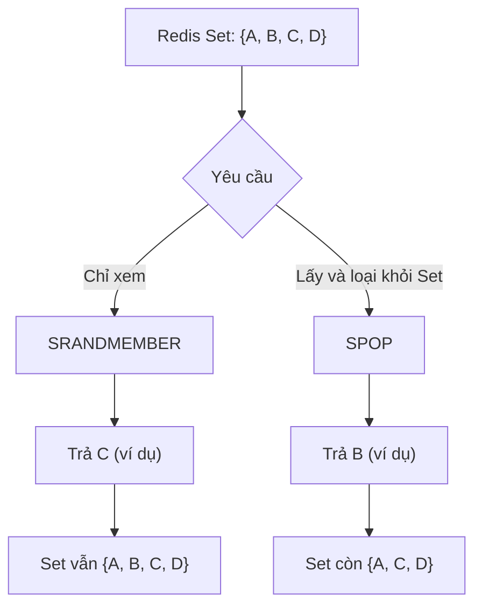
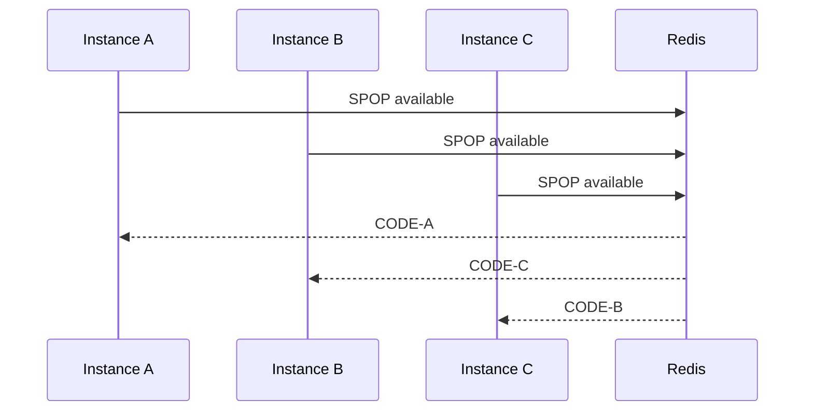
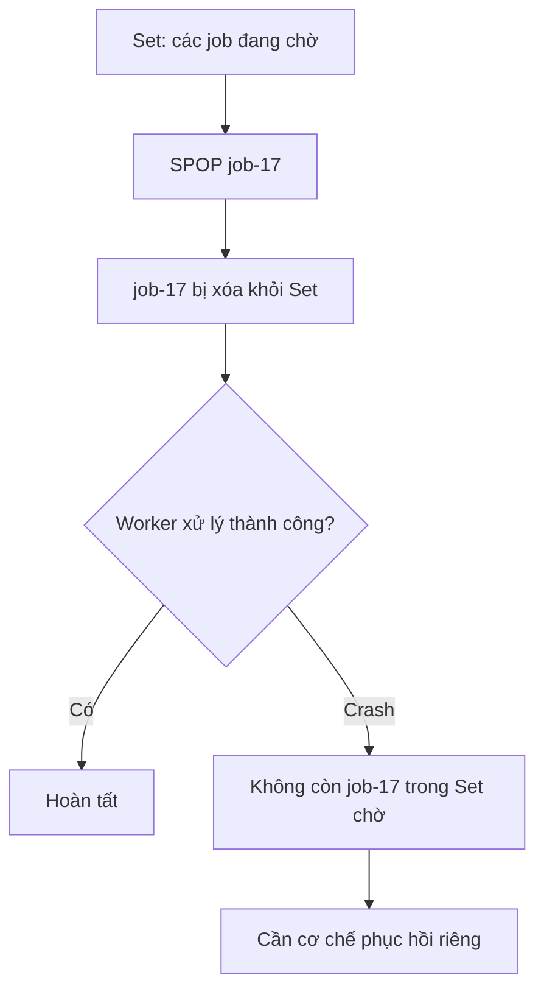

# Lấy thành viên ngẫu nhiên và phân biệt lấy với lấy rồi xóa

## 1. Bối cảnh: chọn một phần tử từ Redis Set

Trong Redis, **Set** là tập hợp các giá trị không trùng nhau và **không có thứ tự ổn định**. Mỗi Set được lưu dưới một Redis key. Ví dụ một ứng dụng Spring Boot có danh sách mã ưu đãi chưa được cấp:

```text
Redis key: promotion:codes:available:v1:campaign-42
Redis type: set

Các thành viên:
  CODE-A7
  CODE-B8
  CODE-C9
  CODE-D0
```

Ứng dụng có thể cần hai hành vi rất khác nhau:

1. **Xem thử một mã ngẫu nhiên** để hiển thị gợi ý nhưng vẫn giữ mã trong Set để lần sau có thể chọn lại.
2. **Lấy ra một mã và loại nó khỏi Set** để mã không còn nằm trong nhóm chưa được cấp.

Redis cung cấp hai họ lệnh dành cho hai nhu cầu đó:

- **`SRANDMEMBER`**: lấy thành viên ngẫu nhiên nhưng **không thay đổi Set**.
- **`SPOP`**: lấy thành viên ngẫu nhiên và **xóa thành viên đã lấy khỏi Set**.

Spring Data Redis đưa các lệnh này lên API `SetOperations<K,V>` của `RedisTemplate` hoặc `StringRedisTemplate`. Tên phương thức có thể gần giống nhau, nhưng hệ quả trên dữ liệu và khi chạy đồng thời hoàn toàn khác.



Lệnh chọn ngẫu nhiên **không tự bảo đảm “công bằng tuyệt đối” cho quay số có thưởng**. Redis cung cấp phép lấy mẫu phục vụ cấu trúc dữ liệu; yêu cầu ngẫu nhiên mật mã, chống gian lận hoặc có chứng từ kiểm toán cần một thiết kế riêng.

## 2. Nhận diện SetOperations trong Spring Data Redis

Trên `StringRedisTemplate`, cách lấy nhóm thao tác Set thường là:

```java
import org.springframework.data.redis.core.SetOperations;
import org.springframework.data.redis.core.StringRedisTemplate;

SetOperations<String, String> sets = redis.opsForSet();
```

`StringRedisTemplate` sử dụng serializer dạng chuỗi cho key và phần tử, phù hợp với mã định danh, voucher code, tag hoặc tên thành viên. Nếu dùng `RedisTemplate<String, MyValue>`, cần cấu hình serializer tương thích cho key và value; Redis lưu byte, không biết generic Java.

Những API quan trọng cho bài học:

| API Spring Data Redis | Lệnh Redis tương ứng về ý nghĩa | Kết quả | Set sau thao tác |
|---|---|---|---|
| `randomMember(key)` | `SRANDMEMBER key` | Một thành viên ngẫu nhiên | **Không đổi** |
| `distinctRandomMembers(key, count)` | `SRANDMEMBER key count` với count dương | Tập các thành viên khác nhau trong một lần lấy mẫu | **Không đổi** |
| `randomMembers(key, count)` | `SRANDMEMBER key -count` với ý nghĩa cho phép trùng | Danh sách lấy mẫu, có thể trùng nhau | **Không đổi** |
| `pop(key)` | `SPOP key` | Một thành viên ngẫu nhiên | **Đã xóa thành viên được trả về** |
| `pop(key, count)` | `SPOP key count` | Nhiều thành viên khác nhau, tối đa số lượng có sẵn | **Đã xóa các thành viên được trả về** |

Đây là API đồng bộ điển hình của Spring Data Redis hiện đại. Chi tiết overload, giới hạn Redis server và kiểu kết quả khi dùng transaction/pipeline cần đối chiếu phiên bản ứng dụng. Trong bối cảnh gọi đồng bộ bình thường, một Set rỗng hoặc không tồn tại không cung cấp phần tử; với API trả về một phần tử, cần xử lý `null`.

### “Lấy ngẫu nhiên” khác “đọc theo vị trí”

Set không có index ổn định. Nó không tương đương List:

```text
List:  [A, B, C]   -> có thứ tự phần tử
Set:   {A, B, C}   -> không có thứ tự để chọn "phần tử thứ hai"
```

Redis quyết định thành viên ngẫu nhiên. Không nên giả định thứ tự nội bộ của Set, thứ tự trả về của nhiều phần tử, hoặc dự đoán mẫu được chọn từ thứ tự `SADD`.

## 3. SRANDMEMBER: lấy ngẫu nhiên nhưng giữ nguyên Set

Lệnh một phần tử:

```text
SRANDMEMBER key
```

Ví dụ với Redis CLI:

```bash
redis-cli SADD demo:raffle:eligible:v1 alice bob carol dave
redis-cli SRANDMEMBER demo:raffle:eligible:v1
redis-cli SCARD demo:raffle:eligible:v1
```

Giả sử lần gọi `SRANDMEMBER` trả về `carol`. Số phần tử của Set vẫn là **4** vì lệnh không xóa thành viên nào.

Với Spring Data Redis:

```java
String key = "demo:raffle:eligible:v1";
String candidate = redis.opsForSet().randomMember(key);

if (candidate != null) {
    System.out.println("Đã chọn thử: " + candidate);
}
```

Gọi nhiều lần có thể trả cùng thành viên:

```text
Lần 1: carol
Lần 2: alice
Lần 3: carol
```

Đó là hành vi hợp lệ vì Set chưa thay đổi. Nếu ứng dụng cần *không lặp lại trong các lần cấp thật*, `SRANDMEMBER` đơn thuần không đáp ứng được yêu cầu này.

### Khi nào phù hợp?

- Hiển thị ngẫu nhiên một tag, gợi ý hoặc mục trong danh sách không bị tiêu thụ.
- Lấy mẫu để quan sát dữ liệu, thử nghiệm hoặc kiểm tra một tập hợp.
- Chọn ngẫu nhiên một thành viên để đọc tiếp dữ liệu khác, khi việc trùng lặp giữa các lần chọn có thể chấp nhận.
- Xây dựng các trải nghiệm giới thiệu nội dung không yêu cầu lịch sử phân phối chính xác.

### Khi nào không phù hợp?

- Phát voucher một lần, cấp tài nguyên hữu hạn, phân công công việc độc quyền.
- Trường hợp hai request đồng thời **phải** không nhận cùng một thành viên.
- Hệ thống cần giải trình tính công bằng của thuật toán quay số hoặc cần bằng chứng lựa chọn không thể can thiệp.

Muốn chọn rồi quyết định có xóa bằng một lời gọi `SRANDMEMBER` và một lời gọi `SREM` riêng? Hai lệnh đó **không tạo thành một thao tác nguyên tử**. Request khác có thể chọn hoặc xóa cùng thành viên ở giữa; nếu cần “lấy và xóa cùng lúc”, hãy xem `SPOP`.

## 4. SRANDMEMBER với COUNT: số dương và số âm khác nhau

Redis cho phép:

```text
SRANDMEMBER key count
```

**Dấu của `count` làm thay đổi ý nghĩa lấy mẫu.**

| COUNT | Quy tắc lấy mẫu | Một ví dụ với Set `{A,B,C}` |
|---|---|---|
| Không truyền | Một thành viên ngẫu nhiên | `B` |
| `2` | Tối đa hai thành viên **khác nhau** | `[C,A]` |
| `5` | Tối đa số thành viên sẵn có, không trùng | `[A,C,B]` |
| `-5` | Cho phép một thành viên xuất hiện nhiều lần, thường trả đủ năm phần tử nếu Set không rỗng | `[B,A,B,C,B]` |
| `0` | Không yêu cầu phần tử | Danh sách rỗng |

Với **count dương**, Redis lấy mẫu **không lặp lại trong chính lần gọi đó**. Nếu count lớn hơn số thành viên hiện có, kết quả chỉ gồm các thành viên có sẵn. Với **count âm**, Redis lấy mẫu **có hoàn lại** (cho phép trùng), vì vậy số phần tử trả về có thể lớn hơn cardinality của Set.

Điều cần phân biệt: yêu cầu count dương không làm các lần gọi **riêng biệt** trở nên không trùng với nhau. Chỉ trong cùng một lượt lấy mẫu, danh sách không có thành viên trùng nhau.

### 4.1. API lấy nhiều thành viên khác nhau

`distinctRandomMembers(key, count)` diễn đạt yêu cầu lấy một tập con không trùng trong một lời gọi:

```java
import java.util.Set;

String key = "demo:raffle:eligible:v1";

Set<String> candidates =
        redis.opsForSet().distinctRandomMembers(key, 3);

if (candidates != null) {
    for (String candidate : candidates) {
        System.out.println(candidate);
    }
}
```

Kiểu trả về là `Set<String>`; không dựa vào thứ tự iteration của nó. Nếu Redis Set chỉ có hai thành viên, số lượng kết quả không thể vượt quá hai. Việc gọi nhiều lần `distinctRandomMembers(key, 3)` vẫn có thể chọn lại những người xuất hiện trong lần trước vì **không thành viên nào bị xóa**.

### 4.2. API lấy mẫu có thể trùng

`randomMembers(key, count)` phù hợp khi muốn số lượt rút có thể lớn hơn số phần tử hoặc chấp nhận một thành viên xuất hiện nhiều lần:

```java
import java.util.List;

List<String> suggestions =
        redis.opsForSet().randomMembers(
                "demo:raffle:eligible:v1", 5);

if (suggestions != null) {
    suggestions.forEach(System.out::println);
}
```

Kết quả kiểu `List` vì cùng một thành viên có thể lặp lại. Trong cơ chế này, ứng dụng truyền **số lượng mong muốn dương** vào API Spring Data Redis; thư viện ánh xạ về ngữ nghĩa lấy mẫu cho phép trùng của Redis. Không tự truyền số âm vào `randomMembers` chỉ vì Redis CLI dùng `SRANDMEMBER key -count`: **contract của phương thức Java là số lượt mong muốn**.

### 4.3. Ví dụ chọn đúng API

Giả sử một service có 100 ID sản phẩm:

- Muốn chọn **1 ID bất kỳ**: `randomMember(key)`.
- Muốn đưa ra **5 ID khác nhau trên một trang gợi ý**: `distinctRandomMembers(key, 5)`.
- Muốn mô phỏng **1.000 lượt rút có hoàn lại** từ tập 100 ID: `randomMembers(key, 1000)`, nhưng xem xét chi phí bộ nhớ và mục tiêu thống kê.
- Muốn **phát 5 ID và xóa khỏi nhóm sẵn có**: `pop(key, 5)`.

Không nên dùng `randomMembers` rồi chuyển kết quả sang Java `Set` để “sửa” những phần tử trùng: cách đó có thể làm số lượng còn ít hơn mức yêu cầu và che giấu một lựa chọn API sai từ đầu.

## 5. SPOP: lấy ngẫu nhiên và xóa ngay khỏi Set

`SPOP` có hai dạng:

```text
SPOP key
SPOP key count
```

`SPOP` chọn ngẫu nhiên thành viên, **trả lại** cho client và **xóa thành viên đó khỏi Set** trong cùng thao tác Redis.

Ví dụ:

```bash
redis-cli SADD demo:vouchers:available:v1 VC-1 VC-2 VC-3
redis-cli SCARD demo:vouchers:available:v1
redis-cli SPOP demo:vouchers:available:v1
redis-cli SCARD demo:vouchers:available:v1
redis-cli SMEMBERS demo:vouchers:available:v1
```

Nếu ban đầu có 3 voucher, sau `SPOP` thành công Set sẽ còn 2. Không thể đoán voucher nào đã được lấy; Redis chọn ngẫu nhiên theo thuật toán của nó.

Trong Spring Data Redis:

```java
String key = "demo:vouchers:available:v1";
String voucher = redis.opsForSet().pop(key);

if (voucher == null) {
    System.out.println("Không còn voucher sẵn có");
} else {
    System.out.println("Đã lấy ra: " + voucher);
}
```

`pop(key)` không cần một lời gọi `remove` sau đó: hành vi xóa đã là một phần của `SPOP`. Nếu client gọi `SREM key voucher` thêm lần nữa, lệnh xóa bổ sung chỉ tốn tài nguyên và có thể che lấp hiểu nhầm trong code.

### 5.1. Lấy và xóa nhiều phần tử

`pop(key, count)` trả về nhiều thành viên khác nhau và xóa chúng khỏi Set:

```java
import java.util.List;

String key = "demo:vouchers:available:v1";

List<String> claimed =
        redis.opsForSet().pop(key, 5);

if (claimed != null && !claimed.isEmpty()) {
    claimed.forEach(System.out::println);
}
```

Nếu Set chỉ còn 3 thành viên, không có cách nào lấy 5 **thành viên khác nhau** từ chính Set đó. Lời gọi sẽ chỉ lấy tối đa số lượng còn có. Không dùng kết quả 3 phần tử làm bằng chứng Redis “bỏ qua hai yêu cầu”; cần xử lý trường hợp không đủ nguồn cung ngay trong nghiệp vụ.

Khác biệt quan trọng giữa nhiều phần tử qua `SPOP` và `SRANDMEMBER`:

```text
Ban đầu: Set = {A, B, C, D}

SRANDMEMBER key 2 -> [B, D]
Sau lệnh: Set = {A, B, C, D}

SPOP key 2        -> [A, C]
Sau lệnh: Set = {B, D}
```

Các danh sách trên chỉ là ví dụ minh họa một lượt chạy, không phải thứ tự/kết quả cố định.

### 5.2. Khi pop phần tử cuối cùng

Khi `SPOP` xóa phần tử cuối, Set không còn thành viên và Redis thường **xóa key của Set** (Redis không duy trì một Set rỗng như một đối tượng dữ liệu riêng). Khi kiểm tra:

```bash
redis-cli EXISTS demo:vouchers:available:v1
redis-cli SCARD demo:vouchers:available:v1
```

Key không tồn tại có thể dẫn tới `EXISTS = 0` và `SCARD = 0`. Nếu ứng dụng chỉ cần biết còn bao nhiêu phần tử, `SCARD` thường đủ; nếu cần phân biệt trạng thái nghiệp vụ “chưa từng tạo” và “đã sử dụng hết”, phải có metadata/trạng thái riêng.

## 6. So sánh lấy ngẫu nhiên với lấy rồi xóa

| Câu hỏi | `SRANDMEMBER` / `randomMember*` | `SPOP` / `pop` |
|---|---|---|
| Có chọn ngẫu nhiên không? | Có | Có |
| Có làm Set nhỏ đi không? | **Không** | **Có** |
| Có thể chọn lại thành viên ở lần gọi sau không? | Có | Không, trừ khi thành viên được thêm lại |
| Có thể có trùng trong một kết quả nhiều phần tử không? | `randomMembers` có thể; `distinctRandomMembers` không | Không, vì phần tử đã bị loại khỏi Set |
| Cần thao tác xóa riêng không? | Nếu nghiệp vụ muốn xóa thì cần thêm lệnh, dễ sinh race | Không |
| Phù hợp gợi ý/sampling? | Có | Không, vì làm thay đổi nguồn dữ liệu |
| Phù hợp tiêu thụ phần tử hữu hạn? | Không đủ | Phù hợp nếu chấp nhận hậu quả “xóa trước, xử lý sau” |
| Bảo đảm xử lý thành công sau khi lấy? | Không áp dụng cơ chế tiêu thụ | **Không**, SPOP chỉ bảo đảm lấy và xóa ở Redis |
| Hỗ trợ xác nhận (ack), retry, pending tự động? | Không | Không |

**Nguyên tắc lựa chọn:** nếu chỉ cần nhìn một phần tử, chọn `SRANDMEMBER`. Nếu một phần tử phải rời khỏi tập sẵn có ngay khi được chọn, chọn `SPOP`. Nếu yêu cầu thực sự là “giao việc và bảo đảm nhận xử lý”, cần thiết kế thêm trạng thái xử lý, xác nhận và phục hồi hoặc cân nhắc cấu trúc dữ liệu/hệ thống khác.

## 7. Tính nguyên tử khi có nhiều instance Spring Boot

Giả sử hệ thống có ba instance Spring Boot và một Set chứa các mã ưu đãi:



Trên một Redis primary đang xử lý lệnh bình thường, **mỗi `SPOP` là một thao tác nguyên tử**. Các lệnh được xử lý riêng, nên hai lệnh `SPOP` thành công không cùng lấy một thành viên đã bị loại, miễn là không có thao tác thêm lại hoặc thay đổi trạng thái phức tạp khác xen vào.

Nếu thay `SPOP` bằng `SRANDMEMBER`:

```text
Instance A: SRANDMEMBER -> CODE-A
Instance B: SRANDMEMBER -> CODE-A
Instance C: SRANDMEMBER -> CODE-C
```

Đây không phải lỗi: các thao tác chỉ đọc, Set không đổi. Tính nguyên tử của lệnh **không** có nghĩa các request đọc sẽ chọn các thành viên khác nhau.

### 7.1. Race condition khi “đọc trước, xóa sau”

Đoạn code sau có thể gặp lỗi:

```java
String item = redis.opsForSet().randomMember(key);

if (item != null) {
    // Client khác cũng có thể đã random ra item này.
    redis.opsForSet().remove(key, item);
    process(item);
}
```

Giữa `randomMember` và `remove`, các client khác có thể lấy đúng `item` đó. Mặt khác, `remove` trả về số lượng phần tử bị xóa: nếu bằng 0, có thể một client khác đã xóa trước; code ví dụ lại vẫn gọi `process(item)`. Nếu muốn **rút một thành viên và loại nó ngay**, `pop(key)` diễn đạt đúng ý nghĩa hơn và tránh khoảng hở giữa chọn và xóa.

### 7.2. Atomic không đồng nghĩa “xử lý đúng một lần”

Ngay cả `SPOP` nguyên tử cũng không bảo đảm toàn bộ workflow được xử lý chính xác một lần:

```text
1. Redis thực thi SPOP -> đã xóa CODE-A
2. Ứng dụng nhận CODE-A
3. Ứng dụng gọi API cấp mã cho người dùng
4. API lỗi hoặc ứng dụng crash
5. CODE-A không còn trong Set nguồn
```

Hoặc kết nối mất **sau khi Redis đã thực thi SPOP nhưng trước khi phản hồi tới Java**. Ứng dụng có thể không biết phần tử nào đã bị lấy và liệu thao tác đã xảy ra hay chưa. Retry `SPOP` ngay lúc đó có thể lấy thêm **một phần tử khác**.

Vì vậy `SPOP` là **atomic remove**, không phải một hàng đợi có xác nhận xử lý, cũng không tự tạo giao dịch phân tán giữa Redis và cơ sở dữ liệu.

## 8. Ví dụ Spring Boot: lấy mẫu mà không tiêu thụ

Service sau cung cấp ba loại lấy mẫu để ứng dụng gọi đúng theo yêu cầu:

```java
import java.util.List;
import java.util.Set;

import org.springframework.data.redis.core.SetOperations;
import org.springframework.data.redis.core.StringRedisTemplate;
import org.springframework.stereotype.Service;

@Service
public class SuggestionService {
    private static final String KEY =
            "content:suggestions:eligible:v1";

    private final SetOperations<String, String> sets;

    public SuggestionService(StringRedisTemplate redis) {
        this.sets = redis.opsForSet();
    }

    public String suggestOne() {
        // Có thể trả null nếu Set không còn thành viên.
        return sets.randomMember(KEY);
    }

    public Set<String> suggestDistinct(long count) {
        if (count < 0 || count > 100) {
            throw new IllegalArgumentException(
                    "count phải nằm trong khoảng 0..100");
        }
        Set<String> result = sets.distinctRandomMembers(KEY, count);
        return result == null ? Set.of() : result;
    }

    public List<String> simulateDrawsWithReplacement(long count) {
        if (count < 0 || count > 100) {
            throw new IllegalArgumentException(
                    "count phải nằm trong khoảng 0..100");
        }
        List<String> result = sets.randomMembers(KEY, count);
        return result == null ? List.of() : result;
    }
}
```

Phương thức thứ hai dùng `Set<String>` để thể hiện yêu cầu **mỗi gợi ý khác nhau trong cùng kết quả**. Phương thức thứ ba dùng `List<String>` vì các lần rút có thể xuất hiện lặp lại. Giới hạn 100 là **chính sách ví dụ của service**, không phải giới hạn Redis.

Mọi lời gọi trong service đều không xóa thành viên khỏi Redis. Cùng một bài viết có thể tiếp tục được gợi ý ở request sau. Nếu muốn giảm lặp giữa các request, phải bổ sung lịch sử đã xem/thuật toán đề xuất khác, không thể chỉ thay `randomMember` thành `distinctRandomMembers`.

## 9. Ví dụ Spring Boot: cấp mã từ một tập sẵn có

Giả sử Redis Set chứa các mã có thể cấp. Service dùng `pop` để lấy mã và xóa mã đó khỏi nguồn:

```java
import java.util.List;
import org.springframework.data.redis.core.SetOperations;
import org.springframework.data.redis.core.StringRedisTemplate;
import org.springframework.stereotype.Service;

@Service
public class VoucherPoolService {
    private final SetOperations<String, String> sets;

    public VoucherPoolService(StringRedisTemplate redis) {
        this.sets = redis.opsForSet();
    }

    private String keyFor(String campaignId) {
        return "voucher:available:v1:" + campaignId;
    }

    public String takeOne(String campaignId) {
        return sets.pop(keyFor(campaignId));
    }

    public List<String> takeUpTo(String campaignId, long requested) {
        if (requested < 1 || requested > 50) {
            throw new IllegalArgumentException(
                    "requested phải nằm trong khoảng 1..50");
        }

        List<String> result = sets.pop(keyFor(campaignId), requested);
        return result == null ? List.of() : result;
    }
}
```

Ví dụ gọi:

```java
String voucher = voucherPoolService.takeOne("campaign-42");
if (voucher == null) {
    // Hết mã hoặc chưa có dữ liệu ở key tương ứng.
    return;
}

// Đây là bước nghiệp vụ riêng, có thể thất bại.
// Phải có thiết kế phục hồi/idempotency nếu cấp mã là quan trọng.
issueVoucherToCustomer(voucher);
```

**Cảnh báo thiết kế nghiệp vụ:** phương thức `takeOne` chỉ bảo đảm Redis đã lấy và loại mã khỏi Set tại thời điểm lệnh thành công. Nó không bảo đảm `issueVoucherToCustomer` thành công hay có thể khôi phục sau crash. Với voucher có giá trị hoặc dữ liệu cần kiểm toán, phải có nguồn sự thật bền vững và một quy trình ghi nhận việc cấp mã, xử lý lỗi giữa các bước.

### 9.1. Nếu yêu cầu phải cấp đúng N mã

`pop(key, N)` chỉ lấy **tối đa** N mã. Nếu nguồn có ít hơn N mã, caller phải xác định quy tắc:

- Cho phép cấp một phần: trả danh sách thực tế và số lượng chưa đủ.
- Không cho phép cấp một phần: kiểm tra điều kiện và thiết kế **thao tác kiểm tra + cấp** cùng một ranh giới nguyên tử, thay vì thực hiện `SCARD` rồi `SPOP` tách rời.
- Cần đặt chỗ tạm thời: xây dựng trạng thái reservation và thời gian hết hạn, không chỉ xóa khỏi Set có sẵn.

Ví dụ anti-pattern:

```java
Long available = sets.size(key);

if (available != null && available >= requested) {
    // Race: sau SCARD, client khác có thể pop phần tử!
    List<String> chosen = sets.pop(key, requested);
}
```

`SCARD` và `SPOP` là hai lệnh độc lập. Nếu yêu cầu “đủ N hoặc không lấy gì”, cần thiết kế bằng script Redis hoặc một cơ chế đồng bộ phù hợp, đồng thời tính đến giới hạn Redis Cluster và việc script có thể lỗi.

## 10. Lấy rồi xóa không phải hàng đợi đáng tin cậy

Một Set với `SPOP` trông giống một hàng công việc đơn giản, nhưng có những khác biệt lớn so với queue/broker có khả năng xác nhận.



Các yêu cầu mà `SPOP` không tự cung cấp:

- **Acknowledgment:** Redis không chờ consumer xác nhận đã xử lý xong.
- **Pending list:** không có trạng thái tự động “đã phát nhưng chưa ack”.
- **Redelivery:** Redis không tự trả lại phần tử đã pop khi worker crash.
- **Ordering:** Set không có thứ tự; `SPOP` không phải FIFO hoặc priority queue.
- **Per-item lease:** không có thời hạn giữ riêng cho phần tử đã pop.
- **Exactly-once end-to-end:** không có bảo đảm xuyên Redis, API và database.

Nếu muốn xử lý nền có ack/retry, cân nhắc **Redis Streams** với consumer group và quản lý pending/ack, hoặc message broker như RabbitMQ/Kafka tùy yêu cầu. Streams cũng không tự bảo đảm nghiệp vụ được xử lý đúng một lần; consumer vẫn cần idempotency.

### 10.1. Khi muốn di chuyển sang tập “đang xử lý”

Đôi khi thiết kế đơn giản dùng hai Set:

```text
tasks:{batch-42}:available
tasks:{batch-42}:processing
```

Yêu cầu là “rút một job khỏi available và thêm vào processing trong cùng một thao tác”. Nếu thực hiện `SPOP` rồi `SADD` bằng hai lời gọi Java, crash giữa hai bước có thể làm mất dấu job.

Có thể dùng Lua script trên Redis để thực hiện cả hai bước trong một lần xử lý:

```lua
-- KEYS[1]: available Set
-- KEYS[2]: processing Set
local jobId = redis.call('SPOP', KEYS[1])
if not jobId then
    return nil
end

redis.call('SADD', KEYS[2], jobId)
return jobId
```

Ý tưởng này giúp thu hẹp khoảng lỗi giữa `SPOP` và `SADD` trên **cùng một Redis node**. Khi chạy Redis Cluster, hai key phải cùng hash slot, ví dụ dùng hash tag `{batch-42}`. Cả hai key phải có kiểu phù hợp; **lỗi trong script Redis không có rollback dữ liệu kiểu RDBMS**, nên cần kiểm soát trạng thái đầu vào.

Quan trọng hơn, **processing Set chưa đủ để tạo hàng đợi đáng tin cậy**. Vẫn phải thiết kế ack (`SREM` khi xử lý xong), thời điểm bắt đầu xử lý, lease/timeout, cơ chế nhận lại job bị treo, tránh hai worker nhận lại cùng lúc, monitoring, persistence và xử lý failover. Khi các yêu cầu này xuất hiện, hệ queue/Stream chuyên dụng thường hợp lý hơn việc phát triển thêm nhiều quy tắc trên Set.

## 11. BoundSetOperations: cố định khóa khi làm việc với một Set

Nếu một phương thức thao tác nhiều lần trên cùng Redis Set, `RedisTemplate` còn cung cấp **`boundSetOps(key)`**, trả về `BoundSetOperations` gắn với một khóa cố định.

```java
import org.springframework.data.redis.core.BoundSetOperations;

String key = "demo:vouchers:available:v1";

BoundSetOperations<String, String> vouchers =
        redis.boundSetOps(key);

Long available = vouchers.size();
String preview = vouchers.randomMember(); // Không xóa.
String taken = vouchers.pop();            // Có xóa.
```

Một số API bound tương ứng gồm `randomMember()`, `randomMembers(count)`, `distinctRandomMembers(count)`, `pop()` và `pop(count)`, tùy phiên bản Spring Data Redis.

**Bound chỉ giúp tránh truyền lại key**; nó không có nghĩa là Redis Set được khóa độc quyền, lệnh tự động ghép thành transaction, hoặc các phương thức liên tiếp có một snapshot chung. Trong ví dụ trên, `size()`, `randomMember()` và `pop()` vẫn là các thao tác riêng. Một client khác có thể thay đổi Set ở giữa.

Không tạo một singleton `BoundSetOperations` gắn với ID người dùng cụ thể rồi dùng cho tất cả người dùng. Khi key thay đổi theo tenant/campaign, hãy tạo Bound Operations trong phạm vi phù hợp hoặc truyền key vào `SetOperations`.

## 12. TTL và vòng đời Set khi rút thành viên

**TTL** của Redis thường gắn với **cả Set key**, không phải từng member. Ví dụ:

```bash
redis-cli SADD demo:vouchers:available:v1 VC-1 VC-2 VC-3
redis-cli EXPIRE demo:vouchers:available:v1 3600
redis-cli TTL demo:vouchers:available:v1
```

Sau `SRANDMEMBER`, TTL vẫn tiếp tục đếm vì lệnh chỉ đọc. Sau `SPOP`, nếu Set vẫn còn thành viên, TTL của key thường vẫn được giữ nguyên; `SPOP` không tự gia hạn TTL. Nếu `SPOP` lấy thành viên cuối, key bị xóa. Khi sau đó `SADD` tạo lại key, TTL cũ không tự được khôi phục.

Trong Spring Boot:

```java
import java.time.Duration;

String key = "demo:vouchers:available:v1";
redis.opsForSet().add(key, "VC-1", "VC-2", "VC-3");
redis.expire(key, Duration.ofHours(1));
```

Hai lời gọi `add` và `expire` là **hai thao tác Redis độc lập**. Nếu Redis hoặc ứng dụng lỗi giữa chúng, key có thể được tạo mà không có TTL mong muốn. Nếu TTL ngay lúc khởi tạo là yêu cầu bắt buộc, hãy tổ chức một thao tác nguyên tử hoặc một cơ chế tạo/dọn khác.

Ngoài ra, Set có thể hết hạn **trong lúc worker đang chờ sử dụng**. Lời gọi `pop` khi đó không có thành viên để cấp, và đó là một tình trạng nghiệp vụ cần xử lý. Đừng tự giả định mọi key đã được khởi tạo sẽ tồn tại tới khi tất cả thành viên bị pop.

## 13. Cách nhận biết kết quả rỗng, lỗi và transaction/pipeline

### 13.1. Không có thành viên

Lệnh `SRANDMEMBER` hoặc `SPOP` một phần tử trên key không tồn tại hoặc Set đã hết thành viên không trả được một member. Với `SetOperations` đồng bộ, các API đơn lẻ thường trả `null` trong trường hợp này:

```java
String sample = redis.opsForSet().randomMember(key);
String removed = redis.opsForSet().pop(key);

if (sample == null) {
    // Không có phần tử để lấy mẫu ở thời điểm đọc.
}
if (removed == null) {
    // Không có phần tử để lấy và xóa ở thời điểm pop.
}
```

Với API nhiều phần tử, xử lý cả kết quả rỗng và `null` theo hợp đồng của phiên bản/client. Khi code chạy bên trong **pipeline hoặc transaction Redis**, `null` của một lời gọi có thể còn mang nghĩa **kết quả chưa có vì lệnh đang được queue**. Không dùng một giá trị `null` trong callback pipeline/`MULTI` để quyết định Set thực sự đã cạn.

### 13.2. Redis key có sai kiểu

Nếu key hiện tại là String hoặc Hash mà gọi `SPOP`/`SRANDMEMBER`, Redis có thể báo lỗi `WRONGTYPE`. Cần quản lý namespace rõ để tránh nhiều chức năng dùng cùng key name với kiểu dữ liệu khác nhau.

```bash
redis-cli TYPE demo:vouchers:available:v1
redis-cli SCARD demo:vouchers:available:v1
```

`TYPE` nên là `set` khi key tồn tại, hoặc `none` khi không có. `SCARD` cho biết số phần tử ở thời điểm gọi, nhưng số đó có thể thay đổi ngay sau khi đọc.

### 13.3. Kết quả timeout không chứng minh lệnh chưa chạy

Giả sử Redis đã thực thi `SPOP` và xóa `VC-1` nhưng kết nối mất trước khi trả reply. Ứng dụng nhận exception và không biết voucher nào đã bị xóa. Retry lời gọi có thể rút `VC-2`.

Với thao tác **không idempotent** như `SPOP`, không retry mù quáng sau lỗi mạng. Nếu nghiệp vụ không được phép mất hoặc cấp thừa tài nguyên, phải thiết kế operation ID, trạng thái đặt chỗ, kết quả có thể đối chiếu và nguồn dữ liệu bền vững. Redis persistence và replica/failover cũng cần được cấu hình theo mục tiêu mất dữ liệu có thể chấp nhận, vì ghi đã xác nhận với client vẫn có thể chịu rủi ro trong một số chế độ triển khai.

## 14. Quan sát bằng Redis CLI mà không gây mất dữ liệu thật

Khi thử nghiệm, nên dùng **key demo riêng** để `SPOP` không xóa thành viên của tập dữ liệu production:

```bash
# Dùng namespace demo riêng, tránh key nghiệp vụ thật.
redis-cli SADD demo:sample:set:v1 A B C D

# Chỉ lấy mẫu; Set không đổi.
redis-cli SRANDMEMBER demo:sample:set:v1
redis-cli SRANDMEMBER demo:sample:set:v1 2
redis-cli SRANDMEMBER demo:sample:set:v1 -6
redis-cli SCARD demo:sample:set:v1

# Rút khỏi Set; đây là thao tác thay đổi dữ liệu.
redis-cli SPOP demo:sample:set:v1
redis-cli SCARD demo:sample:set:v1
redis-cli SPOP demo:sample:set:v1 2
redis-cli SMEMBERS demo:sample:set:v1
```

Điểm cần quan sát:

1. Sau ba lệnh `SRANDMEMBER`, `SCARD` vẫn bằng 4.
2. Lệnh `SRANDMEMBER ... -6` có thể trả phần tử lặp trong sáu lượt lấy mẫu.
3. `SPOP` làm số lượng còn lại giảm khi có phần tử.
4. `SPOP ... 2` lấy nhiều nhất hai thành viên còn lại; nếu nguồn không đủ, trả ít hơn.
5. Thứ tự `SMEMBERS` không phải thứ tự chèn hoặc thứ tự ngẫu nhiên được hứa trước.

Không chạy `SPOP` chỉ để “xem thử” một key đang phục vụ nghiệp vụ thật. Nếu cần quan sát thành viên không thay đổi dữ liệu, dùng `SRANDMEMBER` hoặc truy vấn đọc phù hợp.

## 15. Quy ước key, serializer và bảo mật

Key dễ quản lý nên có namespace rõ ràng:

```text
content:suggestions:eligible:v1
promotion:codes:available:v1:campaign-42
tasks:{batch-42}:processing
tasks:{batch-42}:available
```

Với `StringRedisTemplate`, thành viên Set được serialize dạng chuỗi, thuận tiện kiểm tra bằng Redis CLI. Nếu một service dùng serializer nhị phân khác cho cùng key/value, kết quả đọc có thể không tương thích. Đừng coi hai Java `String` giống nhau là cùng thành viên Redis khi chúng được mã hóa thành hai dãy byte khác nhau.

Member và key không nên chứa token bí mật, email, số điện thoại hoặc dữ liệu nhạy cảm có thể lộ qua log/monitoring. Với mã ưu đãi có giá trị thật, cần kiểm soát quyền Redis ACL, TLS và nơi ghi log; việc một mã nằm trong Set không mặc nhiên đủ để coi đó là hệ thống phân phối an toàn.

Với Redis Cluster, mỗi Set key thuộc một hash slot. `SPOP` trên **một key** không gặp yêu cầu nhiều key cùng slot. Nhưng các script hoặc thao tác phối hợp nhiều Set cần đặt các key liên quan cùng slot, chẳng hạn `tasks:{batch-42}:available` và `tasks:{batch-42}:processing`. Không dùng một hash tag chung cho toàn hệ thống nếu điều đó làm mất cân bằng tải cluster.

## 16. Độ phức tạp, dung lượng và tải đồng thời

Redis thực hiện lựa chọn ngẫu nhiên trên Set theo cấu trúc dữ liệu nội bộ; thao tác lấy một member thường có chi phí thấp. Với số lượng phần tử yêu cầu lớn, chi phí tạo reply, mạng, serialization và cấp phát collection Java tăng theo dữ liệu trả về.

Một số nguyên tắc:

- **Giới hạn count** theo nghiệp vụ thay vì cho phép client yêu cầu hàng triệu phần tử trong một API.
- Tránh gọi `randomMembers(key, veryLargeCount)` trên Set chỉ có vài phần tử; kết quả có thể là danh sách rất lớn gồm các thành viên lặp.
- `distinctRandomMembers(key, count)` trả tối đa cardinality của Set; count lớn không làm Redis tạo thêm member.
- `pop(key, count)` làm thay đổi Set trên phạm vi nhiều member; hãy cân nhắc xử lý kết quả trong service và hành vi nếu downstream thất bại.
- Không gọi `members(key)` để đọc toàn bộ Set chỉ nhằm tự chọn một phần tử trong Java; `SRANDMEMBER`/`SPOP` tránh chuyển tất cả member qua mạng.
- Quan sát Redis CPU, độ trễ p95/p99, số request, kích thước Set, timeout và tỉ lệ hết hàng.

Khi phân phối tài nguyên có giá trị và cần kiểm toán, hiệu năng của `SPOP` không phải tiêu chí duy nhất. Cần biết **ai nhận member nào, lúc nào, có xác nhận thành công chưa và cách phục hồi ra sao**.

## 17. Bài tập thực hành: chọn mẫu và cấp phần tử

**Bài toán:** một ứng dụng Spring Boot quản lý danh sách món quà có thể phân phát cho người dùng. Redis key `demo:gifts:available:v1` ban đầu chứa `gift-A`, `gift-B`, `gift-C`, `gift-D`.

### Phần A — Chọn mẫu không tiêu thụ

```java
String key = "demo:gifts:available:v1";

redis.opsForSet().add(
        key, "gift-A", "gift-B", "gift-C", "gift-D");

String preview = redis.opsForSet().randomMember(key);
Set<String> threeDifferent =
        redis.opsForSet().distinctRandomMembers(key, 3);
List<String> fiveDraws =
        redis.opsForSet().randomMembers(key, 5);

Long stillAvailable = redis.opsForSet().size(key);
```

Kỳ vọng theo ý nghĩa API:

- `preview` là một thành viên, không có thứ tự cố định.
- `threeDifferent` có tối đa ba thành viên và không trùng trong kết quả.
- `fiveDraws` có thể chứa trùng vì có hoàn lại.
- `stillAvailable` vẫn phản ánh số member chưa bị xóa (trừ khi client khác thay đổi Set hoặc key hết hạn).

### Phần B — Rút quà khỏi nguồn

```java
String firstGift = redis.opsForSet().pop(key);
List<String> nextGifts = redis.opsForSet().pop(key, 2);

Long remaining = redis.opsForSet().size(key);
```

Nếu không có client khác can thiệp và Set vẫn tồn tại, sau khi rút thành công 1 + 2 món từ 4 món ban đầu, Set còn một món. Các món rút ra không trùng nhau vì đã bị loại khỏi Set.

### Phần C — Tình huống lỗi

Giả sử sau `pop(key)`, ứng dụng crash trước khi ghi nhận người nhận quà. Hãy xác định:

- Quà đó còn trong `demo:gifts:available:v1` không?
- Có thể dùng `randomMember` để tìm lại quà đã mất dấu không?
- Nếu retry `pop`, có nguy cơ rút thêm quà khác không?
- Phải bổ sung bảng cấp quà trong database, transaction, trạng thái reservation hoặc hàng đợi có ack như thế nào để phù hợp yêu cầu?

Đáp án về Redis Set: **quà đã pop không còn trong Set sẵn có; `randomMember` chỉ nhìn các phần tử còn lại; retry `SPOP` có thể lấy thêm quà khác**. Cơ chế nghiệp vụ bổ sung phải dựa trên ràng buộc về độ bền và khả năng truy vết của hệ thống.

## 18. Tổng hợp quyết định API

| Nhu cầu diễn đạt bằng lời | Phương thức Spring Data Redis |
|---|---|
| “Cho tôi một thành viên bất kỳ, vẫn giữ nguyên Set” | `opsForSet().randomMember(key)` |
| “Cho tôi N thành viên **khác nhau** để xem, chưa xóa” | `opsForSet().distinctRandomMembers(key, n)` |
| “Cho tôi N lượt lấy mẫu, được phép lặp” | `opsForSet().randomMembers(key, n)` |
| “Lấy một thành viên ra khỏi nhóm chưa sử dụng” | `opsForSet().pop(key)` |
| “Lấy tối đa N thành viên khác nhau và loại khỏi nhóm” | `opsForSet().pop(key, n)` |
| “Tôi biết chính xác thành viên cần xóa” | `opsForSet().remove(key, member)` |
| “Kiểm tra một thành viên có còn trong Set không” | `opsForSet().isMember(key, member)` |
| “Đếm số thành viên đang có” | `opsForSet().size(key)` |
| “Phát việc rồi xác nhận, retry/reclaim nếu worker chết” | Thiết kế cơ chế ack/lease riêng hoặc cân nhắc Redis Streams/message broker |

**Điểm phân biệt cần ghi nhớ:** `SRANDMEMBER` **chỉ đọc**, `SPOP` **đọc và xóa trong cùng thao tác Redis**. `randomMembers` và `distinctRandomMembers` còn khác nhau ở việc có cho phép trùng **trong cùng một lượt lấy mẫu** hay không. Khi dữ liệu cần được tiêu thụ một cách đáng tin cậy, tính nguyên tử của `SPOP` mới là bước đầu; ứng dụng vẫn phải thiết kế ghi nhận kết quả, xử lý lỗi, retry, idempotency và nguồn sự thật phù hợp với nghiệp vụ.
