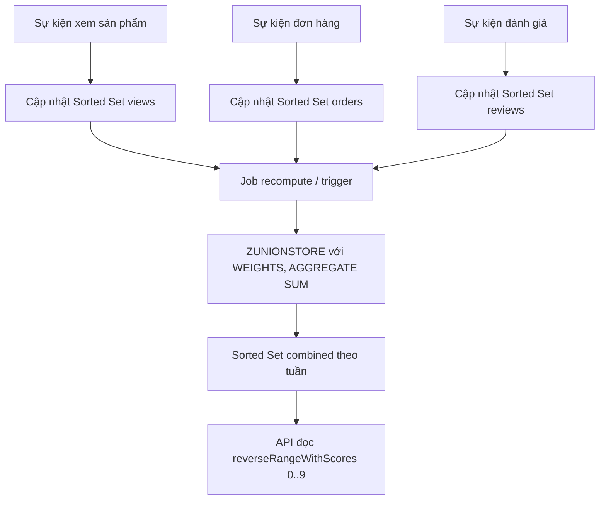

# Phép hợp, giao và tổng hợp điểm của nhiều Sorted Set

## 1. Bài toán và mục tiêu

Trong Redis, **Sorted Set** (thường gọi là ZSet) lưu những **member không trùng lặp**, mỗi member đi kèm một **score**. Redis dùng score để sắp xếp các member, nhờ đó Sorted Set rất phù hợp cho bảng xếp hạng, độ ưu tiên, điểm tương tác, điểm gợi ý hoặc các danh sách có trọng số.

Một ứng dụng thương mại điện tử có thể dùng hai bảng điểm trong cùng tuần:

- `ranking:views:week45`: điểm dựa trên lượt xem sản phẩm.
- `ranking:orders:week45`: điểm dựa trên số lượt mua.

Bộ phận sản phẩm muốn trả lời các câu hỏi:

- Những sản phẩm nào xuất hiện ở **ít nhất một** bảng điểm? → **Phép hợp**.
- Những sản phẩm nào xuất hiện ở **cả hai** bảng điểm? → **Phép giao**.
- Nếu điểm mua hàng quan trọng gấp ba lần điểm xem, **điểm tổng hợp** của từng sản phẩm được tính thế nào?
- Khi nhiều nguồn cùng có một member, cần cộng điểm, lấy điểm nhỏ nhất hay lấy điểm lớn nhất?
- Làm thế nào lưu bảng xếp hạng kết quả vào Redis để đọc top 10 mà không chuyển toàn bộ dữ liệu qua Java?

Redis cung cấp các lệnh `ZUNION`, `ZINTER`, `ZUNIONSTORE` và `ZINTERSTORE` cùng cơ chế `WEIGHTS` và `AGGREGATE SUM|MIN|MAX`. Trong Spring Data Redis, `ZSetOperations` cung cấp các phương thức như `unionAndStore(...)` và `intersectAndStore(...)`; còn khi cần kiểm soát aggregation nâng cao, có thể dùng overload phù hợp với phiên bản thư viện, `RedisCallback` hoặc script Redis.

**Bài học phân biệt rõ hai khía cạnh:** *membership* quyết định member có được đưa vào kết quả hay không; *score aggregation* quyết định score của member được chọn được tính thế nào.

## 2. Nhắc lại bản chất Sorted Set

Một Sorted Set có thể hình dung là tập các cặp:

```text
key: ranking:views:week45

member    score
------    -----
alice      10
bob         6
carol       3
```

Mỗi member chỉ xuất hiện tối đa một lần trong cùng Sorted Set. Nếu ghi lại một member bằng `ZADD` thông thường với score mới, Redis cập nhật score của member đó; không tạo thêm bản sao.

### Các đặc tính quan trọng

| Đặc tính | Redis Sorted Set |
|---|---|
| Member | Không trùng lặp trong một key |
| Score | Số thực kiểu double theo cách Redis biểu diễn |
| Thứ tự | Chủ yếu theo score tăng dần; cùng score được phân biệt bằng thứ tự từ điển theo byte của member |
| Đọc top điểm cao | Có thể đọc theo thứ tự giảm dần bằng `ZREVRANGE` hoặc `ZRANGE ... REV` |
| Thêm/sửa score | `ZADD` |
| Tăng score của một member | `ZINCRBY` |
| Hợp/giao | `ZUNION`/`ZINTER` và các biến thể STORE |
| Kiểm tra member | `ZSCORE` trả score khi member tồn tại |
| Phạm vi expiration thông thường | TTL của top-level Redis key chứa Sorted Set |

**Set thông thường** trả lời chủ yếu câu hỏi member có nằm trong tập hay không. **Sorted Set** trả lời thêm câu hỏi member có **bao nhiêu điểm**, thứ hạng ra sao và nếu kết hợp với Sorted Set khác thì điểm phải được tổng hợp theo quy tắc nào.

### Dữ liệu xuyên suốt bài học

Ta định nghĩa:

```text
A = ranking:views:week45
    alice -> 10
    bob   ->  6
    carol ->  3

B = ranking:orders:week45
    bob   -> 4
    carol -> 8
    dave  -> 5
```

Tạo dữ liệu trong `redis-cli`:

```redis
ZADD ranking:views:week45 10 alice 6 bob 3 carol
ZADD ranking:orders:week45 4 bob 8 carol 5 dave

ZRANGE ranking:views:week45 0 -1 WITHSCORES
ZRANGE ranking:orders:week45 0 -1 WITHSCORES
```

`ZRANGE` với khoảng `0 -1` trả toàn bộ member theo thứ tự score **tăng dần**. Dấu `-1` chỉ vị trí cuối trong cú pháp khoảng, không có nghĩa chỉ chọn member có score âm. Kết quả hiển thị dưới dạng member xen kẽ score, không nhất thiết giống cách bố trí bảng trong tài liệu.

## 3. Phép hợp ZUNION: chọn thành viên của ít nhất một tập

Giả sử hai tập member tương ứng là:

\[
M_A = \{\text{alice},\text{bob},\text{carol}\}
\]

\[
M_B = \{\text{bob},\text{carol},\text{dave}\}
\]

Phép hợp lấy các member thuộc **ít nhất một** trong hai tập:

\[
M_A \cup M_B =
\{\text{alice},\text{bob},\text{carol},\text{dave}\}
\]

Với Sorted Set, kết quả cần cả **membership** và **score mới**. Quy tắc mặc định của Redis là **cộng điểm** các nguồn có chứa member đó.

Cú pháp Redis 6.2 trở lên:

```redis
ZUNION numkeys key [key ...]
  [WEIGHTS weight [weight ...]]
  [AGGREGATE SUM | MIN | MAX]
  [WITHSCORES]
```

Ví dụ:

```redis
ZUNION 2 ranking:views:week45 ranking:orders:week45 WITHSCORES
```

Kết quả theo điểm tổng hợp mặc định:

| Member | Điểm từ A | Điểm từ B | Score kết quả (SUM) |
|---|---:|---:|---:|
| alice | 10 | Không có | 10 |
| bob | 6 | 4 | 10 |
| carol | 3 | 8 | 11 |
| dave | Không có | 5 | 5 |

Tập kết quả gồm bốn member. Lệnh `ZUNION` **không ghi** tập này thành một key mới; nó chỉ trả kết quả.

Theo thứ tự score tăng dần, thứ tự logic là:

```text
dave    5
alice  10
bob    10
carol  11
```

Khi bằng điểm, Redis sử dụng thứ tự từ điển của member để phân biệt; ứng dụng không được hiểu rằng `alice` được xếp trước `bob` vì nằm ở key nguồn đầu tiên.

### 3.1. Vì sao member chỉ thuộc một nguồn vẫn có score?

Trong phép hợp, membership chỉ yêu cầu **xuất hiện ở một trong các nguồn**. Nếu `alice` chỉ nằm ở A, score của nó được lấy từ A sau khi áp dụng trọng số của A. Redis không bắt `alice` phải có một bản ghi score 0 ở B.

Điều này khác với phép giao, nơi `alice` bị loại vì không có mặt trong B, bất kể score ở A cao đến đâu.

### 3.2. Hợp nhiều Sorted Set

Ví dụ thêm bảng điểm đánh giá:

```redis
ZADD ranking:reviews:week45 7 alice 5 carol 2 erin

ZUNION 3 \
  ranking:views:week45 \
  ranking:orders:week45 \
  ranking:reviews:week45 \
  WITHSCORES
```

Trong một câu lệnh Redis CLI, có thể viết tất cả trên một dòng; dấu xuống dòng ở ví dụ chỉ nhằm dễ đọc. Với ba key, `numkeys` phải là `3`. Khi không truyền `WEIGHTS`, tất cả trọng số mặc định là 1. Khi không truyền `AGGREGATE`, Redis dùng `SUM`.

**Một member chỉ có ở nguồn thứ ba vẫn xuất hiện trong hợp**. Đây là cơ sở cho bài toán gộp nhiều tín hiệu từ nhiều nguồn độc lập.

## 4. Phép giao ZINTER: chỉ giữ member chung của mọi tập

Phép giao chỉ giữ member có mặt trong **tất cả** Sorted Set được chỉ định:

\[
M_A \cap M_B = \{\text{bob},\text{carol}\}
\]

Lệnh:

```redis
ZINTER 2 ranking:views:week45 ranking:orders:week45 WITHSCORES
```

Với phép cộng điểm mặc định:

| Member | Điểm A | Điểm B | Score giao (SUM) |
|---|---:|---:|---:|
| bob | 6 | 4 | 10 |
| carol | 3 | 8 | 11 |

`alice` chỉ thuộc A nên bị loại. `dave` chỉ thuộc B nên bị loại. **Tổng hợp điểm chỉ diễn ra đối với các member thỏa điều kiện membership của phép giao.**

### 4.1. Giao nhiều hơn hai tập

Với ba bảng A, B, C:

```redis
ZINTER 3 ranking:views:week45 ranking:orders:week45 ranking:reviews:week45 WITHSCORES
```

Chỉ những member xuất hiện đồng thời trong cả ba mới được trả về. Nếu một key chưa tồn tại hoặc Set rỗng, phép giao thường rỗng. Nếu bất kỳ key đầu vào nào có kiểu Redis không phải Sorted Set, lệnh có thể báo `WRONGTYPE` thay vì tự chuyển đổi.

### 4.2. Khi nào dùng giao?

Phép giao phù hợp khi kết quả phải đáp ứng nhiều điều kiện bắt buộc, chẳng hạn:

- Sản phẩm có tín hiệu tương tác ở **cả lượt xem lẫn đơn hàng**.
- Người dùng có điểm hoạt động trong **cả cộng đồng A và cộng đồng B**.
- Tác giả nằm trong nhiều bảng xếp hạng chuyên đề.
- Danh sách ứng viên có điểm từ nhiều công đoạn đánh giá, chỉ giữ người đã tham gia đầy đủ.

Không nên dùng phép giao để gộp tín hiệu của nguồn có mức phủ không đồng đều nếu mục tiêu là “member nào có ít nhất một tín hiệu”. Khi đó dùng union; còn nếu muốn yêu cầu có đầy đủ mọi nguồn, dùng intersection.

## 5. Điểm tổng hợp: SUM, MIN và MAX

Phép hợp/giao quyết định **member nào tồn tại trong kết quả**. Sau đó, `AGGREGATE` quyết định score của member có mặt từ nhiều nguồn.

Redis hỗ trợ ba phép tổng hợp:

| Tùy chọn | Ý nghĩa | Sử dụng thường gặp |
|---|---|---|
| `SUM` | Cộng các score sau khi nhân trọng số | Hợp nhiều tín hiệu thành điểm chung |
| `MIN` | Lấy score nhỏ nhất trong những nguồn có member | Đánh giá theo tín hiệu yếu nhất |
| `MAX` | Lấy score lớn nhất trong những nguồn có member | Giữ tín hiệu mạnh nhất |

Với mặc định trọng số 1, tính trên A và B:

| Member | Điểm A | Điểm B | SUM | MIN | MAX |
|---|---:|---:|---:|---:|---:|
| alice | 10 | — | 10 | 10 | 10 |
| bob | 6 | 4 | 10 | 4 | 6 |
| carol | 3 | 8 | 11 | 3 | 8 |
| dave | — | 5 | 5 | 5 | 5 |

Dấu `—` nghĩa là member không xuất hiện trong nguồn đó. Với phép hợp, **member vắng mặt ở một nguồn không được đưa vào hàm MIN/MAX như score bằng 0**; Redis tổng hợp các score thực sự tồn tại cho member đã được chọn.

Điều này rất quan trọng: nếu tính `ZUNION ... AGGREGATE MIN`, `alice` vẫn có score 10 chứ không bị kéo về 0 vì không nằm trong B.

### 5.1. Câu lệnh thực tế

```redis
ZUNION 2 ranking:views:week45 ranking:orders:week45 AGGREGATE SUM WITHSCORES

ZUNION 2 ranking:views:week45 ranking:orders:week45 AGGREGATE MIN WITHSCORES

ZUNION 2 ranking:views:week45 ranking:orders:week45 AGGREGATE MAX WITHSCORES
```

Với intersection:

```redis
ZINTER 2 ranking:views:week45 ranking:orders:week45 AGGREGATE SUM WITHSCORES

ZINTER 2 ranking:views:week45 ranking:orders:week45 AGGREGATE MIN WITHSCORES

ZINTER 2 ranking:views:week45 ranking:orders:week45 AGGREGATE MAX WITHSCORES
```

Kết quả `MIN` và `MAX` cho phép giao chỉ bao gồm `bob` và `carol`, vì các member còn lại bị loại ở bước membership.

### 5.2. SUM không phải lúc nào cũng là điểm nghiệp vụ đúng

Nếu nguồn A tính điểm theo thang 0–100 còn nguồn B tính theo thang 0–5, cộng trực tiếp có thể khiến A lấn át B. Cần chuẩn hóa hoặc định nghĩa trọng số dựa trên ý nghĩa các nguồn.

Tương tự, `MAX` không tự tương đương “nguồn đáng tin nhất”; nó chỉ chọn điểm lớn nhất. `MIN` không tự áp dụng logic “chất lượng thấp nhất” nếu thang điểm giữa các nguồn khác nhau. **AGGREGATE chỉ tính toán số**, còn ý nghĩa nghiệp vụ phụ thuộc thiết kế scoring.

## 6. WEIGHTS: điều chỉnh tầm quan trọng từng nguồn

Tùy chọn `WEIGHTS` nhân score của mỗi nguồn với một hệ số trước khi áp dụng `AGGREGATE`.

Với hai Sorted Set A và B, trọng số `w_A` và `w_B`, score tổng hợp dạng SUM cho member `m` là:

\[
S(m) = \sum_{i \in \{A,B\},\, m \in i} w_i \cdot s_i(m)
\]

Trong đó `s_i(m)` là score của member m ở nguồn i, và chỉ những nguồn thực sự có member đó mới đóng góp.

Giả sử:

- Điểm lượt xem có trọng số 1.
- Điểm đơn hàng có trọng số 3.

Lệnh Redis:

```redis
ZUNION 2 ranking:views:week45 ranking:orders:week45 WEIGHTS 1 3 AGGREGATE SUM WITHSCORES
```

Kết quả:

| Member | A × 1 | B × 3 | Điểm hợp có trọng số |
|---|---:|---:|---:|
| alice | 10 | — | 10 |
| bob | 6 | 12 | 18 |
| carol | 3 | 24 | 27 |
| dave | — | 15 | 15 |

Bảng xếp hạng điểm cao giảm dần:

```text
1. carol   27
2. bob     18
3. dave    15
4. alice   10
```

Đây là kết quả có chủ đích của mô hình: `dave` chỉ có điểm đơn hàng vẫn xuất hiện trong union với score 15; `alice` chỉ có điểm lượt xem vẫn được giữ.

### 6.1. Trọng số phải khớp thứ tự key

Lệnh:

```redis
ZUNION 2 ranking:views:week45 ranking:orders:week45 WEIGHTS 1 3 WITHSCORES
```

được hiểu:

```text
ranking:views:week45   -> weight 1
ranking:orders:week45  -> weight 3
```

Nếu đảo thứ tự key nhưng giữ `WEIGHTS 1 3` thì số điểm của các member có thể thay đổi. Để bảo trì, khi gọi bằng Java với danh sách key động, hãy giữ danh sách key và danh sách trọng số trong **cùng một cấu trúc có thứ tự**, tránh dùng collection mà thứ tự thay đổi ngoài ý muốn.

### 6.2. Kết hợp WEIGHTS và MIN/MAX

Trọng số được áp dụng **trước** khi tính MIN/MAX.

Ví dụ điểm có trọng số của `bob` là:

```text
A: views  = 6 × 1 = 6
B: orders = 4 × 3 = 12

SUM = 18
MIN = 6
MAX = 12
```

Với `carol`:

```text
A: views  = 3 × 1 = 3
B: orders = 8 × 3 = 24

SUM = 27
MIN = 3
MAX = 24
```

Các lệnh:

```redis
ZINTER 2 ranking:views:week45 ranking:orders:week45 WEIGHTS 1 3 AGGREGATE MIN WITHSCORES

ZINTER 2 ranking:views:week45 ranking:orders:week45 WEIGHTS 1 3 AGGREGATE MAX WITHSCORES
```

`WEIGHTS` không thay đổi điều kiện member được chọn bởi giao/hợp; nó chỉ ảnh hưởng score. Kể cả khi một nguồn có weight bằng 0, member vẫn có thể tham gia xét membership của phép giao; weight bằng 0 không có nghĩa key bị loại khỏi toán tử.

### 6.3. Có nên dùng weight âm hoặc weight bằng 0?

Redis cho phép nhiều trọng số số học, nhưng weight âm có thể làm thay đổi toàn bộ ý nghĩa xếp hạng: score cao ở nguồn bị phạt sẽ giảm score tổng. Hãy kiểm soát công thức và giải thích rõ dấu cộng/trừ. Không trông chờ các score chỉ là số dương.

Trọng số bằng 0 có thể có ý nghĩa “nguồn này chỉ dùng để xác định điều kiện membership nhưng không đóng góp score”. Trong phép giao, điều đó hữu ích khi một nguồn chỉ là bộ lọc. Tuy nhiên, cách sử dụng này phải được ghi rõ để tránh nhầm là nguồn bị bỏ qua hoàn toàn.

## 7. Lệnh ZUNIONSTORE và ZINTERSTORE: lưu kết quả vào key khác

Các lệnh `ZUNION` và `ZINTER` trả kết quả cho caller. Nếu muốn **ghi bảng xếp hạng tổng hợp vào Redis**, dùng biến thể `STORE`:

```redis
ZUNIONSTORE destination numkeys key [key ...]
  [WEIGHTS weight [weight ...]]
  [AGGREGATE SUM | MIN | MAX]

ZINTERSTORE destination numkeys key [key ...]
  [WEIGHTS weight [weight ...]]
  [AGGREGATE SUM | MIN | MAX]
```

Ví dụ tạo bảng điểm tổng hợp:

```redis
ZUNIONSTORE ranking:combined:week45 2 ranking:views:week45 ranking:orders:week45 WEIGHTS 1 3 AGGREGATE SUM
```

Redis tính union, cộng score sau khi nhân trọng số, rồi lưu kết quả vào `ranking:combined:week45`. Lệnh trả về **số member được lưu**, không phải danh sách score.

Sau đó đọc top 10:

```redis
ZREVRANGE ranking:combined:week45 0 9 WITHSCORES
```

Kết quả theo điểm giảm dần:

```text
carol  27
bob    18
dave   15
alice  10
```

Ở Redis hiện đại, cũng có thể dùng cú pháp `ZRANGE ranking:combined:week45 0 9 REV WITHSCORES`. Cần thống nhất cú pháp theo phiên bản Redis đang triển khai.

### 7.1. Lưu giao

```redis
ZINTERSTORE ranking:active-in-both:week45 2 ranking:views:week45 ranking:orders:week45 WEIGHTS 1 3 AGGREGATE SUM
```

Destination này chỉ có:

```text
carol  27
bob    18
```

Kết quả **không** chứa `alice` hoặc `dave` dù họ có score ở một nguồn, vì phép giao chỉ giữ member ở cả hai.

### 7.2. STORE ghi đè destination

Khi lệnh STORE chạy, Redis thay thế nội dung key đích bằng kết quả. Điều này có một số hệ quả:

- Destination cũ **không tự cộng dồn** điểm với kết quả mới.
- Nếu destination đã có TTL, thao tác ghi đè sẽ tạo trạng thái key mới theo ngữ nghĩa của lệnh; **không dựa vào việc TTL cũ được giữ nguyên**.
- Kết quả rỗng có thể làm destination bị xóa thay vì lưu một Sorted Set rỗng tồn tại lâu dài.
- Nếu destination là một key đang được dùng làm nguồn dữ liệu nghiệp vụ, có thể gây mất dữ liệu.
- Mỗi lần chạy tạo **snapshot** của các nguồn tại thời điểm command, không phải materialized view tự cập nhật.

Nên đặt namespace riêng cho key tổng hợp:

```text
ranking:source:views:week45
ranking:source:orders:week45
ranking:combined:week45
ranking:combined:week45:generated-at
```

Không coi các ví dụ namespace là hợp đồng chuẩn bắt buộc; chọn tên nhất quán với hệ thống và tránh trùng với key của những loại dữ liệu Redis khác.

## 8. Spring Data Redis: ZSetOperations trong ứng dụng Spring Boot

Với ứng dụng Spring Boot dùng Gradle Groovy DSL:

```groovy
dependencies {
    implementation 'org.springframework.boot:spring-boot-starter-data-redis'
}
```

Ví dụ cấu hình local:

```yaml
spring:
  data:
    redis:
      host: localhost
      port: 6379
      connect-timeout: 2s
      timeout: 2s
```

Spring Boot thường cấu hình `StringRedisTemplate` khi có Redis connection factory phù hợp. Template chuỗi rất tiện cho Sorted Set chứa member là user ID, product ID hoặc chuỗi định danh cố định.

`StringRedisTemplate.opsForZSet()` trả một `ZSetOperations<String, String>`. Tên key và member sẽ dùng String serialization của template; score truyền dưới dạng số.

### 8.1. Tạo dữ liệu Sorted Set từ Java

```java
import org.springframework.data.redis.core.StringRedisTemplate;
import org.springframework.data.redis.core.ZSetOperations;
import org.springframework.stereotype.Service;

@Service
public class RankingSourceStore {

    private final ZSetOperations<String, String> zsets;

    public RankingSourceStore(StringRedisTemplate redis) {
        this.zsets = redis.opsForZSet();
    }

    public void recordDemoScores() {
        String views = "ranking:views:week45";
        String orders = "ranking:orders:week45";

        zsets.add(views, "alice", 10.0);
        zsets.add(views, "bob", 6.0);
        zsets.add(views, "carol", 3.0);

        zsets.add(orders, "bob", 4.0);
        zsets.add(orders, "carol", 8.0);
        zsets.add(orders, "dave", 5.0);
    }
}
```

Method `add(key, member, score)` thêm member mới hoặc cập nhật score của member đã có. Ví dụ dùng điểm cố định để dễ quan sát; nếu muốn **cộng delta vào score hiện tại** thay vì ghi đè, cần `incrementScore(...)` hoặc lệnh `ZINCRBY` tương ứng.

Trong hệ thống thật, thường không dùng các ID hiển thị như `alice` và `bob` để xác định một người dùng trên nhiều service; chọn ID bất biến đã được cấp theo nghiệp vụ.

### 8.2. Union và intersection với hai key

Các method phổ biến của `ZSetOperations`:

```java
Long unionCount = zsets.unionAndStore(
        "ranking:views:week45",
        "ranking:orders:week45",
        "ranking:combined:week45");

Long commonCount = zsets.intersectAndStore(
        "ranking:views:week45",
        "ranking:orders:week45",
        "ranking:common:week45");
```

Khi không cấu hình trọng số riêng, các nguồn được tổng hợp theo cách mặc định: weight 1 và `SUM`.

- `unionAndStore(...)` tương ứng với `ZUNIONSTORE`.
- `intersectAndStore(...)` tương ứng với `ZINTERSTORE`.
- Kết quả trả về thường là `Long` đếm member đã lưu.
- Trong pipeline/transaction, phương thức có thể trả `null` trước khi kết quả tổng hợp được đọc từ danh sách phản hồi.

Tùy phiên bản Spring Data Redis, `ZSetOperations` còn có overload cho nhiều key và tùy chọn `WEIGHTS`/`AGGREGATE`. Nếu dự án cần score tùy biến, phải kiểm tra signature của phiên bản đang dùng; không suy ra `unionAndStore(A, B, D)` tự hiểu trọng số từ tên key hay từ một cấu hình toàn cục.

### 8.3. Service lưu kết quả và đọc top K

```java
import java.util.Collections;
import java.util.LinkedHashMap;
import java.util.Map;
import java.util.Set;
import org.springframework.data.redis.core.StringRedisTemplate;
import org.springframework.data.redis.core.ZSetOperations;
import org.springframework.stereotype.Service;

@Service
public class CombinedRankingService {

    private final ZSetOperations<String, String> zsets;

    public CombinedRankingService(StringRedisTemplate redis) {
        this.zsets = redis.opsForZSet();
    }

    public long buildUnweightedUnion(String week) {
        Long size = zsets.unionAndStore(
                "ranking:views:" + week,
                "ranking:orders:" + week,
                "ranking:combined:" + week);

        if (size == null) {
            throw new IllegalStateException(
                    "Không nhận được kết quả trực tiếp từ Redis");
        }
        return size;
    }

    public Map<String, Double> topScores(String week, int limit) {
        if (limit <= 0 || limit > 100) {
            throw new IllegalArgumentException(
                    "limit phải nằm trong khoảng 1..100");
        }

        Set<ZSetOperations.TypedTuple<String>> tuples =
                zsets.reverseRangeWithScores(
                        "ranking:combined:" + week,
                        0,
                        limit - 1L);

        if (tuples == null || tuples.isEmpty()) {
            return Collections.emptyMap();
        }

        Map<String, Double> result = new LinkedHashMap<>();

        for (ZSetOperations.TypedTuple<String> tuple : tuples) {
            result.put(tuple.getValue(), tuple.getScore());
        }

        return result;
    }
}
```

`reverseRangeWithScores(key, 0, 9)` đọc tối đa 10 member có điểm cao nhất cùng score. Kết quả là các `TypedTuple` chứa member và score; đây là điểm khác với `reverseRange(...)` vốn chỉ trả member.

Ví dụ đưa kết quả vào `LinkedHashMap` để giữ thứ tự duyệt của các tuple. Nếu nhiều member có cùng score, thứ tự tie-break là quy tắc của Sorted Set; không dựa vào thứ tự thêm vào nguồn.

Lưu ý code đọc top K không tự bảo đảm rằng destination vừa được tính lại ngay trước đó. Nếu `ranking:combined:week45` là snapshot được tạo hôm trước, API sẽ trả snapshot đó cho tới khi có quá trình cập nhật.

## 9. Tổng hợp có trọng số trong Spring Data Redis

Đôi khi business yêu cầu công thức:

\[
\text{combinedScore} = 1 \times \text{viewsScore}
                     + 3 \times \text{ordersScore}
\]

Các API mức cao có thể có overload `unionAndStore`/`intersectAndStore` cho trọng số và kiểu aggregate theo phiên bản Spring Data Redis. Vì mục tiêu của bài là **ngữ nghĩa Redis không phụ thuộc overload cụ thể**, một cách tương thích trong kiến trúc Spring Data Redis là dùng `RedisScript` để thực hiện lệnh `ZUNIONSTORE` có đủ tham số.

### 9.1. Lua script tạo Sorted Set tổng hợp có trọng số

```lua
-- KEYS[1] = ranking views
-- KEYS[2] = ranking orders
-- KEYS[3] = destination
-- ARGV[1] = weight views
-- ARGV[2] = weight orders
-- ARGV[3] = TTL seconds

local count = redis.call(
    'ZUNIONSTORE',
    KEYS[3],
    2,
    KEYS[1],
    KEYS[2],
    'WEIGHTS',
    ARGV[1],
    ARGV[2],
    'AGGREGATE',
    'SUM'
)

if count > 0 then
    redis.call('EXPIRE', KEYS[3], tonumber(ARGV[3]))
end

return count
```

Script có hai việc quan trọng:

1. Dùng `ZUNIONSTORE` để tính membership và score tổng hợp theo weights.
2. Đặt TTL cho destination trong cùng một lần thực thi server-side, tránh khoảng lỗi giữa lệnh STORE và `EXPIRE` khi tính toán bình thường.

Nếu kết quả rỗng, `ZUNIONSTORE` có thể xóa destination và script không cần đặt TTL cho một key không tồn tại.

### 9.2. Java service gọi RedisScript

Ví dụ Spring Data Redis sử dụng `StringRedisTemplate` và `DefaultRedisScript<Long>`:

```java
import java.time.Duration;
import java.util.List;
import org.springframework.data.redis.core.StringRedisTemplate;
import org.springframework.data.redis.core.script.DefaultRedisScript;
import org.springframework.data.redis.core.script.RedisScript;
import org.springframework.stereotype.Service;

@Service
public class WeightedRankingService {

    private static final RedisScript<Long> MERGE_SCRIPT =
            new DefaultRedisScript<>(
                    """
                    local count = redis.call(
                        'ZUNIONSTORE',
                        KEYS[3],
                        2,
                        KEYS[1],
                        KEYS[2],
                        'WEIGHTS',
                        ARGV[1],
                        ARGV[2],
                        'AGGREGATE',
                        'SUM'
                    )
                    if count > 0 then
                        redis.call('EXPIRE', KEYS[3], tonumber(ARGV[3]))
                    end
                    return count
                    """,
                    Long.class);

    private final StringRedisTemplate redis;

    public WeightedRankingService(StringRedisTemplate redis) {
        this.redis = redis;
    }

    public long rebuild(String week, Duration ttl) {
        long seconds = ttl.getSeconds();
        if (seconds <= 0) {
            throw new IllegalArgumentException(
                    "TTL phải lớn hơn 0 giây");
        }

        String views = "ranking:views:" + week;
        String orders = "ranking:orders:" + week;
        String combined = "ranking:combined:" + week;

        Long count = redis.execute(
                MERGE_SCRIPT,
                List.of(views, orders, combined),
                "1",
                "3",
                Long.toString(seconds));

        if (count == null) {
            throw new IllegalStateException(
                    "Không nhận được kết quả tổng hợp");
        }
        return count;
    }
}
```

Phương thức `rebuild` sẽ tạo `ranking:combined:week45` với điểm tổng hợp có trọng số và TTL do caller quyết định. Một lần gọi script trên Redis chạy nguyên tử theo ngữ nghĩa server-side; nhưng **không bảo đảm snapshot vẫn mới sau khi lệnh kết thúc**.

**Cảnh báo khi dùng Redis Cluster:** tất cả `KEYS[1]`, `KEYS[2]` và `KEYS[3]` phải thuộc cùng hash slot nếu lệnh/script multi-key yêu cầu. Ví dụ key thông thường `ranking:views:week45` và `ranking:orders:week45` có thể khác slot; xem phần Redis Cluster phía dưới trước khi triển khai dạng này trên cluster.

Ngoài ra, script chỉ xử lý trạng thái Redis, không xử lý transaction cùng database quan hệ hoặc hàng đợi sự kiện. Không dùng Lua script như một giải pháp “exactly-once toàn hệ thống”.

### 9.3. Thay SUM bằng MIN hoặc MAX

Nếu nghiệp vụ yêu cầu `AGGREGATE MIN` hoặc `AGGREGATE MAX`, có thể thay giá trị cuối trong lời gọi `redis.call(...)` theo quy tắc mong muốn, hoặc chọn tùy chọn aggregate phù hợp của API Spring đang dùng.

Không nhận chuỗi aggregate tùy ý từ HTTP request rồi chèn vào script mà không validate. Giới hạn rõ ba lựa chọn `SUM`, `MIN` và `MAX`, cùng danh sách nguồn/weights được quản lý từ cấu hình nghiệp vụ.

## 10. Một ví dụ tính điểm tổng hợp nhiều nguồn

Giả sử có ba Sorted Set:

```text
ranking:engagement:week45
  alice -> 10
  bob   ->  6
  carol ->  3

ranking:orders:week45
  bob   -> 4
  carol -> 8
  dave  -> 5

ranking:reviews:week45
  alice -> 7
  carol -> 5
  erin  -> 2
```

Công thức:

\[
S(m)=1\cdot engagement(m)+3\cdot orders(m)+2\cdot reviews(m)
\]

**Với phép hợp**, member chỉ xuất hiện ở một hoặc hai nguồn vẫn được giữ; nguồn không có member không đóng góp vào tổng.

| Member | Engagement × 1 | Orders × 3 | Reviews × 2 | Tổng |
|---|---:|---:|---:|---:|
| alice | 10 | — | 14 | 24 |
| bob | 6 | 12 | — | 18 |
| carol | 3 | 24 | 10 | 37 |
| dave | — | 15 | — | 15 |
| erin | — | — | 4 | 4 |

Câu lệnh:

```redis
ZUNIONSTORE ranking:combined:week45 3 ranking:engagement:week45 ranking:orders:week45 ranking:reviews:week45 WEIGHTS 1 3 2 AGGREGATE SUM

ZREVRANGE ranking:combined:week45 0 9 WITHSCORES
```

Thứ hạng kỳ vọng: `carol 37`, `alice 24`, `bob 18`, `dave 15`, `erin 4`.

**Với phép giao của cả ba nguồn**, chỉ `carol` xuất hiện đồng thời trong cả engagement, orders và reviews. Điểm của `carol` vẫn là `37` theo cùng công thức SUM, nhưng mọi member khác đều bị loại.

```redis
ZINTERSTORE ranking:all-signals:week45 3 ranking:engagement:week45 ranking:orders:week45 ranking:reviews:week45 WEIGHTS 1 3 2 AGGREGATE SUM
```

Kết quả `ranking:all-signals:week45` chỉ có `carol`.

### 10.1. Union với weight không tương đương intersection

Nếu doanh nghiệp muốn ưu tiên những sản phẩm đã có mua hàng, có thể có hai mô hình:

- `ZUNION` với weight mua hàng cao: vẫn đưa sản phẩm chưa từng mua hàng vào kết quả; chỉ giảm lợi thế tương đối.
- `ZINTER` giữa bảng tương tác và bảng mua hàng: loại hoàn toàn sản phẩm không có mặt trong bảng mua hàng.

Đây là **khác biệt điều kiện lọc**, không phải điều chỉnh score. Tăng weight của một nguồn trong union không thể đảm bảo thành viên bắt buộc phải có mặt ở nguồn đó.

### 10.2. Mô hình điểm phải có đơn vị và phiên bản

Score 10 ở một nguồn có thể là số click, trong khi score 10 ở nguồn khác có thể là doanh thu đã chuẩn hóa. Trước khi trộn:

1. Định nghĩa biến nguồn và đơn vị.
2. Giải thích scale và normalization.
3. Quy định weight và cách cập nhật weight.
4. Nêu score lớn là tốt hay xấu.
5. Giữ cùng cửa sổ thời gian giữa các nguồn.
6. Có phiên bản công thức để kết quả cũ và mới không bị so sánh sai.

Đối với hệ thống recommendation production, tổng hợp điểm bằng Redis có thể là tầng phục vụ ranking nhanh, không nhất thiết là nơi huấn luyện hoặc tính toàn bộ model.

## 11. Thứ tự kết quả, top K và xử lý điểm bằng nhau

Redis Sorted Set sắp xếp member theo score. Nếu hai member có cùng score, Redis dùng thứ tự từ điển của member để quyết định vị trí. Khi đọc giảm dần, cách tie-break cũng đi theo chiều giảm dần của thứ tự sắp xếp.

Ví dụ mặc định union không trọng số cho A/B:

```text
alice = 10
bob   = 10
carol = 11
dave  =  5
```

Nếu đọc tăng dần, `alice` đứng trước `bob` trong trường hợp hai chuỗi member này có cùng score. Nếu đọc giảm dần, thứ tự tương ứng bị đảo. **Đừng dựa vào thứ tự dữ liệu input** từ mảng Java hoặc thứ tự key nguồn để quyết định tie-break.

Ví dụ CLI:

```redis
ZRANGE ranking:combined:week45 0 9 WITHSCORES
ZREVRANGE ranking:combined:week45 0 9 WITHSCORES
```

Ví dụ Spring:

```java
Set<String> topMembers = redis.opsForZSet()
        .reverseRange("ranking:combined:week45", 0, 9);

Set<ZSetOperations.TypedTuple<String>> topWithScores =
        redis.opsForZSet()
                .reverseRangeWithScores(
                        "ranking:combined:week45", 0, 9);
```

Để làm bảng xếp hạng ổn định theo quy tắc nghiệp vụ, có thể cần tie-break bổ sung ngoài score, ví dụ timestamp hoặc một thứ tự chuẩn hóa. Redis không tự hiểu “sản phẩm bán sớm hơn xếp trước” nếu dữ liệu thời gian không nằm trong thiết kế xếp hạng.

### 11.1. Tại sao không lấy toàn bộ kết quả union rồi sort trong Java?

Với vài chục hoặc vài trăm member, Java sort có thể chấp nhận. Nhưng nếu có hàng triệu member:

- Redis phải gửi dữ liệu lớn qua mạng.
- JVM tốn bộ nhớ cho các member/score.
- Thao tác deserialize và sort tăng CPU và GC.
- Một endpoint nhỏ có thể gây độ trễ lớn cho các request khác.

Khi chỉ cần top 20, hướng thường phù hợp là **lưu kết quả ở Sorted Set đích** rồi `ZREVRANGE 0 19 WITHSCORES`, thay vì luôn tải toàn bộ kết quả vào Java.

### 11.2. ZUNION/ZINTER có thể trả toàn bộ kết quả

`ZUNION` và `ZINTER` ở dạng read-only phù hợp khi cần danh sách kết quả trực tiếp và kích thước có giới hạn. Chúng không tự áp đặt `LIMIT 20` cho toàn bộ tập tổng hợp. Nếu muốn tối ưu top K cho kết quả lớn, cân nhắc cách materialize, cập nhật gia tăng hoặc thiết kế lại nguồn dữ liệu theo workload.

Một lệnh `ZUNIONSTORE` trả count nhỏ không có nghĩa phép tính bên trong rẻ; Redis vẫn cần xét các member và xây Sorted Set kết quả.

## 12. Tính nguyên tử của các lệnh hợp/giao

Một lệnh Redis `ZUNIONSTORE` hoặc `ZINTERSTORE` được xử lý như một command server-side. Do đó, việc chọn member, tính score tổng hợp và ghi kết quả cho **một lệnh** là một thao tác nguyên tử theo ngữ nghĩa Redis; các command khác không chen vào giữa các bước nội bộ của cùng lệnh thông thường.

Tuy nhiên, không được mở rộng kết luận đó quá phạm vi command.

Ví dụ Java:

```java
zsets.unionAndStore(sourceA, sourceB, destination);
redis.expire(destination, Duration.ofMinutes(10));
```

Đây là **hai lệnh**. Nếu ứng dụng mất kết nối sau STORE nhưng trước EXPIRE, destination có thể tồn tại không có TTL. Nếu một job khác thay đổi nguồn hoặc tính lại destination, kết quả có thể bị ghi đè.

Tương tự:

```text
ZUNIONSTORE tmp A B
ZINTERSTORE result tmp C
EXPIRE result 600
```

Đây là chuỗi ba command, không phải snapshot nguyên tử của A, B, C. Có thể có thay đổi ở các nguồn hoặc key trung gian giữa các bước. Nếu cần toàn bộ logic trên cùng thời điểm hoặc chính sách TTL chắc chắn, thiết kế script/transaction phù hợp và kiểm tra giới hạn tài nguyên.

### 12.1. Script giúp gom bước, nhưng không giải quyết toàn hệ thống

Lua script ở phần trước thực hiện union+TTL trong một lần chạy Redis. Điều đó tránh được khoảng lỗi giữa hai lệnh ở phía client. Nhưng:

- Khi script trả về, các key nguồn vẫn có thể tiếp tục thay đổi.
- Nếu một service ngoài Redis cần cùng cập nhật database, không có distributed ACID transaction chỉ nhờ Lua.
- Khi Redis failover hoặc client timeout, caller có thể không biết chắc kết quả đã được ghi hay chưa.
- Script lớn có thể chặn các command khác và làm tăng latency server.

Vì vậy, chỉ sử dụng script khi có yêu cầu atomicity cụ thể và giữ logic đủ nhỏ.

## 13. Vòng đời kết quả tổng hợp và TTL

Phép hợp/giao về mặt toán học không có TTL. Redis mới là nơi lưu kết quả dưới một key có vòng đời.

### 13.1. Nguồn có TTL không làm kết quả thừa hưởng TTL

Ví dụ:

```redis
EXPIRE ranking:views:week45 3600
EXPIRE ranking:orders:week45 3600

ZUNIONSTORE ranking:combined:week45 2 ranking:views:week45 ranking:orders:week45

TTL ranking:combined:week45
```

Không được suy luận rằng destination tự nhận thời hạn một giờ của các nguồn. Cần đặt chính sách TTL riêng:

```redis
EXPIRE ranking:combined:week45 600
```

Lưu ý: thao tác `ZUNIONSTORE`/`ZINTERSTORE` thay thế destination, nên sau mỗi lần recompute phải quản lý lại TTL theo thiết kế. Nếu các key kết quả được giữ dài hạn, chính sách có thể là không đặt TTL nhưng phải có cleanup theo tuần hoặc phiên bản.

### 13.2. Freshness khác expiration

Giả sử dashboard đọc `ranking:combined:week45` có TTL 10 phút. Nếu nguồn `ranking:orders:week45` thay đổi sau khi result được materialize, destination vẫn phản ánh snapshot trước đó cho đến khi recompute. TTL chỉ cho biết **key còn được lưu bao lâu**, không cho biết **nội dung còn mới bao nhiêu**.

Có ba mô hình:

| Mô hình | Cách hoạt động | Đánh đổi |
|---|---|---|
| Tính khi đọc | Mỗi lần hỏi dùng ZUNION/ZINTER | Dữ liệu gần thời điểm đọc hơn, nhưng tốn tài nguyên nếu thường xuyên |
| Tính theo lịch | Job định kỳ ZUNIONSTORE/ZINTERSTORE | Truy vấn nhanh, chấp nhận độ trễ cập nhật |
| Cập nhật gia tăng | Phản ứng khi nguồn thay đổi để cập nhật result | Độ trễ thấp hơn nhưng logic phức tạp, phải xử lý retry/race |

Nếu chỉ recompute theo giờ, API không nên quảng bá bảng xếp hạng là “real time” trừ khi điều đó phù hợp với mức độ trễ thực tế.

### 13.3. Tránh job song song ghi đè kết quả mới bằng kết quả cũ

Giả sử hai job cùng tính `ranking:combined:week45`:

```text
Job A bắt đầu lúc 10:00, tính mất lâu.
Job B bắt đầu lúc 10:01, tính nhanh, ghi kết quả mới.
Job A hoàn thành sau đó, ghi đè bằng dữ liệu có thể cũ hơn.
```

Nếu freshness là yêu cầu quan trọng, dùng job ownership, khóa/lease phù hợp, versioned destination rồi publish key hoặc cơ chế xác nhận phiên bản. Đừng dùng phép union/giao để thay thế cơ chế điều phối job.

## 14. Redis Cluster: giới hạn multi-key và hash slot

Redis Cluster phân phối top-level key theo **hash slot**. `ZUNION`, `ZINTER` và các lệnh STORE sử dụng nhiều key nên các key liên quan phải đáp ứng quy tắc cùng slot của lệnh multi-key. Nếu đặt key ở những slot khác nhau, Redis có thể trả lỗi `CROSSSLOT`.

Ví dụ các key:

```text
ranking:views:week45
ranking:orders:week45
ranking:combined:week45
```

không được bảo đảm cùng slot.

### 14.1. Hash tag cho nhóm key phải hợp/giao

Đặt hashtag chung cho phạm vi tính toán:

```text
ranking:{week45}:views
ranking:{week45}:orders
ranking:{week45}:reviews
ranking:{week45}:combined
```

Redis Cluster sử dụng phần trong cặp ngoặc nhọn để định slot, nên những key này có thể tham gia multi-key operation yêu cầu cùng slot.

Ví dụ:

```redis
ZUNIONSTORE ranking:{week45}:combined 2 ranking:{week45}:views ranking:{week45}:orders WEIGHTS 1 3 AGGREGATE SUM
```

Với Lua script có ba key, cũng phải truyền các key tương thích về slot theo hợp đồng Cluster.

**Không dùng một hashtag toàn cục** như `{ranking}` cho tất cả sản phẩm/tuần vì điều đó có thể dồn toàn bộ traffic và dữ liệu vào một slot/node. Dùng phạm vi nhóm nhỏ nhất thực sự cần hợp/giao, như campaign, tenant hoặc tuần tùy truy vấn.

### 14.2. Một Sorted Set lớn vẫn chỉ thuộc một slot

Dù trong Sorted Set có một triệu member, Redis không phân tán từng member của cùng key qua nhiều slot. Nếu một bảng xếp hạng toàn hệ thống là hot key, việc cho mọi request đọc hoặc ghi key này có thể tập trung tải vào node sở hữu slot.

Để scale, có thể phân đoạn theo thời gian/phân khúc, giới hạn top K, tạo bảng tổng hợp theo chu kỳ hoặc dùng hệ phân tích/search khác cho tác vụ toàn cục có khối lượng lớn.

### 14.3. Phép toán không thể bỏ qua ranh giới cluster bằng client code

Chạy hai lệnh riêng biệt trên hai slot rồi hợp dữ liệu ở Java có thể khả thi ở tầng ứng dụng, nhưng không còn là **một lệnh Redis nguyên tử** và có thể phải truyền lượng lớn dữ liệu qua mạng. Không coi đó là giải pháp tương đương về consistency và performance với `ZUNIONSTORE` cùng slot.

## 15. Serializer và tính đồng nhất member giữa các nguồn

Spring Data Redis phải serialize key và member thành byte. Redis so sánh member theo **byte**, không theo `equals()` của Java object.

Với `StringRedisTemplate`:

```java
zsets.add("ranking:views:week45", "bob", 6.0);
zsets.add("ranking:orders:week45", "bob", 4.0);
```

Cả hai lần ghi dùng member `bob` dạng UTF-8 nên Redis có thể nhận diện chúng là cùng member khi hợp/giao.

Nếu một service ghi `"bob"` còn service khác ghi `"BOB"`, Redis xem đó là hai member khác nhau. Tương tự, hai JSON object có cùng ID nhưng khác trường hoặc format sẽ trở thành hai byte sequence khác nhau, do đó **không được gộp điểm**.

Ví dụ:

```json
{"id":"42","name":"Bàn phím"}
```

khác:

```json
{"id":"42","name":"Bàn phím","active":true}
```

Dù một Java application có thể coi cả hai là sản phẩm `42`, Redis Sorted Set không tự biết điều đó.

### Quy ước nên dùng

- Member nên là ID bất biến (product ID/user ID), không phải JSON entity thay đổi theo thời gian.
- Dùng cùng encoding, normalisation và quy tắc chữ hoa/thường.
- Dùng cùng key prefix và kiểu dữ liệu Redis; tránh service khác ghi String vào key lẽ ra là Sorted Set.
- Không thay đổi serializer của singleton template trong runtime.
- Nếu chuyển định dạng member, cần migration và có thể phải recompute các bảng tổng hợp.

### 15.1. Kết quả SCORE có thể chịu sai số số thực

Score Redis là số thực dạng double. Phép nhân trọng số và cộng các nguồn có thể sinh sai số biểu diễn dấu chấm động. Redis không tự đảm bảo quy tắc làm tròn tiền tệ hoặc số decimal chính xác tuyệt đối.

Đối với scoring, sai số nhỏ có thể chấp nhận được nếu được tính trong thiết kế. Đối với tiền, tồn kho hoặc dữ liệu giao dịch cần chính xác, không nên dùng Sorted Set aggregation làm nguồn sự thật tài chính.

Ngoài ra, các score rất lớn, trọng số không hợp lệ hoặc phép tính gây NaN có thể bị Redis từ chối; kiểm tra miền giá trị trước khi ghi và khi thay đổi công thức.

## 16. Giao/hợp nhiều Sorted Set và các công thức dễ nhầm

### 16.1. Tổng hợp bằng SUM không đồng nghĩa tính trung bình

Lệnh:

```redis
ZUNION 2 ranking:views:week45 ranking:orders:week45 AGGREGATE SUM WITHSCORES
```

cộng điểm nguồn. Nếu muốn điểm trung bình đơn giản của hai nguồn có mặt cho từng member, không thể áp dụng một công thức chung bằng cách chia cho 2 với mọi member của union khi có member chỉ xuất hiện ở một nguồn.

Ví dụ `alice` chỉ có A=10:

- SUM = 10.
- Trung bình trên nguồn **có mặt** = 10.
- Trung bình trên **hai nguồn, coi thiếu là 0** = 5.

Đây là hai định nghĩa khác nhau. Chỉ áp dụng weight 0.5 cho cả hai nguồn sẽ tạo 5 với `alice`, tương ứng cách coi nguồn thiếu bằng 0, không phải trung bình theo số nguồn hiện hữu. Trong giao của đúng hai nguồn, mọi member đều có cả hai score nên phép chia cho 2 có ý nghĩa nhất quán hơn.

### 16.2. MIN/MAX có trọng số khác “chọn nguồn lớn nhất rồi nhân một trọng số”

Với `bob`: A=6, B=4, weights A=1, B=3.

- Nhân rồi MAX: max(6, 12) = 12.
- Chọn max score thô rồi nhân hệ số tùy ý không phải công thức mà Redis thực hiện.

Redis áp dụng weights cho từng nguồn rồi aggregate. Nếu muốn công thức điều kiện phức tạp hơn, có thể cần xử lý trước điểm nguồn hoặc một service tính score riêng.

### 16.3. Union khác giao dù hai lệnh đều nhận WEIGHTS

`WEIGHTS` không quyết định membership. Nếu cần chỉ nhận sản phẩm có mua hàng, hãy dùng intersection với tập mua hàng hoặc một bước lọc tương đương; weight cao chỉ ảnh hưởng thứ hạng của member được chọn, không buộc member phải thuộc nguồn đó.

### 16.4. Không dùng ZUNION để thực hiện phép hiệu

Phép hợp/giao và tổng hợp điểm không giải quyết trực tiếp bài toán “member có trong A nhưng không trong B”. Redis có các lệnh như `ZDIFF`/`ZDIFFSTORE` trên phiên bản hỗ trợ; điểm còn lại theo nguồn bị giữ, không dùng `AGGREGATE SUM|MIN|MAX` như union/intersection.

Nếu nghiệp vụ cần “điểm tổng hợp từ A/B nhưng loại các member blocked ở C”, cần thiết kế thêm bước hiệu sau union hoặc một công thức lọc tương đương. Một chuỗi nhiều lệnh phải xem xét atomicity, TTL và Cluster.

## 17. Hiệu năng của ZUNION/ZINTER và các biến thể STORE

Phép toán trên Sorted Set không phải truy vấn hằng số `O(1)`. Redis cần xét member của các nguồn, xác định membership, áp dụng score và duy trì thứ tự trong tập kết quả. Chi phí phụ thuộc số Sorted Set, kích thước và mức chồng lấp member.

### 17.1. Union thường tạo kết quả lớn hơn intersection

Với nguồn rất lớn:

- Union có thể chứa gần bằng tổng số member khác nhau của các nguồn.
- Intersection có thể nhỏ hơn rất nhiều nếu các nguồn ít trùng member.
- Nếu nguồn có một key không tồn tại, intersection rỗng nhưng union vẫn có thể giữ member từ nguồn còn lại.

Tuy nhiên, **intersection có kết quả nhỏ không đồng nghĩa không tốn công**, vì Redis vẫn cần kiểm tra membership giữa các nguồn.

### 17.2. STORE giảm network transfer, không xóa chi phí tính toán

`ZUNIONSTORE` không trả mọi member/score về Java; nó ghi chúng vào Redis và trả count. Điều này có thể giảm lượng dữ liệu truyền tới service khi mục tiêu chỉ là tạo ranking để đọc top K.

Nhưng Redis vẫn phải xây dựng Sorted Set kết quả trong server memory và có thể tiêu tốn CPU, đặc biệt với dữ liệu lớn. Nên theo dõi latency, memory, eviction và các lệnh chậm.

### 17.3. Tần suất recompute cũng ảnh hưởng tải

Recompute bảng xếp hạng triệu member mỗi giây thường đắt hơn nhiều so với đọc top 10 từ một key có sẵn. Các chiến lược:

1. Gom cập nhật nguồn trong cửa sổ thời gian.
2. Recompute theo lịch hoặc theo sự kiện có debounce.
3. Materialize theo chiến dịch/phân khúc thay vì một bảng toàn cục.
4. Chỉ giữ các member cần thiết trong những tập nguồn nếu nghiệp vụ cho phép.
5. Giới hạn số job tính toán đồng thời.
6. Đo p95/p99 của command và quan sát Redis Server CPU/memory.

### 17.4. Có cần thêm pipeline không?

Pipelining giúp giảm round trip khi có nhiều command cần gửi. Nhưng `ZUNIONSTORE` là **một lệnh**; bọc nó trong pipeline không làm phép tính bên trong Redis nhanh hơn. Khi có nhiều lệnh độc lập, pipeline có thể hữu ích, nhưng không tự cung cấp atomicity giữa các lệnh.

Nếu mục tiêu là atomically tính score rồi gắn TTL, script gọn có thể phù hợp hơn pipeline gồm hai lệnh.

## 18. Xử lý dữ liệu thiếu và lỗi thường gặp

| Hiện tượng | Nguyên nhân có thể | Hướng xử lý |
|---|---|---|
| `ZINTER` trả rỗng | Không có member chung, hoặc một nguồn rỗng/không tồn tại | Kiểm tra `ZCARD`, `ZSCORE`, key đúng namespace |
| `ZUNION` có member nhưng score bất ngờ | Sai thứ tự weights, sai scale hoặc dùng SUM thay MIN/MAX | Ghi rõ key-weight mapping và công thức |
| Kết quả STORE không còn khi đọc | TTL, eviction, thao tác xóa hoặc compute kết quả rỗng | Xác định lifecycle destination |
| Destination score cũ dù nguồn mới | STORE là snapshot, không tự cập nhật | Chọn lịch recompute hoặc cập nhật gia tăng |
| `WRONGTYPE` | Key đầu vào không phải Sorted Set | `TYPE key`, sửa ownership/type |
| `CROSSSLOT` | Key multi-key ở nhiều slot Redis Cluster | Dùng hashtag đúng phạm vi hoặc đổi kiến trúc |
| Giao rỗng dù ID có vẻ giống | Byte member khác encoding/case/serializer | Chuẩn hóa member format giữa writer |
| Score có sai số nhỏ | Tính toán dấu chấm động | Chọn tolerance/rounding phù hợp mục đích |
| p99 tăng khi recompute | Lệnh tính toán lớn và Redis server bận | Chia phân khúc, giảm tần suất, đo resource |
| API Java trả null trong pipeline | Result chưa được tổng hợp ở thời điểm gọi | Đọc danh sách kết quả pipeline/transaction |
| Đọc top K không đúng thứ tự kỳ vọng | Mặc định ZRANGE tăng dần; code cần reverse | Dùng `reverseRangeWithScores` hoặc `REV` |
| Retry tạo trạng thái khó hiểu | Lệnh STORE có thể đã hoàn thành dù client timeout | Thiết kế idempotent/recompute và version |

### 18.1. Khi nguồn thiếu, score có được coi là 0 không?

Trong **union với SUM**, một member chỉ thuộc một nguồn vẫn nhận đóng góp từ nguồn đó. Đối với phép tính tổng, nhiều người trực giác xem nguồn vắng mặt là 0; kết quả SUM tương ứng cách hiểu đó. Nhưng **MIN/MAX không tính thêm số 0 giả định cho nguồn vắng mặt**. Nếu nghiệp vụ cần “nguồn thiếu tạo score bằng 0” ngay trong MIN/MAX, phải mô hình hóa hoặc tính lại theo logic riêng.

Trong **intersection**, member vắng ở một nguồn bị loại hoàn toàn; không có score kết quả để coi là 0.

### 18.2. Khi tất cả nguồn rỗng

Union của các nguồn rỗng trả kết quả rỗng; STORE có thể không để lại key đích vì Redis không lưu một Sorted Set rỗng như một tập có member. `ZCARD destination` trả 0 nếu key không tồn tại. Nếu hệ thống cần phân biệt “job đã tính thành công nhưng kết quả rỗng” với “job chưa chạy”, nên lưu metadata trạng thái job ở key riêng, thay vì dựa duy nhất vào sự tồn tại của Sorted Set đích.

### 18.3. Khi có key sai kiểu

Ví dụ `ranking:orders:week45` bị service khác ghi thành Redis String:

```redis
TYPE ranking:orders:week45
```

Nếu trả `string`, `ZUNION` hoặc `ZINTER` không thể dùng key đó như Sorted Set. Đừng catch `WRONGTYPE` rồi tự chuyển thành tập rỗng vì có thể che lỗi schema nghiêm trọng.

## 19. Gỡ lỗi có hệ thống bằng redis-cli

Với hai key nguồn:

```redis
TYPE ranking:views:week45
TYPE ranking:orders:week45

ZCARD ranking:views:week45
ZCARD ranking:orders:week45

ZRANGE ranking:views:week45 0 -1 WITHSCORES
ZRANGE ranking:orders:week45 0 -1 WITHSCORES

ZSCORE ranking:views:week45 bob
ZSCORE ranking:orders:week45 bob

ZUNION 2 ranking:views:week45 ranking:orders:week45 WITHSCORES
ZINTER 2 ranking:views:week45 ranking:orders:week45 WITHSCORES

ZUNION 2 ranking:views:week45 ranking:orders:week45 WEIGHTS 1 3 AGGREGATE SUM WITHSCORES
ZUNION 2 ranking:views:week45 ranking:orders:week45 WEIGHTS 1 3 AGGREGATE MIN WITHSCORES
ZUNION 2 ranking:views:week45 ranking:orders:week45 WEIGHTS 1 3 AGGREGATE MAX WITHSCORES
```

Gợi ý đọc kết quả:

1. `TYPE` xác nhận cả hai key thực sự là `zset`.
2. `ZCARD` cho biết số member.
3. `ZRANGE ... WITHSCORES` cho thấy score mỗi nguồn.
4. `ZSCORE key bob` kiểm tra một member có hiện diện và có đúng score không.
5. `ZUNION`/`ZINTER` mặc định cho biết membership và score SUM.
6. Truyền `WEIGHTS` và từng `AGGREGATE` để xác định công thức cần dùng.
7. Sau STORE, kiểm tra `ZREVRANGE destination 0 9 WITHSCORES` và `TTL destination`.
8. Trong Cluster, nếu gặp `CROSSSLOT`, kiểm tra cách đặt hash tag thay vì đổi ngẫu nhiên serializer.

Với bảng xếp hạng rất lớn, không dùng `ZRANGE ... 0 -1 WITHSCORES` thường xuyên trên production chỉ để kiểm tra. Giới hạn khoảng, truy vấn sample member hoặc sử dụng công cụ quan sát có kiểm soát.

## 20. Tình huống kiến trúc: bảng xếp hạng đa tín hiệu theo tuần

Một thiết kế tối giản có thể gồm các key:

```text
ranking:{week45}:views
    product-42 -> 10
    product-51 ->  6
    ...

ranking:{week45}:orders
    product-42 ->  3
    product-99 ->  8
    ...

ranking:{week45}:reviews
    product-51 ->  7
    ...

ranking:{week45}:combined
    điểm tổng hợp theo công thức đã công bố
```

Luồng xử lý:



Trong thiết kế production:

- Sự kiện cần xử lý idempotent; một lần giao hàng lại message không được mặc định cộng score hai lần.
- Nếu nguồn từ database/hệ thống thanh toán, Redis ranking thường là **read model** chứ không phải nguồn sự thật.
- Không tự kết luận top K vừa materialize phản ánh mọi sự kiện mới phát sinh.
- Định nghĩa cửa sổ tuần theo timezone hoặc mốc UTC nhất quán.
- Khi công thức scoring đổi, có version rõ ràng và cách rebuild bảng cũ nếu cần.
- Cần kiểm soát tài nguyên Redis khi nhiều tuần/campaign cùng được recompute.

### 20.1. API đọc kết quả

Ví dụ service ở trên đã có `topScores(week, limit)`. Controller có thể làm lớp trình bày:

```java
import java.util.Map;
import org.springframework.web.bind.annotation.GetMapping;
import org.springframework.web.bind.annotation.PathVariable;
import org.springframework.web.bind.annotation.RequestParam;
import org.springframework.web.bind.annotation.RestController;

@RestController
public class RankingController {

    private final CombinedRankingService rankings;

    public RankingController(CombinedRankingService rankings) {
        this.rankings = rankings;
    }

    @GetMapping("/rankings/{week}/top")
    public Map<String, Double> top(
            @PathVariable String week,
            @RequestParam(defaultValue = "10") int limit) {
        return rankings.topScores(week, limit);
    }
}
```

Đây chỉ là minh họa cách đọc Sorted Set tổng hợp đã được tạo. Trong hệ thống thật, cần validate `week` để tránh key không mong muốn, phân quyền, giới hạn query và quy định khi key snapshot chưa được tính hoặc đã hết hạn.

### 20.2. Cần phân biệt người không xuất hiện và điểm bằng 0

Nếu một member được thêm với score 0, nó **vẫn tồn tại** trong Sorted Set và có thể xuất hiện trong union/intersection. Nếu member hoàn toàn không có trong key nguồn, điều kiện membership khác.

Ví dụ:

```redis
ZADD ranking:views:week45 0 erin
ZSCORE ranking:views:week45 erin
```

`erin` hiện hữu với score 0. Nếu `erin` không có trong orders, union vẫn có thể giữ member này; intersection loại nó. Đây là điểm tương tự “field tồn tại nhưng giá trị bằng 0” ở cấu trúc Redis Hash, nhưng Sorted Set có API membership/score riêng.

## 21. Chọn API phù hợp với câu hỏi

| Câu hỏi | Redis CLI | Spring Data Redis |
|---|---|---|
| Member xuất hiện ở A hoặc B, tổng điểm mặc định? | `ZUNION 2 A B WITHSCORES` (Redis hỗ trợ) | Có thể dùng thao tác phù hợp theo phiên bản, hoặc materialize bằng `unionAndStore` |
| Member xuất hiện ở cả A và B? | `ZINTER 2 A B WITHSCORES` | Có thể materialize bằng `intersectAndStore` |
| Lưu hợp vào D? | `ZUNIONSTORE D 2 A B` | `zsets.unionAndStore(A, B, D)` |
| Lưu giao vào D? | `ZINTERSTORE D 2 A B` | `zsets.intersectAndStore(A, B, D)` |
| Tổng hợp với A×1 và B×3? | `WEIGHTS 1 3 AGGREGATE SUM` | Overload hỗ trợ weights/aggregate hoặc RedisScript/RedisCallback |
| Lấy điểm nhỏ nhất/lớn nhất từ các nguồn? | `AGGREGATE MIN`/`MAX` | Chọn aggregation tương ứng theo API đang dùng |
| Đọc 10 điểm cao nhất từ D? | `ZREVRANGE D 0 9 WITHSCORES` | `reverseRangeWithScores(D, 0, 9)` |
| Một member có bao nhiêu điểm trong D? | `ZSCORE D member` | `score(D, member)` |
| Destination có bao nhiêu member? | `ZCARD D` | `size(D)` |
| Đặt hạn dùng cho destination? | `EXPIRE D seconds` | `redis.expire(D, Duration...)` |

Lưu ý phần API trực tiếp của Spring Data Redis phụ thuộc phiên bản; với các lệnh `ZUNION`/`ZINTER` đọc-only, có thể phải dùng API phiên bản cụ thể hoặc command thấp tầng. Dù triển khai bằng cách nào, giữ nguyên quy tắc membership, score và hash slot của Redis.

## 22. Những sai lầm hay gặp

**Sai lầm 1 — Tưởng hợp chỉ lấy member mà không cộng điểm.** Với Sorted Set, `ZUNION` mặc định cộng score của những nguồn có cùng member. Nếu chỉ muốn membership không xét score, cân nhắc Redis Set hoặc cách chuyển đổi rõ ràng.

**Sai lầm 2 — Dùng giao rồi ngạc nhiên khi member có điểm cao biến mất.** Giao yêu cầu member có mặt trong *mọi* nguồn. Một member điểm 1.000 ở A nhưng không có ở B vẫn bị loại.

**Sai lầm 3 — Đảo thứ tự weights.** `WEIGHTS 1 3` luôn tương ứng với thứ tự các key trong command, không tương ứng với tên biến ở code Java nếu danh sách key đã bị đảo.

**Sai lầm 4 — Nghĩ MIN/MAX sử dụng số 0 cho nguồn không chứa member.** Trong union, Redis tổng hợp score của các nguồn thực sự có member. Muốn coi nguồn thiếu bằng 0 trong phép MIN/MAX phải thiết kế khác.

**Sai lầm 5 — Nhầm sum với average.** `AGGREGATE SUM` cộng điểm. Muốn trung bình hoặc chuẩn hóa còn cần công thức riêng, đặc biệt khi member xuất hiện ở số nguồn khác nhau.

**Sai lầm 6 — Dùng STORE nhưng mong destination cập nhật tự động.** STORE ghi snapshot. Cần job recompute hoặc cập nhật gia tăng.

**Sai lầm 7 — Quên TTL cho destination sau recompute.** TTL của nguồn không được mặc định kế thừa. Việc ghi đè destination có thể thay đổi expiration.

**Sai lầm 8 — Dùng nhiều lệnh và coi đó là snapshot nguyên tử.** Một chuỗi STORE/EXPIRE hoặc nhiều bước tính toán không tự là transaction. Có thể cần Lua/transaction hoặc điều phối job.

**Sai lầm 9 — Dùng serializer khác nhau giữa các nguồn.** Redis so sánh byte member; cùng product ID ở hai JSON payload khác nhau có thể không được nhận là cùng member.

**Sai lầm 10 — Dùng multi-key operation trên các slot khác nhau trong Cluster.** Đặt key hash tag theo đúng phạm vi hoặc thay đổi kiến trúc.

**Sai lầm 11 — Lấy toàn bộ bảng điểm về Java cho một yêu cầu top 10.** Với tập lớn, hãy lưu kết quả ở Redis rồi đọc top K có giới hạn.

**Sai lầm 12 — Coi score tổng hợp là dữ liệu tài chính đáng tin cậy tuyệt đối.** Sorted Set score là số thực và kết quả phụ thuộc độ mới của các nguồn; nó phù hợp với ranking hơn là sổ cái giao dịch.

## 23. Tổng kết

**Phép hợp và phép giao trên Sorted Set kết hợp cả logic tập hợp lẫn logic tính điểm.** Redis chọn member dựa trên membership rồi tổng hợp score từ các Sorted Set liên quan:

- **`ZUNION` / `ZUNIONSTORE`:** giữ member xuất hiện trong **ít nhất một** nguồn.
- **`ZINTER` / `ZINTERSTORE`:** chỉ giữ member xuất hiện trong **tất cả** các nguồn.
- **`WEIGHTS`:** nhân score của từng nguồn với hệ số tương ứng, theo đúng thứ tự key.
- **`AGGREGATE SUM`:** cộng score sau khi nhân trọng số; là mặc định.
- **`AGGREGATE MIN/MAX`:** lấy score nhỏ nhất hoặc lớn nhất từ các nguồn có member được chọn.
- **`*STORE`:** ghi kết quả vào key đích, phục vụ đọc top K nhanh hơn trong nhiều ứng dụng.

Trong Spring Data Redis, `StringRedisTemplate.opsForZSet()` cung cấp `ZSetOperations` để ghi/đọc Sorted Set và thực hiện những phép STORE phổ biến. Khi cần công thức nâng cao hoặc muốn gắn TTL nguyên tử, có thể dùng overload của phiên bản thư viện phù hợp hoặc `RedisScript` với các lệnh Redis tương ứng.

Điều cần giữ nhất quán là **định nghĩa score, định dạng member, thứ tự weights, quy tắc expiration, độ mới của snapshot, ranh giới nguyên tử và khả năng cùng slot trong Redis Cluster**. Khi hiểu những điểm đó, ứng dụng có thể kết hợp nhiều bảng điểm thành một ranking hữu ích mà vẫn kiểm soát được ý nghĩa nghiệp vụ và chi phí vận hành.

