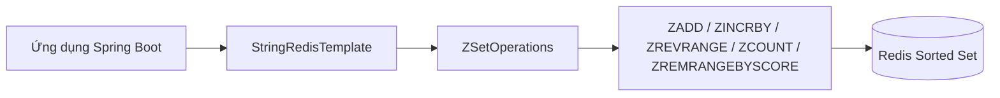
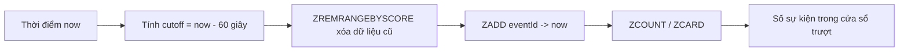
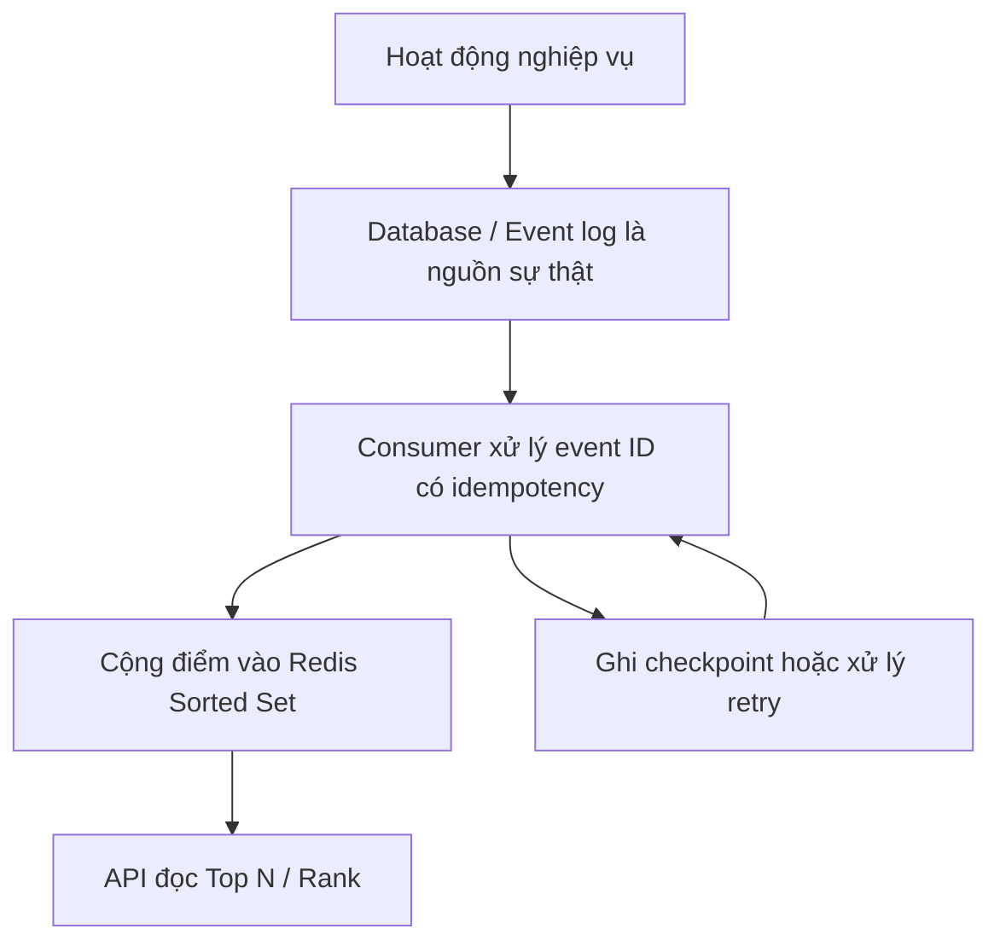

# Xây dựng bảng xếp hạng và cửa sổ dữ liệu theo thời gian

## 1. Bài toán: xếp hạng có điểm số và giới hạn thời gian

Giả sử một ứng dụng Spring Boot có tính năng bảng xếp hạng người dùng theo số điểm đóng góp. Các yêu cầu ban đầu:

- Mỗi khi người dùng hoàn thành một hoạt động, cộng điểm cho người đó.
- Hiển thị **Top 10** người có điểm cao nhất.
- Xem **vị trí hiện tại** của một người dùng.
- Có bảng xếp hạng **hôm nay**, **tuần này** và **tháng này**.
- Không để kết quả tuần cũ làm ảnh hưởng bảng xếp hạng tuần mới.

Redis có kiểu dữ liệu **Sorted Set (ZSet)**, rất phù hợp để giữ tập thành viên duy nhất và sắp xếp chúng theo điểm số. Trong Spring Data Redis, nhóm `ZSetOperations<K,V>` cung cấp các thao tác như `add`, `incrementScore`, `reverseRangeWithScores` và `reverseRank`.

Nhưng có thêm một yêu cầu khác cũng liên quan thời gian:

> “Cho biết người dùng thực hiện bao nhiêu thao tác trong **60 giây gần nhất**.”

Đây là bài toán **cửa sổ trượt (sliding window)**. Cũng có thể dùng Sorted Set, nhưng vai trò của `score` thay đổi: thay vì điểm xếp hạng, score biểu diễn **thời điểm sự kiện**; mỗi member đại diện cho **một sự kiện duy nhất**. Hai thiết kế sử dụng cùng cấu trúc Redis nhưng khác cách đặt key, member, score và cách loại bỏ dữ liệu cũ.

**Mục tiêu bài học:** xây dựng bảng xếp hạng và cửa sổ dữ liệu theo thời gian bằng Spring Data Redis, hiểu rõ thời điểm chọn fixed window hay sliding window, tính nguyên tử, TTL, độ chính xác và các giới hạn vận hành.

## 2. Redis Sorted Set và ZSetOperations

Một Redis Sorted Set chứa các cặp:

```text
member -> score (double)
```

Ví dụ:

```text
Key: leaderboard:daily:v1:2026-11-12
Type: zset

member      score
-----------------
user-42     180
user-17     240
user-91     120
```

Các đặc điểm quan trọng:

1. **Mỗi member là duy nhất** trong một Sorted Set. Thêm lại cùng member bằng `ZADD` sẽ cập nhật score, không tạo hai bản ghi.
2. **Score là số thực dạng double** theo Redis. Member được sắp xếp theo score; khi score bằng nhau, Redis có quy tắc thứ tự theo member.
3. Có thể lấy vùng phần tử **từ thấp đến cao** hoặc **từ cao đến thấp** mà không phải tải toàn bộ Set sang Java để sort.
4. Có thể tìm **thứ hạng**, **đếm theo khoảng score**, **tăng score** hoặc **xóa các phần tử theo khoảng score**.
5. Sorted Set là **một Redis key**. Redis Cluster phân bố key theo hash slot; các member bên trong cùng một key không tự tách sang nhiều node.



Với `StringRedisTemplate`, key/member là chuỗi. Điểm số dùng `double` của Java và Redis:

```java
import org.springframework.data.redis.core.StringRedisTemplate;
import org.springframework.data.redis.core.ZSetOperations;

ZSetOperations<String, String> zset = redis.opsForZSet();
```

### Các API cần sử dụng

| Nhu cầu | Redis command tương ứng | API Spring Data Redis |
|---|---|---|
| Thêm/cập nhật điểm một member | `ZADD` | `add(key, member, score)` |
| Tăng điểm hiện tại | `ZINCRBY` | `incrementScore(key, member, delta)` |
| Lấy điểm của member | `ZSCORE` | `score(key, member)` |
| Lấy thứ hạng từ thấp đến cao | `ZRANK` | `rank(key, member)` |
| Lấy thứ hạng từ cao đến thấp | `ZREVRANK` | `reverseRank(key, member)` |
| Top N từ cao đến thấp | `ZREVRANGE ... WITHSCORES` | `reverseRangeWithScores(key, start, end)` |
| Đếm phần tử trong một khoảng score | `ZCOUNT` | `count(key, min, max)` |
| Lấy phần tử có score trong khoảng | `ZRANGEBYSCORE` hoặc biến thể tương đương | `rangeByScore(key, min, max)` |
| Xóa phần tử có score trong khoảng | `ZREMRANGEBYSCORE` | `removeRangeByScore(key, min, max)` |
| Đếm tổng số member | `ZCARD` | `size(key)` |
| Xóa một member đã biết | `ZREM` | `remove(key, member)` |

Tên lệnh nền có thể khác khi Spring Data Redis dùng biến thể Redis mới hơn, nhưng ý nghĩa API ở bảng vẫn là cơ sở để thiết kế. Các ví dụ dưới đây dùng **API đồng bộ** Spring Data Redis; trong WebFlux có các API reactive riêng.

## 3. Thứ hạng là số đếm từ 0, không phải số thứ tự hiển thị

Ví dụ Redis CLI:

```bash
redis-cli ZADD demo:leaderboard:v1 120 user-91 240 user-17 180 user-42
redis-cli ZREVRANGE demo:leaderboard:v1 0 2 WITHSCORES
redis-cli ZREVRANK demo:leaderboard:v1 user-42
redis-cli ZSCORE demo:leaderboard:v1 user-42
```

Khi sắp xếp theo score giảm dần, thứ tự là:

```text
index 0: user-17 -> 240 điểm
index 1: user-42 -> 180 điểm
index 2: user-91 -> 120 điểm
```

`ZREVRANK` hoặc `reverseRank` trả về **chỉ số từ 0**: `user-42` có rank bằng `1` trong Redis, nhưng giao diện thường muốn hiển thị **hạng 2**. Do đó:

```java
Long zeroBased = zset.reverseRank(key, "user-42");
Long displayRank = zeroBased == null ? null : zeroBased + 1;
```

Nếu member không tồn tại trong key hoặc key đã hết hạn, `reverseRank` có thể trả `null`. Không ép `null` thành số 0 rồi hiển thị nhầm hạng 1.

### 3.1. Trường hợp bằng điểm

Hai member có cùng score vẫn là hai member khác nhau. Redis dùng **thứ tự từ điển của member** để giải quyết vị trí khi score bằng nhau; truy vấn đảo chiều cũng đảo chiều thứ tự xử lý trường hợp hòa.

Ví dụ:

```text
user-42 -> 100
user-91 -> 100
```

`reverseRank` vẫn trả **hai vị trí riêng biệt**, chứ không tự áp dụng kiểu xếp hạng thể thao “cùng điểm thì đồng hạng 1”. Nếu sản phẩm yêu cầu **đồng hạng**, ứng dụng phải đặt quy tắc riêng:

- Hạng **dense rank**: 100 điểm → hạng 1 cho cả hai; 90 điểm → hạng 2.
- Hạng **competition rank**: hai người 100 điểm cùng hạng 1; người 90 điểm hạng 3.
- Hạng **position rank**: mỗi member có một vị trí riêng theo thứ tự Redis.

Không dựa vào `reverseRank` để suy ra đồng hạng theo điểm. Khi số member lớn, tính toán rank hòa bằng các lệnh đếm theo score hoặc một projection riêng thay vì tải toàn bộ bảng lên JVM.

## 4. Bảng xếp hạng đơn giản bằng Spring Data Redis

Ví dụ một service lưu điểm tổng cộng, đọc Top N và thứ hạng:

```java
import java.util.ArrayList;
import java.util.List;
import java.util.Set;

import org.springframework.data.redis.core.StringRedisTemplate;
import org.springframework.data.redis.core.ZSetOperations;
import org.springframework.stereotype.Service;

@Service
public class GlobalLeaderboard {
    private static final String KEY = "leaderboard:all-time:v1";

    private final ZSetOperations<String, String> zset;

    public GlobalLeaderboard(StringRedisTemplate redis) {
        this.zset = redis.opsForZSet();
    }

    public Double addPoints(String userId, double points) {
        if (!Double.isFinite(points) || points <= 0) {
            throw new IllegalArgumentException(
                    "points phải là số dương hữu hạn");
        }
        return zset.incrementScore(KEY, userId, points);
    }

    public Long rankForDisplay(String userId) {
        Long zeroBased = zset.reverseRank(KEY, userId);
        return zeroBased == null ? null : zeroBased + 1;
    }

    public List<RankedUser> top(int limit) {
        if (limit < 1 || limit > 100) {
            throw new IllegalArgumentException("limit phải từ 1 tới 100");
        }

        Set<ZSetOperations.TypedTuple<String>> tuples =
                zset.reverseRangeWithScores(KEY, 0, limit - 1L);

        List<RankedUser> result = new ArrayList<>();
        if (tuples == null) {
            return result;
        }

        int position = 1;
        for (ZSetOperations.TypedTuple<String> tuple : tuples) {
            result.add(new RankedUser(
                    position++, tuple.getValue(), tuple.getScore()));
        }
        return result;
    }

    public record RankedUser(
            int position, String userId, Double score) {}
}
```

Ở đây:

- `incrementScore` dùng hành vi tăng score **nguyên tử của một lệnh Redis**, tránh lỗi lost update của cặp `score` → tính toán Java → `add`.
- `reverseRangeWithScores(KEY, 0, limit - 1)` lấy những member có điểm cao nhất cùng score, thay vì tải tất cả rồi sắp xếp bằng Java.
- `position` trong ví dụ chỉ là **vị trí thứ tự** của kết quả, không phải dense/competition rank khi hòa điểm.
- `TypedTuple` chứa member và score đã được deserialize theo template.
- Một lần đọc Top N và một lần đọc rank là **hai thao tác độc lập**; nếu điểm thay đổi giữa hai lượt, hai kết quả có thể phản ánh các thời điểm khác nhau.

`ZSetOperations` là API thường được dùng từ bean `StringRedisTemplate`. Không cần tạo một connection Redis thủ công cho mỗi request.

## 5. Một bảng xếp hạng cho mọi thời gian hay mỗi cửa sổ một bảng?

Không có một biểu diễn Sorted Set duy nhất đáp ứng mọi loại thời gian. Trước khi viết code, xác định “cửa sổ thời gian” có nghĩa gì.

| Loại | Ví dụ | Biên cửa sổ | Cách lưu gợi ý |
|---|---|---|---|
| **All-time** | Tổng điểm từ khi ra mắt | Không có điểm kết thúc | Một ZSet tổng |
| **Fixed daily window** | Bảng xếp hạng ngày 12/11 | 00:00 tới 00:00 ngày sau theo timezone đã chọn | ZSet riêng cho mỗi ngày |
| **Fixed weekly window** | Tuần ISO bắt đầu thứ Hai | Thứ Hai 00:00 tới thứ Hai kế tiếp | ZSet riêng cho mỗi tuần |
| **Fixed monthly window** | Tháng 11 | Đầu tháng tới đầu tháng tiếp theo | ZSet riêng cho mỗi tháng |
| **Sliding/rolling window** | 60 giây hoặc 24 giờ gần nhất | Trượt liên tục theo thời điểm đánh giá | ZSet sự kiện theo timestamp và dọn sự kiện cũ |
| **Bucketed rolling approximation** | Tổng điểm 7 ngày gần đây, tính theo ngày | Ghép nhiều bucket thời gian | Nhiều ZSet daily và cơ chế tổng hợp |

**Fixed window** có ranh giới lịch rõ ràng. **Sliding window** dịch theo từng giây/millisecond khi thời gian tiến lên. Một bảng xếp hạng trong “7 ngày lịch gần nhất” không nhất thiết giống “7 × 24 giờ chính xác trước thời điểm hiện tại”.

Ví dụ lúc 15:00 ngày 12/11, cửa sổ trượt 24 giờ bắt đầu 15:00 ngày 11/11; bảng xếp hạng “hôm nay” lại bắt đầu 00:00 ngày 12/11. Nếu chỉ lưu trong key theo ngày, không thể suy ra chính xác mọi cửa sổ trượt 24 giờ mà không bổ sung dữ liệu/sự kiện.

## 6. Thiết kế key cho bảng xếp hạng theo ngày và tuần

Một quy ước dễ vận hành:

```text
leaderboard:<domain>:daily:v1:<yyyy-MM-dd>
leaderboard:<domain>:weekly:v1:<ISO-week-year>-W<week-number>
leaderboard:<domain>:monthly:v1:<yyyy-MM>
leaderboard:<domain>:all-time:v1
```

Ví dụ:

```text
leaderboard:activity:daily:v1:2026-11-12
leaderboard:activity:weekly:v1:2026-W46
leaderboard:activity:monthly:v1:2026-11
leaderboard:activity:all-time:v1
```

Mỗi key là **một Redis Sorted Set**, trong đó:

- **member** = `userId` ổn định, ví dụ `user-42`.
- **score** = số điểm tích lũy của người dùng **trong khoảng thời gian đại diện bởi key**.
- Mỗi hoạt động làm tăng điểm của user trong đúng các bảng được nghiệp vụ yêu cầu.
- Chuyển sang một ngày/tuần mới nghĩa là **ghi vào key mới**, không reset toàn bộ Redis và không xóa key đang được người dùng khác đọc.

### 6.1. Timezone và tuần ISO

Mốc thời gian phải được định nghĩa rõ. Ví dụ một chương trình dành cho thị trường Việt Nam chọn `Asia/Ho_Chi_Minh` cho ranh giới ngày. Nếu backend ở UTC mà tự lấy ngày theo timezone hệ điều hành, hai instance chạy ở các vùng khác nhau có thể ghi **hai key khác nhau cho cùng một hoạt động**.

Đối với tuần theo chuẩn ISO:

- Tuần bắt đầu **thứ Hai**.
- Mỗi tuần có số thứ tự theo quy tắc ISO.
- **ISO week-based year** có thể khác **calendar year** ở những ngày sát Tết Dương lịch. Không ghép năm lịch thông thường với số tuần ISO một cách tùy tiện.

Ví dụ Java tạo key theo timezone và ISO week:

```java
import java.time.Clock;
import java.time.LocalDate;
import java.time.ZoneId;
import java.time.temporal.TemporalAdjusters;
import java.time.DayOfWeek;
import java.time.temporal.WeekFields;

public final class LeaderboardKeys {
    private static final ZoneId BUSINESS_ZONE =
            ZoneId.of("Asia/Ho_Chi_Minh");

    private LeaderboardKeys() {}

    public static String daily(Clock clock) {
        LocalDate date = LocalDate.now(clock.withZone(BUSINESS_ZONE));
        return "leaderboard:activity:daily:v1:" + date;
    }

    public static String weekly(Clock clock) {
        LocalDate date = LocalDate.now(clock.withZone(BUSINESS_ZONE));
        LocalDate monday = date.with(
                TemporalAdjusters.previousOrSame(DayOfWeek.MONDAY));
        WeekFields iso = WeekFields.ISO;

        int year = monday.get(iso.weekBasedYear());
        int week = monday.get(iso.weekOfWeekBasedYear());
        return String.format(
                java.util.Locale.ROOT,
                "leaderboard:activity:weekly:v1:%04d-W%02d",
                year, week);
    }
}
```

Truyền `Clock` giúp viết code có thể điều khiển thời điểm trong unit test. Một bean ứng dụng có thể cung cấp:

```java
@Configuration
class ClockConfiguration {
    @Bean
    Clock clock() {
        return Clock.systemUTC();
    }
}
```

`Clock.systemUTC()` cung cấp thời gian, còn `withZone(BUSINESS_ZONE)` ở chỗ tính key xác định **cách diễn giải ngày/tuần**, không yêu cầu máy chủ đặt timezone toàn hệ thống là Việt Nam.

## 7. Tăng điểm trong một fixed window

Một bảng xếp hạng ngày dùng key riêng cho mỗi ngày; mỗi activity làm tăng score của người thực hiện.

```java
import java.time.Clock;
import java.time.Duration;
import java.time.LocalDate;
import java.time.ZoneId;
import java.time.ZonedDateTime;
import java.util.Date;

import org.springframework.data.redis.core.StringRedisTemplate;
import org.springframework.data.redis.core.ZSetOperations;
import org.springframework.stereotype.Service;

@Service
public class DailyLeaderboard {
    private static final ZoneId ZONE =
            ZoneId.of("Asia/Ho_Chi_Minh");

    private final StringRedisTemplate redis;
    private final Clock clock;
    private final ZSetOperations<String, String> zset;

    public DailyLeaderboard(StringRedisTemplate redis, Clock clock) {
        this.redis = redis;
        this.clock = clock;
        this.zset = redis.opsForZSet();
    }

    public Double addPoints(String userId, long delta) {
        if (delta <= 0) {
            throw new IllegalArgumentException("delta phải dương");
        }

        LocalDate day = LocalDate.now(clock.withZone(ZONE));
        String key = "leaderboard:activity:daily:v1:" + day;

        Double score = zset.incrementScore(key, userId, delta);

        // Dữ liệu ngày được giữ thêm 2 ngày sau khi kết thúc.
        ZonedDateTime nextDay = day.plusDays(1).atStartOfDay(ZONE);
        Date expireAt = Date.from(
                nextDay.toInstant().plus(Duration.ofDays(2)));
        redis.expireAt(key, expireAt);

        return score;
    }
}
```

Điều này tạo ra hai ý nghĩa khác nhau:

1. `incrementScore` **tăng score nguyên tử cho member**, kể cả khi nhiều instance đồng thời cộng điểm cho cùng một user.
2. `expireAt` đặt thời hạn **cho cả Sorted Set key**, giúp xóa bảng ngày cũ khi không cần lưu nữa.

**Hai lời gọi trên không phải một transaction Redis nguyên tử**. Nếu process crash sau khi tăng điểm nhưng trước khi đặt TTL, key có thể không có TTL như thiết kế. Nếu TTL là ràng buộc bắt buộc, cần một thao tác kết hợp phù hợp, chẳng hạn Redis Lua script (trình bày ở phần sau), hoặc cơ chế định kỳ phát hiện/dọn key cũ.

TTL được **neo vào cuối cửa sổ cộng thời gian lưu thêm**, không phải “24 giờ kể từ hoạt động cuối cùng”. Nếu mỗi lần cộng điểm đều gọi `expire(key, Duration.ofDays(3))`, một bảng ngày cũ có thể sống lâu thêm khi có sự kiện muộn, gây khó dự đoán thời gian dọn.

### 7.1. Chọn ngày theo lúc nhận sự kiện hay lúc sự kiện xảy ra?

Giả sử một hoạt động xảy ra lúc 23:59 nhưng request tới server lúc 00:01 ngày hôm sau:

- Nếu dùng **processing time** (thời gian xử lý), điểm được cộng vào ngày hôm sau.
- Nếu dùng **event time** (thời điểm thực sự của hoạt động), điểm được cộng vào ngày trước.

Hai cách đều có thể hợp lệ, nhưng quy tắc phải rõ. Với event time, đọc timestamp từ sự kiện đã xác thực, chuyển về timezone nghiệp vụ rồi tính key; kiểm soát sự kiện đến quá muộn, duplicate và dữ liệu có thời gian tương lai. Không tin timestamp tùy ý do client gửi khi nó ảnh hưởng quyền lợi hoặc giải thưởng.

## 8. Đọc Top N theo ngày, tuần và tháng

Khi đã có key của cửa sổ, cách lấy thứ hạng giống bảng all-time:

```java
String key = "leaderboard:activity:daily:v1:2026-11-12";

Set<ZSetOperations.TypedTuple<String>> topTen =
        redis.opsForZSet().reverseRangeWithScores(key, 0, 9);

Long zeroBasedRank = redis.opsForZSet()
        .reverseRank(key, "user-42");

Double currentScore = redis.opsForZSet()
        .score(key, "user-42");
```

Với kết quả từ `reverseRangeWithScores`, mỗi tuple chứa `getValue()` (user ID) và `getScore()`. Nếu không có dữ liệu, truy vấn Top N có thể trả collection rỗng; với member không tồn tại, score/rank có thể `null`.

Nên phân biệt:

- **Top của một cửa sổ cụ thể**: đọc một key đã biết theo ngày/tuần/tháng.
- **Top hiện tại**: tạo key từ đồng hồ tại thời điểm request; khi qua ranh giới ngày, key tự thay đổi.
- **Top lịch sử**: đọc key của cửa sổ đã kết thúc, nếu key vẫn còn; TTL cần đủ để đáp ứng yêu cầu báo cáo.
- **Top theo bất kỳ khoảng từ A tới B**: có thể phải tổng hợp từ nhiều bucket, không thể tự suy ra từ một key daily.

Nếu cần giữ bảng xếp hạng lịch sử lâu dài, Redis có thể chỉ là lớp phục vụ truy vấn nhanh; hãy lưu snapshot hoặc dữ liệu gốc ở nơi bền vững phù hợp. Redis replication/AOF/RDB và eviction policy quyết định mức rủi ro mất dữ liệu; không mặc nhiên xem Redis là kho lịch sử duy nhất.

## 9. Cửa sổ trượt: score là timestamp, member là event ID

Bài toán thứ hai: giới hạn mỗi người dùng tối đa 5 request trong **60 giây gần nhất**. Cửa sổ trượt cần biết các request nào nằm trong khoảng thời gian tính từ `now - 60s` tới `now`.

Thiết kế một Sorted Set cho mỗi subject:

```text
Key: requests:window:v1:user-42
Type: zset

member                  score (epoch milliseconds)
---------------------------------------------------
req-8f01                1794488400123
req-8f02                1794488402781
req-8f03                1794488404530
```

Trong thiết kế này:

- **Key** xác định người dùng/khóa giới hạn cần theo dõi.
- **Member** là **event/request ID duy nhất**. Nếu chỉ dùng `userId` làm member thì mỗi lần `ZADD` cập nhật score cũ, **không thể đếm nhiều request**.
- **Score** là timestamp của event, thường là Unix epoch milliseconds.
- **Cửa sổ hiện hành** là một **khoảng score**.
- Những member quá cũ được loại bằng `ZREMRANGEBYSCORE`; số member còn trong khoảng có thể đo bằng `ZCOUNT` hoặc `ZCARD` nếu đã dọn phù hợp.



**Đừng trộn hai cách dùng score trên một key**. Một Sorted Set có score biểu diễn **điểm của user** không thể đồng thời được dùng như một Sorted Set có score biểu diễn **thời gian của event** mà vẫn giữ đúng hai nghĩa. Dùng các namespace/key riêng cho leaderboard và event window.

### 9.1. Các lệnh Redis nền tảng

Ví dụ một key demo:

```bash
# Các timestamp chỉ mang tính minh họa.
redis-cli ZADD demo:requests:window:v1 \
  10000 req-a 12000 req-b 15000 req-c

# Đếm sự kiện có timestamp từ 11000 đến 15000 (bao gồm hai đầu).
redis-cli ZCOUNT demo:requests:window:v1 11000 15000

# Xóa sự kiện <= 11000.
redis-cli ZREMRANGEBYSCORE demo:requests:window:v1 -inf 11000

# Xem các event còn lại.
redis-cli ZRANGE demo:requests:window:v1 0 -1 WITHSCORES
```

`ZCOUNT` và `ZREMRANGEBYSCORE` hoạt động trên score, không dựa vào tên member. Với timestamp dạng số nguyên milliseconds, cần định nghĩa ranh giới:

- Nếu cửa sổ là **`(now - duration, now]`**, xóa mọi event có score **≤ cutoff**, giữ các event sau cutoff.
- Nếu cửa sổ là **`[now - duration, now]`**, xóa event có score **< cutoff**.

Redis hỗ trợ khoảng score mở/đóng ở mức lệnh; Spring Data Redis có các overload nhận `double` với biên thông thường bao gồm cả hai đầu. Với epoch milliseconds nguyên, có thể biểu diễn cách xóa “nhỏ hơn cutoff” bằng `cutoff - 1`, khi chắc chắn score là số nguyên milliseconds.

### 9.2. Vì sao timestamp milliseconds dùng được làm score?

Redis dùng IEEE-754 double cho score; các số nguyên có trị tuyệt đối **không vượt quá 2^53** được biểu diễn chính xác. Epoch milliseconds trong phạm vi thời gian ứng dụng thông thường nhỏ hơn giới hạn này, nên có thể dùng làm score nguyên milliseconds.

Không mở rộng suy luận đó sang timestamp **nanoseconds** hoặc ghép thêm hàng nghìn bit ID vào cùng score. Những giá trị quá lớn có thể bị làm tròn; các sự kiện khác nhau có thể có score không được phân biệt đúng như dự kiến.

Thứ tự của các sự kiện có cùng timestamp vẫn dựa trên thứ tự member, không phải thứ tự gọi API. Nếu cần sequence có thứ tự tuyệt đối, phải xác định cơ chế cấp sequence riêng.

## 10. Đọc số sự kiện trong cửa sổ bằng Spring Data Redis

Ví dụ service thống kê request trong 60 giây gần nhất. Đây là **đo lường số sự kiện** chứ chưa phải rate limiter nguyên tử:

```java
import java.time.Clock;
import java.time.Duration;
import java.util.UUID;

import org.springframework.data.redis.core.StringRedisTemplate;
import org.springframework.data.redis.core.ZSetOperations;
import org.springframework.stereotype.Service;

@Service
public class RecentRequestCounter {
    private static final Duration WINDOW = Duration.ofSeconds(60);

    private final StringRedisTemplate redis;
    private final ZSetOperations<String, String> zset;
    private final Clock clock;

    public RecentRequestCounter(StringRedisTemplate redis, Clock clock) {
        this.redis = redis;
        this.zset = redis.opsForZSet();
        this.clock = clock;
    }

    public Long recordAndCount(String subjectId) {
        String key = "requests:window:v1:" + subjectId;
        long now = clock.millis();
        long cutoff = now - WINDOW.toMillis();

        // Mỗi request thực sự khác nhau phải có event ID riêng.
        String eventId = UUID.randomUUID().toString();

        // Các lệnh này độc lập; chỉ phù hợp với thống kê best-effort.
        zset.removeRangeByScore(key, Double.NEGATIVE_INFINITY, cutoff);
        zset.add(key, eventId, (double) now);
        Long count = zset.count(key, cutoff + 1.0, (double) now);
        redis.expire(key, WINDOW.plusSeconds(30));

        return count;
    }
}
```

Ví dụ nêu rõ giới hạn:

- `removeRangeByScore` xóa event có score **≤ cutoff**; `count(key, cutoff + 1, now)` đếm cửa sổ **`(cutoff, now]`** với score theo milliseconds nguyên.
- `UUID.randomUUID()` tạo một member mới cho mỗi lần gọi; nếu retry cùng một request phải được xem là **cùng một sự kiện**, hãy dùng **request/event ID ổn định** do tầng nghiệp vụ xác định thay vì tạo UUID mới trên mỗi lần retry.
- `expire` áp TTL cho **cả key**, nhằm dọn key của subject không hoạt động sau một khoảng thời gian. TTL được làm mới khi có event mới.
- Các lệnh dọn, thêm, đếm, đặt TTL là **nhiều lời gọi Redis riêng biệt**; client khác có thể xen vào giữa chúng.
- Kết quả có thể phản ánh thay đổi đồng thời và không nên dùng ví dụ này để quyết định rate limit nghiêm ngặt, cấp quota có giá trị hoặc tính tiền.

Điểm quan trọng khác: các instance nên dùng một nguồn thời gian đáng tin cậy và đồng bộ. Nếu instance A có đồng hồ nhanh hơn B vài giây, chúng có thể thêm event với score tương lai hoặc xóa event quá sớm. Với rate limiter nghiêm ngặt, cân nhắc dùng thời gian của Redis server trong một script thích hợp hoặc bảo đảm đồng bộ clock và chính sách chấp nhận sai số.

## 11. Rate limiter sliding window phải nguyên tử

Giả sử giới hạn là **5 request/60 giây**. Nếu code Java gọi:

```java
Long count = zset.count(key, cutoff, now);
if (count != null && count < 5) {
    zset.add(key, eventId, now);
    return true;
}
return false;
```

thì hai request đồng thời có thể **đều đọc count = 4**, đều vượt qua điều kiện và cùng ghi sự kiện, khiến tổng thành 6. Chỉ chuyển code vào `SessionCallback` mà không có transaction/điều kiện phù hợp **không tự giải quyết race**.

Một hướng triển khai là Redis **Lua script** thực hiện kiểm tra và cập nhật trong một lượt xử lý:

```lua
-- KEYS[1] = key của subject
-- ARGV[1] = nowMs (trusted clock)
-- ARGV[2] = windowMs, ví dụ 60000
-- ARGV[3] = limit, ví dụ 5
-- ARGV[4] = eventId ổn định trong các lần retry
-- ARGV[5] = ttlSeconds, ví dụ 90

local key = KEYS[1]
local now = tonumber(ARGV[1])
local window = tonumber(ARGV[2])
local limit = tonumber(ARGV[3])
local eventId = ARGV[4]
local ttl = tonumber(ARGV[5])
local cutoff = now - window

-- Giữ các event có score > cutoff.
redis.call('ZREMRANGEBYSCORE', key, '-inf', cutoff)

-- Retry của event còn trong cửa sổ: không đếm hai lần.
if redis.call('ZSCORE', key, eventId) then
    return 1
end

local current = redis.call('ZCARD', key)
if current >= limit then
    return 0
end

redis.call('ZADD', key, now, eventId)
redis.call('EXPIRE', key, ttl)
return 1
```

Khi chạy trên Redis primary, các lệnh Redis trong script được thực thi như một đơn vị không bị client khác chen lệnh. Vì vậy hai request không thể đồng thời đọc cùng số lượng rồi cả hai cùng chèn khi chạm ngưỡng, miễn chúng dùng cùng key và cùng quy tắc thời gian.

Để gọi từ Spring Data Redis, có thể dùng `DefaultRedisScript<Long>`:

```java
import java.util.List;
import org.springframework.data.redis.core.script.DefaultRedisScript;

// Nội dung LUA_SCRIPT được lấy từ resource hoặc chuỗi đã quản lý.
DefaultRedisScript<Long> script = new DefaultRedisScript<>();
script.setScriptText(LUA_SCRIPT);
script.setResultType(Long.class);

Long allowed = redis.execute(
        script,
        List.of("requests:window:v1:" + subjectId),
        Long.toString(nowMs),
        "60000",
        "5",
        requestId,
        "90");

boolean accepted = Long.valueOf(1L).equals(allowed);
```

`LUA_SCRIPT` ở đây là nội dung script Lua đã trình bày phía trên, được cấu hình từ một resource hoặc biến do ứng dụng cung cấp. Không gửi script động xây từ dữ liệu không tin cậy. Nên quản lý script như một thành phần mã nguồn có version và cơ chế triển khai rõ ràng.

### Những điều script vẫn không giải quyết hết

1. **Đồng hồ:** ví dụ nhận `nowMs` từ caller. Nếu nhiều instance lệch đồng hồ, kết quả cửa sổ có thể không nhất quán; cần đồng bộ thời gian hoặc chiến lược lấy thời gian server.
2. **Retry sau khi event đã hết cửa sổ:** cùng event ID không còn trong Set; script không có lịch sử vĩnh viễn để nhận diện nó. Nếu phải bảo đảm idempotency lâu hơn cửa sổ, cần kho operation ID khác với retention phù hợp.
3. **Mất phản hồi:** Redis có thể đã nhận request nhưng mạng timeout; caller không thể suy ra lệnh chưa chạy. Retry cùng ID giúp hạn chế đếm trùng **khi event còn trong cửa sổ**, nhưng không thay thế lưu trạng thái nghiệp vụ.
4. **Dữ liệu từ tương lai:** `ZCARD` đếm tất cả member còn lại; nếu có event timestamp tương lai do clock skew, nó có thể làm giới hạn chặt hơn dự kiến. Phải chuẩn hóa nguồn timestamp và chính sách cho dữ liệu bất thường.
5. **Kiểu key:** script giả định key là Sorted Set; nếu key đã được lưu kiểu khác, lệnh có thể báo `WRONGTYPE`.
6. **Độ bền:** tính nguyên tử của script không biến một instance Redis thành cơ sở dữ liệu giao dịch bền vững tuyệt đối qua mọi sự cố/failover.

Khi lệnh script thất bại do lỗi runtime sau một số thao tác ghi, Redis **không cung cấp rollback kiểu RDBMS cho script đã thực thi một phần**. Vì vậy validate đầu vào/kiểu dữ liệu và giữ script ngắn, rõ ràng.

## 12. Cửa sổ trượt dùng cho bảng xếp hạng khác rate limiter như thế nào?

Rate limiter phía trên đếm **sự kiện của một subject**: key theo user, member theo event, score theo timestamp. Nhưng nếu yêu cầu là “Top 10 người có nhiều điểm nhất trong đúng 24 giờ gần nhất” thì bài toán phức tạp hơn:

- Mỗi event có timestamp và **điểm đóng góp**, không phải chỉ một lần đếm.
- Cần tổng hợp điểm theo **từng user** trong cửa sổ trượt.
- Khi event rời khỏi cửa sổ, **điểm đóng góp của event đó phải được trừ ra** khỏi tổng của user.
- Đồng thời cần Sorted Set theo user score để đọc Top N nhanh.

Chỉ lưu:

```text
leaderboard:rolling24h:
  user-42 -> 120 điểm
```

thì không biết trong 120 điểm có bao nhiêu điểm đến từ event đã xảy ra hơn 24 giờ trước. Một Sorted Set leaderboard cộng dồn **không có đủ lịch sử để tự loại đóng góp cũ**.

Có một số cách thiết kế:

| Phương án | Ý tưởng | Độ chính xác / chi phí |
|---|---|---|
| **Fixed daily ZSets** | Mỗi ngày giữ một bảng điểm | Đơn giản, chính xác theo ngày; không phải rolling 24h |
| **Tổng hợp nhiều daily bucket** | Ghép 7 hoặc N bảng daily | Cửa sổ gần đúng theo bucket; ranh giới theo ngày |
| **Minute/hour buckets** | Mỗi phút/giờ một ZSet, tổng hợp các bucket còn hiệu lực | Độ phân giải tốt hơn nhưng nhiều key và chi phí tổng hợp |
| **Event log + materialized rolling scores** | Lưu event có timestamp/điểm, khi hết hạn trừ đóng góp khỏi leaderboard | Có thể chính xác hơn nhưng cần workflow nhất quán và idempotency |
| **Query từ kho dữ liệu có timestamp/index** | Tính tổng trên dữ liệu sự kiện nguồn | Phù hợp khi cần truy vấn linh hoạt/kiểm toán; có thể tốn latency |

**Không nên chuyển score của member trong một leaderboard ZSet thành timestamp rồi kỳ vọng vẫn xếp hạng theo điểm.** Chọn representation dựa trên truy vấn chủ đạo: điểm của user hay thời điểm từng event.

## 13. Tổng hợp bảng xếp hạng từ nhiều bucket thời gian

Một cách thực dụng cho “7 ngày lịch gần đây” là lưu **một Sorted Set theo ngày**, mỗi member là user, score là điểm trong ngày; sau đó cộng các score của cùng member qua nhiều key.

Ví dụ:

```text
leaderboard:activity:daily:v1:2026-11-10
  user-1 -> 10
  user-2 -> 20

leaderboard:activity:daily:v1:2026-11-11
  user-1 -> 25
  user-2 -> 5

leaderboard:activity:daily:v1:2026-11-12
  user-1 -> 15
  user-3 -> 40
```

Tổng ba ngày:

```text
user-1 -> 50
user-2 -> 25
user-3 -> 40
```

Redis hỗ trợ phép kết hợp Sorted Set như `ZUNION` hoặc `ZUNIONSTORE`, với phép tổng score:

```bash
redis-cli ZUNIONSTORE leaderboard:activity:rolling3days:v1:2026-11-12 3 \
  leaderboard:activity:daily:v1:2026-11-10 \
  leaderboard:activity:daily:v1:2026-11-11 \
  leaderboard:activity:daily:v1:2026-11-12 \
  AGGREGATE SUM

redis-cli ZREVRANGE \
  leaderboard:activity:rolling3days:v1:2026-11-12 \
  0 9 WITHSCORES
```

`ZUNIONSTORE` tạo/cập nhật một **destination Sorted Set**; có thể đặt TTL ngắn cho destination nếu chỉ là kết quả tổng hợp tạm thời. Nếu nhiều request cùng tái tính/đọc destination, cần cơ chế refresh/version phù hợp, tránh người dùng đọc bản cũ trong lúc cập nhật.

### Những giới hạn của tổng hợp bucket

- Nếu bucket là **ngày**, phép cộng ba key biểu diễn ba **ngày lịch**, không phải đúng 72 giờ tính tới phút hiện tại.
- Điểm của ngày đang chạy có thể thay đổi trong lúc truy vấn hoặc sau khi kết quả tổng hợp được lưu. Destination là một **snapshot tại thời điểm thực hiện lệnh**, sau đó có thể cũ ngay.
- Tổng hợp nhiều ZSet lớn có chi phí CPU/bộ nhớ đáng kể; không nên tạo lại một bảng tổng hợp có hàng triệu member cho mọi request.
- Khi dùng Redis Cluster, các phép toán đa-key thường yêu cầu **các key tham gia cùng hash slot**; hash tag có thể giúp nhưng cũng có thể gây hotspot nếu buộc quá nhiều bảng lớn vào một slot.
- Nếu destination chỉ là cache, nên có TTL, giới hạn số lần tái tạo hoặc precompute theo lịch; đừng để các client tranh nhau tạo bản tổng hợp lớn.

Khi tần suất đọc cao, có thể lưu **bảng weekly/monthly riêng** và cập nhật đồng thời lúc nhận event thay vì liên tục tổng hợp daily. Đổi lại, cần kiểm soát việc một sự kiện có được ghi đầy đủ vào các bảng hay không.

## 14. Ghi vào nhiều cửa sổ và câu chuyện nhất quán

Một event có thể cần cộng:

```text
All-time leaderboard: +10
Daily leaderboard:    +10
Weekly leaderboard:   +10
Monthly leaderboard:  +10
```

Nếu thực hiện bốn `incrementScore` liên tiếp qua Java:

```java
zset.incrementScore(allTimeKey, userId, 10);
zset.incrementScore(dailyKey, userId, 10);
zset.incrementScore(weeklyKey, userId, 10);
zset.incrementScore(monthlyKey, userId, 10);
```

thì một lần lỗi mạng giữa chừng có thể khiến dữ liệu ghi **một phần**. Retry không kiểm soát có thể cộng trùng ở những key đã ghi thành công.

Các phương án tùy mức bảo đảm:

1. **Chấp nhận eventual consistency:** ghi vào một nguồn dữ liệu sự kiện chính thức, cập nhật các leaderboard theo consumer có idempotency và khả năng chạy bù.
2. **Dùng Lua script hoặc transaction Redis** cho nhóm cập nhật được phép thực thi trên cùng Redis node/slot; xác định operation ID để tránh trùng khi retry.
3. **Dùng batch/pipeline** nếu ưu tiên throughput và chấp nhận không có atomicity xuyên các lệnh; pipeline **không phải transaction**.
4. **Tính lại bảng phụ từ dữ liệu gốc** theo chu kỳ khi tính toàn vẹn quan trọng hơn độ trễ cập nhật tức thời.

**Không có transaction phân tán ACID tự động giữa Redis và PostgreSQL** chỉ vì service được đánh dấu `@Transactional`. Nếu điểm gắn với thanh toán, phần thưởng hoặc quyền lợi, nguồn sự thật nghiệp vụ nên nằm ở hệ thống có khả năng kiểm toán và bảo đảm phù hợp; Redis giữ projection phục vụ xếp hạng.

### Idempotency cho sự kiện cộng điểm

`ZINCRBY` nguyên tử **cho một lệnh tăng**, nhưng nếu cùng event được xử lý hai lần, score cũng tăng hai lần. Ví dụ event `evt-123` mang 10 điểm:

```text
Lần 1 xử lý evt-123 -> +10
Retry evt-123        -> +10 lần nữa nếu không kiểm tra
```

Một thiết kế có thể ghi nhận `eventId` đã xử lý và chỉ cộng điểm nếu chưa có, với ranh giới nguyên tử phù hợp. Khi có nhiều key liên quan, Redis Cluster cần tuân thủ giới hạn hash slot; nếu Redis chỉ là projection, cũng có thể chọn idempotency ở event consumer/database chính thức.

Đừng dùng UUID được tạo mới trong mỗi lần retry làm event ID của cùng một hoạt động, vì như vậy cơ chế chống trùng không thể nhận diện chúng thuộc cùng sự kiện.

## 15. Bảo đảm TTL cho fixed window bằng Lua

Nếu yêu cầu **tăng điểm và đặt thời điểm hết hạn trong cùng một thao tác Redis**, có thể sử dụng script:

```lua
-- KEYS[1] = leaderboard key của một fixed window
-- ARGV[1] = member/user ID
-- ARGV[2] = delta dương
-- ARGV[3] = thời điểm hết hạn Unix seconds

redis.call('ZINCRBY', KEYS[1], ARGV[2], ARGV[1])
redis.call('EXPIREAT', KEYS[1], ARGV[3])
return 1
```

Trong Java:

```java
import java.time.Instant;
import java.util.List;
import org.springframework.data.redis.core.script.DefaultRedisScript;

DefaultRedisScript<Long> incrementWithExpiry =
        new DefaultRedisScript<>();
incrementWithExpiry.setScriptText(INCREMENT_WITH_EXPIRY_LUA);
incrementWithExpiry.setResultType(Long.class);

Long applied = redis.execute(
        incrementWithExpiry,
        List.of(windowKey),
        userId,
        Long.toString(points),
        Long.toString(expireAt.getEpochSecond()));
```

Ở đây `INCREMENT_WITH_EXPIRY_LUA` là nội dung script Lua phía trên được load qua cơ chế quản lý resource/cấu hình mã nguồn. Ví dụ tập trung vào cách truyền key và argument, không ngụ ý biến đó tự có sẵn trong Spring.

Vì cả tăng score và đặt hạn được thực thi trong một script trên một key, không có request khác chen vào **giữa hai lệnh**. Tuy nhiên:

- Script không tự cung cấp **chống xử lý trùng event**.
- Khi `expireAt` đã ở quá khứ, `EXPIREAT` có thể xóa key ngay. Phải **kiểm tra cửa sổ có còn được chấp nhận** trước khi ghi sự kiện muộn.
- Nếu Redis key có sai kiểu, script có thể báo lỗi.
- Redis không rollback những lệnh đã được script thực thi nếu script gặp lỗi runtime sau đó; kiểm tra đầu vào và giữ logic đơn giản.
- Khi lỗi mạng sau khi thực thi, caller có thể không biết event đã được cộng điểm hay chưa; vẫn cần thiết kế idempotency phù hợp.

Nếu đang dùng Redis Cluster và chỉ thao tác **một key**, script này không cần gom nhiều key vào một slot. Với script cập nhật nhiều daily/weekly/monthly key, các key phải thuộc một slot phù hợp khi Redis Cluster yêu cầu.

## 16. Thời gian, score và những vấn đề độ chính xác

### 16.1. Điểm trong Redis là double

Score của Sorted Set là số thực double. Nếu cộng điểm nguyên:

```java
zset.incrementScore(key, "user-42", 1.0);
```

thì kết quả chính xác trong phạm vi integer biểu diễn được của double, nhưng với tổng điểm cực lớn hoặc phép cộng số thập phân, cần cân nhắc sai số floating-point.

- Với điểm nguyên, giới hạn giá trị và áp dụng quy ước nghiệp vụ rõ ràng.
- Với tiền tệ, **không dùng double score làm sổ cái giao dịch**; có thể dùng số đơn vị nhỏ nhất ở kho dữ liệu chính thức và tạo projection điểm phù hợp.
- Không truyền `Double.NaN` hoặc giá trị vô hạn làm score; xác thực đầu vào.
- Nếu score được tính từ nhiều nguồn, chuẩn hóa quy tắc cộng/trừ, tránh một service dùng điểm nguyên và service khác dùng hệ số không rõ.

### 16.2. Thời gian tính cửa sổ

| Vấn đề | Rủi ro | Cách xử lý |
|---|---|---|
| Timezone khác nhau giữa instance | Cùng event vào hai key daily khác nhau | Dùng `ZoneId` nghiệp vụ cố định |
| Giờ mùa hè (DST) ở thị trường khác | “Một ngày” không luôn đúng 24 giờ | Tính biên bằng `ZonedDateTime`, không cộng 24 giờ máy móc |
| Week-based year | Sai key trong những ngày giáp năm | Dùng `WeekFields.ISO`, không ghép calendar year tùy ý |
| Clock skew | Event có timestamp tương lai/quá khứ | Đồng bộ clock hoặc dùng thời gian server theo thiết kế |
| Event đến muộn | Ghi lại cửa sổ đã kết thúc | Quy định allowed lateness và chính sách đóng bucket |
| Retry event | Cộng điểm/đếm hai lần | Event ID ổn định, idempotency |
| Timestamp nanoseconds làm score | Mất chính xác khi vượt giới hạn double | Dùng epoch milliseconds hoặc biểu diễn phù hợp |
| TTL tính từ lần update cuối | Bảng cũ được giữ bất thường | Neo expiration vào cuối fixed window + grace |

### 16.3. TTL của key không tự làm hết hạn từng member

Trong Redis Sorted Set, `EXPIRE key 3600` áp dụng cho **toàn bộ key**. Nó không tự xóa những member có score (timestamp) đã quá 60 giây nếu key vẫn sống.

Vì thế sliding window cần **chủ động xóa event cũ theo score**, bằng `removeRangeByScore` hoặc một cơ chế cleanup khác. TTL toàn key vẫn hữu ích để giải phóng bộ nhớ của subject không còn hoạt động.

Ngược lại, fixed window leaderboard thường dùng **TTL toàn key**: hết hạn bảng ngày/tuần/tháng đã lưu trữ đủ lâu. Hai mục tiêu TTL khác nhau cần được thể hiện rõ trong thiết kế.

## 17. Vấn đề hiệu năng và bộ nhớ

Sorted Set cung cấp thứ hạng và truy vấn theo score hiệu quả hơn việc tải toàn bộ dữ liệu rồi sort trong Java, nhưng **không miễn phí**.

### 17.1. Bảng xếp hạng theo user

Nếu có 10 triệu user trong một bảng xếp hạng, Redis phải giữ dữ liệu cho các member và score cùng overhead của cấu trúc nội bộ. Top 10 vẫn có thể truy vấn hiệu quả, nhưng:

- Key rất lớn chiếm nhiều RAM và có thể tập trung tải vào một Redis node.
- Chỉ cần một key lớn cũng có thể tạo hotspot trong Redis Cluster.
- Giá trị member dài làm tăng bộ nhớ; tránh nhúng JSON lớn, email hoặc token vào member.
- Mỗi lần tăng score, xếp hạng cần cập nhật vị trí tương ứng.
- Nếu chỉ quan tâm Top N, có thể thiết kế dạng **bounded leaderboard** hoặc projection riêng, nhưng phải hiểu rằng cắt bớt member sẽ làm mất khả năng truy vấn rank cho người không có trong tập.

Đừng tối ưu bằng cách `ZREVRANGE key 0 -1` rồi sort ở Java cho mỗi request. Dùng range giới hạn, ví dụ `reverseRangeWithScores(key, 0, 9)`.

### 17.2. Sliding window theo từng event

Nếu giữ **một member cho mỗi request trong 60 giây**, subject có 10.000 request/giây có thể tạo khoảng 600.000 member trong một cửa sổ. Điều này có chi phí đáng kể, chưa tính overhead, mạng và các thao tác dọn.

Các cách giảm chi phí tùy yêu cầu:

- Giới hạn số event giữ lại bằng chính sách rate limiting.
- Sử dụng **bucket theo giây/phút** và counter nếu chấp nhận sai số ở ranh giới cửa sổ.
- Dùng fixed-window counters nếu không cần sliding window chính xác.
- Chọn thuật toán token bucket/leaky bucket hoặc công cụ rate limiter phù hợp khi ưu tiên hiệu năng.
- Đảm bảo dọn các member ngoài cửa sổ và đặt TTL cho key không hoạt động.

Không sử dụng Sorted Set event-level chỉ vì “dùng ZSet có vẻ tiện” khi mục tiêu thực tế là một bộ đếm tổng theo ngày.

### 17.3. Độ phức tạp và tải

Các thao tác trên ZSet thường có đặc tính tốt theo kích thước tập và số phần tử cần trả/xóa. Tuy nhiên, lệnh `removeRangeByScore` có thể xóa nhiều member trong một lượt; số phần tử bị xóa càng lớn, chi phí thực thi càng cao. Một key không được dọn trong thời gian dài có thể gây spike khi request sau đó xóa rất nhiều member đã cũ.

Nên quan sát p95/p99 latency, CPU Redis, lượng RAM, network I/O, số member/key và thời lượng các command. Nếu API yêu cầu latency thấp, tránh công việc cleanup lớn nằm trên đường xử lý đồng bộ.

## 18. Race condition ngoài incrementScore

`incrementScore` xử lý một lần tăng atomically, nhưng một workflow thường nhiều bước hơn:

```text
1. Kiểm tra event đã xử lý?
2. Tính bucket ngày/tuần.
3. Cộng điểm daily.
4. Cộng điểm weekly.
5. Đặt TTL.
6. Gửi thông báo xếp hạng.
```

Sáu bước trên **không tự thành một transaction** vì mỗi bước là một lệnh Java/Redis hoặc hệ thống khác. `SessionCallback` giúp nhiều lệnh dùng chung connection, `MULTI/EXEC` điều phối Redis transaction theo hạn chế Redis, Lua script gom thao tác nguyên tử trên server, còn pipeline tối ưu round trip. Chúng không tạo một transaction phân tán giữa Redis và email/HTTP/database.

Một cách tổ chức bền vững khi điểm gắn với nghiệp vụ:



Khi Redis gián đoạn, consumer có thể chạy bù từ nguồn sự thật. Khi xảy ra sự cố một phần, hệ thống có cơ chế đối soát để tái tạo bảng xếp hạng thay vì mất điểm vĩnh viễn. Phần Redis vẫn cần được cấu hình persistence/replication phù hợp với mục tiêu độ sẵn sàng.

## 19. Redis Cluster và Sorted Set

Mỗi bảng xếp hạng theo ngày là một Redis key, nên trong Redis Cluster toàn bộ member của key đó nằm trong **một hash slot**. Một số hệ quả:

- `ZADD`, `ZINCRBY`, `ZREVRANK` trên một key hoạt động theo định tuyến của key đó.
- Các phép hợp/tổng Sorted Set trên **nhiều key** có thể yêu cầu các key ở cùng slot. Khi dùng `ZUNIONSTORE`, cần xem ràng buộc Redis Cluster và cách client định tuyến.
- Sử dụng hash tag như `leaderboard:{activity}:daily:v1:2026-11-12` và `leaderboard:{activity}:daily:v1:2026-11-11` có thể giúp cùng slot cho phép toán đa-key, nhưng cũng dồn các bảng activity vào một vị trí, dễ tạo hotspot.
- Với nhiều bảng xếp hạng lớn, thay vì ép tất cả cùng slot, cân nhắc tổng hợp ở tầng application/batch hoặc một kho dữ liệu hỗ trợ tổng hợp phân tán.

**Định nghĩa key pattern cần cân bằng giữa đa-key atomic/aggregate và khả năng phân tải.** Không có một mẫu hash tag tối ưu cho mọi workload.

## 20. Các lỗi thường gặp và cách nhận diện

| Triệu chứng | Nguyên nhân thường gặp | Hướng xử lý |
|---|---|---|
| Top N hiển thị hạng bắt đầu từ 0 | Redis rank là zero-based | Cộng 1 khi hiển thị, giữ quy ước nhất quán |
| Hai người cùng điểm nhưng rank khác | Redis vẫn sắp thứ tự member khi tie | Xác định position rank hay shared rank |
| User bị mất điểm sau ngày mới | Ứng dụng đang đọc key daily mới | Phân biệt daily, weekly và all-time |
| Cùng activity được cộng hai lần | `ZINCRBY` bị retry với cùng event | Dùng event ID và idempotency |
| Bảng ngày cũ chưa hết hạn | TTL neo theo lần ghi cuối hoặc không được đặt | Neo expiry vào cuối window + grace; dọn định kỳ |
| Cửa sổ 60 giây đếm sai khi concurrent | `ZCOUNT` rồi `ZADD` không nguyên tử | Script Redis/lệnh nguyên tử phù hợp |
| Mỗi request làm mất event cũ | Dùng userId làm member khi score là timestamp | Member phải là event ID duy nhất |
| Rolling leaderboard không loại điểm cũ | Chỉ lưu tổng user score, thiếu lịch sử đóng góp | Dùng bucket hoặc event log/materialized view |
| Điểm rất lớn bị sai một đơn vị | Giới hạn chính xác của double | Kiểm tra giới hạn score và representation |
| Week key sai vào đầu năm | Dùng calendar year với ISO week number | Dùng ISO week-based year |
| Key leaderboard bị `WRONGTYPE` | Namespace trùng với String/Hash | Dùng key prefix/type rõ ràng |
| Script đa-key lỗi trên Cluster | Các key khác slot | Thiết kế slot hoặc thay cơ chế tổng hợp |
| Top N chứa dữ liệu cũ sau khi thay điểm | Cache kết quả Top N chưa được làm mới | Chọn TTL/refresh/invalidation của projection |
| TTL đã hết nhưng still thấy member? | Đọc từ key khác, replica lag hoặc timing khác | Xác minh endpoint, key, thời điểm và tính nhất quán |

## 21. Bài thực hành: xây bảng xếp hạng ngày và cửa sổ 60 giây

### Phần A — Bảng xếp hạng ngày

Tạo key demo:

```bash
redis-cli ZADD demo:leaderboard:daily:v1:2026-11-12 \
  40 alice 70 bob 20 carol

redis-cli ZINCRBY demo:leaderboard:daily:v1:2026-11-12 50 alice
redis-cli ZREVRANGE demo:leaderboard:daily:v1:2026-11-12 \
  0 2 WITHSCORES
redis-cli ZREVRANK demo:leaderboard:daily:v1:2026-11-12 alice
redis-cli ZSCORE demo:leaderboard:daily:v1:2026-11-12 alice
```

Kết quả logic: `alice` có 90 điểm, `bob` 70, `carol` 20; thứ hạng Redis của Alice là 0 (hiển thị hạng 1). Mục tiêu là hiểu rằng `ZINCRBY` **cộng vào score hiện tại**, còn `ZADD` với member đã tồn tại **đặt score mới**.

### Phần B — Fixed window

Giả sử hôm sau bắt đầu một key khác:

```bash
redis-cli ZADD demo:leaderboard:daily:v1:2026-11-13 \
  15 alice 50 carol
```

Bảng ngày 13/11 không mang điểm của ngày 12/11. Nếu muốn tổng cả hai ngày, phải tổng hợp hoặc ghi vào key weekly/all-time riêng. Thử `TTL` sau khi đặt `EXPIREAT` cho các key demo (chọn một mốc hết hạn trong tương lai, không áp lệnh xóa vào key production).

### Phần C — Sliding window

Tạo ba event có timestamp mô phỏng:

```bash
redis-cli ZADD demo:sliding-window:v1:user-42 \
  100000 evt-1 115000 evt-2 150000 evt-3

# Nếu now = 160000, window = 60000,
# khoảng hợp lệ là (100000, 160000].
redis-cli ZREMRANGEBYSCORE \
  demo:sliding-window:v1:user-42 -inf 100000

redis-cli ZCOUNT \
  demo:sliding-window:v1:user-42 100001 160000
```

Sau bước dọn, còn hai event `evt-2` và `evt-3` trong cửa sổ theo quy ước đã chọn.

### Phần D — Thử trường hợp cạnh tranh

Giả sử limit bằng 5, Set có 4 event. Cho hai request đồng thời thực hiện `count` rồi `add`. Cả hai có thể thấy 4 và cùng ghi, vượt limit. Từ đó triển khai script ở mục 11, kiểm tra hai request cùng subject và không cho số accepted vượt chính sách. Mục đích phần này là phân biệt **đếm/ghi từng lệnh** với **kiểm tra và ghi nguyên tử**.

Không chạy các lệnh demo dùng key thật của ứng dụng vì `ZREMRANGEBYSCORE` và `EXPIREAT` có thể xóa dữ liệu.

## 22. Tổng hợp lựa chọn kiến trúc

| Nhu cầu | Cấu trúc Redis gợi ý | Phương thức chủ đạo |
|---|---|---|
| Top 10 tổng điểm | Một Sorted Set theo bảng xếp hạng | `incrementScore`, `reverseRangeWithScores` |
| Hạng của user hiện tại | Cùng Sorted Set | `reverseRank`, `score` |
| Top theo ngày/tuần/tháng | Sorted Set riêng cho mỗi fixed window | Key thời gian, `incrementScore`, `expireAt` |
| Tổng điểm trong 7 ngày lịch | Tổng hợp các ZSet daily | `ZUNION`/`ZUNIONSTORE` hoặc projection riêng |
| Đếm request trong 60 giây gần nhất | ZSet per subject, member là event ID, score là timestamp | `add`, `count`, `removeRangeByScore` |
| Giới hạn N request/60 giây chính xác khi concurrent | ZSet event với script kiểm tra và cập nhật | Lua script có ranh giới nguyên tử |
| Top 10 chính xác theo rolling 24 giờ | Lịch sử event + tổng hợp/materialized score | Thiết kế event retention, decrement, idempotency |
| Báo cáo điểm chính thức/audit | Database/event log bền vững, Redis là projection | Đối soát và tái xây dựng dữ liệu |

**Điểm mấu chốt:** Redis Sorted Set sắp xếp member theo score, nên nó thích hợp cho cả **bảng xếp hạng theo điểm** lẫn **cửa sổ sự kiện theo timestamp**. Tuy nhiên **score chỉ có một ý nghĩa trong mỗi ZSet**: hoặc là điểm cộng dồn của user, hoặc là thời điểm của từng event. Bảng xếp hạng theo ngày/tuần thường dùng **key theo fixed window + `incrementScore` + TTL cố định**; cửa sổ trượt dùng **event ID + timestamp score + xóa theo khoảng score**. Những thao tác đơn lẻ như `ZINCRBY` là nguyên tử, nhưng quy trình nhiều bước, xử lý retry và đồng bộ dữ liệu qua các hệ thống cần thêm thiết kế idempotency, transaction/script phù hợp và nguồn sự thật đáng tin cậy.
