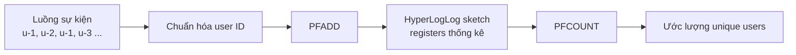
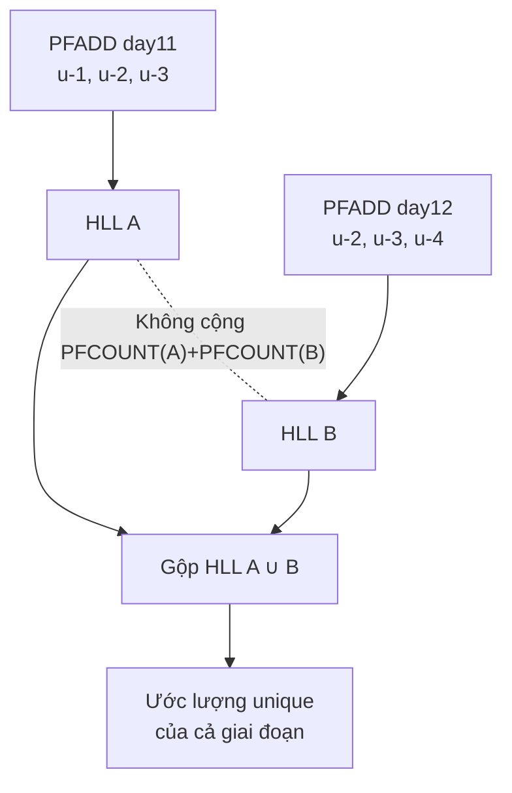
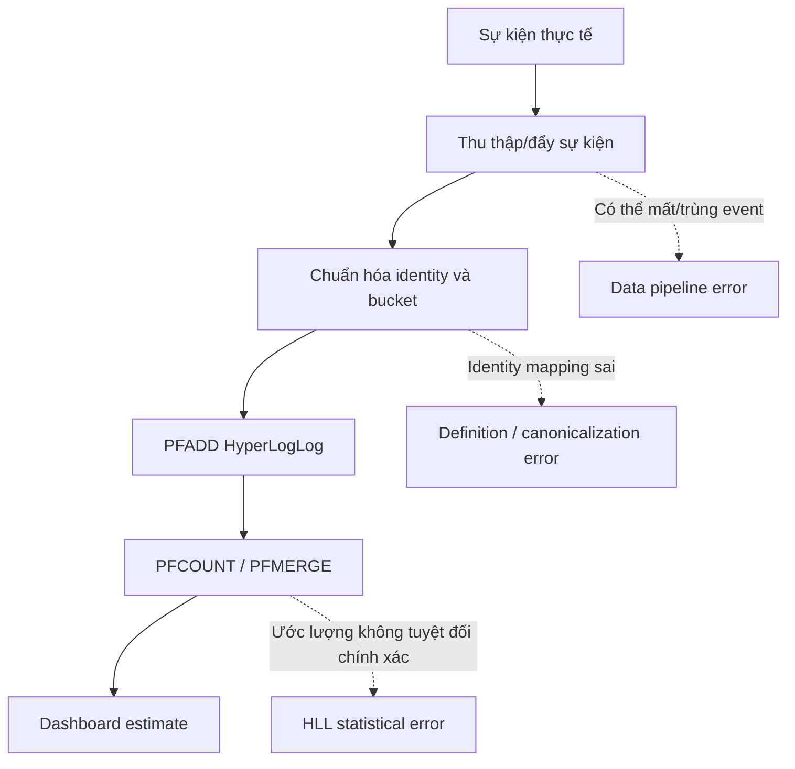
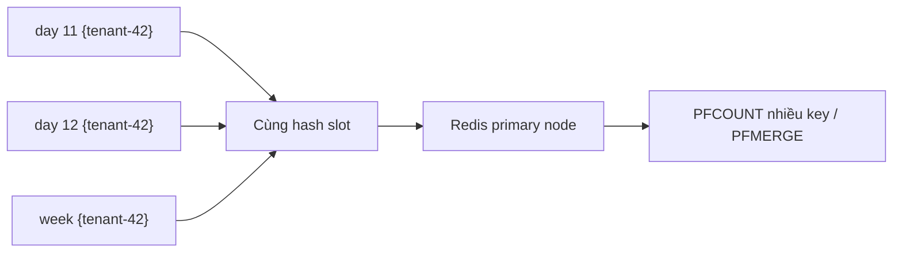

# Gộp HyperLogLog và đánh giá sai số trong Spring Data Redis

Một hệ thống phân tích thường cần trả lời câu hỏi: **“Có bao nhiêu người dùng khác nhau đã truy cập trong hôm nay, cả tuần hoặc toàn bộ chiến dịch?”** Nếu lưu tất cả user ID vào Redis Set, kết quả đếm là chính xác nhưng bộ nhớ tăng theo số người dùng duy nhất. Khi dữ liệu lên đến hàng triệu hoặc hàng trăm triệu định danh, cách tiếp cận này có thể tốn kém.

**HyperLogLog (HLL)** là một cấu trúc dữ liệu xác suất dùng để **ước lượng số phần tử phân biệt** (*approximate distinct count/cardinality*) với dung lượng nhỏ, gần như không tăng theo số lượng định danh đã quan sát. Redis cung cấp ba lệnh chính:

- `PFADD`: ghi nhận các phần tử vào HyperLogLog.
- `PFCOUNT`: lấy **ước lượng** số phần tử phân biệt; có thể tính cho một hoặc nhiều HyperLogLog.
- `PFMERGE`: **gộp** nhiều HyperLogLog thành một HyperLogLog đích có thể tiếp tục lưu và sử dụng.

Spring Data Redis cung cấp API tương ứng qua `HyperLogLogOperations<K, V>`, lấy từ `RedisTemplate.opsForHyperLogLog()`. Bài học này tập trung vào **gộp HyperLogLog và cách đánh giá sai số**: vì sao không thể cộng các số đếm riêng, cách lập HLL theo ngày rồi tính người dùng duy nhất của cả tuần, cách đo sai số so với dữ liệu chuẩn (*ground truth*), và những giới hạn về tính đúng đắn, độ trễ, TTL, Redis Cluster.

Các ví dụ dùng Spring Boot 3.x và Spring Data Redis 3.x; hãy đối chiếu API với phiên bản dự án khi triển khai.

## 1. Khi nào dùng HyperLogLog?

Giả sử một trang có các lượt truy cập:

```text
Ngày 11:
    u-1, u-2, u-3, u-2, u-1

Ngày 12:
    u-2, u-3, u-4, u-4
```

Số lượt truy cập của hai ngày là 9, nhưng số user ID **phân biệt**:

```text
Ngày 11: {u-1, u-2, u-3}             = 3
Ngày 12: {u-2, u-3, u-4}             = 3
Cả hai:  {u-1, u-2, u-3, u-4}        = 4
```

Nếu chỉ cộng 3 + 3 = 6 thì đã **đếm trùng** `u-2` và `u-3`. Cần một cách tính **cardinality của hợp tập**, thay vì tổng của hai cardinality.

Với Redis Set, có thể lưu từng ID và tính hợp tập chính xác. Với Redis HyperLogLog, có thể ước lượng số phần tử phân biệt sau khi **gộp các bản phác thảo thống kê** (*sketches*) mà không giữ lại từng user ID.

| Tiêu chí | Redis Set | Redis HyperLogLog |
|---|---|---|
| Mục tiêu chính | Lưu tập member và kiểm tra membership | Ước lượng số member khác nhau |
| Kết quả cardinality | Chính xác theo các member đã lưu | **Ước lượng**, có sai số thống kê |
| Dung lượng | Tăng theo số member và kích thước member | Nhỏ, có giới hạn ở dạng dense thông thường |
| Kiểm tra user `u-7` có thuộc không | `SISMEMBER` | **Không hỗ trợ** |
| Liệt kê các user | `SMEMBERS` hoặc `SSCAN` | **Không hỗ trợ** |
| Xóa một user | `SREM` | **Không hỗ trợ** |
| Gộp nhiều tập | `SUNION` / `SUNIONSTORE`, kết quả tập đầy đủ | `PFCOUNT key1 key2 ...` hoặc `PFMERGE`, chỉ giữ sketch |
| Use case phù hợp | Membership, quyền, danh sách chính xác | Unique visitors, unique devices, số ID phân biệt với sai số chấp nhận được |

Redis HLL thường sử dụng **tối đa khoảng 12 KiB ở representation dense** cho một sketch với 16.384 registers; representation sparse có thể dùng ít bộ nhớ hơn. Đây là một đặc tính hấp dẫn khi cardinality tăng rất lớn. Kích thước thực tế của key Redis còn phụ thuộc overhead, encoding và phiên bản server.

**Không nên dùng HLL** nếu nghiệp vụ bắt buộc số chính xác tuyệt đối, cần lấy lại danh sách thành viên, cần xóa thành viên cụ thể hoặc cần dùng dữ liệu để phân quyền. HLL giải quyết bài toán *đếm phân biệt xấp xỉ*, không phải thay thế tổng quát cho Redis Set.

## 2. Mô hình hoạt động: từ định danh đến sketch

HyperLogLog không lưu một Set user ID. Khi nhận một định danh, thuật toán băm và cập nhật thông tin thống kê trong các registers; sau đó ước lượng số lượng phần tử phân biệt dựa trên trạng thái registers.



Những hệ quả quan trọng:

1. Thêm lại cùng **byte representation** của một định danh sẽ không làm HLL ghi nhận thêm một người dùng mới ở nghĩa thống kê.
2. HLL có thể có **sai số ngay cả khi các sự kiện đầu vào hoàn toàn đúng**.
3. Không thể truy vấn sketch để lấy danh sách user ID đã từng được thêm.
4. Không thể “`SREM` một user” khỏi HLL để cập nhật số đếm.
5. Gộp HLL có thể ước lượng cardinality của hợp tập, nhưng không khôi phục được các thành viên.

Một cách hiểu ngắn gọn: **Set lưu thành viên; HyperLogLog lưu thông tin đủ để ước lượng số thành viên phân biệt.**

## 3. Redis CLI: PFADD, PFCOUNT, PFMERGE

Hãy bắt đầu với hai HLL theo ngày:

```bash
# Ngày 11: ba ID khác nhau.
redis-cli PFADD analytics:uv:day:2026-11-11 u-1 u-2 u-3

# Ngày 12: có hai ID trùng ngày trước, một ID mới.
redis-cli PFADD analytics:uv:day:2026-11-12 u-2 u-3 u-4
```

Đếm riêng:

```bash
redis-cli PFCOUNT analytics:uv:day:2026-11-11
redis-cli PFCOUNT analytics:uv:day:2026-11-12
```

Ở dữ liệu rất nhỏ này, Redis có thể trả giá trị đúng bằng `3` cho mỗi key, nhưng cần nhớ **đó vẫn là kết quả của một cấu trúc xấp xỉ**, không phải bảo đảm chính xác với mọi đầu vào.

### 3.1. PFCOUNT nhiều key tính hợp, không tính tổng

```bash
redis-cli PFCOUNT \
  analytics:uv:day:2026-11-11 \
  analytics:uv:day:2026-11-12
```

Redis ước lượng số ID khác nhau trong **hợp** của hai HLL. Với bộ dữ liệu nhỏ minh họa, kết quả kỳ vọng gần `4`, **không phải 6**.

Điểm dễ nhầm:

```text
PFCOUNT(day11) + PFCOUNT(day12)
    → tổng hai ước lượng độc lập theo ngày
    → có thể đếm trùng user xuất hiện cả hai ngày

PFCOUNT(day11, day12)
    → ước lượng cardinality của union(day11, day12)
    → tránh cộng chồng user giữa các ngày theo cơ chế HLL
```

Đây là sự khác biệt giữa **tổng số unique theo từng ngày** và **unique users của cả giai đoạn**. Hai chỉ số đều có thể hữu ích nhưng trả lời hai câu hỏi khác nhau.

### 3.2. PFMERGE lưu kết quả gộp vào một key đích

```bash
redis-cli PFMERGE \
  analytics:uv:period:2026-11-11_12 \
  analytics:uv:day:2026-11-11 \
  analytics:uv:day:2026-11-12

redis-cli PFCOUNT analytics:uv:period:2026-11-11_12
```

`PFMERGE` tạo hoặc cập nhật **HyperLogLog đích** bằng cách gộp các sketch. Sau đó có thể gọi `PFCOUNT` trên key đích nhiều lần mà không cần truyền lại toàn bộ source key mỗi khi đọc báo cáo.

| Lệnh | Chức năng | Có lưu một sketch mới/đích không? |
|---|---|---|
| `PFADD hll id...` | Cập nhật sketch từ các ID | Cập nhật key `hll` |
| `PFCOUNT hll` | Ước lượng unique của một HLL | Không tạo key báo cáo mới |
| `PFCOUNT hll1 hll2` | Ước lượng unique của hợp HLL | Không lưu một HLL đích để dùng lâu dài |
| `PFMERGE dest hll1 hll2` | Gộp sketch nguồn vào `dest` | **Có**, ghi vào key đích |

**Lưu ý:** `PFCOUNT` có cơ chế cache ước lượng trong representation của HLL, nên trên một key nó có thể cập nhật metadata/cache nội bộ; cách nói “không lưu sketch đích” ở đây là **không tạo một key gộp để ứng dụng giữ lâu dài**, không phải khẳng định lệnh không bao giờ có tác dụng ghi nội bộ.

### 3.3. Kết quả PFADD không phải số user mới

`PFADD` trả `1` nếu trạng thái HyperLogLog có thay đổi, hoặc `0` nếu không có register thay đổi. Redis **không trả số định danh mới độc nhất được thêm** như `SADD` của Set.

Ví dụ có thể gặp:

```text
PFADD hll new-user-id → 0
```

Điều này **không chứng minh `new-user-id` đã từng được ghi trước đây**. Một ID mới có thể không làm thay đổi registers vì thông tin băm của nó không làm tăng độ lớn được ghi nhận trong sketch.

Vì thế, không dùng return value của `PFADD` để quyết định “người dùng vừa đăng ký lần đầu”, trả thưởng cho user mới, hoặc tính số user mới chính xác ở cấp event. HLL chỉ thích hợp cho aggregate count.

## 4. Spring Data Redis: HyperLogLogOperations

### 4.1. Dependency và cấu hình Redis

Gradle:

```groovy
dependencies {
    implementation 'org.springframework.boot:spring-boot-starter-data-redis'
}
```

Ví dụ kết nối Redis standalone trong `application.yml`:

```yaml
spring:
  data:
    redis:
      host: localhost
      port: 6379
      connect-timeout: 2s
      timeout: 3s
```

Các property này cấu hình **kết nối**, không tự cấu hình độ chính xác của HyperLogLog. Với Redis HLL thông thường, sai số thuật toán được quyết định bởi thiết kế HLL phía Redis, không phải một thuộc tính `spring.data.redis.hyperloglog.error`.

Spring Data Redis cho phép lấy API:

```java
import org.springframework.data.redis.core.HyperLogLogOperations;
import org.springframework.data.redis.core.StringRedisTemplate;

HyperLogLogOperations<String, String> hll =
    stringRedisTemplate.opsForHyperLogLog();
```

`StringRedisTemplate` phù hợp nếu định danh được biểu diễn dưới dạng chuỗi ổn định. Với `RedisTemplate<K,V>` dùng custom serializer, key và member phải được serialize nhất quán giữa các writer, các ngày và các phiên bản ứng dụng.

### 4.2. Bảng API

| Redis command | Spring Data Redis | Ý nghĩa |
|---|---|---|
| `PFADD key item ...` | `hll.add(key, values...)` | Cập nhật một sketch |
| `PFCOUNT key` | `hll.size(key)` | Ước lượng một sketch |
| `PFCOUNT key1 key2 ...` | `hll.size(keys...)` | Ước lượng hợp nhiều sketch, không tạo đích |
| `PFMERGE dest source1 source2 ...` | `hll.union(destination, sources...)` | Gộp và lưu sketch đích |
| `DEL key` cho key HLL | `hll.delete(key)` hoặc `redis.delete(key)` | Xóa **cả sketch**, không xóa từng member |

Tên `union` trong `HyperLogLogOperations` mang ý nghĩa gộp HLL. Nó không trả lại một Java `Set` những user đã thấy.

### 4.3. Service minh họa: unique users theo ngày và theo giai đoạn

```java
import java.util.Objects;
import org.springframework.data.redis.core.HyperLogLogOperations;
import org.springframework.data.redis.core.StringRedisTemplate;
import org.springframework.stereotype.Service;

@Service
public class UniqueUserCounter {
    private final HyperLogLogOperations<String, String> hll;

    public UniqueUserCounter(StringRedisTemplate redis) {
        this.hll = redis.opsForHyperLogLog();
    }

    public void recordUser(String dateIso, String userId) {
        validateDate(dateIso);
        validateUserId(userId);
        hll.add(dayKey(dateIso), userId);
    }

    public long dailyUnique(String dateIso) {
        return requiredEstimate(hll.size(dayKey(dateIso)));
    }

    public long uniqueAcrossDays(String... datesIso) {
        if (datesIso == null || datesIso.length == 0) {
            throw new IllegalArgumentException("No dates supplied");
        }
        String[] keys = new String[datesIso.length];
        for (int i = 0; i < datesIso.length; i++) {
            keys[i] = dayKey(datesIso[i]);
        }
        return requiredEstimate(hll.size(keys));
    }

    public long mergeAndCount(String destinationKey,
                              String... datesIso) {
        if (datesIso == null || datesIso.length == 0) {
            throw new IllegalArgumentException("No dates supplied");
        }
        String[] keys = new String[datesIso.length];
        for (int i = 0; i < datesIso.length; i++) {
            keys[i] = dayKey(datesIso[i]);
        }
        // Chỉ gọi với destinationKey được quản lý/khởi tạo
        // theo đúng migration protocol của hệ thống.
        hll.union(destinationKey, keys);
        return requiredEstimate(hll.size(destinationKey));
    }

    private static String dayKey(String dateIso) {
        validateDate(dateIso);
        return "analytics:uv:day:" + dateIso;
    }

    private static void validateDate(String dateIso) {
        if (dateIso == null
                || !dateIso.matches("\\d{4}-\\d{2}-\\d{2}")) {
            throw new IllegalArgumentException("Invalid date format");
        }
    }

    private static void validateUserId(String userId) {
        if (userId == null || userId.isBlank()) {
            throw new IllegalArgumentException("User ID is required");
        }
    }

    private static long requiredEstimate(Long estimate) {
        return Objects.requireNonNull(
            estimate, "Unexpected deferred Redis result"
        );
    }
}
```

Ví dụ gọi:

```java
counter.recordUser("2026-11-11", "u-1");
counter.recordUser("2026-11-11", "u-2");
counter.recordUser("2026-11-11", "u-3");

counter.recordUser("2026-11-12", "u-2");
counter.recordUser("2026-11-12", "u-3");
counter.recordUser("2026-11-12", "u-4");

long day11 = counter.dailyUnique("2026-11-11");
long day12 = counter.dailyUnique("2026-11-12");

long bothDaysWithoutStorage = counter.uniqueAcrossDays(
    "2026-11-11", "2026-11-12"
);

long bothDaysStored = counter.mergeAndCount(
    "analytics:uv:period:2026-11-11_12:version1",
    "2026-11-11", "2026-11-12"
);
```

Đây là mã minh họa các lệnh HLL; nếu thử nghiệm nhiều lần trên cùng Redis, những sketch đã tạo sẽ vẫn tồn tại. Muốn phép đo sạch phải sử dụng **namespace thử nghiệm riêng** hoặc dọn đúng các key test trước khi chạy. Không xóa key HLL sản xuất chỉ để tái hiện ví dụ.

Các phương thức `add()` và `size()` trả giá trị theo ngữ nghĩa Redis/driver. Khi sử dụng pipeline hoặc Redis transaction, một số phương thức Spring Data Redis có thể trả `null` tại thời điểm lệnh được queue; đường service trên giả định gọi đồng bộ thông thường, không chạy trong callback pipeline.

## 5. Vì sao không thể cộng kết quả đếm của các HLL?

Tập người dùng của hai ngày:

```text
A = {u-1, u-2, u-3}
B = {u-2, u-3, u-4}
```

Theo lý thuyết tập hợp:

\[
|A \cup B| = |A| + |B| - |A \cap B|
\]

Ta có:

\[
|A \cup B| = 3 + 3 - 2 = 4
\]

Trong thực tế, HLL **không giữ lại từng member**, nên không thể chỉ lấy kết quả `PFCOUNT(A)`, `PFCOUNT(B)` rồi suy ra union nếu không có thêm dữ liệu. Hai HLL có thể có overlap rất khác nhau dù riêng từng cái cùng ước lượng 1 triệu.

Điều đúng hơn là **gộp sketches rồi tính cardinality trên sketch hợp**. Redis làm việc này bằng `PFCOUNT A B` hoặc `PFMERGE dest A B` rồi `PFCOUNT dest`.



HLL hỗ trợ gộp vì mỗi register chứa thông tin thống kê từ các phần tử đã thấy; phép hợp có thể kết hợp trạng thái registers (theo nguyên lý lấy giá trị phù hợp trên từng register) mà **không cần truy xuất các ID gốc**.

Gộp **không biến ước lượng thành số chính xác**. Nó cho ước lượng của tập hợp hợp nhất, vẫn chịu sai số thống kê của HyperLogLog.

## 6. Hai cách gộp: PFCOUNT nhiều nguồn và PFMERGE

### 6.1. PFCOUNT nhiều key — tính khi đọc

```java
Long estimate = hll.size(
    "analytics:uv:day:2026-11-11",
    "analytics:uv:day:2026-11-12"
);
```

Ưu điểm:

- Không cần key đích cho mỗi giai đoạn báo cáo.
- Dễ thực hiện truy vấn thăm dò với một số ngày.
- Không phải quản lý vòng đời của một sketch tổng hợp mới.

Đổi lại, mỗi lần query nhiều nguồn, Redis phải tính ước lượng hợp từ các sketches được yêu cầu. Với số key lớn hoặc báo cáo chạy liên tục, cần đo chi phí CPU/latency và cân nhắc materialize kết quả.

### 6.2. PFMERGE — lưu một sketch tổng hợp

```java
String destination = "analytics:uv:week:2026-W46:v1";

hll.union(
    destination,
    "analytics:uv:day:2026-11-09",
    "analytics:uv:day:2026-11-10",
    "analytics:uv:day:2026-11-11",
    "analytics:uv:day:2026-11-12"
);

Long weeklyUnique = hll.size(destination);
```

Ưu điểm:

- Giữ được sketch tổng hợp cho các truy vấn sau.
- Có thể tiếp tục gộp theo nhiều cấp, ví dụ ngày → tuần → tháng.
- Giúp báo cáo không phải liên tục đọc lại tất cả daily sketches.

Đổi lại:

- Có thêm một Redis key cần quản lý namespace/TTL.
- Cần biết **giai đoạn nào đã hoàn tất** để tránh báo cáo thiếu event đến muộn.
- Phải quản lý việc gộp lại, thay thế snapshot và cleanup khi dữ liệu nguồn thay đổi.

### 6.3. Đặc biệt: destination hiện có cũng tham gia phép gộp

Đối với Redis `PFMERGE`, key đích hiện có được **xem như một nguồn** trong phép hợp. Hệ quả này rất quan trọng khi chạy job định kỳ.

Giả sử:

```text
HLL D trước đó chứa thông tin từ {u-1, u-2, u-3}
HLL A hiện tại chứa thông tin từ {u-1}
HLL B hiện tại chứa thông tin từ {u-2}
```

Thực hiện:

```redis
PFMERGE D A B
```

**Không nên cho rằng D được tính lại hoàn toàn chỉ từ A và B.** D cũ cũng là đầu vào, nên các thông tin từ `u-3` vẫn có thể nằm trong sketch kết quả. Việc source A/B thay đổi hoặc xóa ID khỏi nguồn theo cách tạo lại sketch **không làm thông tin cũ biến mất khỏi D**.

Do đó, để tính lại một snapshot từ đúng tập nguồn hiện tại:

- Dùng **destination key mới có version/run ID**, bảo đảm chưa tồn tại trước khi gộp.
- Khi kết quả đã sẵn sàng, chuyển reader sang key mới theo một cơ chế cutover phù hợp.
- Dọn key cũ chỉ sau khi không còn consumer phụ thuộc.

Không chọn cách `DEL destination` rồi `PFMERGE destination sources` một cách mù quáng nếu reader khác đang đọc destination; giữa hai lệnh có thể có khoảng trống hoặc dữ liệu không nhất quán. Một protocol thay thế key cần xét concurrency, TTL và Redis Cluster.

## 7. Cấu trúc key cho gộp HLL theo thời gian

Một convention minh họa:

```text
analytics:uv:tenant:42:day:2026-11-11
analytics:uv:tenant:42:day:2026-11-12
analytics:uv:tenant:42:week:2026-W46:v1
analytics:uv:tenant:42:month:2026-11:v1
```

Các chiều thông tin:

| Phần key | Ví dụ | Ý nghĩa |
|---|---|---|
| Namespace | `analytics:uv` | Đếm unique visitors, không lẫn HLL với Redis String thông thường |
| Tenant/site | `tenant:42` | Tách dữ liệu khách hàng/site |
| Bucket thời gian | `day:2026-11-11` | Sự kiện thuộc ngày nào |
| Bucket tổng hợp | `week:2026-W46` | Báo cáo của một giai đoạn |
| Version | `v1` | Thay định nghĩa event hoặc quy ước định danh; hỗ trợ migration |

### 7.1. Định nghĩa “ngày” và “người dùng duy nhất”

Trước khi ghi HLL, cần quyết định:

- Ngày được tính theo **UTC** hay múi giờ nghiệp vụ của khách hàng?
- Một user được nhận diện bằng account ID, anonymous cookie, device ID hay định danh khác?
- Event trùng do message retry có cần đếm thêm không? Với cùng một ID chuẩn hóa, HLL không đếm nó như user mới trong cardinality.
- User chưa đăng nhập có được hợp nhất với account sau khi đăng nhập không?
- Bot/crawler, internal traffic và sự kiện lỗi có được tính không?
- Event đến trễ 2 ngày được ghi vào bucket theo **event time** hay **processing time**?

HLL chỉ giải quyết ước lượng cardinality theo các chuỗi byte đưa vào; nó **không sửa được định nghĩa định danh kém ổn định hoặc pipeline bị thiếu event**.

### 7.2. HLL theo tenant/site giúp tránh trộn dữ liệu

Nếu cần unique user cho một site, cần bảo đảm mọi event của site ấy đi vào cùng quy ước key và serializer. Nếu gộp HLL từ hai tenant khác nhau, kết quả có thể trùng ID string và trở thành unique identities **toàn cục theo byte**, không phải tổng unique tenant-specific.

Ví dụ nếu cả tenant 42 và tenant 43 đều có user ID `u-1` nhưng đó là hai người khác nhau, gộp ID thô sẽ coi chúng là một. Khi cần global cardinality theo danh tính tenant-specific, có thể chuẩn hóa thành:

```text
tenant-42:user-u-1
tenant-43:user-u-1
```

Ngược lại, nếu cần unique trên mọi site cho cùng một người dùng đã đăng nhập với global ID, thêm tenant vào ID có thể tạo đếm trùng. **Chọn quy ước ID theo câu hỏi phân tích**, không dựa đơn thuần vào tên Redis key.

## 8. Bản chất sai số của HyperLogLog

### 8.1. Sai số khoảng 0,81% nghĩa là gì?

Redis HyperLogLog tiêu chuẩn sử dụng 16.384 registers. Sai số tương đối chuẩn (*relative standard error*, RSE) được mô tả xấp xỉ:

\[
\operatorname{RSE} \approx \frac{1.04}{\sqrt{m}}
\]

Với \(m=16\,384\):

\[
\operatorname{RSE} \approx \frac{1.04}{128}
=0.008125 \approx 0.81\%.
\]

Đây là một thước đo **độ phân tán thống kê của ước lượng**, không phải quy định mọi kết quả đều nằm đúng trong ±0,81% so với thực tế.

Ví dụ nếu thực tế có \(N=1\,000\,000\) user phân biệt:

\[
0.0081 \times 1\,000\,000 \approx 8\,100
\]

Con số khoảng 8.100 này minh họa **mức độ lệch chuẩn tương đối điển hình**, không phải “lỗi tối đa 8.100 user”. Một kết quả đơn lẻ vẫn có thể lệch nhiều hơn; sai số cũng phụ thuộc vùng cardinality và chi tiết estimator.

Nếu giả sử phân phối sai số gần chuẩn và các điều kiện thống kê phù hợp, phạm vi gần hai độ lệch chuẩn có thể được tham khảo để hiểu xác suất. Tuy nhiên, **không dùng nó như một SLA đảm bảo tuyệt đối**. Khi yêu cầu báo cáo pháp lý, đối soát tiền, billing hay kiểm toán cần giá trị đúng 100%, phải có nguồn đếm chính xác hoặc cơ chế đối soát phù hợp.

### 8.2. Sai số tuyệt đối và sai số tương đối

Gọi:

- \(N\): cardinality thật, lấy từ nguồn dữ liệu chuẩn.
- \(\widehat{N}\): kết quả `PFCOUNT`.

**Sai số có dấu**:

\[
e = \widehat{N} - N
\]

**Sai số tuyệt đối**:

\[
|e| = |\widehat{N} - N|
\]

**Sai số tương đối (relative error)** với \(N>0\):

\[
r = \frac{\widehat{N} - N}{N}
\]

**Phần trăm sai số tuyệt đối (absolute percentage error)**:

\[
\operatorname{APE} =
\frac{|\widehat{N} - N|}{N}\times100\%.
\]

Ví dụ:

```text
Số unique chính xác:        15.000
PFCOUNT sau gộp:            14.910
Sai số có dấu:                  -90
Sai số tuyệt đối:               90
Sai số tương đối:             -0,6%
Phần trăm sai số tuyệt đối:    0,6%
```

Một lần thử như vậy cho thấy estimate cụ thể, **không chứng minh Redis luôn sai dưới 0,6%**.

Nếu \(N=0\), phần trăm sai số tương đối **không xác định** vì mẫu số bằng 0. Khi đó nên báo riêng `N=0` và kết quả quan sát (thường `PFCOUNT` key trống/không tồn tại là 0), thay vì chia cho 0.

### 8.3. Sai số của phép gộp

Gộp các HLL hợp lệ được tạo theo cùng semantics định danh sẽ tạo một sketch biểu diễn **hợp dữ liệu**. Estimate của hợp vẫn có sai số HLL; không cộng sai số từng nguồn theo cách đơn giản.

Không tính:

```text
ước lượng ngày A ± 0,81%
+ ước lượng ngày B ± 0,81%
= ước lượng cả hai ngày ± 1,62%
```

Lập luận đó sai cả ở **số đếm trung tâm** (vì overlap) lẫn **mô hình sai số** (vì sketch hợp có cơ chế ước lượng riêng). Cần đánh giá chính estimate của **`PFCOUNT A B`** hoặc `PFCOUNT dest` sau `PFMERGE`, đối chiếu với cardinality chính xác của **union(A,B)**.

## 9. Thí nghiệm đánh giá sai số có ground truth

Để đánh giá HLL, phải có dữ liệu chuẩn cho một tập mẫu mà ta **biết số ID khác nhau chính xác**. Một thí nghiệm tốt nên:

1. Tạo hai tập ID có overlap được kiểm soát.
2. Tính union chính xác trong Java `HashSet`/`Set`.
3. Ghi các ID vào hai HLL độc lập.
4. Lấy estimate từng HLL.
5. Lấy estimate hợp không lưu bằng `size(keyA, keyB)`.
6. Gộp ra một destination sạch bằng `union(dest, keyA, keyB)`.
7. So sánh `size(dest)` với exact union.
8. Lặp qua các bộ dữ liệu **khác nhau**, không gọi `PFCOUNT` lặp lại trên một HLL rồi coi mỗi kết quả là một thử nghiệm độc lập.

### 9.1. Bộ dữ liệu đơn giản với overlap xác định

Chọn:

```text
A = {user-0, user-1, ..., user-9999}
B = {user-5000, user-5001, ..., user-14999}

|A|             = 10.000
|B|             = 10.000
|A giao B|      = 5.000
|A hợp B|       = 15.000
```

Đây là bộ dữ liệu phù hợp để minh họa vì ta kiểm soát được overlap và có thể tính số đúng trước khi gọi Redis. Không nên nhầm số unique của hai HLL là 20.000 chỉ vì mỗi HLL có 10.000 phần tử.

### 9.2. Mã Java tạo dữ liệu và đo lỗi

Đoạn code dưới là một thí nghiệm **chủ động chạy trong môi trường phát triển**, không phải logic nên tự kích hoạt ở mọi lần startup của production. Các key test được đặt namespace riêng; những lần chạy khác nhau dùng `runId` khác nhau để tránh trộn sketch cũ.

```java
import java.util.ArrayList;
import java.util.HashSet;
import java.util.List;
import java.util.Objects;
import java.util.Set;
import java.util.UUID;
import org.springframework.data.redis.core.HyperLogLogOperations;
import org.springframework.data.redis.core.StringRedisTemplate;
import org.springframework.stereotype.Component;

@Component
public class HyperLogLogExperiment {
    private static final int BATCH_SIZE = 500;
    private final HyperLogLogOperations<String, String> hll;

    public HyperLogLogExperiment(StringRedisTemplate redis) {
        this.hll = redis.opsForHyperLogLog();
    }

    public void runExample() {
        String runId = UUID.randomUUID().toString();
        String aKey = "experiment:hll:" + runId + ":a";
        String bKey = "experiment:hll:" + runId + ":b";
        String mergedKey = "experiment:hll:" + runId + ":union";

        Set<String> a = new HashSet<>();
        Set<String> b = new HashSet<>();

        for (int i = 0; i < 10_000; i++) {
            a.add("user-" + i);
        }
        for (int i = 5_000; i < 15_000; i++) {
            b.add("user-" + i);
        }

        Set<String> exactUnion = new HashSet<>(a);
        exactUnion.addAll(b);

        addInBatches(aKey, a);
        addInBatches(bKey, b);

        long estimateA = require(hll.size(aKey));
        long estimateB = require(hll.size(bKey));
        long estimateUnion = require(hll.size(aKey, bKey));

        // mergedKey dùng runId mới, nên không có dữ liệu của lần thử trước.
        hll.union(mergedKey, aKey, bKey);
        long estimateStoredUnion = require(hll.size(mergedKey));

        long exact = exactUnion.size();
        double relativeErrorPercent =
            (estimateUnion - exact) * 100.0 / exact;

        System.out.println("Exact A: " + a.size());
        System.out.println("Exact B: " + b.size());
        System.out.println("Exact union: " + exact);
        System.out.println("Estimated A: " + estimateA);
        System.out.println("Estimated B: " + estimateB);
        System.out.println("PFCOUNT(A,B): " + estimateUnion);
        System.out.println("PFMERGE then PFCOUNT: " + estimateStoredUnion);
        System.out.printf("Relative error: %.3f%%%n",
                          relativeErrorPercent);

        // Dọn đúng ba key thử nghiệm theo chính sách môi trường.
        // Không xóa key sản xuất hoặc xóa trong lúc còn observer đang đọc.
    }

    private void addInBatches(String key, Set<String> ids) {
        List<String> batch = new ArrayList<>(BATCH_SIZE);

        for (String id : ids) {
            batch.add(id);
            if (batch.size() == BATCH_SIZE) {
                hll.add(key, batch.toArray(String[]::new));
                batch.clear();
            }
        }

        if (!batch.isEmpty()) {
            hll.add(key, batch.toArray(String[]::new));
        }
    }

    private static long require(Long estimate) {
        return Objects.requireNonNull(
            estimate, "Unexpected deferred Redis result"
        );
    }
}
```

Trong ví dụ:

- `HashSet` chứa dữ liệu chuẩn chính xác trong Java.
- `PFADD` được chia batch 500 ID để tránh gửi một request không cần thiết quá lớn.
- `size(aKey, bKey)` tính ước lượng hợp **không materialize** một sketch mới.
- `union(mergedKey, aKey, bKey)` materialize một HLL gộp.
- `estimateUnion` và `estimateStoredUnion` nên đại diện cho cùng một hợp sketch nếu các nguồn không thay đổi trong khoảng đo; nếu có writer chạy đồng thời, kết quả có thể khác.
- Không cần `Redis Set` trên server để tạo ground truth: test Java đã có exact union trong bộ nhớ. Trong hệ thống có dữ liệu rất lớn, nguồn exact có thể là database query có `COUNT(DISTINCT ...)`, một pipeline batch chính xác, hoặc tập mẫu được xác nhận.

Lưu ý: cách dùng `UUID.randomUUID()` ở đây chỉ tạo **namespace test mới**. Nó không biến một lần thử thành phép kiểm chứng thống kê có ý nghĩa nếu dữ liệu thành viên luôn giống nhau; để khảo sát phân phối sai số, cần thay đổi tập ID/seed và kích thước input ở từng thử nghiệm.

### 9.3. Bảo đảm phép thử độc lập về dữ liệu

Giả sử chạy 100 lần `PFCOUNT` trên cùng một HLL bất biến và nhận kết quả 14.910 ở cả 100 lần. Đây **không phải** 100 kết quả ước lượng độc lập: với cùng sketch, Redis thường cho lại cùng ước lượng.

Để nghiên cứu sai số trên nhiều tình huống:

- Tạo **nhiều tập ID khác nhau**, ví dụ theo một random seed riêng hoặc cohort khác nhau.
- Giữ được cardinality thực tế của từng tập và từng union.
- Thay đổi kích thước tập, tỷ lệ overlap và mô hình phân phối ID.
- Dùng key test mới hoặc bảo đảm reset sketch đúng cách giữa các lần thử.
- Ghi lại seed, định nghĩa ID và phiên bản Redis để có thể tái hiện.

Ví dụ nhóm thí nghiệm:

| Nhóm | Unique A | Unique B | Overlap chính xác | Unique union |
|---|---:|---:|---:|---:|
| Tập nhỏ | 100 | 100 | 20 | 180 |
| Tập vừa | 10.000 | 10.000 | 5.000 | 15.000 |
| Tập lớn | 1.000.000 | 1.000.000 | 200.000 | 1.800.000 |
| Trùng gần hết | 50.000 | 50.000 | 49.000 | 51.000 |
| Không trùng | 50.000 | 50.000 | 0 | 100.000 |

Thực tế có thể tạo thêm nhiều cohort ngẫu nhiên trong từng nhóm để khảo sát phân bố lỗi. Không được dùng riêng bảng kích thước để kết luận một mức sai số cụ thể; các kết quả HLL phải đo thật trên dữ liệu.

## 10. Tổng hợp sai số qua nhiều lần thử

Với lần thử \(i\), gọi:

- \(N_i\): cardinality chính xác của union.
- \(\widehat{N}_i\): cardinality Redis ước lượng.
- \(r_i=(\widehat{N}_i-N_i)/N_i\): relative error (khi \(N_i>0\)).

Có thể tính các chỉ số:

### 10.1. Bias — sai lệch có hướng

\[
\operatorname{MeanRelativeError}
=\frac{1}{T}\sum_{i=1}^{T}r_i
\]

Nếu trung bình sai số có dấu dương lớn, estimate có khuynh hướng đếm cao; nếu âm lớn, có khuynh hướng đếm thấp. Không nhầm **bias** với sai số tuyệt đối: các lỗi dương và âm có thể triệt tiêu nhau trong trung bình.

### 10.2. MAPE trên các tập có số đúng lớn hơn 0

\[
\operatorname{MAPE}
=\frac{100\%}{T}\sum_{i=1}^{T}|r_i|
\]

MAPE diễn tả sai số phần trăm tuyệt đối trung bình. Nếu các cohort có cardinality rất khác nhau, mỗi cohort có trọng số bằng nhau theo công thức này; đôi khi nên báo thêm metric trọng số theo quy mô hoặc phân nhóm cardinality.

### 10.3. RMSE và độ phân tán

\[
\operatorname{RMSE}
=\sqrt{\frac{1}{T}
\sum_{i=1}^{T}(\widehat{N}_i-N_i)^2}
\]

RMSE theo đơn vị **số user**. Nếu cần so sánh giữa các tập có quy mô khác nhau, có thể tính RMSE trên relative errors hoặc báo theo cardinality bucket.

### 10.4. Percentile sai số

Xem p50/p95/p99 của **absolute relative error** trên các thí nghiệm khác nhau, chẳng hạn:

```text
absoluteRelativeErrorPercent =
    abs(estimate - exact) / exact * 100
```

Phần trăm sai số ở p95 giúp hiểu **mức lỗi của phần lớn thí nghiệm được chọn**. Nhưng p95 trên tập thử không tự trở thành bảo đảm p95 cho mọi người dùng/khung thời gian production, đặc biệt khi tập test không đại diện.

### 10.5. Đánh giá sai số theo nghiệp vụ

Một ngưỡng chấp nhận có thể do product/analytics xác định, ví dụ:

```text
Mục tiêu sản phẩm:
  - Báo cáo xu hướng traffic không cần exact count
  - Sai số quan sát p95 trong các cohort thực tế phải dưới 2%
  - Kiểm tra chất lượng ghi nhận event song song
```

Đây chỉ là **ví dụ tiêu chí nghiệm thu do nhóm sản phẩm đặt ra**, không phải bảo đảm mặc định của Redis. Nếu số liệu dùng cho billing, trả thưởng, quyền lợi hoặc kiểm toán, cần cân nhắc hệ thống đếm chính xác và dữ liệu đối soát thay vì dựa độc nhất vào sketch HLL.

## 11. Sai số thuật toán khác lỗi pipeline dữ liệu

Trong hệ thống thực, “số dashboard lệch” không nhất thiết do sai số 0,81% của HLL. Có hai nguồn sai khác biệt:

### 11.1. Sai số thống kê của HLL

Với cùng một tập định danh đầu vào, estimate của HLL có thể lệch cardinality chính xác vì cấu trúc xác suất. Đây là **approximation error**.

### 11.2. Sai số do sự kiện và định danh

Ví dụ:

- Hệ thống bỏ sót 5% event vì message consumer bị lỗi.
- Một người dùng có hai account ID nên bị xem là hai người.
- Nhiều người dùng chia sẻ một ID chung, dẫn tới bị gộp nhầm.
- Sự kiện từ ngày trước đến trễ nhưng báo cáo đã đóng bucket.
- Dữ liệu bot bị tính trong một báo cáo nhưng không tính trong nguồn đối soát.
- Một ứng dụng ghi user ID đã trim/lowercase, ứng dụng khác ghi nguyên trạng.
- Một ứng dụng ghi UTF-8 String, ứng dụng khác ghi JDK-serialized object cho cùng một ID logic.

Những lỗi này thuộc **data quality/identity resolution**, không phải giới hạn thống kê HLL và **không được sửa bằng cách đặt hệ số hiệu chỉnh 0,81%**.

Một mô hình quan sát:



Để quy trách nhiệm đúng, hãy đối chiếu trên **cùng tập event đã được chuẩn hóa** trước khi đo estimate HLL. Nếu exact query dùng nguồn event khác hoặc định nghĩa identity khác, chênh lệch có thể lớn hơn đáng kể và không đo riêng sai số của HLL.

## 12. HyperLogLog không hỗ trợ xóa từng member

Khác Redis Set:

```redis
SREM myset user-42
```

HyperLogLog **không có thao tác tương đương để “gỡ user-42 ra khỏi sketch”**. Vì HLL không lưu đủ member để truy ra contribution của riêng một ID, nó không thể đảo ngược chính xác một lần `PFADD`.

Điều này quan trọng khi:

- Cần loại bỏ bot sau khi phát hiện.
- Cần xóa sự kiện theo yêu cầu nghiệp vụ.
- Có chính sách xử lý dữ liệu yêu cầu loại bỏ identity trong các aggregate.
- Phát hiện một nguồn đã gửi sai ID hoặc sai bucket.

Những lựa chọn kiến trúc:

1. Giữ **nguồn dữ liệu sự kiện có thể dựng lại** và tính lại HLL mới sau khi lọc.
2. Lưu nhiều HLL theo phân đoạn nhỏ (ngày, cohort, kênh) để có thể chọn lại các phân đoạn hợp lệ khi tính union; cách này chỉ loại bỏ được **toàn bộ phân đoạn**, không xóa riêng một member.
3. Với use case cần add/remove cá nhân và kết quả chính xác, dùng Set hoặc database có khả năng quản lý membership.
4. Khi cần thay sketch lỗi, xây một destination **mới** từ nguồn đúng rồi cutover, thay vì cố “trừ” sketches.

**Không có phép toán “HLL A trừ HLL B” tổng quát** để thu lại cardinality exact hoặc một sketch thể hiện tập hiệu bằng cách xóa registers. Muốn sửa nguồn đã đếm sai phải tính lại theo nguồn dữ liệu còn đầy đủ thông tin.

### 12.1. Tại sao không nên suy giao tập từ ba ước lượng?

Về lý thuyết:

\[
|A\cap B|=|A|+|B|-|A\cup B|.
\]

Nếu thay mỗi số bằng **ước lượng** HLL, chênh lệch của các estimate có thể khuếch đại sai số, đặc biệt khi phần giao rất nhỏ so với hai tập lớn. Vì vậy phép suy giao tập theo công thức trên có thể hữu ích để nghiên cứu với kiểm soát sai số, nhưng **không bảo đảm kết quả đáng tin cậy cho một giao nhỏ**.

Nếu bài toán chính là giao tập, hiệu tập hoặc membership, hãy chọn một cấu trúc dữ liệu hỗ trợ trực tiếp hoặc hệ xử lý phân tích khác.

## 13. Kế hoạch gộp theo ngày, tuần và tháng

Một hệ thống báo cáo có thể tạo HLL theo ngày:

```text
analytics:uv:day:2026-11-09
analytics:uv:day:2026-11-10
analytics:uv:day:2026-11-11
analytics:uv:day:2026-11-12
...
```

Khi cần unique trong tuần:

```text
PFCOUNT day09 day10 day11 day12 ...
        |
        v
Estimate unique visitors for the week
```

Hoặc materialize:

```text
PFMERGE weekly-v1 day09 day10 day11 day12 ...
PFCOUNT weekly-v1
```

### 13.1. Trễ sự kiện: báo cáo gộp có bị cũ không?

Có. Nếu gộp kết quả tuần tại `00:00` nhưng đến `00:05` mới có event thuộc ngày trước, sketch **ngày** được cập nhật nhưng key **tuần đã gộp** không tự đồng bộ theo các source.

Một số chính sách:

- Chỉ materialize khi nguồn được xác định đã **đóng bucket** theo watermark/event-time policy.
- Định kỳ cập nhật lại sketch tổng hợp với những ngày mới được thêm; lưu ý destination cũ vẫn tham gia union nên phương pháp này chỉ phù hợp các nguồn chỉ thêm, không sửa/xóa và không cần “trừ”.
- Nếu có correction, lọc bot hay rebuild source, tạo **destination version mới từ nguồn đã sửa**, rồi chuyển reader sang version đó.
- Lưu metadata như `sourceWindow`, `watermark`, `generation`, `generatedAt` ở key **riêng**, để dashboard biết tuổi dữ liệu.

### 13.2. Lưu HLL hàng tuần có thay thế HLL ngày không?

Tùy nhu cầu. Nếu chỉ giữ weekly HLL, bạn có thể tính unique theo tuần, rồi gộp các tuần thành tháng. Nhưng sau khi xóa các daily HLL, **không thể tái lập một khoảng 3 ngày bất kỳ** chỉ từ weekly HLL vì đã mất thông tin chia tách.

Thiết kế retention:

| Loại HLL | Retention ví dụ | Dùng để |
|---|---|---|
| Theo ngày | 45 ngày | Dashboard ngày, khoảng ngày tùy chọn gần đây |
| Theo tuần | 18 tháng | Báo cáo tuần, gộp tháng/chiến dịch |
| Theo tháng | 3 năm | Xu hướng dài hạn |

Những thời hạn chỉ là **ví dụ nghiệp vụ**; không có TTL mặc định phù hợp cho tất cả HLL. Chọn retention theo khả năng truy vấn lại, chi phí lưu trữ, quyền riêng tư và độ trễ sự kiện.

### 13.3. TTL khi thêm/gộp HyperLogLog

`PFADD` không tự gắn TTL cho key mới. `PFMERGE` cũng không phải API “gộp và đặt TTL” với một duration trong cùng lời gọi Spring `union()`. Nếu cần expiry:

```java
import java.time.Duration;

String destination = "analytics:uv:week:2026-W46:v2";
hll.union(destination, sourceDay1, sourceDay2);

Boolean ttlApplied = stringRedisTemplate.expire(
    destination,
    Duration.ofDays(90)
);
```

Đây là hai thao tác riêng biệt; nếu ứng dụng crash sau `union` trước `expire`, expiry có thể chưa được áp dụng như mong muốn. Ngoài ra cần **kiểm tra chính sách TTL của một destination đã tồn tại** khi dùng `PFMERGE`, thay vì giả định mọi trường hợp đều giữ hoặc reset expiry theo ý mình.

Khi TTL là yêu cầu nghiêm ngặt, có thể phối hợp transaction/script thích hợp, cơ chế hậu kiểm hoặc job reconciliation. Nếu Redis là Redis Cluster, các thao tác nhiều key phải đáp ứng giới hạn hash slot.

## 14. Redis Cluster: gộp nhiều HLL cần chú ý hash slot

`PFADD` và `PFCOUNT` cho một HLL key là thao tác một key. Nhưng `PFCOUNT key1 key2 ...` và `PFMERGE destination source...` liên quan đến **nhiều Redis keys**. Trong Redis Cluster, nhóm key của những lệnh multi-key thường phải **cùng hash slot**.

Ví dụ các key:

```text
analytics:uv:tenant:42:day:2026-11-11
analytics:uv:tenant:42:day:2026-11-12
analytics:uv:tenant:42:week:2026-W46
```

Tên gần giống nhau không bảo đảm cùng slot. Nếu muốn gộp trong Redis Cluster theo tenant, có thể dùng hash tag:

```text
analytics:uv:{tenant-42}:day:2026-11-11
analytics:uv:{tenant-42}:day:2026-11-12
analytics:uv:{tenant-42}:week:2026-W46:v1
```

Các key có `{tenant-42}` sẽ được đưa vào cùng slot:



Lưu ý:

- Key đích **cũng** phải cùng slot với các source trong phép gộp hỗ trợ trên Cluster.
- Đừng đặt cùng một hash tag `{all-tenants}` cho mọi tenant vì nó làm các key dồn về một slot/node, mất khả năng phân tán.
- Gộp các tenant thành một HLL toàn cục trong Redis Cluster có thể cần kế hoạch tổng hợp khác, chẳng hạn bố trí dữ liệu phù hợp theo slot hoặc xử lý bằng hệ phân tích bên ngoài; không kỳ vọng `PFMERGE` tự chạy nguyên tử qua nhiều shard.
- Nếu gộp key từ các cluster/node độc lập, Redis không có `PFMERGE` trực tiếp giữa các server không chung phạm vi command; cần thiết kế xuất/nhập sketches đúng format hoặc tổng hợp ở hệ thống khác, đồng thời kiểm tra compatibility.

### 14.1. Một HLL quá “nóng”

Một HLL cho toàn bộ event toàn cầu có thể trở thành điểm nóng vì tất cả `PFADD` nhắm vào một key/slot. Có thể chia key theo tenant, kênh, ngày hoặc shard logic để phân tán writes, rồi thiết kế cơ chế tính union tương ứng. Tuy nhiên việc phân mảnh tạo thêm giới hạn khi gộp trên Redis Cluster; phải cân bằng write throughput, latency, số key và chi phí tổng hợp.

## 15. Serializer, identity và định dạng lưu trữ

Spring Data Redis serialize **key và values** trước khi gửi lệnh Redis. Với HLL, một identity chỉ trùng nhau nếu **byte representation** được đưa vào `PFADD` nhất quán.

```text
Java "user-42" với StringRedisSerializer
    → UTF-8 bytes của "user-42"
    → PFADD sketch <bytes>

Java "user-42" với một serializer nhị phân khác
    → byte[] khác
    → Redis có thể coi là một phần tử khác
```

Nếu một ứng dụng ghi `"u-7"` và ứng dụng khác ghi `"U-7"`, HLL xem đó là hai chuỗi byte khác nhau. Hệ thống cần quy định **canonical identity** trước khi ghi:

- Dùng stable user ID thay vì display name/email có thể đổi.
- Chuẩn hóa encoding và định dạng ID.
- Không tự ý lowercase identifier nếu domain coi uppercase/lowercase có ý nghĩa khác nhau.
- Xử lý anonymous visitor và logged-in user nhất quán.
- Khi thay thuật toán canonicalization, cân nhắc key namespace/version mới để không trộn hai định nghĩa “unique”.

### 15.1. TYPE của HyperLogLog là String

Redis HyperLogLog có representation **Redis String** ở tầng lưu trữ:

```bash
redis-cli TYPE analytics:uv:day:2026-11-11
# string
```

Nhưng đây **không phải** một String thông thường chứa JSON hoặc CSV user IDs. Nội dung key mang encoding HLL. Không dùng `GET` rồi tìm user ID trong bytes, cũng không tự `SET` một JSON lên cùng HLL key.

Nếu đưa `PFADD` vào một Redis String không có encoding HyperLogLog hợp lệ, Redis có thể báo lỗi định dạng. Hãy tách namespace như `analytics:hll:*` khỏi các Redis String kinh doanh để tránh ghi đè nhầm.

### 15.2. Bảo vệ định danh và quyền riêng tư

Dù HLL không cho liệt kê ID đã thêm, việc gửi identity qua pipeline hoặc ghi vào debug logs vẫn có thể tiết lộ dữ liệu. Chọn ID đã được pseudonymize theo policy nếu cần, hạn chế log raw `userId`, bảo vệ Redis bằng network ACL/TLS/authentication và áp dụng retention.

Không suy luận rằng chỉ vì HLL không liệt kê được member nên mọi yêu cầu về quyền riêng tư tự động được giải quyết. Kiến trúc phải xét cả **nguồn event gốc**, các HLL và các bản aggregate được tạo từ chúng.

## 16. Concurrency và tính nhất quán khi gộp

Một lệnh `PFADD` cập nhật một sketch theo semantics atomic của Redis. Một lệnh `PFMERGE` trên các key phù hợp được Redis thực thi theo lệnh. Tuy vậy một pipeline báo cáo có thể gồm nhiều bước:

```text
1. Các worker liên tục PFADD vào daily HLL.
2. Job PFMERGE daily A/B vào weekly HLL.
3. Dashboard PFCOUNT weekly HLL.
4. Worker gửi event đến trễ vào daily A.
```

Estimate của weekly tại bước 3 **không bao gồm** event đến trễ của bước 4 nếu chưa có bước gộp cập nhật. Việc một lệnh `PFMERGE` atomic không tự tạo consistency xuyên toàn bộ pipeline event và dashboard.

### 16.1. Gộp nhiều lần có luôn an toàn?

Nếu tất cả nguồn **chỉ tăng** (append-only) và destination cũng chỉ tích lũy các nguồn cùng định nghĩa identity, việc gộp lại có thể cập nhật estimate mà không làm mất thông tin cũ. Nhưng điều này không phù hợp nếu:

- Nguồn HLL được build lại sau khi lọc event sai.
- Muốn bỏ một ngày ra khỏi khoảng báo cáo.
- Thay đổi định nghĩa unique visitor.
- Một tenant/site đã chuyển qua key namespace mới.
- Muốn dùng destination cho một cửa sổ thời gian khác.

Trong các trường hợp đó, dùng **destination generation mới** được build từ đúng tập source, rồi cutover.

### 16.2. Sai số do số sự kiện chưa được ghi

Nếu event ingestion chạy bất đồng bộ, dashboard cần cho biết watermark: đến thời điểm nào dữ liệu có thể coi là đủ. HLL count phản ánh các ID **đã được PFADD thành công**, không thể đếm những sự kiện chưa được ghi. Cần phân biệt “estimated unique users as of watermark” và “final unique users for period”.

## 17. Giám sát hiệu năng và sử dụng bộ nhớ

HyperLogLog được chọn vì memory footprint nhỏ khi chỉ cần cardinality. Nhưng không nên nhìn mỗi con số “~12 KiB” mà bỏ qua vận hành:

- Số **HLL keys** vẫn tăng khi tách theo hàng nghìn tenants, ngày, chiến dịch hoặc phiên bản.
- `PFCOUNT` nhiều source và `PFMERGE` nhiều source cần xử lý các sketches; số source lớn làm tăng chi phí.
- Redis Cluster có giới hạn định tuyến multi-key.
- Tần suất `PFADD` rất cao lên cùng một key có thể gây hot key.
- Lưu cả HLL daily, weekly, monthly có overhead metadata và TTL.
- Quá nhiều báo cáo ad hoc có thể gây tải gộp lặp lại.

Những metrics hữu ích:

| Metric | Mục đích |
|---|---|
| Số `PFADD` thành công/thất bại | Theo dõi khả năng ghi nhận sự kiện |
| Event ingest lag/watermark | Phân biệt thiếu event với HLL error |
| Latency của `PFCOUNT`/`PFMERGE` | Theo dõi chi phí tổng hợp |
| Số HLL keys theo tenant/bucket | Quan sát tăng trưởng namespace |
| `MEMORY USAGE key` ở môi trường phù hợp | Đo footprint thực tế của sketch |
| So sánh sampled exact distinct vs HLL | Theo dõi sai số/quality |
| Số source keys thiếu/expired | Tránh báo cáo thiếu cả bucket |
| Version/generation của sketch gộp | Xác định nguồn và thời điểm materialize |

Ví dụ CLI quan sát:

```bash
redis-cli TYPE analytics:uv:day:2026-11-11
redis-cli PFCOUNT analytics:uv:day:2026-11-11
redis-cli TTL analytics:uv:day:2026-11-11
redis-cli MEMORY USAGE analytics:uv:day:2026-11-11
```

`MEMORY USAGE` có thể không trả giá trị nếu key không tồn tại và có thể cần quyền tương ứng. Đừng dùng `KEYS *` để đếm HLL trên Redis production lớn; dùng `SCAN` theo prefix và giới hạn tải, với lưu ý khi chạy Redis Cluster phải xem đầy đủ các primary nodes.

## 18. Những lỗi dễ gặp khi gộp HyperLogLog

| Sai lầm | Vì sao sai | Cách xử lý |
|---|---|---|
| Cộng `PFCOUNT(day1) + PFCOUNT(day2)` để tính unique cả hai ngày | Người dùng lặp giữa ngày bị cộng trùng | Dùng `PFCOUNT day1 day2` hoặc `PFMERGE` |
| Xem số `PFADD` trả về là số user mới | Kết quả chỉ phản ánh thay đổi register | Dùng `PFCOUNT` để ước lượng; nếu cần exact first-time membership thì HLL không phù hợp |
| Cho rằng sai số không bao giờ vượt ±0,81% | 0,81% gần với relative standard error, không phải max bound | Thử nghiệm nhiều cohort và định nghĩa SLA riêng |
| Đo sai số bằng 100 lần `PFCOUNT` cùng một key | Cùng input cho cùng estimate, không có trials độc lập | Dùng bộ ID khác nhau với ground truth riêng |
| Gộp lại vào destination cũ và mong xóa được đóng góp cũ | Destination hiện có cũng là một nguồn của `PFMERGE` | Tạo generation mới khi cần rebuild |
| Dùng HLL để kiểm tra một user đã từng xuất hiện chưa | Sketch không lưu membership exact | Dùng Set/DB nếu cần membership |
| Thay Redis Set bằng HLL cho danh sách user cần xóa riêng | Không thể `SREM` một ID trong HLL | Giữ nguồn event hoặc cấu trúc exact |
| Thêm Redis TTL không đúng retention | Hết daily sketch trước khi gộp hoặc mất báo cáo cần tái tính | Xây chính sách retention/watermark |
| Mỗi service dùng serializer ID khác nhau | Cùng user bị xem là nhiều byte values khác | Chuẩn hóa identity và serializer |
| Gộp trên Redis Cluster khi keys khác slot | Multi-key command có thể bị lỗi `CROSSSLOT` | Thiết kế hash tag theo phạm vi gộp |
| Thấy dashboard lệch 5% rồi quy hết cho HLL | Có thể mất event, sai identity, bot hoặc lệch cửa sổ thời gian | So exact trên cùng input chuẩn hóa; kiểm tra pipeline |
| Ghi JSON vào HLL key vì `TYPE` là String | Phá encoding HLL, lệnh HLL lỗi | Namespace riêng, không dùng key HLL làm String nghiệp vụ |

## 19. Ba tình huống thiết kế

### 19.1. Unique visitors theo ngày và tuần

Ứng dụng muốn thống kê lượng người truy cập theo từng ngày và cả tuần, chấp nhận sai số thống kê nhỏ.

Thiết kế:

1. Khi có event hợp lệ, lấy ID chuẩn hóa và ngày theo event time.
2. `PFADD` vào HLL của ngày.
3. Báo cáo ngày dùng `PFCOUNT dailyKey`.
4. Báo cáo tuần có thể dùng `PFCOUNT dailyKey1 ... dailyKey7`.
5. Khi tuần đã đóng và có watermark đủ tin cậy, materialize một HLL tuần bằng `PFMERGE` vào key versioned.
6. Định kỳ đối chiếu sample exact user count để phát hiện sai số bất thường do pipeline hoặc đổi ID policy.

Đây là một use case phù hợp của HLL vì mục tiêu là **xu hướng và cardinality**, không yêu cầu liệt kê từng visitor.

### 19.2. Cần tìm chính xác user nào chưa nhận thưởng

Ứng dụng muốn so sánh danh sách user đã hoàn tất nhiệm vụ với danh sách user đã nhận thưởng và phát phần thưởng chưa được nhận.

**Không dùng HyperLogLog làm nguồn duy nhất.** Cần danh sách member hoặc cấu trúc có thể truy vấn membership và difference. Redis Set hoặc database có khóa duy nhất/transaction thường phù hợp hơn. HLL chỉ có thể cung cấp số lượng phân biệt xấp xỉ của các nhóm, không trả lời “ai chưa nhận thưởng?”.

### 19.3. Tính lại báo cáo sau khi lọc bot

Ban đầu HLL của ngày chứa cả traffic bot. Sau đó hệ thống phát hiện một tập event cần bỏ.

Không thể lấy daily HLL hiện có rồi “trừ bot ID” để thu sketch exact mới. Cần:

- Lọc lại trên nguồn event chính xác.
- Rebuild các daily sketches bị ảnh hưởng dưới key version mới.
- Build lại HLL weekly/monthly destination **mới** từ các nguồn đã sửa.
- Chuyển dashboard sang generation mới và dọn generation cũ theo kế hoạch.

Nếu nguồn event gốc đã bị xóa, dữ liệu HLL đơn lẻ không có đủ thông tin để thực hiện việc sửa chính xác này.

## 20. Câu hỏi cần trả lời trước khi dùng HLL trong production

1. **Chỉ số cần approximate hay exact?** Unique traffic thường chấp nhận xấp xỉ; billing và quyền lợi nhiều khi không.
2. **“Một user” được xác định thế nào?** Stable identity, canonicalization và chính sách anonymous/login.
3. **Có phải tính hợp của nhiều giai đoạn không?** Cần `PFCOUNT` nhiều key hoặc `PFMERGE`, không cộng estimate.
4. **Nguồn HLL có thể bị sửa hoặc rebuild không?** Nếu có, destination cũ không thể tự trừ dữ liệu; phải version hóa.
5. **Thời điểm nào được coi là hoàn tất?** Event-time bucket, watermark và late events.
6. **Sai số chấp nhận được là gì?** So sánh với ground truth, đo mean/bias/p95 trên các cohort phù hợp, không coi 0,81% là max error.
7. **Có cần member-level operations không?** HLL không hỗ trợ lookup, enumeration và delete một ID.
8. **Redis chạy standalone hay Cluster?** Nếu multi-key merge, cần thiết kế slot locality.
9. **TTL, retention, privacy và rollback ra sao?** Đừng để daily sketch hết hạn trước khi còn cần rebuild.
10. **Ứng dụng có thể phát hiện dữ liệu sai không?** Quan sát ingest lag, quality, estimate-vs-exact trên sample và lỗi Redis.

**Kết luận:** `PFADD` ghi nhận định danh vào sketch, `PFCOUNT` trả về cardinality ước lượng, còn `PFMERGE` gộp các sketch để có thể đếm unique trên nhiều nguồn mà không cộng trùng các ID đã quan sát. Spring Data Redis thể hiện ba hành vi đó qua `HyperLogLogOperations.add()`, `size()` và `union()`. Giá trị lớn nhất của HLL là tiết kiệm bộ nhớ cho các báo cáo distinct count có sai số chấp nhận được; sử dụng đúng đòi hỏi hiểu **ngữ nghĩa hợp tập**, **sai số thống kê khoảng 0,81% ở mức độ lệch chuẩn tương đối**, **giới hạn không thể xóa hoặc truy vấn member**, cùng khả năng tái dựng và kiểm chứng dữ liệu bằng một nguồn exact khi cần.
