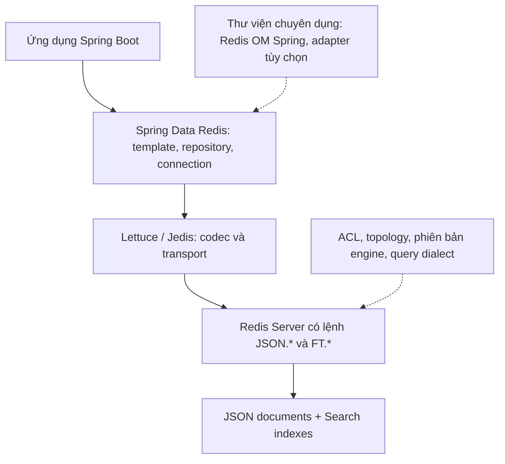
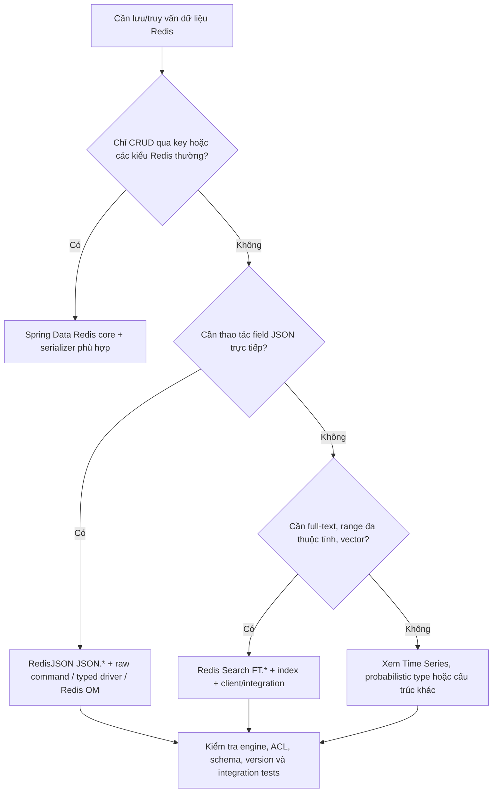

# Ranh giới hỗ trợ với RedisJSON, tìm kiếm và các phần mở rộng khác

Redis không chỉ có String, Hash, List, Set, Sorted Set, Stream, Bitmap, HyperLogLog hay Geo. Các khả năng như **JSON document**, **tìm kiếm văn bản**, **truy vấn nhiều thuộc tính**, **vector search**, **Time Series** và **Bloom Filter** còn mở rộng cách lưu và truy xuất dữ liệu. Trong hệ sinh thái Spring, câu hỏi quan trọng không đơn thuần là “Redis Server có lệnh đó hay không?” mà còn là **Spring Data Redis hỗ trợ trực tiếp đến đâu, driver hỗ trợ đến đâu và ứng dụng cần bổ sung tầng tích hợp nào**.

Bài học này xác định ranh giới trách nhiệm giữa:

1. **Spring Data Redis core**: `RedisTemplate`, `ReactiveRedisTemplate`, các `*Operations` và Redis Repositories thông thường.
2. **Redis Server**: lệnh và tính năng có mặt trên engine hoặc bản phân phối thực tế.
3. **Redis client/driver**: Lettuce, Jedis và cơ chế gọi lệnh mở rộng.
4. **Thư viện bổ sung**: Redis OM Spring, Spring AI Redis Vector Store hoặc adapter được dự án chủ động lựa chọn.
5. **Ứng dụng**: schema, index, ánh xạ dữ liệu, bảo mật, xử lý lỗi, nhất quán và vận hành.

**Mục tiêu:** biết khi nào dùng API Spring Data Redis có sẵn, khi nào gọi lệnh Redis riêng, khi nào dùng thư viện chuyên dụng và những bảo đảm không thể suy ra từ việc kết nối thành công.

> **Ngữ cảnh phiên bản:** Redis 8 tích hợp Redis Search, JSON, Time Series và một số cấu trúc xác suất vốn thường được triển khai qua các thành phần mở rộng trong các hệ Redis Stack cũ. Tuy vậy, **khả năng dùng được trong hệ thống cụ thể vẫn phụ thuộc bản Redis, bản phân phối, managed service và cấu hình/ACL**. Việc Redis 8 có một tính năng không đồng nghĩa Spring Data Redis tự sinh ra API cấp cao cho mọi lệnh của tính năng đó.

## 1. Ba lớp “hỗ trợ” không được đánh đồng

Giả sử application muốn ghi một JSON document và tìm các document có `price` từ 100 đến 500.



Có thể Redis Server hiểu cả `JSON.SET` và `FT.SEARCH`, nhưng code Spring Data Redis hiện tại chỉ khai báo `RedisTemplate`. Điều đó **không tự biến `opsForValue().set(...)` thành `JSON.SET`**, và cũng không tự tạo ra `ftSearch(...)` trong interface `ValueOperations`.

| Cấp độ | Câu hỏi | Ví dụ kiểm tra |
|---|---|---|
| **Engine / server** | Redis đang chạy có biết lệnh không? | `COMMAND INFO JSON.SET`, `COMMAND INFO FT.SEARCH` khi có quyền. |
| **Quyền thực thi** | Redis user có được gọi lệnh và truy cập key/index? | ACL, `NOPERM`, thử lệnh đọc an toàn. |
| **Driver** | Lettuce/Jedis version có API typed cho lệnh này hoặc cơ chế gửi raw command? | Tài liệu version driver, capability và parser phản hồi. |
| **Spring Data Redis** | Core module có `Operations`/Repository phù hợp không? | Javadoc `RedisTemplate`, `RedisConnection`, `RedisRepository`. |
| **Thư viện tích hợp** | Có cần Redis OM Spring / Spring AI / adapter riêng? | Tài liệu và ma trận phiên bản của thư viện bổ sung. |
| **Nghiệp vụ** | JSON schema, Search index, phân trang, consistency có được thiết kế đúng? | Integration test với Redis Server mục tiêu. |

Chỉ khi **tất cả lớp cần thiết** phù hợp, tính năng mới dùng được trong ứng dụng. Một build Maven/Gradle thành công chỉ chứng minh phần dependency resolve và code compile, không chứng minh server có chỉ mục tìm kiếm.

## 2. Spring Data Redis core hỗ trợ gì?

### 2.1. Những API điển hình có sẵn

Spring Data Redis cung cấp những lớp abstraction tập trung vào các kiểu dữ liệu và hành vi Redis phổ biến:

| Redis capability thông thường | API Spring Data Redis điển hình |
|---|---|
| Key, TTL, scan | `RedisTemplate`, `RedisOperations`, `keys()`, `scan()`, `expire()` |
| String | `ValueOperations` |
| Hash | `HashOperations` |
| List | `ListOperations` |
| Set | `SetOperations` |
| Sorted Set | `ZSetOperations` |
| Stream | `StreamOperations` |
| Pub/Sub | Message listener và connection |
| Geo | `GeoOperations` |
| Bitmap | `ValueOperations` bit operations |
| HyperLogLog | `HyperLogLogOperations` |
| Redis Repositories | Mapping entity vào Redis Hash, truy vấn theo khả năng index của repository |
| Reactive | `ReactiveRedisTemplate`, `ReactiveStringRedisTemplate` và các reactive operations tương ứng |

Đây là các abstraction có contract cụ thể, không phải bộ công cụ tự động hiểu mọi command Redis vừa được bổ sung.

Ví dụ:

```java
StringRedisTemplate redis = ...;

redis.opsForValue().set("demo:name", "Redis");
redis.opsForHash().put("demo:user:1", "name", "Alice");
redis.opsForZSet().add("demo:leaderboard", "user:1", 125.0);
```

Mỗi thao tác dùng kiểu Redis tương ứng. Những API trên **không tạo JSON document type hoặc full-text index**.

### 2.2. “Spring Data Redis có JSON serializer” nghĩa là gì?

Một ứng dụng có thể cấu hình serializer cho value thành JSON:

```java
// Sơ đồ ý tưởng, không phải cấu hình bean hoàn chỉnh:
redisTemplate.opsForValue().set("product:1", productObject);
```

Nếu `valueSerializer` là JSON serializer, byte được Redis lưu thường là **Redis String chứa chuỗi JSON**:

```text
Redis key: product:1
Redis TYPE: string
Value bytes: {"id":"1","name":"Keyboard","price":199.0}
```

Redis có thể trả JSON bằng `GET product:1`; nhưng **không thể dùng `JSON.GET product:1 $.price` chỉ vì byte của String tình cờ là JSON hợp lệ**. Tương tự, một index `FT.CREATE ... ON JSON` không tự index Redis String.

Nhận định đúng:

> **JSON serialization** là cách Spring chuyển object thành byte để lưu trong một kiểu Redis hiện có. **RedisJSON** là một kiểu dữ liệu/chức năng server với các lệnh `JSON.*` cho phép thao tác theo JSONPath và tích hợp Search.

Không thể thay thế hai khái niệm cho nhau.

### 2.3. Spring Data Redis Repository không đồng nghĩa Redis Search

Repository mặc định của Spring Data Redis thường dùng mapping vào **Redis Hash** cùng keyspace và các secondary index thuộc cơ chế Spring Data Redis.

Ví dụ Java:

```java
import org.springframework.data.annotation.Id;
import org.springframework.data.redis.core.RedisHash;
import org.springframework.data.redis.core.index.Indexed;

@RedisHash("customers")
public class Customer {

    @Id
    private String id;

    @Indexed
    private String email;

    private String name;

    // Constructors, getters, setters...
}
```

Một repository:

```java
import org.springframework.data.repository.CrudRepository;

public interface CustomerRepository
        extends CrudRepository<Customer, String> {

    Iterable<Customer> findByEmail(String email);
}
```

Cơ chế `@Indexed` này giúp thực hiện một số kiểu truy vấn theo thuộc tính đã index, nhưng **không có nghĩa Redis Server đã tạo một index `FT.CREATE`**. Nó không tự mang đến full-text stemming, phrase matching, vector KNN, geo-filter phức tạp hay aggregation của Redis Search.

Cần phân biệt:

| Cách tiếp cận | Dữ liệu | Index | Truy vấn |
|---|---|---|---|
| Spring Data Redis Repository thông thường | Thường Redis Hash | Secondary index do mapping/repository quản lý | Query derivation giới hạn theo khả năng repository |
| Redis Search trên Hash | Redis Hash | Redis Search index `ON HASH` | `FT.SEARCH`, `FT.AGGREGATE`, TAG/TEXT/NUMERIC/GEO/VECTOR |
| Redis Search trên JSON | RedisJSON document | Redis Search index `ON JSON` | `FT.SEARCH`, `FT.AGGREGATE` theo JSONPath |
| Redis OM Spring | Hash hoặc JSON theo annotation/cấu hình thư viện | Redis Search và cơ chế mapping của Redis OM | Query derivation/DSL tính năng mở rộng của thư viện |

Dù cùng là từ “index”, cơ chế lưu, cách cập nhật, quyền truy cập và query semantics có thể rất khác nhau.

## 3. RedisJSON: loại dữ liệu/chức năng server, không chỉ là format

### 3.1. RedisJSON mang lại điều gì?

RedisJSON hỗ trợ tạo, đọc và cập nhật **JSON document** trực tiếp trên server bằng các lệnh có tiền tố `JSON.`, ví dụ:

| Lệnh | Chức năng |
|---|---|
| `JSON.SET` | Đặt JSON value vào một JSONPath, tạo document ở root khi chưa có key. |
| `JSON.GET` | Đọc JSON document hoặc các path được chọn. |
| `JSON.DEL` | Xóa JSON value tại path hoặc toàn document. |
| `JSON.NUMINCRBY` | Tăng một giá trị số trong document. |
| `JSON.ARRAPPEND` | Thêm phần tử vào JSON array. |
| `JSON.OBJKEYS` / `JSON.OBJLEN` | Xem các key hoặc số thành viên của JSON object. |
| `JSON.TYPE` | Lấy loại JSON ở path cụ thể. |

Việc cập nhật field qua `JSON.SET key $.price 200` khác với quy trình `GET` toàn chuỗi JSON, sửa object Java rồi `SET` lại toàn chuỗi; cách sau có thể gặp **lost update** khi nhiều client sửa những field khác nhau trong cùng document.

### 3.2. Thao tác bằng Redis CLI

Trong Redis Server **có RedisJSON**:

```redis
JSON.SET shop:item:1 $ '{"name":"Mechanical keyboard","price":199,"stock":12,"category":"peripherals"}'
JSON.GET shop:item:1 $
JSON.GET shop:item:1 $.price
JSON.SET shop:item:1 $.price 179
JSON.NUMINCRBY shop:item:1 $.stock -1
JSON.GET shop:item:1 $
```

Với JSONPath bắt đầu bằng `$`, phản hồi có thể là **mảng các giá trị khớp**, ngay cả khi chỉ truy vấn một path, vì JSONPath có thể khớp nhiều phần tử. Ứng dụng không nên giả định `JSON.GET key $.price` luôn trả một scalar như `179`.

Nếu key chưa tồn tại, tạo document bằng path root `$` hoặc `.`. Lệnh `JSON.SET key $.price 179` trên một key hoàn toàn chưa có không tự tạo toàn bộ object cha; cần tạo root trước.

### 3.3. Điều kiện NX/XX của JSON.SET không giống hoàn toàn SET NX/XX

Redis String có:

```redis
SET key value NX
SET key value XX
```

Còn RedisJSON có:

```redis
JSON.SET key path json NX
JSON.SET key path json XX
```

Ở JSON.SET, `NX` và `XX` được diễn giải theo **đường dẫn JSON được yêu cầu**, không chỉ là quy tắc tạo/cập nhật toàn bộ key như Redis String. Chẳng hạn, khi object đã có nhưng field `$.description` chưa có, có thể dùng `NX` để thêm field đó nếu điều kiện path phù hợp. Không chuyển máy móc code đang dùng `setIfAbsent` của `ValueOperations` sang JSON.SET mà không kiểm tra semantics theo path.

### 3.4. Redis type và serializer là ranh giới thật

Thực hành hai key khác nhau:

```redis
SET shop:plain:1 '{"price":199}'
JSON.SET shop:json:1 $ '{"price":199}'

TYPE shop:plain:1
TYPE shop:json:1

GET shop:plain:1
JSON.GET shop:json:1 $.price
```

Key `shop:plain:1` là Redis String; key `shop:json:1` là dữ liệu RedisJSON. Giá trị hiển thị có thể cùng một JSON object, nhưng **các lệnh hợp lệ trên từng key khác nhau**. `GET` không phải giao diện đọc RedisJSON document; `JSON.GET` không biến Redis String thành JSON document.

### 3.5. TTL của document và TTL của path

TTL thông thường của Redis áp dụng trên **key**:

```redis
JSON.SET shop:json:1 $ '{"price":199,"stock":12}'
EXPIRE shop:json:1 600
TTL shop:json:1
```

Không suy ra rằng mỗi field như `$.price` có TTL độc lập chỉ vì nằm trong một document. Nếu cần xử lý vòng đời từng field, cần thiết kế schema hoặc xem những khả năng chuyên biệt mà engine thực tế cung cấp.

Việc thay đổi JSON tại path khác với việc thay mới toàn bộ Redis String. Hãy kiểm tra semantics của expiry sau các lệnh cập nhật JSON theo đúng Redis Server/bản phân phối. Đừng để contract cache phụ thuộc vào giả định rằng mọi lệnh `JSON.*` tự làm mới TTL.

## 4. Redis Search: index và query khác với tìm key

### 4.1. Redis Search dùng để giải quyết vấn đề gì?

Spring Data Redis có thể đọc một Hash khi biết key. Redis Search cho phép tìm **nhiều document theo nội dung và thuộc tính**:

- Full-text search theo token, phrase, stemming và scoring tùy query.
- Lọc số bằng khoảng NUMERIC.
- Lọc nhãn chính xác bằng TAG.
- Truy vấn và lọc tọa độ địa lý nếu index hỗ trợ.
- Sắp xếp/phân trang theo các trường đã được index.
- Aggregate/group qua `FT.AGGREGATE`.
- Vector search cho embedding qua schema vector phù hợp.

Redis Search index có thể được tạo trên **Redis Hash** hoặc **RedisJSON** khi server có các tính năng tương ứng. **Search trên Hash không bắt buộc dùng RedisJSON**.

### 4.2. Ví dụ tạo Search index cho JSON document

Dùng các document ở prefix `shop:item:`:

```redis
JSON.SET shop:item:1 $ '{"name":"Mechanical keyboard","price":199,"stock":12,"category":"peripherals"}'
JSON.SET shop:item:2 $ '{"name":"Wireless mouse","price":49,"stock":20,"category":"peripherals"}'
JSON.SET shop:item:3 $ '{"name":"Office chair","price":230,"stock":4,"category":"furniture"}'
```

Tạo index:

```redis
FT.CREATE idx:shop:item ON JSON PREFIX 1 shop:item: SCHEMA
    $.name AS name TEXT
    $.price AS price NUMERIC
    $.category AS category TAG
```

Đây là cú pháp nhiều dòng để dễ đọc; khi dùng `redis-cli` tương tác, có thể gõ thành **một lệnh** hoặc dùng shell quoting phù hợp.

Ý nghĩa:

- `idx:shop:item`: tên index, không phải key JSON cụ thể.
- `ON JSON`: index dữ liệu RedisJSON, **không index Redis String có nội dung JSON**.
- `PREFIX 1 shop:item:`: chỉ theo dõi những document có key bắt đầu bằng prefix này.
- `$.name AS name TEXT`: index text theo JSONPath.
- `$.price AS price NUMERIC`: có thể lọc theo giá.
- `$.category AS category TAG`: có thể lọc category theo nhãn.

Mỗi document có thể được thêm hoặc cập nhật qua `JSON.SET`, rồi index đồng bộ hóa theo engine/query subsystem tương ứng. Không cần ứng dụng tự quét toàn bộ key `shop:item:*` mỗi lần tìm kiếm.

### 4.3. Truy vấn bằng FT.SEARCH

```redis
FT.SEARCH idx:shop:item '@name:keyboard'
FT.SEARCH idx:shop:item '@price:[100 250]'
FT.SEARCH idx:shop:item '@category:{peripherals}'
FT.SEARCH idx:shop:item '@category:{peripherals} @price:[40 220]'
```

Các query trên lần lượt tìm tên có token liên quan `keyboard`, giá trong khoảng 100–250, category có tag `peripherals`, và kết hợp hai bộ lọc.

**Quan trọng:** cú pháp `FT.SEARCH` có ngôn ngữ query riêng. Không nên nối chuỗi tự do từ input người dùng rồi coi đó là một literal: các ký tự như `@`, `{`, `}`, `[`, `]`, `-` hoặc khoảng trắng có thể làm thay đổi ý nghĩa query. Cần dùng escaping/parameterization theo Redis Search dialect và client API phù hợp.

### 4.4. FT.AGGREGATE là một khả năng riêng

`FT.SEARCH` phù hợp lựa chọn/trả document. Khi cần nhóm và tổng hợp trên tập kết quả, Redis cung cấp `FT.AGGREGATE` với các stage như `GROUPBY` và `REDUCE`.

Ví dụ ý tưởng nghiệp vụ: nhóm sản phẩm theo category rồi tính giá trung bình. Không nên tải mọi document về Java chỉ để tính toán nếu engine Search hỗ trợ truy vấn aggregate tương ứng. Tuy nhiên phải đánh giá bộ index, bộ nhớ, tài nguyên CPU và giới hạn managed service.

### 4.5. Query index và dữ liệu là hai phần cần quản lý

Khi ứng dụng thêm một field mới vào JSON, index hiện tại **không tự có schema tương ứng** chỉ bởi object Java đã thêm trường. Index Search có định nghĩa field, type, tokenizer và những tùy chọn khác.

Khi thay schema, có thể phải:

1. Lập phiên bản định nghĩa index.
2. Tạo index mới hoặc thay đổi theo cơ chế được Redis hỗ trợ.
3. Chờ/tổ chức backfill và theo dõi trạng thái indexing.
4. Chuyển query sang index mới.
5. Loại index cũ khi không còn consumer.

Không khởi tạo `FT.CREATE` một cách mù quáng mỗi khi ứng dụng Spring Boot start: index đã tồn tại có thể gây lỗi, index đang build có thể tốn tài nguyên và nhiều replica ứng dụng khởi động cùng lúc dễ tranh chấp. Nên có quy trình quản lý schema/index có chủ đích.

## 5. Redis 7.x, Redis Stack, Redis 8 và managed service

### 5.1. Không đoán tính năng chỉ từ “Redis” trong tên dịch vụ

Lịch sử triển khai có thể khác nhau:

| Môi trường | Cách các tính năng JSON/Search thường xuất hiện |
|---|---|
| Redis Open Source đời cũ / Redis 6.x–7.x | Cần bản phân phối/cấu hình có RedisJSON, RediSearch hoặc dùng Redis Stack/module tương ứng. |
| Redis Stack ở các môi trường trước Redis 8 | Đóng gói các tính năng JSON, Search, Time Series và các cấu trúc khác cho ứng dụng. |
| Redis Open Source 8+ | Redis tích hợp JSON, Search, Time Series và một số cấu trúc xác suất vào bản phát hành; vẫn phải kiểm tra chức năng cụ thể. |
| Redis Cloud / Redis Software / dịch vụ managed | Tính năng, version engine, command, ACL và chính sách index do sản phẩm/gói/triển khai quyết định. |

Tại mốc kiến thức 2026, Redis 8 tích hợp nhiều tính năng trước đây thường gọi là “Redis Stack modules”. Nhưng điều này **không cho phép kết luận mọi dịch vụ tự xưng Redis 8 đều bật mọi lệnh**. Tài liệu nhà cung cấp và endpoint thực tế mới quyết định.

### 5.2. Kiểm tra capability trên đúng endpoint

Một số lệnh quan sát:

```redis
INFO server
COMMAND INFO JSON.SET
COMMAND INFO JSON.GET
COMMAND INFO FT.SEARCH
COMMAND INFO FT.CREATE
COMMAND INFO TS.ADD
COMMAND INFO BF.ADD
```

Nếu có quyền và Redis Server hỗ trợ, `COMMAND INFO` cung cấp thông tin command. Nếu command không tồn tại, kết quả có thể là entry trống/nil theo RESP. Nếu lệnh quản trị/thông tin bị chặn, không thể suy ra tính năng chắc chắn không có.

Có thể kiểm tra thận trọng bằng lệnh chỉ đọc hoặc trong **namespace lab**:

```redis
JSON.GET lab:missing $
FT._LIST
```

`JSON.GET` trên một key chưa có thường trả nil nếu lệnh được hỗ trợ và user có quyền. `FT._LIST` có thể bị giới hạn trên managed service, vì vậy không dựa vào một lệnh duy nhất để xác định khả năng tổng thể.

Ở Redis đời cũ, `MODULE LIST` đôi khi hữu ích để xem module đang nạp. **Với Redis 8 đã tích hợp tính năng, kết quả `MODULE LIST` không nên được coi là nguồn duy nhất** xác định RedisJSON/Search có mặt hay không.

### 5.3. “Unknown command” khác “NOPERM” và “WRONGTYPE”

| Phản hồi | Ý nghĩa điều tra |
|---|---|
| `ERR unknown command 'JSON.SET'` | Server hoặc endpoint không có command đó, hoặc command bị đổi tên/ẩn theo cấu hình. |
| `NOPERM this user has no permissions...` | Lệnh có thể tồn tại nhưng Redis user thiếu quyền command hoặc quyền key/index. |
| `WRONGTYPE Operation against a key holding the wrong kind of value` | Command đang thao tác vào key có kiểu không phù hợp. |
| `Unknown index name` / lỗi không tìm thấy index | Search có thể có mặt nhưng index chưa được tạo hoặc không đúng tên. |
| `ERR syntax error` | Cú pháp/option chưa đúng hoặc phiên bản command không hỗ trợ option đó. |
| Timeout / connection refused | Kết nối/hạ tầng, chưa đủ bằng chứng là thiếu tính năng. |

Bởi vậy, đừng kết luận “Spring Data Redis không hỗ trợ JSON” chỉ vì một Redis container không có `JSON.SET`. Phải phân tách **server capability**, **ACL** và **Java client API**.

### 5.4. Thay đổi ACL khi lên Redis 8

Redis 8 mở rộng các nhóm ACL, bao gồm những command Search, JSON, Time Series và probabilistic data types. Quy tắc quyền có dạng rộng như `+@read` hoặc `+@write` có thể cho phép nhiều lệnh hơn trước khi nâng engine.

Cần rà soát ACL theo nguyên tắc **ít quyền nhất**; phân quyền rõ command category, key prefix và index. Một app chỉ cần `JSON.GET` và `FT.SEARCH` thường không nên có quyền `FT.DROPINDEX` hoặc `FLUSHALL`.

Các lệnh Search có thể trả document từ nhiều key thuộc prefix của index. Khi chia sẻ Redis giữa tenant, phải thiết kế index prefix, quyền key và mức cô lập phù hợp; không cho rằng query theo một index tự động bảo đảm ranh giới tenant.

## 6. Ba cách tích hợp RedisJSON/Search từ Spring

### 6.1. Cách A — Spring Data Redis core + lệnh thấp tầng

Khi ứng dụng chỉ cần vài lệnh `JSON.GET`, `JSON.SET` hoặc `FT.SEARCH` đơn giản, có thể dùng `RedisTemplate.execute(RedisCallback)` và cơ chế raw command của `RedisConnection`.

Ưu điểm:

- Giữ connection factory, timeout, TLS/ACL và giám sát kết nối theo Spring Data Redis.
- Không phải kéo một framework mapping mới chỉ cho vài lệnh.
- Kiểm soát trực tiếp cú pháp và capability server.

Hạn chế:

- Phải tự serialize arguments và parse RESP response.
- Không tự có Repository, typed DTO hay query builder cho JSON/Search.
- Kết quả và kiểu phản hồi có thể khác giữa RESP2/RESP3 hoặc driver.
- Cần code riêng cho error handling, testing và migration command.

### 6.2. Cách B — API typed của Lettuce hoặc Jedis

Lettuce hỗ trợ RedisJSON trực tiếp từ dòng **6.5**, cung cấp các cách làm việc với document JSON qua codec/parser tùy chọn. Các driver hiện đại có thể có API chuyên biệt cho Search, JSON và các tính năng bổ sung, với **mức độ hỗ trợ tùy phiên bản**.

Ưu điểm:

- API diễn đạt command rõ hơn so với `execute("JSON.GET", ...)` bằng byte.
- Có thể cung cấp model response typed hoặc helper cho query.
- Thường phù hợp khi cần những khả năng module nâng cao.

Hạn chế:

- Code phụ thuộc driver cụ thể.
- Nếu lấy **native connection** từ Spring ConnectionFactory, phải hiểu lifecycle/thread-safety, cách trả connection và transaction.
- Phiên bản driver do Spring Boot quản lý có thể chưa expose API bạn muốn; override version cần kiểm tra tương thích hệ thống.

Trong ứng dụng có nhiều use case JSON/Search, nên cân nhắc dùng **client API chính thức** theo thiết kế thống nhất thay vì rải raw command và kiểu trả `Object` khắp service.

### 6.3. Cách C — Redis OM Spring hoặc abstraction chuyên dụng

**Redis OM Spring** là một thư viện bổ sung được xây trên Spring Data Redis để ánh xạ object vào Redis JSON/Hash, tạo index và query qua Redis Search theo phong cách Spring. Nó có các abstraction như `@Document`, `@EnableRedisDocumentRepositories` và các annotation liên quan tìm kiếm theo tài liệu của Redis OM Spring.

Không nên nhầm:

- `@RedisHash` của Spring Data Redis core.
- `@Document` của Redis OM Spring.
- Repository query derivation đơn giản của Spring Data.
- Full-text/vector query của Redis Search.

Đây là các contract khác nhau dù cùng dùng thuật ngữ repository và annotation.

Khi chọn Redis OM Spring:

1. Kiểm tra **phiên bản cụ thể** của Redis OM Spring tương thích Spring Boot/Spring Data Redis/JDK đang dùng.
2. Kiểm tra yêu cầu Redis Server và Redis Search/JSON.
3. Tìm hiểu cách thư viện tạo, migrate và quản lý index khi start.
4. Kiểm tra khóa, serializer, type metadata và schema đã tồn tại.
5. Đánh giá maintenance và khả năng áp dụng trong CI/production.

Không thêm Redis OM Spring rồi mặc định mọi method của Spring Data Redis core sẽ chuyển sang dùng JSON hoặc FT index. Đây là một **abstraction khác được thêm có chủ đích**.

### 6.4. Ma trận lựa chọn tích hợp

| Nhu cầu | Lựa chọn ban đầu |
|---|---|
| Cache object dưới dạng JSON string, đọc bằng key | `RedisTemplate` với JSON serializer hoặc `StringRedisTemplate`, **không cần RedisJSON**. |
| Đọc/sửa một vài field JSON trực tiếp trong Redis | RedisJSON command qua raw `RedisConnection.execute` hoặc typed API driver. |
| Full-text search trên Hash/JSON | Redis Search index + thư viện/adapter truy vấn phù hợp. |
| Repository có query theo một vài field đơn giản | Xem khả năng `@Indexed` của Spring Data Redis core trước. |
| Object mapping JSON + search/index mạnh | Xem Redis OM Spring và ma trận version. |
| Vector similarity, semantic retrieval | Redis Search vector index + Redis client, hoặc integration Redis Vector Store của framework AI phù hợp. |
| High-throughput Time Series / probabilistic structures | API Redis `TS.*`, `BF.*`, ... qua client/adapter phù hợp, kiểm tra server. |

## 7. Ví dụ Java gọi RedisJSON bằng RedisConnection.execute

### 7.1. Dependency Spring Boot

Trong ứng dụng Boot đã có kết nối Redis:

```groovy
dependencies {
    implementation 'org.springframework.boot:spring-boot-starter-data-redis'
}
```

**Starter không cài RedisJSON hoặc Redis Search lên server.** Redis endpoint phải hỗ trợ lệnh cần gọi.

### 7.2. Lớp adapter tối thiểu

Một ví dụ Java dùng raw command với String/UTF-8 rõ ràng:

```java
import java.nio.charset.StandardCharsets;
import java.util.Objects;

import org.springframework.data.redis.core.RedisCallback;
import org.springframework.data.redis.core.StringRedisTemplate;
import org.springframework.stereotype.Component;

@Component
public class RedisJsonCommandAdapter {

    private final StringRedisTemplate redis;

    public RedisJsonCommandAdapter(StringRedisTemplate redis) {
        this.redis = redis;
    }

    public void putDocument(String key, String validatedJson) {
        Objects.requireNonNull(key, "key");
        Objects.requireNonNull(validatedJson, "validatedJson");

        Object result = redis.execute((RedisCallback<Object>) connection ->
                connection.execute(
                        "JSON.SET",
                        utf8(key),
                        utf8("$"),
                        utf8(validatedJson)
                )
        );

        // JSON.SET thường trả status OK khi thành công.
        // Không giả định kiểu Object luôn là String/Boolean.
        if (result == null) {
            throw new IllegalStateException(
                    "JSON.SET did not return a completed response");
        }
    }

    public String getDocument(String key) {
        Objects.requireNonNull(key, "key");

        Object result = redis.execute((RedisCallback<Object>) connection ->
                connection.execute(
                        "JSON.GET",
                        utf8(key),
                        utf8("$")
                )
        );

        if (result == null) {
            return null;  // Không có document/path, theo response thông thường.
        }

        if (result instanceof byte[] bytes) {
            return new String(bytes, StandardCharsets.UTF_8);
        }

        if (result instanceof String value) {
            return value;
        }

        throw new IllegalStateException(
                "Unexpected JSON.GET response type: "
                        + result.getClass().getName());
    }

    private static byte[] utf8(String text) {
        return text.getBytes(StandardCharsets.UTF_8);
    }
}
```

**Giới hạn ví dụ:** code thể hiện cách gọi raw command và xử lý `JSON.GET` ở chế độ response bulk string thông dụng. Khi RESP3, driver hoặc pipeline thay đổi kiểu phản hồi, adapter phải parse theo **contract thực tế của API/driver**, không ép cast tùy tiện.

`validatedJson` là JSON **đã được serializer đáng tin tạo hoặc validate trước đó**, không phải chuỗi được ghép trực tiếp từ input người dùng. Nếu JSON không hợp lệ, Redis trả lỗi và Spring có thể dịch thành exception. `JSON.GET` với path `$` thường trả JSON array các kết quả path khớp, nên caller phải parse đúng shape.

Đoạn code không tự làm:
- Mapping Java object ↔ JSON.
- Validation JSON schema.
- Search indexing hoặc query.
- Phân biệt các chế độ pipeline/transaction trong response.
- Retry/idempotency cho cập nhật có điều kiện.

Tương tự, một adapter `FT.SEARCH` có thể dùng `connection.execute("FT.SEARCH", ...)`. Nhưng `FT.SEARCH` có **phản hồi phức hợp** (count, key, field/value, cursor hoặc các dữ liệu tùy chọn), nên không nên đơn giản `new String((byte[]) response)`. Phải dùng parser dành riêng cho format phản hồi, hoặc API chuyên biệt của driver.

### 7.3. Cách dùng adapter với mapper Java

Giả sử một service dùng Jackson để serialize DTO rồi gọi adapter:

```java
// Pseudocode tại ranh giới ứng dụng:
// String json = mapper.writeValueAsString(productDto);
// redisJsonAdapter.putDocument("shop:item:" + productDto.id(), json);
//
// String raw = redisJsonAdapter.getDocument("shop:item:" + productId);
// if (raw != null) {
//     // Parse JSON.GET "$": thường là array các value khớp.
//     // Validate schema và dựng lại ProductDto theo hợp đồng.
// }
```

Không “double serialize” một JSON string bằng cách cho `JsonRedisSerializer` xử lý một `String` đã chứa JSON trước khi gửi `JSON.SET`. Khi dùng raw `JSON.SET`, tham số `value` phải là **văn bản JSON hợp lệ** ở dạng byte.

## 8. Tích hợp Redis Search từ Java: dữ liệu, query, phản hồi

### 8.1. FT.SEARCH không chỉ trả List<String>

Ví dụ:

```redis
FT.SEARCH idx:shop:item '@price:[100 250]' LIMIT 0 10
```

Phản hồi chứa ít nhất tổng số kết quả và các document ID, có thể kèm payload field/value. Các tùy chọn `NOCONTENT`, `RETURN`, `WITHSCORES`, `DIALECT` hoặc việc dùng RESP3 có thể thay đổi hình dạng kết quả.

Vì vậy, một adapter Java cần các bước:

1. **Encode query** theo dialect và bảo vệ input.
2. **Gửi lệnh** đến Redis bằng driver phù hợp.
3. **Parse response** đúng kiểu RESP2/RESP3.
4. **Map document ID và field** sang DTO mong muốn.
5. **Trả tổng số và page** theo semantics Search.
6. **Xử lý lỗi index** khi index thiếu/chưa sẵn sàng hoặc khi không có quyền.
7. **Theo dõi latency và cardinality** của query.

Một response bị parse sai có thể không chỉ gây exception: nó có thể đảo vị trí giữa document ID và một field, dẫn tới dữ liệu nghiệp vụ sai.

### 8.2. Bảo vệ query parameter

Không nên làm:

```java
String query = "@name:" + userInput;
// Sau đó gửi trực tiếp query qua FT.SEARCH.
```

Một giá trị người dùng có ký tự cú pháp Search có thể thay đổi cấu trúc truy vấn. Dùng API query builder có xử lý escaping, hoặc validation và cơ chế parameter binding phù hợp cho Redis Search version/dialect đang dùng.

Ví dụ query số có đầu vào được parse trước:

```java
public String priceRangeQuery(long min, long max) {
    if (min < 0 || max < min) {
        throw new IllegalArgumentException("Invalid price interval");
    }

    return "@price:[" + min + " " + max + "]";
}
```

Điều này giảm rủi ro vì **đầu vào đã thành số nguyên đã validate**, không phải văn bản Search query tùy ý. Với text/tags, phải dùng escaping đúng quy tắc và không bê ví dụ số áp dụng nguyên cho chuỗi.

### 8.3. Index không tự tạo chỉ vì Spring có một class DTO

Ví dụ class:

```java
public record ProductDocument(
        String id,
        String name,
        String category,
        double price
) {}
```

Class này mô tả cấu trúc Java. Nó **không tương đương** với lệnh:

```redis
FT.CREATE idx:shop:item ON JSON PREFIX 1 shop:item: SCHEMA
    $.name AS name TEXT
    $.category AS category TAG
    $.price AS price NUMERIC
```

Phải có một nơi chịu trách nhiệm quản lý index. Có thể là migration/script triển khai, một adapter chuyên dụng hoặc thư viện Redis OM Spring, tùy kiến trúc. Đừng coi Java reflection và định nghĩa FT schema là cùng một thao tác.

## 9. Vector search: không đồng nghĩa ZSet hoặc GeoOperations

### 9.1. Vector index phục vụ truy vấn tương đồng

Vector search lưu embedding dưới dạng vector, rồi tìm các vector gần một vector truy vấn theo khoảng cách như cosine, L2 hoặc inner product, tùy cấu hình index. Redis Search có khả năng tạo field `VECTOR` và truy vấn KNN với cú pháp/phương thức tương ứng.

Khái niệm:

```text
Văn bản / hình ảnh
    ↓ embedding model
Vector số thực chiều d
    ↓ encode theo vector type/dimension đã định
Redis Hash hoặc JSON document
    ↓ Redis Search VECTOR index
KNN query / vector similarity
    ↓
Document IDs + score/khoảng cách
```

Không thể dùng `zSetOps.rangeByScore(...)` thay thế vector KNN vì ZSet chỉ có **một score vô hướng cho mỗi member**, còn vector có nhiều chiều và metric riêng. Redis GeoOperations cũng không cung cấp semantic similarity trên embedding.

### 9.2. Lớp tích hợp dành cho AI

Nếu ứng dụng xây RAG hoặc semantic search bằng Spring AI, có thể dùng **Redis Vector Store integration** của Spring AI khi phiên bản Spring AI đó hỗ trợ và phù hợp với Spring Boot/Redis Search mục tiêu.

Cần phân biệt:

- Spring Data Redis core kết nối và xử lý các kiểu Redis phổ biến.
- Spring AI dùng model embedding và interface vector store riêng.
- Redis Search vận hành index vector và query tại server.
- Ứng dụng chịu trách nhiệm chunking, embedding model, dimension, metric, refresh index và lọc quyền truy cập tài liệu.

Không tự giả định dependency `spring-boot-starter-data-redis` đã có toàn bộ Redis Vector Store của Spring AI.

### 9.3. Ba lỗi thiết kế vector phổ biến

1. **Dimension mismatch:** index định nghĩa vector 768 chiều nhưng ứng dụng gửi embedding 1.536 chiều; query/write có thể thất bại.
2. **Embedding model drift:** đổi model embedding nhưng giữ chung index với vector của model cũ khiến khoảng cách không còn cùng ý nghĩa.
3. **Không lọc quyền dữ liệu:** truy vấn KNN tìm được document gần nhất nhưng không giới hạn theo quyền truy cập/tenant; có thể rò rỉ nội dung.

Ngoài ra phải kiểm tra kiểu vector, byte order khi dùng binary, query dialect, memory footprint và trade-off giữa độ chính xác/truy vấn nhanh của thuật toán index.

## 10. Các phần mở rộng khác: Time Series, Bloom Filter, Cuckoo, top-k

Redis 8 tích hợp nhiều capability trước đây thường được cung cấp qua Redis Stack/module. Chúng **không tự trở thành các method tương ứng trong `RedisTemplate.opsForValue()`** chỉ vì cùng Redis.

| Nhu cầu | Lệnh Redis tiêu biểu | Semantics quan trọng |
|---|---|---|
| **Time Series** | `TS.ADD`, `TS.RANGE`, `TS.MRANGE` | Sample theo timestamp, retention, labels và quy tắc duplicate timestamp. |
| **Bloom Filter** | `BF.ADD`, `BF.EXISTS` | Membership gần đúng, có thể false positive; không cho đảm bảo “đã tồn tại chắc chắn”. |
| **Cuckoo Filter** | `CF.ADD`, `CF.EXISTS` | Membership xác suất và chính sách loại bỏ/phân bổ khác Bloom. |
| **Count-Min Sketch** | `CMS.INCRBY`, `CMS.QUERY` | Ước lượng tần suất, sai số thống kê. |
| **TopK** | `TOPK.ADD`, `TOPK.LIST` | Theo dõi phần tử có tần suất cao gần đúng. |
| **t-digest** | `TDIGEST.ADD`, `TDIGEST.QUANTILE` | Ước lượng phân vị/phân phối thống kê. |

### 10.1. Time Series khác với Sorted Set timestamp

Để lưu sự kiện theo timestamp, ứng dụng có thể dùng ZSet:

```redis
ZADD sensor:timeline 1700000000000 "23.1"
```

Nhưng ZSet có semantics **member duy nhất**: nếu thêm một sample khác có cùng member `23.1` thì score được cập nhật, không lưu một sample riêng. Redis Time Series `TS.ADD` có model timestamp/value chuyên biệt và hỗ trợ retention, labels, aggregation/compaction tùy tính năng.

Ví dụ:

```redis
TS.ADD lab:sensor:temperature 1700000000000 23.1
TS.ADD lab:sensor:temperature 1700000060000 23.2
TS.RANGE lab:sensor:temperature 1700000000000 1700000060000
```

Để chạy, endpoint phải có Time Series capability và Redis user có quyền. Đừng cho rằng `opsForZSet()` quản lý được retention hay downsampling của Redis Time Series.

### 10.2. Bloom Filter có false positive

Ví dụ:

```redis
BF.ADD lab:seen:ids order-123
BF.EXISTS lab:seen:ids order-123
BF.EXISTS lab:seen:ids order-999
```

Kết quả `BF.EXISTS` trả 1 có nghĩa “có thể đã được thêm”; false positive là một tính chất của Bloom Filter. Kết quả 0 thường có nghĩa “chưa được thêm” nếu cấu trúc và quá trình dùng không bị sai lệch.

**Không dùng Bloom Filter làm bằng chứng duy nhất để từ chối đăng ký người dùng, kiểm tra quyền hoặc ngăn xử lý thanh toán trùng** nếu hệ thống yêu cầu độ chính xác tuyệt đối. Có thể dùng nó để giảm số lần đọc database, sau đó xác minh tại nguồn sự thật.

### 10.3. Một command có mặt trên server không bảo đảm Java API có mặt

Các command `TS.*`, `BF.*`, `CF.*` và `FT.*` có thể được gửi từ Java qua raw command hoặc API driver, nhưng cách map result và errors khác nhau. Ví dụ `TS.RANGE` trả danh sách timestamp/value, còn `BF.EXISTS` trả Boolean/integer theo RESP và version. Không dùng chung một parser response cho tất cả command.

## 11. Chọn dependency, version và quyền sở hữu integration

### 11.1. Không nhầm dependency Java với khả năng Redis Server

```groovy
dependencies {
    implementation 'org.springframework.boot:spring-boot-starter-data-redis'
}
```

Dependency này mang các thư viện Java cần để kết nối Redis. **Nó không cài RedisJSON, không tạo index FT và không mở ACL Search**.

Ngược lại, chạy Redis Server có JSON/Search không có nghĩa Spring Data Redis tự có một repository JSON/search full-text.

Với Redis OM Spring hoặc Spring AI Redis Vector Store, phiên bản dependency **phải được kiểm tra riêng**. Không tự ép các module Spring Data mới hơn vào project Boot cũ chỉ để lấy một tính năng Redis.

### 11.2. Ma trận kiểm tra trước khi triển khai

| Câu hỏi | Ví dụ câu trả lời có thể chấp nhận |
|---|---|
| Redis Server là dòng nào? | Redis 8.x Open Source hoặc bản Redis managed có Search/JSON được bật. |
| Tính năng nào cần? | JSON.SET/GET, FT.CREATE/SEARCH, TS.ADD, BF.EXISTS... |
| Redis user có quyền nào? | Cho phép đúng command/category và key prefix nghiệp vụ. |
| Java driver nào? | Lettuce/Jedis do BOM quản lý hoặc override đã được kiểm tra. |
| Dùng abstraction nào? | Spring core + raw adapter, driver typed API, Redis OM Spring... |
| Format document? | JSON document ở RedisJSON, hoặc Hash field được index; không nhầm Redis String JSON. |
| Index được tạo ở đâu? | Migration script hoặc library lifecycle có quy trình rõ. |
| Query dialect nào? | Chốt theo Redis Search/server/client và test mẫu. |
| Test tương thích? | Test document write/read và search trên endpoint tương đương production. |
| Rollback? | Có kế hoạch cho schema/index và driver, không chỉ rollback Java dependency. |

### 11.3. Chọn ở đâu đặt abstraction riêng?

Nên gom lệnh mở rộng phía Java vào một **adapter/repository chuyên dụng**, ví dụ:

```text
application/
  ProductService
       |
domain/
  ProductSearchPort
  ProductDocumentPort
       |
infrastructure/redis/
  RedisJsonProductAdapter
  RedisSearchProductAdapter
       |
  RedisConnectionFactory / Lettuce
```

Dùng interface theo nhu cầu nghiệp vụ, chẳng hạn:

```java
public interface ProductSearchPort {
    java.util.List<String> findProductIds(
            String text, long minPrice, long maxPrice, int limit);
}
```

Interface không lộ `FT.SEARCH` và chi tiết RESP ra tầng domain. Nếu tương lai chuyển từ raw command sang Redis OM Spring hoặc một search engine khác, chỉ cần thay adapter và giữ contract nghiệp vụ.

### 11.4. Khi nào nên tránh wrapper tự viết?

Một vài lệnh JSON đơn giản có thể được đóng gói bằng raw command nhỏ. Nhưng nếu ứng dụng cần:

- Query builder phức tạp với escaping và dialect.
- Vector KNN và parser hàng loạt result.
- Phân trang, aggregate, sorting, profiling.
- Quản lý nhiều index với migration.
- Mapping DTO đa hình, schema versioning và retry.
- Reactive APIs có backpressure và connection lifecycle chính xác.

thì một thư viện client/integration phù hợp có thể giảm rủi ro hơn so với tự triển khai toàn bộ tầng giao thức. **Đánh giá năng lực thực tế của thư viện** chứ không chọn chỉ vì tên thư viện chứa chữ Redis.

## 12. Hành vi và giới hạn cần nhớ trong production

### 12.1. Redis Search index và chi phí bộ nhớ

Index Search là cấu trúc dữ liệu **bổ sung** bên cạnh document/Hash được lưu. Khi thêm nhiều trường TEXT/TAG/NUMERIC/VECTOR, Redis cần thêm bộ nhớ để duy trì index. Thêm một field trong JSON không tự bảo đảm truy vấn nhanh nếu field đó chưa được index.

Cần đo:

- Dung lượng document và số lượng index.
- Tốc độ ingest/update và chi phí cập nhật index.
- Latency `FT.SEARCH`, `FT.AGGREGATE`.
- Các truy vấn vector nặng và kích thước embedding.
- Thời gian build/rebuild index và hiệu ứng lên tải chung.

Một index Search có thể hữu ích nhưng không miễn phí; cân bằng yêu cầu tốc độ với RAM/CPU và giới hạn của gói managed Redis.

### 12.2. Quản lý schema và namespace

Ví dụ namespace:

```text
shop:json:v1:<id>        → RedisJSON document
shop:hash:v1:<id>        → Redis Hash
shop:cache:v1:<id>       → Redis String chứa JSON đã serialize
idx:shop:json:v1         → Redis Search index
```

Không trộn cùng prefix cho nhiều kiểu dữ liệu nếu index Search quét prefix đó và ứng dụng có thể ghi kiểu không tương thích. Dùng version ở key hoặc document khi cần thay schema lớn.

Ví dụ `FT.CREATE ... PREFIX 1 shop:json:v1:` chỉ index document trong namespace dự kiến. Nếu query tìm thiếu document, cần xem prefix và path trước khi kết luận engine Search lỗi.

### 12.3. Tính nhất quán khi có nhiều lệnh

Giả sử ứng dụng ghi Redis Hash rồi tự duy trì một Redis Set làm secondary index bằng hai lệnh. Nếu process chết ở giữa, dữ liệu và index thủ công có thể lệch.

Redis Search engine tự quản lý index theo thay đổi document trong phạm vi cơ chế hỗ trợ, khác với việc **ứng dụng tự viết index bằng SET/SADD**. Nhưng điều này cũng không bảo đảm một workflow nhiều key với side effect ngoài Redis là transaction nguyên tử.

Khi dùng Search để đọc dữ liệu ngay sau khi ghi, kiểm tra behavior cập nhật/indexing, replication và loại topology được triển khai. Nếu query đọc từ replica hoặc qua proxy, consistency có thể chịu ảnh hưởng của replication và chính sách dịch vụ.

### 12.4. Backup, restore và migration

JSON documents, Search indexes và Time Series có thể thay đổi ràng buộc backup, persistence, version compatibility và cách restore so với chỉ Redis String/Hash.

Hãy kiểm tra riêng:

- Snapshot/AOF và khả năng restore ở đúng bản Redis.
- Định dạng dữ liệu của module/tính năng tích hợp khi nâng major.
- Index Search có cần rebuild hay migration không.
- Dữ liệu JSON path/field có đọc được từ application cũ không.
- Khả năng rollback sau khi nâng Redis Server.
- Managed service hỗ trợ export/import và khả năng chạy lệnh admin nào.

Đừng coi rollback là chỉ đổi lại Docker tag nếu dữ liệu và index đã được ghi bằng engine mới.

### 12.5. Bảo mật và phân quyền đa tenant

Một index Search có thể bao quát nhiều key. Nếu query không lọc tenant hoặc ACL không ngăn truy cập chéo, kết quả Search có thể làm lộ tài liệu mà API không được phép trả.

Các hướng kiểm soát:

- Tách namespace và index theo chính sách tenant.
- Thiết kế ACL cho command và key/index prefix.
- Kiểm tra quyền của user Redis khi tạo và đọc index.
- Không cho API tự truyền raw query hoặc index name tùy ý.
- Gắn filter tenant vào query theo cách không thể bị input ghi đè.
- Không đưa payload Search chứa PII ra log.

Redis ACL và authentication không tự thay thế **authorization của người dùng cuối**. Một Redis user của backend có thể đọc nhiều tenant; code Spring vẫn phải kiểm tra quyền nghiệp vụ trước khi trả dữ liệu.

## 13. Kiểm tra thực hành: từ CLI đến Java

### 13.1. Chuẩn bị Redis có JSON và Search

Dùng Redis Open Source 8.x hoặc một Redis endpoint hỗ trợ cả RedisJSON lẫn Redis Search. Kiểm tra:

```redis
PING
COMMAND INFO JSON.SET
COMMAND INFO FT.CREATE
COMMAND INFO FT.SEARCH
```

Nếu command thiếu, hãy chọn bản Redis/bản phân phối hỗ trợ đúng tính năng hoặc bật service tương ứng. Nếu bị `NOPERM`, cần cấp quyền phù hợp cho tài khoản lab; không nên dùng tài khoản production toàn quyền chỉ để thử.

### 13.2. Khởi tạo JSON document trong namespace lab

```redis
JSON.SET lab:docs:item:1 $ '{"name":"Redis handbook","price":120,"category":"books"}'
JSON.SET lab:docs:item:2 $ '{"name":"Spring guide","price":80,"category":"books"}'
JSON.SET lab:docs:item:3 $ '{"name":"Desk lamp","price":150,"category":"lighting"}'
JSON.GET lab:docs:item:1 $
```

### 13.3. Tạo index theo JSONPath

```redis
FT.CREATE idx:lab:docs ON JSON PREFIX 1 lab:docs:item: SCHEMA $.name AS name TEXT $.price AS price NUMERIC $.category AS category TAG
```

Chỉ chạy một lần cho index cùng tên, hoặc xóa index lab cũ có kiểm soát trước khi thử lại. **Không chạy `FT.DROPINDEX` tùy tiện trên index production**, đặc biệt khi lệnh có các tùy chọn ảnh hưởng tới document.

### 13.4. Truy vấn và so sánh

```redis
FT.SEARCH idx:lab:docs '@name:Redis'
FT.SEARCH idx:lab:docs '@price:[100 200]'
FT.SEARCH idx:lab:docs '@category:{books}'
FT.INFO idx:lab:docs
```

Đối chiếu:

- Lệnh đầu tìm tên có token liên quan Redis.
- Lệnh thứ hai tìm tài liệu có giá 100–200 theo index.
- Lệnh thứ ba lọc category books.
- `FT.INFO` giúp quan sát thông tin index, tùy quyền được cấp.

Sau đó thử cập nhật:

```redis
JSON.SET lab:docs:item:2 $.price 130
FT.SEARCH idx:lab:docs '@price:[100 200]'
```

Kết quả có thể bao gồm document thứ hai sau khi cập nhật. Đây là cách quan sát sự liên hệ giữa **JSON document** và **Search index** mà không cần tự quản lý một Redis Set index ở phía Spring.

### 13.5. Đọc từ Spring Data Redis qua raw command

Dùng adapter `RedisJsonCommandAdapter` ở mục 7 và gọi:

```java
String document =
        redisJsonCommandAdapter.getDocument("lab:docs:item:1");

System.out.println(document);
```

Nếu document tồn tại và adapter tương thích kiểu response của driver, kết quả là một JSON string đại diện cho path `$`. Hãy parse thành cấu trúc thích hợp; đừng ép thẳng JSON array thành một Java record nếu chưa xử lý shape.

Sau khi smoke test JSON thành công, mới triển khai Search adapter và parser response riêng. **Không xem việc JSON.GET chạy được là bằng chứng FT.SEARCH cũng đã được cấp quyền**.

## 14. Tình huống và cách lựa chọn công nghệ

### Tình huống A: Chỉ muốn cache object Spring Boot

Ứng dụng có `ProductDto`, biết key sản phẩm và chỉ cần `get/set` theo ID.

**Không cần RedisJSON hoặc Search.** Dùng `RedisTemplate` với JSON serializer hoặc `StringRedisTemplate` và ObjectMapper là đủ nếu hợp đồng serialization rõ ràng. JSON ở đây chỉ là format byte của Redis String.

### Tình huống B: Muốn tăng stock trong document mà không tải JSON về Java

Có nhiều instance cùng cập nhật số lượng tồn kho và cần giảm nguy cơ lost update.

**Có thể cân nhắc RedisJSON** với `JSON.NUMINCRBY` cho một field numeric. Cần kiểm tra kiểu field, command support, TTL và nghiệp vụ tránh số lượng âm. Nếu yêu cầu “chỉ giảm khi stock đủ” là một điều kiện nghiệp vụ nhiều bước, cần cơ chế kiểm tra và cập nhật nguyên tử phù hợp.

### Tình huống C: Tìm sản phẩm theo tên và khoảng giá

Ứng dụng cần full-text `name` và NUMERIC range `price`.

**Redis Search** với index trên Redis Hash hoặc RedisJSON phù hợp hơn việc dùng `KEYS product:*` rồi tải mọi value về Java để lọc. Nếu muốn Java Repository DSL, có thể đánh giá Redis OM Spring; nếu chỉ vài query, dùng driver/adapter.

### Tình huống D: Spring Repository có @Indexed nhưng FT.SEARCH báo unknown index

`@Indexed` của Spring Data Redis core không tự tạo Redis Search index `FT.CREATE`. Cần phân biệt secondary index của repository và search engine. Muốn `FT.SEARCH`, phải tạo Search index qua cơ chế riêng và bảo đảm server có Redis Search.

### Tình huống E: Dùng Redis 8 nhưng Redis user bị NOPERM với JSON.SET

Không kết luận lệnh thiếu. Redis 8 có những thay đổi ACL liên quan JSON/Search, và quyền có thể chặn command hoặc key. Kiểm tra ACL theo tài liệu Redis 8 và cấp đúng mức cần thiết; không tạm bật mọi quyền trong production.

### Tình huống F: Muốn lưu embedding và tìm gần nhất

Redis Search vector index hoặc integration Redis Vector Store có thể phù hợp. Spring Data Redis `ZSetOperations` không thay thế metric nhiều chiều của vector search. Phải kiểm tra embedding dimension, data type, Search dialect và lọc quyền.

### Tình huống G: Chỉ cần kiểm tra “có thể đã thấy ID này” để giảm tải database

Bloom Filter có thể hữu ích khi chấp nhận false positive và vẫn có truy vấn xác minh. Nếu cần bảo đảm không bao giờ từ chối một ID hợp lệ do false positive, không dùng Bloom Filter làm nguồn quyết định cuối cùng.

## 15. Câu hỏi tự kiểm tra

**1.** Một key được ghi bằng `StringRedisTemplate.opsForValue().set(key, jsonString)`. Có thể dùng `JSON.GET key $.price` không?

**Không.** Key đang là Redis String chứa JSON text, không phải RedisJSON document.

**2.** `@Indexed` trên Spring Data Redis `@RedisHash` có tạo `FT.CREATE` không?

**Không.** Đó là cơ chế secondary index của Spring Data Redis Repository. Redis Search index cần được tạo riêng hoặc qua thư viện tích hợp chuyên biệt.

**3.** Redis Server hỗ trợ `FT.SEARCH` có nghĩa mọi Java driver đều có method typed `ftSearch` không?

**Không.** Server command support, driver API và Spring Data Redis abstraction là ba cấp khác nhau. Có thể dùng raw command hoặc client phù hợp.

**4.** Redis Search trên Hash có bắt buộc RedisJSON không?

**Không.** Redis Search có thể index Hash. `ON JSON` chỉ cần khi index document kiểu RedisJSON.

**5.** Trên Redis 8, `MODULE LIST` không liệt kê một module. Có thể khẳng định tính năng JSON chắc chắn vắng mặt không?

**Không.** Redis 8 tích hợp nhiều tính năng; dùng capability check trên command, release docs và quyền endpoint thực tế.

**6.** Có nên tự build query `FT.SEARCH` bằng cách nối trực tiếp input văn bản của người dùng không?

**Không.** Query DSL có ký tự đặc biệt; cần escaping, validation, builder hoặc parameter binding phù hợp.

**7.** Redis Search vector có thể thay bằng một ZSet score 0..1 cho mỗi document không?

**Không tương đương.** ZSet chỉ sắp một score vô hướng; vector KNN dựa trên embedding nhiều chiều và index/metric riêng.

**8.** Vì sao thêm JSON field mới không bảo đảm Redis Search có thể filter theo field đó ngay?

**Vì index schema xác định JSONPath và kiểu field được index.** Cần quản lý định nghĩa và migration của index.

**9.** Spring Boot starter Redis có tự cài RedisJSON lên Redis Server không?

**Không.** Starter chỉ là dependency Java; server có vòng đời và tính năng riêng.

**10.** Kết quả `BF.EXISTS` bằng 1 có chứng minh phần tử chắc chắn đã được thêm không?

**Không.** Bloom Filter cho phép false positive. Dùng làm bộ lọc hỗ trợ, không phải bằng chứng chính xác tuyệt đối.

## 16. Tổng kết kiến trúc

Có thể nhớ bằng một sơ đồ quyết định:



**Ranh giới cần ghi nhớ:**

- **JSON serializer không phải RedisJSON.** Một Redis String chứa JSON text không có `JSON.GET` và không tự được index `ON JSON`.
- **Spring Data Redis Repository không phải Redis Search repository.** `@Indexed` của mapping Hash không tự tạo `FT.CREATE`, cũng không mang đến full-text/vector search.
- **Server có command không đồng nghĩa Java API có method.** Muốn dùng `JSON.*`, `FT.*`, `TS.*` hoặc `BF.*` cần driver/adapter/thư viện phù hợp.
- **Redis 8 tích hợp nhiều tính năng mở rộng**, nhưng capability vẫn phải kiểm tra trên endpoint và môi trường vận hành thật, cùng ACL và giới hạn managed service.
- **Đưa abstraction đúng tầng.** Với vài lệnh có thể dùng raw `RedisConnection.execute`; khi query/mapping phức tạp nên xét driver typed API, Redis OM Spring hoặc integration chuyên dụng.
- **Schema, index và quyền truy cập là phần của sản phẩm.** Chúng cần migration, kiểm thử, giám sát và thiết kế bảo mật, không tự hoàn chỉnh chỉ bằng việc thêm starter.

### Tài liệu tham khảo chính thức

- [Spring Data Redis — RedisTemplate and serialization](https://docs.spring.io/spring-data/redis/reference/redis/template.html): API core, RedisTemplate, RedisSerializer và dữ liệu byte.
- [Spring Data Redis — Repositories](https://docs.spring.io/spring-data/redis/reference/redis/redis-repositories.html): mapping Redis Hash, repository và indexing.
- [Spring Data Redis — RedisCommands.execute](https://docs.spring.io/spring-data/redis/reference/api/java/org/springframework/data/redis/connection/RedisCommands.html): gọi raw command từ connection.
- [Spring Data Redis — RedisOperations.execute](https://docs.spring.io/spring-data/redis/reference/api/java/org/springframework/data/redis/core/RedisOperations.html): RedisCallback và quy tắc connection lifecycle.
- [Redis — JSON data type](https://redis.io/docs/latest/develop/data-types/json/): JSON document và các lệnh `JSON.*`.
- [Redis — JSON.SET](https://redis.io/docs/latest/commands/json.set/) và [JSON.GET](https://redis.io/docs/latest/commands/json.get/): JSONPath, biểu diễn phản hồi, NX/XX.
- [Redis — Search and Query](https://redis.io/docs/latest/develop/ai/search-and-query/): full-text, numeric, geo, vector và aggregation.
- [Redis — Index/Search JSON documents](https://redis.io/docs/latest/develop/data-types/json/indexing_json/): `FT.CREATE ON JSON` và `FT.SEARCH`.
- [Redis — Redis 8 release notes](https://redis.io/docs/latest/operate/rc/changelog/version-release-notes/8-0/): tích hợp JSON/Search/Time Series, thay đổi ACL.
- [Redis — Redis OM Spring tutorial](https://redis.io/tutorials/redis-om-spring-getting-started/): `@Document`, query derivation và mapping Search.
- [Lettuce — RedisJSON support](https://redis.github.io/lettuce/user-guide/redis-json/): RedisJSON từ Lettuce 6.5 và các chế độ parsing.
- [Redis — Time Series](https://redis.io/docs/latest/develop/data-types/timeseries/): sample, retention, labels và `TS.*`.
- [Redis — Bloom Filter](https://redis.io/docs/latest/develop/data-types/probabilistic/bloom-filter/): false positives và `BF.*`.
