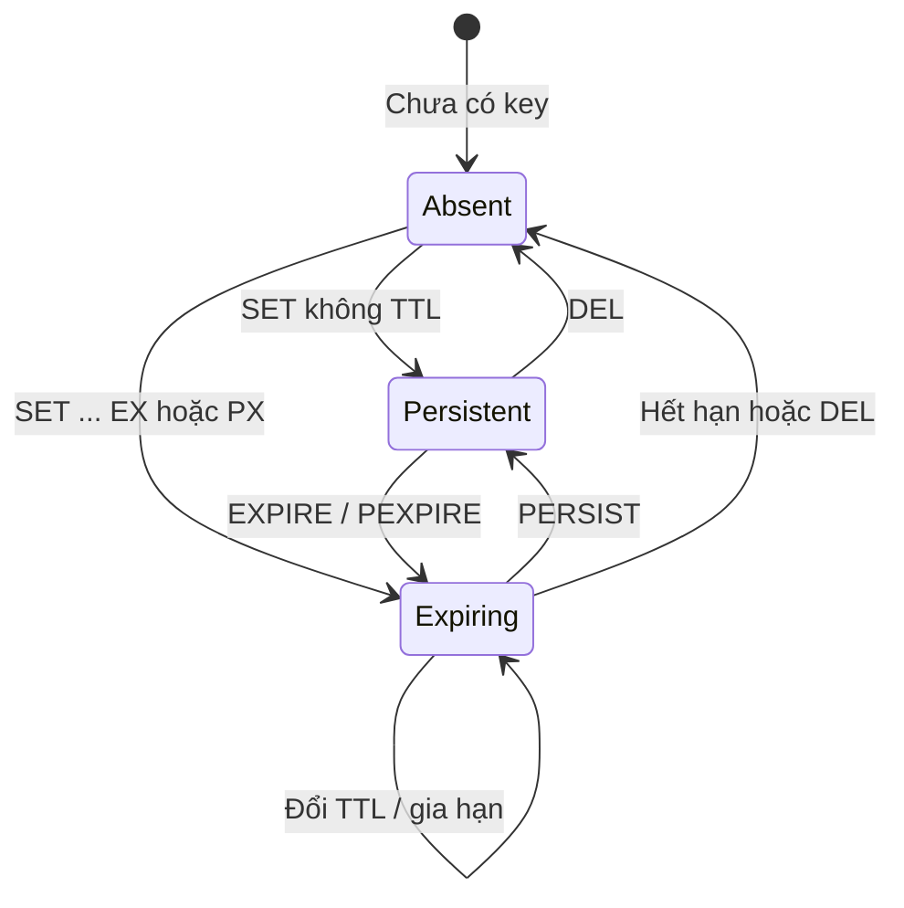

# Xóa thời hạn bằng PERSIST và gia hạn có điều kiện

Redis thường được dùng để lưu những dữ liệu chỉ có giá trị trong một khoảng thời gian: cache, mã xác nhận, phiên làm việc, trạng thái xử lý, marker chống trùng hay khóa tạm. Tuy nhiên, không phải lúc nào một key đã được đặt TTL cũng phải tiếp tục hết hạn. Có nghiệp vụ muốn **chuyển dữ liệu tạm thành dữ liệu không có hạn dùng**, hoặc **chỉ gia hạn TTL nếu thời hạn mới dài hơn thời hạn hiện tại** để tránh một writer cập nhật muộn làm key hết hạn sớm.

Redis cung cấp hai nhóm thao tác quan trọng:

- **`PERSIST`:** xóa metadata hết hạn của một key đang tồn tại nhưng **giữ nguyên key và giá trị**.
- **`EXPIRE` / `PEXPIRE` với điều kiện:** chỉ đặt hoặc đổi hạn dùng khi đáp ứng quy tắc `NX`, `XX`, `GT` hoặc `LT`. Tùy chọn này được Redis hỗ trợ từ Redis 7.0.

Trong Spring Data Redis, có thể dùng `RedisTemplate.persist(key)` để bỏ expiration; các thao tác đơn giản khác dùng `expire(key, Duration)`. Đối với **điều kiện gia hạn**, cần chọn API tương thích phiên bản Spring Data Redis/Redis client hoặc gửi lệnh Redis gốc qua cơ chế hỗ trợ thích hợp. Bài học có ví dụ sử dụng Lua script ngắn chỉ để biểu đạt cùng một lệnh `EXPIRE` có điều kiện, tránh giả định một overload Java tồn tại trên mọi phiên bản.

Nội dung đi từ ngữ nghĩa của TTL, thực hành PERSIST, phân biệt các tùy chọn đặt hạn dùng, đến thiết kế deadline và xử lý đồng thời trong ứng dụng Spring Boot.

## 1. TTL là trạng thái của key, không phải một trường dữ liệu

**TTL (Time To Live)** là khoảng thời gian còn lại trước khi Redis coi một key là hết hạn. Hạn dùng gắn với **Redis key**; nó không được lưu như một field JSON hay một giá trị riêng mà `GET` có thể đọc được.

Ví dụ:

```redis
SET profile:42 "draft" EX 600
GET profile:42
# "draft"

TTL profile:42
# Số giây còn lại, thường gần 600 ngay sau khi ghi
```

Nếu sau đó gọi `TTL`, Redis cho một trong các dạng kết quả sau:

| Kết quả | Diễn giải | Ví dụ tình huống |
| --- | --- | --- |
| Số nguyên `>= 0` | Key tồn tại và có hạn dùng; kết quả theo **giây** | `TTL profile:42` trả `421` |
| `-1` | Key đang tồn tại nhưng **không có expiration** | Key được ghi không TTL hoặc đã gọi `PERSIST` |
| `-2` | Key **không tồn tại** ở thời điểm kiểm tra | Chưa từng tạo, đã xóa hoặc đã hết hạn |

`PTTL key` tương tự nhưng trả thời gian còn lại theo mili-giây. Dùng `PTTL` khi cần quan sát hạn dùng ngắn hoặc tránh mất độ phân giải do làm tròn giây. Ví dụ `PTTL` có thể trả `250` trong khi `TTL` đã gần về 0.

### Các trạng thái cơ bản



**Đừng nhầm `PERSIST` với `DEL`.** `PERSIST` chỉ loại bỏ deadline; `DEL` loại bỏ chính key và value. Sau khi PERSIST thành công, `GET` / `HGET` / `SMEMBERS` vẫn đọc được dữ liệu theo kiểu Redis của key đó.

### TTL của String, Hash, Set, List có gì khác?

Các lệnh `EXPIRE`, `PEXPIRE`, `TTL` và `PERSIST` làm việc ở cấp key, nên có thể áp dụng cho Redis String, Hash, Set, Sorted Set, List, Stream và các loại dữ liệu phù hợp khác. Ví dụ `PERSIST cart:42` loại bỏ TTL của **toàn bộ Hash** `cart:42`, không phải chỉ một field trong Hash.

Ở những dòng Redis mới có API hết hạn riêng cho hash field, ngữ nghĩa đó là nhóm chức năng khác và có yêu cầu phiên bản riêng. `PERSIST key` trong bài này là thao tác trên **expiration của cả key**.

## 2. PERSIST: bỏ TTL nhưng giữ nguyên dữ liệu

### Cú pháp và phản hồi

```redis
PERSIST key
```

Redis trả về:

- `1` nếu key tồn tại, trước đó có expiration và **đã xóa expiration thành công**.
- `0` nếu key không tồn tại hoặc key tồn tại nhưng **vốn không có expiration**.

Như vậy `PERSIST` là một lệnh **nguyên tử**, nhưng response `0` có hai nguyên nhân khác nhau. Không nên tự suy luận “`0` nghĩa là key không tồn tại”.

### Thực hành từ đầu

```redis
SET lesson:persist "temporary" EX 120
# OK

TTL lesson:persist
# Số giây dương, gần 120

PERSIST lesson:persist
# 1: đã bỏ expiration

TTL lesson:persist
# -1: key vẫn có nhưng không có hạn dùng

GET lesson:persist
# "temporary": giá trị không thay đổi

PERSIST lesson:persist
# 0: không còn TTL để bỏ

DEL lesson:persist
# 1: xóa key

PERSIST lesson:persist
# 0: key không còn tồn tại
```

Trạng thái sau `PERSIST` thành công:

```text
Trước:
  key = lesson:persist
  value = "temporary"
  deadline = now + ~120 s

PERSIST lesson:persist

Sau:
  key = lesson:persist
  value = "temporary"
  deadline = không có (-1)
```

Redis có thể vẫn loại bỏ một key không TTL do **lệnh xóa của client, chính sách eviction khi thiếu bộ nhớ, failover/persistence hoặc các thay đổi khác**. “Không có TTL” **không có nghĩa** key được bảo đảm tồn tại vĩnh viễn trong mọi điều kiện hạ tầng.

### Khi nào có lý do dùng PERSIST?

| Tình huống | Trước | Sau khi PERSIST | Điều cần lưu ý |
| --- | --- | --- | --- |
| Bản nháp được duyệt thành cấu hình chính thức | `config:draft:42` có TTL | Cùng key không còn tự hết hạn | Xác định rõ quyền phê duyệt và nguồn dữ liệu chuẩn |
| Dữ liệu khôi phục từ một khoảng lưu tạm | Bản ghi có deadline dự kiến | Giữ bản ghi để kiểm tra lâu hơn | Không vô tình giữ token/PII lâu hơn chính sách |
| Sửa lỗi TTL của key đáng lẽ phải tồn tại lâu | TTL còn 10 giây | TTL trở thành `-1` | Tìm và sửa producer đã gắn TTL sai |
| Key đánh dấu trạng thái đã hoàn tất | Trạng thái đang xử lý có TTL | Trạng thái hoàn tất không TTL | Có thể cần lưu trong DB thay vì Redis nếu yêu cầu bền vững |

`PERSIST` là thao tác thay đổi vòng đời dữ liệu. Một key được giữ vô thời hạn có thể ảnh hưởng **chi phí bộ nhớ, retention, quyền riêng tư, bảo mật và quy trình dọn dẹp**; vì vậy không nên gọi PERSIST như cách sửa mọi vấn đề hết hạn khi chưa biết deadline ban đầu có mục đích gì.

## 3. Dùng PERSIST trong Spring Data Redis

Với một ứng dụng Spring Boot, cần dependency Redis starter trong hệ thống build.

**Gradle Groovy DSL**

```groovy
dependencies {
    implementation 'org.springframework.boot:spring-boot-starter-data-redis'
}
```

**Maven**

```xml
<dependency>
    <groupId>org.springframework.boot</groupId>
    <artifactId>spring-boot-starter-data-redis</artifactId>
</dependency>
```

Trong project có Spring Boot parent/BOM, thường không cần ghi version riêng cho starter.

Ví dụ cấu hình kết nối cho Spring Boot 3.x:

```yaml
spring:
  data:
    redis:
      host: localhost
      port: 6379
      timeout: 2s
```

Nếu Spring Boot chạy trong container còn Redis ở container khác, `localhost` thường không phải địa chỉ của Redis; cần cấu hình hostname/service thực tế.

### Ví dụ service bỏ thời hạn

```java
import java.time.Duration;
import java.util.concurrent.TimeUnit;
import org.springframework.data.redis.core.StringRedisTemplate;
import org.springframework.stereotype.Service;

@Service
public class ProfileExpirationService {

    private final StringRedisTemplate redis;

    public ProfileExpirationService(StringRedisTemplate redis) {
        this.redis = redis;
    }

    public void saveDraft(String profileId, String json) {
        redis.opsForValue().set(
                keyFor(profileId),
                json,
                Duration.ofMinutes(30)
        );
    }

    public boolean keepPermanently(String profileId) {
        Boolean changed = redis.persist(keyFor(profileId));
        return Boolean.TRUE.equals(changed);
    }

    public Long remainingTtlSeconds(String profileId) {
        return redis.getExpire(
                keyFor(profileId),
                TimeUnit.SECONDS
        );
    }

    private String keyFor(String profileId) {
        if (profileId == null || !profileId.matches("[A-Za-z0-9_-]{1,64}")) {
            throw new IllegalArgumentException("Invalid profile ID");
        }
        return "profile:draft:" + profileId;
    }
}
```

Ở lời gọi thông thường:

- `saveDraft(...)` dùng `SET` kèm TTL 30 phút trong một command Redis.
- `keepPermanently(...)` gọi `PERSIST`. `true` chỉ xác nhận expiration vừa được bỏ; `false` **không phân biệt** key đã mất hay đã không TTL.
- `remainingTtlSeconds(...)` cho `Long`, thường là số giây còn lại hoặc `-1`/`-2`. Một số ngữ cảnh như pipeline/transaction có thể trả `null` trước khi kết quả thực sự được thu; ví dụ dành cho lời gọi trực tiếp.

**Lưu ý nghiệp vụ:** đây là ví dụ thao tác TTL, chưa phải quy trình phê duyệt profile hoàn chỉnh. Đối với thay đổi quan trọng, không nên chỉ gọi `PERSIST` rồi mặc định rằng đã cập nhật nguồn dữ liệu chính; Redis không thực hiện transaction chung với database quan hệ hoặc hệ thống khác.

### Đừng dựa vào hai lời gọi để tạo một điều kiện nguyên tử

Đoạn code sau có race condition:

```java
Long ttl = redis.getExpire("profile:draft:42");
if (ttl != null && ttl > 0) {
    redis.persist("profile:draft:42");
}
```

Một client khác có thể xóa key hoặc đổi value/TTL giữa `getExpire` và `persist`. Nếu chỉ cần “bỏ TTL nếu nó có”, **gọi PERSIST trực tiếp** đã là thao tác nguyên tử. Nếu phải kiểm tra owner/token hoặc trạng thái value trước khi bỏ TTL, cần so khớp và PERSIST trong một script hoặc cơ chế atomically khác.

## 4. EXPIRE có điều kiện: NX, XX, GT, LT

Lệnh cơ bản:

```redis
EXPIRE key seconds
```

đặt thời hạn sống theo giây, tính từ thời điểm Redis xử lý lệnh. Với Redis **7.0 trở lên**, có thể thêm các điều kiện:

```redis
EXPIRE key seconds NX
EXPIRE key seconds XX
EXPIRE key seconds GT
EXPIRE key seconds LT
```

Các biến thể theo mili-giây hoặc mốc thời gian tuyệt đối có nhóm option tương ứng, ví dụ `PEXPIRE`, `EXPIREAT` và `PEXPIREAT` trên các phiên bản hỗ trợ. Khi sử dụng nhiều option trong một lệnh, cần đối chiếu quy tắc kết hợp của phiên bản Redis; các ví dụ dưới đây **mỗi lần dùng một option** để nêu rõ một điều kiện.

| Điều kiện | Redis chỉ đặt TTL mới khi… | Key đang có TTL? | Key đang tồn tại nhưng không TTL? |
| --- | --- | --- | --- |
| Không option | Key tồn tại; ghi đè deadline hiện tại | Đặt lại TTL | Đặt TTL mới |
| **`NX`** | Key **chưa có expiration** | Không thay đổi | **Được đặt TTL** |
| **`XX`** | Key **đang có expiration** | **Được thay TTL** | Không thay đổi |
| **`GT`** | Deadline mới **muộn hơn** deadline hiện tại | Chỉ gia hạn, không rút ngắn | Không đặt TTL vì không TTL được xem là deadline vô hạn |
| **`LT`** | Deadline mới **sớm hơn** deadline hiện tại | Chỉ rút ngắn, không kéo dài | **Được đặt TTL** vì không TTL được xem là deadline vô hạn |

Với cả bốn option, **key không tồn tại thì không được tạo** bởi `EXPIRE`. Chúng chỉ có thể thay đổi expiration của một key đang có. Nếu cần tạo key đồng thời TTL, dùng `SET key value EX/PX ...` hoặc cơ chế ghi tương ứng.

**Chú ý về `NX`:** `EXPIRE ... NX` khác `SET ... NX`.

- `SET k v NX` ghi giá trị nếu **key chưa tồn tại**.
- `EXPIRE k 60 NX` đặt expiration nếu **key đang tồn tại nhưng chưa có expiration**.

Nhầm hai định nghĩa này có thể tạo ra các giả định sai về việc tạo key hoặc xử lý key đã hết hạn.

### Giá trị trả về

`EXPIRE` trả:

- `1`: Redis đã áp dụng expiration theo điều kiện.
- `0`: key không tồn tại hoặc điều kiện không thỏa.

Giống `PERSIST`, response `0` không tự cho biết lý do chính xác. Nếu cần phân biệt để báo lỗi nghiệp vụ, cần đánh giá state theo hợp đồng ứng dụng, lưu ý bất kỳ lệnh kiểm tra riêng nào cũng có thể thấy dữ liệu đã thay đổi.

## 5. Thực hành NX: chỉ đặt TTL cho key đang tồn tại mà chưa hết hạn

Tình huống: một quy trình import đã tạo các key dữ liệu nhưng quên gắn TTL; một job muốn thêm TTL **một lần**, không rút ngắn/gia hạn những key đã có deadline.

```redis
SET lesson:nx "first"
# Key tồn tại, không có expiration

TTL lesson:nx
# -1

EXPIRE lesson:nx 120 NX
# 1: key chưa có expiration, TTL được đặt

TTL lesson:nx
# Gần 120

EXPIRE lesson:nx 600 NX
# 0: key đã có expiration, không thay đổi

TTL lesson:nx
# Vẫn đếm ngược từ deadline ban đầu
```

Điều kiện NX hữu ích khi nhiều worker cố gắng **khởi tạo expiration một lần**. Tuy nhiên:

- NX không bảo đảm đúng một worker đã tạo key gốc; nó chỉ kiểm tra metadata expiration tại thời điểm lệnh thực thi.
- Nếu key bị xóa và tạo lại, NX có thể thành công lần nữa với key mới.
- Nếu key không tồn tại, `EXPIRE NX` trả 0, không tự tạo giá trị.

Nếu khởi tạo cả value và TTL cho một key mới, thường nên dùng:

```redis
SET lesson:created "payload" NX EX 120
```

Như vậy **giá trị và TTL được tạo trong cùng một command**, thay vì `SETNX` rồi `EXPIRE NX` qua hai round trip và có khoảng trống ở giữa.

## 6. Thực hành XX: chỉ cập nhật key vốn đã có TTL

Tình huống: dữ liệu tạm được phép gia hạn, nhưng ứng dụng **không muốn vô tình đưa một key vĩnh viễn vào cơ chế tự hết hạn**.

```redis
SET lesson:xx "temporary" EX 60

EXPIRE lesson:xx 180 XX
# 1: key có TTL, đặt lại deadline theo 180 giây từ lúc gọi

TTL lesson:xx
# Gần 180

PERSIST lesson:xx
# 1: key giờ không còn TTL

EXPIRE lesson:xx 300 XX
# 0: vì key đã persistent

TTL lesson:xx
# -1
```

**Điểm cần phân biệt:** `XX` chỉ yêu cầu key đang có TTL. Nó **không bảo đảm thời hạn mới dài hơn** thời hạn cũ. Ví dụ:

```redis
SET lesson:xx-short "value" EX 600
EXPIRE lesson:xx-short 30 XX
# 1: dù đây là rút ngắn TTL từ gần 600 xuống gần 30
```

Nếu bài toán là **chỉ gia hạn chứ không rút ngắn**, cần `GT` thay vì chỉ `XX`.

## 7. Thực hành GT: chỉ gia hạn khi deadline mới muộn hơn

`GT` viết tắt của **greater than**: so sánh thời điểm hết hạn mới với thời điểm hết hạn hiện tại. Trong cách dùng `EXPIRE` với TTL tương đối, lệnh chỉ thành công khi deadline mới nằm **xa hơn về tương lai**.

```redis
SET lesson:gt "active" EX 120
# Key có TTL gần 120 giây

EXPIRE lesson:gt 300 GT
# 1: deadline mới muộn hơn deadline cũ

EXPIRE lesson:gt 60 GT
# 0: sẽ rút ngắn nên không áp dụng

TTL lesson:gt
# Vẫn đang đếm ngược từ deadline 300 giây đã đặt
```

Đây là điều kiện phù hợp cho những trường hợp **không được phép rút ngắn TTL do cập nhật tới muộn**:

- Một lease tạm cần kéo dài hạn dùng nếu công việc được chấp thuận tiếp tục.
- Nhiều worker tính ra TTL khác nhau và chỉ muốn giữ deadline xa nhất.
- Cơ chế cache hoặc session có yêu cầu monotonic extension, không để refresh kém ưu tiên rút ngắn hạn sống đã được gia hạn.

### GT trên key không có expiration

```redis
SET lesson:gt-persistent "value"
EXPIRE lesson:gt-persistent 120 GT
# 0

TTL lesson:gt-persistent
# -1
```

Redis coi key **không có expiration** như đang có deadline **vô hạn** khi so sánh `GT` / `LT`. Không có một TTL hữu hạn nào “lớn hơn vô hạn”, nên `GT` không thể gắn TTL cho key persistent.

Điều đó thường là tính chất mong muốn: nếu một thao tác trước đã gọi `PERSIST` để giữ key, một worker thực hiện `EXPIRE GT` sau đó **không tự biến key trở lại thành có TTL**.

### GT không kiểm tra quyền sở hữu lease

`EXPIRE key 300 GT` chỉ kiểm tra deadline; nó không biết writer có đang giữ token hợp lệ hay không. Trong distributed lock, worker đã mất quyền sở hữu không nên được phép gia hạn khóa của worker mới chỉ vì `GT` đúng. Cần kiểm tra **owner token** và gia hạn trong cùng thao tác nguyên tử (ví dụ Lua script) hoặc dùng thư viện lock đáp ứng yêu cầu hệ thống.

## 8. Thực hành LT: chỉ áp dụng deadline sớm hơn

`LT` viết tắt của **less than**: chỉ đặt expiration khi deadline mới **sớm hơn** deadline hiện tại.

```redis
SET lesson:lt "value" EX 600

EXPIRE lesson:lt 120 LT
# 1: rút ngắn hạn dùng từ gần 600 về gần 120

EXPIRE lesson:lt 900 LT
# 0: 900 giây sẽ kéo dài, nên bị từ chối

TTL lesson:lt
# Vẫn đếm ngược từ deadline 120 giây đã đặt
```

`LT` đặc biệt hữu ích khi hệ thống muốn **áp một giới hạn tối đa về deadline**: ví dụ một phiếu xác nhận không được tồn tại quá thời điểm do nghiệp vụ quy định.

### LT trên key persistent

```redis
SET lesson:lt-persistent "value"

EXPIRE lesson:lt-persistent 90 LT
# 1

TTL lesson:lt-persistent
# Gần 90
```

Do key không có TTL được coi là deadline vô hạn, bất kỳ expiration hữu hạn hợp lệ nào đều sớm hơn vô hạn, nên `LT` có thể chuyển key persistent thành key có hạn dùng.

Đây là **khác biệt quan trọng** so với `GT`, và là lý do không nên áp dụng một điều kiện hết hạn chỉ dựa trên tên “gia hạn” mà không hiểu rõ quy tắc so sánh.

## 9. Bảng tóm tắt trạng thái đầu vào và lựa chọn option

Giả sử key đang tồn tại và lệnh đặt một TTL dương hợp lệ:

| Trạng thái key trước lệnh | `EXPIRE 180 NX` | `EXPIRE 180 XX` | `EXPIRE 180 GT` | `EXPIRE 180 LT` |
| --- | --- | --- | --- | --- |
| Không TTL (persistent) | **Áp dụng** | Bỏ qua | Bỏ qua | **Áp dụng** |
| TTL còn khoảng 60 giây | Bỏ qua | **Áp dụng** | **Áp dụng** | Bỏ qua |
| TTL còn khoảng 300 giây | Bỏ qua | **Áp dụng** | Bỏ qua | **Áp dụng** |
| Key không tồn tại | Bỏ qua | Bỏ qua | Bỏ qua | Bỏ qua |

Các mốc “60” và “300” chỉ là ví dụ để minh họa. Redis so sánh **deadline thực tế tại thời điểm thực thi**, không so sánh những giá trị TTL cũ được Java đọc từ nhiều mili-giây trước. Vì vậy, nếu yêu cầu là “chỉ kéo dài”, dùng `GT` trong chính lệnh Redis tốt hơn việc đọc TTL rồi tự quyết định ở client.

### Ngữ nghĩa NX/XX/GT/LT không giống kiểm tra value

Tất cả điều kiện trên liên quan đến **metadata hết hạn của key**. Chúng không kiểm tra:

- Value của key có bằng một giá trị mong đợi không.
- User có quyền sửa TTL không.
- Phiên làm việc đã bị thu hồi ở database chính hay chưa.
- Deadline mới có vượt quá thời hạn tối đa được business cho phép không.

Đối với những điều kiện nghiệp vụ, cần thêm kiểm tra phù hợp và có thể phải đặt chúng cùng thao tác thay đổi TTL để tránh race condition.

## 10. Gia hạn theo thời điểm tuyệt đối: EXPIREAT / PEXPIREAT

TTL tương đối như `EXPIRE key 300` được tính tại **thời điểm Redis xử lý lệnh**. Nếu hai hệ thống đã thỏa thuận một deadline tuyệt đối, có thể dùng:

```redis
EXPIREAT key unixSeconds
PEXPIREAT key unixMilliseconds
```

Với Redis hỗ trợ các condition option tương ứng:

```redis
EXPIREAT token:42 1900000000 LT
PEXPIREAT token:43 1900000000000 GT
```

Các mốc số trong ví dụ là **Unix epoch mẫu**, không phải deadline áp dụng cho một hệ thống thật. Với môi trường production, tính chúng từ một `Instant` hoặc nguồn thời gian đáng tin, xác định đúng đơn vị giây/mili-giây.

`EXPIREAT ... LT` có thể hữu ích để **rút deadline về không muộn hơn mốc chính sách**. `PEXPIREAT ... GT` có thể dùng khi chỉ được phép chuyển deadline ra muộn hơn.

Nếu timestamp đích đã nằm trong quá khứ, một lệnh expiration hợp lệ có thể dẫn tới **xóa key ngay lập tức** theo ngữ nghĩa Redis. Vì vậy nên xác thực deadline trước khi gửi và không coi `EXPIREAT` là hành vi “lưu timestamp” vô hại.

### Vì sao deadline tuyệt đối có thể tốt hơn TTL lặp lại?

Giả sử OTP được tạo lúc 10:00, **hết hạn cứng lúc 10:05**. Nếu mỗi request đều gọi `EXPIRE otp:42 300`, request lúc 10:04 sẽ đẩy deadline đến khoảng 10:09, vi phạm yêu cầu ban đầu.

Thay vào đó, quản lý deadline tuyệt đối 10:05:

- Ghi key ban đầu với expiration đúng deadline.
- Nếu cần điều chỉnh, chỉ được rút ngắn về deadline hợp lệ bằng điều kiện phù hợp.
- Tại business layer, kiểm tra deadline khi hành động quan trọng nếu cần bảo đảm hơn việc chỉ dựa vào key còn tồn tại.
- Không để một worker sử dụng TTL tương đối vô tình mở rộng một hạn dùng mà business đã xác định là cố định.

## 11. Spring Data Redis: đặt expiration thông thường

Trong Spring Data Redis, cách phổ biến để đặt hạn dùng của một key đã có là:

```java
import java.time.Duration;
import org.springframework.data.redis.core.StringRedisTemplate;

Boolean applied = stringRedisTemplate.expire(
        "profile:draft:42",
        Duration.ofMinutes(15)
);
```

Phương thức `expire(key, Duration)` biểu đạt expiration thông thường **không điều kiện**. Trong lời gọi trực tiếp, `true` thường nghĩa Redis đã đặt hạn dùng, `false` nghĩa không thể áp dụng (ví dụ key không tồn tại).

Điểm cần nhớ: nếu key đã có TTL, lệnh không điều kiện này có thể **đổi TTL dài thành TTL ngắn** hoặc ngược lại. Nếu nghiệp vụ yêu cầu chỉ kéo dài, `expire(key, Duration)` không tự có điều kiện `GT`.

### PERSIST với key Redis Hash, Set, String

Giả sử:

```java
stringRedisTemplate.opsForHash().put("profile:42", "status", "ACTIVE");
stringRedisTemplate.expire("profile:42", Duration.ofHours(1));
stringRedisTemplate.persist("profile:42");
```

Kết quả là **cả key Hash `profile:42`** không còn TTL. Tương tự với Set/List/Sorted Set: `persist` không cần biết kiểu dữ liệu bên trong, vì nó thay metadata expiration của key.

Trong một số ứng dụng Spring Boot còn có tầng cache tự động (`@Cacheable`, `RedisCacheManager`). Các key cache có thể được tạo với TTL theo cấu hình riêng. Gọi `persist` thủ công trên những key đó có thể phá vỡ chính sách dọn cache; phải hiểu nguồn sở hữu key và chính sách eviction trước khi chỉnh TTL.

## 12. Thực hiện EXPIRE có điều kiện từ Spring Data Redis

Tùy phiên bản Spring Data Redis và Redis driver, API Java có thể cung cấp các cách biểu đạt expiration condition khác nhau. Điều kiện `NX` / `XX` / `GT` / `LT` là ngữ nghĩa **của Redis server từ Redis 7.0**; không nên tự đoán một overload Java hoặc tên enum nào là phổ biến cho mọi release.

Một cách rõ ràng để minh họa từ `StringRedisTemplate` là sử dụng một **RedisScript ngắn** chuyển option đến chính command `EXPIRE`. Script không có mục đích “biến hai lệnh thành nguyên tử” ở đây: **EXPIRE có điều kiện vốn đã là một command nguyên tử**. Script chỉ là một cách đi qua API cho môi trường hỗ trợ Lua và các option Redis tương ứng.

### 12.1. Service Java với option cố định

```java
import java.time.Duration;
import java.util.List;
import java.util.Objects;
import org.springframework.data.redis.core.StringRedisTemplate;
import org.springframework.data.redis.core.script.RedisScript;
import org.springframework.stereotype.Service;

@Service
public class ConditionalExpiryService {

    private static final RedisScript<Long> CONDITIONAL_EXPIRE =
            RedisScript.of(
                    """
                    return redis.call(
                        'EXPIRE',
                        KEYS[1],
                        tonumber(ARGV[1]),
                        ARGV[2]
                    )
                    """,
                    Long.class
            );

    private final StringRedisTemplate redis;

    public ConditionalExpiryService(StringRedisTemplate redis) {
        this.redis = redis;
    }

    public boolean setTtlIfAbsent(String key, Duration ttl) {
        return changeTtl(key, ttl, Mode.NX);
    }

    public boolean refreshOnlyIfExpiring(String key, Duration ttl) {
        return changeTtl(key, ttl, Mode.XX);
    }

    public boolean extendOnly(String key, Duration ttl) {
        return changeTtl(key, ttl, Mode.GT);
    }

    public boolean shortenOnly(String key, Duration ttl) {
        return changeTtl(key, ttl, Mode.LT);
    }

    private boolean changeTtl(String key, Duration ttl, Mode mode) {
        Objects.requireNonNull(key, "key");
        Objects.requireNonNull(ttl, "ttl");
        Objects.requireNonNull(mode, "mode");

        // Ví dụ này dùng EXPIRE với số giây nguyên dương.
        // Duration dưới 1 giây không hợp lệ cho phương thức này.
        long seconds = ttl.getSeconds();
        if (seconds <= 0 || key.isBlank()) {
            throw new IllegalArgumentException(
                    "key must be nonblank and TTL at least one second"
            );
        }

        Long changed = redis.execute(
                CONDITIONAL_EXPIRE,
                List.of(key),
                Long.toString(seconds),
                mode.name()
        );

        return Objects.requireNonNull(
                changed,
                "No Redis expiry result"
        ) == 1L;
    }

    private enum Mode {
        NX, XX, GT, LT
    }
}
```

Đoạn code minh họa dùng Java 17+ (text block) cùng Spring Data Redis có API `RedisScript.of`. Redis server phải hỗ trợ option `NX/XX/GT/LT` cho `EXPIRE` (Redis 7.0+). Nếu server cũ hơn, lệnh phát sinh trong script sẽ bị từ chối; **không** nên âm thầm fallback sang `getExpire()` rồi `expire()` trong hai round trip nếu nghiệp vụ phụ thuộc tính nguyên tử.

Trong bản triển khai thực tế, có thể dùng `PEXPIRE` khi cần mili-giây và API/driver thích hợp. Ví dụ trên cố ý chấp nhận **TTL ít nhất một giây** và dùng `ttl.getSeconds()`; nếu truyền `Duration.ofMillis(500)`, phương thức từ chối thay vì vô tình gửi TTL bằng 0. Đối với thời lượng có phần lẻ lớn hơn một giây, đoạn code lấy phần giây nguyên; nên định nghĩa quy tắc làm tròn và dùng độ phân giải phù hợp với nghiệp vụ.

### 12.2. Sử dụng service

```java
// Chỉ gắn TTL nếu key đang tồn tại nhưng chưa hết hạn.
boolean initialized = conditionalExpiryService.setTtlIfAbsent(
        "profile:42",
        Duration.ofMinutes(15)
);

// Chỉ đẩy deadline ra xa hơn.
boolean extended = conditionalExpiryService.extendOnly(
        "worker:lease:42",
        Duration.ofMinutes(10)
);

// Chỉ rút ngắn deadline; hữu ích với giới hạn thời gian cứng.
boolean shortened = conditionalExpiryService.shortenOnly(
        "token:verification:42",
        Duration.ofSeconds(30)
);

// Chỉ đặt lại TTL trên key vốn đã có expiration.
boolean refreshed = conditionalExpiryService.refreshOnlyIfExpiring(
        "session:42",
        Duration.ofMinutes(20)
);
```

`false` có nghĩa **không áp dụng được expiration theo điều kiện**, không có nghĩa Redis gặp lỗi. Nếu Redis không kết nối được, script sai hoặc không hỗ trợ option, lời gọi có thể ném exception; không nên che tất cả exception thành `false`.

### 12.3. Tại sao không tự so sánh TTL ở Java?

Một cách làm không an toàn:

```java
Long current = redis.getExpire("worker:lease:42");

if (current != null && current >= 0 && current < 600) {
    redis.expire("worker:lease:42", Duration.ofSeconds(600));
}
```

Giữa hai command, một writer khác có thể đã gia hạn TTL lên 2.000 giây. Lệnh `expire(..., 600)` sau đó **rút deadline trở lại**. Ngược lại, dùng `EXPIRE key 600 GT` để Redis so sánh và thay expiration **trong một command**, nên không có race condition giữa bước kiểm tra và bước áp dụng của chính thao tác đó.

Nếu business còn cần kiểm tra token/version của value, giải pháp chỉ `GT` vẫn chưa đủ; cần logic so khớp ở server trước khi thay expiration.

## 13. PERSIST và các lệnh ghi khác ảnh hưởng TTL thế nào?

Trong thực tế, việc “vừa bỏ TTL rồi lại thấy TTL xuất hiện” thường do **writer khác** hoặc do code ghi đè value.

| Lệnh/thao tác | Tác động lên key và TTL |
| --- | --- |
| `PERSIST key` | Giữ key/value, loại bỏ expiration hiện tại |
| `SET key value` | Ghi đè String value và **thường xóa expiration cũ**, nếu không có option giữ/đặt TTL |
| `SET key value EX 300` | Ghi value mới và đặt TTL mới 300 giây |
| `SET key value KEEPTTL` | Ghi value mới, cố ý giữ expiration hiện tại khi có |
| `HSET key field value` | Thêm/đổi field Hash; thông thường không xóa TTL của key Hash đang tồn tại |
| `SADD key member` | Thêm member vào Set; thông thường không xóa TTL hiện có của key |
| `INCR key` | Tăng giá trị String dạng số; thông thường không xóa TTL hiện có |
| `EXPIRE key seconds` | Ghi đè expiration với deadline mới khi key tồn tại |
| `EXPIRE key seconds NX/XX/GT/LT` | Thay expiration có điều kiện |
| `DEL key` | Xóa key cùng metadata expiration |
| `GETEX key PERSIST` | Đọc giá trị String và bỏ TTL trong một command, nếu Redis hỗ trợ |

**Lưu ý:** “Thông thường không xóa TTL” của `HSET`, `SADD`, `INCR` nghĩa là khi thao tác cập nhật **key đang tồn tại**, expiration của key không tự biến mất. Nếu thao tác tạo một key mới, key đó không tự có TTL trừ khi một lệnh/cơ chế khác đặt hạn dùng.

### Sự khác nhau giữa GET rồi PERSIST và GETEX ... PERSIST

Redis hỗ trợ lệnh:

```redis
GETEX session:42 PERSIST
```

cho Redis String trong các phiên bản hỗ trợ. Lệnh này vừa **đọc value hiện tại** vừa **bỏ expiration** trong một thao tác. Nếu ứng dụng làm:

```redis
GET session:42
PERSIST session:42
```

thì một writer khác có thể thay value hoặc làm key hết hạn giữa hai lệnh. `GETEX ... PERSIST` tránh trạng thái trung gian cho cặp hành vi đọc và bỏ hạn dùng của Redis String, nhưng vẫn phải xác định đúng chính sách nghiệp vụ: không phải mọi lần đọc session đều được phép chuyển session thành sống vô thời hạn.

Trong Spring Data Redis, một số dòng phiên bản cung cấp API đọc và bỏ TTL (ví dụ nhóm phương thức `ValueOperations.getAndPersist`). Khi dùng trong project, cần kiểm tra API ở **phiên bản Spring Data Redis thực tế**, thay vì suy luận từ ví dụ của một phiên bản khác.

## 14. PERSIST có điều kiện theo giá trị: khi chỉ người sở hữu được bỏ TTL

`PERSIST` bản thân không nhận option so sánh value. Nếu muốn “chỉ bỏ hạn dùng nếu key vẫn thuộc về thao tác hiện tại”, mẫu đơn giản là dùng Lua:

```lua
-- KEYS[1]: key String
-- ARGV[1]: token/giá trị sở hữu mong đợi

if redis.call('GET', KEYS[1]) == ARGV[1] then
    return redis.call('PERSIST', KEYS[1])
end

return 0
```

Trong cùng lần thực thi script:

1. Redis đọc value hiện tại.
2. So sánh với token mong đợi.
3. Chỉ gọi `PERSIST` nếu token còn khớp.

Điều này ngăn một client có token cũ bỏ expiration của **value mới** do writer khác vừa ghi, vì không có command bên ngoài chen giữa thao tác kiểm tra và PERSIST của script.

Tuy nhiên, **không dùng PERSIST để biến distributed lock thành khóa vĩnh viễn** nếu thiết kế lock phải tự giải phóng khi process crash. Script chỉ minh họa phương pháp so sánh và sửa TTL nguyên tử. Trên hệ thống thật, cần xét ủy quyền người gọi, token duy nhất, cơ chế kiểm toán và tác động của việc key không còn tự hết hạn.

Nếu key là Hash hoặc dữ liệu dạng khác, `GET` sẽ không phù hợp; logic so khớp phải dùng lệnh đọc tương ứng, chẳng hạn `HGET` cho field có token, trước khi gọi `PERSIST` cho cả key.

## 15. Các bài toán thực tế

### 15.1. Cache được cập nhật bởi nhiều writer

Một dịch vụ A ghi cache với TTL 10 phút; dịch vụ B quyết định tăng TTL lên 30 phút vì dữ liệu vẫn hợp lệ. Nếu B gọi `EXPIRE 1800` không điều kiện, ổn trong thời điểm đó; nhưng một worker C đến muộn có thể gọi `EXPIRE 300`, làm cache hết hạn sớm.

Nếu quy tắc là **deadline chỉ được kéo dài**, hãy dùng `EXPIRE ... GT` cho **mọi** writer tham gia gia hạn. Không thể đạt bất biến monotonic nếu chỉ một writer dùng GT nhưng các writer còn lại vẫn được phép gọi `EXPIRE` không điều kiện hoặc `SET` mà không có expiration phù hợp.

### 15.2. Dữ liệu tạm chuyển thành dữ liệu chính thức

Quy trình:

```text
Tạo draft có TTL 30 phút
    ↓
Người dùng xác nhận
    ↓
Ghi trạng thái chính thức vào nguồn dữ liệu chuẩn
    ↓
Quyết định dữ liệu Redis cần giữ lại hay xóa
    ↓
PERSIST key (chỉ nếu chính sách cho phép giữ vô thời hạn)
```

Nếu trạng thái chính thức thực sự cần lưu bền vững, Redis `PERSIST` **không thay thế được** transaction/cập nhật database và quy trình backup. Có thể còn phù hợp hơn khi chuyển dữ liệu sang key namespace chính thức rồi xóa key draft, thay vì giữ mãi cùng một key có tên `draft`.

### 15.3. Session với sliding expiration

Giả sử mỗi hoạt động hợp lệ có thể kéo dài session thêm 15 phút kể từ lần hoạt động đó. Dùng `EXPIRE session:42 900 XX` để chỉ cập nhật session **đang có TTL**; nếu muốn chắc chắn không rút ngắn deadline do request cũ, `GT` phù hợp hơn. Nhưng `GT` một mình không kiểm tra session đã bị thu hồi hoặc user còn hợp lệ.

Thiết kế session an toàn hơn cần cân nhắc:

- Phiên có **deadline cứng** không được vượt quá, ngoài sliding TTL hay không.
- Session có thể bị revoke tức thời không.
- Writer refresh có được phép làm sống lại session đã mất không.
- Nếu Redis không còn session, hệ thống xử lý như mất phiên chứ không tự tạo lại chỉ bằng một lệnh expiration.
- Key chỉ còn TTL sau khi refresh; key persistent bất thường không bị tự gia hạn vì GT/XX đều bỏ qua.

Không dùng `PERSIST` để “sửa” session hết hạn nếu chính sách bảo mật yêu cầu expiration. Điều đó có thể tạo phiên tồn tại lâu ngoài dự kiến.

### 15.4. Deadline tối đa cho mã xác nhận

Một OTP có hạn dùng 5 phút từ lúc tạo, tuyệt đối không được kéo dài:

- Lưu deadline nghiệp vụ rõ ràng.
- Khi phải chỉnh TTL, dùng `EXPIREAT ... LT` hoặc điều kiện tương ứng để chỉ đưa deadline **về sớm hơn**.
- Không gọi `SET ... EX 300` lại sau mỗi lần nhập mã thất bại.
- Nếu OTP đã hết hạn, phải từ chối thay vì phát sinh lại cùng value chỉ vì một thao tác cache.

`LT` giúp thực thi quy tắc “không kéo dài expiration” ở Redis, nhưng không tự kiểm tra số lần thử, token đã bị dùng, quyền truy cập hoặc tính hợp lệ của OTP.

### 15.5. Lease của background worker

Một worker giữ marker `job:42:lease` có TTL 60 giây. Khi cần thêm thời gian, `EXPIRE key 120 GT` chỉ kéo dài nếu key còn TTL và deadline mới xa hơn. Tuy nhiên nếu lease đã chuyển sang worker khác, worker cũ vẫn có thể gửi GT trừ khi cơ chế gia hạn **đồng thời kiểm tra token sở hữu**.

Mẫu Lua có kiểm tra token:

```lua
-- KEYS[1]: key String chứa token của owner
-- ARGV[1]: owner token
-- ARGV[2]: số giây gia hạn

if redis.call('GET', KEYS[1]) ~= ARGV[1] then
    return 0
end

return redis.call('EXPIRE', KEYS[1], tonumber(ARGV[2]), 'GT')
```

Khi script chạy trên Redis 7.0+, owner token phải khớp và deadline mới phải muộn hơn deadline cũ. Nếu worker cũ đã mất lease, script không nên được xem là cho phép tác động nghiệp vụ nữa. Đối với công việc có rủi ro **stale worker** ghi dữ liệu bên ngoài Redis, có thể còn cần fencing token và cơ chế phối hợp với hệ đích; gia hạn lease trên Redis tự nó không bảo vệ mọi resource.

## 16. Điều gì xảy ra khi có nhiều writer và timeout?

### Không phải mọi thao tác nhìn thấy thứ tự giống nhau

Xét hai tác vụ:

```text
Tác vụ A: PERSIST session:42
Tác vụ B: EXPIRE session:42 600
```

Nếu A chạy trước B và B dùng `EXPIRE` không điều kiện, key có thể lại có TTL. Nếu B chạy trước A, key có thể trở thành persistent. Thứ tự command được Redis xử lý quyết định trạng thái cuối, không phải thời điểm mà hai request bắt đầu ở Java.

Nếu business muốn sau khi PERSIST thì không writer nào được gắn lại TTL, cần thay đổi **quy tắc ghi chung** (ví dụ các writer gia hạn chỉ dùng `GT`/`XX`) và cơ chế phân quyền/version trạng thái nếu cần. Chỉ gọi PERSIST một lần không khóa metadata expiration chống lại những writer khác.

### Timeout không có nghĩa Redis chưa thực thi

Client gửi `EXPIRE key 300 GT` hoặc `PERSIST key`, nhưng response bị mất trên đường truyền. Java có thể gặp timeout dù Redis **đã** áp dụng thao tác. Lần gọi lại có thể nhận `0` vì:

- Với `PERSIST`, expiration đã bị bỏ ở lần đầu.
- Với `GT`, deadline mới không còn lớn hơn deadline đã được đặt.

Đừng biến `0` của lần retry thành bằng chứng rằng thao tác đầu đã thất bại. Cần thiết kế API idempotent và cơ chế kiểm tra trạng thái hiện tại tùy yêu cầu nghiệp vụ.

### Tính nguyên tử khác tính bền vững

Redis bảo đảm tính nguyên tử của từng command/script ở server xử lý. Điều đó **không tự bảo đảm** command đã được replicate hoặc ghi bền vững sang disk trước khi trả response. Trong trường hợp crash/failover, kết quả cuối còn phụ thuộc persistence, replication và cách triển khai. Với dữ liệu quan trọng, cần xác định nguồn dữ liệu chuẩn và chính sách khôi phục riêng.

## 17. Quan sát expiration trong môi trường vận hành

Các lệnh chẩn đoán cần biết:

```redis
TYPE session:42
EXISTS session:42
TTL session:42
PTTL session:42
GET session:42
INFO stats
INFO commandstats
```

- `TYPE` giúp tránh đọc nhầm kiểu dữ liệu Redis.
- `EXISTS` phân biệt key hiện tại có tồn tại hay không, nhưng kết quả là một **snapshot** tại thời điểm command xử lý.
- `TTL`/`PTTL` xác định key đang có expiration hay không.
- `INFO stats` cung cấp thống kê liên quan đến expiration và eviction tùy phiên bản Redis.
- `INFO commandstats` có thể giúp xem tần suất/chí phí thực thi theo nhóm command, nhưng không chỉ ra trực tiếp “writer nào đã gọi PERSIST trên key này”.

Nếu ứng dụng gặp tình trạng “TTL tự biến mất”, cần truy ngược **đường ghi**:

1. Có gọi `PERSIST` không?
2. Có `SET key value` mà không kèm TTL hoặc `KEEPTTL` không?
3. Có một layer cache hoặc background job làm mới key theo định dạng khác không?
4. Có task migration/sửa lỗi gọi lệnh không điều kiện không?
5. Có nhiều producer cùng dùng namespace key nhưng chính sách retention khác nhau không?

Nếu ứng dụng gặp tình trạng “TTL tự dài ra”:

1. Có gọi `SET ... EX` hay `EXPIRE` không điều kiện trong mỗi lần refresh không?
2. Có writer tự gọi `EXPIRE XX` dù thực chất cần GT không?
3. Có đơn vị giây/mili-giây bị trộn lẫn không?
4. Có cách tính deadline từ đồng hồ của các service khác nhau không?

Chỉ dựa vào một giá trị `TTL` chụp tại thời điểm điều tra không chứng minh lịch sử của key; quan sát event, telemetry và log business có giới hạn là cần thiết.

### Những chỉ số nên theo dõi

| Chỉ số / sự kiện | Ý nghĩa khi điều tra |
| --- | --- |
| Tỷ lệ key có `TTL=-1` trong namespace tạm | Có key bị mất deadline hoặc PERSIST quá mức |
| Tỷ lệ key `TTL=-2` khi request kỳ vọng còn tồn tại | Key hết hạn sớm, bị xóa hoặc sai endpoint |
| Số request gia hạn thành công/thất bại theo NX/XX/GT/LT | Đánh giá logic writer và race condition |
| Redis `expired_keys` | Tần suất key hết hạn, cần diễn giải trong bối cảnh tải |
| Redis `evicted_keys` | Key bị đẩy ra vì chính sách memory, **không đồng nghĩa** hết TTL |
| Redis command latency và client timeout | Phân biệt chậm server, mạng, pool và xử lý Java |
| Số key persistent tăng dần trong namespace cache | Rủi ro giữ dữ liệu không giới hạn |

Không dùng `KEYS *` thường xuyên trên production để tìm mọi key thiếu TTL; việc quét keyspace có thể làm Redis chậm. Nếu cần kiểm kê, dùng `SCAN` theo batch, giới hạn tốc độ và chỉ đọc metadata của một số key đại diện. Một vòng scan cũng không phải snapshot nhất quán khi key đang thay đổi.

## 18. Các lỗi hiểu nhầm thường gặp

| Nhầm lẫn | Vì sao sai | Cách hiểu đúng |
| --- | --- | --- |
| “PERSIST xóa key.” | PERSIST chỉ xóa deadline. | `DEL` xóa key; `PERSIST` giữ value và đặt TTL về `-1` nếu thành công. |
| “PERSIST trả 0 nghĩa là key không tồn tại.” | Key có thể tồn tại nhưng không TTL. | Kiểm tra trạng thái theo nhu cầu, phân biệt response với lý do. |
| “EXPIRE NX đặt TTL nếu key không tồn tại.” | NX ở EXPIRE kiểm tra **expiration chưa có**, không kiểm tra key absent. | Key phải tồn tại; persistent key là trường hợp NX có thể thành công. |
| “XX chỉ gia hạn, không bao giờ rút ngắn.” | XX chỉ yêu cầu key đang có TTL. | Dùng GT khi cần deadline mới muộn hơn. |
| “GT gắn TTL cho key persistent.” | Không TTL được coi là deadline vô hạn. | GT bỏ qua key persistent; LT có thể áp TTL hữu hạn. |
| “LT không thể áp dụng nếu key không có TTL.” | Deadline vô hạn lớn hơn deadline hữu hạn. | LT có thể chuyển key persistent thành expiring. |
| “Đọc TTL rồi so sánh ở Java cũng nguyên tử.” | Writer khác có thể thay đổi giữa hai lệnh. | Dùng option trong chính command hoặc script nguyên tử. |
| “Một lệnh PERSIST giúp key tồn tại mãi mãi.” | Eviction, DEL, lỗi hạ tầng hoặc policy khác vẫn có thể loại bỏ key. | Persistent chỉ có nghĩa không có TTL. |
| “Lệnh SET ghi đè giữ nguyên TTL cũ.” | SET thông thường xóa expiration cũ. | Dùng SET EX/PX hoặc KEEPTTL theo mục đích. |
| “Lệnh HSET sửa field sẽ luôn xóa TTL cả Hash.” | HSET trên key đã tồn tại thông thường giữ TTL key. | Phân biệt cập nhật field và thay thế String value bằng SET. |
| “Gia hạn lease với GT đủ bảo đảm ownership.” | GT không kiểm tra value/owner token. | So khớp owner và gia hạn trong một thao tác, cân nhắc fencing. |
| “Expire thành công nghĩa dữ liệu chắc chắn còn tới deadline.” | Lệnh DEL, memory eviction hoặc crash/failover có thể thay đổi. | TTL không phải cam kết bền vững. |

## 19. Thực hành tổng hợp bằng Redis CLI

Các ví dụ dưới đây dùng key `lesson:*` riêng. Chỉ chạy trên Redis thử nghiệm có quyền ghi/xóa; các lệnh `DEL` sẽ xóa dữ liệu mang tên đó.

### Bài A — Bỏ TTL

```redis
DEL lesson:persist:a
SET lesson:persist:a "ready" EX 30
TTL lesson:persist:a
PERSIST lesson:persist:a
TTL lesson:persist:a
GET lesson:persist:a
```

Kỳ vọng: PERSIST trả 1; TTL sau đó là `-1`; value vẫn là `"ready"`.

### Bài B — NX không gia hạn

```redis
DEL lesson:expire:nx
SET lesson:expire:nx "v"
EXPIRE lesson:expire:nx 60 NX
EXPIRE lesson:expire:nx 300 NX
TTL lesson:expire:nx
```

Kỳ vọng: hai lệnh EXPIRE lần lượt trả `1` rồi `0`. Deadline thuộc lần đặt 60 giây đầu tiên.

### Bài C — XX có thể rút ngắn

```redis
DEL lesson:expire:xx
SET lesson:expire:xx "v" EX 600
EXPIRE lesson:expire:xx 30 XX
TTL lesson:expire:xx
```

Kỳ vọng: `EXPIRE XX` trả 1; TTL gần 30, không phải gần 600.

### Bài D — GT chỉ tăng

```redis
DEL lesson:expire:gt
SET lesson:expire:gt "v" EX 120
EXPIRE lesson:expire:gt 300 GT
EXPIRE lesson:expire:gt 30 GT
TTL lesson:expire:gt
```

Kỳ vọng: hai lệnh EXPIRE lần lượt trả `1` và `0`; TTL tiếp tục tính từ mức gần 300 giây đã đặt.

### Bài E — LT có thể áp TTL cho key persistent

```redis
DEL lesson:expire:lt
SET lesson:expire:lt "v"
EXPIRE lesson:expire:lt 90 LT
EXPIRE lesson:expire:lt 600 LT
TTL lesson:expire:lt
```

Kỳ vọng: lần LT đầu trả `1` vì deadline cũ là vô hạn; lần LT sau trả `0` vì sẽ kéo dài.

### Bài F — PERSIST kết hợp gia hạn có điều kiện

```redis
DEL lesson:lifecycle
SET lesson:lifecycle "confirmed" EX 60
PERSIST lesson:lifecycle
EXPIRE lesson:lifecycle 300 GT
EXPIRE lesson:lifecycle 300 XX
TTL lesson:lifecycle
```

Kỳ vọng: PERSIST trả `1`; cả GT và XX trả `0` vì key không còn expiration; TTL vẫn `-1`.

Cuối cùng có thể dọn các key `lesson:*` được nêu **bằng tên cụ thể** trong môi trường thử nghiệm. Không dùng `KEYS lesson:*` kết hợp xóa hàng loạt một cách tùy tiện trên Redis dùng chung.

## 20. Bài tập tư duy

**Câu 1.** `PERSIST token:42` trả 0. Có thể khẳng định key không tồn tại không? Bạn cần dữ liệu gì thêm để phân biệt?

*Gợi ý:* key có thể đã persistent từ trước; `TTL` có các giá trị `-1` và `-2`.

**Câu 2.** Hai writer cùng cập nhật TTL của một key; writer A muốn 900 giây, writer B muốn 60 giây. Nếu business chỉ cho phép deadline được kéo dài, dùng option nào?

*Gợi ý:* `GT`, và mọi writer tham gia phải tuân thủ quy tắc này.

**Câu 3.** Một key đang persistent. Kết quả của `EXPIRE key 600 NX`, `EXPIRE key 600 XX`, `EXPIRE key 600 GT` và `EXPIRE key 600 LT` khác nhau thế nào?

*Gợi ý:* NX/LT có thể đặt TTL, XX/GT bỏ qua. Nếu thử tuần tự trên cùng key, lệnh đầu có thể thay đổi điều kiện của các lệnh sau; hãy khôi phục trạng thái ban đầu giữa các lần thử.

**Câu 4.** Vì sao `EXPIRE key 60 XX` không bảo vệ được deadline đang cách hiện tại 600 giây?

*Gợi ý:* XX chỉ xem key có expiration, không so sánh dài/ngắn.

**Câu 5.** Một token phải hết hạn cứng vào 12:00 UTC. Dùng `EXPIRE token 300` sau mọi lần yêu cầu có thể gây lỗi gì?

*Gợi ý:* TTL tương đối reset theo lần yêu cầu, có thể vượt deadline cứng; cân nhắc expiration tuyệt đối và chính sách không kéo dài.

**Câu 6.** Ứng dụng đọc `getExpire` rồi nếu TTL nhỏ hơn 300 thì gọi `expire(300)`. Khi nào xảy ra race condition?

*Gợi ý:* writer khác có thể gia hạn lên một deadline dài hơn trong khoảng giữa hai command.

**Câu 7.** Worker cũ giữ token `A` đã hết lease; worker mới giữ token `B`. Worker cũ gửi `EXPIRE key 300 GT`. Vì sao Redis có thể vẫn gia hạn sai người?

*Gợi ý:* GT chỉ so sánh TTL, không kiểm tra owner; cần kiểm tra token trước khi gia hạn.

**Câu 8.** Redis có cơ chế eviction theo memory; một key đã PERSIST thành công biến mất sau đó. Có nhất thiết đó là lỗi của PERSIST không?

*Gợi ý:* persistent nghĩa không có TTL; key vẫn có thể bị xóa hoặc evict theo chính sách hệ thống.

**Câu 9.** Một Hash có TTL 60 giây; service gọi `HSET` để sửa field và thấy TTL vẫn tồn tại. Có gì khác nếu service dùng `SET` ghi lại String value cùng tên key?

*Gợi ý:* HSET cập nhật field trong Hash, SET thay thế value String và có ngữ nghĩa expiration khác; dùng sai kiểu cũng có thể trả WRONGTYPE.

**Câu 10.** Một API duyệt hàng nghìn key để sửa TTL bằng `EXPIRE NX`. Điều đó có bảo đảm mọi key vẫn tồn tại và expiration được đặt chính xác vào thời điểm API trả response không?

*Gợi ý:* từng command là nguyên tử trên key tương ứng, nhưng toàn bộ vòng lặp không phải transaction/snapshot; key có thể tiếp tục bị thay đổi.

## 21. Ghi nhớ

**`PERSIST key` xóa thời hạn sống mà giữ nguyên key và value.** Nó trả `1` khi thực sự bỏ được expiration, trả `0` khi key không tồn tại hoặc không có TTL. Sau khi thành công, `TTL` trả `-1`; đó là trạng thái **không có deadline**, không phải cam kết lưu trữ bền vững vô điều kiện.

Đối với Redis 7.0+, **`EXPIRE` có điều kiện** giúp kiểm soát thay đổi deadline nguyên tử: **`NX`** chỉ đặt khi key chưa có TTL; **`XX`** chỉ thay đổi khi key đã có TTL; **`GT`** chỉ kéo dài deadline; **`LT`** chỉ rút ngắn deadline. Key persistent được xem là có deadline vô hạn trong so sánh GT/LT, nên **GT không gắn TTL cho key persistent nhưng LT có thể làm vậy**.

Trong Spring Data Redis, `redisTemplate.persist(key)` là API trực tiếp để bỏ hạn dùng; `expire(key, Duration)` đặt expiration thông thường, còn yêu cầu NX/XX/GT/LT cần chọn cách gọi phù hợp phiên bản Redis/client hoặc thực thi lệnh gốc có điều kiện một cách rõ ràng. Đừng thay một command nguyên tử bằng “đọc TTL rồi so sánh trong Java” khi nhiều writer cùng cập nhật. Cuối cùng, ràng buộc metadata TTL **không thay thế** xác thực owner, giới hạn deadline nghiệp vụ, chính sách retention và kế hoạch khôi phục dữ liệu.
