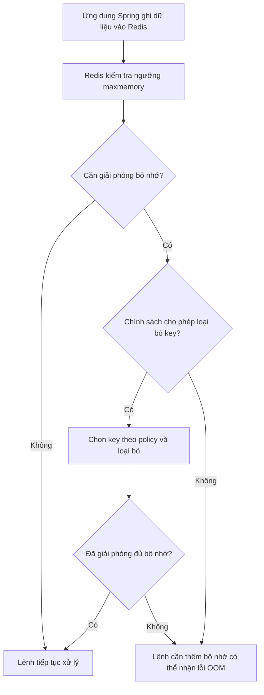

# Chính sách `maxmemory` và các nhóm eviction trong Redis

> **Ngữ cảnh:** Spring Data Redis · **Chương:** Hết hạn và loại bỏ  
> **Mục tiêu:** Hiểu Redis quyết định xóa key nào khi thiếu bộ nhớ, phân biệt eviction với TTL expiration, cấu hình chính sách đúng cho từng loại dữ liệu và nhận biết tác động tới ứng dụng Spring.

## 1. Vì sao Redis cần chính sách eviction?

Redis lưu phần lớn dữ liệu trong RAM. Với một ứng dụng Spring, Redis có thể phục vụ nhiều vai trò: bộ nhớ đệm kết quả truy vấn, dữ liệu phiên đăng nhập, giới hạn tần suất truy cập, bảng xếp hạng hoặc cấu trúc dữ liệu phục vụ nghiệp vụ. Những dữ liệu này có mức độ chấp nhận mất mát khác nhau.

Khi Redis được dùng làm cache, một key bị xóa sớm có thể chỉ gây **cache miss**: ứng dụng đọc lại dữ liệu từ nguồn gốc rồi tạo cache mới. Ngược lại, nếu Redis đang giữ dữ liệu nghiệp vụ không thể tạo lại, eviction có thể gây mất dữ liệu ngay cả khi key chưa hết TTL.

Hai cơ chế dễ bị nhầm lẫn:

- **Expiration (hết hạn):** Một key có TTL bị xóa khi thời điểm hết hạn đến. Nguyên nhân là **thời gian**, bất kể Redis còn nhiều hay ít RAM.
- **Eviction (loại bỏ vì áp lực bộ nhớ):** Redis chủ động loại bỏ key theo `maxmemory-policy` để lấy chỗ cho dữ liệu khi bộ nhớ bị giới hạn. Một key **chưa hết TTL** vẫn có thể bị eviction.

`maxmemory` thiết lập ngưỡng bộ nhớ Redis dùng để quyết định có cần eviction hay không; `maxmemory-policy` quyết định **những key nào đủ điều kiện** và **cách chọn key**. Hai thiết lập này thuộc **Redis server**, không thuộc `RedisTemplate`, `RedisCacheManager` hay cấu hình kết nối của Spring Boot.

### Luồng xử lý khái quát



Đây là sơ đồ khái niệm; Redis thực tế kiểm soát bộ nhớ theo quy trình xử lý lệnh của server, nên một lệnh lớn có thể khiến mức sử dụng bộ nhớ vượt ngưỡng tạm thời.

## 2. Cấu hình `maxmemory` và `maxmemory-policy`

### 2.1. Đặt giới hạn trong `redis.conf`

Ví dụ một Redis instance chuyên làm cache, giới hạn dữ liệu và bộ nhớ liên quan ở 512 MB, ưu tiên giữ những key được truy cập thường xuyên:

```conf
maxmemory 512mb
maxmemory-policy allkeys-lfu
maxmemory-samples 5
```

- `maxmemory 512mb`: Redis bắt đầu xử lý áp lực bộ nhớ khi vượt ngưỡng tương ứng.
- `maxmemory-policy allkeys-lfu`: Có thể loại bỏ bất kỳ key nào, ưu tiên loại những key có tần suất sử dụng thấp theo ước lượng LFU.
- `maxmemory-samples 5`: Số lượng mẫu được xem xét khi chọn ứng viên trong các thuật toán lấy mẫu. Tăng số mẫu thường cho kết quả gần thuật toán lý tưởng hơn, nhưng tốn thêm công xử lý.

Đặt `maxmemory 0` có nghĩa là không áp giới hạn bộ nhớ dữ liệu kiểu này; đây là mặc định trên hệ thống Redis 64-bit nếu không được cấu hình khác. **Không nên coi `0` là bảo đảm an toàn về RAM**: hệ điều hành hoặc container vẫn có giới hạn riêng.

Trong Redis Open Source, mặc định thông thường của `maxmemory-policy` là `noeviction`. Một số dịch vụ Redis được quản lý có thể cung cấp mặc định khác; hãy kiểm tra instance thực tế.

### 2.2. Thay đổi khi Redis đang chạy

```bash
redis-cli CONFIG GET maxmemory
redis-cli CONFIG GET maxmemory-policy
redis-cli CONFIG GET maxmemory-samples

redis-cli CONFIG SET maxmemory 512mb
redis-cli CONFIG SET maxmemory-policy allkeys-lfu
```

`CONFIG SET` thay đổi cấu hình đang chạy. Nếu quản trị Redis qua tệp cấu hình và muốn đồng bộ cấu hình động trở lại tệp, có thể xem xét `CONFIG REWRITE` trong môi trường cho phép. Với Redis Cloud hoặc Redis do nền tảng quản lý, cách cập nhật chính sách thường là qua bảng điều khiển/API của nhà cung cấp; `CONFIG SET` có thể bị hạn chế quyền.

Thay đổi policy ảnh hưởng **toàn bộ keyspace thuộc Redis instance** (hoặc từng shard trong Redis Cluster), không chỉ một cache name hay một Redis logical database. Trong Redis Cluster, mỗi shard chịu áp lực bộ nhớ và thực hiện eviction theo trạng thái của chính nó.

### 2.3. `maxmemory` không phải trần RAM tuyệt đối của tiến trình

Khi lập kế hoạch bộ nhớ, phải phân biệt:

- **Bộ nhớ Redis tính vào quyết định eviction:** bộ nhớ Redis theo dõi để so với `maxmemory`.
- **Bộ đệm replication/AOF:** một phần RAM phục vụ sao chép và ghi bền vững không được tính vào quyết định eviction nhằm tránh vòng lặp “evict → tạo thêm dữ liệu cho bộ đệm → evict tiếp”.
- **Memory fragmentation, chi phí allocator, cấu trúc nội bộ, tải lệnh lớn:** làm RAM tiến trình hoặc RAM hệ điều hành có thể vượt con số `maxmemory`.

`INFO memory` hiển thị `mem_not_counted_for_evict` để theo dõi lượng bộ nhớ không tính cho eviction, cùng các trường như `used_memory`, `used_memory_rss`, `used_memory_dataset` và `maxmemory`. Do đó, chỉ đặt `maxmemory` bằng toàn bộ RAM cấp cho container/máy chủ có thể tạo nguy cơ thiếu RAM thực tế. Cần chừa khoảng dự phòng cho thành phần ngoài dữ liệu và quan sát tải thật.

## 3. Phân loại tất cả các chính sách eviction

Có ba nhóm cần nhớ:

1. **`noeviction`:** không tự loại bỏ key để lấy chỗ.
2. **`allkeys-*`:** mọi key đều có thể trở thành nạn nhân, bất kể có TTL hay không.
3. **`volatile-*`:** chỉ những key đang có thời điểm hết hạn mới đủ điều kiện bị loại bỏ. Tên `volatile` ở đây nói tới **key có TTL**, không phải mọi dữ liệu chỉ lưu trong RAM.

### 3.1. Bảng tổng hợp

| Chính sách | Tập key được xét | Quy tắc chọn key để loại bỏ | Đặc điểm |
|---|---|---|---|
| `noeviction` | Không key nào | Từ chối những lệnh ghi cần thêm bộ nhớ khi không còn chỗ | Hữu ích nếu không chấp nhận mất key tự động; ứng dụng phải xử lý lỗi ghi |
| `allkeys-lru` | Tất cả key | Key ít được sử dụng gần đây nhất (*Least Recently Used*) | Điểm khởi đầu phổ biến cho cache |
| `allkeys-lfu` | Tất cả key | Key ít được sử dụng thường xuyên nhất (*Least Frequently Used*) | Phù hợp khi “key nóng” được truy cập lặp đi lặp lại |
| `allkeys-random` | Tất cả key | Chọn ngẫu nhiên | Đơn giản, không ưu tiên theo lịch sử truy cập |
| `allkeys-lrm` | Tất cả key | Key lâu không được sửa đổi nhất (*Least Recently Modified*) | Có từ **Redis 8.6**; ưu tiên thời điểm ghi thay vì thời điểm đọc |
| `volatile-lru` | Chỉ key có TTL | Ít được sử dụng gần đây nhất trong số key có TTL | Key không TTL được loại khỏi tập ứng viên |
| `volatile-lfu` | Chỉ key có TTL | Ít được sử dụng thường xuyên nhất trong số key có TTL | Giữ các key có TTL được truy cập nhiều hơn |
| `volatile-random` | Chỉ key có TTL | Chọn ngẫu nhiên trong số key có TTL | Không dùng lịch sử truy cập để ưu tiên |
| `volatile-ttl` | Chỉ key có TTL | Key có thời gian còn lại đến lúc hết hạn ngắn nhất | Ưu tiên bỏ key sắp hết hạn |
| `volatile-lrm` | Chỉ key có TTL | Key lâu không được sửa đổi nhất trong số key có TTL | Có từ **Redis 8.6** |

**Lưu ý phiên bản:** Redis trước 8.6 không hỗ trợ `allkeys-lrm` và `volatile-lrm`. Trước khi áp dụng lệnh hoặc ví dụ, xác định phiên bản đang chạy bằng `INFO server` hay `redis-cli INFO server`.

### 3.2. Ý nghĩa quyết định của `allkeys` và `volatile`

Giả sử Redis đang có:

```redis
SET app:feature-flags "v2"
SET cache:product:101 "{...}" EX 600
SET cache:product:102 "{...}" EX 120
```

- `app:feature-flags` không có TTL.
- `cache:product:101` có TTL 10 phút.
- `cache:product:102` có TTL 2 phút.

Khi `maxmemory` bị vượt:

- Với `allkeys-lru`, cả ba key đều có thể bị loại bỏ; tần suất truy cập và thời gian sử dụng gần nhất quyết định ưu tiên chọn.
- Với `volatile-lru`, chỉ hai key `cache:product:*` là ứng viên. `app:feature-flags` không có TTL sẽ không bị policy này chọn để eviction.
- Với `volatile-ttl`, khi các yếu tố khác phù hợp, `cache:product:102` được ưu tiên vì còn ít thời gian sống hơn.
- Với `noeviction`, Redis không chọn key nào. Những lệnh cần cấp phát thêm bộ nhớ có thể bị lỗi.

Điểm dễ gây sự cố: nếu chính sách là `volatile-lru` nhưng **không còn key có TTL nào có thể loại bỏ**, Redis không thể giải phóng bộ nhớ bằng eviction và có thể trả lỗi OOM khi ghi dữ liệu mới. Nó không tự chuyển sang loại bỏ key không TTL.

Ngoài ra, khi tất cả key là cache và tất cả đều được gắn TTL, `allkeys-lru` vẫn thường có lợi hơn `volatile-lru` nếu bạn muốn Redis chủ động chọn trên toàn bộ keyspace; `volatile-*` chỉ thật sự hữu ích khi việc **loại trừ key không TTL khỏi tập ứng viên** là một yêu cầu có chủ đích.

## 4. So sánh LRU, LFU, LRM, Random và TTL

Các thuật ngữ này là **tiêu chí lựa chọn**, độc lập với phạm vi `allkeys` hay `volatile`.

### 4.1. LRU — chú trọng lần truy cập gần đây

LRU ưu tiên giữ những key mới được sử dụng. Trong cache chứa thông tin người dùng, nếu key A được truy cập gần đây và key B lâu chưa có yêu cầu nào, B thường dễ bị chọn hơn.

Ví dụ theo trình tự:

```text
t1: GET product:A
t2: GET product:B
t3: GET product:A
t4: Áp lực bộ nhớ
```

Với các điều kiện tương đương, `product:B` dễ bị eviction hơn vì lần sử dụng gần nhất của nó cũ hơn.

Redis dùng **LRU xấp xỉ**, không lưu một danh sách LRU hoàn hảo cho mọi key. Server lấy mẫu các key và chọn ứng viên phù hợp, nhằm tiết kiệm bộ nhớ và chi phí cập nhật. Vì thế, kết quả từng lần eviction không phải lúc nào cũng là “key cũ nhất tuyệt đối”.

Khi phù hợp: cache có tính thời điểm, key được truy cập gần đây có khả năng sớm được truy cập lại, chẳng hạn dữ liệu trang sản phẩm, kết quả truy vấn hoặc nội dung của trang đang được người dùng quan tâm.

### 4.2. LFU — chú trọng tần suất truy cập

LFU ưu tiên giữ những key được truy cập nhiều lần. Giả sử:

- Key A được đọc 500 lần trong một khoảng thời gian.
- Key B vừa được đọc 1 lần.
- Key C hiếm khi được đọc.

Nếu dùng `allkeys-lfu`, A có nhiều khả năng được giữ lại hơn B và C, dù lần đọc B có thể mới hơn lần đọc A.

Redis không lưu bộ đếm chính xác vô hạn. LFU là **xấp xỉ xác suất** bằng một bộ đếm nhỏ, có cơ chế *decay* làm giảm ảnh hưởng của những truy cập quá xa trong quá khứ. Redis có các thông số:

```bash
redis-cli CONFIG GET lfu-log-factor
redis-cli CONFIG GET lfu-decay-time
```

`lfu-log-factor` chi phối độ nhạy tăng của bộ đếm; `lfu-decay-time` điều chỉnh tốc độ giảm mức độ “nóng” theo thời gian. Không nên tinh chỉnh chỉ dựa vào cảm giác: cần dựa vào phân phối truy cập và tỉ lệ cache hit trong tải thực tế.

Khi phù hợp: tập key có một nhóm nhỏ luôn được sử dụng nhiều, chẳng hạn danh mục hàng bán chạy hoặc cấu hình được đọc lặp lại ở tần suất cao.

### 4.3. LRM — chú trọng lần sửa đổi gần đây (Redis 8.6+)

LRM (*Least Recently Modified*) dựa trên thời điểm key được **sửa đổi gần nhất**. Khác với LRU, một lượt `GET` không làm key trở thành “vừa được sửa đổi”.

Ví dụ: key A được đọc liên tục nhưng giá trị không được cập nhật trong thời gian dài; key B vừa được thay đổi. Theo tiêu chí LRM, A có thể dễ bị loại bỏ hơn B dù A có nhiều lượt đọc.

LRM được giới thiệu trong Redis Open Source **8.6** với `allkeys-lrm` và `volatile-lrm`. Cơ chế này có ích khi độ mới của dữ liệu được đo qua **lần cập nhật**, chẳng hạn bản chụp nội dung, dữ liệu liên tục được làm mới hoặc một số cache cần ưu tiên giá trị vừa được tái tạo. Nó không đồng nghĩa với “cũ về nghiệp vụ”: lần ghi Redis mới nhất chỉ là một tín hiệu kỹ thuật.

### 4.4. Random — không dựa vào lịch sử

`allkeys-random` hoặc `volatile-random` chọn ứng viên ngẫu nhiên trong tập key đủ điều kiện. Khi các key tương đối đồng đều về giá trị và không có tín hiệu LRU/LFU hữu ích, random có thể là lựa chọn đơn giản. Đổi lại, nó có thể loại bỏ một key đang được sử dụng nhiều.

### 4.5. `volatile-ttl` — ưu tiên key sắp hết hạn

`volatile-ttl` chỉ xét key có TTL và chọn key có **thời gian sống còn lại ngắn hơn**. Đây không phải là cách “bật TTL” cho các key. TTL phải được đặt trước qua các lệnh như `SET ... EX`, `EXPIRE` hoặc API tương ứng trong Spring.

Ví dụ:

| Key | TTL còn lại | Có thể bị `volatile-ttl` ưu tiên? |
|---|---:|---|
| `cache:offer:1` | 15 giây | Có, cao nhất trong ba key |
| `cache:offer:2` | 10 phút | Có, nhưng kém ưu tiên hơn key còn 15 giây |
| `config:global` | Không có TTL | Không đủ điều kiện |

Việc xóa sớm vẫn là **eviction do bộ nhớ**, dù key sắp tới thời điểm hết hạn tự nhiên.

## 5. Khác nhau giữa expiration và eviction trong vòng đời key

Giả sử ứng dụng ghi:

```redis
SET cache:order:5001 "..." EX 900
TTL cache:order:5001
```

Key có TTL ban đầu khoảng 900 giây. Sau đó có thể xảy ra:

1. Redis còn đủ RAM, key không bị ghi đè: hết 900 giây, Redis xem key là expired và loại bỏ theo cơ chế expiration.
2. Redis thiếu RAM, policy có thể chọn key này: key bị evicted **trước 900 giây**.
3. Ứng dụng gọi `DEL cache:order:5001`: key bị xóa chủ động.
4. Ứng dụng ghi đè hoặc thay đổi TTL: thời điểm hết hạn có thể đổi tùy lệnh sử dụng.

`TTL key` cung cấp ba trạng thái đặc biệt quan trọng:

- Giá trị dương: số giây còn lại trước lúc key hết hạn.
- `-1`: key tồn tại nhưng **không có thời điểm hết hạn**.
- `-2`: key không tồn tại, có thể do chưa được ghi, đã expired, đã evicted hoặc bị xóa theo cách khác.

Chỉ riêng `TTL = -2` **không cho biết nguyên nhân key biến mất**. Muốn phân biệt xu hướng expiration và eviction, kết hợp thống kê Redis với log và luồng nghiệp vụ.

### Tại sao TTL không bảo đảm dữ liệu sống đủ thời gian?

Trong mô hình cache, TTL nên được hiểu là **thời gian sống tối đa mong muốn nếu không có yếu tố khác xóa key**. Eviction có quyền rút ngắn vòng đời này nếu policy cho phép. Vì vậy:

- Không dùng TTL như cam kết giữ dữ liệu đến đúng hạn.
- Không dùng Redis cache làm nguồn duy nhất chứa dữ liệu bắt buộc phải tồn tại.
- Luồng đọc cần xử lý cache miss hợp lệ bất kỳ lúc nào.

Nếu dữ liệu **phải tồn tại**, cần thiết kế lưu trữ bền vững thích hợp hoặc một Redis instance riêng với chiến lược dữ liệu, persistence, HA và giới hạn bộ nhớ tương ứng. Chọn `noeviction` chỉ tránh **tự động xóa vì maxmemory**; nó không thay thế persistence hay biện pháp bảo vệ trước mất dữ liệu.

## 6. Tích hợp với Spring Data Redis

### 6.1. Phân biệt cấu hình phía Spring và Redis server

Một ứng dụng Spring Boot thường có thông tin kết nối như sau:

```yaml
spring:
  data:
    redis:
      host: localhost
      port: 6379
      timeout: 2s
```

Các thuộc tính trên giúp ứng dụng kết nối Redis. Chúng **không tự thiết lập** `maxmemory` hoặc `maxmemory-policy`. Hai policy này phải được cấu hình trên Redis server hoặc dịch vụ Redis đang sử dụng.

Điều này càng quan trọng khi có nhiều service Spring dùng chung một Redis instance: một cấu hình server sẽ tác động tới tất cả, kể cả service không hề dùng `RedisCacheManager`.

### 6.2. Redis Cache: cấu hình TTL của từng cache

Với Spring Cache abstraction, bạn có thể quy định TTL ở lớp ứng dụng bằng `RedisCacheConfiguration`. Ví dụ Java:

```java
import java.time.Duration;
import java.util.Map;

import org.springframework.cache.annotation.EnableCaching;
import org.springframework.context.annotation.Bean;
import org.springframework.context.annotation.Configuration;
import org.springframework.data.redis.cache.RedisCacheConfiguration;
import org.springframework.data.redis.cache.RedisCacheManager;
import org.springframework.data.redis.connection.RedisConnectionFactory;

@Configuration
@EnableCaching
public class CacheConfiguration {

    @Bean
    RedisCacheManager cacheManager(RedisConnectionFactory connectionFactory) {
        RedisCacheConfiguration defaults =
                RedisCacheConfiguration.defaultCacheConfig()
                        .entryTtl(Duration.ofMinutes(15))
                        .disableCachingNullValues();

        RedisCacheConfiguration productCache =
                defaults.entryTtl(Duration.ofHours(2));

        return RedisCacheManager.builder(connectionFactory)
                .cacheDefaults(defaults)
                .withInitialCacheConfigurations(
                        Map.of("products", productCache))
                .build();
    }
}
```

Khi một phương thức sử dụng `@Cacheable(cacheNames = "products")`, các entry được ghi vào cache `products` có TTL tương ứng 2 giờ theo cấu hình trên. Những cache khác dùng mặc định 15 phút.

**Các điểm cần hiểu:**

- `entryTtl(...)` thiết lập **expiration** cho entry cache, không lựa chọn key để eviction khi thiếu RAM.
- Redis server vẫn áp dụng `maxmemory-policy` cho tất cả key. Entry cache có TTL 2 giờ vẫn có thể bị evicted sau vài phút.
- `RedisCacheConfiguration.defaultCacheConfig()` mặc định **không có expiration**; nếu không thêm TTL, entry có thể tồn tại vô hạn về thời gian. Với policy `volatile-*`, các entry **không có TTL** sẽ không phải ứng viên eviction.
- TTL thường được đặt lại khi tạo/ghi cập nhật entry. Đọc cache đơn thuần không tự làm TTL quay về giá trị ban đầu. Spring Data Redis các phiên bản hỗ trợ có cơ chế time-to-idle mô phỏng thông qua `enableTimeToIdle()` và `GETEX` khi cấu hình riêng; đó là hành vi khác với TTL thông thường.

Một phương thức ứng dụng minh họa cách tái tạo dữ liệu sau cache miss:

```java
import org.springframework.cache.annotation.Cacheable;
import org.springframework.stereotype.Service;

@Service
public class ProductService {

    private final ProductRepository repository;

    public ProductService(ProductRepository repository) {
        this.repository = repository;
    }

    @Cacheable(cacheNames = "products", key = "#id")
    public Product findById(Long id) {
        return repository.findById(id)
                .orElseThrow();
    }
}
```

Ở đây `Product` và `ProductRepository` là các kiểu thuộc tầng domain/persistence của ứng dụng. Khi cache miss vì expiration **hoặc** eviction, Spring Cache gọi phương thức thật để tải lại dữ liệu, sau đó có thể lưu kết quả vào cache. Nếu phương thức phải truy vấn cơ sở dữ liệu tốn kém, eviction quá mạnh sẽ làm tăng tải và độ trễ.

### 6.3. `StringRedisTemplate`: gắn TTL trực tiếp

Khi cần thao tác key trực tiếp, dùng `StringRedisTemplate`:

```java
import java.time.Duration;

import org.springframework.data.redis.core.StringRedisTemplate;
import org.springframework.stereotype.Service;

@Service
public class ProductSnapshotCache {

    private final StringRedisTemplate redis;

    public ProductSnapshotCache(StringRedisTemplate redis) {
        this.redis = redis;
    }

    public void put(String id, String json) {
        redis.opsForValue().set(
                "snapshot:product:" + id,
                json,
                Duration.ofMinutes(30));
    }

    public String get(String id) {
        return redis.opsForValue().get("snapshot:product:" + id);
    }
}
```

`put` tạo hoặc cập nhật key với TTL 30 phút. Nếu Redis dùng `volatile-lru`, key này thuộc tập ứng viên eviction; nếu dùng `allkeys-lru`, nó cũng thuộc tập ứng viên cùng với cả các key không có TTL.

Đặt TTL qua `StringRedisTemplate`, `RedisTemplate`, `@TimeToLive` hoặc Spring Cache là quyết định **vòng đời dữ liệu theo thời gian**. Chọn `allkeys-*` hay `volatile-*` là quyết định **quản lý áp lực bộ nhớ tại Redis server**. Hai cơ chế phối hợp nhưng không thay thế nhau.

### 6.4. Một điểm quan trọng với Spring Data Redis repositories

Những entity được lưu qua Spring Data Redis repositories, chẳng hạn entity có `@RedisHash`, có thể là dữ liệu nghiệp vụ chứ không phải bản sao cache. Việc chúng có hay không có TTL phụ thuộc cấu hình entity và cách ứng dụng lưu trữ.

Nếu cùng instance đang dùng `allkeys-lru`, một entity repository **không có TTL** vẫn có thể bị evicted. Nếu dùng `volatile-lru`, entity không TTL được loại khỏi tập ứng viên nhưng các key cache có TTL có thể bị xóa liên tục và sau đó Redis có thể báo OOM nếu không còn ứng viên. Cách thiết kế ổn định hơn thường là **tách cache có thể tái tạo và dữ liệu phải giữ**, đồng thời xác định rõ nguồn dữ liệu chuẩn.

## 7. Chọn policy theo bài toán

| Mô hình sử dụng | Chính sách nên cân nhắc | Lý do và giới hạn |
|---|---|---|
| Redis chỉ lưu cache, phần lớn truy cập tập trung vào một số key vừa dùng | `allkeys-lru` | Đơn giản, giữ key được dùng gần đây; không cần gắn TTL chỉ để được phép eviction |
| Redis chỉ lưu cache, một nhóm key nóng có tần suất đọc rất cao | `allkeys-lfu` | Giữ các key thường xuyên được sử dụng; có thể hiệu quả hơn LRU với một số workload |
| Cache cần ưu tiên dữ liệu vừa cập nhật, Redis 8.6+ | `allkeys-lrm` | Đo độ mới của lần ghi thay vì lần đọc |
| Cache có truy cập gần như đồng đều, mọi key có giá trị tương đương | `allkeys-random` | Có thể đủ đơn giản, nhưng cần đo hit ratio để xác nhận |
| Cùng instance có key không TTL cần bảo vệ khỏi eviction và cache có TTL | `volatile-lru` / `volatile-lfu` | Chỉ chọn cache có TTL; cần chấp nhận OOM khi không còn key đủ điều kiện |
| Có chủ đích ưu tiên bỏ key gần hết hạn | `volatile-ttl` | Hiệu quả khi TTL phản ánh mức độ sẵn sàng loại bỏ; không phù hợp mọi workload |
| Dữ liệu không thể mất qua eviction, ứng dụng có cách xử lý áp lực bộ nhớ | `noeviction` | Chặn tự động loại key nhưng lệnh ghi có thể lỗi OOM; vẫn cần dự phòng, persistence và vận hành |
| Redis chứa cả session quan trọng lẫn cache có thể tái tạo | Tách instance/keyspace theo yêu cầu độ tin cậy | Một policy chung khó đáp ứng đồng thời chính sách lưu giữ khác nhau; tách namespace không tách được eviction |

Không có chính sách tối ưu cho mọi hệ thống. LRU dự đoán dựa vào **độ gần đây**, LFU dự đoán dựa vào **mức độ phổ biến**, LRM dựa vào **độ mới của cập nhật**. Đo mức cache miss, tải database gốc và bộ nhớ mới giúp kết luận policy nào phù hợp.

## 8. Ví dụ thực hành trên Redis riêng cho môi trường học

Sử dụng một Redis tạm thời trên cổng `6380` để tránh tác động instance đang có dữ liệu:

```bash
docker run --rm --name redis-eviction-lab -p 6380:6379 redis:8.6 \
  redis-server --maxmemory 16mb --maxmemory-policy allkeys-lru

# Trong terminal khác:
redis-cli -p 6380 CONFIG GET maxmemory
redis-cli -p 6380 CONFIG GET maxmemory-policy
redis-cli -p 6380 SET lab:no-ttl "permanent"
redis-cli -p 6380 SET lab:ttl-60 "short" EX 60
redis-cli -p 6380 TTL lab:no-ttl
redis-cli -p 6380 TTL lab:ttl-60
redis-cli -p 6380 INFO stats
```

Dòng nối lệnh bằng `\` được viết cho shell kiểu Linux/macOS. Trên PowerShell, có thể viết `docker run` trên một dòng.

Khi chỉ lưu vài key nhỏ, Redis chưa chạm ngưỡng 16 MB nên **không có lý do để eviction**. Để quan sát eviction, cần nạp lượng dữ liệu đủ lớn vào instance thử nghiệm rồi theo dõi chênh lệch của `evicted_keys`; không nên giảm `maxmemory` tùy tiện trên Redis có dữ liệu thật.

Có thể đổi chính sách trong lab và xem các key nào đủ điều kiện:

```bash
redis-cli -p 6380 CONFIG SET maxmemory-policy volatile-lru
redis-cli -p 6380 CONFIG GET maxmemory-policy

redis-cli -p 6380 SET lab:ttl-600 "long" EX 600
redis-cli -p 6380 TTL lab:ttl-600
redis-cli -p 6380 TTL lab:no-ttl
```

Kỳ vọng về **tập ứng viên**: key `lab:no-ttl` không có TTL nên `volatile-lru` không chọn nó; `lab:ttl-60` và `lab:ttl-600` là ứng viên nếu còn tồn tại và TTL chưa hết. Ví dụ này cho thấy quy tắc lựa chọn, **không khẳng định một key cụ thể sẽ bị xóa** vì Redis dùng thuật toán gần đúng và còn phụ thuộc mức bộ nhớ, thời điểm truy cập.

## 9. Giám sát eviction trong ứng dụng thực tế

### 9.1. Lệnh quan sát quan trọng

```bash
redis-cli INFO memory
redis-cli INFO stats
redis-cli INFO keyspace
redis-cli INFO commandstats
redis-cli CONFIG GET maxmemory
redis-cli CONFIG GET maxmemory-policy
```

| Chỉ số | Nói lên điều gì? | Cách diễn giải |
|---|---|---|
| `maxmemory` | Ngưỡng cấu hình để kích hoạt xử lý áp lực bộ nhớ | Xác nhận đúng giá trị trên từng instance/shard |
| `maxmemory_policy` | Chính sách eviction đang áp dụng | Đối chiếu với loại dữ liệu thực tế |
| `used_memory` | Bộ nhớ Redis đang phân bổ theo thống kê của Redis | So sánh theo thời gian, không dùng một mình làm số RAM tiến trình |
| `used_memory_rss` | Bộ nhớ cư trú của tiến trình trong RAM theo OS | Có thể lệch `used_memory` vì fragmentation và các yếu tố khác |
| `mem_not_counted_for_evict` | Bộ nhớ không tính vào quyết định eviction | Quan trọng khi dùng replication/AOF |
| `evicted_keys` | Tổng số key bị loại bỏ bởi eviction kể từ lần khởi động/thống kê lại | Theo dõi **mức tăng theo thời gian**, không chỉ tổng tuyệt đối |
| `expired_keys` | Tổng số key bị xóa vì hết hạn | Phân biệt xu hướng hết hạn tự nhiên với eviction |
| `keyspace_hits` / `keyspace_misses` | Số lượt tìm key thành công/thất bại | Dùng đánh giá mức độ hiệu quả cache cùng với số liệu ứng dụng |
| `current_eviction_exceeded_time` | Thời gian Redis đang liên tục ở trạng thái vượt ngưỡng | Hỗ trợ phát hiện tình trạng áp lực bộ nhớ kéo dài |

Hit ratio tham khảo trên cùng cửa sổ đo:

```text
hit_ratio = delta(keyspace_hits) /
            (delta(keyspace_hits) + delta(keyspace_misses))
```

Mẫu số bằng 0 thì chưa đủ lượt tra cứu để tính. Các bộ đếm Redis có thể bao gồm tra cứu của nhiều ứng dụng dùng chung instance và không thay thế metric cache hit/miss ở tầng nghiệp vụ.

### 9.2. Tình huống chẩn đoán

**Tình huống A: `evicted_keys` tăng nhanh, cache hit giảm**

Redis đang loại nhiều key để lấy chỗ. Có thể dữ liệu tăng quá giới hạn, TTL dài bất hợp lý, tập working set lớn hơn RAM hoặc policy không phù hợp mô hình truy cập. Cần xem tải nguồn dữ liệu gốc, độ trễ, kích thước các loại key và thay đổi hit/miss trước khi kết luận chỉ cần tăng `maxmemory`.

**Tình huống B: Lệnh ghi báo `OOM command not allowed when used memory > 'maxmemory'`**

Xác định `maxmemory-policy`. Nếu là `noeviction`, hành vi từ chối ghi khi không đủ chỗ là điều dự kiến. Nếu là `volatile-*`, kiểm tra có key **đang có TTL** đủ điều kiện hay không. Đừng nhầm số lượng key lớn với khả năng eviction: một triệu key không TTL vẫn không phải ứng viên của `volatile-*`.

Trong Spring, lỗi OOM từ Redis có thể được driver và tầng truy cập dữ liệu chuyển thành exception. Luồng gọi Redis phải có xử lý lỗi phù hợp: với cache có thể dùng fallback hợp lệ; với thao tác cần ghi chắc chắn thì phải báo lỗi và bảo đảm không lặng lẽ mất kết quả nghiệp vụ.

**Tình huống C: `expired_keys` cao nhưng `evicted_keys` thấp**

Nhiều key tự hết hạn theo TTL, còn áp lực bộ nhớ do eviction không nhất thiết lớn. Kiểm tra xem TTL có quá ngắn so với nhu cầu đọc lại dữ liệu hay không. Tăng `maxmemory` có thể không giải quyết được cache miss đến từ expiration.

**Tình huống D: Redis bị thiếu RAM dù đã đặt `maxmemory`**

Kiểm tra `used_memory_rss`, `mem_not_counted_for_evict`, allocator/fragmentation, bộ đệm, chi phí của persistence và giới hạn tài nguyên container. `maxmemory` là cơ chế điều tiết dữ liệu, không là giới hạn cưỡng chế toàn bộ RAM tiến trình.

## 10. Những sai lầm thường gặp

### 10.1. Cho rằng key có TTL sẽ không bị xóa trước hạn

Sai. TTL không miễn nhiễm với eviction. Với policy `allkeys-*` hay `volatile-*`, một key có TTL vẫn có thể biến mất sớm. Khi ứng dụng đọc dữ liệu, mọi cache miss hợp lệ phải được xử lý.

### 10.2. Cho rằng `volatile-lru` chọn mọi key trong bộ nhớ

Sai. Nó chỉ chọn key đang có TTL. Key được ghi bằng `SET key value` mà không có `EX`/`PX` hoặc `EXPIRE` sẽ không đủ điều kiện, dù giá trị được ghi nhiều ngày trước.

### 10.3. Cho rằng `allkeys-lru` chỉ loại key có TTL

Sai. `allkeys-*` xem cả key không TTL là ứng viên. Một key session, job state hoặc domain entity không có TTL cũng có thể biến mất nếu lưu chung instance.

### 10.4. Cố dùng `noeviction` để chữa mọi lỗi thiếu bộ nhớ

`noeviction` giúp tránh tự động loại key nhưng chuyển áp lực sang **lỗi lệnh ghi**. Với hệ thống không chịu được lỗi ghi, cần lập kế hoạch dung lượng, cảnh báo, giảm dữ liệu thừa và cách khôi phục; chỉ đổi policy là chưa đủ.

### 10.5. Đổi TTL để thay đổi thứ tự `allkeys-lru`

Thời gian hết hạn và lịch sử truy cập là hai tín hiệu khác nhau. `allkeys-lru` chọn theo sử dụng gần đây, không ưu tiên key có TTL ngắn nhất; nếu chủ đích chọn theo TTL còn lại thì đó là `volatile-ttl`.

### 10.6. Nhầm namespace Spring Cache với phạm vi policy

`products::123` và `users::456` chỉ là cách đặt tên key ở ứng dụng. Redis không tự áp policy riêng cho từng prefix. Cấu hình `maxmemory-policy` có phạm vi instance/shard. Muốn ngân sách bộ nhớ hoặc mức chấp nhận mất mát khác nhau, cần tách hạ tầng hoặc thiết kế phân vùng phù hợp.

## 11. Tóm lược cách quyết định

Hãy bắt đầu từ câu hỏi: **Dữ liệu nào có thể tạo lại khi bị xóa?** Nếu toàn bộ key là cache, `allkeys-lru` là lựa chọn dễ hiểu; cân nhắc `allkeys-lfu` khi phổ biến theo tần suất truy cập, hoặc `allkeys-lrm` trên Redis 8.6+ nếu quan trọng thời điểm thay đổi. Nếu bạn cố ý giữ key không có TTL ngoài phạm vi eviction, các policy `volatile-*` đáp ứng nhưng có rủi ro OOM khi thiếu ứng viên. Nếu không chấp nhận tự xóa bất kỳ key nào, `noeviction` khiến việc quản lý dung lượng và xử lý lỗi ghi trở thành trách nhiệm bắt buộc của ứng dụng/vận hành.

Trong Spring Data Redis, hãy thiết kế **TTL tại tầng cache** bằng `RedisCacheConfiguration`, `RedisTemplate` hoặc cơ chế tương ứng, và thiết kế **eviction tại Redis server** bằng `maxmemory` cùng `maxmemory-policy`. Kết hợp theo dõi `evicted_keys`, `expired_keys`, hit ratio, latency và RAM để điều chỉnh dựa trên tải thật.

## Tài liệu tham khảo

- Redis — [Key eviction](https://redis.io/docs/latest/reference/eviction/): `maxmemory`, nhóm policy, LRU/LFU xấp xỉ, bộ nhớ không tính cho eviction.
- Redis — [Redis 8.6](https://redis.io/docs/latest/develop/whats-new/8-6/): hai chính sách `allkeys-lrm` và `volatile-lrm`.
- Redis — [INFO command](https://redis.io/docs/latest/commands/info/): thống kê bộ nhớ, eviction, expiration và keyspace hit/miss.
- Spring Data Redis — [Redis Cache](https://docs.spring.io/spring-data/redis/reference/redis/redis-cache.html): `RedisCacheManager`, TTL và TTI của cache entry.
