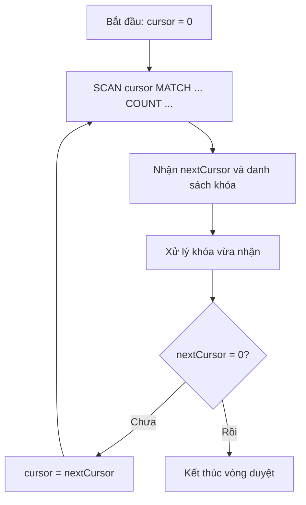

# Duyệt khóa bằng SCAN và quản lý Cursor trong Spring Data Redis

Khi Redis chứa hàng trăm nghìn hoặc hàng triệu khóa, ứng dụng thường cần tìm những khóa có chung tiền tố để thống kê, kiểm tra dữ liệu hoặc dọn dẹp cache. Spring Data Redis cung cấp API `scan()` dựa trên lệnh `SCAN` của Redis để duyệt dần tập khóa, cùng đối tượng `Cursor` để quản lý quá trình duyệt và tài nguyên kết nối.

Bài học này tập trung vào **duyệt khóa trong keyspace bằng `SCAN`**, hiểu chính xác trạng thái con trỏ, cấu hình `MATCH`/`COUNT`/`TYPE`, sử dụng `StringRedisTemplate` và đóng `Cursor` đúng cách. Cuối bài cũng phân biệt `SCAN` với `HSCAN`, `SSCAN` và `ZSCAN`, đồng thời chỉ ra các giới hạn cần tính đến khi chạy tác vụ thực tế.

## 1. Vì sao không nên dùng KEYS để duyệt lượng lớn khóa?

Redis hỗ trợ lệnh:

```redis
KEYS session:*
```

`KEYS` tìm tất cả khóa khớp mẫu và trả kết quả trong một lần gọi. Trên một keyspace lớn, thao tác này có thể chiếm CPU của Redis trong thời gian đáng kể, làm tăng độ trễ cho các yêu cầu khác. Ngoài ra, ứng dụng phải tiếp nhận toàn bộ danh sách khóa cùng lúc.

`SCAN` chia việc duyệt thành nhiều lần gọi nhỏ:

```redis
SCAN 0 MATCH session:* COUNT 100
```

Mỗi lần gọi xử lý một phần keyspace và trả về **con trỏ tiếp theo** cùng những khóa tìm được trong lần đó. Ứng dụng tiếp tục gọi cho đến khi Redis trả con trỏ `0`.

| Tiêu chí | `KEYS` | `SCAN` |
|---|---|---|
| Cách lấy dữ liệu | Một lần trả danh sách khớp mẫu | Nhiều lần lấy dần các phần tử |
| Tác động trên keyspace lớn | Một lệnh có thể giữ Redis bận lâu | Có thể điều chỉnh lượng công việc mỗi lần gọi |
| Bộ nhớ phía ứng dụng | Dễ giữ toàn bộ kết quả trong RAM | Có thể xử lý từng khóa hoặc theo lô |
| Trùng lặp kết quả | Danh sách của một lệnh | Có thể gặp lại cùng một khóa |
| Ảnh chụp nhất quán của keyspace | Không phải snapshot giao dịch | Không phải snapshot giao dịch |
| Trường hợp phù hợp | Chẩn đoán tập dữ liệu nhỏ, môi trường kiểm soát | Duyệt dần, tác vụ quản trị, xử lý theo lô |

**Lưu ý:** `SCAN` giảm thời gian chiếm dụng Redis của *mỗi lần gọi*, nhưng không làm toàn bộ công việc trở thành O(1). Một vòng duyệt hết keyspace vẫn có độ phức tạp tổng thể xấp xỉ O(N), với N là số phần tử được duyệt.

## 2. Redis SCAN hoạt động như thế nào?

### 2.1. Cú pháp và vòng đời của con trỏ

```text
SCAN cursor [MATCH pattern] [COUNT count] [TYPE type]
```

Giả sử Redis có các khóa `session:1`, `session:2`, `session:3` cùng nhiều khóa khác. Một phiên làm việc *minh họa* có thể như sau:

```text
> SCAN 0 MATCH session:* COUNT 2
1) "14"                         # Cursor để tiếp tục
2) 1) "session:2"               # Các khóa trả về lần này
   2) "session:1"

> SCAN 14 MATCH session:* COUNT 2
1) "0"                          # Vòng duyệt đã kết thúc
2) 1) "session:3"
```

Giá trị con trỏ và số khóa trong mỗi lần gọi chỉ là ví dụ; kết quả thực tế phụ thuộc dữ liệu và cấu trúc nội bộ của Redis.

Quy tắc duyệt:

1. **Khởi đầu bằng `0`** để mở một vòng duyệt mới.
2. Gửi lại **chính con trỏ Redis vừa trả về** ở lần gọi kế tiếp.
3. Xử lý danh sách khóa nhận được, kể cả khi danh sách rỗng.
4. **Chỉ kết thúc khi con trỏ trả về bằng `0`**.



Điều dễ nhầm nhất là một lần `SCAN` có thể trả **0 khóa nhưng cursor khác 0**. Tình huống này thường xuất hiện khi mẫu `MATCH` chỉ khớp rất ít khóa. Không được dùng điều kiện “danh sách rỗng” để kết thúc vòng lặp.

### 2.2. Cursor là gì?

Ở mức lệnh Redis, cursor là một giá trị do Redis trả về để xác định cách tiếp tục vòng duyệt. Nó **không phải số thứ tự trang**, không phải vị trí ổn định trong một danh sách đã sắp xếp, và không đại diện cho một snapshot cố định.

Ở mức Spring Data Redis, `Cursor<T>` là một bộ duyệt kiểu Java `Iterator` có khả năng đóng tài nguyên:

```java
try (Cursor<String> cursor = redisTemplate.scan(options)) {
    while (cursor.hasNext()) {
        String key = cursor.next();
        // Xử lý key.
    }
}
```

Spring Data Redis tự gọi các đợt `SCAN` tiếp theo trong quá trình duyệt, thay vì buộc chương trình viên tự truyền cursor dạng số. Đối tượng `Cursor` có thể giữ tài nguyên liên quan đến kết nối Redis; vì vậy phải đóng nó ngay cả khi chỉ đọc một phần kết quả hoặc có ngoại lệ.

Một lượt duyệt có thể dừng sớm. Redis không cần thông báo “hủy cursor” ở phía server vì lệnh `SCAN` không duy trì phiên kết quả có trạng thái trên server; tuy nhiên **đối tượng Cursor của Spring vẫn cần `close()`** để giải phóng tài nguyên phía client.

## 3. Các tùy chọn MATCH, COUNT và TYPE

### MATCH — lọc theo mẫu

```redis
SCAN 0 MATCH user:profile:* COUNT 200
```

`MATCH` dùng cú pháp glob của Redis, ví dụ:

| Mẫu | Ý nghĩa |
|---|---|
| `session:*` | Các khóa bắt đầu bằng `session:` |
| `order:2026:*` | Các khóa thuộc không gian tên `order:2026:` |
| `cache:user:?` | Một ký tự bất kỳ sau `cache:user:` |
| `item:[abc]*` | Bắt đầu bằng `item:a`, `item:b` hoặc `item:c` |

`MATCH` **lọc kết quả sau khi Redis đã duyệt các vị trí trong keyspace**. Nó không biến việc tìm theo tiền tố thành truy vấn có chỉ mục, nên một mẫu rất hẹp vẫn có thể phải đi qua phần lớn keyspace. Redis có thể trả đợt rỗng dù còn nhiều vị trí cần duyệt.

### COUNT — gợi ý mức công việc của một lần gọi

```redis
SCAN 0 MATCH session:* COUNT 500
```

`COUNT 500` là **gợi ý**, không phải “lấy đúng 500 khóa”, “tối đa 500 khóa” hay `LIMIT 500`. Một lượt có thể trả ít hơn, nhiều hơn, hoặc không có khóa nào. Mặc định Redis sử dụng gợi ý `COUNT 10` nếu không khai báo.

Không tồn tại một giá trị `COUNT` tối ưu cho mọi hệ thống. Có thể bắt đầu thử với vài trăm trên tác vụ quản trị rồi điều chỉnh dựa trên độ trễ Redis, kích thước dữ liệu, số lần round trip và lưu lượng sản xuất. Giá trị quá cao có thể tạo một lệnh nặng và một phản hồi lớn; quá thấp có thể gây quá nhiều lần trao đổi qua mạng.

### TYPE — lọc loại dữ liệu

Redis hỗ trợ `TYPE` cho lệnh `SCAN` toàn keyspace từ Redis 6.0:

```redis
SCAN 0 MATCH cache:* COUNT 200 TYPE string
```

Trong Spring Data Redis, có thể khai báo:

```java
import org.springframework.data.redis.connection.DataType;
import org.springframework.data.redis.core.ScanOptions;

ScanOptions options = ScanOptions.scanOptions()
        .match("cache:*")
        .count(200)
        .type(DataType.STRING)
        .build();
```

Tùy chọn này phụ thuộc phiên bản Redis và driver. `TYPE` chỉ áp dụng cho `SCAN` keyspace, không áp dụng tương tự cho `HSCAN`/`SSCAN`/`ZSCAN`. Redis lọc theo kiểu lưu trữ bên dưới; ví dụ dữ liệu dạng bitmap cũng được lưu dưới kiểu `string`.

## 4. Duyệt khóa bằng Spring Data Redis

### 4.1. Dùng StringRedisTemplate và try-with-resources

Với khóa dạng văn bản như `session:123` hoặc `cache:product:42`, `StringRedisTemplate` là lựa chọn thuận tiện vì sử dụng serializer chuỗi cho khóa và giá trị.

Ví dụ một service cho phép xử lý dần các khóa phiên:

```java
import java.util.function.Consumer;

import org.springframework.data.redis.core.Cursor;
import org.springframework.data.redis.core.ScanOptions;
import org.springframework.data.redis.core.StringRedisTemplate;
import org.springframework.stereotype.Service;

@Service
public class SessionKeyScanner {

    private final StringRedisTemplate redisTemplate;

    public SessionKeyScanner(StringRedisTemplate redisTemplate) {
        this.redisTemplate = redisTemplate;
    }

    public long forEachSessionKey(Consumer<String> action) {
        ScanOptions options = ScanOptions.scanOptions()
                .match("session:*")
                .count(500)
                .build();

        long visits = 0;

        try (Cursor<String> cursor = redisTemplate.scan(options)) {
            while (cursor.hasNext()) {
                String key = cursor.next();
                action.accept(key);
                visits++;
            }
        }

        return visits;
    }
}
```

Cách gọi minh họa:

```java
long visits = scanner.forEachSessionKey(key -> {
    // Ví dụ: kiểm tra metadata hoặc gửi key sang bộ xử lý theo lô.
    processKey(key);
});
```

Trong đoạn code trên:

- `ScanOptions` điều khiển mẫu khóa và gợi ý lượng công việc.
- `redisTemplate.scan(options)` tạo một `Cursor<String>` để Spring lấy dữ liệu dần.
- `hasNext()`/`next()` duyệt qua các khóa; Spring có thể gửi thêm lệnh `SCAN` khi cần.
- `try-with-resources` đảm bảo đóng `Cursor` cả khi `action.accept(key)` ném ngoại lệ.
- `visits` đếm **số lần khóa xuất hiện trong kết quả**, không bảo đảm bằng số khóa khác nhau vì `SCAN` có thể trả trùng.

Ví dụ phù hợp với ứng dụng Spring Boot đã cấu hình kết nối Redis. Nếu chỉ cần đi qua các khóa và xử lý từng khóa, cách này giúp tránh tạo một `List<String>` chứa toàn bộ keyspace.

### 4.2. Khi dùng RedisTemplate<K, V> thông thường

Với `RedisTemplate<String, MyValue>`, kiểu trả về của `scan()` vẫn là `Cursor<String>` nếu khóa có kiểu `String`. Tuy nhiên, **kiểu Java của khóa không quyết định cách Redis lưu byte**: `keySerializer` mới là thành phần quyết định.

Nếu template dùng JDK serialization cho khóa, mẫu `session:*` có thể không khớp với những khóa lưu dưới dạng byte đã được tuần tự hóa, dù phía Java thấy tên khóa là chuỗi. Với không gian tên khóa dạng văn bản, nên dùng `StringRedisTemplate` hoặc cấu hình `StringRedisSerializer` nhất quán từ lúc ghi đến lúc quét.

### 4.3. ReactiveRedisTemplate

Trong ứng dụng Reactive, `ReactiveRedisTemplate` cung cấp `scan(options)` trả về `Flux<K>`. Có thể kết hợp với chuỗi xử lý không chặn:

```java
import reactor.core.publisher.Mono;
import org.springframework.data.redis.core.ScanOptions;
import org.springframework.data.redis.core.ReactiveStringRedisTemplate;

public class ReactiveSessionScanner {
    private final ReactiveStringRedisTemplate redis;
    private final SessionHandler handler;

    public ReactiveSessionScanner(
            ReactiveStringRedisTemplate redis,
            SessionHandler handler) {
        this.redis = redis;
        this.handler = handler;
    }

    public Mono<Void> processSessions() {
        ScanOptions options = ScanOptions.scanOptions()
                .match("session:*")
                .count(200)
                .build();

        return redis.scan(options)
                .concatMap(handler::handle) // handle(String) trả về Mono<Void>
                .then();
    }
}
```

Ở đây `SessionHandler` là abstraction ví dụ do ứng dụng định nghĩa. `concatMap` giúp giữ thứ tự xử lý từng phần tử và giới hạn mức đồng thời của handler trong ví dụ. Với reactive, tránh gọi `block()` bên trong pipeline; quản lý vòng đời bằng subscription, completion và cancellation.

## 5. Quản lý vòng đời Cursor an toàn

Trong ứng dụng Java, việc quản lý `Cursor` quan trọng không kém cách chọn `MATCH`/`COUNT`.

### Nguyên tắc 1: Đóng Cursor ở mọi nhánh thực thi

**Đúng:**

```java
try (Cursor<String> cursor = redisTemplate.scan(options)) {
    while (cursor.hasNext()) {
        String key = cursor.next();
        if (shouldStop(key)) {
            break; // Cursor vẫn được đóng tự động.
        }
    }
}
```

**Không nên:**

```java
Cursor<String> cursor = redisTemplate.scan(options);
while (cursor.hasNext()) {
    processKey(cursor.next());
}
// Thiếu close(): có nguy cơ giữ tài nguyên kết nối.
```

Tương tự, không nên trả `Cursor` chưa đóng ra khỏi service hoặc giữ nó trong một singleton để xử lý ở thời điểm khác. Cursor thích hợp với một phạm vi công việc ngắn, có nơi sở hữu và đóng tài nguyên rõ ràng.

### Nguyên tắc 2: Phân biệt Cursor phía Redis và Cursor phía Spring

| Khái niệm | Ý nghĩa |
|---|---|
| Con trỏ trong `SCAN 0` | Giá trị Redis trả về để gửi lại ở lần gọi tiếp theo |
| `Cursor<T>` của Spring | Iterator phía Java che giấu các lần gọi tiếp theo và quản lý tài nguyên |
| `cursor.hasNext()` | Kiểm tra và có thể nạp thêm phần tử từ Redis |
| `cursor.close()` | Giải phóng tài nguyên liên quan đến quá trình quét |
| Con trỏ `0` trả từ Redis | Dấu hiệu vòng duyệt Redis đã kết thúc |

Không dùng `0` làm “trang số 0” trong giao diện người dùng. Nó vừa là giá trị mở đầu vừa là giá trị kết thúc vòng duyệt ở mức giao thức, tùy vị trí sử dụng.

### Nguyên tắc 3: Không chia sẻ một Cursor đồng thời giữa nhiều luồng

Một `Cursor` là bộ duyệt trạng thái, không phải hàng đợi thread-safe. Nếu nhiều worker cần chạy độc lập, hãy chia công việc bằng những tập khóa hoặc partition rõ ràng; việc đồng thời gọi `next()` trên cùng cursor có thể làm rối trạng thái duyệt và quản lý kết nối.

### Nguyên tắc 4: Giới hạn tuổi thọ và lượng công việc

Việc xử lý từng khóa rất chậm khiến cursor mở lâu, có thể chiếm một kết nối trong pool trong suốt lượt duyệt. Tác vụ quản trị nên có giới hạn thời gian, cơ chế hủy và điều chỉnh tốc độ xử lý; nếu công việc kéo dài, cân nhắc tách bước phát hiện khóa khỏi bước thực thi bằng hàng đợi/job worker.

## 6. Duyệt Hash, Set và Sorted Set

Họ lệnh `SCAN` gồm bốn lệnh, mỗi lệnh duyệt một phạm vi khác nhau:

| Lệnh Redis | API Spring Data Redis | Đối tượng nhận được |
|---|---|---|
| `SCAN` | `redisTemplate.scan(options)` | Các **tên khóa** trong database |
| `HSCAN` | `redisTemplate.opsForHash().scan(key, options)` | Các cặp **field/value** của một Hash |
| `SSCAN` | `redisTemplate.opsForSet().scan(key, options)` | Các **member** của một Set |
| `ZSCAN` | `redisTemplate.opsForZSet().scan(key, options)` | Các **member và score** của một Sorted Set |

Ví dụ duyệt từng field của Hash `user:42`:

```java
import java.util.Map;
import org.springframework.data.redis.core.Cursor;
import org.springframework.data.redis.core.ScanOptions;

ScanOptions options = ScanOptions.scanOptions()
        .match("pref:*")
        .count(100)
        .build();

try (Cursor<Map.Entry<Object, Object>> cursor =
        stringRedisTemplate.opsForHash().scan("user:42", options)) {
    while (cursor.hasNext()) {
        Map.Entry<Object, Object> entry = cursor.next();
        System.out.println(entry.getKey() + " = " + entry.getValue());
    }
}
```

Ví dụ duyệt member của một Set:

```java
try (Cursor<String> cursor = stringRedisTemplate.opsForSet()
        .scan("tags:popular", ScanOptions.scanOptions().count(100).build())) {
    while (cursor.hasNext()) {
        String member = cursor.next();
        processTag(member);
    }
}
```

Ví dụ duyệt member và điểm số của Sorted Set:

```java
import org.springframework.data.redis.core.ZSetOperations;

try (Cursor<ZSetOperations.TypedTuple<String>> cursor =
        stringRedisTemplate.opsForZSet()
                .scan("leaderboard:weekly", ScanOptions.scanOptions().count(100).build())) {
    while (cursor.hasNext()) {
        ZSetOperations.TypedTuple<String> tuple = cursor.next();
        System.out.println(tuple.getValue() + ": " + tuple.getScore());
    }
}
```

Các lệnh này đều có giới hạn về tính nhất quán khi dữ liệu thay đổi; `COUNT` vẫn là gợi ý. Đặc biệt, `ZSCAN` **không trả các member theo thứ tự score**. Nếu cần trang xếp hạng có thứ tự, hãy dùng thao tác truy vấn theo rank/score như `ZRANGE` với giới hạn rõ ràng.

## 7. Xử lý khóa theo lô và tránh giữ toàn bộ kết quả

Một lỗi phổ biến là duyệt bằng `SCAN` nhưng lại gom tất cả vào một danh sách:

```java
List<String> allKeys = new ArrayList<>();
try (Cursor<String> cursor = redisTemplate.scan(options)) {
    cursor.forEachRemaining(allKeys::add);
}
// allKeys vẫn có thể chiếm rất nhiều RAM khi keyspace lớn.
```

Nếu mục tiêu là áp dụng thao tác cho từng khóa, hãy xử lý ngay trong vòng lặp hoặc gom vào **lô có kích thước cố định**.

Ví dụ dưới đây minh họa tác vụ dọn dẹp namespace `demo:cleanup:` bằng `UNLINK`. `UNLINK` tách phần thu hồi bộ nhớ của giá trị khỏi luồng xử lý lệnh Redis, nên thường phù hợp hơn `DEL` khi xóa các giá trị lớn; việc quét và xóa vẫn tạo tải cho Redis.

```java
import java.util.ArrayList;
import java.util.List;

import org.springframework.data.redis.core.Cursor;
import org.springframework.data.redis.core.ScanOptions;
import org.springframework.data.redis.core.StringRedisTemplate;

public class DemoCleanupJob {

    private static final String PREFIX = "demo:cleanup:";
    private static final int BATCH_SIZE = 100;

    private final StringRedisTemplate redis;

    public DemoCleanupJob(StringRedisTemplate redis) {
        this.redis = redis;
    }

    public long unlinkMatchingKeys() {
        ScanOptions options = ScanOptions.scanOptions()
                .match(PREFIX + "*")
                .count(300)
                .build();

        long deleted = 0;
        List<String> batch = new ArrayList<>(BATCH_SIZE);

        try (Cursor<String> cursor = redis.scan(options)) {
            while (cursor.hasNext()) {
                String key = cursor.next();

                // Ràng buộc namespace một lần nữa trước thao tác xóa.
                if (!key.startsWith(PREFIX)) {
                    continue;
                }

                batch.add(key);
                if (batch.size() >= BATCH_SIZE) {
                    deleted += unlinkBatch(batch);
                    batch.clear();
                }
            }
        }

        if (!batch.isEmpty()) {
            deleted += unlinkBatch(batch);
        }

        return deleted;
    }

    private long unlinkBatch(List<String> keys) {
        Long removed = redis.unlink(keys);
        return removed == null ? 0 : removed;
    }
}
```

Điểm cần hiểu ở ví dụ:

- Bộ nhớ phía ứng dụng tỷ lệ với `BATCH_SIZE`, không tỷ lệ với tổng số khóa.
- Có thể gặp lại khóa đã duyệt; `UNLINK` với khóa không còn tồn tại thường không làm tăng số lượng xóa thành công.
- **Vừa quét vừa xóa làm keyspace thay đổi.** Redis không bảo đảm một vòng quét duy nhất sẽ tìm được mọi khóa bị thêm, sửa hoặc xóa trong thời gian đó; kết quả `deleted` chỉ là số khóa Redis thực sự báo đã unlink trong các lần gọi.
- Khi dọn dẹp dữ liệu quan trọng, cần xác định namespace đủ hẹp, quyền thực thi, thời gian chạy, kiểm tra số lượng còn lại và chính sách chạy lại nếu cần.
- Nếu xóa phải bảo đảm không bỏ sót khóa, cần thiết kế một quy trình có trạng thái hoặc kiểm soát nguồn tạo khóa, thay vì xem một lần `SCAN` là bằng chứng tập khóa đã rỗng vĩnh viễn.

Trong hệ thống sản xuất, một luồng xử lý theo lô thường có dạng:

```text
SCAN theo namespace
    ↓
Đưa từng phần khóa vào batch/queue
    ↓
Worker xử lý idempotent
    ↓
Ghi số lượng thành công/thất bại, retry có giới hạn
```

## 8. Tính nhất quán: SCAN có thể bỏ sót hoặc trả trùng khi nào?

Redis đưa ra các bảo đảm cho một **full iteration** (bắt đầu ở `0` và đi đến khi Redis trả `0`):

1. Một phần tử **có mặt liên tục từ đầu đến cuối** vòng duyệt sẽ được trả về ít nhất một lần.
2. Một phần tử **không hề tồn tại trong suốt vòng duyệt** sẽ không được trả về.
3. Một phần tử **được thêm, xóa, hết TTL hoặc thay đổi** trong lúc duyệt có thể được trả về hoặc không; hành vi không được bảo đảm.
4. Một phần tử có thể xuất hiện **nhiều lần** trong kết quả.

Điều này có ba hệ quả lớn:

**Một là, xử lý phải chịu được trùng lặp.** Ví dụ “kiểm tra trạng thái hiện tại” hoặc “đặt trạng thái về giá trị X” thường dễ làm idempotent hơn thao tác “tăng bộ đếm lên 1 cho mỗi khóa” vì lệnh tăng có thể bị áp dụng hai lần nếu một khóa xuất hiện trùng.

**Hai là, không dùng `SCAN` để thống kê chính xác tức thời.** Số khóa đếm được không nhất thiết bằng số khóa khác nhau hay số khóa tồn tại tại một thời điểm. Nếu cần kết quả chính xác, phải chọn thiết kế dữ liệu và cơ chế đồng bộ phù hợp với yêu cầu nghiệp vụ.

**Ba là, không xem `SCAN` như phân trang ổn định.** Redis không cung cấp thứ tự, chỉ số trang, tổng số bản ghi hoặc snapshot bất biến cho quá trình quét. Một cursor chỉ có ý nghĩa để tiếp tục chuỗi gọi tương ứng; nó không thay thế `page=2&size=20`.

Đặc biệt, nếu keyspace tăng nhanh liên tục và không có giới hạn kích thước, Redis không bảo đảm vòng quét sẽ kết thúc trong thời gian hữu hạn.

## 9. Có nên lưu cursor để tiếp tục ở request sau?

Ở mức giao thức Redis, ứng dụng có thể nhận cursor từ một lần `SCAN` và gửi lại con trỏ đó trong lần tiếp theo. Cách này phù hợp với một luồng điều khiển ngắn mà ứng dụng tự quản lý và hiểu rõ dữ liệu có thể biến động.

Tuy nhiên, **không nên dùng cursor SCAN như token phân trang lâu dài** cho API công khai vì:

- Một trang có thể ít phần tử, nhiều phần tử hoặc không có phần tử.
- Khóa có thể bị trả trùng hoặc không xuất hiện nếu keyspace thay đổi.
- Không có thứ tự ổn định để cam kết “trang kế tiếp” không lặp dữ liệu.
- Cursor không phải checkpoint bền vững để khôi phục chính xác sau sự cố.
- `Cursor<T>` của Spring gắn với vòng đời iterator và tài nguyên client; không nên serialize đối tượng Java này để lưu giữa các request.

Nếu nghiệp vụ cần **phân trang nhất quán**, hãy duy trì một chỉ mục có thứ tự (chẳng hạn Sorted Set với score phù hợp), dùng database hỗ trợ truy vấn theo thứ tự, hoặc chụp tập ID thành một kết quả có thời hạn. Nếu cần **job có thể phục hồi**, nên checkpoint theo các đơn vị công việc ổn định do ứng dụng định nghĩa và cho phép retry idempotent.

## 10. Khi chạy trên Redis Cluster

Trong Redis Cluster, keyspace được phân chia theo hash slot và các node. Không nên giả định rằng một lệnh `SCAN` trên một kết nối node sẽ quét mọi khóa của toàn cluster.

Cách triển khai phụ thuộc driver, kết nối cluster và API Spring Data Redis sử dụng. Với tác vụ phải bao phủ toàn cluster, cần lựa chọn cơ chế duyệt trên từng node master/primary hoặc API cluster-aware phù hợp, và kiểm tra hành vi sau failover/rebalance. Các điểm cần chú ý:

- Mỗi node có thể có không gian con trỏ riêng; không ghép con trỏ của node này vào lệnh gửi sang node khác.
- Rebalance, thêm/xóa khóa, chuyển slot có thể làm tập kết quả thay đổi trong lúc quét.
- Không cộng trực tiếp số lượt thăm khóa ở nhiều node để coi đó là số khóa phân biệt.
- Nếu cần bao phủ chính xác một tập dữ liệu nghiệp vụ, hãy dựa vào nguồn ID/chỉ mục có quy tắc nhất quán rõ ràng.

## 11. Hiệu năng và vận hành

| Tình huống | Cách xử lý |
|---|---|
| Quá nhiều vòng gọi Redis | Tăng `COUNT` từng bước và đo lại, đồng thời giới hạn tốc độ tác vụ |
| Một lần quét gây tăng độ trễ | Giảm `COUNT`, giảm số job đồng thời, chuyển tác vụ sang giờ ít tải |
| `MATCH` rất hẹp, nhiều lần không có kết quả | Tiếp tục đến khi cursor Redis trả `0`; cân nhắc duy trì chỉ mục nghiệp vụ |
| Bộ nhớ ứng dụng tăng liên tục | Không gom toàn bộ khóa vào `List`/`Set`; xử lý từng phần hoặc theo batch cố định |
| Kết nối Redis bị giữ lâu | Đóng cursor đúng phạm vi và chia tác vụ lớn thành các đơn vị có giới hạn |
| Kết nối lỗi giữa vòng duyệt | Đóng tài nguyên, chạy lại theo chiến lược retry idempotent; không mặc định có thể khôi phục chính xác |
| Kết quả bị lặp | Thiết kế tác vụ idempotent hoặc dùng cơ chế dedup có giới hạn rõ ràng |
| API trả trang thiếu ổn định | Dùng nguồn dữ liệu có thứ tự và hỗ trợ phân trang thích hợp |

Các chỉ số nên quan sát gồm thời gian chạy toàn job, số khóa đã thăm, số thao tác thực sự thành công, số lần retry, số lỗi kết nối, độ trễ Redis và áp lực lên connection pool. Tách **số lượt nhìn thấy khóa** khỏi **số khóa xử lý thành công** để tránh diễn giải nhầm do trùng lặp.

Trong môi trường có nhiều request trực tuyến, tránh chạy các vòng quét nặng ngay trong request HTTP thông thường. Có thể chuyển việc quét sang job quản trị, đặt giới hạn concurrency, cho phép hủy và cung cấp tiến độ theo số việc đã thực hiện thay vì phần trăm “tổng khóa” không đáng tin cậy.

## 12. Những lỗi thường gặp

### Lỗi 1: Dùng KEYS trên production vì code ngắn

```java
Set<String> keys = redisTemplate.keys("session:*");
```

Lời gọi này có thể kích hoạt `KEYS` và gây độ trễ lớn khi keyspace nhiều khóa. Với trường hợp cần duyệt dần, hãy ưu tiên `scan(options)`.

### Lỗi 2: Hiểu COUNT là kích thước trang cố định

```java
ScanOptions options = ScanOptions.scanOptions().count(20).build();
```

Không có bảo đảm `cursor.next()` sẽ trả thành từng nhóm đúng 20 phần tử; `Cursor` của Spring còn che giấu các lần gọi SCAN bên dưới. Nếu API phải trả chính xác 20 mục, ứng dụng cần một chiến lược phân trang riêng.

### Lỗi 3: Dừng khi batch rỗng

```text
SCAN 200 MATCH extremely:rare:* COUNT 10
=> nextCursor = 340, keys = []
```

Đây **chưa phải kết thúc**. Chỉ giá trị nextCursor bằng `0` mới báo hoàn tất vòng quét.

### Lỗi 4: Quên đóng Cursor

Không đóng `Cursor` có thể làm rò rỉ hoặc giữ lâu tài nguyên client/kết nối. Dùng `try-with-resources` làm lựa chọn mặc định, cả với các nhánh `break`, `return` và ngoại lệ.

### Lỗi 5: Dùng SCAN như ảnh chụp nhất quán

Một khóa có TTL có thể hết hạn ngay trong lúc quét; khóa khác được tạo mới có thể xuất hiện hoặc không. Cần thiết kế nghiệp vụ dựa trên giới hạn này thay vì suy ra tập kết quả là “mọi khóa ở thời điểm T”.

### Lỗi 6: Không để ý serializer

`StringRedisTemplate` và `RedisTemplate` cấu hình serializer khác nhau có thể nhìn cùng một tên khóa Java nhưng ghi byte khác nhau vào Redis. Hãy thống nhất chuẩn tên khóa và serializer, đặc biệt khi dùng `MATCH` theo tiền tố.

## 13. Bài thực hành tự kiểm tra cách SCAN vận hành

Có thể thử trong một Redis dành riêng cho học tập:

```redis
SET demo:scan:1 "a"
SET demo:scan:2 "b"
SET demo:scan:3 "c"
SET other:key "x"
SCAN 0 MATCH demo:scan:* COUNT 1
```

Lấy cursor từ kết quả, gửi `SCAN <cursor> MATCH demo:scan:* COUNT 1`, tiếp tục đến khi nhận cursor `0`. Quan sát:

1. Số khóa mỗi đợt có đúng bằng `COUNT 1` hay không?
2. Có đợt nào không trả khóa nhưng cursor vẫn khác `0` không?
3. Khi thêm hoặc xóa một khóa trong lúc duyệt, kết quả có luôn như kỳ vọng không?
4. Khi tăng `COUNT`, số lần gọi và kích thước phản hồi thay đổi thế nào?

Sau đó viết một đoạn Java sử dụng `StringRedisTemplate.scan` với `try-with-resources`, in lần lượt từng khóa, rồi thay hành động in bằng một thao tác idempotent. Bài thực hành giúp phân biệt “đã thăm khóa” với “đã xử lý một khóa duy nhất” trong quá trình quét.

## 14. Ghi nhớ khi áp dụng

- `SCAN` là công cụ duyệt **tăng dần** keyspace; một vòng quét toàn bộ vẫn tốn công việc O(N).
- Bắt đầu với cursor Redis bằng `0` và chỉ dừng khi **cursor trả về `0`**; batch rỗng chưa chắc kết thúc.
- `MATCH` là bộ lọc glob, `COUNT` là gợi ý khối lượng công việc, `TYPE` lọc kiểu khóa khi Redis/driver hỗ trợ.
- Với Spring Data Redis, dùng `Cursor<K>` và **luôn đóng** bằng `try-with-resources`.
- Thiết kế tác vụ có khả năng chịu trùng lặp, dữ liệu thay đổi, retry và giới hạn tài nguyên.
- Không dùng `SCAN` thay cho phân trang có thứ tự hay thống kê snapshot chính xác; chọn cấu trúc dữ liệu và cơ chế nhất quán phù hợp yêu cầu.

### Tài liệu tham khảo

- [Redis — SCAN, guarantees, MATCH, COUNT và TYPE](https://redis.io/docs/latest/commands/scan/)
- [Spring Data Redis — RedisTemplate.scan(ScanOptions)](https://docs.spring.io/spring-data/redis/reference/api/java/org/springframework/data/redis/core/RedisTemplate.html)
- [Spring Data Redis — ScanOptions](https://docs.spring.io/spring-data/redis/reference/api/java/org/springframework/data/redis/core/ScanOptions.html)
- [Spring Data Redis — HashOperations.scan](https://docs.spring.io/spring-data/redis/reference/api/java/org/springframework/data/redis/core/HashOperations.html)
- [Spring Data Redis — SetOperations.scan](https://docs.spring.io/spring-data/redis/reference/api/java/org/springframework/data/redis/core/SetOperations.html)
