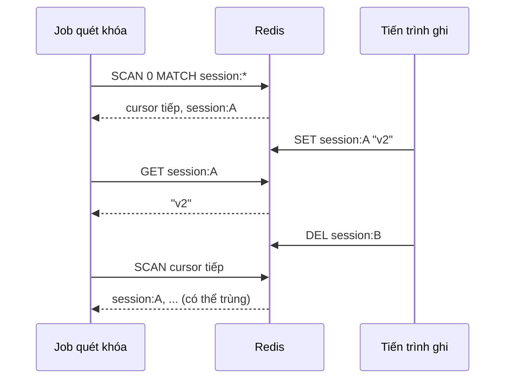
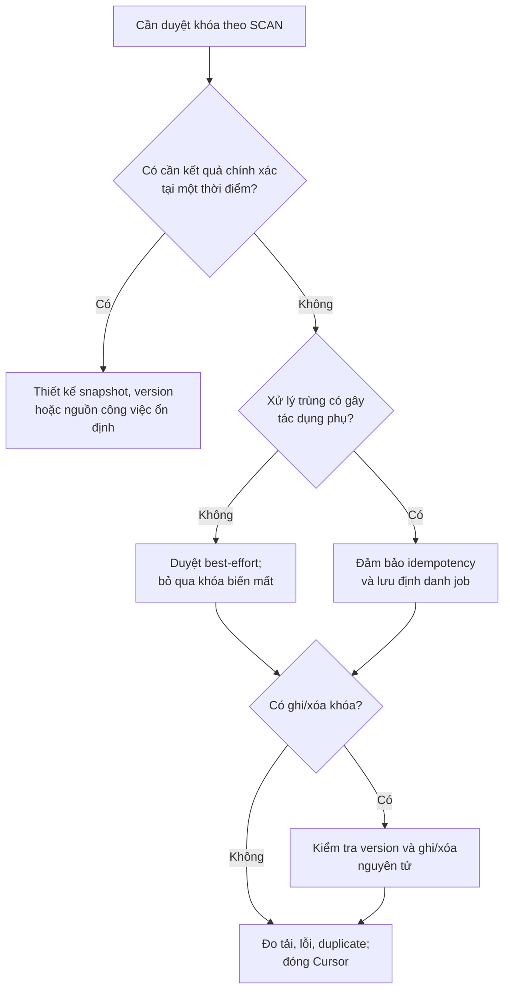

# Xử lý kết quả trùng hoặc thay đổi trong lúc SCAN

Trong Spring Data Redis, `SCAN` thường được dùng để duyệt nhiều khóa theo từng đợt mà không phải yêu cầu Redis trả về toàn bộ keyspace trong một lệnh. Chẳng hạn, một ứng dụng cần tìm các khóa `session:*` để thống kê, kiểm tra thời hạn hoặc dọn dữ liệu cũ. Vấn đề xuất hiện khi chính ứng dụng và những tiến trình khác vẫn liên tục tạo, sửa, xóa hoặc làm hết hạn khóa trong quá trình duyệt.

**Điểm cốt lõi:** `SCAN` là phép duyệt tăng dần trên một tập dữ liệu có thể thay đổi, **không phải ảnh chụp (snapshot)** tại thời điểm bắt đầu. Cùng một khóa có thể được trả về nhiều lần; một khóa được thêm hoặc xóa giữa chừng có thể xuất hiện hoặc không; dữ liệu bên trong khóa có thể đã khác tại thời điểm ứng dụng đọc hoặc xử lý nó. Vì vậy, cần thiết kế cách xử lý phù hợp với mức độ chính xác mà nghiệp vụ thực sự yêu cầu.

## 1. Cơ chế duyệt và phạm vi bảo đảm

Lệnh Redis cơ bản có dạng:

```redis
SCAN 0 MATCH session:* COUNT 500
```

Redis trả về hai phần: **cursor tiếp theo** và **danh sách khóa của đợt hiện tại**. Client đưa cursor vừa nhận vào lần gọi tiếp theo, lặp cho tới khi Redis trả cursor `0` lần nữa. Một đợt có thể trả về ít phần tử, nhiều phần tử hoặc không có phần tử nào; **danh sách rỗng không có nghĩa quá trình duyệt đã kết thúc**.

```text
SCAN 0    -> cursor 42, keys [session:A, session:C]
SCAN 42   -> cursor 91, keys [session:B, session:A]
SCAN 91   -> cursor 0,  keys [session:D]
                         ^
                         session:A xuất hiện hai lần
```

Đây chỉ là ví dụ minh họa: cursor, thứ tự và số khóa ở mỗi đợt không cố định.

Với một **vòng duyệt hoàn chỉnh** (bắt đầu bằng cursor `0`, tiếp tục theo các cursor Redis trả về và kết thúc bằng cursor `0`), Redis công bố các bảo đảm sau:

| Tình trạng của phần tử trong suốt vòng duyệt | Redis `SCAN` bảo đảm gì? |
| --- | --- |
| Khóa tồn tại liên tục từ đầu đến cuối | Khóa được trả về **ít nhất một lần**. |
| Khóa vắng mặt liên tục từ đầu đến cuối | Khóa **không** được trả về. |
| Khóa mới xuất hiện, bị xóa hoặc hết hạn trong lúc duyệt | Khóa **có thể** được trả về hoặc không; không có bảo đảm bao phủ. |
| Khóa được trả về ở một đợt trước | Khóa **vẫn có thể** được trả lại ở đợt sau. |
| Khóa tồn tại nhưng giá trị thay đổi | `SCAN` chỉ cho biết tên khóa; **không bảo đảm** phiên bản hoặc nội dung của giá trị. |

Một vòng duyệt chỉ được bảo đảm kết thúc khi kích thước tập được duyệt có giới hạn trên trong thời gian thực hiện. Nếu keyspace liên tục phình to không giới hạn, ứng dụng không được mặc định rằng vòng duyệt sẽ luôn sớm kết thúc.

`COUNT 500` là **gợi ý về lượng công việc** cho Redis, không phải cam kết trả đúng 500 khóa. `MATCH session:*` lọc tên khóa theo mẫu, nhưng không biến `SCAN` thành truy vấn có chỉ mục trên tiền tố và không cho phép suy ra số khóa phải quét từ số khóa nhận được.

## 2. Vì sao có kết quả trùng và kết quả thay đổi?

Redis tổ chức các khóa trong cấu trúc băm. Khi dữ liệu tăng, giảm hoặc cấu trúc được tổ chức lại (rehash), một vòng duyệt sử dụng cursor có thể gặp lại cùng phần tử. Đây là hành vi hợp lệ của `SCAN`, không nhất thiết là lỗi ở Spring Data Redis.

Đồng thời, vòng duyệt có thể kéo dài qua nhiều lệnh, trong khi các thao tác ghi khác vẫn diễn ra:



Trong sơ đồ, `session:A` được tìm thấy trước khi giá trị thay đổi nhưng được đọc sau khi cập nhật, nên ứng dụng nhận `v2`. Nếu `session:B` biến mất giữa hai lần gọi, nó có thể không được trả về. Nếu `session:A` xuất hiện hai lần, ứng dụng có thể vô tình thực hiện cùng một tác vụ hai lần.

Cần phân biệt ba khái niệm:

1. **Trùng tên khóa:** cùng chuỗi `session:A` được `SCAN` trả về nhiều lần trong một vòng.
2. **Thay đổi giá trị:** cùng tên khóa vẫn tồn tại nhưng nội dung, TTL hoặc metadata đã thay đổi.
3. **Xóa rồi tạo lại:** một khóa biến mất và được tạo lại với cùng tên. Về nghiệp vụ, đây có thể là một thực thể hoặc một phiên bản hoàn toàn mới. Khử trùng chỉ dựa vào tên khóa sẽ gộp cả hai lại.

Việc dùng `hasKey()` trước `get()` cũng không loại bỏ được trường hợp giá trị biến mất giữa hai lệnh. Đây là lỗi kiểu *time-of-check/time-of-use* (TOCTOU).

## 3. Chọn chiến lược theo yêu cầu nghiệp vụ

Trước khi xử lý kết quả, hãy xác định công việc cần độ chính xác nào:

| Nhu cầu | Hướng xử lý |
| --- | --- |
| Thống kê gần đúng, quan sát vận hành, rà soát cache | Chấp nhận dữ liệu biến động; bỏ qua khóa biến mất và ghi nhận số lần trùng. |
| Mỗi **tên khóa** chỉ xử lý một lần **trong một lần chạy** | Sử dụng `Set` ghi nhận tên khóa đã gặp. |
| Xử lý lặp lại không được gây tác dụng phụ | Thiết kế hành động **idempotent**: chạy thêm lần nữa vẫn cho kết quả nghiệp vụ như cũ. |
| Nhiều worker, job có thể chết rồi chạy lại | Lưu danh tính tác vụ và trạng thái xử lý bền vững, có khóa duy nhất và cơ chế retry. |
| Chỉ thay đổi/xóa nếu giá trị vẫn đúng phiên bản đã kiểm tra | Dùng thao tác kiểm tra phiên bản và ghi/xóa **nguyên tử**, thường là Lua script hoặc cơ chế optimistic locking phù hợp. |
| Cần danh sách chính xác tại một thời điểm, hoặc không được bỏ sót mọi cập nhật | Xây dựng snapshot/chỉ mục và nhật ký thay đổi do ứng dụng quản lý; `SCAN` riêng lẻ không đáp ứng hợp đồng này. |

Khử trùng ở bộ nhớ là một lựa chọn hữu ích nhưng **không tự giải quyết sự thay đổi của dữ liệu**. Chống thực thi trùng là một vấn đề khác với việc dữ liệu có còn mới tại thời điểm thực thi hay không.

## 4. Ví dụ Spring Data Redis: bỏ trùng theo tên khóa

Với Redis lưu session dạng **string**, có thể dùng `StringRedisTemplate.scan(ScanOptions)` và một `HashSet`. Ví dụ sau phục vụ công việc kiểm tra best-effort: đọc giá trị hiện có, bỏ qua khóa vừa biến mất, và chuyển cặp khóa/giá trị cho một hàm xử lý. Hàm xử lý được giả định là an toàn khi chạy lại trong những lượt job khác nhau.

```java
import java.util.HashSet;
import java.util.Set;
import java.util.function.Consumer;

import org.springframework.data.redis.core.Cursor;
import org.springframework.data.redis.core.ScanOptions;
import org.springframework.data.redis.core.StringRedisTemplate;
import org.springframework.stereotype.Service;

@Service
public class SessionScanService {

    private final StringRedisTemplate redis;

    public SessionScanService(StringRedisTemplate redis) {
        this.redis = redis;
    }

    public ScanStats scanSessions(Consumer<SessionEntry> handler) {
        ScanOptions options = ScanOptions.scanOptions()
                .match("session:*")
                .count(500)
                .build();

        Set<String> visited = new HashSet<>();
        long duplicates = 0;
        long missingOnRead = 0;
        long handled = 0;

        // Cursor phải được đóng để giải phóng tài nguyên của kết nối.
        try (Cursor<String> cursor = redis.scan(options)) {
            while (cursor.hasNext()) {
                String key = cursor.next();

                if (!visited.add(key)) {
                    duplicates++;
                    continue;
                }

                // Giá trị có thể đã hết hạn/bị xóa kể từ lúc SCAN thấy key.
                String value = redis.opsForValue().get(key);
                if (value == null) {
                    missingOnRead++;
                    continue;
                }

                handler.accept(new SessionEntry(key, value));
                handled++;
            }
        }

        return new ScanStats(
                visited.size(), duplicates, missingOnRead, handled);
    }

    public record SessionEntry(String key, String value) {}

    public record ScanStats(
            long uniqueKeys,
            long duplicateReturns,
            long missingOnRead,
            long handled) {}
}
```

Ví dụ sử dụng:

```java
ScanStats stats = sessionScanService.scanSessions(entry -> {
    // Ví dụ: đưa dữ liệu vào báo cáo chỉ đọc.
    // Nếu ghi ra DB, gọi API hoặc xóa key, cần xử lý idempotency riêng.
    System.out.println(entry.key() + " = " + entry.value());
});
System.out.println(stats);
```

Giới hạn và ý nghĩa thực tế của ví dụ:

- `visited.add(key)` trả về `false` từ lần thứ hai gặp cùng tên khóa, nên tránh xử lý lặp trong **cùng một lần chạy**. Nó không phân biệt một key cũ với key vừa bị xóa rồi tạo lại cùng tên.
- `HashSet` dùng bộ nhớ **O(U)** với `U` là số tên khóa khác nhau đã gặp. Nếu có hàng chục triệu khóa, không nên coi đây là kỹ thuật chi phí cố định.
- `GET` lấy giá trị tại **thời điểm đọc**, không phải tại thời điểm `SCAN` phát hiện khóa. Giá trị vẫn có thể thay đổi ngay sau `GET`.
- Nếu `session:*` có khóa thuộc kiểu dữ liệu khác `string`, `GET` có thể trả lỗi `WRONGTYPE`. Ví dụ giả định quy ước tên khóa bảo đảm kiểu dữ liệu; ứng dụng hỗn hợp cần phân loại theo schema/kiểu.
- Ngoại lệ từ Redis hoặc `handler` sẽ dừng lần quét; ví dụ không coi đó là hoàn thành thành công. `try-with-resources` vẫn đóng cursor khi thoát.

Trong Spring Data Redis, `RedisTemplate.scan(...)` trả về `Cursor<K>` và tài nguyên này cần được đóng. Không nên gọi `keys("session:*")` để thay thế trên keyspace lớn: phương thức `keys()` sử dụng Redis `KEYS`, có thể gây độ trễ đáng kể vì quét toàn bộ keyspace trong một lệnh.

## 5. Nếu số lượng khóa quá lớn để giữ `HashSet`

Có ba hướng phổ biến, tùy mức độ bảo đảm:

**Để xử lý lặp vẫn an toàn:** không cần giữ mọi tên khóa nếu thao tác nghiệp vụ tự idempotent. Ví dụ, cập nhật trạng thái hiện tại của một thực thể bằng cùng một giá trị thường dễ làm idempotent hơn việc cộng bộ đếm, gửi email hoặc trừ tiền mỗi khi gặp khóa. Đặc biệt, đối với tác vụ bên ngoài Redis, idempotency phải được bảo đảm ở nơi thực hiện tác dụng phụ.

**Để khử trùng giữa nhiều worker:** lưu dấu vết theo `jobId` và `key` (hoặc `key` + `version`) vào kho có ràng buộc duy nhất. Ví dụ, bảng kết quả trong cơ sở dữ liệu có unique key `(job_id, redis_key, version)`. Worker tranh chấp cùng một mục sẽ không thể tạo hai kết quả logic trùng nhau. Nếu tác vụ cập nhật chính cơ sở dữ liệu đó, nên ghi nhận trạng thái và thực hiện cập nhật trong cùng giao dịch.

**Để giữ tập đã thấy tạm thời trong Redis:** có thể dùng `SADD scan:seen:<jobId> <key>`: kết quả `1` nghĩa là mới được thêm, `0` nghĩa là đã có. Chọn tiền tố `scan:seen:` nằm ngoài `MATCH session:*`, đặt chính sách dọn dẹp/TTL thích hợp và tính tới chi phí bộ nhớ, RTT, cùng tính nguyên tử của nghiệp vụ. `SADD` chỉ đánh dấu đã thấy: **đánh dấu trước rồi xử lý thất bại** có thể làm lần retry bị bỏ qua; **xử lý trước rồi đánh dấu** có thể gây thực hiện hai lần. Không được suy diễn `SADD` đơn lẻ thành cơ chế exactly-once.

Đối với job có side effect quan trọng, mô hình thường cần `PENDING` → `PROCESSING` (có lease) → `COMPLETED`, kết hợp trạng thái bền vững, retry và thao tác idempotent. Khi lease hết hạn, một worker khác có thể xử lý lại, vì thế chức năng nghiệp vụ vẫn phải chịu được việc chạy trùng.

## 6. Xử lý khóa đã thay đổi hoặc vừa bị xóa

Một khóa được trả về chưa chắc còn tồn tại khi sử dụng. Ví dụ:

```text
T1: SCAN trả về session:42
T2: Worker khác DEL session:42
T3: GET session:42 -> null
T4: Worker khác SET session:42 "phiên mới"
```

Ứng dụng cần chọn một trong những chính sách rõ ràng:

- **Bỏ qua khi không còn giá trị:** phù hợp cho kiểm tra cache, thống kê gần đúng. Không coi `null` là lỗi toàn cục và tránh suy ra rằng khóa chưa từng tồn tại.
- **Đọc lại trạng thái hiện tại rồi tính toán:** phù hợp khi chỉ quan tâm trạng thái mới nhất. Dù vậy, dữ liệu có thể đổi tiếp ngay sau lần đọc.
- **Chỉ ghi/xóa khi phiên bản vẫn khớp:** phù hợp khi dọn dữ liệu cũ hoặc thay đổi trạng thái mà không được tác động lên đối tượng vừa được thay mới.

Ví dụ nguy hiểm:

```java
String value = redis.opsForValue().get(key);
if (isExpiredBusinessValue(value)) {
    redis.delete(key); // Có thể xóa một giá trị MỚI vừa được ghi vào key.
}
```

Hai thao tác `GET` và `DEL` riêng lẻ không tạo thành một kiểm tra-và-xóa nguyên tử. Nếu Redis lưu mỗi session dưới dạng **hash** có trường `version`, một Lua script có thể so sánh phiên bản và xóa trong cùng lần thực thi trên Redis:

```lua
-- KEYS[1] = session:42
-- ARGV[1] = version đã đọc và quyết định cần xóa
if redis.call('HGET', KEYS[1], 'version') == ARGV[1] then
    return redis.call('UNLINK', KEYS[1])
end
return 0
```

Trong Spring Data Redis, có thể thực thi script như trên qua `RedisTemplate.execute(RedisScript, keys, args...)`. Với khóa bị xóa, hết hạn hoặc đã được cập nhật sang version mới, script sẽ không xóa vì điều kiện không còn khớp. `UNLINK` giúp tách phần giải phóng bộ nhớ khỏi đường xử lý chính; có thể dùng `DEL` khi phù hợp với yêu cầu.

**Điều kiện để so sánh phiên bản có ý nghĩa:** mỗi lần tạo mới hoặc cập nhật phải cấp một `version` khác, không tái sử dụng phiên bản cũ. Nếu xóa một khóa rồi tạo lại với chính version cũ (vấn đề *ABA*), so sánh bằng version vẫn không phân biệt được hai thế hệ dữ liệu. Với hash, đảm bảo thao tác tạo/cập nhật hash và version tuân thủ cùng một hợp đồng; không trộn quy ước key string với key hash trong ví dụ này.

Lựa chọn khác là `WATCH` + `MULTI`/`EXEC` để kiểm tra thay đổi trước khi commit; nếu giao dịch bị hủy phải đọc lại và retry. Dù chọn cơ chế nào, phạm vi nguyên tử cần bao gồm **điều kiện bảo vệ và thao tác thực hiện**, không chỉ phép đọc ban đầu.

## 7. Trường hợp cần sự nhất quán mạnh hơn `SCAN`

Nếu yêu cầu là “mọi khóa có mặt đúng lúc bắt đầu phải được xử lý dựa trên **giá trị của chính thời điểm đó**”, thì việc chỉ `SCAN` rồi `GET` không thể thỏa mãn: khóa có thể đổi giá trị, hết hạn hoặc bị tạo lại trong khoảng thời gian hai thao tác. Khử trùng bằng `Set` cũng không biến vòng duyệt thành snapshot.

Một vài thiết kế khả thi khi nghiệp vụ thật sự cần độ chính xác cao:

1. **Danh sách công việc ổn định:** ứng dụng ghi các ID phải xử lý vào một danh sách/hàng đợi riêng tại thời điểm chốt công việc. Mỗi ID có định danh và trạng thái, cho phép retry. Để có snapshot giá trị, cần lưu cả version hoặc dữ liệu bất biến tương ứng.
2. **Chỉ mục do ứng dụng duy trì:** thay vì dò toàn keyspace theo tiền tố, quản lý tập ID hoặc sorted set theo thời gian/phiên bản và cập nhật chỉ mục cùng dữ liệu qua thao tác nguyên tử khi cần. Việc lấy một danh sách ID vẫn chưa tự đóng băng giá trị; cần hợp đồng version.
3. **Nguồn sự kiện thay đổi:** ứng dụng phát sự kiện tạo/sửa/xóa vào Redis Streams hoặc hệ thống event log bền vững, rồi consumer duyệt theo offset và xử lý retry. Cần thiết kế tính nhất quán giữa cập nhật dữ liệu và phát sự kiện; không coi Pub/Sub hay keyspace notifications là nhật ký bền vững có thể replay.
4. **Kho dữ liệu hỗ trợ snapshot/giao dịch:** với báo cáo đối soát hay tài chính, nên đặt nguồn sự thật ở hệ thống có tính chất giao dịch/ảnh chụp phù hợp, và dùng Redis như lớp cache hoặc chỉ mục hỗ trợ.

Không có lựa chọn nào trong số này tự động cho “exactly once” trên nhiều hệ thống. Khi có tác dụng phụ, cần kết hợp định danh tác vụ, dedup bền vững, giao dịch ở nơi có thể và cơ chế phục hồi sau lỗi.

## 8. Vận hành an toàn: cursor, tải, retry và Redis Cluster

**Cursor và kết nối.** Luôn dùng `try-with-resources` hoặc đóng `Cursor` trong `finally`; không giữ cursor sống vô hạn trong request web. Nếu quét rất lâu, nên triển khai dưới dạng job có giới hạn thời gian/tải, phân quyền phù hợp và khả năng chạy lại. Redis cursor là trạng thái để tiếp tục **một vòng duyệt**, không phải mã định danh snapshot được đóng băng.

**Lỗi giữa chừng.** Khi kết nối hỏng hoặc tiến trình chết, một cách phục hồi đơn giản là khởi chạy vòng `SCAN` mới rồi dựa vào cơ chế idempotency hoặc dấu vết hoàn tất để tránh tác dụng phụ trùng. Không coi việc lưu số cursor rồi dùng lại sau một thời gian dài là checkpoint nghiệp vụ có bảo đảm chính xác, đặc biệt khi keyspace đang thay đổi.

**Điều chỉnh `COUNT`.** Bắt đầu với cỡ đợt vừa phải (ví dụ `500` trong đoạn mã) rồi quan sát latency, số lệnh, CPU Redis và tải network. `COUNT` tăng có thể giảm số chuyến đi nhưng tăng công việc và độ trễ từng lệnh. `MATCH` không thay thế được việc kiểm soát tải; mỗi khóa được xử lý có thể còn phát sinh `GET` hay lệnh khác.

**Nhiều vòng quét.** Quét định kỳ có thể làm tăng khả năng phát hiện các khóa sống ngắn, nhưng không bảo đảm bắt được mọi khóa từng tồn tại. Nếu cần bắt tất cả thay đổi, dùng nhật ký sự kiện/định danh công việc thay vì kỳ vọng quét nhanh hơn.

**Redis Cluster.** Keyspace phân tán trên nhiều node; một cursor của một node không đại diện cho snapshot toàn cluster. Cách quét cluster và mức hỗ trợ tùy phiên bản Spring Data Redis, Redis driver và cấu hình kết nối. Khi cần duyệt đủ toàn cluster, phải dùng cơ chế duyệt các master/node phù hợp của client và áp dụng khử trùng, trạng thái job theo phạm vi toàn cục.

**Các chỉ số nên ghi nhận:** `keysReturned`, `uniqueKeys`, `duplicateReturns`, `missingOnRead`, `processed`, `failed`, thời gian chạy, số lần retry và số lệnh Redis. Chúng giúp phân biệt dữ liệu đang biến động với lỗi của job; `uniqueKeys` không phải số khóa chính xác tại một thời điểm.

## 9. Diễn tập các tình huống thường gặp

Giả sử lúc bắt đầu có `session:A`, `session:B`, `session:C`.

| Diễn biến trong lúc duyệt | Quan sát có thể xảy ra | Cách xử lý phù hợp |
| --- | --- | --- |
| `session:A` tồn tại liên tục nhưng bị trả hai lần | `A, ..., A` | `visited.add(A)` để bỏ trùng trong cùng job; tác vụ vẫn phải idempotent khi retry. |
| `session:B` bị xóa trước khi `GET` | `SCAN` có thể trả `B`; `GET` trả `null` | Bỏ qua, đếm `missingOnRead`; không giả định giá trị còn tồn tại. |
| `session:C` đổi từ `v1` sang `v2` trước khi đọc | `SCAN` trả `C`, `GET` trả `v2` | Chấp nhận giá trị mới hoặc kiểm tra version nếu công việc cần dữ liệu cũ. |
| `session:D` được tạo sau khi job bắt đầu | Có thể thấy hoặc không | Không dựa vào một vòng `SCAN` để xác định mọi khóa được tạo trong khoảng thời gian chạy. |
| `session:A` bị xóa rồi tạo lại cùng tên | Có thể trả lại tên `A`; `HashSet` chỉ thấy một tên | Dùng `version`/generation nếu cần phân biệt hai vòng đời của khóa. |
| Job chết sau khi gọi dịch vụ bên ngoài | Lần chạy sau có thể làm lại cùng việc | Gửi idempotency key và lưu trạng thái bền vững; phục hồi/retry có kiểm soát. |

### Quy trình ra quyết định khi triển khai



## 10. Ghi nhớ

`SCAN` thích hợp để **khám phá và duyệt dần** các khóa Redis trong khi hệ thống còn hoạt động. Nó bảo đảm trả ít nhất một lần các khóa tồn tại xuyên suốt một vòng duyệt hoàn chỉnh, nhưng **không bảo đảm một lần duy nhất**, **không cung cấp snapshot** và **không giữ nguyên giá trị** trong suốt quá trình. Với Spring Data Redis, hãy đóng `Cursor`, xử lý khóa có thể biến mất, dùng khử trùng nếu thích hợp và xây dựng idempotency cho các tác vụ có tác dụng phụ. Nếu cần ghi/xóa theo trạng thái đã quan sát, hãy bảo vệ thao tác bằng version và cơ chế nguyên tử. Nếu cần lịch sử thay đổi hoặc kết quả đúng tại một thời điểm, thiết kế nguồn dữ liệu ổn định thay vì dựa vào một lần `SCAN`.

### Tài liệu tham khảo

- [Redis Documentation — SCAN](https://redis.io/docs/latest/commands/scan/): cú pháp, điều kiện bảo đảm, duplicate, `MATCH` và `COUNT`.
- [Spring Data Redis — RedisTemplate API](https://docs.spring.io/spring-data/redis/reference/api/java/org/springframework/data/redis/core/RedisTemplate.html): phương thức `scan(ScanOptions)` và nghĩa vụ đóng `Cursor`.
- [Redis Documentation — Keys and values](https://redis.io/docs/latest/develop/using-commands/keyspace/): lưu ý khi sử dụng `KEYS` và `SCAN` trên keyspace.
