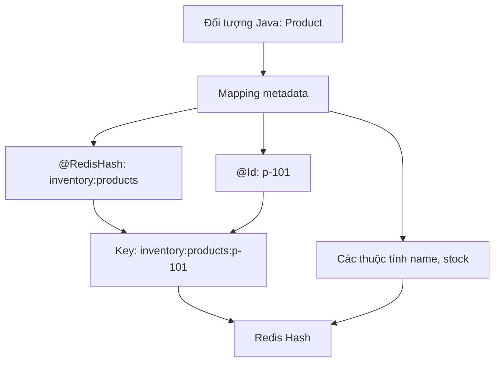

# Định nghĩa keyspace bằng `@RedisHash` trong Spring Data Redis

## 1. Keyspace giải quyết vấn đề gì?

Redis lưu dữ liệu theo cặp **key → value**. Nếu một ứng dụng chỉ dùng các key đơn giản như `42`, `100` hoặc `admin`, sẽ rất khó xác định key thuộc loại dữ liệu nào, đồng thời có nguy cơ hai nhóm dữ liệu sử dụng trùng tên key.

Ví dụ, cùng mã định danh `42` có thể được dùng cho một khách hàng và một đơn hàng:

```text
customer:42   -> khách hàng số 42
order:42      -> đơn hàng số 42
```

Phần `customer` và `order` đóng vai trò **keyspace**: một không gian tên để phân nhóm key theo loại thực thể. Với các thực thể được ánh xạ bằng **Spring Data Redis Repositories**, annotation `@RedisHash` cho phép khai báo keyspace ngay trên lớp Java.

```java
import org.springframework.data.annotation.Id;
import org.springframework.data.redis.core.RedisHash;

@RedisHash("customers")
public class Customer {
    @Id
    private String id;
    private String name;

    // Constructor, getter và setter được trình bày ở phần ví dụ đầy đủ.
}
```

Với một `Customer` có `id = "42"`, Spring Data Redis thường lưu phần dữ liệu của đối tượng ở key:

```text
customers:42
```

Đây là quy ước ghép **`<keyspace>:<id>`**. Redis không tự hiểu khái niệm lớp Java `Customer`; chính tầng ánh xạ của Spring Data Redis quyết định cách chuyển đối tượng thành Redis Hash và tạo tên key.

Sau bài này, bạn cần phân biệt được:

- **Keyspace**: tiền tố tên key để nhóm các thực thể.
- **ID**: định danh của một thực thể bên trong keyspace.
- **Redis Hash**: kiểu dữ liệu Redis lưu các field của thực thể.
- **Redis Repository**: API phía Java điều phối ánh xạ, lưu, tìm và xóa thực thể.
- **TTL**: thời hạn sống của key, có thể được cấu hình thêm qua `@RedisHash`.

## 2. Cách `@RedisHash` xác định keyspace

Annotation `@RedisHash` nằm trong package:

```java
import org.springframework.data.redis.core.RedisHash;
```

Nó được đặt **trên lớp thực thể** để khai báo đây là kiểu dữ liệu được lưu dưới dạng Redis Hash trong cơ chế ánh xạ của Spring Data Redis.

### 2.1. Khai báo rõ tên keyspace

```java
@RedisHash("customers")
public class Customer {
    // ...
}
```

`"customers"` là tên keyspace. Với ID `42`, key của đối tượng có dạng `customers:42`.

Có thể viết rõ thuộc tính `value`:

```java
@RedisHash(value = "customers")
public class Customer {
    // ...
}
```

Hai cách trên tương đương. Tên keyspace là một chuỗi do ứng dụng quyết định; nên đặt tên **ổn định, dễ phân biệt và phản ánh miền dữ liệu**.

### 2.2. Khi không chỉ định tên

Spring Data Redis có cơ chế suy ra keyspace mặc định từ metadata ánh xạ của lớp và có thể nhận cấu hình keyspace riêng. Tuy nhiên, nếu tên keyspace là một phần của hợp đồng lưu trữ lâu dài, việc **khai báo tường minh `@RedisHash("...")`** giúp tránh phụ thuộc vào quy tắc tên mặc định hoặc thay đổi tên lớp trong quá trình refactor.

Ví dụ:

```java
@RedisHash
public class Customer {
    // ...
}
```

Trường hợp này không ghi một tên keyspace rõ ràng trong annotation. Để người vận hành dễ tìm dữ liệu và để các phiên bản ứng dụng cùng nhận diện một tập key, thông thường nên chủ động chọn `value` thay vì dựa vào tên mặc định.

### 2.3. Keyspace không phải một cấu trúc độc lập của Redis

Redis không có câu lệnh `CREATE KEYSPACE customers`. Khái niệm keyspace ở đây là **quy ước tên và metadata ánh xạ của Spring Data Redis**, thể hiện bằng những key mà Redis lưu trữ.

Vì vậy:

| Khái niệm | Vai trò | Ví dụ |
|---|---|---|
| Redis database | Không gian khóa trong một database Redis, thường chọn bằng chỉ số DB | Database `0` |
| Keyspace của thực thể | Nhóm key cùng tiền tố do ứng dụng/framework quản lý | `customers` |
| Redis key của thực thể | Địa chỉ chính xác của một bản ghi | `customers:42` |
| Redis Hash | Kiểu dữ liệu lưu nội dung field/value | `name` → `Lan` |
| ID của thực thể | Định danh Java dùng để tìm bản ghi | `42` |

Không nên nhầm **keyspace khai báo bằng `@RedisHash`** với thuật ngữ **Redis keyspace notifications**. Keyspace notifications là cơ chế phát sự kiện khi key thay đổi hoặc hết hạn, không phải cách đặt tiền tố cho entity.

## 3. Quan hệ giữa `@RedisHash`, `@Id` và Redis Hash

Xét thực thể sau:

```java
import org.springframework.data.annotation.Id;
import org.springframework.data.redis.core.RedisHash;

@RedisHash("inventory:products")
public class Product {

    @Id
    private String id;

    private String name;
    private Integer stock;

    public Product() {
    }

    public Product(String id, String name, Integer stock) {
        this.id = id;
        this.name = name;
        this.stock = stock;
    }

    public String getId() {
        return id;
    }

    public void setId(String id) {
        this.id = id;
    }

    public String getName() {
        return name;
    }

    public void setName(String name) {
        this.name = name;
    }

    public Integer getStock() {
        return stock;
    }

    public void setStock(Integer stock) {
        this.stock = stock;
    }
}
```

Có ba phần quan trọng:

1. `@RedisHash("inventory:products")` khai báo **keyspace**.
2. `@Id` đánh dấu thuộc tính dùng làm **định danh**.
3. Các thuộc tính còn lại là dữ liệu được Spring Data Redis chuyển sang biểu diễn trong **Redis Hash**.

Với:

```java
Product product = new Product("p-101", "Mechanical Keyboard", 25);
```

Key thực thể có dạng:

```text
inventory:products:p-101
```

Sơ đồ luồng dữ liệu:



Nội dung của Redis Hash gồm các field biểu diễn thuộc tính, đồng thời framework có thể lưu **metadata kiểu đối tượng** (chẳng hạn `_class`) phục vụ ánh xạ khi đọc. Tập field chính xác còn phụ thuộc loại thuộc tính, converter và cấu hình serialization. Đừng coi một ví dụ `HGETALL` đơn giản là hợp đồng bất biến cho mọi kiểu entity.

**Lưu ý:** annotation `@Id` ở đây được import từ `org.springframework.data.annotation.Id`. Không nên dùng nhầm `jakarta.persistence.Id` rồi mặc định rằng Redis mapping sẽ xử lý giống JPA.

## 4. Ví dụ đầy đủ: lưu một thực thể theo keyspace

### 4.1. Thành phần cần có

Với Spring Boot 3.x, ứng dụng sử dụng Spring Data Redis có thể khai báo dependency:

```groovy
dependencies {
    implementation 'org.springframework.boot:spring-boot-starter-data-redis'
}
```

Cấu hình kết nối Redis đơn giản trong `application.yml`:

```yaml
spring:
  data:
    redis:
      host: localhost
      port: 6379
```

Đây là ví dụ cho Redis local không cần xác thực. Với môi trường triển khai thực tế, thông tin kết nối phải tương ứng hạ tầng, TLS và cơ chế quản lý secrets của hệ thống.

### 4.2. Khai báo entity

```java
package com.example.demo.customer;

import org.springframework.data.annotation.Id;
import org.springframework.data.redis.core.RedisHash;

@RedisHash("shop:v1:customers")
public class Customer {

    @Id
    private String id;

    private String fullName;

    private String phone;

    public Customer() {
    }

    public Customer(String id, String fullName, String phone) {
        this.id = id;
        this.fullName = fullName;
        this.phone = phone;
    }

    public String getId() {
        return id;
    }

    public void setId(String id) {
        this.id = id;
    }

    public String getFullName() {
        return fullName;
    }

    public void setFullName(String fullName) {
        this.fullName = fullName;
    }

    public String getPhone() {
        return phone;
    }

    public void setPhone(String phone) {
        this.phone = phone;
    }
}
```

Tên `shop:v1:customers` đã thể hiện ứng dụng, phiên bản quy ước tên và loại thực thể. Với ID `c-1001`, key dự kiến:

```text
shop:v1:customers:c-1001
```

Dấu hai chấm `:` chỉ là ký tự trong tên key, thường dùng làm dấu phân cách dễ đọc. Redis không tự tạo cấp thư mục hoặc cấu trúc phân cấp từ các dấu hai chấm.

### 4.3. Khai báo repository

```java
package com.example.demo.customer;

import org.springframework.data.repository.CrudRepository;

public interface CustomerRepository
        extends CrudRepository<Customer, String> {
}
```

`CrudRepository<Customer, String>` cho framework biết entity là `Customer` và ID có kiểu `String`. Khi repository lưu đối tượng, nó sử dụng thông tin ánh xạ của `Customer`, bao gồm `@RedisHash("shop:v1:customers")`.

Với Spring Boot, cấu hình tự động có thể kích hoạt Redis repositories khi dependency và điều kiện cần thiết được đáp ứng. Nếu muốn khai báo phạm vi quét repository một cách tường minh:

```java
package com.example.demo;

import com.example.demo.customer.CustomerRepository;
import org.springframework.boot.SpringApplication;
import org.springframework.boot.autoconfigure.SpringBootApplication;
import org.springframework.data.redis.repository.configuration.EnableRedisRepositories;

@SpringBootApplication
@EnableRedisRepositories(basePackageClasses = CustomerRepository.class)
public class DemoApplication {
    public static void main(String[] args) {
        SpringApplication.run(DemoApplication.class, args);
    }
}
```

Không cần lặp lại cấu hình quét nếu ứng dụng đã tự kích hoạt đúng repository. Mục đích của `@EnableRedisRepositories` trong ví dụ là làm rõ repository nào thuộc cơ chế Redis.

### 4.4. Lưu, tìm và xóa theo ID

```java
package com.example.demo.customer;

import java.util.Optional;

import org.springframework.stereotype.Service;

@Service
public class CustomerService {

    private final CustomerRepository repository;

    public CustomerService(CustomerRepository repository) {
        this.repository = repository;
    }

    public Customer createExample() {
        Customer customer =
                new Customer("c-1001", "Nguyen Lan", "0900000000");
        return repository.save(customer);
    }

    public Optional<Customer> getById(String id) {
        return repository.findById(id);
    }

    public void remove(String id) {
        repository.deleteById(id);
    }
}
```

Khi gọi:

```java
Customer customer = service.createExample();
Optional<Customer> found = service.getById("c-1001");
```

Framework thao tác với dữ liệu ánh xạ trong keyspace `shop:v1:customers`. Phần lớn code nghiệp vụ chỉ cần biết **kiểu entity và ID**, không cần tự ghép `"shop:v1:customers:" + id` trong mỗi phương thức.

Lợi ích này xuất hiện khi thao tác qua **Spring Data Redis repository/mapping**. Nếu code dùng `StringRedisTemplate.opsForValue().set("x", "...")` hoặc `RedisTemplate.opsForHash().put(...)` trực tiếp, các lệnh đó **không tự đọc annotation `@RedisHash` từ một lớp không được truyền vào mapper**.

## 5. Quan sát bản ghi thật trong redis-cli

Sau khi repository lưu `Customer` có ID `c-1001`, có thể kiểm tra trong Redis:

```redis
TYPE shop:v1:customers:c-1001
HGETALL shop:v1:customers:c-1001
TTL shop:v1:customers:c-1001
```

Ý nghĩa mong đợi:

- `TYPE` trả `hash` khi key entity tồn tại.
- `HGETALL` cho thấy field/value mà mapper đã ghi, có thể gồm metadata `_class`.
- `TTL` trả `-1` nếu key chưa được cấu hình expiration và vẫn tồn tại.

Kết quả minh họa về cấu trúc có thể trông như sau; tên và cách mã hóa field thực tế phụ thuộc converter:

```text
> TYPE shop:v1:customers:c-1001
hash
> HGETALL shop:v1:customers:c-1001
1) "_class"
2) "com.example.demo.customer.Customer"
3) "id"
4) "c-1001"
5) "fullName"
6) "Nguyen Lan"
7) "phone"
8) "0900000000"
> TTL shop:v1:customers:c-1001
(integer) -1
```

Có thể tìm các key khớp tiền tố trong môi trường kiểm tra:

```redis
SCAN 0 MATCH shop:v1:customers:* COUNT 100
```

`SCAN` trả về cursor và một phần kết quả. Nếu cursor chưa bằng `0`, phải lặp với cursor được trả về để duyệt tiếp; `COUNT` là gợi ý số lượng, không bảo đảm trả đủ trong một lần. Redis repositories còn có thể duy trì các key phụ trợ cho tracking entity và chỉ mục. Vì vậy, **không nên đếm các kết quả `SCAN` rồi đồng nhất chúng với số thực thể**.

Vì bản ghi là Redis Hash, không dùng `GET shop:v1:customers:c-1001` như với String; `GET` đối với một key Hash sẽ báo lỗi sai kiểu (`WRONGTYPE`).

## 6. Quy tắc đặt tên keyspace trong ứng dụng

Tên keyspace nên được xem như một phần của thiết kế dữ liệu vì nó ảnh hưởng trực tiếp đến khả năng tìm đọc các bản ghi đã ghi từ trước.

### 6.1. Nhất quán theo miền nghiệp vụ

Ví dụ một hệ thống bán hàng có thể chọn:

| Entity | Khai báo | Key minh họa |
|---|---|---|
| `Customer` | `@RedisHash("shop:customers")` | `shop:customers:c-1` |
| `Order` | `@RedisHash("shop:orders")` | `shop:orders:o-1` |
| `Cart` | `@RedisHash("shop:carts")` | `shop:carts:c-1` |
| `InventoryItem` | `@RedisHash("shop:inventory")` | `shop:inventory:p-1` |

ID `c-1` có thể xuất hiện ở nhiều entity mà không bị trùng key nếu keyspace khác nhau.

### 6.2. Có thể thêm tiền tố ứng dụng hoặc phiên bản schema

```java
@RedisHash("learning:v1:student-profiles")
public class StudentProfile {
    // ...
}
```

Tiền tố `learning` giúp nhận diện miền ứng dụng; `v1` giúp tách nhóm dữ liệu khi cần đổi hợp đồng lưu trữ lớn. Tuy vậy, chỉ thêm phiên bản khi ứng dụng có quy trình đọc/ghi và di chuyển dữ liệu phù hợp; tăng `v1` thành `v2` khiến repository nhìn sang **nhóm key mới**.

Một số quy tắc thực hành:

1. Dùng tên có nghĩa, thống nhất số ít/số nhiều trong cùng hệ thống.
2. Cố định quy ước phân cách và chữ hoa/chữ thường vì Redis key **phân biệt hoa thường**.
3. Tránh dùng cùng một keyspace cho nhiều kiểu entity không tương thích.
4. Tránh đặt dữ liệu nhạy cảm trực tiếp vào keyspace hoặc ID; tên key thường xuất hiện trong log, công cụ giám sát và thao tác vận hành.
5. Tránh đổi tên keyspace chỉ để làm code đẹp hơn nếu đã có dữ liệu lưu trữ.

### 6.3. Va chạm keyspace có hậu quả thực sự

Xét hai lớp:

```java
@RedisHash("records")
public class CustomerRecord {
    @Id private String id;
    // ...
}

@RedisHash("records")
public class OrderRecord {
    @Id private String id;
    // ...
}
```

Nếu cả hai ghi ID `42`, cùng một Redis key `records:42` có thể bị ghi đè hoặc dữ liệu không còn tương thích với kiểu entity mà repository đang mong đợi. Việc có metadata kiểu đối tượng không tạo ra một namespace tách biệt để giải quyết xung đột này.

Nên tách:

```java
@RedisHash("customers")
public class CustomerRecord {
    @Id private String id;
}

@RedisHash("orders")
public class OrderRecord {
    @Id private String id;
}
```

Khi nhiều ứng dụng cùng dùng một Redis database, chúng phải thống nhất quy ước keyspace để tránh vô tình tác động đến key của nhau. **Tiền tố không phải cơ chế phân quyền hay bảo mật**; chính sách truy cập Redis phải được triển khai riêng.

## 7. Keyspace và ID: hai phần độc lập

Với `@RedisHash("customers")`:

```text
customers:c-1
│         │
│         └── ID của một entity
└──────────── Keyspace
```

Hai entity cùng keyspace với hai ID khác nhau tạo hai key khác nhau:

```text
customers:c-1
customers:c-2
```

Ngược lại, hai keyspace khác nhau có thể dùng cùng một ID:

```text
customers:42
orders:42
```

`@RedisHash` không thay thế cho `@Id`. Annotation thứ nhất quyết định **nơi nhóm đối tượng**; annotation thứ hai cho mapper biết **cách xác định một đối tượng** trong nhóm đó.

Khi tự cung cấp ID, hãy bảo đảm ID ổn định trong vòng đời entity và không tạo xung đột trong cùng keyspace. Nếu dựa vào cơ chế sinh ID của Spring Data Redis, cần hiểu cách framework sinh và trả lại ID trong phiên bản đang dùng. Không nên lẫn lộn ID Redis entity với ID tự tăng của một bảng SQL.

## 8. Keyspace và thời gian hết hạn: `timeToLive`

Annotation `@RedisHash` còn có thuộc tính `timeToLive` để cung cấp thời gian sống mặc định cho các entity trong keyspace đó.

### 8.1. TTL cố định khai báo trên lớp

```java
import org.springframework.data.annotation.Id;
import org.springframework.data.redis.core.RedisHash;

@RedisHash(value = "auth:verification-codes", timeToLive = 300)
public class VerificationCode {

    @Id
    private String id;

    private String code;

    public VerificationCode() {
    }

    public VerificationCode(String id, String code) {
        this.id = id;
        this.code = code;
    }

    public String getId() {
        return id;
    }

    public void setId(String id) {
        this.id = id;
    }

    public String getCode() {
        return code;
    }

    public void setCode(String code) {
        this.code = code;
    }
}
```

`timeToLive = 300` nghĩa là thời hạn **300 giây**. Khi entity được lưu qua cơ chế repository, Spring Data Redis có thể gắn expiration tương ứng lên key `auth:verification-codes:<id>`.

Ví dụ:

```redis
TTL auth:verification-codes:verify-1
```

Ngay sau khi lưu thành công, TTL dự kiến ở gần 300 giây; số quan sát được phụ thuộc thời gian thực thi. Sau khi hết hạn, key có thể biến mất và `findById` trả về rỗng.

Điều quan trọng là `@RedisHash("auth:verification-codes")` vẫn chỉ định **keyspace**, còn `timeToLive` chỉ định **chính sách hết hạn**. Hai khái niệm liên quan nhưng không đồng nhất.

### 8.2. TTL thay đổi theo từng entity

Khi mỗi entity cần thời lượng khác nhau, Spring Data Redis hỗ trợ `@TimeToLive` trên thuộc tính hoặc phương thức phù hợp. Ví dụ:

```java
import org.springframework.data.annotation.Id;
import org.springframework.data.redis.core.RedisHash;
import org.springframework.data.redis.core.TimeToLive;

@RedisHash("auth:tokens")
public class AccessTokenRecord {

    @Id
    private String id;

    private String ownerId;

    @TimeToLive
    private Long remainingSeconds;

    public AccessTokenRecord() {
    }

    public AccessTokenRecord(String id, String ownerId, Long remainingSeconds) {
        this.id = id;
        this.ownerId = ownerId;
        this.remainingSeconds = remainingSeconds;
    }

    public String getId() { return id; }
    public void setId(String id) { this.id = id; }

    public String getOwnerId() { return ownerId; }
    public void setOwnerId(String ownerId) { this.ownerId = ownerId; }

    public Long getRemainingSeconds() { return remainingSeconds; }
    public void setRemainingSeconds(Long remainingSeconds) {
        this.remainingSeconds = remainingSeconds;
    }
}
```

Khi lưu:

```java
AccessTokenRecord shortToken =
        new AccessTokenRecord("t-1", "user-42", 60L);

AccessTokenRecord longToken =
        new AccessTokenRecord("t-2", "user-42", 1800L);
```

Hai object có **cùng keyspace** nhưng TTL có thể là 60 và 1.800 giây. Khi có cả TTL đặt trên entity và TTL mặc định trên `@RedisHash`, cần hiểu độ ưu tiên của mapping; `@TimeToLive` trên entity được dùng để chỉ định TTL riêng.

Giá trị TTL đọc về từ Redis có thể là **thời gian còn lại**, không phải thời lượng gốc đã khai báo khi tạo. Không nên coi một thuộc tính `@TimeToLive` sau khi đọc entity là cấu hình vòng đời bất biến.

### 8.3. Lưu lại entity không đơn giản là gọi `HSET`

Repository có thể thực hiện nhiều lệnh để ghi dữ liệu và quản lý thời hạn của aggregate. Khi gọi `repository.save(entity)` lần nữa, expiration có thể được áp dụng lại theo metadata TTL của entity. Vì vậy, không suy luận rằng mọi lần `save` đều giữ nguyên TTL chỉ vì Redis Hash có các lệnh `HSET` giữ TTL của key hiện có.

Nếu nghiệp vụ bắt buộc phải giữ **deadline cũ** qua các lần cập nhật, hãy thiết kế và kiểm tra rõ chính sách TTL của repository hoặc dùng thao tác Redis phù hợp. Chọn `@RedisHash(timeToLive = ...)` khi muốn chính sách TTL dựa vào vòng đời lưu entity mà framework quản lý.

## 9. Keyspace không tự tạo chỉ mục truy vấn

Khai báo:

```java
@RedisHash("customers")
public class Customer {
    @Id private String id;
    private String email;
}
```

cho phép repository tìm thực thể qua ID, chẳng hạn `findById("c-1")`. Tuy nhiên, **keyspace không phải chỉ mục trên mọi thuộc tính**. Nếu muốn truy vấn qua `email` bằng repository query method, thường cần chỉ mục phụ.

Ví dụ:

```java
import org.springframework.data.annotation.Id;
import org.springframework.data.redis.core.RedisHash;
import org.springframework.data.redis.core.index.Indexed;

@RedisHash("customers")
public class Customer {

    @Id
    private String id;

    @Indexed
    private String email;

    public Customer() {
    }

    public Customer(String id, String email) {
        this.id = id;
        this.email = email;
    }

    public String getId() { return id; }
    public void setId(String id) { this.id = id; }

    public String getEmail() { return email; }
    public void setEmail(String email) { this.email = email; }
}
```

Repository:

```java
import java.util.Optional;
import org.springframework.data.repository.CrudRepository;

public interface CustomerRepository
        extends CrudRepository<Customer, String> {

    Optional<Customer> findByEmail(String email);
}
```

Trong ví dụ này:

- `@RedisHash` xác định **nhóm key chứa entity**.
- `@Id` xác định **key của từng entity**.
- `@Indexed` giúp Spring Data Redis duy trì chỉ mục để giải quyết truy vấn theo thuộc tính `email`.

Redis repositories có thể lưu các Redis Set và key phụ trợ cho chỉ mục hoặc quản lý tập entity. Điều đó giải thích vì sao ứng dụng có thể tạo thêm key ngoài Hash `customers:<id>`. Không được xóa các key phụ trợ một cách tùy tiện vì repository có thể dựa vào chúng để truy vấn.

Các chỉ mục của Redis repository có giới hạn so với hệ quản trị quan hệ: không thể suy diễn rằng mọi biểu thức query, JOIN hoặc truy vấn phức tạp của JPA đều chạy tương đương ở đây. Keyspace đơn thuần không tạo khả năng truy vấn SQL.

## 10. `@RedisHash` và `RedisTemplate` khác nhau ở đâu?

Hai cách lưu dữ liệu sau đều có thể tạo Redis Hash, nhưng mức độ ánh xạ khác nhau.

### 10.1. Dùng repository và `@RedisHash`

```java
@RedisHash("customers")
public class Customer {
    @Id private String id;
    private String name;
    // ...
}
```

```java
repository.save(customer);
repository.findById("c-1");
```

Framework dựa vào mapping của entity để quyết định keyspace, ID, field, metadata và các thao tác repository liên quan.

### 10.2. Dùng `RedisTemplate` trực tiếp

```java
String key = "customers:c-1";
redisTemplate.opsForHash().put(key, "name", "Lan");
```

Ở đây **code chủ động ghép tên key**. `opsForHash().put(...)` không tự suy ra `customers` từ `@RedisHash` của một kiểu entity khác. Ứng dụng cũng phải tự quyết định cách biểu diễn trường, kiểm soát TTL và quy ước key.

| Tiêu chí | Redis Repository + `@RedisHash` | `RedisTemplate` trực tiếp |
|---|---|---|
| Xác định keyspace | Từ metadata ánh xạ entity | Do code hoặc một lớp tiện ích tự ghép |
| Chuyển đổi Java ↔ Redis Hash | Mapping framework phụ trách | Code tự thực hiện hoặc dùng converter riêng |
| Truy cập theo ID | `findById`, `save`, `deleteById` | Dùng các operation Redis tương ứng |
| TTL | Có thể khai báo `timeToLive` hoặc `@TimeToLive` | Tự chỉ định expiration |
| Quản lý chỉ mục phụ | Repository có cơ chế chỉ mục riêng | Tự quản lý nếu cần |

Không có lựa chọn đúng cho mọi trường hợp. Với aggregate Java có ID và CRUD rõ ràng, `@RedisHash` giúp mã nguồn biểu đạt cấu trúc dữ liệu. Với counter, lock, queue, cache String hoặc các thao tác Redis đặc thù, `RedisTemplate` có thể phù hợp hơn.

## 11. Khác biệt giữa `@RedisHash` và các annotation hay gặp

| Annotation / API | Ý nghĩa | Điều cần nhớ |
|---|---|---|
| `@RedisHash("customers")` | Khai báo kiểu entity Redis và keyspace | Gắn với lớp được Spring Data Redis mapping |
| `@Id` | Xác định thuộc tính ID | Phần `<id>` của key entity |
| `@TimeToLive` | TTL động của entity | Thuộc tính/method biểu diễn thời gian sống |
| `@Indexed` | Tham gia chỉ mục phụ | Hỗ trợ query theo field trong repository |
| `@Cacheable("customers")` | Đặt tên cache trong Spring Cache abstraction | Không tự đồng nghĩa với keyspace của Redis repository |
| `@Entity` trong JPA | Mapping thực thể sang hệ quản trị quan hệ | Không dùng thay thế `@RedisHash` cho Redis repository |

Ví dụ cùng chuỗi `"customers"` xuất hiện ở `@Cacheable("customers")` và `@RedisHash("customers")` **không bảo đảm** chúng sử dụng cùng key vật lý hay cùng cơ chế serialization. Spring Cache Redis thường có key prefix và cách serialize riêng, trong khi Redis repositories lưu Hash theo mapping của entity.

Nếu một ứng dụng dùng cả Spring Cache và Redis repositories trên cùng Redis server, nên chủ động phân biệt các namespace để tránh đụng key.

## 12. Khi đổi keyspace: cần nghĩ đến dữ liệu hiện có

Giả sử phiên bản đầu khai báo:

```java
@RedisHash("customers")
public class Customer {
    @Id private String id;
}
```

Sau một lần đổi tên:

```java
@RedisHash("crm:customers")
public class Customer {
    @Id private String id;
}
```

Trước thay đổi:

```text
customers:c-1001
```

Sau thay đổi, repository sử dụng:

```text
crm:customers:c-1001
```

**Annotation mới không tự di chuyển các key cũ**. Vì vậy, một lệnh `findById("c-1001")` sau triển khai có thể không thấy bản ghi cũ dù Redis vẫn còn `customers:c-1001`.

Đây là thay đổi **hợp đồng lưu trữ**. Một kế hoạch chuyển đổi thường cần:

1. Xác định nhóm key cũ và mới, cùng định dạng ID và các cấu trúc chỉ mục mà repository đang dùng.
2. Chọn phương án chuyển dữ liệu, đọc tương thích tạm thời hoặc chuyển hẳn vào thời điểm triển khai.
3. Bảo toàn TTL còn lại nếu dữ liệu có expiration.
4. Đồng bộ cả metadata và chỉ mục liên quan; chỉ `RENAME` các Hash có thể không đủ với dữ liệu do Redis repository quản lý.
5. Kiểm tra rằng bản ghi cũ có thể được đọc qua repository mới, rồi mới dừng hỗ trợ keyspace cũ.

Tương tự, **đổi tên package hoặc lớp Java** có thể tác động đến metadata kiểu đối tượng đã lưu. Vì vậy, việc giữ nguyên keyspace mới chỉ giải quyết phần tên key; thay đổi mapping/class metadata vẫn cần được cân nhắc riêng.

## 13. Một số sai lầm thường gặp

### Sai lầm 1: Nghĩ rằng `@RedisHash` là annotation cho từng field

`@RedisHash` được dùng để khai báo mapping ở **cấp lớp entity**, không phải chọn một field cụ thể để thành keyspace. Field định danh cần có `@Id`; field truy vấn phụ có thể dùng `@Indexed`.

### Sai lầm 2: Chỉ thêm `@RedisHash` rồi mong dữ liệu tự được lưu

Annotation là **metadata**. Dữ liệu chỉ xuất hiện khi ứng dụng thật sự gọi repository/mapper hoặc thao tác Redis để ghi. Khai báo entity không tạo sẵn key trong Redis.

### Sai lầm 3: Cho rằng mọi key cùng tiền tố đều là Hash entity

Repository có thể tạo key phụ trợ dưới các tên có liên quan đến keyspace, còn các phần khác của ứng dụng có thể dùng cùng tiền tố cho kiểu dữ liệu khác. Cần kiểm tra `TYPE key` trước khi giả định rằng key nhận được qua `SCAN` là một Hash có thể đọc bằng `HGETALL`.

### Sai lầm 4: Cho rằng `@RedisHash` mặc định thiết lập TTL

Khai báo `@RedisHash("customers")` **chưa thể hiện thời hạn hết hạn**. Nếu chính sách yêu cầu đối tượng tự xóa sau một khoảng thời gian, phải cấu hình `timeToLive`, `@TimeToLive` hoặc cơ chế expiration phù hợp.

### Sai lầm 5: Dùng chung keyspace cho nhiều domain model

Các repository khác nhau dùng cùng keyspace và ID có thể tranh chấp cùng key, gây ghi đè hoặc đọc sai kiểu. Keyspace cần được thiết kế nhất quán như một phần của hợp đồng dữ liệu.

### Sai lầm 6: Nhầm keyspace với Redis database hoặc quyền truy cập

`@RedisHash("tenant-a:customers")` đặt tiền tố cho key; nó không tự chuyển sang một Redis database khác và không hạn chế client khác truy cập dữ liệu. Đối với hệ thống nhiều tenant, cần cơ chế cách ly và kiểm soát quyền thực sự theo kiến trúc bảo mật.

### Sai lầm 7: Đổi `@RedisHash("old")` thành `@RedisHash("new")` rồi coi dữ liệu cũ được chuyển

Repository bắt đầu tìm key theo prefix mới. Dữ liệu trước đó vẫn thuộc keyspace cũ cho đến khi ứng dụng có quy trình di chuyển hoặc đọc tương thích.

## 14. Bài thực hành có hướng dẫn

**Mục tiêu:** lưu hai loại entity có ID trùng nhau và quan sát cách keyspace ngăn việc dùng trùng Redis key.

Khai báo hai entity:

```java
import org.springframework.data.annotation.Id;
import org.springframework.data.redis.core.RedisHash;

@RedisHash("demo:customers")
class DemoCustomer {
    @Id String id;
    String name;
}

@RedisHash("demo:orders")
class DemoOrder {
    @Id String id;
    String status;
}
```

Sau khi cấu hình repository phù hợp cho từng entity, hãy lưu:

```text
DemoCustomer(id="42", name="Lan")
DemoOrder(id="42", status="NEW")
```

Hai key tương ứng:

```text
demo:customers:42
demo:orders:42
```

Quan sát bằng redis-cli:

```redis
TYPE demo:customers:42
HGETALL demo:customers:42
TYPE demo:orders:42
HGETALL demo:orders:42
```

Hai key có thể có cùng ID nhưng không chồng lấn vì chúng thuộc hai keyspace khác nhau. Tiếp tục thử:

- Gắn `timeToLive = 120` vào một entity, lưu lại và quan sát `TTL` trên **key của entity đó**.
- Thêm `@Indexed` vào một field, lưu dữ liệu và sử dụng method query của repository để nhận ra vai trò của chỉ mục phụ.
- Đổi tạm tên keyspace trong môi trường thực hành, thử `findById` với cùng ID và quan sát tại sao dữ liệu cũ không được tìm theo prefix mới.

Thực hành trên một Redis/database dành riêng cho thử nghiệm; khi kết thúc có thể xóa các key thử bằng ID đã biết hoặc dùng cơ chế cleanup của môi trường thử nghiệm.

## 15. Tổng kết về trách nhiệm của `@RedisHash`

Trong cơ chế entity mapping của Spring Data Redis, có thể hình dung cấu trúc:

```text
@RedisHash("shop:customers")
          │
          ├── Keyspace: shop:customers
          │
          └── @Id = c-1001
                    │
                    ▼
          shop:customers:c-1001
                    │
                    ▼
             Redis Hash của Customer
```

`@RedisHash` cho Spring Data Redis biết **entity thuộc keyspace nào** và có thể khai báo **TTL mặc định** cho thực thể. `@Id` xác định bản ghi cụ thể, còn repository áp dụng mapping khi lưu và đọc. Khi hệ thống lớn lên, tên keyspace cần được quản lý như một phần của hợp đồng dữ liệu: có quy ước rõ ràng, tránh xung đột, không tùy tiện đổi tên và biết cách kiểm chứng các key thật trong Redis.

## Tài liệu tham khảo

- [Spring Data Redis Reference — Redis Repositories](https://docs.spring.io/spring-data/redis/reference/redis/redis-repositories.html)
- [Spring Data Redis Reference — Object-to-Hash Mapping](https://docs.spring.io/spring-data/redis/reference/redis/redis-repositories/mapping.html)
- [Spring Data Redis Reference — Keyspaces](https://docs.spring.io/spring-data/redis/reference/redis/redis-repositories/keyspaces.html)
- [Spring Data Redis Reference — Time To Live](https://docs.spring.io/spring-data/redis/reference/redis/redis-repositories/expirations.html)
- [Spring Data Redis Reference — Secondary Indexes](https://docs.spring.io/spring-data/redis/reference/redis/redis-repositories/indexes.html)
- [Spring Data Redis — `@RedisHash` API](https://docs.spring.io/spring-data/redis/docs/3.3.7/api/org/springframework/data/redis/core/RedisHash.html)
- [Redis Documentation — Hashes](https://redis.io/docs/latest/develop/data-types/hashes/)
