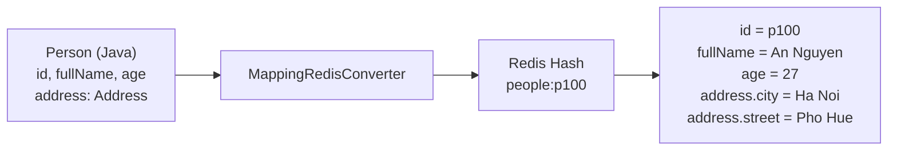
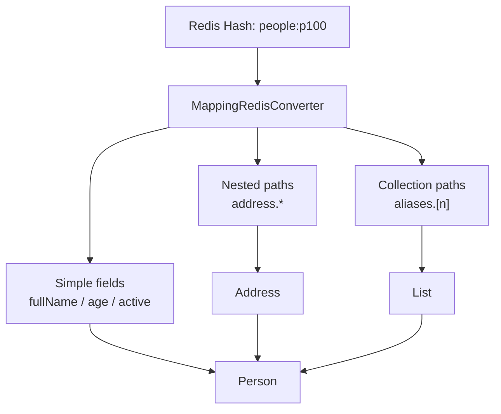

# Ánh xạ thuộc tính đơn giản và đối tượng lồng nhau trong Spring Data Redis

> **Module:** Spring Data Redis  
> **Chương:** Ánh xạ thực thể  
> **Nội dung:** Cách Spring Data Redis chuyển một đối tượng Java thành các trường trong Redis Hash, cách khôi phục đối tượng khi đọc, quy tắc xử lý các thuộc tính đơn giản, đối tượng lồng nhau, collection và những trường hợp cần điều chỉnh ánh xạ.

## 1. Từ thực thể Java đến Redis Hash

Khi sử dụng **Spring Data Redis Repositories**, ứng dụng làm việc với thực thể Java thông qua các thao tác quen thuộc như `save`, `findById` và `deleteById`. Spring Data Redis đảm nhiệm việc chuyển đổi giữa mô hình đối tượng và cấu trúc lưu trữ của Redis.

Ví dụ một thực thể Java:

```java
@RedisHash("people")
public class Person {

    @Id
    private String id;

    private String fullName;
    private Integer age;
    private Address address;
}
```

Ứng dụng nhìn thấy `Person` với thuộc tính `address` là một đối tượng `Address`. Redis nhìn thấy một key đại diện cho thực thể, thông thường là `people:<id>`, với giá trị kiểu **hash** chứa các cặp tên trường và giá trị.

Nếu `address` là đối tượng lồng nhau thông thường, những thuộc tính của nó có thể được *trải phẳng* thành các trường hash như `address.city` và `address.street`. Vì vậy, một thực thể Java **không nhất thiết tương đương một chuỗi JSON** và một đối tượng lồng nhau **không nhất thiết tạo ra Redis key riêng**.

### Sơ đồ ánh xạ



Spring Data Redis sử dụng hạ tầng mapping, trong đó có `RedisMappingContext` và `MappingRedisConverter`, để xác định các thuộc tính cần lưu, chuyển đổi kiểu dữ liệu và tái dựng đối tượng. Thông tin kiểu như `_class` cũng có thể được lưu để hỗ trợ đọc lại chính xác kiểu Java.

Phạm vi bài học này là **ánh xạ thực thể qua Redis Repositories/Redis Mapping**. Đây là cơ chế khác với việc ứng dụng tự gọi `StringRedisTemplate.opsForValue().set(key, json)` để lưu nguyên một chuỗi JSON vào Redis String.

## 2. Thiết lập ví dụ đầy đủ

Giả sử ứng dụng quản lý hồ sơ khách hàng. Mỗi khách hàng có những thuộc tính đơn giản và một địa chỉ lồng nhau.

### 2.1. Lớp `Address`: đối tượng lồng nhau

```java
package com.example.redis.domain;

public class Address {

    private String street;
    private String district;
    private String city;

    public Address() {
    }

    public Address(String street, String district, String city) {
        this.street = street;
        this.district = district;
        this.city = city;
    }

    public String getStreet() {
        return street;
    }

    public void setStreet(String street) {
        this.street = street;
    }

    public String getDistrict() {
        return district;
    }

    public void setDistrict(String district) {
        this.district = district;
    }

    public String getCity() {
        return city;
    }

    public void setCity(String city) {
        this.city = city;
    }
}
```

`Address` là một đối tượng Java thông thường. Trong ví dụ này, nó không có `@Id`, không khai báo `@RedisHash` và không được quản lý như một thực thể độc lập. Nó là một phần dữ liệu của `Person`.

### 2.2. Lớp `Person`: thực thể gốc

```java
package com.example.redis.domain;

import java.util.ArrayList;
import java.util.List;

import org.springframework.data.annotation.Id;
import org.springframework.data.redis.core.RedisHash;

@RedisHash("people")
public class Person {

    @Id
    private String id;

    private String fullName;
    private Integer age;
    private Boolean active;
    private Address address;
    private List<String> aliases = new ArrayList<>();

    public Person() {
    }

    public Person(
            String id,
            String fullName,
            Integer age,
            Boolean active,
            Address address,
            List<String> aliases) {
        this.id = id;
        this.fullName = fullName;
        this.age = age;
        this.active = active;
        this.address = address;
        this.aliases = aliases;
    }

    public String getId() {
        return id;
    }

    public void setId(String id) {
        this.id = id;
    }

    public String getFullName() {
        return fullName;
    }

    public void setFullName(String fullName) {
        this.fullName = fullName;
    }

    public Integer getAge() {
        return age;
    }

    public void setAge(Integer age) {
        this.age = age;
    }

    public Boolean getActive() {
        return active;
    }

    public void setActive(Boolean active) {
        this.active = active;
    }

    public Address getAddress() {
        return address;
    }

    public void setAddress(Address address) {
        this.address = address;
    }

    public List<String> getAliases() {
        return aliases;
    }

    public void setAliases(List<String> aliases) {
        this.aliases = aliases;
    }
}
```

Các annotation và thuộc tính có vai trò riêng:

| Thành phần | Vai trò |
|---|---|
| `@RedisHash("people")` | Khai báo thực thể được Redis mapping quản lý, với keyspace có tên `people` |
| `@Id` | Xác định khóa định danh dùng trong Redis key của thực thể |
| `fullName` | Thuộc tính đơn giản kiểu `String` |
| `age` | Thuộc tính đơn giản kiểu `Integer` |
| `active` | Thuộc tính đơn giản kiểu `Boolean` |
| `address` | Đối tượng phức hợp lồng bên trong `Person` |
| `aliases` | Collection chứa các giá trị đơn giản |

Ví dụ chỉ định rõ `id` khi tạo đối tượng để dễ quan sát Redis key. Trong một số cấu hình, Spring Data có thể hỗ trợ sinh ID nếu chưa có; bài này dùng ID xác định trước để tách bạch việc ánh xạ với chiến lược tạo ID.

### 2.3. Repository

```java
package com.example.redis.repository;

import com.example.redis.domain.Person;
import org.springframework.data.repository.CrudRepository;

public interface PersonRepository extends CrudRepository<Person, String> {
}
```

Repository cung cấp thao tác lưu/đọc thực thể. Không cần tự xây dựng câu lệnh `HSET` cho từng thuộc tính.

Với Spring Boot, thêm dependency `spring-boot-starter-data-redis`, cấu hình kết nối tương ứng và bật Redis repositories nếu ứng dụng chưa bật thông qua cấu hình tự động:

```java
package com.example.redis;

import org.springframework.boot.SpringApplication;
import org.springframework.boot.autoconfigure.SpringBootApplication;
import org.springframework.data.redis.repository.configuration.EnableRedisRepositories;

@SpringBootApplication
@EnableRedisRepositories
public class RedisApplication {

    public static void main(String[] args) {
        SpringApplication.run(RedisApplication.class, args);
    }
}
```

```yaml
spring:
  data:
    redis:
      host: localhost
      port: 6379
```

Ví dụ dùng quy ước cấu hình Spring Boot hiện đại. Nếu dự án đã tự cấu hình repository scan hoặc có nhiều kho dữ liệu, cần xác định phạm vi package phù hợp thay vì bật quét lặp lại.

### 2.4. Lưu và đọc đối tượng

Giả sử một thành phần ứng dụng đã được inject `PersonRepository`:

```java
Address address = new Address(
        "12 Pho Hue",
        "Hai Ba Trung",
        "Ha Noi");

Person person = new Person(
        "p100",
        "An Nguyen",
        27,
        true,
        address,
        List.of("An", "Anna"));

personRepository.save(person);

Person restored = personRepository.findById("p100")
        .orElseThrow();

System.out.println(restored.getFullName());        // An Nguyen
System.out.println(restored.getAddress().getCity()); // Ha Noi
System.out.println(restored.getAliases().get(0));   // An
```

Ở bước `save`, framework khảo sát thuộc tính của `Person` và tạo các trường hash tương ứng. Ở bước `findById`, framework đọc hash và chuyển dữ liệu trở lại một `Person`, bao gồm cả `Address` và danh sách `aliases`.

Đây là ánh xạ **hai chiều**: không chỉ ghi dữ liệu mà còn phải biết khởi tạo lại cấu trúc đối tượng Java khi đọc.

## 3. Thuộc tính đơn giản được ánh xạ như thế nào?

Một *simple property* là thuộc tính được hệ thống conversion xem như giá trị đơn có thể biểu diễn trực tiếp trong một trường Redis Hash, thay vì mở rộng thành nhiều thuộc tính con.

Các ví dụ quen thuộc:

- `String`, `char`/`Character`: văn bản hoặc ký tự.
- Kiểu số như `int`/`Integer`, `long`/`Long`, `double`/`Double`.
- `boolean`/`Boolean`.
- `enum` và một số kiểu thời gian/giá trị được hệ thống conversion của phiên bản đang dùng hỗ trợ.
- Những kiểu tùy chỉnh có converter phù hợp để biến thành giá trị đơn.

Ví dụ `Person` có:

```java
private String fullName = "An Nguyen";
private Integer age = 27;
private Boolean active = true;
```

Dưới dạng hash có thể hình dung:

```text
Redis key: people:p100
Redis type: hash

Field          Value
-------------  ---------
fullName       An Nguyen
age            27
active         true
```

Redis Hash lưu dữ liệu dạng chuỗi byte ở cả trường lẫn giá trị. Những con số hay boolean hiển thị bằng `redis-cli` là biểu diễn đã được serializer/converter xử lý; Redis **không tự biết** trường `age` vốn khai báo `Integer` trong Java. Khi đọc, Spring Data Redis dựa vào thông tin property và cơ chế conversion để khôi phục kiểu cần thiết.

### 3.1. Sự khác nhau giữa primitive và wrapper

Trong Java:

```java
private int score;
private Integer optionalScore;
```

`int` không thể là `null`; giá trị mặc định của nó là `0` nếu đối tượng được tạo và chưa gán. `Integer` có thể là `null` để biểu diễn “chưa có điểm”.

Khi một thuộc tính wrapper không có giá trị, trường tương ứng thường không được ghi vào hash theo cơ chế mapping thông thường. Vì vậy, sự khác nhau giữa **không có trường**, **giá trị rỗng** và **giá trị mặc định** cần được thiết kế rõ trong mô hình domain.

Ví dụ:

- `age = 0` là giá trị có ý nghĩa và không tương đương `age = null`.
- `fullName = ""` là một chuỗi rỗng, khác với không có thuộc tính `fullName` trong hash.
- Không nên đoán rằng một trường không xuất hiện trong hash có nghĩa người dùng đã chủ động xóa dữ liệu; đó cũng có thể là dấu hiệu dữ liệu cũ chưa có trường này.

### 3.2. `@Transient` loại bỏ thuộc tính khỏi ánh xạ

Không phải mọi trường của lớp Java đều cần được lưu.

```java
import org.springframework.data.annotation.Transient;

@Transient
private String displayLabel;
```

`displayLabel` có thể là giá trị tính toán để phục vụ giao diện. `@Transient` của **Spring Data** cho biết mapping framework không lưu trường này như thuộc tính bền vững của thực thể.

Chú ý phân biệt `org.springframework.data.annotation.Transient` với các annotation tương tự của thư viện serialization khác. Annotation của thư viện khác có thể không mang cùng ý nghĩa trong Redis repository mapping.

### 3.3. Kiểu enum

Ví dụ:

```java
public enum MembershipLevel {
    BASIC, SILVER, GOLD
}

private MembershipLevel level;
```

Một enum thường được chuyển thành biểu diễn đơn có thể lưu vào hash và được đọc ngược về enum. Nếu đổi tên hằng số enum sau khi đã có dữ liệu, bản ghi cũ có thể không còn ánh xạ về enum mới được nữa.

Vì vậy, với dữ liệu cần duy trì lâu dài, tên enum và các converter liên quan nên được xem như một phần hợp đồng dữ liệu.

## 4. Đối tượng lồng nhau: cơ chế trải phẳng thuộc tính

Một thuộc tính được coi là đối tượng phức hợp khi framework cần đi vào các thuộc tính con của nó để tạo bản ghi Redis.

Giả sử:

```java
public class Address {
    private String street;
    private String district;
    private String city;
}
```

Và:

```java
private Address address;
```

Khi `address` tồn tại và chứa:

```text
street   = "12 Pho Hue"
district = "Hai Ba Trung"
city     = "Ha Noi"
```

Redis mapping có thể trải phẳng thành:

```text
address.street   = "12 Pho Hue"
address.district = "Hai Ba Trung"
address.city     = "Ha Noi"
```

**Dấu chấm** trong tên trường biểu diễn đường dẫn thuộc tính. `address.city` nghĩa là truy cập thuộc tính `city` bên trong `address` của `Person`.

### 4.1. Xem dữ liệu trực tiếp bằng `redis-cli`

Với đối tượng `p100` của ví dụ:

```bash
redis-cli TYPE people:p100
redis-cli --raw HGETALL people:p100
redis-cli --raw HGET people:p100 address.city
```

Giá trị `TYPE` dự kiến là `hash`. Một dạng dữ liệu minh họa có thể là:

```text
Redis key: people:p100

_class          com.example.redis.domain.Person
id              p100
fullName        An Nguyen
age             27
active          true
address.street  12 Pho Hue
address.district Hai Ba Trung
address.city    Ha Noi
aliases.[0]     An
aliases.[1]     Anna
```

Tên keyspace và các đường dẫn thuộc tính ở trên thể hiện cơ chế mapping thông dụng. Biểu diễn byte, trường metadata như `_class`, thứ tự trường và chi tiết map/collection có thể thay đổi theo cấu hình converter hoặc phiên bản Spring Data Redis. `HGETALL` không bảo đảm thứ tự kết quả.

### 4.2. Không tự động tạo Redis key cho `Address`

Ở ví dụ trên, Redis không cần có key `address:<some-id>`. Các trường của địa chỉ nằm trong cùng Redis Hash `people:p100`.

Hệ quả:

- Xóa `people:p100` cũng loại bỏ các trường `address.*` của hash đó.
- TTL của `people:p100`, nếu có, áp dụng cho **toàn bộ key** chứa cả Person và địa chỉ.
- Không thể dùng `PersonRepository.findById(...)` để truy vấn riêng một `Address` như một aggregate root độc lập.
- Thay đổi địa chỉ thường được lưu cùng thao tác lưu `Person`, thay vì tự động tồn tại như một thực thể riêng.

Đây là mô hình **embedded/nested value object**. Nó phù hợp với thông tin chỉ có ý nghĩa khi đi cùng thực thể gốc, như địa chỉ giao hàng tại thời điểm tạo đơn, cấu hình hiển thị của tài khoản hoặc thông số kỹ thuật riêng của một sản phẩm.

### 4.3. Nhiều cấp lồng nhau

Giả sử `Address` có thêm `GeoLocation`:

```java
public class GeoLocation {
    private Double latitude;
    private Double longitude;
}

public class Address {
    private String city;
    private GeoLocation location;
}
```

Cấu trúc Java:

```text
Person
└── address
    ├── city
    └── location
        ├── latitude
        └── longitude
```

Có thể được biểu diễn theo đường dẫn:

```text
address.city
address.location.latitude
address.location.longitude
```

Chính tên thuộc tính Java tạo thành đường dẫn, vì vậy việc đổi tên `address`, `location` hoặc `latitude` có thể ảnh hưởng tới cách bản ghi cũ được đọc. Khi dữ liệu đã tồn tại, đổi tên property nên đi kèm chiến lược tương thích hoặc chuyển đổi dữ liệu.

### 4.4. Đối tượng lồng nhau có `null`

Nếu:

```java
person.setAddress(null);
personRepository.save(person);
```

Thì trong ánh xạ thông thường sẽ không còn các trường có giá trị thuộc `address` trong bản ghi được lưu lại. Khi đọc, framework không có thông tin thuộc tính con để dựng một địa chỉ đầy đủ.

Một đối tượng `new Address()` mà mọi thuộc tính con đều `null` cũng là trường hợp cần cân nhắc: nếu không có trường nào được lưu, ứng dụng có thể không phân biệt được “đối tượng rỗng đã được tạo” với “không có đối tượng”. Nếu hai trạng thái có ý nghĩa khác nhau trong nghiệp vụ, hãy lưu thêm một tín hiệu trạng thái rõ ràng hoặc sử dụng cách chuyển đổi riêng.

## 5. Collection, List và Map lồng nhau

Ánh xạ thuộc tính không chỉ áp dụng với một đối tượng con. Một collection có thể được trải phẳng thành nhiều trường hash với chỉ mục hoặc khóa map trong đường dẫn.

### 5.1. `List<String>`

Trong `Person`:

```java
private List<String> aliases;
```

Giá trị:

```java
person.setAliases(List.of("An", "Anna", "An Nguyen"));
```

Có thể được lưu theo dạng:

```text
aliases.[0]  = An
aliases.[1]  = Anna
aliases.[2]  = An Nguyen
```

Số trong `[0]`, `[1]`, `[2]` đại diện vị trí trong danh sách. Khi đọc lại, converter dựng collection và các phần tử theo ánh xạ tương ứng.

Không nên trực tiếp sửa trường `aliases.[1]` và cho rằng toàn bộ quy tắc repository, chỉ mục phụ và cấu trúc dữ liệu khác đã được đồng bộ. Nếu dùng repository để quản lý thực thể, nên cập nhật bằng API repository hoặc cơ chế partial update được thiết kế phù hợp.

### 5.2. `List<Address>`

Giả sử một người có nhiều địa chỉ:

```java
private List<Address> deliveryAddresses;
```

Với hai phần tử, đường dẫn thuộc tính có thể được biểu diễn như:

```text
deliveryAddresses.[0].street
deliveryAddresses.[0].city
deliveryAddresses.[1].street
deliveryAddresses.[1].city
```

Điều quan trọng là **đối tượng ở trong list vẫn là nested object**, còn vị trí list trở thành một phần đường dẫn của thuộc tính. Đổi thứ tự list có thể khiến nhiều trường được viết lại dù dữ liệu địa chỉ không đổi.

### 5.3. `Map<String, String>`

Ví dụ:

```java
private Map<String, String> preferences;
```

Giá trị:

```java
Map.of(
    "language", "vi",
    "timezone", "Asia/Ho_Chi_Minh"
);
```

Có thể được trải phẳng thành các tên trường chứa khóa map, chẳng hạn:

```text
preferences.[language] = vi
preferences.[timezone] = Asia/Ho_Chi_Minh
```

Với map chứa đối tượng phức hợp, đường dẫn còn bao gồm thuộc tính của đối tượng đó.

Tên trường cụ thể tùy cấu hình mapper và kiểu key của map. Khi thiết kế map với khóa động, cần chú ý những ký tự mang ý nghĩa cấu trúc trong tên trường (dấu chấm, dấu ngoặc vuông), đồng thời kiểm tra cách mapping của phiên bản sử dụng thay vì tự ghép tên trường theo suy đoán.

### 5.4. `Set` và thứ tự phần tử

`Set` không bảo đảm thứ tự như `List`. Nếu framework dùng vị trí trong cấu trúc hash để tái tạo các phần tử collection, vị trí vật lý không phải hợp đồng nghiệp vụ cho `Set`.

Nếu bài toán yêu cầu thứ tự ổn định (ví dụ thứ tự các bước, mức ưu tiên hoặc lịch trình), nên dùng `List` hoặc tự lưu trường `order` của từng phần tử.

### 5.5. Collection rỗng

Collection rỗng không có phần tử nào để trải phẳng. Vì thế, ở một số dạng ánh xạ, collection rỗng và thuộc tính `null` có thể tạo biểu diễn lưu trữ giống nhau hoặc khó phân biệt. Nếu khác biệt này quan trọng, hãy cân nhắc một thuộc tính riêng để ghi trạng thái hoặc converter tùy chỉnh.

## 6. Cơ chế đọc lại một thực thể

Khi gọi:

```java
personRepository.findById("p100");
```

Có thể hình dung quá trình:

1. Repository xác định keyspace `people` và ID `p100` để tìm Redis key.
2. Redis trả về các trường của hash.
3. `MappingRedisConverter` xác định metadata của thực thể, kiểu của thuộc tính và các quy tắc chuyển đổi.
4. Các trường `fullName`, `age`, `active` được gán lại theo kiểu Java tương ứng.
5. Các đường dẫn `address.street`, `address.city` được gom thành đối tượng `Address`.
6. Các phần tử `aliases.[n]` được dựng lại thành `List<String>`.
7. Spring Data Redis trả lại `Person` cho ứng dụng.



Converter cần biết cách tạo object. Với các POJO Java thông thường, một constructor không tham số cùng các property có thể truy cập được là lựa chọn dễ hiểu. Spring Data còn hỗ trợ nhiều cơ chế chọn constructor và ánh xạ vào đối tượng bất biến tùy phiên bản; khi dùng record, constructor có tham số hoặc kiểu tùy chỉnh, phải bảo đảm cách tạo object phù hợp với framework thực tế.

## 7. Khi nào dùng embedded object, khi nào dùng `@Reference`?

Đối tượng lồng nhau **trải phẳng trong hash** và đối tượng được lưu **riêng bằng reference** là hai mô hình khác nhau.

### 7.1. Embedded object: dữ liệu thuộc về thực thể cha

```java
@RedisHash("people")
public class Person {

    @Id
    private String id;

    private Address address;
}
```

Cấu trúc:

```text
people:p100  (Redis Hash)
  id = p100
  address.city = Ha Noi
  address.street = 12 Pho Hue
```

`Address` phụ thuộc vào vòng đời dữ liệu của `Person`. Khi đọc Person, Spring Data Redis tái dựng Address từ các trường trong cùng một hash.

Dùng khi: địa chỉ là bản sao dữ liệu riêng của người đó, ít có nhu cầu truy cập như một aggregate root độc lập.

### 7.2. `@Reference`: tham chiếu một thực thể khác

Nếu một thuộc tính trỏ tới thực thể được quản lý độc lập, Spring Data Redis có hỗ trợ `@Reference`:

```java
import org.springframework.data.redis.core.index.Indexed;
import org.springframework.data.redis.core.RedisHash;
import org.springframework.data.annotation.Id;
import org.springframework.data.annotation.Reference;

@RedisHash("departments")
public class Department {
    @Id
    private String id;
    private String name;
    // Constructor và accessor theo nhu cầu.
}

@RedisHash("employees")
public class Employee {
    @Id
    private String id;

    @Reference
    private Department department;
    // Constructor và accessor theo nhu cầu.
}
```

Ý tưởng lưu trữ:

```text
departments:d10
  id = d10
  name = Engineering

employees:e20
  id = e20
  department = [tham chiếu tới departments:d10]
```

Thay vì trải phẳng `department.name` bên trong hash `employees:e20`, framework có thể lưu thông tin tham chiếu đủ để tìm thực thể `Department` tương ứng khi đọc.

**Điểm rất quan trọng:** `@Reference` không đồng nghĩa tự động lưu dây chuyền (*cascade save*). Nếu bạn thay đổi `Department` và chỉ lưu `Employee`, đừng kỳ vọng bản ghi `Department` được tự động cập nhật. Tương tự, xóa thực thể tham chiếu không có nghĩa framework sẽ tự bảo đảm mọi reference trỏ đến nó còn hợp lệ.

Quyết định embedded hay reference nên xuất phát từ **ranh giới sở hữu dữ liệu**:

| Tiêu chí | Nested/embedded | `@Reference` |
|---|---|---|
| Cách lưu | Trải phẳng vào hash thực thể gốc | Lưu tham chiếu tới thực thể riêng |
| Key riêng cho đối tượng con | Không yêu cầu | Có, thực thể đích được lưu độc lập |
| Đọc thực thể cha | Dựng đối tượng con từ cùng hash | Có thể cần đọc thực thể đích qua tham chiếu |
| Vòng đời | Gắn với thực thể cha | Vòng đời riêng |
| Phù hợp | Value object, địa chỉ bản sao, cài đặt cá nhân | Department, shared category, đối tượng được nhiều thực thể dùng chung |
| Lưu dây chuyền | Lưu cha lưu các trường nested | Không tự giả định cascade save |

Với quan hệ phức tạp hoặc cần tính nhất quán chặt giữa nhiều aggregate, Redis repositories không phải hệ ORM quan hệ đầy đủ. Cần thiết kế rõ chiến lược cập nhật và đồng bộ.

## 8. Một số annotation và cơ chế liên quan

### 8.1. `@RedisHash`

`@RedisHash("people")` khai báo keyspace. Mẫu key thường thấy là:

```text
people:<id>
```

Ví dụ `people:p100`. Ngoài hash chính, Spring Data Redis có thể tạo các key phụ để phục vụ quản lý keyspace, chỉ mục và expiration tùy đặc điểm repository.

Không nên dựa vào việc “chỉ có đúng một key được tạo” để thiết kế logic scan/xóa trực tiếp trong Redis.

### 8.2. `@Id`

`@Id` giúp framework xác định thực thể.

```java
@Id
private String id;
```

Khi ID thay đổi, danh tính của thực thể trong Redis cũng thay đổi. Không nên tùy tiện sửa `id` của object đã lưu rồi nghĩ đó chỉ là cập nhật một thuộc tính bình thường.

### 8.3. `@Indexed` và truy vấn theo nested property

Redis không tự tạo chỉ mục cho mọi trường hash. Truy vấn repository theo một thuộc tính cần được hỗ trợ bởi cơ chế index phù hợp.

Ví dụ đánh dấu trường `city` bên trong `Address`:

```java
import org.springframework.data.redis.core.index.Indexed;

public class Address {

    @Indexed
    private String city;

    // Các thuộc tính và accessor khác.
}
```

Repository có thể định nghĩa phương thức tìm theo đường dẫn nested:

```java
import java.util.List;

public interface PersonRepository extends CrudRepository<Person, String> {

    List<Person> findByAddress_City(String city);
}
```

Dấu gạch dưới trong tên phương thức giúp tách đường dẫn `address.city` khi trình phân tích tên property cần phân biệt các phần.

Với Spring Data Redis, các trường được index có thể được ánh xạ đến Redis Set chứa ID của những thực thể tương ứng. Điều này hỗ trợ tìm kiếm theo giá trị thuộc tính đã index. Nó cũng có chi phí cập nhật và bộ nhớ: mỗi lần lưu/xóa thực thể có thể phải quản lý thêm dữ liệu index.

Không nhầm `@Indexed` với việc tạo một Redis Hash riêng cho thuộc tính con; indexing là một cấu trúc phục vụ **tra cứu**, còn dữ liệu gốc vẫn được lưu theo mapping của thực thể.

### 8.4. `@TimeToLive` / `@RedisHash(timeToLive = ...)`

TTL áp dụng cho **Redis key của thực thể**, không tự tạo TTL riêng cho từng trường `address.*`.

Ví dụ:

```java
@RedisHash(value = "short-lived-people", timeToLive = 3600)
public class TemporaryPerson {

    @Id
    private String id;

    private Address address;
}
```

Ở đây TTL được khai báo bằng giây. Khi Redis key của `TemporaryPerson` hết hạn, toàn bộ hash biến mất, bao gồm mọi thuộc tính đơn giản và nested đã lưu bên trong.

Một số phiên bản Redis hỗ trợ thao tác expiration ở mức hash field, nhưng đó là tính năng Redis riêng và không đồng nghĩa hành vi TTL entity mặc định của Spring Data Redis repositories.

### 8.5. `@TypeAlias` và metadata kiểu

Spring Data Redis có thể lưu metadata về kiểu Java, chẳng hạn `_class`, để đọc lại đúng thực thể hoặc đối tượng có kiểu đa hình.

Khi refactor package/class, tên Java đã lưu trong Redis có thể không còn hợp lệ. Với dữ liệu giữ lâu, có thể cân nhắc `@TypeAlias` và chiến lược chuyển đổi tương thích.

Ví dụ:

```java
import org.springframework.data.annotation.TypeAlias;

@TypeAlias("person")
@RedisHash("people")
public class Person {
    // ...
}
```

Cách cấu hình metadata cụ thể phụ thuộc mapping context và phiên bản. `@TypeAlias` không tự chuyển đổi các bản ghi cũ đang chứa tên kiểu khác; cần lập kế hoạch migration khi đã có dữ liệu tồn tại.

## 9. Khi một kiểu Java cần custom converter

Ánh xạ mặc định không nhất thiết biết cách lưu mọi value object tùy chỉnh. Có hai cách phổ biến:

- **Cho framework trải phẳng:** một kiểu có các thuộc tính con rõ ràng, ví dụ `GeoLocation(latitude, longitude)`, có thể được map thành `location.latitude` và `location.longitude`.
- **Định nghĩa converter:** lưu đối tượng tùy chỉnh thành một giá trị đơn có định dạng được kiểm soát, ví dụ `"21.0285,105.8542"`, rồi đọc ngược.

Ví dụ mô hình:

```java
public class GeoLocation {
    private double latitude;
    private double longitude;
    // Constructor và accessor.
}
```

Nếu để nested mapping xử lý:

```text
address.location.latitude  = 21.0285
address.location.longitude = 105.8542
```

Nếu cần lưu như một simple value:

```text
address.location = 21.0285,105.8542
```

Có thể đăng ký cặp converter sử dụng Spring `Converter<S, T>` với annotation `@WritingConverter` và `@ReadingConverter`, sau đó đưa chúng vào `RedisCustomConversions`.

Ví dụ phần chuyển đổi cốt lõi:

```java
import org.springframework.core.convert.converter.Converter;
import org.springframework.data.convert.ReadingConverter;
import org.springframework.data.convert.WritingConverter;

@WritingConverter
public class GeoLocationToString
        implements Converter<GeoLocation, String> {

    @Override
    public String convert(GeoLocation source) {
        return source.getLatitude() + "," + source.getLongitude();
    }
}

@ReadingConverter
public class StringToGeoLocation
        implements Converter<String, GeoLocation> {

    @Override
    public GeoLocation convert(String source) {
        String[] parts = source.split(",", -1);
        if (parts.length != 2) {
            throw new IllegalArgumentException("Invalid coordinates: " + source);
        }
        return new GeoLocation(
                Double.parseDouble(parts[0]),
                Double.parseDouble(parts[1]));
    }
}
```

Đoạn code minh họa yêu cầu `GeoLocation` có constructor và getter như được sử dụng. Để converter có hiệu lực cần đăng ký nó trong `RedisCustomConversions` của ứng dụng; chỉ khai báo class converter chưa bảo đảm repository tự dùng nó.

Lưu ý khi thiết kế converter:

1. **Đọc và ghi đối xứng:** dữ liệu do converter ghi phải được converter đọc lại đúng.
2. **Định dạng ổn định:** nếu thay đổi dấu phân tách, độ chính xác số hoặc format ngày giờ, cần tính đến dữ liệu cũ.
3. **Xử lý lỗi rõ ràng:** giá trị bị hỏng hay không đúng format phải được xử lý có chủ đích.
4. **Không tạo xung đột conversion:** converter quá tổng quát (ví dụ giữa những kiểu phổ biến) có thể ảnh hưởng các property ngoài dự kiến.
5. **Xác định nhu cầu truy vấn:** một thuộc tính được gói thành chuỗi đơn sẽ không còn các đường dẫn con như `address.location.latitude` để index theo kiểu nested mapping mặc định.

## 10. Lưu cập nhật đối tượng lồng nhau

Giả sử đã có Person với `address.city = "Ha Noi"`. Để sửa:

```java
Person person = personRepository.findById("p100")
        .orElseThrow();

person.getAddress().setCity("Da Nang");

personRepository.save(person);
```

Bản ghi Redis của thực thể được cập nhật theo trạng thái đối tượng đã lưu. Một lưu ý quan trọng là `CrudRepository.save` hoạt động ở mức **thực thể** và cơ chế mapping có thể ghi lại nhiều trường của hash; không nên mặc định coi đây là một lệnh `HSET address.city ...` duy nhất.

### 10.1. Tại sao cách cập nhật rất quan trọng?

Giả sử hai luồng cùng xử lý `people:p100`:

```text
Luồng A đọc Person (age=27, city=Ha Noi)
Luồng B đọc Person (age=27, city=Ha Noi)

Luồng A đổi city=Da Nang rồi save
Luồng B đổi age=28 rồi save dựa trên bản đọc cũ
```

Nếu mỗi luồng ghi lại trạng thái thực thể cũ của mình, cập nhật của luồng A có thể bị ghi đè bởi luồng B, tùy cơ chế cập nhật và điều phối thực tế.

Cách xử lý có thể gồm:

- Đồng bộ hoặc thiết kế lại thao tác cập nhật theo ranh giới aggregate.
- Dùng cơ chế optimistic locking/versioning nếu loại repository và phiên bản được dùng hỗ trợ phù hợp.
- Dùng thao tác Redis được thiết kế riêng để cập nhật một trường khi thật sự cần tính nguyên tử ở mức trường.
- Với yêu cầu chặt chẽ hơn, cân nhắc Lua script/transaction Redis và các ràng buộc nghiệp vụ tương ứng.

Không nên khuyên dùng một thao tác repository như giải pháp đồng bộ tuyệt đối giữa các lần ghi cạnh tranh nếu chưa xác định rõ bảo đảm của phiên bản Spring Data Redis và mô hình dữ liệu.

### 10.2. Partial update

Spring Data Redis có cơ chế `PartialUpdate` cho những tình huống cần cập nhật một phần của đối tượng đã được ánh xạ mà không cần cung cấp toàn bộ object mới.

Ví dụ khái niệm với `RedisKeyValueTemplate`:

```java
import org.springframework.data.redis.core.PartialUpdate;

PartialUpdate<Person> update =
        new PartialUpdate<>("p100", Person.class)
                .set("address.city", "Da Nang");

redisKeyValueTemplate.update(update);
```

`redisKeyValueTemplate` ở đây là bean `RedisKeyValueTemplate` được inject trong ứng dụng. Cú pháp và các khả năng cập nhật nested path phụ thuộc loại thuộc tính và phiên bản Spring Data Redis sử dụng.

**Không mặc nhiên thay thế** mọi `save` bằng `PartialUpdate`. Việc thay đổi property có index, TTL hoặc collection có thể cần framework cập nhật cấu trúc liên quan. Phải chọn API phù hợp với cơ chế quản lý metadata/index của ứng dụng.

## 11. Phân biệt Redis Repository Mapping với các kiểu lưu Redis khác

Spring Data Redis cung cấp nhiều cách ghi dữ liệu. Cùng một object Java nhưng cách biểu diễn trên Redis có thể rất khác nhau.

| Cách truy cập | Dữ liệu thường được lưu theo dạng | Ý nghĩa của nested object |
|---|---|---|
| Redis Repositories với `@RedisHash` | Redis Hash và mapping property path | Có thể trải phẳng thành `address.city`, `address.street` |
| `RedisTemplate.opsForHash()` | Redis Hash do ứng dụng trực tiếp chỉ định field/value | Ứng dụng quyết định tên field và serializer, không tự mặc định dùng repository mapping |
| `StringRedisTemplate.opsForValue()` | Redis String | Ứng dụng tự biến object thành chuỗi nếu cần |
| `RedisTemplate.opsForValue()` với serializer JSON | Redis String chứa JSON hoặc byte biểu diễn JSON | Object lồng nhau thường là cấu trúc JSON bên trong một value |
| RedisJSON (nếu triển khai module/tính năng tương ứng) | Redis JSON document | Có thể thao tác với JSON path theo API RedisJSON; không phải mặc định của `@RedisHash` |

Ví dụ lưu nguyên JSON bằng `StringRedisTemplate`:

```java
String json = """
        {
          "id": "p100",
          "fullName": "An Nguyen",
          "address": {
            "city": "Ha Noi",
            "street": "12 Pho Hue"
          }
        }
        """;

stringRedisTemplate.opsForValue()
        .set("person-json:p100", json);
```

Đọc `person-json:p100` cần `GET`, vì key là Redis String. Ngược lại, `people:p100` do repository tạo sẽ được đọc như Redis Hash bằng `HGETALL` hoặc `HGET`.

Một trong những lỗi phổ biến là dùng `GET people:p100` rồi gặp `WRONGTYPE`. Redis key của repository được lưu dưới kiểu hash nên phải dùng lệnh phù hợp kiểu dữ liệu; hoặc tốt nhất là đọc qua repository.

## 12. Thực hành quan sát cấu trúc ánh xạ

Chuẩn bị Redis đang chạy, ứng dụng Spring Data Redis và repository của ví dụ.

### Bước 1: lưu thực thể

```java
Person person = new Person(
        "p200",
        "Binh Tran",
        31,
        true,
        new Address("5 Nguyen Trai", "Thanh Xuan", "Ha Noi"),
        List.of("Binh", "BT"));

personRepository.save(person);
```

### Bước 2: xem kiểu dữ liệu và các trường

```bash
redis-cli TYPE people:p200
redis-cli --raw HGETALL people:p200
redis-cli --raw HGET people:p200 fullName
redis-cli --raw HGET people:p200 address.city
```

Kết quả dự kiến:

```text
TYPE people:p200
hash

HGET people:p200 fullName
Binh Tran

HGET people:p200 address.city
Ha Noi
```

### Bước 3: thay đổi nested object

```java
Person found = personRepository.findById("p200")
        .orElseThrow();

found.getAddress().setCity("Hue");
personRepository.save(found);
```

Kiểm tra lại:

```bash
redis-cli --raw HGET people:p200 address.city
```

Kết quả kỳ vọng:

```text
Hue
```

### Bước 4: xem collection

```bash
redis-cli --raw HGETALL people:p200
```

Quan sát các trường mang đường dẫn tương ứng với những phần tử trong `aliases`. Đừng phụ thuộc thứ tự các dòng từ `HGETALL`.

### Bước 5: xóa toàn bộ thực thể

```java
personRepository.deleteById("p200");
```

```bash
redis-cli EXISTS people:p200
```

Kỳ vọng là `0` nếu không có thao tác đồng thời tạo lại key. Khi xóa qua repository, framework còn có cơ hội xử lý metadata/index mà nó quản lý; xóa trực tiếp bằng `DEL` có thể bỏ qua một phần công việc quản lý đó tùy cấu hình.

## 13. Những lỗi thiết kế thường gặp

### 13.1. Nghĩ rằng nested object luôn là JSON

`@RedisHash` mặc định sử dụng mapping Redis Hash với các field theo đường dẫn. Nếu muốn lưu một JSON document nguyên vẹn, cần chủ động lựa chọn serializer/cơ chế lưu khác.

### 13.2. Nghĩ rằng cứ lồng object là tạo thêm Redis key

Lồng `Address` trong `Person` không tự tạo key `addresses:<id>`. Chỉ khi thiết kế thực thể độc lập và lưu nó qua repository tương ứng, hoặc sử dụng cơ chế reference, mới có lý do tồn tại key riêng.

### 13.3. Tự sửa từng field mà bỏ qua repository

Dùng lệnh `HSET` trực tiếp có thể sửa hash nhưng framework còn có thể quản lý index, expiration và metadata khác. Nếu có `@Indexed` hoặc cần đảm bảo trạng thái domain, cách ghi trực tiếp ngoài repository có thể khiến các cấu trúc liên quan không được đồng bộ.

### 13.4. Đổi tên field Java mà không tính đến dữ liệu cũ

Nếu `fullName` đổi thành `displayName`, field hash đã được ghi trước đó không tự đổi tên. Dữ liệu cũ có thể thiếu field mới và bản đọc không phản ánh kỳ vọng. Cần lên kế hoạch migration hoặc đọc tương thích nhiều phiên bản schema.

### 13.5. Nhầm `null` với giá trị mặc định

Một trường vắng mặt không phải lúc nào cũng mang cùng ý nghĩa với `0`, `false` hoặc chuỗi rỗng. Đặc biệt khi đọc bản ghi cũ hoặc object con có thể `null`, nên định nghĩa rõ giá trị mặc định tại tầng domain.

### 13.6. Cho rằng mọi property đều tìm kiếm được qua repository

Redis Hash không tự tạo index truy vấn cho mọi property. Với các phương thức tìm kiếm ngoài ID, cần có cách indexing được hỗ trợ, ví dụ `@Indexed` trên thuộc tính phù hợp, và hiểu chi phí bộ nhớ/cập nhật index.

### 13.7. Không phân biệt “giá trị con” và “thực thể chia sẻ”

Nếu nhiều Person cùng cần dùng một Department và Department thay đổi tập trung, sao chép toàn bộ Department như nested object trong từng Person sẽ tạo nhiều bản dữ liệu dễ lệch nhau. Cân nhắc `@Reference` hoặc mô hình truy cập riêng, đồng thời xử lý việc lưu và cập nhật thực thể đích.

### 13.8. Coi repository save là phép cập nhật đồng thời an toàn cho mọi trường

Đối tượng được đọc, sửa và ghi lại qua `save` có thể chịu vấn đề ghi đè khi nhiều yêu cầu cùng cập nhật. Cần thiết kế nhất quán theo yêu cầu nghiệp vụ; mapping tự động không giải quyết mọi vấn đề cạnh tranh dữ liệu.

## 14. Cách chọn kiểu ánh xạ cho dự án

Khi thiết kế một thực thể dùng Spring Data Redis, có thể ra quyết định theo thứ tự sau:

1. **Xác định aggregate root:** đối tượng nào có danh tính và vòng đời độc lập? Gắn `@RedisHash` và `@Id` cho thực thể cần truy cập bằng ID.
2. **Phân loại property:** giá trị đơn như `String`, `Integer`, `Boolean` là simple property; object mô tả chi tiết riêng thường phù hợp nested mapping.
3. **Chọn embedded hay reference:** dữ liệu phụ thuộc vào thực thể cha nên lưu nested; dữ liệu có danh tính riêng và chia sẻ rộng cần xem xét thực thể độc lập.
4. **Đánh giá collection:** cần duy trì thứ tự thì dùng `List`; dùng `Map` khi các phần tử có khóa; lưu ý biểu diễn đường dẫn và trường hợp rỗng.
5. **Xác định nhu cầu truy vấn:** nếu cần tìm theo property ngoài ID, thiết kế index cụ thể; không giả định mọi field Redis Hash đều có thể truy vấn bằng derived repository method.
6. **Xác định vòng đời:** TTL ở mức key của thực thể; expiration sẽ xóa cả simple field lẫn nested field trong cùng hash.
7. **Dự tính tiến hóa schema:** thêm/bớt/đổi tên property và thay đổi converter đều có tác động lên dữ liệu cũ.
8. **Quyết định cơ chế cập nhật:** lưu toàn bộ thực thể qua repository hay cập nhật một phần phải dựa vào tính nhất quán, index và cách ứng dụng xử lý ghi đồng thời.

Điểm cốt lõi của bài học là: **Spring Data Redis có thể ánh xạ một cây đối tượng Java thành một Redis Hash với các field mô tả đường dẫn thuộc tính.** Thuộc tính đơn giản trở thành giá trị đơn; đối tượng lồng nhau được trải phẳng theo tên thuộc tính; collection bổ sung vị trí hoặc khóa vào đường dẫn. Hiểu được cấu trúc này giúp bạn đọc dữ liệu thực tế trong Redis, thiết kế domain rõ ràng và tránh nhầm lẫn giữa embedded object, reference và JSON serialization.

## Tài liệu đọc thêm

- Spring Data Redis Reference — [Object Mapping](https://docs.spring.io/spring-data/redis/reference/redis/redis-repositories/mapping.html).
- Spring Data Redis Reference — [Redis Repositories](https://docs.spring.io/spring-data/redis/reference/redis/redis-repositories.html).
- Spring Data Redis Reference — [Indexing](https://docs.spring.io/spring-data/redis/reference/redis/redis-repositories/indexes.html).
- Spring Data Redis Reference — [Keyspaces](https://docs.spring.io/spring-data/redis/reference/redis/redis-repositories/keyspaces.html).
- Spring Data Redis Reference — [Custom Conversions](https://docs.spring.io/spring-data/redis/reference/redis/redis-repositories/mapping.html#redis.repositories.mapping.custom-conversions).
