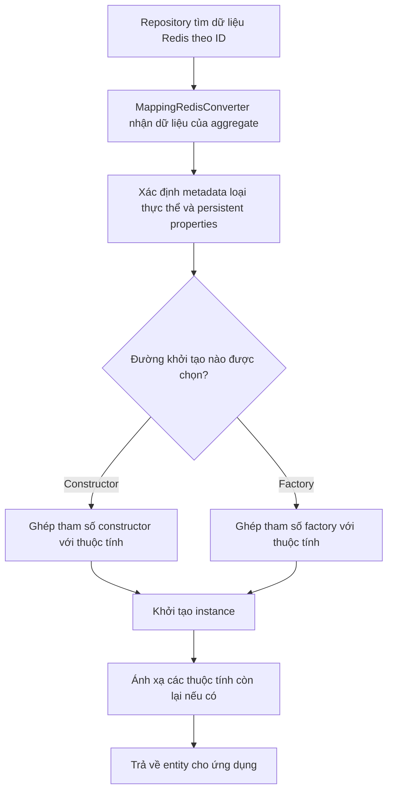
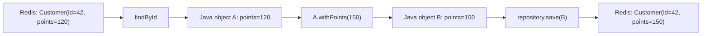

# Lựa chọn constructor và khởi tạo đối tượng bất biến trong Spring Data Redis

## 1. Bối cảnh: Redis lưu dữ liệu, Spring Data dựng lại đối tượng Java

Khi ứng dụng lưu một thực thể bằng **Spring Data Redis Repository**, dữ liệu của thực thể được ánh xạ thành các cấu trúc Redis. Khi đọc lại, Spring Data Redis phải thực hiện chiều ngược lại: xác định loại thực thể, lấy các thuộc tính đã lưu và **tạo một instance Java** có trạng thái tương ứng.

Với đối tượng Java thông thường, ứng dụng có thể tạo đối tượng bằng constructor không tham số rồi gán thuộc tính qua setter. Nhưng với một thực thể **bất biến** (*immutable entity*), các trường thường là `final`, không có setter và phải nhận toàn bộ trạng thái cần thiết ngay khi khởi tạo. Spring Data cần chọn đúng constructor hoặc phương thức factory để truyền giá trị đã đọc vào đối tượng.

Ví dụ, một thực thể người dùng có ba thuộc tính:

```text
Redis
  customers:42  ->  id = "42"
                    displayName = "Mai"
                    points = 120
                         |
                         v
             Spring Data Redis mapping
                         |
                         v
     new Customer("42", "Mai", 120)
```

Không phải lúc nào Redis cũng lưu các trường dưới đúng biểu diễn văn bản như trên; đây là mô hình khái niệm của bước ánh xạ. Việc mã hóa thuộc tính thực tế phụ thuộc vào cấu hình converter và kiểu dữ liệu.

Mục tiêu của bài học là hiểu **cơ chế lựa chọn constructor**, cách thiết kế **immutable entity có thể được Spring Data Redis đọc/ghi**, và những lỗi thường xuất hiện khi có nhiều constructor, thiếu metadata tên tham số hoặc thay đổi cấu trúc thực thể.

## 2. Phạm vi: entity mapping khác với tự serialize một object

Cần phân biệt hai cách sử dụng Redis trong Spring:

| Cách làm | Ai tạo đối tượng khi đọc? | Vai trò của constructor trong Spring Data mapping |
|---|---|---|
| `CrudRepository<Customer, String>` với `@RedisHash` | Spring Data Redis mapping infrastructure | Áp dụng quy tắc chọn persistence constructor / factory |
| `RedisTemplate` với `MappingRedisConverter` hoặc đường ánh xạ tương đương | Spring Data Redis mapping infrastructure | Cũng sử dụng cơ chế entity mapping |
| `RedisTemplate` ghi JSON bằng một JSON serializer | JSON serializer/deserializer đã cấu hình, ví dụ Jackson | Tuân theo quy tắc của JSON serializer; `@PersistenceCreator` không phải cơ chế khởi tạo chung của Jackson |
| `StringRedisTemplate` ghi một chuỗi đơn | String serializer | Không cần materialize entity Java từ Redis Hash |

Do đó, bài này nói về **ánh xạ thực thể do Spring Data Redis quản lý**. Không nên mặc định rằng thêm `@PersistenceCreator` sẽ thay đổi cách một JSON serializer bất kỳ khởi tạo đối tượng.

Một thực thể Redis Repository thường có:

- `@RedisHash`: định nghĩa đây là aggregate được lưu trong Redis keyspace.
- `@Id`: chỉ định thuộc tính định danh.
- Các thuộc tính persistent: dữ liệu cần ánh xạ vào và ra từ Redis.
- Một constructor hoặc factory thích hợp để Spring Data tái tạo instance.

## 3. Lựa chọn constructor diễn ra như thế nào?

Spring Data dùng cơ chế *object creation* chung của Spring Data Commons để xác định phương thức khởi tạo đối tượng persistent. Với Java, các lựa chọn tiêu biểu bao gồm:

| Cấu trúc lớp | Cách thiết kế nên dùng |
|---|---|
| Chỉ có một constructor | Spring Data thường dùng constructor duy nhất đó |
| Có nhiều constructor, một constructor đánh dấu `@PersistenceCreator` | Constructor được chỉ định là đường khởi tạo cho persistence |
| Có static factory được chỉ định `@PersistenceCreator` | Spring Data có thể tạo instance thông qua factory đó |
| Java `record` | Constructor canonical của record được dùng để khôi phục các component, trừ khi có lựa chọn persistence được chỉ định rõ phù hợp |
| Lớp mutable có constructor không tham số và setter / field access | Có thể khởi tạo bằng no-arg constructor rồi gán trạng thái |
| Có nhiều đường khởi tạo nhưng không có lựa chọn rõ ràng | Dễ bị chọn ngoài ý muốn hoặc không khởi tạo được; cần thiết kế lại hoặc đánh dấu rõ ràng |

Có những quy tắc ưu tiên cụ thể giữa constructor đơn, annotated factory, record và no-arg constructor; vì vậy cách **ít mơ hồ nhất** khi có nhiều constructor là chỉ định đúng một đường persistence bằng `@PersistenceCreator`. Đối với Java record thuần túy, canonical constructor là lựa chọn tự nhiên.

`@PersistenceCreator` nằm trong package:

```java
import org.springframework.data.annotation.PersistenceCreator;
```

Đừng nhầm annotation này với `@Autowired` (chọn constructor cho dependency injection của Spring bean) hoặc `@JsonCreator` (hướng dẫn một số JSON serializer). Một thực thể Redis thường là **đối tượng miền dữ liệu**, không phải bean được container tạo và inject.

### Dòng xử lý lúc đọc một thực thể



Bước *khởi tạo đối tượng* và bước *gán thuộc tính còn lại* là hai trách nhiệm khác nhau. Nếu một thuộc tính `final` không được đưa vào constructor và cũng không có cách tạo bản sao thích hợp, Spring Data có thể không có đường hợp lệ để thiết lập giá trị đó.

## 4. Ví dụ cơ bản: immutable entity chỉ có một constructor

Giả sử ứng dụng có thực thể khách hàng với ID được cấp bởi nghiệp vụ, tên hiển thị và số điểm. Tất cả thuộc tính đều được cung cấp ngay khi tạo đối tượng.

```java
package com.example.demo.customer;

import java.util.Objects;
import org.springframework.data.annotation.Id;
import org.springframework.data.redis.core.RedisHash;

@RedisHash("customers")
public class Customer {

    @Id
    private final String id;
    private final String displayName;
    private final int points;

    public Customer(String id, String displayName, int points) {
        this.id = Objects.requireNonNull(id, "id");
        this.displayName = Objects.requireNonNull(displayName, "displayName");
        if (points < 0) {
            throw new IllegalArgumentException("points must be non-negative");
        }
        this.points = points;
    }

    public String getId() {
        return id;
    }

    public String getDisplayName() {
        return displayName;
    }

    public int getPoints() {
        return points;
    }

    public Customer withPoints(int newPoints) {
        return new Customer(id, displayName, newPoints);
    }

    public Customer withDisplayName(String newName) {
        return new Customer(id, newName, points);
    }
}
```

Vì lớp này chỉ có một constructor với đầy đủ thuộc tính, Spring Data có thể dùng constructor đó để tái tạo thực thể khi đọc. Hai phương thức `withPoints` và `withDisplayName` tạo **instance mới**, giúp bên ngoài không cần sửa các trường `final`.

Repository:

```java
package com.example.demo.customer;

import org.springframework.data.repository.CrudRepository;

public interface CustomerRepository extends CrudRepository<Customer, String> {
}
```

Dịch vụ minh họa đọc, thay đổi và ghi lại:

```java
package com.example.demo.customer;

import org.springframework.stereotype.Service;

@Service
public class CustomerService {

    private final CustomerRepository repository;

    public CustomerService(CustomerRepository repository) {
        this.repository = repository;
    }

    public Customer create(String id, String displayName) {
        return repository.save(new Customer(id, displayName, 0));
    }

    public Customer addPoints(String id, int amount) {
        if (amount <= 0) {
            throw new IllegalArgumentException("amount must be positive");
        }

        Customer existing = repository.findById(id)
                .orElseThrow(() -> new IllegalArgumentException("Customer not found"));

        Customer updated = existing.withPoints(
                Math.addExact(existing.getPoints(), amount)
        );
        return repository.save(updated);
    }
}
```

Trong ví dụ trên, tính bất biến thuộc **đối tượng Java**: `existing` không đổi sau khi gọi `withPoints`. Redis vẫn là kho dữ liệu có thể cập nhật; `save(updated)` lưu trạng thái mới. Đọc → tính toán → lưu bằng các lệnh riêng **không tự bảo đảm chống lost update khi có nhiều tác vụ đồng thời**. Một ứng dụng tích điểm có yêu cầu tính đúng đắn cao cần thêm cơ chế điều phối hoặc thao tác cập nhật nguyên tử phù hợp.

### Vì sao nên truyền ID từ đầu?

Nếu ID được cấp khi gọi `new Customer(...)` thì constructor có đầy đủ mọi giá trị cần thiết. Ngược lại, nếu dựa vào cơ chế sinh ID khi lưu mà `id` là `final`, Spring Data cần một chiến lược để đưa ID được sinh vào object, chẳng hạn một *wither* tạo đối tượng mới có ID tương ứng. Cấu hình cụ thể phụ thuộc kiểu entity và ánh xạ. Với ví dụ nhập môn về khởi tạo immutable entity, **ID được cấp rõ ràng** giúp luồng tạo đối tượng dễ theo dõi.

## 5. Khi có nhiều constructor: chọn rõ bằng @PersistenceCreator

Một nhu cầu phổ biến là thêm constructor tiện dụng cho mã nghiệp vụ. Nếu lớp có nhiều constructor, tránh để Spring Data phải suy đoán constructor nào dùng để phục hồi dữ liệu.

```java
package com.example.demo.customer;

import java.util.Objects;
import org.springframework.data.annotation.Id;
import org.springframework.data.annotation.PersistenceCreator;
import org.springframework.data.redis.core.RedisHash;

@RedisHash("customers")
public class Customer {

    @Id
    private final String id;
    private final String displayName;
    private final int points;

    // Constructor tiện dụng cho tác vụ tạo mới.
    public Customer(String id, String displayName) {
        this(id, displayName, 0);
    }

    // Constructor Spring Data dùng khi đọc dữ liệu đã lưu.
    @PersistenceCreator
    public Customer(String id, String displayName, int points) {
        this.id = Objects.requireNonNull(id, "id");
        this.displayName = Objects.requireNonNull(displayName, "displayName");
        if (points < 0) {
            throw new IllegalArgumentException("points must be non-negative");
        }
        this.points = points;
    }

    public String getId() {
        return id;
    }

    public String getDisplayName() {
        return displayName;
    }

    public int getPoints() {
        return points;
    }

    public Customer withPoints(int value) {
        return new Customer(id, displayName, value);
    }
}
```

Ở đây có hai mục đích khác nhau:

1. `Customer(id, displayName)` giúp mã nghiệp vụ tạo khách hàng với `points = 0`.
2. `Customer(id, displayName, points)` là constructor đầy đủ để Spring Data khôi phục trạng thái persistent, kể cả số điểm đã lưu.

Annotation `@PersistenceCreator` giải quyết trực tiếp lựa chọn đó. Constructor cho persistence nên nhận đủ các giá trị cần để xác lập bất biến của entity. Nếu constructor bỏ qua một trường bất biến có giá trị đã lưu, cần có một cơ chế tạo bản sao hợp lệ cho trường đó; cách đơn giản hơn thường là đưa trường đó vào constructor.

### Tên tham số là một phần của hợp đồng ánh xạ

Spring Data cần liên hệ tên tham số constructor với tên persistent property tương ứng. Ví dụ:

```java
@PersistenceCreator
public Customer(String id, String displayName, int points) {
    // id          -> thuộc tính id
    // displayName -> thuộc tính displayName
    // points      -> thuộc tính points
}
```

Nếu đổi tên tham số `displayName` thành `name` trong khi persistent property vẫn là `displayName`, Spring Data không tự suy ra rằng hai tên này có cùng ý nghĩa. Tùy metadata và mapping, ứng dụng có thể báo lỗi khi tạo entity hoặc khi gán thuộc tính.

Đối với Java class, bảo đảm tên tham số được giữ trong bytecode bằng tùy chọn compiler `-parameters`, hoặc cung cấp metadata tên tham số bằng cách được Spring Data hỗ trợ, ví dụ `@ConstructorProperties` trong trường hợp thích hợp:

```java
import java.beans.ConstructorProperties;

@PersistenceCreator
@ConstructorProperties({"id", "displayName", "points"})
public Customer(String id, String displayName, int points) {
    this.id = id;
    this.displayName = displayName;
    this.points = points;
}
```

Ví dụ `@ConstructorProperties` minh họa cách khai báo tên thuộc tính; trong mã thực tế vẫn cần giữ validation và invariant tương ứng. Với dự án Gradle Java, tùy chọn compile có thể được cấu hình như sau nếu build hiện tại chưa giữ tên tham số:

```groovy
tasks.withType(JavaCompile).configureEach {
    options.compilerArgs += '-parameters'
}
```

Một số cấu hình Spring Boot đã thiết lập tùy chọn này; chỉ bổ sung khi cần thiết, tránh sửa build không có lý do. Việc đổi tên field, constructor parameter hay thay đổi schema Redis phải được thực hiện nhất quán.

## 6. Dùng Java record cho thực thể bất biến

Java `record` là cú pháp ngắn gọn cho một kiểu dữ liệu có component cố định. Mỗi record có canonical constructor tương ứng với các component. Với Spring Data mapping, canonical constructor giúp khôi phục instance mà không cần setter.

```java
package com.example.demo.customer;

import org.springframework.data.annotation.Id;
import org.springframework.data.redis.core.RedisHash;

@RedisHash("customerProfiles")
public record CustomerProfile(
        @Id String id,
        String displayName,
        String email
) {
    public CustomerProfile {
        if (id == null || id.isBlank()) {
            throw new IllegalArgumentException("id must not be blank");
        }
        if (displayName == null || displayName.isBlank()) {
            throw new IllegalArgumentException("displayName must not be blank");
        }
    }

    public CustomerProfile withEmail(String newEmail) {
        return new CustomerProfile(id, displayName, newEmail);
    }
}
```

Phần `public CustomerProfile { ... }` là **compact canonical constructor**. Java tự gán các component sau khi phần thân constructor kết thúc; Spring Data có thể sử dụng canonical constructor để tái tạo record.

```java
public interface CustomerProfileRepository
        extends CrudRepository<CustomerProfile, String> {
}
```

Ví dụ sử dụng:

```java
CustomerProfile initial =
        new CustomerProfile("42", "Mai", "mai@example.test");

repository.save(initial);

CustomerProfile saved = repository.findById("42")
        .orElseThrow();

CustomerProfile changed = saved.withEmail("mai.new@example.test");
repository.save(changed);

// saved.email() vẫn là "mai@example.test"
```

Record có sẵn `equals`, `hashCode` và `toString` dựa trên component. Tuy nhiên, tính bất biến của record là **nông** (*shallow immutability*): nếu một component trỏ đến `List` hoặc object có thể sửa đổi, record không tự đóng băng nội dung bên trong. Cần dùng giá trị bất biến, sao chép phòng vệ hoặc quy ước không sửa collection khi thiết kế aggregate.

Không phải mọi mô hình domain đều phù hợp với record: nếu có các liên kết phức tạp, trạng thái theo vòng đời dài hoặc cần các cách tạo bản sao đặc thù, một class `final` với constructor rõ ràng có thể dễ bảo trì hơn.

## 7. Static factory với @PersistenceCreator

Ngoài constructor, Spring Data Commons còn có thể dùng **static factory method** được đánh dấu `@PersistenceCreator` làm đường tạo persistent entity. Cách này hữu ích khi muốn giấu constructor hoặc đặt tên rõ ý nghĩa cho việc khôi phục trạng thái.

```java
package com.example.demo.customer;

import java.util.Objects;
import org.springframework.data.annotation.Id;
import org.springframework.data.annotation.PersistenceCreator;
import org.springframework.data.redis.core.RedisHash;

@RedisHash("memberships")
public class Membership {

    @Id
    private final String id;
    private final String tier;

    private Membership(String id, String tier) {
        this.id = Objects.requireNonNull(id);
        this.tier = Objects.requireNonNull(tier);
    }

    public static Membership newBasic(String id) {
        return new Membership(id, "BASIC");
    }

    @PersistenceCreator
    public static Membership restore(String id, String tier) {
        return new Membership(id, tier);
    }

    public String getId() {
        return id;
    }

    public String getTier() {
        return tier;
    }
}
```

`newBasic(...)` dùng để tạo mới trong nghiệp vụ; `restore(...)` nhận đầy đủ trạng thái từ dữ liệu persistent. Trong lớp đã có đường khởi tạo được chỉ định, tránh định nghĩa thêm một constructor/factory persistence cạnh tranh. Tên tham số factory cũng cần ánh xạ được tới thuộc tính, tương tự tham số constructor.

Không sử dụng factory được chỉ định cho persistence để gọi dịch vụ ngoài, tạo dữ liệu ngẫu nhiên hoặc thực hiện side effect. Spring Data có thể gọi nó cho mỗi lần đọc; factory nên là phép tạo đối tượng xác định từ dữ liệu đầu vào.

## 8. Khởi tạo bất biến không có nghĩa là không bao giờ cập nhật

Xem một thực thể bất biến như **snapshot của trạng thái**. Việc cập nhật thực thể trong Redis gồm tạo một snapshot mới rồi lưu:



Thiết kế này đem lại các lợi ích:

- Trạng thái của object vừa đọc không bị thay đổi bất ngờ bởi code ở nơi khác.
- Có thể kiểm tra invariant ngay trong constructor.
- Mã miền thể hiện rõ việc tạo một phiên bản mới, hỗ trợ suy luận và kiểm thử.

Nhưng cần tránh ba ngộ nhận:

**Ngộ nhận 1: `final` đảm bảo an toàn đồng thời của toàn bộ thao tác cập nhật.** Không đúng. Hai request có thể cùng đọc `points = 120`, tính ra các số mới khác nhau và lưu lần lượt; một cập nhật có thể bị ghi đè. Đây là vấn đề của phối hợp cập nhật dữ liệu, không phải của constructor.

**Ngộ nhận 2: bất biến nghĩa là Redis không cho sửa dữ liệu.** Không đúng. Redis luôn chứa trạng thái có thể được thay thế hoặc cập nhật. Bất biến là thuộc tính của instance được tạo trong Java.

**Ngộ nhận 3: không có setter đồng nghĩa Spring Data luôn khởi tạo được.** Không đúng. Spring Data vẫn cần có đường đưa các giá trị persisted vào constructor/factory hoặc cơ chế tạo bản sao hợp lệ.

## 9. Sinh ID và wither cho trường final

Một thực thể mới đôi khi chưa biết ID:

```java
new Item(null, "Keyboard");
```

Với entity mutable, một framework có thể gán ID sau khi sinh. Với entity có `final id`, không có setter để cập nhật instance ban đầu. Một mẫu thiết kế là **wither**:

```java
@RedisHash("items")
public class Item {

    @Id
    private final String id;
    private final String name;

    public Item(String id, String name) {
        this.id = id;
        this.name = name;
    }

    public Item withId(String newId) {
        return new Item(newId, name);
    }

    public String getId() {
        return id;
    }

    public String getName() {
        return name;
    }
}
```

Spring Data có cơ chế xử lý cập nhật thuộc tính immutable bằng cách tạo bản sao trong các trường hợp hỗ trợ. Với thực thể cần ID được sinh khi lưu, kiểm tra chiến lược ID của module, hỗ trợ wither và giá trị trả về từ `save(...)`. Đừng giả định biến `Item original` ban đầu được thay đổi tại chỗ sau khi gọi `save(original)`.

```java
Item original = new Item(null, "Keyboard");
Item persisted = repository.save(original);

// Dùng persisted cho các bước tiếp theo, nhất là khi ID được cấp
// và kết quả save là một instance mới.
```

Nếu nghiệp vụ chủ động cấp ID từ đầu, có thể tránh một số độ phức tạp của việc cập nhật ID bất biến. Dù chọn cách nào, cần có một mô hình nhất quán giữa constructor, định danh và cách repository lưu trả lại đối tượng.

## 10. Khi thêm thuộc tính mới vào entity bất biến

Giả sử phiên bản đầu lưu:

```java
public Member(String id, String displayName) {
    this.id = id;
    this.displayName = displayName;
}
```

Phiên bản tiếp theo thêm `status`. Dữ liệu Redis cũ có thể chưa có trường này. Nếu constructor mới đòi giá trị không null, việc đọc dữ liệu cũ có thể không thành công.

Một chiến lược là nhận giá trị có thể thiếu và áp dụng default rõ ràng:

```java
@RedisHash("members")
public class Member {

    @Id
    private final String id;
    private final String displayName;
    private final String status;

    @PersistenceCreator
    public Member(String id, String displayName, String status) {
        this.id = java.util.Objects.requireNonNull(id);
        this.displayName =
                java.util.Objects.requireNonNull(displayName);
        this.status = status == null ? "ACTIVE" : status;
    }

    public Member(String id, String displayName) {
        this(id, displayName, "ACTIVE");
    }

    public String getId() { return id; }

    public String getDisplayName() { return displayName; }

    public String getStatus() { return status; }
}
```

Default `"ACTIVE"` chỉ là **ví dụ về chính sách nghiệp vụ**. Trong hệ thống thật, cần quyết định liệu dữ liệu cũ có thực sự tương đương trạng thái đó. Không dùng default tùy tiện để che giấu lỗi schema hoặc dữ liệu hỏng.

Khi tiến hóa schema, nên cân nhắc:

1. **Tên thuộc tính:** đã lưu theo tên nào; constructor mới có còn nhận đúng tên đó không?
2. **Null / thiếu trường:** constructor xử lý thế nào; nên dùng reference type hay primitive?
3. **Invariant:** validation mới có chấp nhận dữ liệu do phiên bản cũ tạo ra không?
4. **Kiểu dữ liệu:** converter có chuyển được dữ liệu đã lưu sang kiểu constructor mới không?
5. **Đường khởi tạo:** có vô tình thêm constructor khiến framework đổi lựa chọn cũ không?

Một constructor bảo vệ invariant là tốt, nhưng nếu dữ liệu cũ không còn hợp lệ thì cần quyết định migration và tương thích ngược trước khi triển khai.

## 11. Kotlin data class và constructor chính

Nếu dự án dùng Kotlin, `data class` thường là cách tự nhiên để biểu diễn thực thể bất biến. Spring Data hỗ trợ nhận diện primary constructor của Kotlin để materialize entity, với yêu cầu metadata và runtime Kotlin phù hợp.

```kotlin
import org.springframework.data.annotation.Id
import org.springframework.data.redis.core.RedisHash

@RedisHash("customers")
data class Customer(
    @Id val id: String,
    val displayName: String,
    val points: Int = 0
) {
    fun withPoints(newPoints: Int): Customer =
        copy(points = newPoints)
}
```

Kotlin `copy(...)` tạo đối tượng mới trong khi giữ các thuộc tính không được thay đổi. Khả năng áp dụng default parameter trong quá trình materialization phụ thuộc việc tham số được cung cấp hay bị bỏ qua khi ánh xạ; không nên mặc định rằng mọi giá trị `null` trong dữ liệu đều tự chuyển thành default. Đặc biệt, property khai báo `String` không nullable cần nhận giá trị hợp lệ.

Với Java, record thường là lựa chọn tương đương về tính ngắn gọn. Với Kotlin, data class cho phép biểu diễn hàm `copy` ngay trong ngôn ngữ.

## 12. Hiệu năng: constructor invocation và property population

Spring Data có thể sử dụng cơ chế tạo instance tối ưu (ví dụ sinh đối tượng hỗ trợ gọi constructor/factory) khi kiểu dữ liệu và visibility cho phép; khi không phù hợp, framework có thể dùng reflection hoặc cơ chế dự phòng. Điều này không thay đổi hợp đồng dữ liệu: constructor vẫn cần nhận đúng các thuộc tính persistent.

Các nguyên tắc thiết kế thường có ích hơn tối ưu hóa sớm:

- Dùng type có visibility rõ ràng và constructor/factory có thể truy cập.
- Tránh non-static inner class làm entity vì nó cần instance bao ngoài để khởi tạo.
- Ưu tiên constructor có đầy đủ trạng thái cần thiết, không giấu side effect.
- Tránh tạo entity dựa vào biến global, request context hoặc đồng hồ hiện tại trong persistence constructor.
- Không phân tán việc thiết lập các trường `final` sang nhiều setter giả lập.

Để biết đường khởi tạo nào đang được dùng trong một dự án, hãy căn cứ vào cấu trúc entity và metadata thực tế; đừng dùng suy đoán dựa trên việc code “chạy được” khi chỉ lưu mà chưa đọc lại.

## 13. Chẩn đoán lỗi khi materialize entity

| Triệu chứng | Nguyên nhân thường gặp | Hướng xử lý |
|---|---|---|
| Đọc entity thất bại sau khi thêm constructor mới | Spring Data chọn sai đường khởi tạo hoặc không xác định được constructor phù hợp | Giữ một constructor persistence rõ ràng, đánh dấu `@PersistenceCreator` khi cần |
| Không tìm thấy giá trị cho tham số constructor | Tên tham số không khớp persistent property hoặc thiếu metadata tên | Đồng bộ tên thuộc tính, kiểm tra `-parameters` / `@ConstructorProperties` |
| Thất bại khi gán thuộc tính `final` | Thuộc tính không nhận giá trị qua constructor/factory và không có đường tạo bản sao thích hợp | Đưa thuộc tính vào constructor hoặc cung cấp chiến lược wither phù hợp |
| `NullPointerException` / validation exception khi đọc bản ghi cũ | Dữ liệu thiếu trường hoặc vi phạm invariant mới | Thiết kế fallback có chủ đích hoặc migration dữ liệu |
| Sai kiểu dữ liệu trong constructor | Converter không chuyển được dữ liệu đã lưu sang Java type mới | Xem lại schema lưu trữ và cơ chế conversion |
| Save xong nhưng object ban đầu vẫn thiếu ID | Object bất biến không bị sửa tại chỗ | Sử dụng object do `save` trả về |
| Có `@JsonCreator` nhưng Spring Data Redis Repository vẫn lỗi | Nhầm cơ chế JSON deserialization với Spring Data mapping | Chọn annotation đúng theo đường đọc thực tế |
| Constructor đọc dữ liệu thành công nhưng thuộc tính bị mất | Một số persistent property không nằm trong creator và không được population đúng cách | Đối chiếu danh sách property với tham số constructor/factory |

Khi gặp lỗi ánh xạ, đọc **cause gốc** của ngoại lệ (`MappingInstantiationException`, vấn đề conversion, lỗi trong constructor hoặc lỗi binding thuộc tính) để phân biệt lỗi lựa chọn creator với dữ liệu cũ không hợp lệ. Không nên chỉ dựa vào thông điệp “Could not instantiate” mà mặc định constructor không tham số là giải pháp.

Một checklist thực dụng cho một entity mới:

1. Xác nhận đối tượng được đọc qua Spring Data Redis entity mapping chứ không qua JSON serializer độc lập.
2. Xác định constructor, factory hoặc record canonical constructor sẽ được Spring Data dùng.
3. Bảo đảm tên và kiểu các tham số được ánh xạ đúng sang persistent properties.
4. Đưa các trường bất biến vào creator hoặc chuẩn bị cơ chế copy phù hợp.
5. Đảm bảo cùng một instance có thể được tạo bằng dữ liệu đã lưu, kể cả trường có thể vắng mặt từ phiên bản cũ.
6. Khi cập nhật, tạo object mới rồi lưu; xử lý ID và cạnh tranh cập nhật ở tầng lưu trữ/ứng dụng.

## 14. Kết luận

**Lựa chọn constructor** là bước quyết định cách Spring Data Redis biến dữ liệu đã lưu thành một aggregate Java. Với class chỉ có một constructor đầy đủ, framework thường có thể chọn tự nhiên; với nhiều constructor hoặc static factory, `@PersistenceCreator` giúp chỉ định đường phục hồi. Java record và Kotlin data class cung cấp những cú pháp thuận tiện cho mô hình bất biến, còn wither và `copy` cho phép tạo phiên bản trạng thái mới.

Thiết kế immutable entity tốt cần đồng thời thỏa ba điều kiện: **khởi tạo được từ dữ liệu Redis**, **bảo vệ invariant của miền nghiệp vụ**, và **có đường cập nhật rõ ràng mà không sửa instance hiện tại**. Những điều kiện này giúp entity dễ hiểu hơn khi hệ thống lớn lên và khi schema persistent thay đổi theo thời gian.
