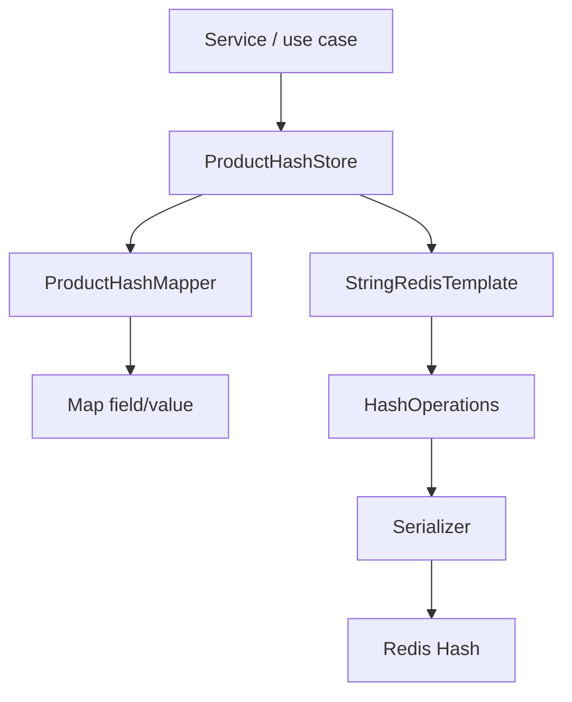

# HashMapper và lựa chọn ánh xạ đối tượng ngoài Repository trong Spring Data Redis

Redis lưu dữ liệu dưới dạng nhiều cấu trúc khác nhau; với **Redis Hash**, một khóa chứa tập các cặp *field → value*. Khi ứng dụng Java cần lưu đối tượng vào Hash mà không dùng `CrudRepository` của Spring Data Redis, lập trình viên phải quyết định cách đặt tên khóa, chuyển thuộc tính Java thành các field, tuần tự hóa giá trị và dựng lại đối tượng. `HashMapper` là một abstraction của Spring Data Redis hỗ trợ riêng bước **chuyển đổi giữa đối tượng và cấu trúc Map đại diện cho Redis Hash**.

Bài học trình bày cơ chế `HashMapper`, các lựa chọn `BeanUtilsHashMapper`, `Jackson2HashMapper`, `ObjectHashMapper` và mapper tự viết; sau đó xây dựng một ví dụ đầy đủ với `StringRedisTemplate` và `HashOperations`. Trọng tâm là hiểu khi nào nên dùng từng cách, đặc biệt trong dịch vụ quản lý cache, dữ liệu phiên, dữ liệu tạm hoặc khi ứng dụng cần kiểm soát trực tiếp lệnh Redis.

## 1. Redis Hash khác gì một đối tượng Java?

Giả sử ứng dụng có một sản phẩm:

```java
public record Product(
        String id,
        String name,
        long priceCents,
        boolean active
) {}
```

Một cách lưu đối tượng này vào Redis là dùng **một Redis Hash cho một sản phẩm**:

```text
Redis key: catalog:product:p-42

field           value
--------------------------
schemaVersion   "1"
id              "p-42"
name            "Notebook"
priceCents      "159000"
active          "true"
```

Thao tác tương ứng trong Redis CLI có thể là:

```redis
HSET catalog:product:p-42 schemaVersion 1 id p-42 name Notebook priceCents 159000 active true
HGETALL catalog:product:p-42
HGET catalog:product:p-42 priceCents
HSET catalog:product:p-42 active false
```

Redis chỉ lưu dữ liệu dạng byte; ở ví dụ này chúng ta chọn biểu diễn mỗi field và value thành chuỗi UTF-8. Redis **không tự biết** `priceCents` là `long`, `active` là `boolean` hay sản phẩm dùng lớp Java nào. Cần một quy tắc chuyển đổi hai chiều:

```text
Product (Java)
    |
    | toHash(product)
    v
Map<String, String>
    |
    | Redis serializer và HSET/HMSET
    v
Redis Hash dưới key "catalog:product:p-42"
    |
    | HGETALL và Redis deserializer
    v
Map<String, String>
    |
    | fromHash(fields)
    v
Product (Java)
```

Điểm quan trọng: **mapping và lưu trữ là hai việc khác nhau**. `HashMapper` phụ trách biến đối tượng thành `Map` và ngược lại. `HashOperations` hoặc mã Redis cấp thấp mới thực sự gửi `HSET`, `HGETALL`, `HDEL`, `EXPIRE` đến server.

## 2. Giao diện HashMapper hoạt động như thế nào?

Spring Data Redis định nghĩa abstraction dạng:

```java
import org.springframework.data.redis.hash.HashMapper;

public interface HashMapper<T, HK, HV> {
    Map<HK, HV> toHash(T object);
    T fromHash(Map<HK, HV> hash);
}
```

Đây là phần mô tả chữ ký chính để hiểu ý tưởng: `T` là kiểu đối tượng Java; `HK` là kiểu *hash field*; `HV` là kiểu *hash value*. Hai phương thức đảm nhận hai chiều ánh xạ.

| Thành phần | Vai trò | Ví dụ |
|---|---|---|
| `T` | Kiểu object nguồn và đích | `Product` |
| `HK` | Kiểu tên field trong Hash | `String` hoặc `byte[]` |
| `HV` | Kiểu giá trị field phía Java | `String`, `Object` hoặc `byte[]` |
| `toHash(T)` | Đổi object thành dữ liệu field/value | `Product → Map<String, String>` |
| `fromHash(Map)` | Dựng object từ dữ liệu đã đọc | `Map<String, String> → Product` |

`HashMapper` không quyết định:

- Tên Redis key chứa Hash, ví dụ `catalog:product:p-42`.
- Cách kết nối đến Redis, chính sách retry, timeout hoặc phân cụm.
- Redis serializer dùng cho key, hash field và hash value.
- TTL của khóa, quy tắc xóa hoặc chính sách cache invalidation.
- Các chỉ mục phụ, query theo thuộc tính, quan hệ thực thể hoặc quản lý repository.
- Chính sách phiên bản schema và cách chuyển đổi dữ liệu cũ.

Vì vậy có thể dùng cùng một mapper trong nhiều cơ chế lưu trữ, nhưng cần giữ **hợp đồng định dạng dữ liệu** nhất quán giữa mapper, serializer và đối tượng đọc/ghi.

## 3. Các lựa chọn mapping ngoài Repository

Spring Data Redis có các mapper tích hợp và cho phép tự triển khai `HashMapper`.

| Lựa chọn | Đặc điểm | Phù hợp khi | Điều cần cân nhắc |
|---|---|---|---|
| `BeanUtilsHashMapper<T>` | Dựa trên cơ chế thuộc tính JavaBean của Spring | Bean đơn giản, quy ước thuộc tính rõ ràng | Giới hạn với cấu trúc phức tạp, chuyển kiểu và hình dạng bean |
| `Jackson2HashMapper` | Dùng Jackson chuyển object thành các field; hỗ trợ chế độ thường và flatten | Đã dùng Jackson và cần xử lý nhiều thuộc tính/nested object | Cần cấu hình ObjectMapper, serializer và type metadata tương thích |
| `ObjectHashMapper` | Ánh xạ object thành field/value nhị phân | Muốn sử dụng mapping object của Spring Data Redis ở cấp Hash | Dữ liệu nhị phân khó đọc thủ công, cần cân nhắc tiến hóa schema |
| **Tự viết HashMapper** | Tự quyết định chính xác field name và định dạng | Schema ổn định, cần tương thích nhiều dịch vụ/ngôn ngữ, muốn kiểm soát chặt | Phải chủ động xử lý null, validation, phiên bản và dữ liệu cũ |
| **Không dùng HashMapper** | Tự gọi `HashOperations.put/get/entries` và chuyển đổi tại nơi gọi | Rất ít field hoặc chỉ thao tác một field độc lập | Mapping dễ bị lặp và phân tán nếu object có nhiều thuộc tính |

Không có mapper tốt nhất cho mọi trường hợp. Lựa chọn phụ thuộc trước tiên vào **định dạng dữ liệu muốn xuất hiện trong Redis**, sau đó mới đến mức thuận tiện khi viết code Java.

Nếu Hash được nhiều dịch vụ cùng đọc, một mapper rõ ràng với field và value dạng chuỗi thường dễ kiểm soát hơn. Nếu toàn bộ dữ liệu chỉ dùng nội bộ một ứng dụng, một mapper tích hợp có thể giảm mã phải tự viết.

## 4. Ví dụ hoàn chỉnh: tự viết HashMapper để lưu Product

Chúng ta xây dựng một trường hợp cụ thể:

- Mỗi sản phẩm được lưu tại key `catalog:product:{id}`.
- Giá trị Redis Hash đều là chuỗi, tương thích với `StringRedisTemplate`.
- `schemaVersion` được lưu để phát hiện bản ghi không tương thích.
- Nếu không có key, thao tác đọc trả `Optional.empty()`.
- Các trường bắt buộc được kiểm tra khi đọc và ghi.

### 4.1. Định nghĩa model

```java
package com.example.redis.hash;

public record Product(
        String id,
        String name,
        long priceCents,
        boolean active
) {
    public Product {
        if (id == null || id.isBlank()) {
            throw new IllegalArgumentException("Product id is required");
        }
        if (name == null || name.isBlank()) {
            throw new IllegalArgumentException("Product name is required");
        }
        if (priceCents < 0) {
            throw new IllegalArgumentException("Price cannot be negative");
        }
    }
}
```

Dùng `long` cho đơn vị tiền nhỏ nhất giúp tránh sai số số thực trong ví dụ. Với miền nghiệp vụ có tiền tệ, tỷ giá hoặc số chữ số thập phân khác nhau, ứng dụng vẫn cần thiết kế kiểu tiền và quy ước lưu trữ phù hợp.

### 4.2. Viết ProductHashMapper

```java
package com.example.redis.hash;

import java.util.Map;
import org.springframework.data.redis.hash.HashMapper;

public final class ProductHashMapper
        implements HashMapper<Product, String, String> {

    private static final String VERSION = "1";

    @Override
    public Map<String, String> toHash(Product product) {
        return Map.of(
                "schemaVersion", VERSION,
                "id", product.id(),
                "name", product.name(),
                "priceCents", Long.toString(product.priceCents()),
                "active", Boolean.toString(product.active())
        );
    }

    @Override
    public Product fromHash(Map<String, String> hash) {
        String version = required(hash, "schemaVersion");
        if (!VERSION.equals(version)) {
            throw new IllegalArgumentException(
                    "Unsupported product schemaVersion: " + version);
        }

        String rawPrice = required(hash, "priceCents");
        long price;
        try {
            price = Long.parseLong(rawPrice);
        } catch (NumberFormatException ex) {
            throw new IllegalArgumentException(
                    "Invalid priceCents: " + rawPrice, ex);
        }

        String rawActive = required(hash, "active");
        if (!"true".equals(rawActive) && !"false".equals(rawActive)) {
            throw new IllegalArgumentException(
                    "Invalid boolean active: " + rawActive);
        }

        return new Product(
                required(hash, "id"),
                required(hash, "name"),
                price,
                Boolean.parseBoolean(rawActive)
        );
    }

    private static String required(Map<String, String> hash, String field) {
        String value = hash.get(field);
        if (value == null || value.isBlank()) {
            throw new IllegalArgumentException(
                    "Missing required hash field: " + field);
        }
        return value;
    }
}
```

Với quy tắc này, gọi:

```java
Product product = new Product("p-42", "Notebook", 159000, true);
ProductHashMapper mapper = new ProductHashMapper();

Map<String, String> fields = mapper.toHash(product);
// {
//   schemaVersion=1,
//   id=p-42,
//   name=Notebook,
//   priceCents=159000,
//   active=true
// }

Product restored = mapper.fromHash(fields);
```

Thứ tự duyệt `Map.of(...)` không được bảo đảm và **không ảnh hưởng** đến định dạng Redis Hash. Lưu ý, mapper chủ động từ chối dữ liệu thiếu trường bắt buộc hoặc có phiên bản không hỗ trợ, thay vì âm thầm tạo ra object sai.

Ưu điểm của cách này là hợp đồng lưu trữ dễ đọc, không đòi hỏi thông tin tên lớp Java trong Redis và dễ đồng bộ với dịch vụ viết bằng ngôn ngữ khác.

### 4.3. Dùng StringRedisTemplate để ghi và đọc Hash

```java
package com.example.redis.hash;

import java.time.Duration;
import java.util.Map;
import java.util.Optional;

import org.springframework.data.redis.core.HashOperations;
import org.springframework.data.redis.core.StringRedisTemplate;
import org.springframework.stereotype.Service;

@Service
public class ProductHashStore {

    private static final String PREFIX = "catalog:product:";
    private static final Duration TTL = Duration.ofHours(12);

    private final StringRedisTemplate redis;
    private final HashOperations<String, String, String> hashes;
    private final ProductHashMapper mapper = new ProductHashMapper();

    public ProductHashStore(StringRedisTemplate redis) {
        this.redis = redis;
        this.hashes = redis.opsForHash();
    }

    public void save(Product product) {
        String key = key(product.id());
        hashes.putAll(key, mapper.toHash(product));
        redis.expire(key, TTL);
    }

    public Optional<Product> findById(String id) {
        Map<String, String> fields = hashes.entries(key(id));
        if (fields.isEmpty()) {
            return Optional.empty();
        }
        return Optional.of(mapper.fromHash(fields));
    }

    public void updatePriceCents(String id, long newPriceCents) {
        if (newPriceCents < 0) {
            throw new IllegalArgumentException("Price cannot be negative");
        }
        hashes.put(key(id), "priceCents", Long.toString(newPriceCents));
    }

    public boolean deleteById(String id) {
        return Boolean.TRUE.equals(redis.delete(key(id)));
    }

    private static String key(String id) {
        if (id == null || id.isBlank()) {
            throw new IllegalArgumentException("Product id is required");
        }
        return PREFIX + id;
    }
}
```

Ở đây:

- `hashes.putAll(key, mapper.toHash(product))` gửi các field cần ghi vào Redis Hash.
- `hashes.entries(key)` đọc toàn bộ field/value, sau đó `mapper.fromHash(...)` dựng lại object.
- `redis.expire(key, TTL)` đặt thời gian sống cho **cả Redis key chứa Hash**.
- `hashes.put(key, "priceCents", ...)` cập nhật một field, không cần đọc toàn bộ object trước.
- `redis.delete(key)` xóa cả Hash khi không còn cần lưu trữ.

Ví dụ sử dụng:

```java
store.save(new Product("p-42", "Notebook", 159000, true));

Product product = store.findById("p-42")
        .orElseThrow();

store.updatePriceCents("p-42", 149000);

boolean removed = store.deleteById("p-42");
```

**Giới hạn cần chủ động xử lý:**

1. `putAll` chỉ ghi đè hoặc bổ sung các field được cung cấp; field cũ không còn nằm trong schema vẫn có thể tồn tại. Nếu cần thay thế toàn bộ Hash, phải thiết kế thao tác thay thế riêng, tránh xóa rồi ghi mà không có cơ chế bảo vệ phù hợp.
2. `putAll` và `expire` ở trên là **hai lệnh riêng**. Nếu ứng dụng lỗi giữa hai lệnh, key có thể đã ghi nhưng chưa có TTL. Khi cần tính nguyên tử của cả cụm thao tác, hãy sử dụng `MULTI/EXEC` hoặc Lua script phù hợp với yêu cầu.
3. `updatePriceCents` có thể tạo một Hash mới chỉ chứa `priceCents` nếu key trước đó không tồn tại. Nếu nghiệp vụ yêu cầu “chỉ cập nhật sản phẩm đã tồn tại”, cần kiểm tra và cập nhật trong một thao tác nguyên tử, chẳng hạn qua Lua; gọi `hasKey` rồi `HSET` riêng lẻ vẫn có race condition.
4. Khi một field được cập nhật trực tiếp, validation ở `ProductHashMapper.toHash` **không được gọi**. Mọi API cập nhật field phải tự thực thi ràng buộc nghiệp vụ.
5. `findById` coi Hash rỗng là key không tồn tại. Nếu key vẫn tồn tại nhưng thiếu field bắt buộc, `fromHash` báo lỗi để ứng dụng phát hiện dữ liệu hỏng hoặc schema không tương thích.

## 5. Cần thống nhất serializer với kiểu dữ liệu của mapper

Đây là ranh giới gây lỗi phổ biến nhất khi dùng `HashMapper` ngoài Repository.

Redis lưu byte, còn `HashMapper` trả về các kiểu Java. `RedisTemplate` phụ trách biến đối tượng Java thành byte bằng serializer, thường theo bốn vị trí:

| Thành phần RedisTemplate | Dữ liệu | Ví dụ serializer |
|---|---|---|
| `keySerializer` | Redis key | `StringRedisSerializer` |
| `valueSerializer` | Giá trị String thông thường | Tùy trường hợp |
| `hashKeySerializer` | Tên field của Hash | `StringRedisSerializer` |
| `hashValueSerializer` | Giá trị field của Hash | String, JSON hoặc binary |

Trong ví dụ `ProductHashMapper`, cả field và value đều là `String`. `StringRedisTemplate` phù hợp vì các thành phần liên quan dùng serializer chuỗi. Tương đương phía Redis, ta có thể đọc:

```redis
HGETALL catalog:product:p-42
HGET catalog:product:p-42 active
TTL catalog:product:p-42
```

Nhưng nếu đổi sang mapper trả `Map<String, Object>` với giá trị `Long`, `Boolean` hoặc object lồng nhau, **không thể giả định** `StringRedisTemplate` sẽ tự đổi mọi kiểu thành chuỗi mong muốn. Serializer chuỗi có thể từ chối kiểu Java không phải String. Khi đó phải chọn serializer hoặc thực hiện chuyển đổi về String rõ ràng.

Tương tự, `Map<byte[], byte[]>` cần các hash serializer xử lý byte nguyên vẹn; áp `StringRedisSerializer` cho dữ liệu nhị phân tùy ý có thể gây sai định dạng hoặc lỗi.

Quy tắc nên tuân thủ: **thiết kế định dạng lưu trữ → chọn HashMapper → cấu hình serializer tương thích → cố định hợp đồng đọc/ghi**. Không coi việc thay serializer ở một thời điểm bất kỳ là thay đổi nội bộ vô hại: byte trên Redis của dữ liệu đã lưu có thể khác hoàn toàn sau khi đổi.

## 6. BeanUtilsHashMapper: ánh xạ kiểu JavaBean

`BeanUtilsHashMapper<T>` dùng cơ chế thuộc tính JavaBean của Spring để ánh xạ object và Hash. Đây là một lựa chọn thuận tiện cho model đơn giản, có getter/setter và các property rõ ràng.

Ví dụ model phù hợp về mặt hình dạng:

```java
public class Profile {
    private String displayName;
    private String city;

    public Profile() {}

    public String getDisplayName() {
        return displayName;
    }

    public void setDisplayName(String displayName) {
        this.displayName = displayName;
    }

    public String getCity() {
        return city;
    }

    public void setCity(String city) {
        this.city = city;
    }
}
```

Khởi tạo mapper:

```java
import org.springframework.data.redis.hash.BeanUtilsHashMapper;

BeanUtilsHashMapper<Profile> mapper =
        new BeanUtilsHashMapper<>(Profile.class);

Map<String, Object> fields = mapper.toHash(profile);
Profile restored = mapper.fromHash(fields);
```

Ưu thế là không cần viết phép gán cho từng thuộc tính như ví dụ `ProductHashMapper`. Tuy nhiên, nếu DTO là Java `record`, chứa nhiều cấu trúc lồng nhau, kiểu giá trị đặc biệt hoặc cần quy tắc tương thích dữ liệu cũ, cách mapping dựa trên JavaBean có thể không khớp kỳ vọng.

Đặc biệt, field value của mapper này không nhất thiết đã là String. Trước khi đưa vào Redis, hãy xác định serializer nào sẽ chuyển các giá trị đó thành byte và cách giải mã để `fromHash` nhận lại kiểu dữ liệu phù hợp. Không nên mặc định chỉ cần thay `ProductHashMapper` bằng `BeanUtilsHashMapper` là mọi cấu hình của `StringRedisTemplate` vẫn hoạt động.

## 7. Jackson2HashMapper: chuyển object bằng Jackson

`Jackson2HashMapper` sử dụng Jackson để chuyển object thành Hash, hữu ích khi class có nhiều thuộc tính, cấu trúc lồng nhau hoặc đã có sẵn quy tắc Jackson như `@JsonProperty`, định dạng ngày giờ, chuyển enum.

Mapper này có hai chế độ:

```java
import org.springframework.data.redis.hash.Jackson2HashMapper;

Jackson2HashMapper normalMapper = new Jackson2HashMapper(false);
Jackson2HashMapper flatMapper   = new Jackson2HashMapper(true);
```

### 7.1. Chế độ không flatten

Với một đối tượng:

```json
{
  "id": "u-7",
  "name": "Lan",
  "address": {
    "city": "Hanoi",
    "country": "VN"
  }
}
```

Chế độ thường giữ thông tin cấu trúc lồng nhau ở giá trị field tương ứng thay vì tách mọi property thành những field độc lập. Về mặt khái niệm, Hash có các field cấp cao như `id`, `name` và `address`.

Nếu lưu bằng `HashOperations`, giá trị lồng nhau phải được serializer hỗ trợ. Một serializer chỉ chấp nhận String sẽ không tự bảo đảm lưu được cấu trúc Java như `Map` hay object con.

### 7.2. Chế độ flatten

Chế độ flatten trải phẳng các thuộc tính lồng nhau thành các tên field phản ánh đường dẫn property. Minh họa cách tổ chức:

```text
id               -> "u-7"
name             -> "Lan"
address.city     -> "Hanoi"
address.country  -> "VN"
```

Nhờ vậy, một field lồng nhau có thể trở thành một ô trong Redis Hash. Nhưng phải cẩn thận:

- Dấu phân tách trong tên field có thể xung đột với tên property hoặc key của Map có chứa dấu chấm/ký tự đặc biệt.
- Cấu trúc collection, array, map động và giá trị null không phải lúc nào cũng biểu diễn hoặc khôi phục theo cách ta kỳ vọng.
- Quy tắc đặt tên thuộc tính và chiến lược Jackson ảnh hưởng đến key trong Redis.
- Chuyển đổi qua lại cần kiểm tra với **model thực tế**; không nên suy ra rằng mọi graph Java đều round-trip nguyên vẹn.
- Nếu thay đổi cấu trúc lớp hoặc tên thuộc tính trong phiên bản sau, các field đã lưu trước đó cần chính sách tương thích.

Có thể truyền `ObjectMapper` đã cấu hình vào constructor để dùng các Jackson module và annotation mong muốn:

```java
import com.fasterxml.jackson.databind.ObjectMapper;
import org.springframework.data.redis.hash.Jackson2HashMapper;

ObjectMapper objectMapper = new ObjectMapper();
// Cấu hình module, naming strategy hoặc kiểu dữ liệu nếu cần.

Jackson2HashMapper mapper = new Jackson2HashMapper(objectMapper, true);
Map<String, Object> fields = mapper.toHash(someObject);
```

Vấn đề cần tách bạch: `Jackson2HashMapper` trả dữ liệu ánh xạ theo Jackson nhưng **việc `fromHash` dựng về đúng kiểu class của bạn** phụ thuộc vào thông tin kiểu được lưu và cấu hình Jackson. Nếu không có type metadata phù hợp, kết quả có thể ở dạng map/generic object thay vì class ban đầu. Không ép kiểu đối tượng trả về chỉ dựa vào giả định.

Khi dữ liệu chỉ cần được đọc bởi một class cố định, ứng dụng có thể chọn thiết kế mapper tùy chỉnh, hoặc dùng quy trình chuyển đổi sang kiểu đích rõ ràng bằng Jackson `convertValue(..., Target.class)` với dữ liệu phù hợp. Không nên bật cơ chế Jackson default typing rộng rãi cho dữ liệu không tin cậy; nếu dùng polymorphic typing, phải hạn chế kiểu được phép giải mã.

**Chọn flatten hay không?** Chế độ flatten có thể tiện nếu cần cập nhật riêng các field đơn giản; chế độ thường dễ biểu diễn một object lồng nhau hơn. Nếu nhu cầu chủ yếu là thay đổi nhiều thuộc tính con một cách độc lập và có schema ổn định, nên thiết kế tên field trực tiếp thay vì phụ thuộc hoàn toàn vào layout tự sinh của object.

## 8. ObjectHashMapper: ánh xạ kiểu nhị phân

`ObjectHashMapper` là một cách ánh xạ object sang cặp field/value nhị phân:

```java
import org.springframework.data.redis.hash.HashMapper;
import org.springframework.data.redis.hash.ObjectHashMapper;

HashMapper<Object, byte[], byte[]> mapper = new ObjectHashMapper();

Map<byte[], byte[]> hash = mapper.toHash(someObject);
Object restored = mapper.fromHash(hash);
```

Khác biệt lớn nhất khi sử dụng là **tên field và giá trị ở phía Java có kiểu `byte[]`**. Dữ liệu Redis vì vậy không nhất thiết đọc trực quan được bằng CLI như Hash dùng chuỗi.

Điều này mang lại một số hệ quả:

1. Serializer của `hashKey` và `hashValue` phải giữ được byte nhị phân đúng nghĩa.
2. Nếu dùng `byte[]` làm key trong một `Map` Java, phải hiểu rằng mảng dùng so sánh identity theo mặc định; không được tự suy ra hai mảng chứa byte giống nhau là cùng key như `String`.
3. Việc theo dõi lỗi bằng Redis CLI, tích hợp với ứng dụng khác ngôn ngữ và thay đổi schema cần được cân nhắc sớm.
4. Không nên ghép lẫn các cách mã hóa của `ObjectHashMapper` và `StringRedisTemplate` trên cùng một Redis key.

`ObjectHashMapper` có thể phù hợp khi ứng dụng muốn tận dụng cơ chế ánh xạ object nhị phân và kiểm soát toàn bộ vòng đời dữ liệu. Ngược lại, nếu Hash là hợp đồng liên hệ giữa nhiều dịch vụ hoặc cần vận hành thủ công, định dạng dễ đọc, có phiên bản tường minh thường thuận lợi hơn.

## 9. Không dùng Repository nghĩa là ứng dụng tự chịu trách nhiệm điều gì?

Spring Data Redis Repository thường đi cùng `@RedisHash`, `@Id`, repository interfaces và các cơ chế của tầng mapping/repository. Nó thuận tiện cho thao tác CRUD theo entity và một số chức năng liên quan đến chỉ mục, TTL hay metadata.

Ví dụ về hướng dùng Repository:

```java
import org.springframework.data.annotation.Id;
import org.springframework.data.redis.core.RedisHash;

@RedisHash("catalog:product")
public class ProductEntity {
    @Id
    private String id;
    private String name;
    // getter/setter ...
}
```

Nếu bỏ Repository và gọi thẳng `HashOperations`, bạn có quyền điều khiển key và command chính xác hơn, nhưng không tự nhiên có những hành vi do Repository quản lý:

| Nhu cầu | Dùng Repository | Dùng HashMapper + HashOperations |
|---|---|---|
| CRUD theo ID | Có abstraction repository | Tự viết key builder và thao tác Redis |
| Chuyển object thành Hash | Mapping của Repository | Chọn `HashMapper` và serializer |
| Keyspace, naming | Theo metadata/cấu hình Repository | Tự quy định hoàn toàn |
| TTL | Có cơ chế tích hợp tùy cách cấu hình | Tự gửi `EXPIRE` và xác định quy tắc gia hạn |
| Secondary index | Có thể dùng cơ chế indexing của Repository | Phải tự duy trì các index nếu cần |
| Query theo thuộc tính | Tùy khả năng index/repository | Tự thiết kế Set/ZSet/index hoặc nguồn truy vấn khác |
| Schema migration | Vẫn cần chiến lược tương thích | Tự quản lý rõ ràng |
| Pipeline, transaction, Lua | Có thể cần code cấp thấp bổ sung | Chủ động điều khiển trực tiếp |

Điểm rất dễ nhầm: **thêm `@RedisHash` hoặc `@Indexed` lên class không khiến lệnh `hashes.putAll(...)` tự tạo index hay tự áp TTL**. Những annotation này được xử lý trong luồng mapping/repository tương ứng; khi đi thẳng qua `HashOperations`, ứng dụng đã bỏ qua phần đó.

### Khi nào nên chọn cách nào?

**Ưu tiên Repository** nếu entity có vòng đời CRUD theo ID, muốn sử dụng abstraction repository và chấp nhận quy tắc dữ liệu của tầng mapping.

**Ưu tiên HashMapper + HashOperations** nếu chỉ lưu cache/DTO, cần gọi `HGET` hoặc `HSET` một field, yêu cầu Redis key chính xác, phải tương tác với Hash có schema cố định từ hệ thống khác hoặc cần kết hợp pipeline/Lua và thao tác Redis chuyên biệt.

**Chỉ dùng HashOperations trực tiếp** nếu thao tác ít field, ví dụ cờ trạng thái hoặc bộ đếm:

```java
hashes.put("job:status:17", "state", "RUNNING");
String state = hashes.get("job:status:17", "state");
```

Khi số field tăng và phải dựng đầy đủ object ở nhiều nơi, một `HashMapper` chung giúp tránh phân tán logic chuyển kiểu.

## 10. Thiết kế schema Redis Hash để tồn tại qua nhiều phiên bản

Một Hash lưu bên ngoài Repository thường sống lâu hơn một lần triển khai ứng dụng. Vì vậy schema không nên được xem là chi tiết ngẫu nhiên của class Java.

### 10.1. Đặt tên field ổn định

Ví dụ schema ban đầu:

```text
schemaVersion = "1"
id            = "p-42"
name          = "Notebook"
priceCents    = "159000"
active        = "true"
```

Ở phiên bản sau, ứng dụng muốn thêm `currency` và đổi `priceCents` thành `amountMinor`. Một ứng dụng cũ vẫn đọc dữ liệu trong Redis, nên việc đổi ngay tên field sẽ khiến nó không hiểu bản ghi.

Một số chiến lược:

- **Backward-compatible reader:** mapper mới chấp nhận cả field cũ và mới trong giai đoạn chuyển đổi.
- **Dual-write có kiểm soát:** tạm thời ghi cả field cũ và mới, sau đó bỏ field cũ khi mọi reader đã nâng cấp.
- **Lazy migration:** khi đọc bản ghi phiên bản cũ, chuyển đổi sang model mới và ghi lại một cách an toàn.
- **Versioned key:** đặt phiên bản trong namespace khi thực sự thay đổi định dạng không tương thích, ví dụ `catalog:v2:product:p-42`.

Không nên xem trường `schemaVersion` là giải pháp tự động. Nó chỉ giúp phát hiện và định tuyến logic chuyển đổi. Mã của ứng dụng vẫn cần có quy tắc xử lý dữ liệu cũ, dữ liệu tương lai và bản ghi bị hỏng.

### 10.2. Quy ước null, missing và giá trị rỗng

Redis Hash phân biệt việc **field không tồn tại** với field có value là chuỗi rỗng. `null` Java không thể truyền thẳng vào mọi serializer/Hash mapper như một giá trị Redis hợp lệ.

Một quy ước có thể dùng:

| Trạng thái nghiệp vụ | Cách biểu diễn đề xuất |
|---|---|
| Trường bắt buộc hợp lệ | Field có value rõ ràng |
| Trường không bắt buộc chưa được đặt | Không ghi field |
| Chuỗi rỗng là dữ liệu hợp lệ | Ghi value `""` |
| Cần phân biệt “null rõ ràng” với “missing” | Thiết kế marker hoặc field trạng thái riêng và tài liệu hóa |
| Field bị thay tên | Đọc fallback theo phiên bản schema |

Ví dụ `required(...)` ở trên coi chuỗi rỗng là không hợp lệ cho tất cả field bắt buộc; đó là **quyết định nghiệp vụ của bài học**, không phải quy tắc bắt buộc của Redis.

### 10.3. Kiểu số và ngày giờ

Một số biểu diễn đơn giản, dễ trao đổi giữa các ngôn ngữ:

- Số nguyên: chuỗi thập phân không có dấu phân cách, ví dụ `"159000"`.
- Boolean: chỉ chấp nhận `"true"` hoặc `"false"`, không tự diễn giải mọi giá trị không rỗng là true.
- Thời gian: chuỗi ISO-8601 có múi giờ/offset hoặc epoch milliseconds, chọn một chuẩn duy nhất.
- Tiền: đơn vị nhỏ nhất cộng với mã tiền tệ; tránh lưu `double` cho giá trị cần chính xác.
- Enum: giá trị mã ổn định có chiến lược đổi tên, không phụ thuộc chỉ vào tên class Java.

Việc chọn cấu trúc dữ liệu này giúp giảm rủi ro khi nâng cấp library, thay serializer hoặc để hệ thống khác đọc chung Redis.

## 11. Cập nhật từng field, TTL và tính nguyên tử

Redis Hash rất phù hợp khi một đối tượng có nhiều thuộc tính nhưng ứng dụng chỉ cần đọc hoặc thay đổi một số field.

### Cập nhật field

```java
hashes.put("catalog:product:p-42", "active", "false");
String active = hashes.get("catalog:product:p-42", "active");
```

Lệnh `HSET` xử lý field được chỉ định và không thay thế các field khác. Nhưng điều đó cũng có nghĩa **một lần cập nhật field có thể bỏ qua quy tắc của model hoàn chỉnh**. Nếu `active=false` yêu cầu thêm `disabledAt`, nên thiết kế thao tác cùng nhau một cách nguyên tử.

### TTL đặt cho Redis key

```java
redis.expire("catalog:product:p-42", Duration.ofMinutes(30));
```

TTL thông thường tác động đến toàn bộ khóa Redis, bao gồm mọi field trong Hash. `HSET` một field trên key đã có TTL thường giữ nguyên TTL của key; gọi `EXPIRE` có thể gia hạn hoặc đặt lại thời gian sống tùy thời hạn truyền vào.

Không nhầm TTL của toàn key với cơ chế hết hạn theo field có thể tồn tại trên một số phiên bản Redis/client mới; ví dụ và API trong bài sử dụng TTL của **key chứa Hash**.

### Ghi nhiều lệnh liên quan

Giả sử ứng dụng phải:

1. Lưu toàn bộ Hash.
2. Đặt TTL cho Hash.
3. Thêm ID sản phẩm vào một Set chỉ mục.

Nếu gọi ba lệnh riêng và lỗi mạng xảy ra giữa chừng, trạng thái cuối có thể không đồng bộ. Tùy yêu cầu, có thể xem xét:

- `MULTI/EXEC` để các lệnh thực thi liên tiếp theo giao dịch Redis (không có rollback như database quan hệ).
- Lua script để gộp logic kiểm tra điều kiện và cập nhật dữ liệu trong cùng một lần thực thi.
- Chiến lược reconcile định kỳ hoặc ghi sự kiện để phục hồi khi nhiệm vụ đòi hỏi độ bền cao.

Với Redis Cluster, thao tác nhiều key trong Lua/giao dịch cần để ý **hash slot**: những key dùng cùng một script hoặc thao tác multi-key thường phải ở cùng slot. Có thể sử dụng hash tag như `catalog:{product:p-42}:data` và `catalog:{product:p-42}:index` khi thiết kế các key phải xử lý cùng nhau, nhưng cần tính cả phân phối slot và mô hình truy vấn.

Không nên chỉ vì mapper đã chuyển đúng object mà suy ra thao tác lưu nhiều key đã nguyên tử.

## 12. Hiệu năng: chọn Redis Hash hay một JSON String?

Có hai cách lưu cùng một object:

**Cách A — Redis Hash:**

```text
key = catalog:product:p-42
HSET key name "Notebook" priceCents "159000" active "true"
```

**Cách B — Redis String chứa JSON:**

```text
key = catalog:product:p-42
SET key '{"name":"Notebook","priceCents":159000,"active":true}'
```

| Nhu cầu | Redis Hash | JSON String |
|---|---|---|
| Đọc một field | `HGET` | Thường phải đọc/giải mã toàn bộ JSON |
| Cập nhật một field | `HSET` | Thường phải thay toàn bộ value hoặc dùng cơ chế khác |
| Đọc toàn bộ object | `HGETALL` rồi mapping | `GET` rồi deserialize JSON |
| Cấu trúc object lồng nhau | Cần thiết kế cách flatten/serialize | JSON biểu diễn tự nhiên |
| Dễ xem từng field bằng CLI | Có, nếu field/value là chuỗi | Có thể đọc JSON, nhưng là một value |
| Mapping, serializer | Cần thống nhất field-level | Cần thống nhất JSON schema |
| TTL của object | TTL của key | TTL của key |

Không có lựa chọn mặc định luôn nhanh hơn. Hiệu quả phụ thuộc kích thước object, số field, tần suất cập nhật từng field, mẫu truy vấn, kích thước payload và cách Redis mã hóa cấu trúc.

Nếu một Hash có rất nhiều field và ứng dụng luôn gọi `HGETALL`, tải mạng và bộ nhớ có thể vẫn lớn. Khi chỉ cần một số field, ưu tiên `HGET`/`HMGET` qua `HashOperations.get` hoặc `multiGet`. Khi object rất nhỏ và thường luôn được đọc trọn vẹn, JSON String có thể đơn giản hơn.

Trong cả hai cách, nếu truy vấn cần “tất cả sản phẩm có active=true”, Redis Hash **không tự tạo secondary index**. Phải duy trì cấu trúc tìm kiếm riêng hoặc dùng nguồn dữ liệu khác phù hợp.

## 13. Các lỗi thường gặp khi mapping ngoài Repository

### Lỗi 1: Mapper và serializer không khớp

```text
HashMapper.toHash() -> Map<String, Object> (Long, Boolean, Map)
StringRedisTemplate  -> serializer chỉ xử lý String
```

Ứng dụng có thể gặp lỗi tuần tự hóa hoặc đọc ra kiểu dữ liệu khác kỳ vọng. Hãy xác định rõ kiểu `HK`/`HV` và serializer thực tế trước khi lưu.

### Lỗi 2: Tưởng HashMapper tự đặt tên key

`HashMapper` chỉ tạo `Map`, không quyết định keyspace. Tên khóa cần được tạo và kiểm soát bởi tầng lưu trữ, thường bằng helper để tránh trùng hoặc lệch namespace.

### Lỗi 3: Dùng HGETALL cho mọi truy vấn nhỏ

Nếu chỉ cần `active`, hãy dùng `hashes.get(key, "active")`. Đọc tất cả field rồi gọi `fromHash` tốn tài nguyên không cần thiết nếu không cần nguyên object.

### Lỗi 4: Chuyển kiểu Boolean quá dễ dãi

`Boolean.parseBoolean("yes")` trả `false`, giống cả nhiều chuỗi không phải `"true"`. Với dữ liệu cần chính xác, hãy kiểm tra tập giá trị hợp lệ rồi mới chuyển đổi.

### Lỗi 5: Đọc object nhưng mất metadata phiên bản

Nếu đổi tên field hoặc chuyển từ số nguyên sang số thập phân mà không có cơ chế đọc dữ liệu cũ, quá trình triển khai từng phần có thể khiến các dịch vụ hiểu Redis Hash khác nhau.

### Lỗi 6: Nghĩ HSET thay thế toàn bộ entity

`putAll` không tự dọn các field không có trong map mới. Nếu xóa một thuộc tính khỏi model, field tương ứng có thể tồn tại trong Redis cho đến khi `HDEL`, xóa key hoặc TTL hết hạn.

### Lỗi 7: Dựa vào annotation Repository khi dùng RedisTemplate

`@RedisHash`, `@Id` hay `@Indexed` trên entity không tự làm cho các lệnh RedisTemplate cấp thấp có đầy đủ hành vi của Redis Repository.

### Lỗi 8: Nhầm kiểm tra tồn tại rồi cập nhật là nguyên tử

`hasKey` và `HSET` là hai lệnh. Một key có thể hết TTL sau kiểm tra nhưng trước khi cập nhật; `HSET` có thể tạo ra Hash thiếu field. Cần script/giao dịch có điều kiện phù hợp khi thao tác buộc phải là “update only if exists”.

### Lỗi 9: Trộn định dạng lưu trữ trên cùng namespace

Một service ghi JSON string vào `catalog:product:p-42` trong khi service khác kỳ vọng Redis Hash tại cùng key sẽ dẫn tới lỗi `WRONGTYPE`. Namespace phải quy định rõ **kiểu dữ liệu Redis** cùng schema để các service không ghi đè ý nghĩa của nhau.

## 14. Quy trình chọn mapper cho một ứng dụng thực tế

Khi bắt đầu thiết kế mapping ngoài Repository, có thể đặt lần lượt những câu hỏi sau:

1. **Ứng dụng cần thao tác từng field hay luôn đọc/ghi trọn object?** Nếu thường xuyên dùng `HGET`/`HSET`, Hash là một lựa chọn mạnh; nếu luôn đọc cả object lồng nhau, cân nhắc JSON String.
2. **Có hệ thống khác cùng đọc Redis không?** Nếu có, ưu tiên hợp đồng field/value độc lập với Java và có phiên bản rõ ràng.
3. **Model đơn giản hay nhiều nested object?** JavaBean đơn giản có thể dùng `BeanUtilsHashMapper`; cấu trúc Jackson có thể dùng `Jackson2HashMapper`; schema nghiêm ngặt có thể tự viết mapper.
4. **Dữ liệu có cần đọc được bằng CLI không?** Trường hợp cần vận hành thủ công thường ưu tiên String field/value; mapper nhị phân đòi hỏi công cụ đọc chuyên dụng.
5. **Dữ liệu tồn tại qua nhiều phiên bản deploy không?** Nếu có, lên kế hoạch đổi schema và định dạng serializer từ đầu.
6. **Có cần index, TTL hay cập nhật nhiều key nguyên tử không?** Dùng `HashMapper` không tự giải quyết những yêu cầu này; phải quyết định ở tầng lưu trữ.

Một kiến trúc dễ duy trì:



Ở đây `ProductHashStore` sở hữu tên key, TTL và lời gọi Redis; `ProductHashMapper` sở hữu quy tắc ánh xạ field/value; model `Product` mô tả dữ liệu của ứng dụng. Việc tách trách nhiệm giúp đổi chính sách lưu trữ mà không rải lệnh Redis khắp các use case.

## 15. Bài tập thực hành

**Bài 1 — Tạo schema ổn định.** Thiết kế một đối tượng `ShoppingCartItem` gồm `sku`, `quantity`, `unitPriceCents` và `updatedAt`. Chọn kiểu dữ liệu Redis, tên các field và cách biểu diễn thời gian.

**Bài 2 — Viết mapper hai chiều.** Tạo `HashMapper<ShoppingCartItem, String, String>`. Làm rõ cách xử lý số lượng âm, field thiếu, chuỗi số không hợp lệ và schemaVersion không được hỗ trợ.

**Bài 3 — Tạo Store.** Dùng `StringRedisTemplate` để ghi item vào `cart:item:{cartId}:{sku}`, đọc lại và cập nhật riêng `quantity`. Xác định cách tránh tạo bản ghi thiếu field khi item đã hết hạn.

**Bài 4 — Thử serializer.** So sánh cách lưu cùng một JavaBean bằng mapper thủ công và `Jackson2HashMapper`. Quan sát tên field, kiểu value, khả năng đọc bằng Redis CLI và cách khôi phục class Java ban đầu.

**Bài 5 — Thử thay đổi schema.** Thêm field `currency` vào phiên bản 2 của mapper. Thiết kế cách đọc được cả Hash phiên bản 1 và 2, đồng thời giải thích lúc nào có thể bỏ hỗ trợ phiên bản 1.

Trong mỗi bài, hãy phân biệt ba lớp kết quả: **Map do mapper sinh ra**, **byte mà serializer lưu** và **đối tượng dựng lại sau khi đọc Redis**. Đây là cách rõ ràng nhất để xác định lỗi nằm ở mapping, serialization hay thao tác Redis.

## 16. Tổng kết kiến thức

- `HashMapper<T, HK, HV>` hỗ trợ chuyển đổi **object ↔ Map field/value**, không tự thực hiện CRUD, TTL hoặc index.
- `BeanUtilsHashMapper` thuận tiện cho JavaBean đơn giản; `Jackson2HashMapper` phù hợp khi tận dụng Jackson và cần cân nhắc flatten; `ObjectHashMapper` sử dụng dữ liệu nhị phân; mapper tùy chỉnh mang lại quyền kiểm soát schema tốt nhất.
- Tầng lưu trữ như `StringRedisTemplate`/`HashOperations` phụ trách Redis key, command và TTL. Kiểu `HK`/`HV` của mapper phải tương thích với serializer.
- Khi bỏ Repository, ứng dụng phải tự thiết kế namespace, index, quản lý TTL, schema migration, validation, tính nguyên tử và xử lý dữ liệu thiếu hoặc lỗi.
- Redis Hash tiện cho cập nhật field đơn lẻ; JSON String tiện cho object lồng nhau. Hãy chọn theo kiểu truy cập và hợp đồng lưu trữ, không chỉ theo số dòng code của mapper.

### Tài liệu tham khảo

- [Spring Data Redis — Object-to-Hash Mapping](https://docs.spring.io/spring-data/redis/reference/redis/redis-repositories/mapping.html)
- [Spring Data Redis — RedisTemplate và serializers](https://docs.spring.io/spring-data/redis/reference/redis/template.html)
- [Spring Data Redis — Redis Repositories](https://docs.spring.io/spring-data/redis/reference/redis/redis-repositories.html)
- [Redis — Hashes](https://redis.io/docs/latest/develop/data-types/hashes/)
- [Redis — HSET](https://redis.io/docs/latest/commands/hset/)
- [Redis — HGETALL](https://redis.io/docs/latest/commands/hgetall/)
