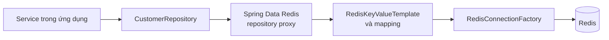

# Bật và cấu hình `@EnableRedisRepositories`

`@EnableRedisRepositories` là annotation của **Spring Data Redis** dùng để kích hoạt và cấu hình cơ chế tạo bean cho các **Redis Repository**. Repository cho phép ứng dụng lưu, tìm, cập nhật và xóa đối tượng Java trong Redis theo mô hình quen thuộc của Spring Data, chẳng hạn `CrudRepository<Customer, String>`.

Bài này tập trung vào việc bật Redis Repository, chọn đúng phạm vi quét interface repository, nối với kết nối Redis, cấu hình các tùy chọn quan trọng và nhận biết trường hợp cần cấu hình thủ công trong Spring Boot.

## 1. `@EnableRedisRepositories` thực hiện điều gì?

Khi Spring xử lý annotation, Spring Data Redis sẽ tìm các interface repository trong phạm vi được cấu hình, tạo bean triển khai chúng và kết nối các thao tác repository với hạ tầng **Redis Key-Value**. Với entity được ánh xạ bằng `@RedisHash` và định danh `@Id`, ta có thể dùng các thao tác như:

```java
repository.save(customer);
repository.findById("c-101");
repository.deleteById("c-101");
```

Luồng khái niệm:



Annotation này xử lý **đăng ký repository**. Nó không tự khởi động Redis Server, không biến Redis thành cơ sở dữ liệu quan hệ và không phải annotation để kích hoạt Spring Cache. Nếu ứng dụng cần `@Cacheable`, đó là cơ chế khác, thường được bật bằng `@EnableCaching` cùng `CacheManager` phù hợp.

## 2. Có luôn cần khai báo annotation không?

**Không nhất thiết.** Với ứng dụng Spring Boot đã thêm starter Redis, có kết nối Redis phù hợp và repository nằm trong vùng quét của Boot, tính năng **auto-configuration** có thể tự kích hoạt Redis repositories. Vì thế một ứng dụng nhỏ thường chạy được mà không cần viết `@EnableRedisRepositories` trực tiếp.

Khai báo `@EnableRedisRepositories` hữu ích khi cần:

- Quét package repository nằm ngoài vùng tự động quét của ứng dụng.
- Giới hạn cụ thể repository thuộc Redis, nhất là khi dùng đồng thời JPA, MongoDB hoặc nhiều loại Spring Data.
- Tùy chỉnh tên `RedisTemplate` hoặc `RedisKeyValueTemplate` mà các repository sử dụng.
- Điều chỉnh cơ chế lắng nghe sự kiện hết hạn khóa phục vụ repository và các tùy chọn liên quan.

| Cách sử dụng | Ai đăng ký repository? | Khi nào phù hợp? |
| --- | --- | --- |
| Spring Boot auto-configuration | Boot/Spring Data tự phát hiện repository theo cấu hình mặc định | Ứng dụng nhỏ, package rõ ràng, chỉ dùng Redis hoặc cấu hình mặc định đủ dùng |
| Khai báo `@EnableRedisRepositories` | Cấu hình Spring Data Redis được khai báo tường minh | Cần quét chính xác, nhiều kho dữ liệu hoặc tùy chỉnh hạ tầng |

Đối với Spring Boot 3.x, có thể điều khiển **tự động đăng ký** Redis repositories bằng thuộc tính:

```yaml
spring:
  data:
    redis:
      repositories:
        enabled: true
```

Giá trị mặc định thông thường là bật khi các điều kiện auto-configuration được đáp ứng. Đặt `enabled: false` để **tắt nhánh tự động đăng ký của Boot**; nếu chính ứng dụng vẫn khai báo `@EnableRedisRepositories`, cấu hình tường minh đó tiếp tục là một cách đăng ký repository riêng. Không nên khai báo các cấu hình quét chồng lấn nếu không có nhu cầu.

Lưu ý: tiền tố thuộc tính cấu hình kết nối Redis thay đổi theo các dòng Spring Boot. Các ví dụ bên dưới sử dụng quy ước **Spring Boot 3.x**: `spring.data.redis.*`.

## 3. Chuẩn bị dự án Spring Boot

### 3.1. Dependency

Với Gradle, thêm Spring Data Redis starter:

```groovy
dependencies {
    implementation 'org.springframework.boot:spring-boot-starter-data-redis'
}
```

Starter cung cấp các thư viện Spring Data Redis và các thành phần client Redis mặc định của Spring Boot. Để ví dụ hoạt động, cần một Redis Server đang chạy và ứng dụng có thể kết nối tới nó.

Với Redis cục bộ ở cổng mặc định:

```yaml
# src/main/resources/application.yml
spring:
  data:
    redis:
      host: localhost
      port: 6379
```

Trong môi trường thật, những thông tin như host, port, xác thực, TLS, timeout và topology Redis phải theo cấu hình triển khai. `@EnableRedisRepositories` không thay thế các thuộc tính kết nối này.

### 3.2. Tạo entity dùng `@RedisHash`

Ví dụ ứng dụng quản lý khách hàng trong package `com.example.shop.redis`:

```java
package com.example.shop.redis;

import org.springframework.data.annotation.Id;
import org.springframework.data.redis.core.RedisHash;
import org.springframework.data.redis.core.index.Indexed;

@RedisHash("customers")
public class Customer {

    @Id
    private String id;

    @Indexed
    private String email;

    private String displayName;

    public Customer() {
    }

    public Customer(String id, String email, String displayName) {
        this.id = id;
        this.email = email;
        this.displayName = displayName;
    }

    public String getId() {
        return id;
    }

    public void setId(String id) {
        this.id = id;
    }

    public String getEmail() {
        return email;
    }

    public void setEmail(String email) {
        this.email = email;
    }

    public String getDisplayName() {
        return displayName;
    }

    public void setDisplayName(String displayName) {
        this.displayName = displayName;
    }
}
```

Ý nghĩa các annotation:

- `@RedisHash("customers")`: đánh dấu một aggregate được lưu bằng cơ chế Redis hash và chọn keyspace/prefix logic `customers`.
- `@Id`: trường định danh, được repository dùng để xây dựng khóa cho đối tượng.
- `@Indexed`: yêu cầu Spring Data Redis duy trì chỉ mục thứ cấp cho thuộc tính `email`, hỗ trợ phương thức tìm theo email.

Ví dụ minh họa về tên khóa dữ liệu là `customers:c-101`. Cấu trúc Redis thực tế còn có thể gồm các khóa quản lý keyspace và index. **Không nên coi danh sách khóa nội bộ đó là API dữ liệu ổn định để tự chỉnh sửa thủ công.**

### 3.3. Tạo interface repository

```java
package com.example.shop.redis;

import java.util.Optional;
import org.springframework.data.repository.CrudRepository;

public interface CustomerRepository
        extends CrudRepository<Customer, String> {

    Optional<Customer> findByEmail(String email);
}
```

Không cần tự viết lớp `CustomerRepositoryImpl` cho các thao tác CRUD cơ bản và phương thức truy vấn được Spring Data Redis hỗ trợ. Spring tạo implementation tại runtime. Trường `email` đã có `@Indexed` vì Redis Repository **không phải SQL engine** có thể tùy ý quét và lọc mọi thuộc tính theo mọi biểu thức truy vấn.

### 3.4. Bật repository tường minh

Tại lớp cấu hình ứng dụng:

```java
package com.example.shop;

import com.example.shop.redis.CustomerRepository;
import org.springframework.boot.SpringApplication;
import org.springframework.boot.autoconfigure.SpringBootApplication;
import org.springframework.data.redis.repository.configuration.EnableRedisRepositories;

@SpringBootApplication
@EnableRedisRepositories(basePackageClasses = CustomerRepository.class)
public class ShopApplication {

    public static void main(String[] args) {
        SpringApplication.run(ShopApplication.class, args);
    }
}
```

`basePackageClasses = CustomerRepository.class` chỉ rõ package cần quét thông qua một kiểu Java, giúp tránh lỗi do viết sai tên package dạng chuỗi và dễ theo dõi khi refactor. Nếu dùng auto-configuration của Boot và repository đã nằm trong phạm vi quét hợp lệ, có thể bỏ annotation tường minh.

Ví dụ gọi repository từ service:

```java
package com.example.shop;

import com.example.shop.redis.Customer;
import com.example.shop.redis.CustomerRepository;
import java.util.Optional;
import org.springframework.stereotype.Service;

@Service
public class CustomerService {

    private final CustomerRepository customers;

    public CustomerService(CustomerRepository customers) {
        this.customers = customers;
    }

    public Customer register(String id, String email, String name) {
        return customers.save(new Customer(id, email, name));
    }

    public Optional<Customer> findByEmail(String email) {
        return customers.findByEmail(email);
    }
}
```

Khi chạy, service được inject bằng bean proxy của repository. Nếu Redis không kết nối được, các thao tác truy cập Redis sẽ thất bại; việc tạo thành công Spring bean không chứng minh Redis Server đã sẵn sàng.

## 4. Cấu hình vùng quét repository

Các tùy chọn thường dùng của `@EnableRedisRepositories`:

| Thuộc tính | Tác dụng | Gợi ý sử dụng |
| --- | --- | --- |
| `basePackages` | Chọn một hoặc nhiều package bằng tên chuỗi | Phù hợp khi phạm vi được cung cấp từ cấu hình tĩnh |
| `basePackageClasses` | Chọn package theo kiểu Java được khai báo | Ưu tiên khi muốn an toàn trước đổi tên package |
| `value` | Cách viết ngắn gọn thay cho `basePackages` | Chỉ nên dùng khi một package đơn giản |
| `includeFilters` / `excludeFilters` | Điều chỉnh các interface được phép tham gia quét | Chỉ dùng khi cấu trúc module cần lọc đặc biệt |
| `redisTemplateRef` | Tên bean `RedisTemplate` mà hạ tầng Redis repository tham chiếu | Hữu ích khi ứng dụng có nhiều template |
| `keyValueTemplateRef` | Tên bean `RedisKeyValueTemplate` dùng cho kho Key-Value | Cần đúng bean nếu cấu hình thủ công hạ tầng repository |
| `enableKeyspaceEvents` | Chính sách bật listener xử lý keyspace events | Quan trọng khi dùng TTL và cập nhật chỉ mục khi khóa hết hạn |
| `keyspaceNotificationsConfigParameter` | Giá trị cấu hình Redis cho keyspace notifications khi listener được bật | Cần chú ý quyền `CONFIG` trên managed Redis |
| `shadowCopy` | Điều khiển cơ chế bản sao phục vụ sự kiện hết hạn | Chỉ thay đổi khi hiểu yêu cầu sự kiện và chi phí bộ nhớ |

Ví dụ cách chỉ định nhiều package:

```java
@Configuration
@EnableRedisRepositories(basePackages = {
    "com.example.shop.redis.customer",
    "com.example.shop.redis.session"
})
public class RedisRepositoryConfig {
}
```

Hoặc dùng kiểu marker để tránh phụ thuộc chuỗi:

```java
@Configuration
@EnableRedisRepositories(basePackageClasses = {
    CustomerRepository.class,
    SessionRepository.class
})
public class RedisRepositoryConfig {
}
```

Ví dụ thứ hai giả định tồn tại `SessionRepository` trong package cần quét.

**Nếu bỏ `basePackages` và `basePackageClasses`, vùng quét mặc định liên quan tới package chứa lớp được gắn `@EnableRedisRepositories`.** Điều này dễ gây lỗi nếu đặt `RedisRepositoryConfig` trong `com.example.shop.config`, còn repository lại nằm trong `com.example.shop.redis`: hai package là anh em, nên repository có thể không được tìm thấy. Chỉ rõ phạm vi quét là cách cấu hình dễ hiểu hơn trong dự án nhiều module.

## 5. Phân biệt `RedisTemplate` và `RedisKeyValueTemplate`

Hai template phục vụ những cấp độ trừu tượng khác nhau:

**`RedisTemplate<K, V>`** cung cấp API thao tác Redis trực tiếp như `opsForValue()`, `opsForHash()`, `opsForSet()` và quản lý serialization của các lệnh đó. `StringRedisTemplate` là biến thể thuận tiện khi key/value theo chuỗi.

**`RedisKeyValueTemplate`** cung cấp hạ tầng lưu aggregate theo mapping của Spring Data Key-Value, được Redis Repository sử dụng để thao tác với đối tượng `@RedisHash`, ID và secondary index.

Một cấu hình tường minh có thể tham chiếu tên bean:

```java
@Configuration
@EnableRedisRepositories(
    basePackageClasses = CustomerRepository.class,
    redisTemplateRef = "redisTemplate",
    keyValueTemplateRef = "redisKeyValueTemplate"
)
public class RedisRepositoryConfig {
}
```

Các tên trong ví dụ là tên bean hạ tầng thông thường. Chỉ đổi sang tên khác khi thực sự đã có các bean tương ứng trong Spring context và những bean đó được cấu hình nhất quán với `RedisConnectionFactory`, mapping và Redis database mong muốn.

Khi ứng dụng dùng nhiều Redis connection hoặc nhiều logical database, **chỉ đổi `redisTemplateRef` không tự bảo đảm toàn bộ repository chuyển sang connection khác**: `RedisKeyValueTemplate` và adapter bên dưới cũng phải sử dụng đúng connection. Nếu cấu hình nhiều repository group, cần kiểm soát rõ phạm vi quét và các bean hạ tầng cho từng group.

Ngoài ra, việc thay serializer của một `RedisTemplate` dùng để gọi `opsForValue()` không đồng nghĩa tất cả dữ liệu Redis Repository lập tức chuyển sang JSON theo serializer đó. Redis Repository ánh xạ aggregate dưới dạng Redis hash với cơ chế mapping riêng; thay đổi serializer tùy tiện có thể làm dữ liệu cũ không đọc được.

## 6. Dùng cùng JPA hoặc nhiều loại Spring Data

Một ứng dụng có thể đồng thời sử dụng PostgreSQL qua Spring Data JPA và Redis qua Spring Data Redis. Khi đó nên phân tách repository theo package và kiểu aggregate:

```text
com.example.shop
├── jpa
│   ├── JpaOrder.java          (@Entity)
│   └── JpaOrderRepository.java
├── redis
│   ├── Customer.java          (@RedisHash)
│   └── CustomerRepository.java
└── config
    └── PersistenceConfig.java
```

Cấu hình ví dụ:

```java
package com.example.shop.config;

import com.example.shop.jpa.JpaOrderRepository;
import com.example.shop.redis.CustomerRepository;
import org.springframework.context.annotation.Configuration;
import org.springframework.data.jpa.repository.config.EnableJpaRepositories;
import org.springframework.data.redis.repository.configuration.EnableRedisRepositories;

@Configuration
@EnableJpaRepositories(basePackageClasses = JpaOrderRepository.class)
@EnableRedisRepositories(basePackageClasses = CustomerRepository.class)
public class PersistenceConfig {
}
```

Ví dụ này giả định ứng dụng đã khai báo dependency JPA, DataSource và các entity JPA tương ứng. Mục tiêu là để mỗi module Spring Data nhận đúng repository của nó. Spring Data có cơ chế phân biệt repository theo store, nhưng việc tổ chức package rõ ràng giúp tránh thông báo không xác định được kho dữ liệu dành cho một interface repository chung chung.

Không nên đánh dấu cùng một aggregate một cách mơ hồ cho nhiều store và dựa vào tự động quét để đoán nơi lưu dữ liệu. Với Redis Repository, khai báo `@RedisHash` trên aggregate và quét riêng package là lựa chọn minh bạch.

## 7. TTL và keyspace events

Redis Repository hỗ trợ thời gian sống cho aggregate. Có thể khai báo TTL mặc định trên entity:

```java
import org.springframework.data.annotation.Id;
import org.springframework.data.redis.core.RedisHash;

@RedisHash(value = "sessions", timeToLive = 1800)
public class Session {

    @Id
    private String id;

    private String accountId;

    public Session() {
    }

    // Constructors, getters, setters...
}
```

`timeToLive = 1800` trong ví dụ có nghĩa TTL 1.800 giây. Khi Redis hết hạn một khóa, bản thân khóa sẽ biến mất; tuy nhiên nếu repository duy trì các secondary index trỏ đến khóa đó, ứng dụng cần hiểu cơ chế xử lý expired event để tránh metadata/index lỗi thời.

### 7.1. Cấu hình listener

```java
import org.springframework.context.annotation.Configuration;
import org.springframework.data.redis.core.RedisKeyValueAdapter.EnableKeyspaceEvents;
import org.springframework.data.redis.repository.configuration.EnableRedisRepositories;

@Configuration
@EnableRedisRepositories(
    basePackageClasses = SessionRepository.class,
    enableKeyspaceEvents = EnableKeyspaceEvents.ON_STARTUP
)
public class RedisSessionRepositoryConfig {
}
```

Ví dụ này giả định `SessionRepository` đã được khai báo như một `CrudRepository<Session, String>`. Các lựa chọn của `enableKeyspaceEvents` gồm:

| Chế độ | Ý nghĩa |
| --- | --- |
| `OFF` | Không bật listener keyspace events thông qua cấu hình này |
| `ON_STARTUP` | Khởi tạo listener khi ứng dụng bắt đầu |
| `ON_DEMAND` | Khởi tạo listener khi phát sinh nhu cầu theo cơ chế Redis repository |

Khi listener được kích hoạt, Spring Data Redis có thể sử dụng thông báo hết hạn để phát sự kiện và dọn các chỉ mục liên quan. **Keyspace notifications của Redis dựa trên Pub/Sub, không có replay đảm bảo**: sự kiện hết hạn có thể bị bỏ lỡ khi ứng dụng tắt, mất kết nối hoặc listener chưa được khởi tạo. Không nên dùng chúng làm nguồn sự thật duy nhất cho nghiệp vụ yêu cầu ghi nhận mọi lần hết hạn.

### 7.2. Redis không cho ứng dụng gọi `CONFIG SET`

Một số dịch vụ Redis được quản lý hạn chế quyền `CONFIG`. Khi bật listener, Spring Data Redis có thể cố thiết lập tham số `notify-keyspace-events`; thao tác đó có thể bị từ chối.

Có thể để việc cấu hình notifications cho Redis Server do hạ tầng quản lý, đồng thời yêu cầu ứng dụng không tự đặt giá trị này:

```java
@Configuration
@EnableRedisRepositories(
    basePackageClasses = SessionRepository.class,
    enableKeyspaceEvents = EnableKeyspaceEvents.ON_STARTUP,
    keyspaceNotificationsConfigParameter = ""
)
public class RedisSessionRepositoryConfig {
}
```

Khi đó, **phải bật notification tương thích trên Redis Server bằng cấu hình ngoài ứng dụng**. Trong Redis tự quản lý, một ví dụ cấu hình là:

```redis
CONFIG SET notify-keyspace-events Ex
```

`E` cho phép thông báo theo kênh keyevent, `x` cho sự kiện expired. Ở managed Redis, dùng cách đặt tham số được nhà cung cấp hỗ trợ thay vì giả định có quyền thực thi lệnh `CONFIG`. Cấu hình `keyspaceNotificationsConfigParameter = ""` chỉ bỏ bước đặt tham số từ phía Spring Data; **không tự bật notification ở Redis**.

### 7.3. Bản sao phục vụ sự kiện hết hạn

Khi cần xuất bản sự kiện hết hạn với thông tin aggregate, Redis Repository có thể sử dụng cơ chế **shadow copy** (còn gọi phantom copy) để duy trì bản sao tạm thời vượt quá thời điểm key gốc hết hạn. Điều này có thêm chi phí bộ nhớ và liên quan tới lựa chọn `shadowCopy`.

Nếu ứng dụng không cần payload aggregate khi xử lý expired events, có thể xem xét tắt shadow copy; tuy nhiên phải hiểu rằng event và khả năng dọn chỉ mục có thể không còn cùng thông tin như trước. Việc chọn `OFF`, `ON_DEMAND` hoặc `ON_STARTUP` cho listener, cũng như shadow copy, cần dựa trên đặc điểm TTL và yêu cầu xử lý của ứng dụng.

## 8. Các lỗi cấu hình thường gặp

### Không inject được repository

Thông báo thường thấy là thiếu bean thuộc kiểu `CustomerRepository`.

Kiểm tra:

1. Có dependency `spring-boot-starter-data-redis`.
2. Interface có kế thừa một repository interface phù hợp như `CrudRepository`.
3. Package chứa interface nằm trong vùng quét của `@EnableRedisRepositories` hoặc vùng quét tự động của Boot.
4. Ứng dụng có cấu hình kết nối Redis và bean hạ tầng cần thiết.
5. Không vô tình tắt auto-configuration khi cũng chưa bật đăng ký repository thủ công.

Một nguyên nhân điển hình: `@EnableRedisRepositories` đặt trong package `config`, không khai báo `basePackages`, trong khi repository ở package `redis` cùng cấp.

### Lỗi thiếu `redisTemplate` hoặc `redisKeyValueTemplate`

Đây thường là vấn đề bean hạ tầng không tồn tại hoặc tên bean trong `redisTemplateRef`/`keyValueTemplateRef` không khớp. Kiểm tra rằng dependency, `RedisConnectionFactory`, các template và cấu hình quét được khởi tạo đúng. Khi nhiều Redis connection cùng tồn tại, phải xác định bean nào thuộc nhóm repository đang cấu hình.

### Truy vấn `findByEmail` không trả kết quả mong muốn

Redis Repository không thực thi truy vấn SQL. Phương thức tìm theo thuộc tính cần tuân thủ khả năng query/indexing của Spring Data Redis. Với ví dụ trên, `@Indexed` trên `email` là phần quan trọng để có secondary index tương ứng.

Thêm `@Indexed` cho dữ liệu đã lưu trước đó **không tự động tạo lại index chính xác cho toàn bộ dữ liệu cũ**. Cần kế hoạch reindex hoặc nạp lại dữ liệu theo cơ chế lưu repository được kiểm soát, nhất là trên hệ thống đang hoạt động.

### TTL hết hạn nhưng index hoặc xử lý sự kiện không như mong đợi

Kiểm tra `@RedisHash(timeToLive = ...)`/`@TimeToLive`, chế độ `enableKeyspaceEvents`, cấu hình notification ở Redis, quyền `CONFIG`, thời điểm listener khởi động và nguy cơ mất Pub/Sub event. Không suy ra rằng sự kiện đã được phát chỉ vì khóa đã hết hạn.

### Có hai repository bean hoặc mâu thuẫn nhiều store

Kiểm tra các lớp `@EnableRedisRepositories`, phạm vi quét của Spring Boot, và các cấu hình `@EnableJpaRepositories`/`@EnableMongoRepositories`. Thu hẹp vùng quét, tránh đăng ký cùng repository từ nhiều cấu hình và bảo đảm entity của từng store có annotation đúng.

### Dữ liệu có trong Redis nhưng repository không đọc được

Một giá trị JSON ghi bằng `StringRedisTemplate.opsForValue()` không mặc nhiên là một Redis aggregate hash hợp lệ cho `@RedisHash`. Tương tự, dữ liệu tự ghi thẳng vào key theo tiền tố repository có thể thiếu metadata/index mà repository quản lý. Cần nhất quán về mô hình lưu trữ, định danh, serialization và cách tạo dữ liệu.

## 9. Các lưu ý triển khai thực tế

**Định danh và keyspace.** Chọn tiền tố Redis hash rõ ràng, tách khỏi những khóa do cache, rate limiter hay job khác quản lý. ID cần ổn định và phù hợp với domain. Không dùng cùng tiền tố cho nhiều kiểu aggregate không tương thích.

**Chi phí index.** `@Indexed` cải thiện những truy vấn được hỗ trợ nhưng làm tăng số thao tác ghi và số khóa index phải bảo trì. Chỉ index những thuộc tính thực sự cần tìm. Nếu dùng TTL, cân nhắc chi phí listener và cơ chế dọn index khi hết hạn.

**Giới hạn của repository abstraction.** Các thao tác `findAll()` trên một keyspace lớn có thể rất tốn kém; không nên xem Redis Repository như một ORM hỗ trợ mọi kiểu join, sort và truy vấn nhiều điều kiện. Khi nghiệp vụ cần các truy vấn phức tạp, hãy cân nhắc thiết kế chỉ mục chuyên biệt, Redis Stack/RediSearch nếu phù hợp, hoặc một cơ sở dữ liệu truy vấn khác.

**Tính nhất quán.** `save()` một aggregate vào Redis không tạo ra giao dịch phân tán với cơ sở dữ liệu hay hệ thống bên ngoài. Việc đồng bộ nhiều kho dữ liệu đòi hỏi hợp đồng nghiệp vụ và cơ chế phục hồi riêng.

**Bảo mật và vận hành.** Dùng cấu hình kết nối từ môi trường triển khai, quản lý secrets bên ngoài mã nguồn và kiểm soát quyền Redis cần thiết. Khi dùng keyspace events ở môi trường được quản lý, phối hợp cấu hình server trước khi bật listener trong ứng dụng.

## 10. Ví dụ chọn cấu hình cho ba bối cảnh

| Bối cảnh | Cấu hình khởi điểm |
| --- | --- |
| Ứng dụng Boot chỉ có Redis, repository dưới package ứng dụng | Dùng starter, connection properties và auto-configuration; không nhất thiết cần `@EnableRedisRepositories` |
| Ứng dụng Boot có cả JPA và Redis | Khai báo rõ `@EnableRedisRepositories(basePackageClasses = ...)` và `@EnableJpaRepositories(...)` với package riêng |
| Dữ liệu Redis Repository có TTL và cần xử lý hết hạn | Cân nhắc `enableKeyspaceEvents`, server `notify-keyspace-events`, tùy chọn shadow copy và kế hoạch đối phó sự kiện bị bỏ lỡ |

Ví dụ một cấu hình tổng hợp cho nhóm Redis Repository đơn giản:

```java
package com.example.shop.config;

import com.example.shop.redis.CustomerRepository;
import org.springframework.context.annotation.Configuration;
import org.springframework.data.redis.repository.configuration.EnableRedisRepositories;

@Configuration
@EnableRedisRepositories(
    basePackageClasses = CustomerRepository.class,
    redisTemplateRef = "redisTemplate",
    keyValueTemplateRef = "redisKeyValueTemplate"
)
public class RedisRepositoryConfig {
}
```

Không cần chép tất cả tùy chọn vào mọi ứng dụng: mặc định là đủ khi chỉ có một kết nối Redis và package repository được nhận diện đúng. Hãy bổ sung tùy chọn khi có nhu cầu thực sự như nhiều kho dữ liệu, TTL events hay cách tổ chức module.

## Kết luận

`@EnableRedisRepositories` là điểm cấu hình để Spring Data Redis tìm repository interface, tạo bean và liên kết chúng với hạ tầng Redis Key-Value. Trong Spring Boot, có thể tận dụng auto-configuration; khi muốn kiểm soát chính xác hơn, dùng `basePackageClasses` hoặc `basePackages`, chỉ định template phù hợp và cân nhắc keyspace events nếu aggregate có TTL. Một repository hoạt động đúng cần đồng thời có dependency, kết nối Redis, entity `@RedisHash` với `@Id`, interface repository và vùng quét phù hợp.

### Tài liệu tham khảo

- [Spring Data Redis — Repositories](https://docs.spring.io/spring-data/redis/reference/redis/redis-repositories.html): khái niệm Redis Repository, mapping, secondary index và TTL.
- [Spring Data Redis — `@EnableRedisRepositories` API](https://docs.spring.io/spring-data/redis/reference/api/java/org/springframework/data/redis/repository/configuration/EnableRedisRepositories.html): các thuộc tính cấu hình annotation.
- [Spring Boot — Redis](https://docs.spring.io/spring-boot/reference/data/nosql.html#data.nosql.redis): kết nối Redis và auto-configuration trong Spring Boot.
- [Redis Documentation — Keyspace notifications](https://redis.io/docs/latest/develop/pubsub/keyspace-notifications/): cách bật notification và giới hạn của cơ chế Pub/Sub.
