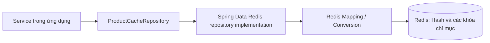

# Khai báo `CrudRepository` cho thực thể Redis trong Spring Data Redis

## 1. Mục tiêu

Khi dùng Redis trong ứng dụng Spring, ta có thể thao tác trực tiếp với các lệnh như `GET`, `SET`, `HSET` hoặc thông qua `RedisTemplate`. Tuy nhiên, khi dữ liệu cần lưu có cấu trúc của một **thực thể nghiệp vụ**, việc tự ghép tên khóa, chuyển đổi thuộc tính và viết từng thao tác lưu/đọc/xóa khiến mã ứng dụng dễ bị lặp.

**Spring Data Redis Repository** cho phép làm việc với đối tượng Java thông qua giao diện repository. Ta khai báo thực thể Redis, đánh dấu thuộc tính định danh rồi tạo một interface kế thừa `CrudRepository`. Spring Data sẽ tạo phần triển khai cho các thao tác CRUD cơ bản.

Sau bài này, bạn có thể:

- Xác định các thành phần của một thực thể được lưu trong Redis.
- Khai báo `@RedisHash`, `@Id` và một `CrudRepository` đúng kiểu.
- Cấu hình để Spring tìm thấy repository và kết nối Redis.
- Gọi `save`, `findById`, `findAll`, `existsById`, `count` và `deleteById`.
- Phân biệt truy vấn bằng ID với truy vấn theo thuộc tính có chỉ mục.
- Hiểu cách Redis Repository lưu dữ liệu, tác động của TTL và những giới hạn cần xét khi đưa vào ứng dụng thực tế.

## 2. Redis Repository hoạt động như thế nào?

Khác với repository dành cho cơ sở dữ liệu quan hệ, Redis Repository làm việc trên cấu trúc key–value của Redis. Thông thường, một đối tượng được ánh xạ thành **Redis Hash** với tên khóa có dạng:

```text
<keyspace>:<id>
```

Ví dụ một thực thể sản phẩm có `keyspace` là `catalog:product` và ID là `p-1001` sẽ được lưu dưới khóa:

```text
catalog:product:p-1001
```

Các thuộc tính như `name`, `category` và `priceInCents` được ánh xạ thành trường trong hash. Spring Data Redis còn có thể quản lý những khóa phụ để phục vụ việc theo dõi các thực thể trong keyspace và các truy vấn được lập chỉ mục.

Luồng dữ liệu điển hình:



Từ góc nhìn mã Java, ứng dụng gọi phương thức trên interface như `repository.save(product)` mà không phải viết lệnh `HSET` thủ công. Dù vậy, Redis vẫn là Redis: repository không tự biến nó thành cơ sở dữ liệu quan hệ, không cung cấp SQL hay quan hệ khóa ngoại.

### Repository phù hợp với bài toán nào?

Các trường hợp thường gặp gồm dữ liệu cache có cấu trúc, bản nháp tạm, trạng thái xử lý, thông tin truy cập nhanh theo ID hoặc nhóm thực thể cần đọc/ghi bằng API CRUD. Với dữ liệu nghiệp vụ yêu cầu giao dịch phức tạp, truy vấn tùy ý, ràng buộc quan hệ và tính toàn vẹn nghiêm ngặt, cần cân nhắc Redis có thực sự là kho lưu trữ chính phù hợp hay nên là lớp lưu trữ bổ trợ.

## 3. Chuẩn bị dự án và kết nối Redis

Ví dụ dùng ứng dụng Spring Boot với Spring Data Redis.

Nếu dự án dùng Gradle:

```kotlin
dependencies {
    implementation("org.springframework.boot:spring-boot-starter-data-redis")
}
```

Nếu dự án dùng Maven:

```xml
<dependency>
    <groupId>org.springframework.boot</groupId>
    <artifactId>spring-boot-starter-data-redis</artifactId>
</dependency>
```

Các phiên bản phụ thuộc thường do Spring Boot dependency management quản lý; không cần chỉ định thủ công phiên bản starter khi dùng cấu hình chuẩn của Boot.

Cấu hình kết nối Redis trong `application.yml`:

```yaml
spring:
  data:
    redis:
      host: localhost
      port: 6379
```

Đây là cấu hình minh họa cho Redis local. Môi trường thực tế cần sử dụng host, cơ chế xác thực, TLS, topology và quản lý secret phù hợp với hạ tầng. Không đặt mật khẩu thật trực tiếp vào mã nguồn.

Spring Boot thường tự cấu hình `RedisConnectionFactory`, `RedisTemplate` và Redis Repository khi starter cùng các điều kiện auto-configuration tương ứng có hiệu lực. Điều quan trọng là interface repository phải nằm trong vùng package được Spring quét.

Cấu trúc package ví dụ:

```text
com.example.shop
├── ShopApplication.java
├── redis
│   ├── ProductCacheEntry.java
│   └── ProductCacheRepository.java
└── service
    └── ProductCacheService.java
```

Lớp `ShopApplication` nên nằm ở package gốc `com.example.shop` để quá trình quét thành phần và repository có thể tìm thấy các package con.

## 4. Khai báo thực thể Redis bằng @RedisHash và @Id

Ta xây dựng thực thể `ProductCacheEntry` biểu diễn dữ liệu sản phẩm cần truy cập nhanh.

**File: `com/example/shop/redis/ProductCacheEntry.java`**

```java
package com.example.shop.redis;

import org.springframework.data.annotation.Id;
import org.springframework.data.redis.core.RedisHash;
import org.springframework.data.redis.core.index.Indexed;

@RedisHash("catalog:product")
public class ProductCacheEntry {

    @Id
    private String id;

    private String name;

    @Indexed
    private String category;

    private long priceInCents;

    public ProductCacheEntry() {
    }

    public ProductCacheEntry(
            String id,
            String name,
            String category,
            long priceInCents
    ) {
        this.id = id;
        this.name = name;
        this.category = category;
        this.priceInCents = priceInCents;
    }

    public String getId() {
        return id;
    }

    public void setId(String id) {
        this.id = id;
    }

    public String getName() {
        return name;
    }

    public void setName(String name) {
        this.name = name;
    }

    public String getCategory() {
        return category;
    }

    public void setCategory(String category) {
        this.category = category;
    }

    public long getPriceInCents() {
        return priceInCents;
    }

    public void setPriceInCents(long priceInCents) {
        this.priceInCents = priceInCents;
    }
}
```

### Ý nghĩa của các annotation

| Annotation | Vai trò |
|---|---|
| `@RedisHash("catalog:product")` | Đánh dấu đối tượng được ánh xạ thành Redis Hash, đồng thời chỉ định keyspace cho thực thể |
| `@Id` | Đánh dấu thuộc tính định danh; kết hợp với keyspace để xác định Redis key |
| `@Indexed` | Yêu cầu Spring Data Redis quản lý chỉ mục thứ cấp cho thuộc tính; cần thiết khi dùng truy vấn repository theo thuộc tính đó |

**Lưu ý về import:** `@Id` là `org.springframework.data.annotation.Id`; `@RedisHash` là `org.springframework.data.redis.core.RedisHash`; `@Indexed` là `org.springframework.data.redis.core.index.Indexed`. Không dùng nhầm `jakarta.persistence.Entity` hoặc `jakarta.persistence.Id` của JPA cho ví dụ Redis này.

Nếu ID là `p-1001`, khóa chính của đối tượng có dạng:

```text
catalog:product:p-1001
```

Giá trị ID có thể do ứng dụng tự cấp như ví dụ để đồng bộ với định danh sản phẩm ở hệ thống khác. Spring Data Redis cũng hỗ trợ tạo ID khi thuộc tính `@Id` chưa có giá trị trong những cấu hình ánh xạ được hỗ trợ; việc chủ động cấp ID giúp mô tả và theo dõi các ví dụ dễ hơn.

### Vì sao có constructor rỗng và getter/setter?

Spring Data cần tạo đối tượng Java từ dữ liệu lưu trong Redis. Constructor rỗng và các accessor làm ví dụ dễ hiểu, dễ sử dụng với Java thông thường. Spring Data còn hỗ trợ nhiều chiến lược khởi tạo/ánh xạ khác, nhưng không cần dùng chúng để khai báo repository cơ bản.

Trường `priceInCents` lưu giá trị nhỏ nhất của đơn vị tiền tệ bằng `long` để tránh sai số làm tròn khi xử lý số thực. Đây chỉ là cách chọn mô hình của ví dụ, không phải yêu cầu của Redis Repository.

## 5. Khai báo interface kế thừa CrudRepository

Sau khi có thực thể, tạo repository tương ứng.

**File: `com/example/shop/redis/ProductCacheRepository.java`**

```java
package com.example.shop.redis;

import java.util.List;

import org.springframework.data.repository.CrudRepository;

public interface ProductCacheRepository
        extends CrudRepository<ProductCacheEntry, String> {

    List<ProductCacheEntry> findByCategory(String category);
}
```

Đây là phần khai báo quan trọng nhất:

```java
CrudRepository<ProductCacheEntry, String>
```

Trong đó:

- `ProductCacheEntry` là **kiểu thực thể** được repository quản lý.
- `String` là **kiểu dữ liệu của thuộc tính `@Id`** trong thực thể.

Nếu ID khai báo là `Long` thì generic thứ hai cần là `Long`. Kiểu ID trong repository và entity phải nhất quán.

Không cần tự viết lớp `ProductCacheRepositoryImpl` cho những thao tác CRUD mà Spring Data đã hỗ trợ. Khi repository được đăng ký thành công, Spring tạo bean triển khai interface; các service có thể inject trực tiếp bean đó.

### Phương thức có sẵn trong CrudRepository

| Phương thức | Ý nghĩa |
|---|---|
| `save(entity)` | Lưu một thực thể, cập nhật dữ liệu của thực thể có cùng ID theo cách ánh xạ repository |
| `saveAll(entities)` | Lưu nhiều thực thể |
| `findById(id)` | Trả về `Optional<T>` với thực thể có ID tương ứng, nếu tồn tại |
| `existsById(id)` | Kiểm tra có thực thể với ID đó hay không |
| `findAll()` | Trả về các thực thể thuộc repository |
| `findAllById(ids)` | Tìm các thực thể theo tập ID được cung cấp |
| `count()` | Đếm các thực thể thuộc repository |
| `deleteById(id)` | Xóa thực thể có ID tương ứng |
| `delete(entity)` | Xóa thực thể được truyền vào |
| `deleteAll()` | Xóa tất cả thực thể thuộc repository |

**Phân biệt khi dùng:** `save` không phải thao tác chỉ dành cho insert; với một ID đã tồn tại, dữ liệu có thể được cập nhật. Cần quản lý các quy tắc ghi đè nếu có nhiều tiến trình cùng sửa một thực thể. `deleteAll()` có phạm vi rất rộng và không thích hợp để gọi từ các chức năng công khai không được kiểm soát.

### Truy vấn tự suy diễn từ tên phương thức

Khai báo:

```java
List<ProductCacheEntry> findByCategory(String category);
```

cho Spring Data biết cần tìm các đối tượng theo thuộc tính `category`. Với Redis Repository, truy vấn theo thuộc tính thông thường dựa vào **secondary index**, vì vậy `category` trong entity đã được gắn `@Indexed`.

Điểm này khác với suy nghĩ thường gặp khi sử dụng JPA: ta không thể tùy ý thêm mọi kiểu `findBy...` rồi mặc định rằng Redis sẽ quét toàn bộ dữ liệu hoặc thực hiện phép so sánh giống SQL.

Ví dụ:

```java
List<ProductCacheEntry> books = repository.findByCategory("BOOKS");
```

Các đối tượng được lưu đúng thông qua repository và có category `BOOKS` sẽ được đưa vào chỉ mục để truy vấn. Dữ liệu được ghi thẳng bằng Redis CLI hoặc `RedisTemplate` mà không cập nhật index có thể không xuất hiện trong kết quả truy vấn này.

## 6. Sử dụng repository trong Service

Service là nơi diễn đạt thao tác nghiệp vụ, còn repository phụ trách truy cập dữ liệu.

**File: `com/example/shop/service/ProductCacheService.java`**

```java
package com.example.shop.service;

import java.util.List;
import java.util.Optional;

import org.springframework.stereotype.Service;

import com.example.shop.redis.ProductCacheEntry;
import com.example.shop.redis.ProductCacheRepository;

@Service
public class ProductCacheService {

    private final ProductCacheRepository repository;

    public ProductCacheService(ProductCacheRepository repository) {
        this.repository = repository;
    }

    public ProductCacheEntry saveProduct(
            String id,
            String name,
            String category,
            long priceInCents
    ) {
        ProductCacheEntry entry = new ProductCacheEntry(
                id,
                name,
                category,
                priceInCents
        );

        return repository.save(entry);
    }

    public Optional<ProductCacheEntry> getProduct(String id) {
        return repository.findById(id);
    }

    public boolean containsProduct(String id) {
        return repository.existsById(id);
    }

    public List<ProductCacheEntry> findByCategory(String category) {
        return repository.findByCategory(category);
    }

    public void removeProduct(String id) {
        repository.deleteById(id);
    }
}
```

Service được inject bằng constructor; đây là cách sử dụng tự nhiên của bean repository do Spring quản lý. Service không cần biết dữ liệu của sản phẩm được phân tách thành những Redis hash field cụ thể nào.

Ví dụ các lệnh gọi từ một thành phần khác trong ứng dụng:

```java
ProductCacheEntry saved = productCacheService.saveProduct(
        "p-1001",
        "Sách Java cơ bản",
        "BOOKS",
        125_000
);

System.out.println(saved.getId()); // p-1001

Optional<ProductCacheEntry> found =
        productCacheService.getProduct("p-1001");

found.ifPresent(product ->
        System.out.println(product.getName())
);

List<ProductCacheEntry> books =
        productCacheService.findByCategory("BOOKS");

boolean exists =
        productCacheService.containsProduct("p-1001");

productCacheService.removeProduct("p-1001");
```

Khi `findById` không tìm được dữ liệu, nó trả về `Optional.empty()`. Không nên gọi `get()` mà không kiểm tra có giá trị; có thể dùng `orElseThrow` khi nghiệp vụ cần báo lỗi không tìm thấy.

Đoạn trên minh họa cách gọi service. Trong chương trình thật, mã có thể nằm ở controller, command handler, scheduled task hoặc mã khởi tạo dành riêng cho môi trường phát triển.

## 7. Đăng ký Redis Repository với Spring

Với cấu trúc Spring Boot chuẩn và `spring-boot-starter-data-redis`, repository có thể được phát hiện qua auto-configuration khi các điều kiện liên quan được đáp ứng.

Ví dụ lớp khởi động:

**File: `com/example/shop/ShopApplication.java`**

```java
package com.example.shop;

import org.springframework.boot.SpringApplication;
import org.springframework.boot.autoconfigure.SpringBootApplication;

@SpringBootApplication
public class ShopApplication {

    public static void main(String[] args) {
        SpringApplication.run(ShopApplication.class, args);
    }
}
```

Spring Boot quét các thành phần trong package `com.example.shop` và những package con. Khi dùng auto-configuration repository theo mặc định, cách bố trí này giúp Spring tìm thấy `ProductCacheRepository`.

Nếu dự án không dùng auto-configuration repository hoặc cần chỉ định rõ vùng quét, có thể bật Redis Repository bằng cấu hình tường minh:

```java
package com.example.shop.config;

import com.example.shop.redis.ProductCacheRepository;

import org.springframework.context.annotation.Configuration;
import org.springframework.data.redis.repository.configuration.EnableRedisRepositories;

@Configuration
@EnableRedisRepositories(
        basePackageClasses = ProductCacheRepository.class
)
public class RedisRepositoryConfig {
}
```

Đoạn cấu hình này là **phương án thay thế khi cần cấu hình thủ công**, không phải lớp bắt buộc phải thêm vào mọi dự án Spring Boot. Nếu ứng dụng đã được tự động cấu hình đúng, không nên chồng thêm cấu hình quét repository trùng nhau.

### Một số tình huống cần kiểm tra

**Không inject được `ProductCacheRepository`:** cần xem repository có nằm trong vùng quét không, starter Redis đã được thêm chưa, Redis Repository có bị tắt trong cấu hình hay không và ứng dụng có bean `RedisConnectionFactory` hợp lệ hay không.

**Dự án có nhiều loại cơ sở dữ liệu:** nếu cùng dùng JPA và Redis, nên tổ chức package và cấu hình repository theo từng store rõ ràng. Các interface và entity phải có annotation đặc trưng của công nghệ tương ứng để Spring Data nhận diện đúng repository. Không đặt một interface Redis Repository chung package và nhầm kiểu với JPA Repository mà không kiểm soát phạm vi quét.

**Ứng dụng có nhiều Redis connection:** cấu hình repository cần trỏ đến các bean phù hợp; không mặc định rằng repository luôn kết nối đến Redis instance mà một `RedisTemplate` tự khai báo trong dự án đang sử dụng.

## 8. Quan sát dữ liệu thực tế trong Redis

Sau khi lưu:

```java
repository.save(
        new ProductCacheEntry(
                "p-1001",
                "Sách Java cơ bản",
                "BOOKS",
                125_000
        )
);
```

Có thể quan sát Redis bằng CLI trong môi trường thử nghiệm:

```redis
TYPE catalog:product:p-1001
HGETALL catalog:product:p-1001
```

`TYPE` thường cho biết khóa là `hash`. `HGETALL` cho thấy các field được Spring Data Redis ánh xạ. Tên và giá trị chi tiết của các field metadata, đặc biệt metadata về kiểu Java, có thể thay đổi theo model và cách cấu hình converter.

Để xem khóa phụ, có thể dùng cơ chế `SCAN` trong môi trường thử nghiệm. Redis Repository có thể quản lý thêm các tập hợp keyspace và secondary index, vì thế **không nên giả định mỗi entity chỉ chiếm duy nhất một Redis key**.

Một lưu ý quan trọng: nếu dùng `SET catalog:product:p-1001 "..."` thủ công, bạn có thể thay đổi loại dữ liệu của khóa từ hash sang string, khiến repository đọc không đúng. Việc trộn thao tác Redis CLI, `RedisTemplate` và repository trên cùng một namespace cần tuân theo cùng mô hình ánh xạ.

## 9. TTL: đặt thời hạn sống cho thực thể Redis

Nhiều thực thể Redis chỉ nên tồn tại trong thời gian giới hạn, chẳng hạn bản nháp hoặc dữ liệu cache tạm. `@RedisHash` hỗ trợ thời gian sống mặc định cho toàn bộ thực thể.

Ví dụ khai báo một loại entity khác với TTL 30 phút:

```java
package com.example.shop.redis;

import org.springframework.data.annotation.Id;
import org.springframework.data.redis.core.RedisHash;

@RedisHash(value = "catalog:product-preview", timeToLive = 1800)
public class ProductPreview {

    @Id
    private String id;

    private String previewText;

    public ProductPreview() {
    }

    public ProductPreview(String id, String previewText) {
        this.id = id;
        this.previewText = previewText;
    }

    public String getId() {
        return id;
    }

    public void setId(String id) {
        this.id = id;
    }

    public String getPreviewText() {
        return previewText;
    }

    public void setPreviewText(String previewText) {
        this.previewText = previewText;
    }
}
```

Ở đây `timeToLive = 1800` được tính bằng **giây**; tức 30 phút. Repository của loại entity này có thể được khai báo tương tự:

```java
public interface ProductPreviewRepository
        extends CrudRepository<ProductPreview, String> {
}
```

Nếu thời gian sống thay đổi theo từng đối tượng, Spring Data Redis cũng hỗ trợ thuộc tính dùng `@TimeToLive`:

```java
import java.util.concurrent.TimeUnit;

import org.springframework.data.redis.core.TimeToLive;

// Bên trong một lớp entity được @RedisHash:
@TimeToLive(unit = TimeUnit.SECONDS)
private Long ttlSeconds;
```

Nên lựa chọn **TTL mặc định ở cấp lớp** hoặc **TTL động ở cấp thuộc tính** theo chính sách vòng đời của thực thể. Không cần thêm cả hai nếu chỉ có một quy tắc hết hạn cố định.

### TTL tác động thế nào đến repository?

Sau khi key hết hạn, `findById` không còn trả về entity đó. Redis tự quản lý việc hết hạn key, trong khi Spring Data Redis có cơ chế lắng nghe sự kiện keyspace để xử lý một số công việc liên quan như dọn dữ liệu chỉ mục khi đủ điều kiện cấu hình.

Cần hiểu rằng:

- Sự kiện hết hạn của Redis phụ thuộc cấu hình thông báo keyspace, trạng thái tiến trình và thời điểm Redis thực sự xử lý expiration; không phải lịch hẹn chính xác đến từng mili giây.
- Việc xử lý secondary index khi TTL hết hạn có thể cần repository key expiration listener hoạt động đúng. Với một số hạ tầng Redis được quản lý, ứng dụng không có quyền thay đổi `notify-keyspace-events`.
- Nếu dữ liệu bị xóa bằng lệnh Redis thô mà không thông qua repository, các chỉ mục do repository quản lý có thể bị bỏ sót hoặc lỗi thời.
- TTL không tự giải quyết quy tắc cập nhật đồng thời hay tính nhất quán giữa Redis và một cơ sở dữ liệu khác.

Không nên coi một sự kiện expired là cơ chế duy nhất cho nghiệp vụ bắt buộc phải chạy chính xác một lần; nếu cần độ tin cậy cao, hãy dùng cơ chế hàng đợi/job hoặc trạng thái nghiệp vụ phù hợp.

## 10. Truy vấn theo thuộc tính và secondary index

Trong entity chính, thuộc tính `category` đã được đánh dấu:

```java
@Indexed
private String category;
```

Khi repository lưu entity, Spring Data Redis cập nhật cấu trúc chỉ mục để hỗ trợ:

```java
List<ProductCacheEntry> findByCategory(String category);
```

Giả sử đã lưu:

| ID | Tên | Category |
|---|---|---|
| `p-1001` | Sách Java | `BOOKS` |
| `p-1002` | Sách Redis | `BOOKS` |
| `p-1003` | Bàn phím | `ACCESSORIES` |

Gọi `findByCategory("BOOKS")` kỳ vọng lấy ra hai đối tượng có ID `p-1001` và `p-1002`, miễn là các đối tượng đã được quản lý và lập chỉ mục đúng thông qua repository, và không có cập nhật/xóa đồng thời làm thay đổi trạng thái.

### Vì sao không thêm findByPriceInCentsGreaterThan ngay?

Redis Repository không hỗ trợ toàn bộ biểu thức và toán tử truy vấn như một hệ quản trị quan hệ. Khả năng thực thi derived query phụ thuộc cơ chế chỉ mục và những toán tử được Spring Data Redis hỗ trợ. Đặc biệt, không nên giả định rằng việc có `@Indexed` đồng nghĩa với khả năng lọc khoảng giá, sắp xếp hoặc ghép nhiều điều kiện như SQL.

Nếu nghiệp vụ cần truy vấn phong phú theo thuộc tính, cần xem lại mô hình truy vấn, tổ chức các chỉ mục phù hợp hoặc chọn giải pháp lưu trữ/tìm kiếm hỗ trợ kiểu truy vấn đó.

### Chỉ mục có chi phí

Secondary index mang lại tiện ích truy vấn nhưng làm tăng số Redis key/cấu trúc dữ liệu cần cập nhật khi entity được thêm, sửa hoặc xóa. Với field có giá trị thay đổi thường xuyên, việc duy trì index cũng tạo thêm chi phí.

Không thêm `@Indexed` vào mọi thuộc tính theo thói quen. Chỉ lập chỉ mục những field thực sự được truy vấn và theo dõi tác động lên bộ nhớ, tải ghi, TTL và việc dọn chỉ mục.

## 11. Phân biệt CrudRepository, RedisTemplate và các abstraction khác

| Công cụ | Cách làm việc | Tình huống phù hợp |
|---|---|---|
| `CrudRepository<Entity, ID>` | CRUD theo thực thể và ID, tích hợp mapping và index repository | Đối tượng có mô hình rõ ràng; thao tác CRUD lặp lại |
| `RedisTemplate<K, V>` | Gửi các thao tác Redis qua API template | Cần điều khiển cụ thể key, hash, list, set, sorted set hoặc pipeline |
| `StringRedisTemplate` | Template chuyên dùng cho key/value chuỗi | Cache chuỗi đơn giản, counter/lock theo quy ước, lệnh Redis trực tiếp |
| Spring Cache (`@Cacheable`, `@CacheEvict`) | Cache kết quả phương thức ở mức annotation | Tối ưu đọc theo lời gọi phương thức, không cần tự tạo repository entity |

Không phải mọi dữ liệu trong Redis đều cần một repository. Nếu chỉ lưu giá trị chuỗi theo key hoặc dùng các cấu trúc đặc thù như sorted set/stream, `RedisTemplate` và những API chuyên dụng thường rõ ràng hơn.

Mặt khác, repository là lựa chọn tốt khi muốn thể hiện một tập đối tượng dưới dạng các entity có ID, có lifecycle và cần những phương thức CRUD thống nhất.

## 12. Những giới hạn cần lưu ý trong vận hành

### Không coi Redis Repository là JPA

Dữ liệu nằm trong Redis, không có bảng SQL, khóa ngoại hoặc quan hệ join. `@RedisHash` và `@Id` của Spring Data không mang nghĩa `@Entity` và `@Id` của JPA. Repository có thể cung cấp tên phương thức quen thuộc, nhưng việc thực thi, truy vấn và đảm bảo dữ liệu tuân theo năng lực của Redis.

### findAll, count và deleteAll có thể đắt trên tập dữ liệu lớn

`findAll()` có thể kéo về nhiều thực thể và dữ liệu ánh xạ, không phù hợp làm API trả toàn bộ dữ liệu cho người dùng khi keyspace lớn. `count()` và `deleteAll()` cũng có thể kéo theo việc đọc/duyệt các cấu trúc phục vụ quản lý entity trong repository.

Đối với tập dữ liệu rất lớn, nên thiết kế truy vấn có phạm vi cụ thể, hạn chế lượng dữ liệu trả về và có quy trình dọn nhóm riêng thay vì gọi `deleteAll()` một cách tùy tiện.

### Ghi đồng thời và tính nguyên tử

Một lời gọi `save` có thể liên quan nhiều thao tác Redis: ghi hash, cập nhật metadata và secondary index. Không mặc định mỗi lần lưu entity là một giao dịch nguyên tử bao trùm tất cả khóa liên quan.

Nếu hai tiến trình cùng đọc rồi sửa một thực thể theo cách “read–modify–write”, việc ghi sau có thể làm mất cập nhật của tiến trình trước. `@Transactional` của Spring cũng không tự động cung cấp các bảo đảm giống một giao dịch JPA nếu chưa cấu hình và chọn mô hình giao dịch Redis phù hợp.

Các yêu cầu đồng thời mạnh hơn cần được thiết kế riêng: điều phối bên ghi, thao tác nguyên tử theo lệnh Redis, kiểm tra phiên bản hoặc một kho dữ liệu phù hợp với yêu cầu nhất quán.

### Namespace và quản lý serializer

Tên `keyspace` trong `@RedisHash` nên phản ánh domain và tránh trùng với vùng khóa do những thành phần khác quản lý. Nếu nhiều service cùng lưu vào một Redis instance, cần định nghĩa ranh giới namespace rõ ràng.

Không thay đổi tùy tiện kiểu ID, cách ánh xạ, cấu trúc entity hoặc metadata kiểu Java khi đang có dữ liệu cũ. Việc đổi model có thể đòi hỏi chiến lược tương thích ngược hoặc migration dữ liệu.

### Redis Cluster, TTL và dữ liệu phụ trợ

Trong Redis Cluster, các key có thể nằm trên nhiều hash slot. Redis Repository có thể quản lý thêm keyspace/index keys ngoài khóa chính; do đó tính năng và hành vi của từng thao tác phải được xem xét theo cấu hình cluster, mapping và driver đang sử dụng.

Không đặt giả định rằng mọi thao tác repository luôn là một lệnh Redis duy nhất hoặc mọi khóa phụ thuộc sẽ ở cùng một slot.

## 13. Lỗi thường gặp khi khai báo CrudRepository

| Triệu chứng | Nguyên nhân điển hình | Cách xử lý |
|---|---|---|
| `No qualifying bean` cho repository | Interface không nằm trong phạm vi quét hoặc Redis Repository chưa được bật | Kiểm tra package gốc, starter, auto-configuration và `@EnableRedisRepositories` khi cần |
| Không kết nối được Redis | Host/port, xác thực, TLS hoặc topology sai | Kiểm tra cấu hình `spring.data.redis.*` và kết nối tới môi trường đúng |
| `findById` không tìm thấy entity vừa lưu | ID bị thay đổi, dùng Redis DB khác hoặc keyspace không khớp | Kiểm tra ID trả về từ `save`, mapping và cấu hình kết nối |
| `findByCategory` không thấy dữ liệu | Chưa có `@Indexed` hoặc dữ liệu được ghi thủ công không qua repository | Gắn chỉ mục đúng field, đảm bảo quá trình ghi quản lý index |
| Lỗi mapping khi đọc | Thiếu cấu hình kiểu, constructor không phù hợp, cấu trúc cũ không tương thích | Kiểm tra lớp thực thể, bộ chuyển đổi và dữ liệu đang tồn tại |
| Key hết hạn sớm | TTL của entity hoặc cấu hình cache khác với dự kiến | Kiểm tra `@RedisHash(timeToLive = ...)`, `@TimeToLive` và `TTL` trong Redis |
| Dữ liệu vẫn có key phụ sau xóa/hết hạn | Cấu trúc chỉ mục hoặc cơ chế xử lý expiration không đồng bộ | Kiểm tra cách xóa dữ liệu và cấu hình keyspace notifications |
| Ghi đè ngoài ý muốn | Cùng một ID được nhiều luồng cập nhật | Thiết kế kiểm soát cập nhật đồng thời theo yêu cầu nghiệp vụ |

## 14. Quy trình tối thiểu để thêm một Redis Repository mới

1. **Xác định đối tượng và keyspace.** Ví dụ: `ProductCacheEntry` và `catalog:product`.
2. **Khai báo entity.** Thêm `@RedisHash`, thuộc tính `@Id` và các field cần lưu.
3. **Thêm chỉ mục có chủ đích.** Dùng `@Indexed` chỉ với thuộc tính cần hỗ trợ truy vấn repository.
4. **Tạo interface.** Kế thừa `CrudRepository<ProductCacheEntry, String>`; thêm derived query được Redis hỗ trợ nếu cần.
5. **Đảm bảo Spring đăng ký repository.** Dùng auto-configuration Boot hoặc `@EnableRedisRepositories` khi cấu hình thủ công.
6. **Inject vào service.** Gọi những phương thức CRUD; xử lý `Optional` và lỗi kết nối phù hợp.
7. **Chọn vòng đời dữ liệu.** Cân nhắc TTL, cập nhật đồng thời, cách quản lý namespace, index và quy mô tập dữ liệu.

Điểm cốt lõi của việc khai báo là sự nhất quán giữa **kiểu entity, thuộc tính `@Id`, keyspace `@RedisHash` và generic của `CrudRepository`**. Khi bốn thành phần đó rõ ràng, Spring Data Redis có thể đảm nhiệm phần CRUD phổ biến, giúp mã dịch vụ tập trung vào nghiệp vụ.

## 15. Tài liệu tham khảo

- [Spring Data Redis — Redis Repositories](https://docs.spring.io/spring-data/redis/reference/redis/redis-repositories.html)
- [Spring Data Redis — Redis Repositories: Object Mapping](https://docs.spring.io/spring-data/redis/reference/redis/redis-repositories/mapping.html)
- [Spring Data Commons — CrudRepository API](https://docs.spring.io/spring-data/commons/docs/current/api/org/springframework/data/repository/CrudRepository.html)
- [Spring Data Redis — RedisHash API](https://docs.spring.io/spring-data/redis/reference/api/java/org/springframework/data/redis/core/RedisHash.html)
