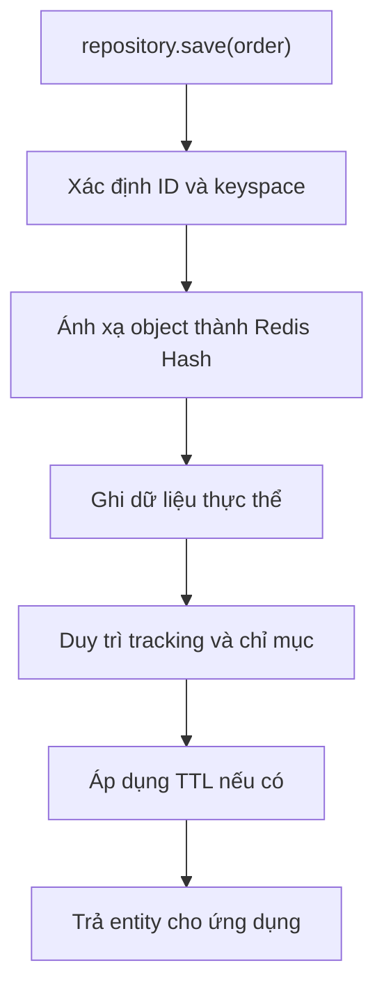
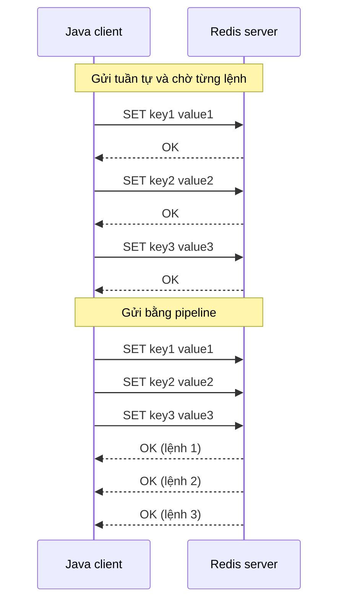
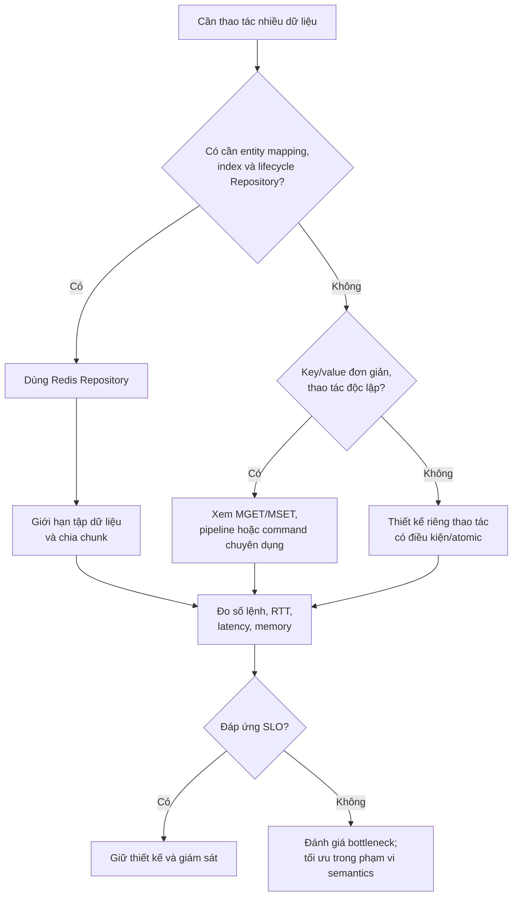

# Thao tác nhiều thực thể và chi phí truy cập Redis trong Spring Data Redis Repository

## 1. Vì sao thao tác hàng loạt cần được thiết kế riêng?

Giả sử một ứng dụng bán hàng lưu đơn hàng trong Redis bằng Spring Data Redis Repository. Với một đơn hàng, cách viết sau trông đơn giản:

```java
orderRepository.save(order);
```

Khi cần lưu 5.000 đơn hàng, ta có thể chuyển sang:

```java
orderRepository.saveAll(orders);
```

Tuy nhiên, **`saveAll` không đồng nghĩa với một lệnh Redis duy nhất** và cũng không mặc nhiên bảo đảm ứng dụng chỉ phải chờ một lượt truyền qua mạng. Repository có trách nhiệm ánh xạ Java object thành Redis Hash, quản lý ID, keyspace, chỉ mục phụ và thời gian hết hạn khi được cấu hình. Một lời gọi repository cấp cao có thể phát sinh **nhiều lệnh Redis**.

Khi số lượng thực thể tăng, tổng chi phí gồm:

- **Chi phí mạng:** số lượt yêu cầu/phản hồi (round trip), độ trễ đến Redis và kích thước dữ liệu truyền.
- **Chi phí phía Redis:** thực thi các lệnh, thao tác cấu trúc dữ liệu, duy trì keyspace và chỉ mục.
- **Chi phí phía Java:** chuyển đổi object, serializer, cấp phát bộ nhớ, duyệt tập đầu vào và xử lý kết quả.
- **Chi phí nhất quán:** một phần batch có thể đã ghi thành công trước khi phát sinh lỗi; cần biết cách thử lại an toàn.

Bài này tập trung vào thao tác **nhiều thực thể bằng Redis Repository** trong Spring Data Redis: `saveAll`, `findAllById`, `deleteAllById`, `findAll`, tác động của chỉ mục/TTL và khi nào cần dùng `RedisTemplate`, multi-key command hoặc pipelining.

## 2. Repository làm gì khi lưu một thực thể?

Xét một thực thể đơn hàng:

```java
import org.springframework.data.annotation.Id;
import org.springframework.data.redis.core.RedisHash;
import org.springframework.data.redis.core.index.Indexed;

@RedisHash("shop:orders")
public class OrderRecord {

    @Id
    private String id;

    @Indexed
    private String customerId;

    private String status;

    public OrderRecord() {
    }

    public OrderRecord(String id, String customerId, String status) {
        this.id = id;
        this.customerId = customerId;
        this.status = status;
    }

    public String getId() {
        return id;
    }

    public void setId(String id) {
        this.id = id;
    }

    public String getCustomerId() {
        return customerId;
    }

    public void setCustomerId(String customerId) {
        this.customerId = customerId;
    }

    public String getStatus() {
        return status;
    }

    public void setStatus(String status) {
        this.status = status;
    }
}
```

Repository tương ứng:

```java
import java.util.List;
import org.springframework.data.repository.CrudRepository;

public interface OrderRepository
        extends CrudRepository<OrderRecord, String> {

    List<OrderRecord> findByCustomerId(String customerId);
}
```

Khi gọi:

```java
repository.save(new OrderRecord("o-101", "c-42", "NEW"));
```

Spring Data Redis dùng `@RedisHash("shop:orders")` để xác định keyspace và `@Id` để xác định bản ghi, thường có tên key dạng:

```text
shop:orders:o-101
```

Các trường của object được chuyển thành Redis Hash. Đồng thời, repository có thể duy trì tập định danh theo keyspace, các chỉ mục phụ cho `@Indexed`, dữ liệu hỗ trợ quản lý TTL và metadata cần thiết.

Một luồng xử lý *minh họa về mặt khái niệm*:



Sơ đồ không phải bản ghi các lệnh cụ thể. **Số lệnh, thứ tự và cách thực thi phụ thuộc phiên bản Spring Data Redis, mapping, loại thao tác và cấu hình.** Điều cần ghi nhớ là một lần `save` có thể đắt hơn một lệnh Redis `HSET` tự viết.

## 3. Các API thao tác nhiều thực thể

Spring Data cung cấp những phương thức phổ biến qua `CrudRepository<T, ID>`:

| API | Công dụng | Điều không nên suy diễn |
|---|---|---|
| `saveAll(Iterable<S> entities)` | Lưu hoặc cập nhật nhiều entity | Không bảo đảm một lệnh Redis, một round trip hay một transaction nguyên tử. |
| `findAllById(Iterable<ID> ids)` | Tìm các entity có ID trong tập đầu vào | Không bảo đảm trả đủ phần tử cho ID không tồn tại; không mặc định giữ thứ tự đầu vào. |
| `deleteAllById(Iterable<? extends ID> ids)` | Xóa nhiều entity theo ID | Không bảo đảm xóa một lần ở server; có thể cần xử lý metadata/chỉ mục. |
| `findAll()` | Lấy tất cả entity mà repository quản lý | Có thể rất tốn bộ nhớ và nhiều lượt đọc khi tập dữ liệu lớn. |
| `deleteAll(Iterable<? extends T> entities)` | Xóa những entity được chỉ định | Không đồng nghĩa với xóa một key Redis duy nhất. |
| `deleteAll()` | Xóa toàn bộ entity thuộc phạm vi repository | Có nguy cơ gây tải lớn; cần cân nhắc kỹ trong hệ thống nhiều dữ liệu. |
| `count()` | Đếm số entity theo cơ chế repository | Không nên giả định mức chi phí hoặc độ chính xác tức thời khi có thao tác đồng thời chỉ từ tên API. |

Các phương thức CRUD này xác định **ý nghĩa nghiệp vụ**, không cam kết chiến lược vận chuyển dữ liệu tối ưu. Để biết số round trip thực tế, cần đo theo cấu hình và bản Spring Data Redis/driver đang chạy.

### 3.1. `saveAll`: tiện lợi, nhưng không nhất thiết là bulk insert

```java
List<OrderRecord> orders = List.of(
    new OrderRecord("o-101", "c-42", "NEW"),
    new OrderRecord("o-102", "c-42", "NEW"),
    new OrderRecord("o-103", "c-43", "NEW")
);

Iterable<OrderRecord> saved = repository.saveAll(orders);
```

Điều được kỳ vọng ở tầng repository là các entity được xử lý theo hợp đồng `saveAll`. **Không được coi ba entity là một ghi nhận nguyên tử:** nếu một bước thất bại sau khi đã lưu một phần, dữ liệu trước đó có thể vẫn tồn tại trong Redis. Redis Repository không biến mọi `saveAll` thành một transaction chỉ vì API nhận một tập hợp.

Ngoài ra, `saveAll` không có nghĩa chỉ có một lệnh `MSET`. Entity được lưu ở dạng Hash và có thể cần thao tác trên nhiều key phụ trợ.

### 3.2. `findAllById`: đầu vào là tập ID, đầu ra chỉ gồm bản ghi tìm thấy

```java
List<String> requestedIds = List.of("o-101", "o-999", "o-102");

Iterable<OrderRecord> found = repository.findAllById(requestedIds);

for (OrderRecord order : found) {
    System.out.println(order.getId() + " -> " + order.getStatus());
}
```

Nếu `o-999` không tồn tại, repository không cần trả về một object đại diện cho ID đó. Hợp đồng API cũng không yêu cầu kết quả đúng theo thứ tự ID truyền vào.

Khi cần trả danh sách theo thứ tự yêu cầu hoặc nhận diện ID bị thiếu, hãy tự xây một ánh xạ theo ID:

```java
Map<String, OrderRecord> byId = new HashMap<>();
repository.findAllById(requestedIds)
          .forEach(order -> byId.put(order.getId(), order));

for (String id : requestedIds) {
    OrderRecord order = byId.get(id);
    if (order == null) {
        System.out.println(id + " -> NOT_FOUND");
    } else {
        System.out.println(id + " -> " + order.getStatus());
    }
}
```

Đoạn trên giả định đã import `java.util.Map` và `java.util.HashMap`; một bản ghi tìm thấy được nhận diện bằng `getId()`, không dựa vào vị trí trong `Iterable`.

### 3.3. `deleteAllById`: nhiều ID không nhất thiết tương đương `DEL key1 key2 ...`

```java
repository.deleteAllById(List.of("o-101", "o-102", "o-103"));
```

Redis hỗ trợ lệnh `DEL` nhiều key, nhưng Redis Repository còn có thể phải cập nhật chỉ mục phụ hoặc các cấu trúc theo dõi thực thể. Gọi trực tiếp `DEL shop:orders:o-101` để thay repository có thể để lại metadata/chỉ mục không còn khớp.

Một batch xóa lớn còn làm tăng nguy cơ truy cập nhiều key và phát sinh tải không cần thiết. Chọn phạm vi xóa cẩn thận, nhất là khi sử dụng `deleteAll()`.

## 4. Mô hình chi phí: số lệnh khác số round trip

Ba đại lượng thường bị nhầm:

1. **Số entity (N):** số bản ghi nghiệp vụ cần xử lý.
2. **Số lệnh Redis (C):** số thao tác Redis thực sự được gửi, có thể lớn hơn N do tracking, index, TTL.
3. **Số lượt mạng phải chờ (R):** số lần ứng dụng phải đợi phản hồi để tiếp tục công việc. Với pipeline hay multi-key command, R có thể nhỏ hơn C.

Một công thức trực giác cho thời gian xử lý:

```text
T ≈ R × RTT
    + thời gian thực thi các lệnh trên Redis
    + thời gian encode/decode và ánh xạ Java
    + thời gian truyền payload và xử lý kết quả
    + các chi phí hàng đợi, contention và hạ tầng
```

Trong đó **RTT (Round-Trip Time)** là thời gian đi/về giữa client và Redis. Đây chỉ là mô hình giải thích, không phải công thức dự báo chính xác thời gian production.

Giả sử để minh họa:

- Có `500` entity.
- Mỗi entity cần trung bình `3` lệnh Redis.
- Mỗi lượt chờ mạng có RTT xấp xỉ `2 ms`.
- Nếu tất cả `1.500` lệnh được thực thi và chờ **tuần tự**, riêng phần RTT đã khoảng `1.500 × 2 ms = 3 giây`.

Nếu những lệnh độc lập được pipeline thành một số đợt gửi, client có thể giảm rất nhiều lần chờ mạng. **Redis vẫn phải xử lý các lệnh thực tế**; pipelining không làm cho 1.500 thao tác biến thành một thao tác tính toán duy nhất.

Ví dụ này là phép tính lý thuyết để thấy mức ảnh hưởng của RTT, **không phải benchmark của `saveAll`**. Một ứng dụng dùng connection pool, asynchronous I/O, command batching hoặc transaction sẽ có hình thái chờ mạng khác.

### 4.1. Cùng khối lượng dữ liệu, độ trễ mạng có thể chi phối

| Tình huống | Đặc điểm | Hệ quả có thể gặp |
|---|---|---|
| Redis và ứng dụng cùng máy/mạng gần | RTT thấp | Serialization, số lệnh và CPU Redis dễ trở thành điểm nghẽn đáng kể. |
| Redis qua mạng giữa các vùng | RTT cao | Nhiều thao tác tuần tự khiến tổng thời gian tăng mạnh. |
| Entity nhiều field hoặc payload lớn | Bytes truyền và mapping tăng | Dù ít round trip, tổng thời gian vẫn có thể cao. |
| `@Indexed` trên nhiều field | Có thêm công việc duy trì index | Ghi/xóa phức tạp hơn một thao tác vào Hash. |
| Entity có TTL/quan hệ | Có thể có các lệnh và dữ liệu hỗ trợ | Cần tính cả thời gian và bộ nhớ ngoài Hash chính. |

Vì vậy, **"gọi ít phương thức Java" không đồng nghĩa "gửi ít lệnh Redis"**. Để tối ưu đúng điểm nghẽn, phải quan sát cả client, Redis và đường truyền.

## 5. Ví dụ service thao tác nhiều đơn hàng

Service sau giữ nguyên ngữ nghĩa repository. Nó phù hợp khi ứng dụng cần lifecycle của entity, index và truy vấn bằng repository.

```java
import java.util.ArrayList;
import java.util.Collection;
import java.util.HashMap;
import java.util.List;
import java.util.Map;

import org.springframework.stereotype.Service;

@Service
public class OrderBatchService {

    private final OrderRepository repository;

    public OrderBatchService(OrderRepository repository) {
        this.repository = repository;
    }

    public List<OrderRecord> saveMany(Collection<OrderRecord> orders) {
        List<OrderRecord> result = new ArrayList<>();
        repository.saveAll(orders).forEach(result::add);
        return result;
    }

    public Map<String, OrderRecord> findMany(Collection<String> ids) {
        Map<String, OrderRecord> byId = new HashMap<>();
        repository.findAllById(ids)
                  .forEach(order -> byId.put(order.getId(), order));
        return byId;
    }

    public void deleteMany(Collection<String> ids) {
        repository.deleteAllById(ids);
    }

    public long countOrders() {
        return repository.count();
    }
}
```

Lưu ý:

- Phương thức `saveMany` tạo `List` kết quả nên bộ nhớ tiêu thụ tỷ lệ với số entity được trả về; không nên vô tình tích lũy hàng triệu object.
- `findMany` trả `Map` chỉ chứa những ID được tìm thấy; code gọi phải xử lý ID bị thiếu.
- `deleteMany` phụ thuộc repository để giữ các cấu trúc mà repository quản lý nhất quán theo hợp đồng của nó.
- Cả ba phương thức có thể hoàn thành **một phần** trước khi ngoại lệ xảy ra; không ngầm bảo đảm all-or-nothing.

### 5.1. Chia lô để giới hạn kích thước dữ liệu đang xử lý

Nếu dữ liệu đầu vào đã ở trong một danh sách lớn, có thể xử lý theo từng nhóm:

```java
import java.util.List;

public void saveInChunks(List<OrderRecord> orders, int chunkSize) {
    if (chunkSize <= 0) {
        throw new IllegalArgumentException("chunkSize must be positive");
    }

    for (int from = 0; from < orders.size(); from += chunkSize) {
        int to = Math.min(from + chunkSize, orders.size());
        List<OrderRecord> chunk = orders.subList(from, to);
        repository.saveAll(chunk);
    }
}
```

Ví dụ, với 20.000 entity và `chunkSize = 250`, vòng lặp có 80 lần gọi `saveAll`. Cách này giúp ứng dụng kiểm soát phạm vi lỗi, log tiến độ và tránh giữ cả một danh sách kết quả lớn. Tuy nhiên, vì danh sách `orders` ban đầu vẫn nằm trong RAM, `subList` **không làm biến mất chi phí bộ nhớ của toàn bộ dữ liệu đầu vào**. Để tiết kiệm RAM thật sự khi nhập rất nhiều bản ghi, hãy lấy dữ liệu từ nguồn theo từng trang/đợt và chỉ giữ một đợt trong bộ nhớ.

**Chia chunk không tự bật Redis pipelining** và không tự giảm số round trip. Mục tiêu chính của nó ở đây là điều phối khối lượng công việc, lỗi và bộ nhớ.

### 5.2. Có nên chạy nhiều `saveAll` song song?

Có thể tăng throughput nhờ concurrency khi nút thắt là thời gian chờ I/O, nhưng tăng số luồng không tự động làm Redis mạnh hơn. Quá nhiều task đồng thời có thể làm đầy connection pool, tạo hàng đợi lớn hoặc tăng contention trên Redis.

Nếu các batch cùng sửa một ID, có nguy cơ **ghi đè lẫn nhau**. Với mỗi ID, cần xác định chiến lược phiên bản/đồng bộ theo nghiệp vụ trước khi chạy cập nhật song song.

Hãy giới hạn mức concurrency, đo độ trễ p95/p99 và Redis CPU, rồi điều chỉnh theo năng lực của hệ thống thật.

## 6. Vì sao `findAll()` có thể đắt?

`findAll()` rất tiện trong dữ liệu mẫu:

```java
Iterable<OrderRecord> allOrders = repository.findAll();
```

Nhưng trong một hệ thống đã lưu hàng trăm nghìn đơn hàng, thao tác này có thể phải:

1. Xác định tập ID thuộc keyspace của repository.
2. Đọc dữ liệu tương ứng với nhiều ID.
3. Chuyển từng Redis Hash thành Java object.
4. Trả tập kết quả về ứng dụng.

Các bước cụ thể và cách tổ chức truy vấn phụ thuộc implementation, nhưng **đọc toàn bộ một tập lớn** thường tạo áp lực lên mạng, Redis và bộ nhớ Java.

So sánh:

```java
// Chỉ cần ba đơn hàng cụ thể:
repository.findAllById(List.of("o-101", "o-102", "o-103"));

// Chỉ cần một đơn hàng:
repository.findById("o-101");

// Không nên mặc định tải mọi đơn hàng chỉ để tìm vài ID:
repository.findAll();
```

Khi cần duyệt một tập dữ liệu rất lớn, cân nhắc một API truy xuất có phạm vi hẹp, cơ chế cursor/SCAN phù hợp hoặc thiết kế một read model chuyên dụng. Không nên mặc định các tính năng pagination quen thuộc của JPA/SQL đều có cùng hợp đồng trong Redis Repository.

### 6.1. Có thể chỉ đọc từ chỉ mục phụ?

Nếu nghiệp vụ thường tìm các đơn hàng của một khách hàng, có thể thêm:

```java
@Indexed
private String customerId;
```

và khai báo:

```java
List<OrderRecord> findByCustomerId(String customerId);
```

Như vậy có thể tránh tải **toàn bộ** keyspace rồi lọc bằng Java. Đổi lại, Redis Repository phải duy trì chỉ mục phụ khi ghi, cập nhật và xóa entity.

Tức là đã đánh đổi một phần **chi phí ghi và bộ nhớ** để đổi lấy khả năng **tìm theo field**. Nếu một field hiếm khi được tìm kiếm hoặc giá trị thay đổi liên tục, hãy cân nhắc liệu chỉ mục có đáng giá hay không.

## 7. Tác động của `@Indexed`, TTL và metadata lên bulk operations

### 7.1. Chỉ mục phụ thêm công việc khi ghi và xóa

Ví dụ:

```java
@RedisHash("shop:orders")
public class OrderRecord {
    @Id
    private String id;

    @Indexed
    private String customerId;

    private String status;
}
```

Khi lưu hàng nghìn entity, mỗi giá trị `customerId` có thể tạo hoặc cập nhật thông tin membership của chỉ mục. Nếu `customerId` thay đổi, hệ thống còn phải xử lý mối liên hệ giữa giá trị cũ và mới.

Do đó, benchmark lưu một entity **chỉ có ID và một String field** không phản ánh đầy đủ chi phí của entity có nhiều `@Indexed`, TTL hoặc quan hệ tham chiếu.

### 7.2. TTL có thể làm phát sinh thêm hoạt động

Ví dụ:

```java
import org.springframework.data.redis.core.RedisHash;

@RedisHash(value = "shop:draft-orders", timeToLive = 3600)
public class DraftOrder {
    // @Id và các thuộc tính khác
}
```

`timeToLive = 3600` khai báo TTL tính bằng giây. Repository phải xét expiration khi lưu entity, và một số cơ chế quản lý expiration có thể cần thêm metadata hoặc bản sao hỗ trợ sự kiện hết hạn tùy cấu hình.

Không nên kết luận một lần `saveAll` chứa N entity có TTL vẫn chỉ tốn N lệnh Redis. Khi cập nhật lại entity, thời điểm hết hạn cũng có thể bị ảnh hưởng bởi quy tắc mapping; cần lựa chọn chính sách TTL phù hợp với vòng đời nghiệp vụ.

### 7.3. Không xóa thẳng Hash rồi mặc định index tự khớp

Nếu một entity được quản lý bằng Redis Repository, thao tác:

```redis
DEL shop:orders:o-101
```

có thể xóa dữ liệu chính nhưng không thực hiện toàn bộ công việc dọn chỉ mục mà repository thường đảm nhiệm. Hệ quả có thể là truy vấn qua index cho ra ID không còn dữ liệu.

Đừng thay `repository.deleteAllById(...)` bằng một batch `DEL` tự viết khi ứng dụng vẫn cần các index, tracking và semantics của repository. Muốn chuyển sang cách lưu/xóa thủ công phải sở hữu luôn cơ chế bảo trì dữ liệu phụ trợ.

## 8. Multi-key commands: ít round trip cho dữ liệu đơn giản

Redis hỗ trợ các lệnh như `MGET`, `MSET` và `DEL` nhiều key. Chúng rất có ích khi dữ liệu được lưu thành **String key/value đơn giản** và không cần toàn bộ ngữ nghĩa entity mapping của repository.

### 8.1. Đọc nhiều String bằng `multiGet`

```java
import java.util.List;
import org.springframework.data.redis.core.StringRedisTemplate;

public class StatusReader {

    private final StringRedisTemplate redis;

    public StatusReader(StringRedisTemplate redis) {
        this.redis = redis;
    }

    public List<String> readStatuses() {
        List<String> keys = List.of(
            "order-status:o-101",
            "order-status:o-102",
            "order-status:o-103"
        );
        return redis.opsForValue().multiGet(keys);
    }
}
```

`multiGet` tương ứng với ý tưởng đọc nhiều key String qua `MGET`. Kết quả thường tương ứng theo vị trí của danh sách key đầu vào; một key không tồn tại có thể có phần tử `null`. Đọc theo kiểu này **không tự trả về OrderRecord** có mapping `@RedisHash`.

### 8.2. Ghi nhiều String bằng `multiSet`

```java
import java.util.LinkedHashMap;
import java.util.Map;

Map<String, String> statuses = new LinkedHashMap<>();
statuses.put("order-status:o-101", "PAID");
statuses.put("order-status:o-102", "PACKED");
statuses.put("order-status:o-103", "SHIPPED");

redis.opsForValue().multiSet(statuses);
```

`multiSet` thường dùng lệnh `MSET`. Nó có thể giảm overhead của nhiều lần `SET` riêng lẻ.

Nhưng cần nhớ:

- `MSET` ghi **String**; nó không thay thế cho các bước mapping entity thành Redis Hash.
- Redis `MSET` thông thường **xóa TTL cũ** của key được ghi đè và không nhận TTL khác nhau cho từng key như một lần `SET ... EX`.
- Khi chạy Redis Cluster, lệnh đa key trên server thường yêu cầu các key nằm trong **cùng hash slot**; driver có thể áp dụng tối ưu riêng nhưng không được mặc định mọi tổ hợp key đều hợp lệ.
- Nếu cần các index/TTL/repository callback, dùng `multiSet` tự viết có thể làm sai hợp đồng lưu trữ của entity.

### 8.3. `DEL` nhiều key cũng không thay thế toàn bộ `deleteAllById`

```redis
DEL order-status:o-101 order-status:o-102 order-status:o-103
```

Lệnh này phù hợp nếu ứng dụng sở hữu trực tiếp ba key String và không có metadata phụ trợ. Với Hash entity do Redis Repository quản lý, hãy giữ quy tắc xóa phù hợp để không bỏ sót index.

## 9. Pipelining: giảm chờ mạng khi có nhiều lệnh độc lập

**Redis pipelining** cho phép client gửi một loạt lệnh mà không phải chờ phản hồi của từng lệnh trước khi gửi lệnh tiếp theo. Sau khi server xử lý, client đọc các phản hồi tương ứng.



Ưu điểm quan trọng là **giảm số lần client phải chờ mạng**. Một pipeline có 100 lệnh vẫn là 100 lệnh Redis cần thực thi.

**Pipelining không tự tạo transaction.** Nếu lệnh thứ 40 lỗi, các lệnh trước có thể đã hoàn thành và các lệnh khác có thể vẫn được xử lý. Nếu nghiệp vụ yêu cầu all-or-nothing, phải xem xét giao dịch, Lua hoặc chiến lược thiết kế dữ liệu tương ứng; pipeline thuần không cung cấp rollback.

### 9.1. Ví dụ Spring Data Redis: pipeline các lệnh `SET`

Đây là ví dụ dùng `StringRedisTemplate` để ghi **các key String do ứng dụng tự quản lý**, không đi qua Redis Repository. Các key có TTL 5 phút trong cùng lệnh `SET`.

```java
import java.nio.charset.StandardCharsets;
import java.util.List;
import java.util.Map;

import org.springframework.data.redis.connection.RedisStringCommands;
import org.springframework.data.redis.core.RedisCallback;
import org.springframework.data.redis.core.StringRedisTemplate;
import org.springframework.data.redis.core.types.Expiration;
import org.springframework.stereotype.Service;

@Service
public class StatusPipelineWriter {

    private final StringRedisTemplate redis;

    public StatusPipelineWriter(StringRedisTemplate redis) {
        this.redis = redis;
    }

    public void writeBatch(Map<String, String> statuses) {
        redis.executePipelined((RedisCallback<Object>) connection -> {
            for (Map.Entry<String, String> entry : statuses.entrySet()) {
                byte[] key = ("order-status:" + entry.getKey())
                    .getBytes(StandardCharsets.UTF_8);
                byte[] value = entry.getValue()
                    .getBytes(StandardCharsets.UTF_8);

                connection.stringCommands().set(
                    key,
                    value,
                    Expiration.seconds(300),
                    RedisStringCommands.SetOption.upsert()
                );
            }
            return null;
        });
    }
}
```

Trong ví dụ này:

- `executePipelined` mở ngữ cảnh pipeline, gửi các lệnh và nhận danh sách phản hồi sau khi kết thúc.
- Callback phải trả `null`; kết quả từng lệnh trong lúc đang queue không được xử lý như kết quả đã thực thi.
- `Expiration.seconds(300)` yêu cầu TTL mới cùng với giá trị, tránh lệnh `EXPIRE` riêng.
- Đoạn mã dùng bytes UTF-8 theo cách `StringRedisTemplate` mặc định serialize chuỗi. Nếu ứng dụng dùng cấu hình serializer khác, phải đồng bộ cách encode key/value.
- Để giữ bộ nhớ có giới hạn, không gửi một pipeline gồm hàng triệu lệnh. Nên chia thành các chunk có kích thước đo đạc được.

Với `StringRedisTemplate`, `executePipelined` có thể trả một `List<Object>` chứa phản hồi đã giải mã. Nếu ứng dụng cần xác nhận từng lệnh, hãy lưu và xử lý danh sách này; code minh họa trên sử dụng pipeline theo kiểu ghi hàng loạt và không phân tích phản hồi chi tiết.

### 9.2. Chia pipeline theo chunk

```java
import java.util.ArrayList;
import java.util.List;
import java.util.Map;

public void writeInChunks(Map<String, String> statuses, int chunkSize) {
    if (chunkSize <= 0) {
        throw new IllegalArgumentException("chunkSize must be positive");
    }

    List<Map.Entry<String, String>> entries =
        new ArrayList<>(statuses.entrySet());

    for (int from = 0; from < entries.size(); from += chunkSize) {
        int to = Math.min(from + chunkSize, entries.size());
        Map<String, String> chunk = new java.util.LinkedHashMap<>();
        for (Map.Entry<String, String> entry : entries.subList(from, to)) {
            chunk.put(entry.getKey(), entry.getValue());
        }
        writeBatch(chunk);
    }
}
```

Đây là phương thức bổ sung cho `StatusPipelineWriter` ở trên. Kích thước chunk cần được lựa chọn dựa vào độ lớn payload, memory, độ trễ và phản hồi driver. Một con số như 100, 500 hay 1.000 chỉ là **điểm khởi đầu để đo**, không có ngưỡng "tối ưu" áp dụng cho mọi hệ thống.

### 9.3. Pipelining với entity Repository: phải giữ hợp đồng mapping

Một cách tối ưu dễ mắc sai lầm là lấy danh sách `OrderRecord` rồi pipeline lệnh `HSET` trực tiếp vào `shop:orders:<id>`. Điều này có thể giảm RTT nhưng **bỏ qua**:

- Tracking entity theo keyspace.
- Chỉ mục phụ như `@Indexed`.
- TTL, metadata kiểu thực thể, conversion cho field phức tạp.
- Những thao tác xóa/cập nhật đi kèm mà repository cần.

Nếu yêu cầu là **CRUD entity với Redis Repository**, hãy bắt đầu từ repository và đo chi phí thật. Nếu cần throughput lớn hơn mức cơ chế đó đáp ứng, thiết kế một tầng ghi chuyên dụng sử dụng RedisTemplate, pipeline hoặc script **cùng với chiến lược duy trì nhất quán dữ liệu phụ trợ**. Không ghép giải pháp thấp tầng vào cùng keyspace repository mà không xét side effect.

## 10. Pipeline, transaction và Lua khác nhau như thế nào?

| Cơ chế | Mục đích chính | Có tự bảo đảm all-or-nothing? | Có tự giảm số lệnh Redis? |
|---|---|---|---|
| `saveAll` của Repository | API CRUD nhiều entity, giữ mapping | **Không mặc định** | **Không bảo đảm** |
| Redis `MSET` / `MGET` | Lệnh đa key cho dữ liệu String | Một lệnh server có ngữ nghĩa nguyên tử tương ứng; có hạn chế hash slot trên cluster | Có thể thay nhiều lệnh đơn bằng một lệnh |
| Pipelining | Giảm thời gian chờ giữa nhiều lệnh | **Không** | **Không**, chỉ giảm các lần chờ |
| `MULTI` / `EXEC` | Gom các lệnh cho thực thi tuần tự như một transaction Redis | Redis không có cơ chế rollback lỗi lệnh kiểu SQL | Không tự giảm số lệnh nghiệp vụ |
| Lua script | Đưa logic nhiều bước sang server để thực hiện nguyên tử | Một script chạy nguyên tử đối với các lệnh khác; không tương đương rollback giao dịch SQL | Có thể giảm round trip và một phần thao tác phía client |

Không nên gọi pipeline là "batch transaction". Một batch có thể **hiệu quả về network** nhưng vẫn có rủi ro lỗi từng lệnh.

Với một nghiệp vụ có nhiều key trên **Redis Cluster**, transaction hoặc script cũng có giới hạn theo hash slot; không thể giả định mọi key trên các node khác nhau được xử lý nguyên tử cùng nhau.

## 11. Redis Cluster ảnh hưởng gì đến thao tác nhiều key?

Redis Cluster chia key vào các **hash slot**. Các lệnh đa key có yêu cầu các key nằm cùng slot khi được thực thi trên một node. Ví dụ:

```text
MGET order-status:o-101 order-status:o-102
```

Trong cluster, hai key có thể nằm ở các slot khác nhau. Khi gửi trực tiếp lệnh đa key không hợp lệ đến node, Redis có thể báo `CROSSSLOT`.

Redis hỗ trợ cú pháp **hash tag** để ghép các key có cùng một đoạn trong dấu ngoặc nhọn vào cùng slot:

```text
order:{o-101}:status
order:{o-101}:payment
order:{o-101}:shipping
```

Ba key cùng tag `{o-101}` được hash theo cùng nội dung tag và có thể đặt cùng slot. Tuy nhiên, không nên gán toàn bộ dữ liệu lớn vào **một hash tag duy nhất**, vì điều đó có thể tập trung tải vào một shard và giảm lợi ích phân tán của Cluster.

Với pipelining, driver cluster-aware có thể phân phối các lệnh độc lập theo node/slot, nhưng khả năng và thứ tự tổng hợp phản hồi phụ thuộc driver/API. **Không suy diễn rằng pipeline tự giải quyết được mọi lệnh đa key vượt slot**. Khi tối ưu Redis Repository trên Cluster, kiểm tra cả quy tắc đặt tên keyspace, chỉ mục phụ và các thao tác theo nhiều key.

## 12. Lựa chọn phù hợp theo loại tác vụ

| Tác vụ | Cách tiếp cận thường hợp lý | Lý do |
|---|---|---|
| Tạo hoặc cập nhật một nhóm nhỏ entity có index | `repository.saveAll` | Giữ mapping, lifecycle và semantics repository. |
| Tìm một số entity đã biết ID | `repository.findAllById` | Tránh tải toàn bộ keyspace bằng `findAll`. |
| Xóa entity đã được repository quản lý | `repository.deleteAllById` | Giữ các cấu trúc phụ trợ theo cơ chế repository. |
| Lấy trạng thái String của nhiều key | `StringRedisTemplate.opsForValue().multiGet` | Tận dụng lệnh đa key nếu topology cho phép. |
| Ghi nhiều String key có cùng quy tắc TTL | Pipelining các lệnh `SET ... EX` | Giảm round trip mà vẫn kiểm soát TTL từng key. |
| Bộ đếm/lượt truy cập tần suất cao | Redis command chuyên dụng như `INCR`, phối hợp TTL an toàn | Tránh overhead mapping entity cho một con số. |
| Cập nhật nhiều bước cần tính nguyên tử | Lua hoặc transaction tương ứng | Quy tắc nghiệp vụ quan trọng hơn số lượt gọi Java. |
| Nhập hàng triệu entity từ nguồn bên ngoài | Đọc theo trang, ghi theo chunk, đo tải | Giới hạn bộ nhớ và kiểm soát xử lý lỗi. |
| Truy vấn hàng loạt theo một field | Repository query có `@Indexed` khi phù hợp | Đổi chi phí ghi/chỉ mục lấy truy vấn nhanh hơn. |

Các lựa chọn trên là hướng thiết kế. Quyết định cuối cùng phụ thuộc vào chi phí Redis thực tế, semantics dữ liệu và cấu trúc deployment.

## 13. Xử lý lỗi khi một batch chưa hoàn tất

### 13.1. Batch không mặc định rollback

Giả sử:

```text
Batch 1: save o-001 .. o-250 -> thành công
Batch 2: save o-251 .. o-500 -> lỗi ở giữa
Batch 3: chưa thực thi
```

Không thể suy ra toàn bộ 500 bản ghi đã thất bại. Có thể một phần dữ liệu của batch 2 đã được lưu trước khi exception đến ứng dụng.

Nếu hệ thống thử lại toàn bộ, cần xác định:

- Có thể **ghi cùng ID nhiều lần** mà vẫn đúng nghiệp vụ không?
- Lệnh đang dùng là ghi trạng thái tuyệt đối, hay thao tác tăng bộ đếm/phát sự kiện có thể gây trùng?
- Có cần thông tin phiên bản hoặc điều kiện cập nhật để tránh ghi đè dữ liệu mới hơn?
- Chỉ mục và TTL có giữ đúng hợp đồng sau khi thử lại không?

Đối với entity lưu theo ID ổn định, `save` lại có thể phù hợp trong nhiều tình huống, nhưng **không tự động an toàn cho mọi nghiệp vụ**. Ví dụ, lưu object cũ sau khi client khác vừa cập nhật có thể làm mất phiên bản mới.

### 13.2. Dùng ID ổn định và ghi nhận tiến độ

Với luồng nhập dữ liệu:

```text
Đọc một trang dữ liệu
    ↓
Chuyển sang entity có ID ổn định
    ↓
Ghi theo chunk
    ↓
Chỉ đánh dấu chunk hoàn tất sau khi xử lý thành công
    ↓
Đọc trang tiếp theo
```

Nếu hệ thống yêu cầu độ chính xác cao, có thể cần checkpoint tại nguồn, hàng đợi có acknowledgment hoặc cơ chế deduplication riêng. Việc log "đã gọi `saveAll`" không phải bằng chứng toàn bộ dữ liệu đã được lưu.

### 13.3. Xử lý dữ liệu thiếu khi đọc nhiều ID

Redis key có thể hết hạn trong lúc batch đọc, hoặc bị xóa bởi client khác. Vì vậy, ứng dụng phải coi kết quả `findAllById` là **tập các bản ghi tìm thấy tại thời điểm thực hiện**, không mặc định là snapshot nhất quán của toàn bộ danh sách ID.

Nếu yêu cầu nghiệp vụ là "mọi bản ghi phải tồn tại đồng thời" (ví dụ xác nhận tất cả đơn hàng thuộc một giao dịch), Redis Repository CRUD đơn lẻ không đủ để suy ra điều đó; cần chiến lược nhất quán được thiết kế riêng.

## 14. Tối ưu bộ nhớ và kích thước payload

### 14.1. Đừng materialize nhiều lần không cần thiết

Ví dụ code sau nhân đôi dữ liệu trong RAM:

```java
List<OrderRecord> source = loadAllOrders();
List<OrderRecord> copied = new ArrayList<>(source);
List<OrderRecord> saved = new ArrayList<>();
repository.saveAll(copied).forEach(saved::add);
```

Nếu không cần giữ ba bản sao của tập dữ liệu, có thể thiết kế luồng xử lý trang hoặc chunk. `List` bản thân chỉ chứa tham chiếu đến object, nhưng vẫn tốn bộ nhớ; các byte array phục vụ serializer và object chuyển đổi cũng có thể làm tăng mức sử dụng heap.

### 14.2. Kiểm soát kích thước entity

Một entity chứa nhiều trường văn bản lớn hoặc dữ liệu lồng nhau có thể:

- Tăng chi phí chuyển đổi object.
- Tăng kích thước dữ liệu đi qua mạng.
- Tăng CPU Redis và thời gian phản hồi.
- Khi ghi lại toàn bộ object, tạo chi phí lớn dù ứng dụng chỉ sửa một thuộc tính nhỏ.

Với truy cập tần suất cao vào một trạng thái nhỏ, có thể thiết kế riêng một key String hoặc Hash nhỏ hơn, miễn là quyền sở hữu dữ liệu và tính nhất quán được định nghĩa rõ.

### 14.3. Không tạo pipeline vô hạn

Pipelining cần giữ phản hồi chờ đọc ở Redis/client. Gửi hàng trăm nghìn lệnh trong một pipeline có thể làm tăng memory, độ trễ của những request khác và rủi ro khi kết nối bị gián đoạn. **Pipeline chia chunk** thường là chiến lược vận hành dễ kiểm soát hơn.

## 15. Quan sát và đo đạc hiệu năng

Tối ưu đúng yêu cầu bằng số liệu thay vì chỉ nhìn tên API. Với cùng một môi trường, có thể đo:

- **Throughput:** số entity xử lý mỗi giây.
- **Latency:** tổng thời gian một batch và p50/p95/p99 của các request.
- **Redis command rate:** số lệnh thực thi; so sánh với số entity.
- **Network:** RTT, bandwidth, số bytes request/response.
- **Memory:** heap Java, bộ nhớ Redis, phản hồi pipeline.
- **Chi phí metadata:** khác biệt khi bật/tắt index, TTL trên các thực thể mẫu.
- **Lỗi:** timeout, pool exhaustion, retry, cập nhật đồng thời và kết quả đọc thiếu.

### 15.1. Đo end-to-end trong service

Ví dụ thời gian của một batch:

```java
import java.util.List;
import java.util.concurrent.TimeUnit;

public long measureSaveMillis(
        OrderRepository repository,
        List<OrderRecord> batch) {

    long started = System.nanoTime();
    repository.saveAll(batch);
    return TimeUnit.NANOSECONDS.toMillis(
        System.nanoTime() - started
    );
}
```

Đây là đo **thời gian lời gọi Java ở tầng service**. Nó có thể bao gồm serialization, lập lệnh, chờ I/O và các hoạt động khác; không phải phép đo riêng thời gian CPU Redis. Nếu `saveAll` trả kết quả được xử lý lười trong một implementation cụ thể, cần tính cả bước tiêu thụ kết quả khi đo.

Muốn so sánh đáng tin cậy, hãy đo nhiều lần sau khi hệ thống ổn định, dùng cùng kích thước entity, cùng cấu hình serializer/index/TTL và cùng topology Redis. Việc một lần chạy nhanh hơn chưa đủ để xác nhận lựa chọn tối ưu.

### 15.2. Quan sát trực tiếp ở Redis

Một số lệnh hữu ích:

```redis
INFO commandstats
INFO stats
SLOWLOG GET 10
```

`INFO commandstats` giúp quan sát thống kê theo lệnh; `SLOWLOG` ghi các lệnh server thực thi chậm theo ngưỡng cấu hình. **Slow log không phản ánh trọn vẹn thời gian mạng và hàng đợi phía client**, nên có thể xảy ra trường hợp Redis báo lệnh rất nhanh nhưng ứng dụng vẫn có latency cao do RTT hoặc connection pool.

`MONITOR` có thể giúp thấy luồng lệnh thực tế trong môi trường thử nghiệm, nhưng gây overhead và có thể hiển thị dữ liệu nhạy cảm; không nên mặc định bật trong production có tải cao. Khi cần điều tra sản xuất, ưu tiên observability có giới hạn và số liệu từ ứng dụng/driver.

### 15.3. Ma trận đo thử gợi ý

| Cấu hình | 100 entity | 1.000 entity | 10.000 entity |
|---|---|---|---|
| Repository `saveAll`, không index, không TTL | Đo | Đo | Đo |
| Repository `saveAll`, có `@Indexed` | Đo | Đo | Đo |
| Repository `saveAll`, có TTL | Đo | Đo | Đo |
| Pipeline `SET` các key String độc lập | Đo | Đo | Đo |
| Đọc nhiều key bằng `multiGet` | Đo | Đo | Đo |

Đây không phải các phương án có semantics dữ liệu tương đương; mục đích là quan sát **chi phí bổ sung của từng kiểu thao tác**. Không dùng kết quả "pipeline String nhanh hơn Repository Hash" để kết luận có thể bỏ toàn bộ repository mapping mà không thay đổi hợp đồng dữ liệu.

## 16. Những sai lầm thường gặp

### Sai lầm 1: "`saveAll` chắc chắn chỉ gọi Redis một lần"

Không có bảo đảm đó từ tên API. Repository có thể xử lý từng entity cùng nhiều bước phụ trợ. Hãy đo số lệnh/round trip thật.

### Sai lầm 2: "Pipelining làm batch trở thành transaction"

Pipelining tối ưu đường truyền; nó **không cung cấp rollback** và không tự ngăn client khác xen vào các thao tác.

### Sai lầm 3: "`findAll` là cách đơn giản để lọc vài bản ghi"

Đọc toàn bộ keyspace rồi lọc bằng Java có thể rất tốn kém. Nếu có ID, dùng `findById` / `findAllById`; nếu truy vấn theo thuộc tính, thiết kế index có cân nhắc.

### Sai lầm 4: "Dùng `DEL` hàng loạt trực tiếp sẽ tương đương `deleteAllById`"

Điều này bỏ qua khả năng Redis Repository duy trì chỉ mục và key phụ trợ. Chỉ sử dụng cách xóa thấp tầng khi ứng dụng nắm toàn bộ semantics lưu trữ.

### Sai lầm 5: "Tăng kích thước batch vô hạn sẽ càng nhanh"

Batch quá lớn làm tăng RAM, payload, thời gian chờ, khó phục hồi lỗi và áp lực lên Redis. Kích thước hợp lý phải được đo trên tải thực.

### Sai lầm 6: "Chia thành chunk là đã giảm round trip"

Chunking kiểm soát dung lượng xử lý; muốn giảm chờ mạng thường phải dùng API/driver có batching, pipelining hoặc multi-key command thật sự.

### Sai lầm 7: "Một lần retry chắc chắn an toàn"

Đối với các thao tác không idempotent như tăng counter, phát sự kiện hoặc cập nhật theo thứ tự, retry có thể tạo kết quả sai. Với `save`, việc ghi object cũ cũng có thể đè trạng thái mới hơn.

### Sai lầm 8: "Redis command càng ít thì nghiệp vụ càng tốt"

Một lệnh lớn cũng có thể có thời gian server và payload cao, hoặc không hỗ trợ indexing/TTL mà ứng dụng cần. Cần so sánh **end-to-end latency và correctness**, không chỉ đếm phương thức.

## 17. Bài tập suy luận

Một hệ thống quản lý 10.000 giỏ hàng lưu qua Redis Repository:

```java
@RedisHash(value = "carts", timeToLive = 900)
class Cart {
    @Id String id;
    @Indexed String userId;
    // ...
}
```

Ứng dụng cần thực hiện bốn việc:

1. Nhập thêm 2.000 giỏ hàng.
2. Đọc trạng thái của 20 giỏ hàng đã biết ID.
3. Xóa 100 giỏ hàng cũ.
4. Ghi một triệu lượt tăng bộ đếm theo người dùng.

Cách tiếp cận hợp lý để cân nhắc:

| Yêu cầu | Hướng tiếp cận | Điều cần kiểm tra |
|---|---|---|
| Nhập 2.000 giỏ | `saveAll` theo các chunk hợp lý | Chi phí tạo Hash, index `userId`, TTL, partial failures. |
| Đọc 20 ID | `findAllById` | Xử lý ID bị thiếu/hết hạn; không mặc định thứ tự trả về. |
| Xóa 100 ID | `deleteAllById` | Cơ chế cập nhật index và TTL metadata; không xóa Hash thủ công. |
| Tăng một triệu bộ đếm | Lệnh `INCR` chuyên dụng, có thể pipeline/batch | Tính nguyên tử tăng, TTL khi key mới xuất hiện, giới hạn tải. |

Câu hỏi bổ sung: nếu bộ đếm phải hết hạn 60 giây từ lần tăng đầu tiên, chỉ gọi `INCR` là chưa đủ; thao tác tạo mới phải phối hợp với expiration một cách an toàn khi có cạnh tranh. Nếu các giỏ hàng phải duy trì hạn hết 15 phút tính từ lúc tạo, cần biết việc lưu cập nhật lại entity tác động TTL như thế nào.

## 18. Nguyên tắc thiết kế khi dữ liệu tăng

Một quy trình ra quyết định hữu ích:



Khi làm việc với nhiều thực thể, hãy phân biệt **API tiện lợi** và **chi phí thực thi thực tế**. `saveAll`, `findAllById` và `deleteAllById` giúp diễn đạt nghiệp vụ ở mức entity, nhưng không hứa hẹn một lượt mạng hay một giao dịch. Multi-key command và pipelining có thể cải thiện throughput cho workload thích hợp, song không tự bảo toàn mapping, chỉ mục và TTL mà Repository quản lý. Thiết kế tốt là chọn đúng mức trừu tượng, đo tải thực và bảo toàn ngữ nghĩa dữ liệu khi tối ưu.

## Tài liệu tham khảo

- [Spring Data Redis Reference — Redis Repositories](https://docs.spring.io/spring-data/redis/reference/redis/redis-repositories.html)
- [Spring Data Redis Reference — Mapping](https://docs.spring.io/spring-data/redis/reference/redis/redis-repositories/mapping.html)
- [Spring Data Redis Reference — Secondary Indexes](https://docs.spring.io/spring-data/redis/reference/redis/redis-repositories/indexes.html)
- [Spring Data Redis Reference — Time To Live](https://docs.spring.io/spring-data/redis/reference/redis/redis-repositories/expirations.html)
- [Spring Data Redis Reference — Pipelining](https://docs.spring.io/spring-data/redis/reference/redis/pipelining.html)
- [Spring Data Commons Reference — Core Repository Concepts](https://docs.spring.io/spring-data/commons/reference/repositories/core-concepts.html)
- [Redis Documentation — Pipelining](https://redis.io/docs/latest/develop/using-commands/pipelining/)
- [Redis Documentation — MGET](https://redis.io/docs/latest/commands/mget/)
- [Redis Documentation — MSET](https://redis.io/docs/latest/commands/mset/)
- [Redis Documentation — SCAN](https://redis.io/docs/latest/commands/scan/)
