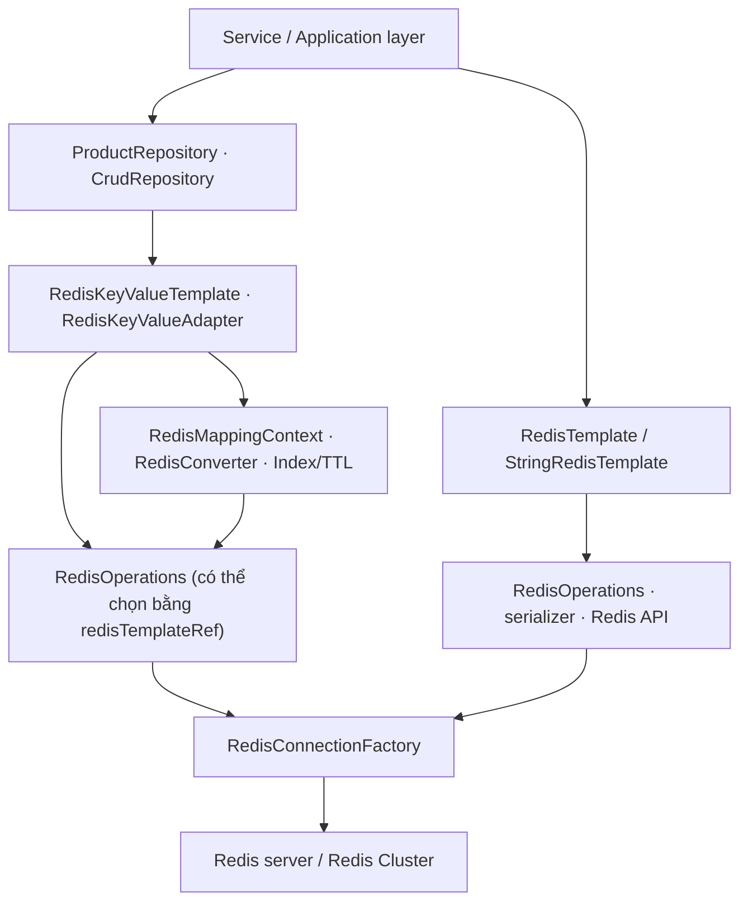

# Phân biệt cấu hình Repository với cấu hình RedisTemplate trong Spring Data Redis

> **Module:** Spring Data Redis  
> **Chương:** Redis Repository  
> **Trọng tâm:** Phân biệt cấu hình phục vụ *domain repository* với cấu hình thao tác Redis trực tiếp qua `RedisTemplate`, đồng thời hiểu cách hai cơ chế phối hợp trên cùng một Redis server.

## 1. Hai cách sử dụng Redis trong ứng dụng Spring

Spring Data Redis cung cấp hai hướng tiếp cận phổ biến cho dữ liệu:

1. **`RedisTemplate` và `StringRedisTemplate`:** thao tác với các kiểu dữ liệu native của Redis — String, Hash, List, Set, Sorted Set, Stream, Pub/Sub... — bằng các operation API như `opsForValue()`, `opsForHash()` và `opsForSet()`. Ứng dụng tự quyết định tên key, kiểu dữ liệu, định dạng serialize, TTL và các lệnh cần thực hiện.
2. **Redis Repository:** biểu diễn dữ liệu dưới dạng **entity** và truy cập qua interface repository như `CrudRepository<Product, String>`. Spring Data Redis quản lý chuyển đổi entity thành Redis Hash, keyspace, chỉ mục phụ và một số thao tác đọc/ghi theo quy ước.

Ví dụ cùng là “lưu sản phẩm vào Redis”:

- Với template, ứng dụng có thể gọi `SET cache:product:101 "<json>" EX 600`.
- Với repository, ứng dụng gọi `productRepository.save(product)`; Redis Repository có thể lưu entity dưới dạng **Hash** `products:101` và duy trì các Set hỗ trợ tra cứu theo thuộc tính đánh dấu `@Indexed`.

Cả hai có thể dùng **cùng Redis server và cùng `RedisConnectionFactory`**. Tuy nhiên, việc cùng kết nối một server không đồng nghĩa dữ liệu của chúng tự động tương thích về key, value, kiểu Redis hay cách chuyển đổi.

### 1.1. Sơ đồ kiến trúc



Sơ đồ trên là cách nhìn theo **trách nhiệm cấu hình**, không phải sơ đồ lớp hoặc lời khẳng định mọi triển khai đều có cùng chuỗi lời gọi nội bộ. Điểm cốt lõi:

- Repository **không chỉ là một `RedisTemplate` được đổi tên**. Nó có tầng metadata của entity, mapping và repository proxy.
- Repository **có thể sử dụng một bean `RedisOperations`/`RedisTemplate` ở bên dưới**. `@EnableRedisRepositories(redisTemplateRef = "...")` cho phép chỉ định bean đó.
- Khi bạn định nghĩa một template mới để code tự gọi, repository **không tự chuyển sang dùng bean mới**. Việc chọn template cho repository phụ thuộc cấu hình wiring và tên bean tham chiếu.

## 2. Bảng phân biệt nhanh

| Khía cạnh | Redis Repository | `RedisTemplate` / `StringRedisTemplate` |
|---|---|---|
| Đơn vị lập trình | Entity, aggregate, interface repository | Key, value và native Redis data structure |
| API điển hình | `save`, `findById`, `findAll`, `deleteById`, finder theo thuộc tính | `opsForValue`, `opsForHash`, `opsForSet`, `expire`, `execute` |
| Cơ chế khởi tạo | Quét repository interface, tạo proxy, tạo hạ tầng KeyValue | Khai báo hoặc autoconfigure một bean template |
| Biểu diễn dữ liệu chính | Entity được map thành **Redis Hash** | Do ứng dụng chọn: String, Hash, List, Set, ZSet… |
| Định danh/keyspace | `@RedisHash`, `@Id`, cấu hình keyspace | Tự dựng key trong code |
| Chuyển đổi kiểu | `RedisConverter`, `RedisMappingContext`, `RedisCustomConversions` | `RedisSerializer` cho key/value/hash key/hash value; tùy API |
| Truy vấn theo field | Finder dựa trên secondary index, thường dùng `@Indexed` | Ứng dụng tự thiết kế index, lệnh Redis hoặc RediSearch nếu dùng |
| TTL | `@RedisHash(timeToLive = …)`, `@TimeToLive`, keyspace settings | `set(..., Duration)`, `expire(...)`, các lệnh có TTL |
| Phương thức transaction | Redis Repository không hỗ trợ transaction theo mô hình repository | Template có một số khả năng giao dịch Redis, cần cấu hình rõ |
| Phạm vi hoạt động | Các entity thuộc repository đã quét | Bất kỳ key/data structure nào ứng dụng được phép truy cập |
| Độ linh hoạt native Redis | Chuyên cho CRUD entity và tập truy vấn được hỗ trợ | Phù hợp tác vụ đặc thù Redis, pipeline, Lua, cấu trúc dữ liệu |
| Quan hệ giữa hai bên | Có thể dùng bean template qua `redisTemplateRef` | Khai báo template riêng không tự bật/sửa Repository |

**Điểm phân biệt chính:** cấu hình *Repository* mô tả **entity được quản lý và cơ chế repository hoạt động thế nào**; cấu hình *template* mô tả **cách một RedisOperations bean giao tiếp Redis và chuyển đổi dữ liệu**. Có một vùng giao nhau vì repository có thể được nối với một template cụ thể.

## 3. Các lớp cấu hình cần phân biệt

### 3.1. Cấu hình kết nối (`RedisConnectionFactory`)

Cả repository và template đều cần kết nối tới Redis. Trong ứng dụng Spring Boot dùng starter Redis, có thể cấu hình:

```yaml
spring:
  data:
    redis:
      host: localhost
      port: 6379
      database: 0
      timeout: 2s
```

Với Spring Boot tương ứng, starter thường cung cấp `RedisConnectionFactory` dùng Lettuce và có thể autoconfigure các template mặc định.

- Thay host/port/credentials/SSL trong connection factory ảnh hưởng các thành phần **sử dụng chính factory đó**.
- Một ứng dụng có thể có nhiều connection factory, nhưng khi đó phải chỉ định bean tương ứng thay vì giả định tất cả thành phần tự chọn đúng đích.
- `database: 0` chỉ có ý nghĩa ở mô hình Redis hỗ trợ chọn logical database. Redis Cluster thường chỉ sử dụng database 0.
- Cấu hình server như `maxmemory`, `maxmemory-policy`, persistence hoặc ACL thuộc **Redis server**; không được bật bằng annotation của repository hay `setValueSerializer()`.

### 3.2. Cấu hình Repository

Những thành phần quan trọng của Repository:

- **`@EnableRedisRepositories`:** kích hoạt quét repository interface, định phạm vi package và cấu hình liên kết hạ tầng. Trong một số dự án Spring Boot, auto-configuration đã kích hoạt repositories khi thỏa điều kiện; annotation tường minh hữu ích khi cần kiểm soát phạm vi hay các tùy chọn.
- **`@RedisHash("products")`:** đánh dấu entity và xác định keyspace, thường tạo key theo dạng `products:<id>`.
- **`@Id`:** chỉ ra định danh entity.
- **`@Indexed`:** tạo secondary index cho trường cần truy vấn.
- **`@TimeToLive` hoặc `@RedisHash(timeToLive = …)`:** thiết lập thời gian sống cho entity.
- **`RedisMappingContext`, `RedisConverter` và `RedisCustomConversions`:** quy tắc chuyển đổi object thành Redis Hash, quản lý metadata và custom converter.
- **`RedisKeyValueAdapter` và `RedisKeyValueTemplate`:** hạ tầng phối hợp thao tác repository, mapping, lưu và truy vấn entity.

Khi viết `productRepository.findByCategory("desk")`, Spring Data Redis dùng hạ tầng repository và index để tìm entity thích hợp. Một cấu hình `valueSerializer` đơn lẻ không thể tự tạo secondary index hay biến `StringRedisTemplate` thành repository.

### 3.3. Cấu hình `RedisTemplate`

Một bean `RedisTemplate<K, V>` thường cần:

- `setConnectionFactory(...)`: kết nối Redis;
- `setKeySerializer(...)`: chuyển key Java sang byte;
- `setValueSerializer(...)`: chuyển value sang byte;
- `setHashKeySerializer(...)` và `setHashValueSerializer(...)`: chuyển field/value của Redis Hash khi dùng các hash operations thông thường;
- cấu hình thao tác phù hợp, chẳng hạn transaction support khi cần.

Ví dụ tạo một template ghi **chuỗi** với tên bean riêng:

```java
import org.springframework.beans.factory.annotation.Qualifier;
import org.springframework.context.annotation.Bean;
import org.springframework.context.annotation.Configuration;
import org.springframework.data.redis.connection.RedisConnectionFactory;
import org.springframework.data.redis.core.RedisTemplate;
import org.springframework.data.redis.serializer.StringRedisSerializer;

@Configuration
public class ManualRedisTemplateConfiguration {

    @Bean("manualStringTemplate")
    public RedisTemplate<String, String> manualStringTemplate(
            RedisConnectionFactory connectionFactory) {

        StringRedisSerializer serializer = new StringRedisSerializer();

        RedisTemplate<String, String> template = new RedisTemplate<>();
        template.setConnectionFactory(connectionFactory);
        template.setKeySerializer(serializer);
        template.setValueSerializer(serializer);
        template.setHashKeySerializer(serializer);
        template.setHashValueSerializer(serializer);
        template.afterPropertiesSet();

        return template;
    }
}
```

Code sử dụng:

```java
import java.time.Duration;
import org.springframework.beans.factory.annotation.Qualifier;
import org.springframework.data.redis.core.RedisTemplate;
import org.springframework.stereotype.Service;

@Service
public class GreetingCache {

    private final RedisTemplate<String, String> template;

    public GreetingCache(
            @Qualifier("manualStringTemplate")
            RedisTemplate<String, String> template) {
        this.template = template;
    }

    public void save(String userId, String greeting) {
        template.opsForValue().set(
                "greeting:" + userId, greeting, Duration.ofMinutes(10));
    }

    public String read(String userId) {
        return template.opsForValue().get("greeting:" + userId);
    }
}
```

Template này tự điều khiển một Redis String, dùng key `greeting:<userId>`, TTL 10 phút và UTF-8 String serialization. **Không có `@RedisHash`, proxy repository, secondary index hay entity mapping** trong luồng này.

`StringRedisTemplate` cung cấp sẵn lựa chọn chuyên cho String key/value, thường có bean tương ứng qua Spring Boot auto-configuration. Bean `manualStringTemplate` ở ví dụ giúp thể hiện rõ nơi cấu hình serializer và cách chọn bean bằng qualifier.

## 4. Ví dụ Repository đầy đủ với cùng Redis server

Xây dựng module lưu danh mục sản phẩm. Entity có id, tên, category và TTL:

### 4.1. Entity `CatalogProduct`

```java
import org.springframework.data.annotation.Id;
import org.springframework.data.redis.core.index.Indexed;
import org.springframework.data.redis.core.RedisHash;

@RedisHash(value = "products", timeToLive = 3600L)
public class CatalogProduct {

    @Id
    private String id;

    private String name;

    @Indexed
    private String category;

    protected CatalogProduct() {
    }

    public CatalogProduct(String id, String name, String category) {
        this.id = id;
        this.name = name;
        this.category = category;
    }

    public String getId() {
        return id;
    }

    public String getName() {
        return name;
    }

    public String getCategory() {
        return category;
    }
}
```

Giải thích:

- `@RedisHash(value = "products")` xác định keyspace `products`; Redis Hash cho entity có id `p-101` thường mang key `products:p-101`.
- `@Id` xác định phần định danh của key.
- `@Indexed` yêu cầu repository quản lý secondary index cho `category`; đây là điều kiện để finder theo field hoạt động theo mô hình index.
- `timeToLive = 3600L` là thời gian sống mặc định **tính bằng giây** của entity (1 giờ), không phải TTL của toàn bộ Redis server và không phải TTL cho `manualStringTemplate`.
- Entity này dùng constructor, getter và metadata để repository có thể chuyển đổi object. Ứng dụng có thể bổ sung setter, constructor hay constructor mapping phù hợp theo chiến lược domain.

### 4.2. Interface Repository

```java
import java.util.List;
import org.springframework.data.repository.CrudRepository;

public interface CatalogProductRepository
        extends CrudRepository<CatalogProduct, String> {

    List<CatalogProduct> findByCategory(String category);
}
```

Spring Data tạo triển khai repository để xử lý `save`, `findById`, `deleteById` và finder `findByCategory`. Redis không cung cấp SQL hay truy vấn field tùy ý mặc định; repository sử dụng secondary index do Spring Data Redis duy trì.

### 4.3. Kích hoạt Repository và chọn template nền

Giả sử Spring Boot đã tạo bean `redisTemplate` mặc định. Nếu muốn cấu hình rõ phạm vi quét và kết nối repository với template đó:

```java
import org.springframework.context.annotation.Configuration;
import org.springframework.data.redis.repository.configuration.EnableRedisRepositories;

@Configuration
@EnableRedisRepositories(
        basePackageClasses = CatalogProductRepository.class,
        redisTemplateRef = "redisTemplate"
)
public class RedisRepositoryConfiguration {
}
```

`basePackageClasses` giới hạn nơi quét repository thông qua package của interface chỉ định. `redisTemplateRef` trỏ tới **tên bean `RedisOperations` dùng bởi phần hạ tầng Redis Repository**.

Giả sử bạn đồng thời có bean `manualStringTemplate` ở phần trước:

- `CatalogProductRepository` đang dùng template có tên `redisTemplate` theo wiring tường minh.
- `GreetingCache` dùng bean `manualStringTemplate` vì constructor có `@Qualifier`.
- Việc thay serializer cho `manualStringTemplate` **không làm thay đổi** serialization của `redisTemplate`, cũng không tự làm thay đổi mapping repository.

Nếu muốn repository sử dụng một `RedisOperations` bean khác, phải khai báo và cấu hình tương thích bean đó rồi sửa tham chiếu `redisTemplateRef`. Không nên đổi bừa thành một template chuyên serialize String/JSON mà chưa kiểm tra các Redis Hash và secondary index repository đang dùng.

### 4.4. Service gọi Repository

```java
import java.util.List;
import org.springframework.stereotype.Service;

@Service
public class ProductCatalogService {

    private final CatalogProductRepository products;

    public ProductCatalogService(CatalogProductRepository products) {
        this.products = products;
    }

    public CatalogProduct create() {
        return products.save(
                new CatalogProduct("p-101", "Bàn làm việc", "desk"));
    }

    public CatalogProduct get(String id) {
        return products.findById(id)
                .orElseThrow(() ->
                        new IllegalArgumentException("Product not found: " + id));
    }

    public List<CatalogProduct> findDesks() {
        return products.findByCategory("desk");
    }
}
```

Lưu ý: đây là ví dụ cấu trúc cho ứng dụng Spring Boot có starter Redis và các lớp được đặt trong package có thể quét. Thứ tự thao tác là **gọi repository → chuyển entity thành Redis Hash → truy cập Redis**, chứ không phải ứng dụng tự dựng `SET`/`HSET` cho từng field.

## 5. Dữ liệu lưu thực tế khác nhau như thế nào?

Giả sử service gọi:

```java
productRepository.save(
        new CatalogProduct("p-101", "Bàn làm việc", "desk"));

manualStringTemplate.opsForValue().set(
        "greeting:u-1", "Xin chào", Duration.ofMinutes(10));
```

Các key điển hình:

| Key | Redis type | Do ai tạo? | Cơ chế |
|---|---|---|---|
| `products:p-101` | Hash | Repository | Các field được chuyển từ entity |
| `products` | Set | Repository | Tập định danh entity thuộc keyspace |
| `products:category:desk` | Set | Repository | Secondary index phục vụ `findByCategory` |
| `greeting:u-1` | String | Template | Value String và TTL do ứng dụng đặt |

Tên và cấu trúc chính xác của key hỗ trợ có thể thay đổi theo mapping, index và phiên bản; bảng thể hiện kiểu dữ liệu và quy ước phổ biến để giải thích cách hoạt động.

Kiểm tra thủ công bằng Redis CLI trong môi trường thử nghiệm:

```bash
redis-cli TYPE products:p-101
redis-cli HGETALL products:p-101
redis-cli TTL products:p-101

redis-cli TYPE products:category:desk
redis-cli SMEMBERS products:category:desk

redis-cli TYPE greeting:u-1
redis-cli GET greeting:u-1
redis-cli TTL greeting:u-1
```

Các câu lệnh phụ thuộc key có thực sự tồn tại tại thời điểm kiểm tra, có tồn tại index tương ứng và cùng logical database đang sử dụng.

### 5.1. Vì sao `template.opsForValue().get("products:p-101")` không đọc được entity?

Repository thường lưu `products:p-101` dưới dạng Redis **Hash**. `opsForValue().get(...)` tương ứng thao tác `GET` trên Redis String. Khi dùng `GET` cho một key có kiểu Hash, Redis có thể trả lỗi `WRONGTYPE Operation against a key holding the wrong kind of value`.

Ngay cả khi Redis type phù hợp, nếu key/value được serialize bằng cấu hình khác (JDK serialization, JSON, String...), ứng dụng có thể đọc ra dữ liệu không tương thích.

Muốn đọc entity Repository, dùng:

```java
CatalogProduct product = productRepository.findById("p-101")
        .orElseThrow();
```

Muốn đọc một Redis Hash qua template, phải dùng `opsForHash()`, nhưng khi tự ánh xạ các field, ứng dụng cũng phải hiểu quy ước serialization/mapping của Repository. Không nên giả định có thể cast Hash trực tiếp thành entity.

### 5.2. Vì sao `opsForHash().put(...)` không thay thế `repository.save(...)`?

Redis Repository duy trì nhiều cấu trúc liên quan: Hash của entity, Set theo keyspace, các Set index và metadata cần thiết. Nếu ứng dụng sửa trực tiếp một field qua `opsForHash().put("products:p-101", "category", "lamp")`:

- Redis Hash có thể thay đổi;
- index `products:category:desk` và `products:category:lamp` **không nhất thiết được cập nhật**;
- truy vấn `findByCategory(...)` có thể trả kết quả cũ, thiếu hoặc không nhất quán.

Ngoài ra, theo cơ chế lưu entity, một lần repository save có thể xóa và tạo lại nội dung Hash được map. Những field mà template đã tự thêm nhưng không thuộc mapping có thể bị mất khi repository lưu lại entity.

**Nguyên tắc vận hành:** Với key thuộc quyền quản lý của Repository, dùng Repository để tạo/sửa/xóa entity. Khi cần cập nhật từng field hiệu quả hoặc câu lệnh Redis chuyên biệt, thiết kế riêng luồng template và cơ chế duy trì index/TTL nhất quán.

## 6. `redisTemplateRef` và `keyValueTemplateRef`: điểm giao của hai cấu hình

Đây là hai thuộc tính khác nhau của `@EnableRedisRepositories`:

| Thuộc tính | Loại bean tham chiếu | Giá trị mặc định thông dụng | Vai trò |
|---|---|---|---|
| `redisTemplateRef` | `RedisOperations`, thường là `RedisTemplate` | `redisTemplate` | Chọn RedisOperations dùng ở tầng adapter |
| `keyValueTemplateRef` | `KeyValueOperations`, thường là `RedisKeyValueTemplate` | `redisKeyValueTemplate` | Chọn hạ tầng KeyValueOperations mà repository proxy sử dụng |

Trong thiết lập đơn giản, framework cấu hình hạ tầng phụ trợ phù hợp. Khi cần đặc biệt hóa nhiều nhóm repository, nhiều Redis backend, mapper hoặc converter, bạn có thể phải khai báo rõ các bean và reference để tránh wiring nhầm.

**Ví dụ dễ nhầm:**

```java
@Bean("reportsTemplate")
RedisTemplate<String, String> reportsTemplate(RedisConnectionFactory factory) {
    // Cấu hình dành riêng cho thao tác key reports:*.
    // ...
}
```

Chỉ khai báo bean này **không phải** chỉ thị cho `CatalogProductRepository` dùng `reportsTemplate`; repo tiếp tục theo wiring được chọn. Nếu gắn `redisTemplateRef = "reportsTemplate"`, repo có thể sử dụng RedisOperations đó nhưng **vẫn hoạt động theo cơ chế entity-to-Hash**, không tự đổi sang lưu toàn bộ entity thành JSON String.

Cấu hình repository như `@RedisHash`, `@Indexed`, `RedisConverter` không được thay thế bởi việc chỉ thay `valueSerializer`. Mặt khác, template/connection được repository tham chiếu là thành phần thực sự của hạ tầng; không thể nói hai cấu hình hoàn toàn độc lập về mặt runtime.

### 6.1. Các tầng “serialize” cần phân biệt

1. **Serialization của `RedisTemplate`:** cách key/value/hash field/hash value được chuyển thành bytes khi thực hiện `RedisOperations`.
2. **Mapping và conversions của Repository:** cách entity và thuộc tính của entity được chuyển thành các field/value trong một Redis Hash, dùng `RedisConverter` và `RedisCustomConversions`.
3. **JSON serializer trong `RedisCacheManager`:** thường dùng cho Spring Cache abstraction; lại là một cấu hình riêng nữa.

Ví dụ bạn cấu hình `RedisTemplate<String, Object>` với một JSON serializer cho value. Điều đó giúp những lệnh `opsForValue().set(key, object)` trên chính template đó lưu value theo JSON. Nó **không tự chuyển `ProductRepository.save(product)` thành `SET products:id <json>`**. Repository vẫn dùng Redis Hash và mapping của Repository.

Khi muốn thay đổi cách một thuộc tính domain phức tạp được lưu bởi repository, cần nghiên cứu `RedisCustomConversions` hoặc custom `RedisConverter`. Thay serializer không đồng nghĩa thay cấu trúc entity-mapping.

## 7. Cấu hình truy vấn: `@Indexed` khác gì tìm kiếm thủ công?

Giả sử bạn có:

```java
List<CatalogProduct> findByCategory(String category);
```

Repository thường dựa vào **secondary index do chính nó xây dựng và cập nhật**. Việc thêm `@Indexed` vào `category` sẽ tạo các Set phục vụ tra cứu giá trị bằng nhau; các phép tìm kiếm kết hợp một số điều kiện có thể sử dụng phép toán Set của Redis.

Nếu bỏ `@Indexed` hoặc chưa xây dựng index cho các entity lưu trước đó, không thể kỳ vọng phương thức finder truy vấn trực tiếp toàn bộ các Hash theo field một cách tự động như cơ sở dữ liệu quan hệ.

Đối với template, bạn có thể tự tạo một index thủ công:

```java
template.opsForSet().add("idx:category:desk", "p-101");
```

Nhưng từ thời điểm đó, **ứng dụng chịu trách nhiệm** đồng bộ index khi tạo, sửa, xóa, hết hạn hoặc evict key. Redis Repository đã có logic xử lý một phần công việc này theo cơ chế của nó; index thủ công không được Repository tự quản lý chỉ vì prefix key giống nhau.

Cũng cần phân biệt Redis Repository secondary indexes với công cụ tìm kiếm/truy vấn mở rộng trên Redis (ví dụ Redis Query Engine/RediSearch). Đây là những công nghệ và cách cấu hình riêng.

## 8. Cấu hình TTL và sự kiện hết hạn

### 8.1. TTL trong Repository

Có thể đặt TTL ở metadata của entity:

```java
@RedisHash(value = "sessions", timeToLive = 1800L)
public class SessionEntry {
    @Id
    private String id;
    private String accountId;
    // Constructor, getters, setters hoặc constructor mapping.
}
```

`timeToLive` trên `@RedisHash` được hiểu theo **giây**. Hoặc dùng `@TimeToLive` cho thời gian sống linh hoạt:

```java
import org.springframework.data.annotation.Id;
import org.springframework.data.redis.core.RedisHash;
import org.springframework.data.redis.core.TimeToLive;

@RedisHash("loginTokens")
public class LoginToken {

    @Id
    private String id;

    @TimeToLive
    private Long secondsToLive;

    protected LoginToken() {}

    public LoginToken(String id, Long secondsToLive) {
        this.id = id;
        this.secondsToLive = secondsToLive;
    }

    public String getId() {
        return id;
    }

    public Long getSecondsToLive() {
        return secondsToLive;
    }
}
```

Trường có `@TimeToLive` cho phép xác định TTL theo từng entity. Với repository, keyspace notifications và `RedisKeyExpiredEvent` có thể liên quan khi cần xử lý sự kiện hết hạn; cấu hình listener, quyền thay đổi `notify-keyspace-events` và việc lưu bản sao tạm (*shadow copy*) có chi phí vận hành riêng.

### 8.2. TTL trong Template

```java
template.opsForValue().set(
        "login:otp:u-1", "123456", Duration.ofMinutes(5));

template.expire("some:key", Duration.ofMinutes(5));
```

Ở đây TTL được điều khiển trực tiếp trên key bởi lệnh Redis. Nó không tham chiếu `@TimeToLive` của entity khác.

### 8.3. Sự kiện hết hạn và secondary index

Repository có cơ chế xử lý hết hạn thông qua Redis keyspace notifications. Theo cấu hình, framework có thể lưu thêm phantom copy và phát `RedisKeyExpiredEvent`. Những thông báo dựa trên Redis Pub/Sub **không bền vững**: nếu ứng dụng không nhận được sự kiện khi offline, việc dọn tham chiếu index có thể không đầy đủ.

Không suy luận rằng cứ thêm `@TimeToLive` thì mọi ứng dụng sẽ nhận expiration event chính xác và bền vững. Cần thiết kế vận hành phù hợp, đặc biệt với Redis do nhà cung cấp quản lý có hạn chế `CONFIG`.

## 9. Cấu hình khi có cả Redis Repository và RedisTemplate

Một kiến trúc phổ biến:

- **Repository:** lưu entity domain nhẹ, có id, dùng query theo field đã index.
- **Template riêng:** lưu cache, counter, distributed lock với cơ chế an toàn tương ứng, rate limit, Set/ZSet/Stream và lệnh Redis đặc thù.
- **Connection factory:** chia sẻ nếu chúng thực sự dùng cùng Redis; tách khi tải, tính chất dữ liệu hoặc rủi ro đòi hỏi Redis instance riêng.
- **Prefix namespace:** ví dụ `products:*` thuộc Repository và `cache:*` thuộc template. Prefix tránh trùng key nhưng **không tạo ranh giới tài nguyên hay eviction policy**.

### 9.1. Ví dụ Spring configuration kết hợp

```java
import org.springframework.context.annotation.Bean;
import org.springframework.context.annotation.Configuration;
import org.springframework.data.redis.connection.RedisConnectionFactory;
import org.springframework.data.redis.core.RedisTemplate;
import org.springframework.data.redis.repository.configuration.EnableRedisRepositories;
import org.springframework.data.redis.serializer.StringRedisSerializer;

@Configuration
@EnableRedisRepositories(
        basePackageClasses = CatalogProductRepository.class,
        redisTemplateRef = "redisTemplate")
public class AppRedisConfiguration {

    @Bean("cacheStringTemplate")
    RedisTemplate<String, String> cacheStringTemplate(
            RedisConnectionFactory factory) {

        RedisTemplate<String, String> template = new RedisTemplate<>();
        template.setConnectionFactory(factory);

        StringRedisSerializer stringSerializer = new StringRedisSerializer();
        template.setKeySerializer(stringSerializer);
        template.setValueSerializer(stringSerializer);
        template.setHashKeySerializer(stringSerializer);
        template.setHashValueSerializer(stringSerializer);
        template.afterPropertiesSet();

        return template;
    }
}
```

Lớp trên dành cho ứng dụng **đã được Spring Boot autoconfigure bean `redisTemplate` và `RedisConnectionFactory`**. Nó chỉ tạo thêm `cacheStringTemplate` và nói rõ Repository phải dùng bean `redisTemplate`. Nếu ứng dụng không có Redis auto-configuration, cần tự tạo bean connection factory và template nền tương ứng.

Mỗi service nên inject theo **ý định**:

```java
public ProductApplicationService(
        CatalogProductRepository repository,
        @Qualifier("cacheStringTemplate")
        RedisTemplate<String, String> cacheTemplate) {
    this.repository = repository;
    this.cacheTemplate = cacheTemplate;
}
```

Không đặt tên nhiều bean giống nhau. Khi có nhiều `RedisTemplate`, dùng `@Qualifier`, tên bean hoặc cấu hình selection rõ ràng để tránh `NoUniqueBeanDefinitionException` và wiring ngoài ý muốn.

### 9.2. Có cần gọi `@EnableRedisRepositories` mọi lúc?

Tùy cấu hình Spring Boot và module hiện diện, repository có thể được auto-configure. Không nên thêm annotation chỉ vì dùng `RedisTemplate` — template **không cần** repository scanning. Ngược lại, nếu muốn repository được quét trong một package cụ thể hoặc dùng template khác mặc định, `@EnableRedisRepositories` là điểm cấu hình chính thức.

Kiểm tra package chứa repository, điều kiện auto-configuration, bean names và các annotation đang tồn tại trước khi thêm cấu hình tường minh. Nếu ứng dụng dùng nhiều Spring Data modules, cần bảo đảm một repository interface được gán đúng store.

### 9.3. Nhiều Redis instance: cấu hình phải nhất quán cả chuỗi

Nếu bạn có Redis A cho cache và Redis B cho domain:

- Khai báo hai `RedisConnectionFactory` phân biệt;
- template cho A trỏ đến factory A;
- RedisOperations dùng cho Repository trỏ đến factory B;
- `redisTemplateRef`/`keyValueTemplateRef` và các bean mapping được wiring theo đúng đích;
- quản lý riêng TTL, monitoring, quyền truy cập và vận hành.

Chỉ đổi `@RedisHash("domain")` thành một prefix khác **không làm Repository kết nối sang Redis B**. Prefix là quy ước tên key, không phải cấu hình connection.

## 10. Những lỗi cấu hình dễ gặp

| Triệu chứng | Nguyên nhân thường gặp | Hướng kiểm tra |
|---|---|---|
| `NoSuchBeanDefinitionException` đối với `CatalogProductRepository` | Repository scanning chưa bật, sai base package hoặc auto-config không khớp | Xem `@EnableRedisRepositories`, dependency, điều kiện Boot auto-config |
| `NoUniqueBeanDefinitionException` với `RedisTemplate` | Có nhiều bean template cùng kiểu | Dùng `@Qualifier` hoặc tên bean, kiểm tra `redisTemplateRef` |
| Repository vẫn dùng Redis cũ dù đã tạo template mới | Repository chưa tham chiếu bean mới | Kiểm tra `redisTemplateRef`, connection factory và KeyValue wiring |
| `findByCategory` không tìm được entity | Chưa gắn `@Indexed` hoặc dữ liệu cũ chưa có index | Kiểm tra cấu hình index và các Redis Set tương ứng |
| `GET products:p-101` lỗi `WRONGTYPE` | Entity repository là Redis Hash, nhưng ứng dụng dùng Redis String command | Dùng `HGETALL` để quan sát hoặc `repository.findById` để lấy entity |
| Template đọc value ra bytes khó hiểu | Serializer của template ghi/đọc không giống nhau | Kiểm tra key/value/hash serializer và dữ liệu đã ghi |
| Key repository biến mất sớm | TTL của entity, eviction từ Redis hoặc xóa dữ liệu | Kiểm tra `TTL`, stats `evicted_keys`, `expired_keys` và code ghi/xóa |
| Query ra dữ liệu cũ sau khi sửa Hash thủ công | Bỏ qua cơ chế cập nhật secondary index | Sửa entity qua Repository hoặc tự duy trì index đầy đủ |
| Repository hoạt động bất thường với Redis transactions | Repository không hỗ trợ transactions theo cơ chế của nó | Tránh gắn template transaction-enabled cho Repository; thiết kế consistency phù hợp |
| Không nhận được sự kiện entity hết hạn | Keyspace notifications/Listener chưa phù hợp, ứng dụng offline | Kiểm tra event listener, cấu hình Redis và tính không bền vững của Pub/Sub |

### 10.1. Các lệnh chẩn đoán đơn giản

```bash
redis-cli PING
redis-cli INFO server
redis-cli TYPE products:p-101
redis-cli TTL products:p-101
redis-cli HGETALL products:p-101
redis-cli SMEMBERS products:category:desk
redis-cli TYPE greeting:u-1
```

Nếu key được tạo từ RedisTemplate với serializer khác, tên key ở dạng bytes có thể không hiển thị như một chuỗi trực quan; cần kiểm tra **serializer thực tế**, không đoán từ tên key trong code Java.

Nếu dùng Redis Cluster, quan sát đúng shard/connection và giới hạn của các thao tác nhiều key.

## 11. Chọn Repository hay RedisTemplate?

| Nhu cầu | Công cụ thường thích hợp |
|---|---|
| CRUD entity bằng id, domain type rõ ràng | **Redis Repository** |
| Finder đơn giản theo thuộc tính được index | **Redis Repository** với `@Indexed` |
| Thao tác List/Set/ZSet/Stream trực tiếp | **RedisTemplate** |
| Counter bằng `INCR`, quota/rate limit, thao tác atomic riêng | **RedisTemplate** hoặc Redis API chuyên dụng |
| Cache String/JSON có TTL, tự đặt key | **StringRedisTemplate** hoặc template cấu hình serializer |
| Cần toàn quyền với Lua script, pipeline, Redis transaction semantics | **RedisTemplate** và các API lệnh tương ứng |
| Custom object-to-Hash mapping theo annotation và entity | **Repository** với converter/mapping phù hợp |
| Cùng dữ liệu nhưng vừa cần CRUD entity vừa cần thao tác native | **Phối hợp có kiểm soát**; tránh bypass repository khi sửa các Hash/index của nó |

Câu hỏi nên đặt ra trước khi thiết kế:

1. Dữ liệu có phải entity cần mapping và CRUD theo mô hình domain không?
2. Có cần tự tạo tên key, TTL, serializer hoặc thao tác Redis native không?
3. Có cần truy vấn theo thuộc tính? Nếu có, dữ liệu được index như thế nào?
4. Hai cơ chế có ghi vào cùng một key không? Nếu có, ai chịu trách nhiệm giữ mapping/index nhất quán?
5. Khi cùng instance Redis, các yêu cầu về bảo toàn dữ liệu, eviction và hiệu năng có tương thích không?

Lựa chọn Repository không miễn trừ việc hiểu Redis. Mỗi thao tác entity có thể kéo theo nhiều lệnh ghi Hash, Set và index, nên phải cân nhắc lưu lượng, bộ nhớ và cách quản lý TTL. Lựa chọn template trao nhiều quyền chủ động, đồng thời chuyển trách nhiệm duy trì schema và index sang code ứng dụng.

## 12. Ghi nhớ cốt lõi

- **`RedisConnectionFactory`** quyết định kết nối Redis nào được sử dụng.
- **`RedisTemplate`** quyết định một bean RedisOperations gửi lệnh và serialize key/value ra sao.
- **Redis Repository** quyết định entity được nhận diện, map, đánh index, quản lý TTL và truy cập bằng interface như thế nào.
- **`@EnableRedisRepositories(redisTemplateRef = "...")`** là điểm nối giữa hai tầng: repository có thể dùng một template cụ thể, nhưng **mapping entity vẫn là mapping của Repository**.
- **`@RedisHash` và `@Indexed` không thay thế `setValueSerializer()`**, và **`setValueSerializer()` không thay thế `RedisConverter`/secondary index**.
- Không dùng một key vừa làm Redis String JSON của template vừa làm Redis Hash của repository. Khi cần phối hợp, quy định rõ ownership và dữ liệu trao đổi.

## Tài liệu tham khảo

- Spring Data Redis — [Redis Repositories: Usage](https://docs.spring.io/spring-data/redis/reference/redis/redis-repositories/usage.html): entity, repository interface và cấu hình.
- Spring Data Redis — [Redis Repositories: Object-to-Hash Mapping](https://docs.spring.io/spring-data/redis/reference/redis/redis-repositories/mapping.html): `RedisConverter` và chuyển đổi entity.
- Spring Data Redis — [Secondary Indexes](https://docs.spring.io/spring-data/redis/reference/redis/redis-repositories/indexes.html): `@Indexed` và cấu trúc index.
- Spring Data Redis — [Time To Live](https://docs.spring.io/spring-data/redis/reference/redis/redis-repositories/expirations.html): `@TimeToLive`, sự kiện hết hạn.
- Spring Data Redis — [`@EnableRedisRepositories` API](https://docs.spring.io/spring-data-redis/reference/api/java/org/springframework/data/redis/repository/configuration/EnableRedisRepositories.html): `redisTemplateRef` và `keyValueTemplateRef`.
- Spring Data Redis — [Hash Mapping](https://docs.spring.io/spring-data/redis/reference/redis/hash-mappers.html): thao tác Hash qua template và các mapper.
