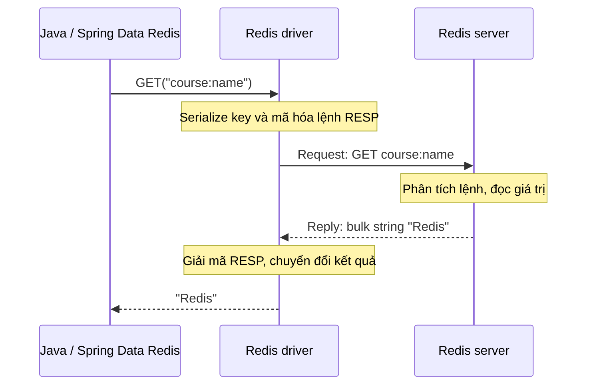
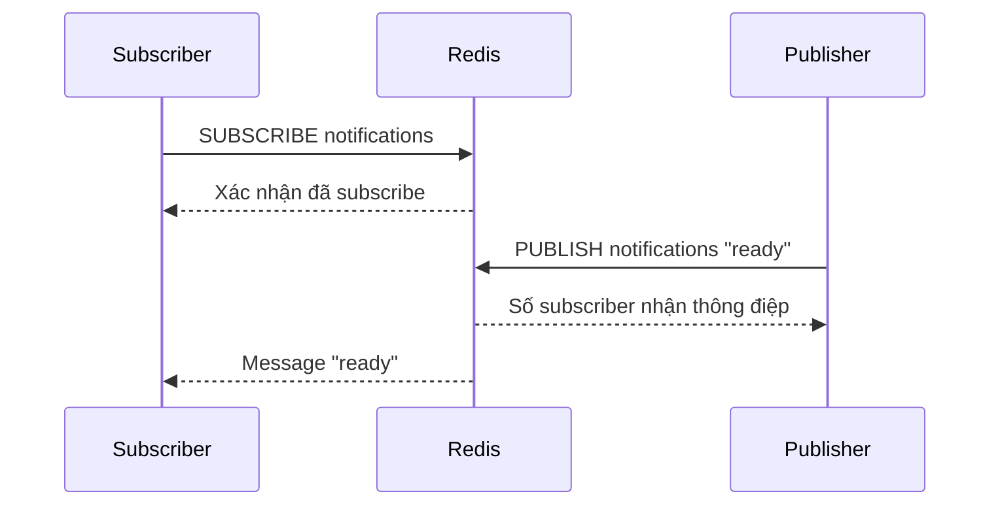

# Chu kỳ yêu cầu–phản hồi và giao thức Redis

Redis thường được gọi là cơ sở dữ liệu trong bộ nhớ, nhưng với ứng dụng Java, phần lớn tương tác với Redis là **giao tiếp qua mạng**: client mã hóa một lệnh, gửi đến server, chờ hoặc thu thập phản hồi rồi giải mã kết quả. Hiểu chu kỳ này giúp phân biệt thời gian chạy lệnh với độ trễ mạng, biết khi nào cần pipelining và giải thích được các lỗi thường gặp trong Spring Data Redis.

Bài học tập trung vào đường đi của **một lệnh Redis từ ứng dụng đến phản hồi**, cách **RESP (Redis Serialization Protocol)** biểu diễn dữ liệu trên kết nối, và những biến thể của chu kỳ cơ bản như pipelining, transaction, Pub/Sub và Redis Cluster.

## 1. Redis giao tiếp với ứng dụng như thế nào?

### 1.1. Các thành phần trong một lần gọi

Ví dụ, ứng dụng Spring gọi:

```java
String value = stringRedisTemplate.opsForValue().get("course:name");
```

Ở mức tổng quát, lời gọi đi qua các lớp:

```text
Mã ứng dụng Java
    ↓
Spring Data Redis (RedisTemplate / StringRedisTemplate)
    ↓
Redis driver (ví dụ: Lettuce hoặc Jedis)
    ↓
TCP/TLS hoặc Unix domain socket; dữ liệu được đóng khung bằng RESP
    ↓
Redis server
    ↓
Kết quả lệnh → RESP → driver giải mã → Spring Data Redis → Java
```

Mỗi thành phần có trách nhiệm riêng:

| Thành phần | Trách nhiệm |
|---|---|
| Mã nghiệp vụ | Chọn thao tác cần thực hiện, ví dụ lấy giá trị, tăng bộ đếm hoặc đặt TTL. |
| Spring Data Redis | Cung cấp API thao tác dữ liệu, chuyển đổi kiểu Java sang dạng dữ liệu phù hợp và phối hợp với driver. |
| Driver Redis | Quản lý kết nối, gửi lệnh theo giao thức RESP, nhận và giải mã phản hồi, xử lý cơ chế bất đồng bộ hoặc định tuyến nếu được cấu hình. |
| Kết nối mạng | Vận chuyển dòng byte hai chiều; TCP bảo đảm thứ tự byte trong **một** kết nối, còn TLS có thể bảo vệ dữ liệu khi truyền. |
| Redis server | Phân tích lệnh, thực hiện thao tác, tạo phản hồi; khi vận hành theo cluster, node nhận lệnh có thể yêu cầu chuyển hướng đến node khác. |

**RESP không phải HTTP.** Một lệnh `GET` không được gửi như HTTP `GET /...` với header và status code; nó là một lệnh Redis cùng các đối số được mã hóa thành byte theo quy tắc RESP.

### 1.2. Một chu kỳ request–response thông thường

Giả sử khóa `course:name` đang chứa chuỗi `Redis`.



Theo thứ tự:

1. **Chuẩn bị lệnh:** Spring Data Redis dùng serializer để chuyển khóa/giá trị từ đối tượng Java sang byte. Driver tạo khung RESP từ tên lệnh và đối số.
2. **Gửi lệnh:** client ghi byte vào kết nối đã có hoặc tạo kết nối mới khi cần. Việc quản lý và tái sử dụng kết nối phụ thuộc cấu hình client.
3. **Nhận và thực thi:** Redis đọc dữ liệu, xác định đầy đủ một lệnh, kiểm tra cú pháp/quyền truy cập/trạng thái liên quan và thực hiện lệnh.
4. **Trả phản hồi:** Redis mã hóa kết quả thành một giá trị RESP, chẳng hạn chuỗi, số nguyên, mảng hoặc lỗi.
5. **Giải mã:** driver đọc phản hồi, ghép phản hồi với lời gọi tương ứng; Spring Data Redis chuyển đổi dữ liệu về kiểu được API trả về.

Một lệnh đơn lẻ thường có **một phản hồi**, kể cả khi đó là phản hồi lỗi. Cách vận hành này là nền tảng, nhưng sẽ có ngoại lệ như thông điệp Pub/Sub hoặc RESP3 Push.

### 1.3. Độ trễ gồm những phần nào?

Thời gian nhìn từ phía ứng dụng không chỉ là thời gian Redis tìm khóa:

```text
Thời gian client cảm nhận
≈ thời gian chuẩn bị/mã hóa
+ thời gian chờ gửi và truyền trên mạng
+ thời gian chờ xử lý tại Redis
+ thời gian thực thi lệnh
+ thời gian chuyển phản hồi về client
+ thời gian giải mã/chuyển kiểu
```

**RTT (round-trip time)** là thời gian tín hiệu đi từ client đến server và phản hồi quay lại, thường dùng để hình dung chi phí truyền thông. Ngay cả khi `GET` mất rất ít CPU trên Redis, một chuỗi lệnh gửi tuần tự vẫn có thể chậm vì mỗi lệnh phải chờ thêm một vòng phản hồi qua mạng.

Phân biệt ba yếu tố:

- **Latency:** thời gian một thao tác mất từ góc nhìn quan sát cụ thể.
- **Throughput:** số thao tác hoàn tất trong một đơn vị thời gian.
- **Server execution time:** thời gian Redis thực sự xử lý lệnh; nó chỉ là một phần của latency đầu cuối.

Một lệnh Redis chạy nhanh không đồng nghĩa lời gọi Java luôn nhanh, nhất là khi đường mạng xa, kết nối bận hoặc client phải chờ tài nguyên.

## 2. Giao thức RESP: cách biểu diễn lệnh và phản hồi

### 2.1. RESP giải quyết vấn đề gì?

TCP chỉ chuyển một **dòng byte**. Nó không biết byte nào là điểm bắt đầu của `SET`, đâu là kết thúc của một giá trị và một phản hồi gồm mấy phần tử. RESP cung cấp quy tắc đóng khung (framing) để cả hai phía phân tích được lệnh và dữ liệu ngay cả khi một lần đọc socket chỉ nhận được một phần khung hoặc nhiều khung liên tiếp.

RESP sử dụng:

- **Byte mở đầu** cho biết loại giá trị.
- **CRLF** (hai byte `\r\n`) để kết thúc các phần điều khiển và một số giá trị đơn giản.
- **Độ dài tính bằng byte** cho dữ liệu dạng bulk, cho phép truyền dữ liệu nhị phân, bao gồm cả nội dung có xuống dòng hoặc byte `0`.

Các lệnh Redis thông thường được client gửi như một **array của bulk strings**: phần tử đầu tiên là tên lệnh, các phần tử còn lại là đối số. Phản hồi có kiểu tùy theo lệnh và phiên bản RESP đang được kết nối sử dụng.

### 2.2. Các kiểu dữ liệu cơ bản của RESP2

| Ký hiệu đầu | Kiểu RESP2 | Ví dụ dạng wire (viết `\r\n` để dễ nhìn) | Ý nghĩa |
|---|---|---|---|
| `+` | Simple String | `+OK\r\n` | Trạng thái hoặc chuỗi đơn giản. |
| `-` | Simple Error | `-WRONGTYPE ...\r\n` | Lệnh bị lỗi; client thường chuyển thành exception tương ứng. |
| `:` | Integer | `:42\r\n` | Một số nguyên, ví dụ kết quả `INCR`. |
| `$` | Bulk String | `$5\r\nRedis\r\n` | Chuỗi/khối byte có độ dài khai báo. |
| `*` | Array | `*2\r\n:1\r\n:2\r\n` | Tập phần tử theo thứ tự, có thể lồng nhau. |

Trong RESP2, **không có giá trị null độc lập**. Một khóa không tồn tại được biểu diễn bằng *null bulk string* `$-1\r\n` khi câu lệnh trả về dạng bulk string. Đừng nhầm với chuỗi rỗng `$0\r\n\r\n`.

Đối với array, `*0\r\n` là mảng rỗng, còn `*-1\r\n` là null array. Đây là các trạng thái khác nhau và có thể ảnh hưởng trực tiếp đến logic Java.

### 2.3. Giải mã từng byte của lệnh `SET` và `GET`

Giả sử client gửi:

```redis
SET course:1 Redis
```

Trên kết nối dùng cách mã hóa lệnh RESP tiêu chuẩn, dữ liệu là:

```text
*3\r\n
$3\r\n
SET\r\n
$8\r\n
course:1\r\n
$5\r\n
Redis\r\n
```

Đọc khung theo từng lớp:

1. `*3`: array có ba phần tử.
2. `$3` rồi `SET`: phần tử đầu chứa đúng 3 byte, là tên lệnh.
3. `$8` rồi `course:1`: khóa dài 8 byte.
4. `$5` rồi `Redis`: giá trị dài 5 byte.

Nếu thành công, server gửi:

```text
+OK\r\n
```

Tiếp theo, lệnh:

```redis
GET course:1
```

Được mã hóa thành:

```text
*2\r\n
$3\r\n
GET\r\n
$8\r\n
course:1\r\n
```

Phản hồi:

```text
$5\r\n
Redis\r\n
```

**Lưu ý về cách hiển thị:** các khối trên tách mỗi phần bằng dòng mới để dễ đọc. Trên mạng, `\r\n` đại diện cho **hai byte CR và LF**, chứ không phải chuỗi bốn ký tự in ra màn hình. Nội dung UTF-8 có dấu tiếng Việt có thể chiếm nhiều byte hơn số ký tự nhìn thấy. Vì vậy, không dùng độ dài `String.length()` của Java để suy ra độ dài RESP cho mọi chuỗi Unicode.

### 2.4. Phản hồi của các lệnh khác nhau

```text
PING                → +PONG\r\n
SET x hello         → +OK\r\n
GET x               → $5\r\nhello\r\n
GET nonexistent     → $-1\r\n                  (RESP2)
INCR count          → :1\r\n                    (nếu count ban đầu không tồn tại)
```

Chú ý rằng **kiểu phản hồi không nhất thiết giống kiểu dữ liệu lưu trong Redis**. `INCR` thao tác trên một khóa string chứa số nguyên nhưng phản hồi của lệnh lại là RESP integer. Ngược lại, `GET` thường trả về bulk string. Driver dựa vào đặc tả lệnh và khung RESP để cung cấp kiểu trả về thuận tiện cho Java.

### 2.5. RESP3 mở rộng RESP2 như thế nào?

RESP3 xuất hiện để biểu diễn rõ ràng hơn các kiểu phản hồi. Redis 6 giới thiệu hỗ trợ RESP3 theo cơ chế lựa chọn; hai phiên bản vẫn cùng tồn tại. Kết nối mới mặc định khởi đầu ở RESP2; client có thể thương lượng bằng `HELLO 3` nếu server hỗ trợ.

Các kiểu bổ sung đáng nhớ:

| Ký hiệu đầu | Kiểu RESP3 | Ý nghĩa thực hành |
|---|---|---|
| `_` | Null | Giá trị null rõ ràng, ví dụ `_\r\n`. |
| `#` | Boolean | `#t\r\n` hoặc `#f\r\n`. |
| `,` | Double | Số thực. |
| `(` | Big Number | Số nguyên lớn. |
| `%` | Map | Cấu trúc cặp khóa/giá trị. |
| `~` | Set | Tập phần tử không yêu cầu thứ tự. |
| `>` | Push | Thông điệp server chủ động đẩy đến client. |
| `|` | Attribute | Siêu dữ liệu phụ gắn với giá trị khác. |
| `!`, `=` | Bulk Error, Verbatim String | Cách biểu diễn bổ sung cho lỗi và văn bản. |

Ví dụ, một kết quả dạng cặp khóa/giá trị có thể được thể hiện bằng một **map** ở RESP3 thay vì array phẳng ở RESP2. Lớp lập trình phía trên có thể vẫn hiển thị cùng một `Map`, nên không thể kết luận phiên bản RESP chỉ bằng cách nhìn kiểu Java.

Phiên bản giao thức là **trạng thái trên từng kết nối**, không phải một thuộc tính toàn cục của mọi client. Việc gọi `HELLO 3` từ một kết nối không tự động chuyển các kết nối khác sang RESP3.

```redis
HELLO 3
```

Lệnh này yêu cầu server chuyển phiên làm việc của kết nối sang RESP3 và trả về thông tin bắt tay. Với ứng dụng Spring, để driver thương lượng phiên bản và quản lý phản hồi; không nên chèn `HELLO` thủ công vào giữa các thao tác nghiệp vụ.

## 3. Thứ tự request–response và pipelining

### 3.1. Gửi tuần tự: đợi xong lệnh trước mới gửi lệnh sau

Khi code thực hiện ba lệnh đồng bộ theo thứ tự:

```text
Client                 Redis
  |--- INCR visits ---->|
  |<------ :1 ----------|
  |--- INCR visits ---->|
  |<------ :2 ----------|
  |--- INCR visits ---->|
  |<------ :3 ----------|
```

Mỗi lần gọi phải đợi phản hồi trước khi ứng dụng tiếp tục. Nếu mỗi vòng mạng mất đáng kể thời gian, tổng thời gian bị chi phối bởi số lần chờ qua lại.

Đây là mô hình dễ hiểu, dễ xử lý lỗi theo từng bước. Nó cũng phù hợp khi lệnh sau **phụ thuộc kết quả** lệnh trước, chẳng hạn phải đọc một giá trị rồi mới quyết định gửi lệnh tiếp theo.

### 3.2. Pipeline: gửi trước, đọc phản hồi sau

Trong pipelining, client đưa nhiều lệnh lên kết nối mà **không chờ phản hồi ngay sau từng lệnh**:

```text
Client                 Redis
  |--- INCR visits ---->|
  |--- INCR visits ---->|
  |--- INCR visits ---->|
  |<------ :1 ----------|
  |<------ :2 ----------|
  |<------ :3 ----------|
```

Trong mô hình request–response thông thường trên cùng một kết nối, các phản hồi của những lệnh được gửi theo thứ tự sẽ được nhận theo thứ tự đó. Driver ghép từng phản hồi vào lời gọi/vị trí tương ứng. Ở RESP3, thông điệp Push có thể xen vào *giữa các phản hồi hoàn chỉnh*, vì thế driver phải nhận diện Push riêng, không coi đó là phản hồi của lệnh kế tiếp.

Pipelining cải thiện hiệu năng nhờ:

- Giảm việc client phải chờ RTT sau từng lệnh.
- Tận dụng tốt hơn việc đọc/ghi socket và giảm chi phí thao tác I/O.
- Tăng throughput khi có nhiều lệnh độc lập hoặc có thể gom thành đợt.

Một ước lượng trực giác với `N` lệnh nhỏ, bỏ qua nhiều yếu tố khác:

```text
Gửi và chờ từng lệnh:   khoảng N × RTT + tổng thời gian xử lý
Pipeline một đợt:       gần một đợt truyền/nhận + tổng thời gian xử lý
```

Đây là **mô hình giải thích**, không phải cam kết rằng pipeline luôn mất đúng một RTT: độ lớn dữ liệu, việc flush của driver, tải server và mạng thực tế đều ảnh hưởng.

### 3.3. Pipeline không phải transaction

| Tiêu chí | Các lệnh tuần tự | Pipelining | Transaction `MULTI/EXEC` |
|---|---|---|---|
| Mục đích chính | Xử lý từng lệnh, dễ phụ thuộc kết quả | Giảm chi phí chờ/I/O của nhiều lệnh | Thực thi nhóm lệnh không bị lệnh khác xen vào trong lúc `EXEC` chạy |
| Khi nào có phản hồi? | Sau từng lệnh, trước khi gửi tiếp | Thu thập sau khi gửi một nhóm | `QUEUED` khi xếp hàng; kết quả thực thi trả về bởi `EXEC` |
| Bảo đảm nguyên tử cho cả nhóm? | Không | **Không** | Có tính thực thi tuần tự, không bị client khác chen giữa; **không rollback kiểu SQL** khi một lệnh lỗi lúc thực thi |
| Có thể dùng chung? | — | Có thể pipeline các lệnh khác, kể cả cơ chế transaction theo hỗ trợ của client | Có thể kết hợp pipelining khi client hỗ trợ đúng ngữ nghĩa |

Nếu client A pipeline `SET x 1` rồi `GET x`, các lệnh của client B có thể được Redis xử lý giữa các lệnh đó tùy lịch xử lý; **đừng** dựa vào pipeline để bảo vệ một chuỗi read–modify–write nhiều lệnh khỏi tranh chấp.

### 3.4. Chọn kích thước đợt pipeline

Gửi hàng triệu lệnh và chỉ đọc kết quả ở cuối có thể khiến Redis phải giữ quá nhiều phản hồi trong bộ nhớ, trong khi client cũng phải giữ danh sách thao tác/kết quả. Nên chia thành những đợt hợp lý và đo thực tế. Tài liệu Redis nêu đợt khoảng **10.000 lệnh** như một ví dụ minh họa cách giới hạn lượng phản hồi tồn đọng, không phải kích thước tối ưu cho mọi hệ thống.

Không nên đưa lệnh blocking, Pub/Sub hoặc chuỗi phụ thuộc kết quả tức thời vào một pipeline mà chưa hiểu hành vi driver và kết nối đang sử dụng.

## 4. Transaction thay đổi chu kỳ phản hồi ra sao?

Redis cung cấp `MULTI`, `EXEC`, `DISCARD` và `WATCH` để xử lý nhóm lệnh có yêu cầu nhất quán. Ví dụ trên một kết nối:

```text
Client → MULTI          Server → +OK
Client → INCR a         Server → +QUEUED
Client → INCR b         Server → +QUEUED
Client → EXEC           Server → *2 ... (kết quả của INCR a và INCR b)
```

`QUEUED` là phản hồi cho biết lệnh đã được xếp vào transaction; **nó chưa phải giá trị sau thực thi**. Tới `EXEC`, Redis mới chạy các lệnh đã xếp hàng liên tiếp, không để lệnh từ client khác chen giữa.

Một số điểm quan trọng:

- `DISCARD` bỏ các lệnh đang được xếp hàng trước khi `EXEC`.
- `WATCH` hỗ trợ khóa lạc quan: nếu khóa theo dõi bị thay đổi trước `EXEC`, transaction có thể bị hủy; client phải quyết định có thử lại hay không.
- Nếu một lệnh đã được đưa vào transaction nhưng lỗi kiểu dữ liệu khi `EXEC` thực thi, Redis **không tự hoàn tác** những lệnh khác như cơ chế rollback đầy đủ của cơ sở dữ liệu quan hệ.
- Trạng thái `MULTI` và `WATCH` gắn với **kết nối**. Trong Spring Data Redis, phải sử dụng đúng cơ chế callback/transaction để các lệnh liên quan được thực hiện trong ngữ cảnh kết nối thích hợp.

Ví dụ lựa chọn công cụ:

- Muốn tăng bộ đếm an toàn khi nhiều client cùng dùng: ưu tiên **`INCR`**, vì bản thân lệnh tăng là nguyên tử.
- Muốn giảm RTT khi ghi 1.000 khóa độc lập: xem xét **pipeline**.
- Muốn kiểm tra điều kiện và cập nhật có kiểm soát cạnh tranh: cân nhắc **`WATCH`/`MULTI`/`EXEC`** hoặc script Redis phù hợp.

## 5. Kết nối không phải lúc nào cũng chỉ có request rồi reply

### 5.1. Kết nối là một phiên có trạng thái

Một số trạng thái tồn tại trên từng kết nối như xác thực, phiên bản RESP, việc chọn database trong chế độ hỗ trợ, transaction, đăng ký Pub/Sub hay thao tác blocking. Điều này giải thích vì sao driver và connection pool không thể được thay thế bằng thao tác mở/đóng socket tùy tiện mà vẫn giữ nguyên hành vi.

Khi kết nối được tạo, client có thể thực hiện bước xác thực (`AUTH` hoặc thông qua `HELLO`), chọn giao thức, đồng bộ trạng thái và kiểm tra khả dụng. Không phải thao tác `GET` nào cũng tạo kết nối TCP mới; các driver thường quản lý và tái sử dụng kết nối theo chiến lược của chúng.

TCP duy trì **thứ tự byte trên một kết nối**, nhưng không bảo đảm một request tương đương một gói TCP. Một lệnh có thể bị chia qua nhiều lần đọc và nhiều lệnh có thể đến cùng một lần đọc. RESP giúp parser xác định ranh giới lệnh/phản hồi.

### 5.2. Pub/Sub và thông điệp do server đẩy

Đối với request–response thông thường, client chủ động gửi lệnh rồi nhận kết quả. Với Pub/Sub, sau khi đăng ký kênh, server có thể chủ động gửi thông điệp mỗi khi có publisher phát nội dung phù hợp.



Trong RESP2, kết nối đã vào chế độ Pub/Sub có ngữ nghĩa lệnh bị giới hạn; RESP3 cung cấp kiểu **Push (`>`)** cho các thông điệp từ server. Với subscription, dùng API quản lý kết nối/lắng nghe phù hợp của Spring Data Redis, chẳng hạn `RedisMessageListenerContainer`; đừng đọc thông điệp Pub/Sub như phản hồi cho một lệnh `GET` kế tiếp.

### 5.3. Blocking commands

Lệnh như `BLPOP` có thể chờ dữ liệu xuất hiện hoặc hết thời gian chờ. Khi đó, một lệnh đã gửi nhưng phản hồi chưa về không nhất thiết là mất kết nối: **server đang chờ điều kiện của lệnh**. Client phải phân biệt timeout của lệnh Redis với timeout cấu hình ở socket/driver và lưu ý ảnh hưởng lên kết nối được dùng.

### 5.4. Redis Cluster và phản hồi chuyển hướng

Trong Redis Cluster, client gửi lệnh đến một node nhưng khóa thuộc slot của node khác có thể nhận lỗi chuyển hướng như `MOVED` hoặc `ASK`. Driver hỗ trợ cluster sẽ cập nhật hoặc dùng thông tin định tuyến để gửi lệnh phù hợp. Những bước bổ sung này có thể tăng số lần trao đổi trên mạng.

Các lệnh nhiều khóa trong cluster phải tuân thủ quy tắc slot. Chẳng hạn, dùng cùng hash tag `{account:7}` trong `{account:7}:name` và `{account:7}:balance` giúp hai khóa cùng hash slot. Điều này **không** khiến mọi lệnh nhiều khóa tự nhiên hợp lệ; cần kiểm tra hỗ trợ của lệnh và driver.

## 6. Kết nối RESP với API Spring Data Redis

### 6.1. Gọi lệnh đồng bộ bằng `StringRedisTemplate`

`StringRedisTemplate` thích hợp khi muốn làm việc với key/value dạng chuỗi và quan sát hành vi gần với lệnh Redis. Ví dụ service:

```java
import java.time.Duration;

import org.springframework.data.redis.core.StringRedisTemplate;
import org.springframework.stereotype.Service;

@Service
public class RedisRequestReplyDemo {

    private final StringRedisTemplate redis;

    public RedisRequestReplyDemo(StringRedisTemplate redis) {
        this.redis = redis;
    }

    public String saveAndRead() {
        redis.opsForValue().set("demo:course", "Redis", Duration.ofMinutes(5));

        String value = redis.opsForValue().get("demo:course");

        Long visits = redis.opsForValue().increment("demo:visits");

        // value: "Redis"; visits: số lượt tăng được Redis trả về.
        return value + " / visits=" + visits;
    }
}
```

Trong cách gọi đồng bộ thông thường, đoạn trên tạo ra ba thao tác Redis theo thứ tự **`SET`, `GET`, `INCR`** (bỏ qua các thao tác thiết lập kết nối có thể xảy ra). Mỗi phương thức trả về sau khi đã nhận và xử lý phản hồi cần thiết. `Duration` ở `set` được chuyển thành tùy chọn hết hạn tương ứng trong lệnh gửi đi.

Một vài phép ánh xạ phổ biến:

| API Spring Data Redis | Ý tưởng lệnh Redis | Giá trị phản hồi cấp Java |
|---|---|---|
| `opsForValue().get(key)` | `GET key` | Chuỗi hoặc `null` khi khóa không có giá trị. |
| `opsForValue().set(key, value)` | `SET key value` | Phương thức thao tác có thể không trả lại nội dung `OK` cho code gọi. |
| `opsForValue().increment(key)` | `INCR key` | `Long` chứa giá trị sau tăng. |
| `hasKey(key)` | `EXISTS key` | `Boolean`. |
| `getExpire(key)` | `TTL key` | Thời gian còn lại dưới dạng phù hợp với overload được gọi. |

API Java là **mức trừu tượng cao hơn** RESP. Java không nhận trực tiếp `+OK\r\n` hay `:3\r\n`; driver và Spring Data Redis đã chuyển kết quả vào kiểu trả về của API.

### 6.2. Ví dụ pipeline trong Spring Data Redis

Khi các lệnh độc lập về dữ liệu hoặc có thể gửi liên tiếp mà chưa cần đọc phản hồi từng lệnh, dùng `executePipelined`:

```java
import java.nio.charset.StandardCharsets;
import java.util.List;

import org.springframework.data.redis.core.RedisCallback;
import org.springframework.data.redis.core.StringRedisTemplate;

public class RedisPipelineDemo {

    private final StringRedisTemplate redis;

    public RedisPipelineDemo(StringRedisTemplate redis) {
        this.redis = redis;
    }

    public List<Object> setThenGet() {
        return redis.executePipelined((RedisCallback<Object>) connection -> {
            byte[] key = "demo:pipeline".getBytes(StandardCharsets.UTF_8);
            byte[] value = "hello".getBytes(StandardCharsets.UTF_8);

            connection.stringCommands().set(key, value);
            connection.stringCommands().get(key);

            // Callback phải trả null; kết quả thực nằm trong List<Object>.
            return null;
        });
    }
}
```

Khi thực thi, Spring Data Redis gửi các thao tác theo pipeline và tập hợp phản hồi thành danh sách theo thứ tự. `SET` được gửi trước `GET`, vì thế `GET` đọc giá trị vừa ghi trong trường hợp các lệnh được thực hiện thành công trên cùng ngữ cảnh Redis. Kiểu phần tử trong `List<Object>` phụ thuộc lệnh và serializer; không nên ép kiểu theo suy đoán từ byte RESP.

Cần phân biệt **giá trị mà phương thức gọi trong callback có thể trả về khi đang pipelined** với **kết quả cuối của `executePipelined`**. Callback phải trả `null` vì chính `executePipelined` là nơi thu thập những phản hồi đã giải mã.

Không dùng pipeline chỉ vì có nhiều dòng code: nếu lệnh thứ hai cần quyết định từ kết quả của lệnh thứ nhất, pipeline thông thường không thể cung cấp kết quả đó giữa hai lần gửi theo cách đồng bộ.

### 6.3. Serializer tác động đến byte nào?

Giả sử Java tạo một đối tượng người dùng và lưu vào Redis. Spring Data Redis có thể dùng serializer chuỗi, JSON, hoặc cơ chế khác tùy cách cấu hình `RedisTemplate`. RESP **chỉ vận chuyển các byte được serializer tạo ra**:

```text
User Java object
   ↓ serializer do ứng dụng cấu hình
byte[] (ví dụ: JSON UTF-8)
   ↓ driver đóng vào bulk string RESP
Redis lưu chuỗi byte đó
   ↓ GET trả bulk string chứa những byte tương ứng
serializer đọc ngược
   ↓
User Java object
```

Hai lớp mã hóa khác nhau:

- **Serialization của Spring:** biểu diễn đối tượng/khóa thành `byte[]`.
- **Serialization của RESP:** biểu diễn lệnh, đối số và phản hồi thành các khung dữ liệu truyền trên kết nối.

Nếu một ứng dụng viết bằng serializer JSON còn ứng dụng khác đọc bằng serializer khác, phản hồi Redis vẫn có thể hoàn toàn hợp lệ nhưng ứng dụng không giải mã được đúng đối tượng. Đây là lỗi tương thích dữ liệu, không phải lỗi khung RESP.

### 6.4. Đồng bộ, bất đồng bộ và reactive

Với Lettuce, driver có khả năng thực hiện I/O không đồng bộ; API Spring Data Redis mà ứng dụng chọn quyết định cách nhận kết quả. `RedisTemplate` cung cấp API thường dùng theo kiểu đồng bộ, trong khi `ReactiveRedisTemplate` cung cấp các publisher để kết hợp trong luồng reactive.

**Reactive không đồng nghĩa mọi lệnh tự động được gom thành một pipeline nguyên tử.** Hành vi truyền, thời điểm phát lệnh, sự song song và thứ tự kết quả phụ thuộc chuỗi thao tác reactive, kết nối và driver. Dù API ở mức Java là đồng bộ hay reactive, kết nối Redis vẫn dùng giao thức request–response hoặc các ngoại lệ được hỗ trợ.

## 7. Lỗi, timeout và hành vi thử lại

### 7.1. Lỗi Redis khác lỗi kết nối

Giả sử `demo:key` đang lưu một string, nhưng client gửi `LPUSH demo:key x`. Redis có thể trả:

```text
-WRONGTYPE Operation against a key holding the wrong kind of value\r\n
```

Đây là **phản hồi lỗi hợp lệ của RESP**: kết nối có thể vẫn đang hoạt động. Driver chuyển phản hồi đó thành exception để code Java xử lý.

Ngược lại, timeout kết nối, mất socket, lỗi TLS hoặc lỗi DNS có thể xảy ra khi client không nhận được phản hồi đầy đủ. Chúng không có nghĩa Redis đã gửi một phản hồi lỗi RESP.

| Tình huống | Ý nghĩa cần kiểm tra | Hướng xử lý |
|---|---|---|
| `WRONGTYPE` / cú pháp lệnh sai | Redis đã nhận lệnh và trả lỗi ở mức giao thức | Sửa thao tác hoặc kiểu dữ liệu. |
| `NOAUTH` / `NOPERM` | Phải xem cấu hình xác thực/ACL | Cấu hình đúng quyền và thông tin kết nối. |
| Chờ phản hồi lâu | Có thể do mạng, server bận, lệnh blocking hoặc vấn đề client | Đo và phân tích từng thành phần latency. |
| Socket đóng khi đang thực thi | Không chắc lệnh đã được chạy hay chưa | Xem xét tính idempotent trước khi thử lại. |
| `MOVED` / `ASK` trong cluster | Khóa cần được định tuyến đến node phù hợp | Dùng client cluster-aware và cấu hình topology đúng. |

### 7.2. Vì sao timeout không chứng minh lệnh chưa chạy?

Xét hai trường hợp:

```text
Tình huống A:
Client -- INCR counter --> Redis thực hiện INCR
Client <-- phản hồi bị thất lạc / kết nối đứt

Tình huống B:
Client -- kết nối hỏng trước khi lệnh tới Redis
Client không nhận phản hồi
```

Cả hai có thể biểu hiện như một timeout ở Java, nhưng trong A bộ đếm **đã tăng**, còn trong B thì chưa. Nếu tự động gửi lại `INCR` ở A, bộ đếm có thể tăng hai lần.

Vì thế:

- Có thể thử lại thao tác đọc hoặc ghi theo cách **idempotent** khi đúng yêu cầu nghiệp vụ và đã cân nhắc độ nhất quán.
- Cẩn trọng với lệnh có hiệu ứng tích lũy như `INCR`, `LPUSH`, `PUBLISH` hoặc thao tác làm thay đổi trạng thái theo mỗi lần gọi.
- Khi cần bảo đảm hiệu ứng nghiệp vụ không lặp, phải thiết kế cơ chế idempotency/định danh yêu cầu ở cấp ứng dụng; chỉ tăng timeout hoặc thử lại vô điều kiện là chưa đủ.

### 7.3. Quan sát và chẩn đoán

Các lệnh/chỉ số hỗ trợ điều tra:

- `PING`: kiểm tra phản hồi cơ bản của server trên kết nối sử dụng.
- `INFO commandstats`: quan sát thống kê lệnh mà Redis ghi nhận.
- `SLOWLOG GET`: xem các lệnh có thời gian thực thi server vượt ngưỡng cấu hình; chỉ số này không bao gồm toàn bộ độ trễ mạng.
- `CLIENT LIST`: xem trạng thái các kết nối client.
- `LATENCY LATEST`: xem sự kiện latency nếu theo dõi latency được bật/có dữ liệu.
- `MONITOR`: cho thấy luồng lệnh phục vụ điều tra ngắn; có thể gây tốn tài nguyên và lộ dữ liệu trong lệnh, không bật tùy tiện trên hệ thống đang tải cao.

Ngoài server, đo số lượng connection, pending commands, pool wait, timeout, RTT, kích thước pipeline và thời gian chuyển đổi serializer ở phía ứng dụng để tránh quy mọi độ trễ cho Redis.

## 8. Thực hành bằng `redis-cli`

Cần có Redis đang chạy và `redis-cli` kết nối được đến đúng host/port, ví dụ một Redis local mặc định ở `127.0.0.1:6379`. Thực hành trong namespace khóa riêng `lab:resp:...` để tránh đụng dữ liệu khác.

Chạy từng lệnh:

```bash
redis-cli PING
redis-cli SET lab:resp:name Redis
redis-cli GET lab:resp:name
redis-cli DEL lab:resp:counter
redis-cli INCR lab:resp:counter
redis-cli INCR lab:resp:counter
redis-cli GET lab:resp:counter
redis-cli TTL lab:resp:name
```

Nếu mọi lệnh thành công và trước đó không có thao tác thay đổi khóa giữa các bước, ta quan sát:

- `PING` trả `PONG`.
- `SET` trả `OK`.
- `GET lab:resp:name` hiển thị `Redis`.
- Hai lần `INCR` sau `DEL` trả lần lượt số nguyên `1` và `2`.
- `GET lab:resp:counter` trả nội dung chuỗi `"2"`.
- `TTL lab:resp:name` thường trả `-1`, vì `SET` trong ví dụ chưa gắn thời gian hết hạn.

Thử gắn TTL:

```bash
redis-cli EXPIRE lab:resp:name 30
redis-cli TTL lab:resp:name
```

Khi `EXPIRE` thành công, `TTL` trả số giây còn lại, giảm dần theo thời gian. Sau khi khóa hết hạn, `GET` cho kết quả nil/null theo chế độ hiển thị của CLI.

Để yêu cầu RESP3 khi chạy `redis-cli` trên phiên bản CLI hỗ trợ:

```bash
redis-cli -3 PING
```

Có thể mở phiên tương tác `redis-cli` rồi dùng `HELLO 3` để xem thông tin bắt tay. **Dữ liệu in ra bởi `redis-cli` là giao diện trình bày kết quả**, không nhất thiết là byte RESP thô. Ví dụ màn hình hiển thị `(integer) 2` là cách CLI diễn giải phản hồi `:2\r\n`.

### Bài tập suy luận ngắn

1. Lệnh `GET` trả null trong Java: phản hồi có nhất thiết là lỗi RESP không?
2. Cùng 100 lệnh `SET` độc lập, vì sao pipeline có thể nhanh hơn gửi và chờ từng lệnh?
3. Nếu gửi `INCR`, mất kết nối rồi thử lại, điều gì có thể xảy ra?
4. `MULTI` trả `OK` và lệnh trong transaction trả `QUEUED`: giá trị thực đã được cập nhật chưa?
5. Tại sao byte length trong RESP không thể luôn suy ra từ số ký tự của một chuỗi Java?

**Gợi ý đáp án:** (1) Không, đó có thể là null hợp lệ khi khóa không tồn tại; (2) giảm số lần chờ RTT/chi phí I/O; (3) tăng hai lần nếu lệnh đầu đã chạy; (4) chưa, transaction thực thi khi `EXEC`; (5) vì Unicode và UTF-8 có thể dùng nhiều byte cho một ký tự, còn bulk string khai báo byte length.

## 9. Những nhầm lẫn cần tránh

| Nhầm lẫn | Cách hiểu đúng |
|---|---|
| “Redis trong RAM nên không có chi phí mạng.” | Redis có thể xử lý nhanh nhưng gọi từ ứng dụng vẫn chịu truyền thông, queueing và serialization. |
| “Mỗi lệnh tương ứng đúng một TCP packet.” | TCP là byte stream; ranh giới được xác định bởi RESP. |
| “Pipeline khiến mọi lệnh chạy nguyên tử.” | Pipeline tối ưu gửi/nhận; transaction hoặc một lệnh nguyên tử mới xử lý yêu cầu nguyên tử tương ứng. |
| “`QUEUED` là kết quả của `INCR`.” | `QUEUED` chỉ xác nhận lệnh đã xếp hàng trong transaction. |
| “Lỗi Redis luôn có nghĩa kết nối đứt.” | Redis có thể trả một khung lỗi RESP hợp lệ mà không đóng kết nối. |
| “Không thấy phản hồi tức là lệnh chưa thực thi.” | Phản hồi có thể bị mất sau khi Redis đã thực hiện lệnh. |
| “Dữ liệu JSON lưu trong Redis là định dạng RESP.” | JSON là cách serializer biểu diễn giá trị; RESP là giao thức đóng khung lệnh và phản hồi. |
| “RESP3 chỉ là RESP2 đổi tên.” | RESP3 bổ sung nhiều kiểu, đặc biệt null, map, set và thông điệp Push. |

## 10. Kết luận kỹ thuật

Đối với một lời gọi thông thường, **Spring Data Redis chuẩn bị dữ liệu → driver mã hóa yêu cầu RESP → Redis thực thi → server trả RESP → driver/Spring chuyển thành kết quả Java**. Hiểu chu kỳ đó giúp đặt câu hỏi đúng khi gặp latency, lỗi hoặc kết quả không như mong đợi:

- Lệnh có thật sự được gửi đến Redis chưa?
- Đang chờ mạng, chờ Redis thực thi, hay chờ phản hồi?
- Kiểu RESP trả về là gì và Spring giải mã ra kiểu Java nào?
- Một nhóm lệnh cần giảm RTT bằng pipeline hay cần tính nhất quán bằng transaction/lệnh nguyên tử?
- Nếu xảy ra timeout, thử lại có làm lặp hiệu ứng nghiệp vụ không?

### Tài liệu chính thức để đối chiếu

- [Redis Serialization Protocol (RESP) specification](https://redis.io/docs/latest/reference/protocol-spec/) — kiểu dữ liệu RESP2/RESP3, framing và handshake.
- [Redis pipelining](https://redis.io/docs/latest/develop/using-commands/pipelining/) — request/response, RTT và cách gom lệnh.
- [Redis transactions](https://redis.io/docs/latest/develop/using-commands/transactions/) — `MULTI`, `EXEC`, `WATCH` và xử lý lỗi.
- [Spring Data Redis — Pipelining](https://docs.spring.io/spring-data/redis/reference/redis/pipelining.html) — cách dùng `executePipelined`, callback và serializer.
