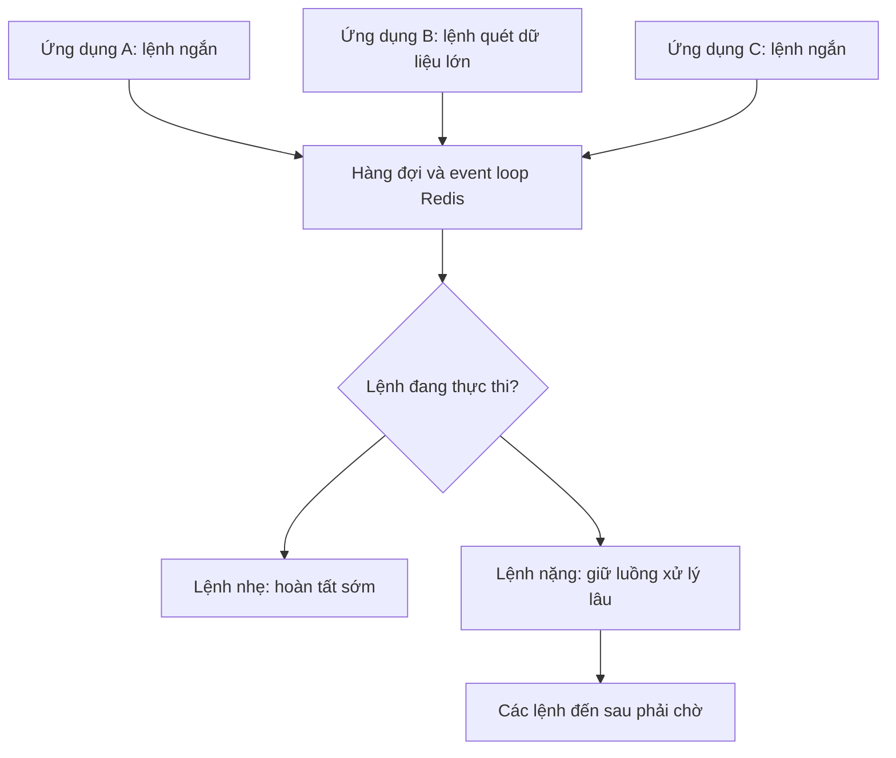

# Độ phức tạp lệnh Redis và tác động của thao tác kéo dài

Trong Redis, một lệnh có thể chạy rất nhanh khi dữ liệu nhỏ nhưng gây trễ đáng kể khi số phần tử tăng lên. Điểm cần hiểu không chỉ là Redis lưu dữ liệu trong bộ nhớ, mà còn là **mỗi lệnh phải thực hiện bao nhiêu công việc**, công việc đó diễn ra trên luồng xử lý nào, và các yêu cầu khác bị ảnh hưởng ra sao. Đây là nền tảng để thiết kế cách truy cập Redis hiệu quả từ ứng dụng Spring Data Redis.

## 1. Độ phức tạp của lệnh nói lên điều gì?

Độ phức tạp thời gian mô tả mức tăng công việc của một thuật toán khi kích thước đầu vào tăng. Redis công bố độ phức tạp cho từng lệnh, thường theo ký hiệu **Big O**:

| Ký hiệu | Ý nghĩa gần đúng | Ví dụ trong Redis |
| --- | --- | --- |
| `O(1)` | Số bước xử lý gần như không phụ thuộc vào số phần tử của tập dữ liệu đang xét | `HGET`, `SISMEMBER`, `SCARD` trong điều kiện thông thường |
| `O(log N)` | Công việc tăng chậm khi `N` tăng | Thao tác trên sorted set như `ZADD` cho một phần tử |
| `O(N)` | Công việc tăng theo số phần tử | `HGETALL`, `SMEMBERS`, `KEYS` |
| `O(N + M)` | Phụ thuộc vào nhiều thành phần đầu vào | Một số thao tác duyệt danh sách hoặc kết hợp dữ liệu |
| `O(N log N)` | Công việc tăng nhanh hơn tuyến tính do có thêm bước sắp xếp/xử lý | Các thuật toán cần sắp xếp toàn bộ dữ liệu; độ phức tạp cụ thể phụ thuộc lệnh |

Trong các bảng sau, ký hiệu cần được hiểu **theo từng lệnh**, không mặc định `N` là tổng số key trong Redis:

- `K`: tổng số key trong không gian đang quét.
- `N`: số phần tử của một collection, ví dụ số field trong hash hoặc số member trong set.
- `M`: số phần tử thực sự được yêu cầu/trả về.
- `S`: khoảng cách cần đi qua từ đầu hoặc cuối list để đến vị trí bắt đầu.
- `B`: kích thước dữ liệu tính bằng byte.

Ví dụ, `HGETALL user:123` có độ phức tạp `O(N)` với `N` là **số field của hash `user:123`**, còn `KEYS user:*` có độ phức tạp `O(K)` với `K` là **số key Redis phải kiểm tra**. Hai lệnh đều được gọi là `O(N)` trong tài liệu theo nghĩa tổng quát, nhưng kích thước đầu vào khác nhau hoàn toàn.

### Độ phức tạp không đồng nghĩa với thời gian phản hồi

Một cách nhìn hữu ích đối với một request đi qua Spring Data Redis là:

```text
Thời gian quan sát ở ứng dụng
 ≈ thời gian mạng / round trip
 + thời gian chờ kết nối và xếp hàng
 + thời gian Redis thực thi lệnh
 + thời gian truyền dữ liệu phản hồi
 + thời gian giải mã / ánh xạ đối tượng phía Java
```

Big O chủ yếu mô tả **công việc của thuật toán**. Nó không trực tiếp phản ánh số byte trên đường truyền, tốc độ CPU, trạng thái bộ nhớ, thời gian chờ pool kết nối hoặc chi phí serialize/deserialize. Bởi vậy:

- `GET` được Redis mô tả là `O(1)` theo thao tác tra cứu, nhưng đọc một string có kích thước hàng chục MB vẫn tốn thời gian truyền dữ liệu và cấp phát bộ nhớ ở client.
- `HGETALL` trên hash có 5 field thường rất nhanh; cùng lệnh đó trên hash có 500.000 field có thể tạo phản hồi lớn và kéo dài thời gian xử lý.
- 1.000 lệnh nhỏ gửi tuần tự qua mạng có thể chậm vì nhiều round trip, dù mỗi lệnh là `O(1)`.

Những nhận xét về `O(1)` thường áp dụng cho trường hợp thông thường hoặc độ phức tạp trung bình/amortized; biểu diễn nội bộ và các lần mở rộng bảng băm có thể tạo sai khác tại từng thời điểm.

## 2. Bản chất xử lý lệnh của Redis

Redis được thiết kế với event loop hiệu quả và **phần lớn công việc thực thi lệnh trên một shard/instance diễn ra tuần tự trên luồng xử lý chính**. Redis hiện đại còn có các cơ chế I/O đa luồng và công việc nền, nhưng chúng không biến một lệnh nặng trên đường thực thi chính thành một công việc có thể chạy song song tùy ý với các lệnh khác.



Giả sử một lệnh chạy 150 ms trên đường thực thi chính. Trong khoảng thời gian đó, nhiều lệnh rất nhẹ đến sau vẫn có thể phải chờ. Nếu hệ thống nhận nhiều request đồng thời, hàng đợi và thời gian phản hồi **p95/p99** có thể tăng mạnh dù thời gian thực thi trung bình của từng thao tác tra cứu vẫn thấp.

Hệ quả của thao tác kéo dài:

1. **Tăng độ trễ dây chuyền:** request khác bị xếp hàng phía sau một thao tác tốn CPU hoặc giải phóng bộ nhớ đồng bộ.
2. **Tăng timeout và retry:** client có thể hết thời gian chờ; retry thiếu kiểm soát lại làm Redis nhận thêm tải.
3. **Giảm throughput hữu ích:** một phần lớn thời gian bị chiếm bởi ít thao tác có chi phí cao.
4. **Tăng áp lực truyền dữ liệu và bộ nhớ client:** response lớn làm tăng byte truyền qua mạng, bộ nhớ ứng dụng và thời gian xử lý JSON/Java object.
5. **Gây ảnh hưởng cục bộ theo shard:** với Redis Cluster, lệnh nặng chủ yếu ảnh hưởng node/shard đang xử lý key đó; cluster không tự loại bỏ vấn đề key nóng hoặc dữ liệu lớn.

Khái niệm cần tách bạch: lệnh như `BLPOP`/`BRPOP` hay `XREAD ... BLOCK` **chờ dữ liệu theo cơ chế blocking đối với client gọi lệnh**, nhưng Redis vẫn có thể phục vụ client khác. Chúng không đồng nghĩa với một lệnh CPU nặng khóa event loop suốt thời gian chờ. Tác động thực tế cần quan tâm là kết nối client bị giữ và khả năng cạn pool kết nối nếu ứng dụng cấu hình không phù hợp.

## 3. Những nhóm lệnh dễ nhầm về chi phí

### 3.1. Tra cứu một phần tử và lấy toàn bộ collection

| Nhu cầu | Lệnh | Độ phức tạp điển hình | Điều cần chú ý |
| --- | --- | --- | --- |
| Đọc một string theo key | `GET key` | `O(1)` | Payload quá lớn vẫn làm tăng thời gian truyền và xử lý client |
| Ghi một string | `SET key value` | `O(1)` theo tra cứu/cập nhật | Kích thước `value` vẫn ảnh hưởng truyền dữ liệu và cấp phát |
| Lấy một field hash | `HGET key field` | `O(1)` | Phù hợp khi chỉ cần một trường |
| Lấy một số field hash | `HMGET key field...` | `O(M)` | Chi phí theo số field yêu cầu |
| Lấy toàn bộ hash | `HGETALL key` | `O(N)` | Trả cả field và value; response có thể rất lớn |
| Kiểm tra member trong set | `SISMEMBER key member` | `O(1)` | Phù hợp cho câu hỏi “có tồn tại?” |
| Lấy toàn bộ set | `SMEMBERS key` | `O(N)` | Dễ gây phản hồi khổng lồ khi set lớn |
| Đếm số phần tử set | `SCARD key` | `O(1)` | Không cần đọc toàn bộ member chỉ để đếm |
| Đọc nhiều string key | `MGET key...` | `O(M)` | Mỗi key nhỏ nhưng tổng response vẫn có thể lớn |

Ví dụ thiết kế sai là lấy toàn bộ hash rồi chọn một field trong Java:

```java
// Lấy mọi field của hash dù chỉ cần email.
Map<Object, Object> profile = redisTemplate.opsForHash().entries("user:123");
Object email = profile.get("email");
```

Cách truy cập có giới hạn dữ liệu:

```java
Object email = redisTemplate.opsForHash().get("user:123", "email");
```

Khi hash có hàng trăm nghìn field, khác biệt không chỉ là CPU Redis mà còn là lượng dữ liệu Redis phải gửi và Java phải cấp phát. Với Spring Data Redis, `opsForHash().entries(key)` về bản chất tương ứng với lấy toàn bộ hash; thao tác tiện lợi ở API không làm thay đổi độ phức tạp của lệnh Redis phía dưới.

### 3.2. List và sorted set: chi phí còn phụ thuộc vị trí, số lượng kết quả

| Lệnh | Độ phức tạp điển hình | Vì sao cần quan tâm? |
| --- | --- | --- |
| `LPUSH` / `RPUSH` | `O(1)` cho một phần tử | Thêm nhiều phần tử trong một lệnh thì công việc tăng theo số phần tử thêm |
| `LLEN` | `O(1)` | Nhanh hơn lấy cả list để đếm |
| `LINDEX` | `O(N)` trong trường hợp tổng quát | Redis có thể phải đi qua các phần tử để tới vị trí |
| `LRANGE key start stop` | `O(S + M)` | `S` là khoảng cách cần duyệt tới vị trí bắt đầu, `M` là số phần tử trả về |
| `ZADD` | `O(log N)` cho một phần tử | Thêm nhiều member làm tổng chi phí tăng |
| `ZSCORE` | `O(1)` | Phù hợp lấy score của một member đã biết |
| `ZRANGE` | `O(log N + M)` | Giới hạn số member trả về để tránh response quá lớn |

Với bảng xếp hạng 2 triệu người dùng, `ZRANGE leaderboard 0 49 REV WITHSCORES` chỉ lấy 50 hạng đầu, khác đáng kể với `ZRANGE leaderboard 0 -1 WITHSCORES` lấy tất cả. Một lệnh có khả năng trả về toàn bộ collection cần được xem như một quyết định thiết kế API, không phải chi tiết tiện ích của thư viện.

Ví dụ phân trang qua Spring Data Redis:

```java
int page = 0;
int pageSize = 50;
long from = (long) page * pageSize;
long to = from + pageSize - 1;

Set<String> members = stringRedisTemplate.opsForZSet()
    .reverseRange("leaderboard", from, to);
```

Khi tăng `page`, cần cân nhắc thêm tính ổn định của thứ hạng giữa các lần đọc. Nếu dữ liệu thay đổi liên tục, các trang dựa trên offset có thể xuất hiện phần tử lặp hoặc đổi thứ tự; đây là vấn đề nhất quán dữ liệu, độc lập với độ phức tạp.

### 3.3. Lệnh quét key: `KEYS` và `SCAN` khác nhau thế nào?

Giả sử Redis chứa 4 triệu key, ứng dụng muốn tìm `session:*`.

```redis
KEYS session:*
```

`KEYS` phải kiểm tra không gian key đang xét; độ phức tạp `O(K)` với `K` là số key trong cơ sở dữ liệu, **không phải số key khớp mẫu**. Lệnh cố gắng hoàn thành toàn bộ việc tìm kiếm trước khi trả kết quả, vì thế có thể giữ đường xử lý lệnh lâu và tạo response lớn. Trên hệ thống production có nhiều key, đây là lệnh cần tránh trong luồng request thường xuyên.

Thay vào đó, dùng `SCAN` với con trỏ:

```redis
SCAN 0 MATCH session:* COUNT 200
# Ví dụ phản hồi: cursor mới và danh sách key tìm được.
SCAN 914 MATCH session:* COUNT 200
# Lặp với cursor Redis trả về, đến khi cursor bằng 0.
```

`SCAN` chia quá trình duyệt thành nhiều lần gọi, giúp ứng dụng **phân tán công việc theo thời gian**. Tuy nhiên có các giới hạn quan trọng:

- `COUNT 200` chỉ là **gợi ý** về lượng công việc, không bảo đảm mỗi lần trả đúng 200 key, cũng không bảo đảm mỗi lần gọi luôn rẻ như nhau.
- Một lần `SCAN` có thể trả 0 key dù cursor chưa kết thúc. Phải tiếp tục theo cursor đến `0`.
- Tổng chi phí của một vòng duyệt đầy đủ vẫn tăng theo số key được duyệt, thường mô tả là `O(K)`; chia nhỏ không biến tổng công việc thành `O(1)`.
- Không có snapshot cố định khi key được thêm/xóa trong lúc scan. Có thể gặp phần tử lặp hoặc kết quả phụ thuộc thay đổi đồng thời; thao tác xử lý cần **idempotent** nếu tính đúng đắn đòi hỏi.
- `MATCH` là bộ lọc, không tạo chỉ mục tra cứu tiền tố. Một mẫu chỉ khớp vài key vẫn có thể cần duyệt lượng key rất lớn.
- `HSCAN`, `SSCAN`, `ZSCAN` dùng cách duyệt tương tự cho collection; collection có biểu diễn nội bộ nhỏ có thể trả nhiều phần tử trong một lượt dù có `COUNT`.

Chỉ đổi `KEYS` thành `SCAN` mà lập tức quét toàn bộ hàng triệu key trong một request HTTP vẫn có thể gây áp lực CPU, mạng và pool kết nối. Muốn kiểm soát tác động, hãy **giới hạn công việc mỗi đợt**, đưa cleanup dài sang background job và tạo thời gian cho các yêu cầu bình thường.

### 3.4. Xóa key lớn: `DEL` và `UNLINK`

```redis
DEL huge:hash
UNLINK huge:hash
```

`DEL` xóa key và thực hiện công việc giải phóng bộ nhớ tương ứng. Với một key chứa collection rất lớn, phần giải phóng có thể tốn thời gian theo số phần tử nội bộ; trường hợp string đơn giản thường nhẹ hơn. `UNLINK` tách key ra khỏi keyspace trên luồng chính và **chuyển phần giải phóng giá trị sang công việc nền**, vì vậy chi phí phía trước thường gần `O(1)` cho mỗi key. Tổng công việc giải phóng bộ nhớ vẫn tồn tại và có thể gây áp lực tài nguyên nền.

```java
// Spring Data Redis: xóa không đồng bộ phần giải phóng bộ nhớ trong Redis.
Long deleted = stringRedisTemplate.unlink("huge:hash");
```

`UNLINK` là lựa chọn đáng cân nhắc khi xóa key chứa dữ liệu lớn. Nó không đồng nghĩa với việc toàn bộ chu trình xóa tốn bằng không, cũng không bảo đảm mọi lệnh khác sẽ không chịu ảnh hưởng từ áp lực CPU/bộ nhớ của các tác vụ nền.

## 4. Các tình huống thao tác kéo dài thường gặp

### Tình huống A — Màn hình quản trị đọc toàn bộ tập dữ liệu

Một API hiển thị 20 bản ghi nhưng gọi `SMEMBERS` trên set có 1 triệu member rồi phân trang trong Java.

```text
HTTP request
  -> SMEMBERS product:ids
  -> Redis tạo response toàn bộ set
  -> Mạng chuyển một lượng dữ liệu lớn
  -> Java deserialize toàn bộ
  -> Java chỉ giữ 20 item cho trang hiện tại
```

Hậu quả: thời gian phản hồi và bộ nhớ tăng theo toàn bộ tập dữ liệu, dù giao diện chỉ cần 20 bản ghi. Nếu cần phân trang và thứ tự cố định, nên chọn cấu trúc phù hợp như sorted set với truy vấn có giới hạn, hoặc thiết kế chỉ mục phục vụ chính xác truy vấn. `SSCAN` có thể dùng để duyệt từng phần, nhưng không tự mang lại thứ tự phân trang ổn định.

### Tình huống B — Dọn dữ liệu theo tiền tố trong request người dùng

API đăng xuất thực hiện `KEYS session:*`, sau đó `DEL` hàng nghìn key. Việc đăng xuất của một người trở thành thao tác toàn cục trên số lượng key khổng lồ, đồng thời có thể xóa cả session của người khác nếu chọn mẫu sai.

Thiết kế phù hợp hơn là dùng key có thể suy ra trực tiếp từ định danh session, thiết lập TTL khi ghi và chỉ xóa đúng key cần xóa. Nếu có nhu cầu dọn theo nhóm, hãy duy trì chỉ mục nhóm khi ghi hoặc chạy một job kiểm soát số lượng key mỗi đợt bằng `SCAN` và `UNLINK`.

### Tình huống C — Lua script hoặc transaction quá lớn

`EVAL` chạy Lua script trên Redis với tính nguyên tử của quá trình thực thi script; một script duyệt/xử lý lượng dữ liệu lớn có thể chiếm luồng thực thi quá lâu. Tương tự, nhóm lệnh khổng lồ trong `MULTI`/`EXEC` vẫn cần thời gian chạy từng lệnh, và các client khác có thể phải chờ trong lúc transaction thực thi.

```redis
MULTI
HGETALL account:large
SMEMBERS order:ids
EXEC
```

Transaction giúp gom các thao tác theo ngữ nghĩa của Redis; nó **không làm thuật toán nặng nhẹ đi**. Lua cũng không phải cách tăng tốc tự động cho thao tác quét toàn dữ liệu. Cần giới hạn kích thước công việc, dữ liệu tác động và thời gian script trước khi đưa vào production.

### Tình huống D — Pipeline quá lớn

Pipelining giảm số lần đi-về qua mạng khi ứng dụng cần gửi nhiều lệnh. Ví dụ, 100 lệnh `HGET` gửi trong pipeline thường có chi phí mạng tốt hơn 100 request tuần tự, nhưng Redis vẫn phải thực thi cả 100 lệnh. Nếu tạo pipeline chứa hàng trăm nghìn lệnh, hai phía còn phải xử lý lượng request/response lớn, tăng bộ nhớ tạm và kéo dài thời gian client khác chờ.

Quy tắc thực tế: **pipeline theo batch có giới hạn**, lựa chọn giới hạn dựa trên kích thước payload, độ trễ mục tiêu và tài nguyên thực đo. Không coi pipeline là phương án sửa chữa cho một lệnh `O(N)` vốn quá đắt.

## 5. Minh họa cách sử dụng Spring Data Redis an toàn hơn

Với yêu cầu bảo trì định kỳ để dọn một nhóm key được đặt tên theo tiền tố, ví dụ `cache:legacy:`, có thể dùng `StringRedisTemplate.scan(...)` kết hợp `unlink(...)` theo từng batch. Đây là mẫu xử lý **hậu trường/bảo trì**, không nên gắn nguyên vòng duyệt vào request người dùng có deadline ngắn.

```java
import java.util.ArrayList;
import java.util.List;

import org.springframework.data.redis.core.Cursor;
import org.springframework.data.redis.core.ScanOptions;
import org.springframework.data.redis.core.StringRedisTemplate;
import org.springframework.stereotype.Service;

@Service
public class RedisCacheCleanupService {
    private final StringRedisTemplate redis;

    public RedisCacheCleanupService(StringRedisTemplate redis) {
        this.redis = redis;
    }

    public long removeLegacyCacheBatchwise() {
        final int batchSize = 200;
        ScanOptions options = ScanOptions.scanOptions()
                .match("cache:legacy:*")
                .count(batchSize)
                .build();

        long removed = 0;
        List<String> batch = new ArrayList<>(batchSize);

        try (Cursor<String> cursor = redis.scan(options)) {
            while (cursor.hasNext()) {
                batch.add(cursor.next());

                if (batch.size() >= batchSize) {
                    Long count = redis.unlink(batch);
                    removed += count == null ? 0 : count;
                    batch.clear();
                }
            }
        }

        if (!batch.isEmpty()) {
            Long count = redis.unlink(batch);
            removed += count == null ? 0 : count;
        }

        return removed;
    }
}
```

Giải thích các quyết định trong ví dụ:

1. `scan(options)` duyệt theo cursor, không tạo một danh sách chứa tất cả key của database ngay từ đầu.
2. `count(batchSize)` điều chỉnh lượng việc **mong muốn** mỗi lượt `SCAN`; nó không phải giới hạn cứng.
3. `unlink(batch)` gửi xóa theo từng nhóm key, tránh lấy toàn bộ danh sách key trước khi xóa.
4. `try`-with-resources đóng `Cursor`/tài nguyên kết nối khi kết thúc hoặc có ngoại lệ.
5. Số `removed` là số key mà các lần gọi xóa báo đã tách khỏi keyspace, không nhất thiết bằng số key mà `SCAN` từng nhìn thấy vì key có thể tự hết TTL hoặc bị thao tác khác sửa/xóa đồng thời.

Ví dụ này vẫn cần giới hạn thời gian, xử lý lỗi, tiến độ và cơ chế dừng/tiếp tục khi chạy trên dữ liệu lớn. Đối với Redis Cluster, phải xác định rõ API quét nào hoạt động trên node nào và tổ chức việc duyệt theo topology thực tế; không được mặc định một lần scan tự duyệt mọi node trong cluster. Nếu business cần hoàn thành chính xác một snapshot cố định, `SCAN` trên dữ liệu đang thay đổi không đáp ứng được yêu cầu đó một cách tự động.

### Thiết kế tốt bắt đầu từ cấu trúc key

Một số lựa chọn để tránh duyệt toàn bộ keyspace:

| Yêu cầu nghiệp vụ | Thiết kế nên cân nhắc | Lý do |
| --- | --- | --- |
| Đọc thông tin một user | Key trực tiếp `user:{id}` hoặc hash field đã biết | Truy cập theo định danh cụ thể |
| Session hết hạn tự động | `SET ... EX ...` hoặc TTL cho key session | Redis quản lý vòng đời, giảm nhu cầu job xóa theo tiền tố |
| Lấy 50 thành viên đứng đầu bảng xếp hạng | Sorted set và truy vấn range giới hạn | Không tải toàn bộ tập kết quả |
| Danh sách key theo nhóm nghiệp vụ | Duy trì chỉ mục nhóm khi ghi | Không cần `KEYS group:*` cho mỗi request |
| Dữ liệu hash khổng lồ, cập nhật độc lập | Xem xét chia dữ liệu theo domain hoặc bucket phù hợp | Giới hạn phạm vi một thao tác, tránh trả/xóa collection quá lớn |

Việc tạo chỉ mục riêng có chi phí ghi, bộ nhớ và đồng bộ dữ liệu. Vì thế chỉ chọn sau khi xác định rõ kiểu truy vấn thường dùng, vòng đời dữ liệu và yêu cầu nhất quán.

## 6. Quan sát và tìm nguyên nhân Redis chậm

Thấy API Spring Boot chậm không đủ để khẳng định Redis thực thi lệnh chậm. Cần phân biệt thời gian phía server, thời gian mạng và thời gian phía Java.

### 6.1. `SLOWLOG`: lệnh nào tốn thời gian thực thi?

```redis
CONFIG GET slowlog-log-slower-than
CONFIG GET slowlog-max-len
SLOWLOG GET 10
SLOWLOG LEN
```

`SLOWLOG` ghi những lệnh có thời gian **thực thi bên trong Redis** vượt ngưỡng cấu hình. Thời gian mạng và thời gian client nhận dữ liệu không nằm trong phép đo này. Ví dụ, `HGETALL` có thể không vượt ngưỡng slowlog nhưng API vẫn chậm nếu response quá lớn hoặc Java deserialize tốn nhiều thời gian. Ngược lại, một lệnh được ghi slowlog là bằng chứng cần điều tra công việc bên trong Redis.

Ngưỡng slowlog có đơn vị **microsecond**; thay đổi ngưỡng trên môi trường đang vận hành cần theo chính sách quan sát và chi phí ghi log của hệ thống. `SLOWLOG` chứa thông tin lệnh và đối số, nên cũng cần hạn chế quyền đọc đối với dữ liệu nhạy cảm.

### 6.2. Thống kê lệnh và độ trễ server

```redis
INFO commandstats
INFO stats
INFO cpu
INFO memory
INFO clients
LATENCY LATEST
LATENCY DOCTOR
```

- `INFO commandstats` tổng hợp số lần gọi và thời gian CPU xử lý theo loại lệnh; hữu ích để phát hiện lệnh được gọi quá nhiều hoặc có chi phí thực thi tích lũy cao.
- `INFO stats`, `INFO cpu`, `INFO memory`, `INFO clients` giúp đối chiếu tải lệnh, áp lực tài nguyên, kết nối và hiện tượng bất thường.
- `LATENCY LATEST`/`LATENCY DOCTOR` dùng dữ liệu từ cơ chế latency monitoring nếu được bật/cấu hình phù hợp; khi không có sự kiện không thể suy ra chắc chắn là hệ thống không có vấn đề.
- `redis-cli --latency` và công cụ đo bên ngoài có thể quan sát độ trễ từ vị trí client, nhưng thời gian đo này bao gồm cả môi trường mạng và tải của client.

Trong ứng dụng Spring Boot, nên thu thập thêm thời gian truy cập Redis theo thao tác, timeout, mức sử dụng pool, số lượng command mỗi request, payload size và chỉ số **p50/p95/p99**. Một request có thể chậm vì Redis, vì kết nối đang chờ trong pool hoặc vì deserialize lượng dữ liệu lớn.

### 6.3. Tìm key lớn và hot key

Key chứa nhiều phần tử (**big key**) khác với key được truy cập liên tục (**hot key**):

- Big key dễ khiến `HGETALL`, `SMEMBERS`, `LRANGE 0 -1` hoặc `DEL` tốn tài nguyên.
- Hot key có thể chỉ chứa một giá trị nhỏ nhưng trở thành điểm nghẽn do tần suất truy cập cực cao, nhất là trong Redis Cluster.
- Một key có thể đồng thời vừa lớn vừa nóng.

Công cụ như `redis-cli --bigkeys` hỗ trợ nhận diện đối tượng đáng chú ý bằng cách duyệt keyspace. Dù dùng cơ chế duyệt tăng dần, thao tác này vẫn phát sinh tải; nên chạy có kế hoạch và theo dõi tác động. Ngoài ra cần đo kích thước giá trị, kiểu dữ liệu, TTL và tần suất truy cập để chọn phương án thích hợp.

## 7. Nguyên tắc thiết kế để giới hạn độ trễ

### Giới hạn lượng công việc của mỗi lệnh

Ưu tiên yêu cầu dữ liệu cụ thể (`HGET`, `HMGET`, range giới hạn) thay vì lấy toàn bộ collection. Đặt giới hạn số item trả về, payload tối đa và quy mô batch trên các API có thể tăng dữ liệu theo thời gian. Khi thiết kế key mới, cân nhắc trường hợp dữ liệu tăng gấp 100 hoặc 1.000 lần.

### Duyệt dần và xử lý nền các tác vụ bảo trì

Dùng `SCAN`/`HSCAN`/`SSCAN`/`ZSCAN` khi phải duyệt tập dữ liệu lớn; đưa công việc dài ra job có thể checkpoint và chạy theo đợt. Một lượt scan có thể trả nhiều phần tử hơn gợi ý `COUNT`, vì vậy còn phải giới hạn batch xử lý và tốc độ phát lệnh. Thiết kế để việc xử lý lặp không gây hậu quả khi gặp phần tử trùng.

### Xóa dữ liệu có nhận thức về kích thước

Nếu key lớn, cân nhắc `UNLINK`; nếu key có vòng đời rõ ràng, gắn TTL ngay lúc tạo và dùng tên key có thể suy ra khi cần hủy. Đừng xây một quy trình xóa theo `KEYS` như đường đi mặc định của ứng dụng.

### Giới hạn pipeline, concurrency và retry

Batch nhỏ giúp giảm số round trip nhưng giữ được khả năng chia tải. Quá nhiều tác vụ song song có thể xếp hàng tại Redis và làm p99 xấu đi; retry vô hạn có thể nhân tải khi server đã chậm. Chọn timeout, backoff, số kết nối và giới hạn concurrency theo phép đo thực tế của hệ thống.

### Không đánh đổi khả năng vận hành lấy sự tiện tay của API

Các phương thức Java như `keys(pattern)`, `opsForSet().members(key)`, `opsForHash().entries(key)` diễn đạt nghiệp vụ rất gọn, nhưng lần lượt có thể kích hoạt thao tác quét keyspace hoặc tải toàn bộ collection. Trước khi gọi, hãy tự trả lời: **lệnh Redis nào được phát ra, số phần tử tối đa là bao nhiêu, phản hồi lớn tới đâu, và lệnh này chạy bao lâu ở trạng thái dữ liệu xấu nhất?**

## 8. Ví dụ phân tích một sự cố độ trễ

Giả sử một dịch vụ có `GET cart:{id}` với thời gian thông thường 2–5 ms. Sau khi triển khai trang thống kê, p99 tăng lên hàng trăm ms. Cách phân tích hợp lý:

1. **Đối chiếu thời gian:** tìm xem các đợt p99 cao có trùng thời điểm trang thống kê được gọi không.
2. **Kiểm tra command:** log tracing cho thấy trang thống kê gọi `SMEMBERS all:orders` mỗi lần tải màn hình.
3. **Xác định quy mô:** set chứa hàng trăm nghìn order ID. Chi phí `SMEMBERS` và response tăng tuyến tính theo số member.
4. **Kiểm tra dấu hiệu server/client:** đối chiếu `SLOWLOG`, `INFO commandstats`, CPU/network và số byte chuyển về ứng dụng. Nếu slowlog không ghi nhận thời gian cao, vẫn cần xem response và deserialize.
5. **Thay đổi thiết kế truy vấn:** với mục đích chỉ đếm, dùng `SCARD`; với mục đích lấy 20 item theo thứ tự, duy trì cấu trúc có hỗ trợ truy vấn range; với mục đích duyệt offline, dùng `SSCAN` theo batch.
6. **Đo lại với lượng dữ liệu thực tế:** quan sát p50/p95/p99 và số byte phản hồi ở tải cao, xác nhận không còn request phải tải toàn bộ set.

Điểm mấu chốt là sửa **kiểu truy vấn và kích thước công việc**, không đơn thuần tăng timeout hay số kết nối khi một lệnh có thể chiếm thời gian thực thi dài.

## 9. Câu hỏi tự luyện

**Câu 1.** Một hash có 10 field hôm nay và có thể tăng lên 1 triệu field trong năm sau. API chỉ cần field `status`. Nên chọn `HGET` hay `HGETALL`? Vì sao?

**Gợi ý:** xét số field Redis phải đọc, số byte cần trả về và bộ nhớ mà Spring Boot phải sử dụng.

**Câu 2.** Một job gọi `SCAN` với `COUNT 100`, nhưng có lượt trả 0 key và cursor khác `0`. Job có nên dừng không?

**Gợi ý:** `COUNT` là hint; điều kiện kết thúc vòng duyệt là cursor bằng `0`.

**Câu 3.** Vì sao `UNLINK` hữu ích khi xóa một sorted set rất lớn nhưng không làm biến mất toàn bộ chi phí xóa?

**Gợi ý:** phân biệt thao tác tách key trên luồng chính và công việc giải phóng bộ nhớ nền.

**Câu 4.** Một pipeline có 50.000 lệnh nhỏ chạy chậm và ảnh hưởng request khác. Tăng pipeline thành 100.000 lệnh có giúp giảm CPU Redis không?

**Gợi ý:** pipeline tối ưu round trip; Redis vẫn thực thi số lệnh tương ứng.

**Câu 5.** `SLOWLOG` không có bản ghi dài, nhưng API đọc Redis vẫn mất 500 ms. Có thể kiểm tra những yếu tố nào?

**Gợi ý:** mạng, response size, connection pool, deserialize, phía Java và số lệnh mà một request phát ra.

## Ghi nhớ

Redis rất nhanh với những thao tác có phạm vi dữ liệu được kiểm soát. Tuy nhiên, bộ nhớ không làm các lệnh duyệt hoặc xử lý toàn bộ dữ liệu trở thành miễn phí. `KEYS`, `HGETALL`, `SMEMBERS`, range không giới hạn, `DEL` collection lớn và script/transaction kéo dài đều có thể tạo độ trễ dây chuyền. Khi dùng Spring Data Redis, cần hiểu lệnh Redis tương ứng bên dưới API Java, giới hạn lượng dữ liệu mỗi lượt, đo độ trễ ở cả server lẫn client, và thiết kế key/index theo nhu cầu truy cập thực sự.
