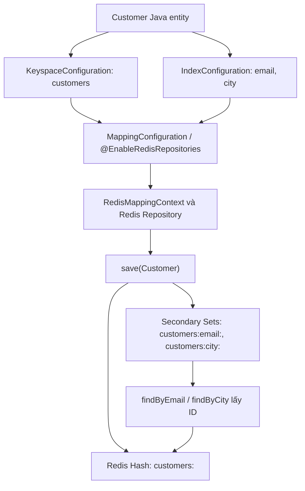

# Cấu hình chỉ mục và keyspace bằng mã trong Spring Data Redis

## 1. Mục tiêu và ngữ cảnh

Spring Data Redis có thể lưu một thực thể Java thành Redis Hash và cho phép tìm thực thể bằng các thuộc tính ngoài ID thông qua **secondary index**. Khi một ứng dụng không muốn đặt toàn bộ cấu hình vào annotation của lớp miền, Spring Data Redis cung cấp API để khai báo **keyspace**, **chỉ mục** và **thời gian sống** bằng mã Java.

Ví dụ, hệ thống quản lý khách hàng lưu các trường `id`, `email` và `city`. Ta muốn:

- Lưu mỗi khách hàng dưới keyspace `customers`, tạo khóa thực thể dạng `customers:<id>`.
- Tìm khách hàng bằng email và thành phố qua Redis Repository.
- Khai báo tên keyspace và các trường cần index tại một nơi tập trung.
- Khi cần, đặt TTL mặc định cho các thực thể thuộc keyspace.
- Hiểu cấu trúc Redis được tạo và cách thay đổi cấu hình khi đã có dữ liệu.

Có hai cơ chế khác nhau nhưng liên quan:

| Cơ chế | Chịu trách nhiệm | Ví dụ |
|---|---|---|
| **Keyspace** | Đặt prefix cho khóa thực thể Redis | `customers:42` |
| **Secondary index** | Lưu quan hệ giữa **giá trị thuộc tính** và các ID thực thể để truy vấn | `customers:city:DaNang` chứa ID `42` |

Keyspace giúp phân vùng tên dữ liệu theo loại thực thể; secondary index giúp Repository tìm ID khi điều kiện truy vấn sử dụng một thuộc tính được index. Chúng không phải cùng một thứ.

> Phạm vi bài: **Spring Data Redis Repository / MappingRedisConverter**. Những chỉ mục này do cơ chế ánh xạ Repository quản lý, không phải index toàn văn của Redis Search/RediSearch. Một thao tác `StringRedisTemplate.opsForValue().set(...)` hoặc `redis-cli HSET` trực tiếp không tự cập nhật secondary index mà Repository đang duy trì.

## 2. Cấu hình bằng annotation và bằng mã khác nhau thế nào?

Cách ngắn nhất với một entity thường là:

```java
@RedisHash("customers")
public class Customer {
    @Id
    private String id;

    @Indexed
    private String email;
}
```

Trong đó `@RedisHash("customers")` khai báo keyspace; `@Indexed` đánh dấu một thuộc tính để Spring Data Redis duy trì secondary index.

Khi entity nằm trong thư viện không thể sửa, hoặc muốn cấu hình index tách khỏi domain model, có thể khai báo tương đương bằng các thành phần:

- `KeyspaceConfiguration` cùng `KeyspaceConfiguration.KeyspaceSettings`: ánh xạ **kiểu Java → keyspace**, và có thể cấu hình TTL.
- `IndexConfiguration` cùng `SimpleIndexDefinition`: khai báo **keyspace + đường dẫn thuộc tính cần index**.
- `@EnableRedisRepositories`: nhận hai lớp cấu hình qua `keyspaceConfiguration` và `indexConfiguration`.
- `MappingConfiguration` và `RedisMappingContext`: cách kết hợp hai cấu hình trong một mapping context Bean.

Một điểm về mức ưu tiên: nếu lớp đã gắn `@RedisHash("someName")`, tên keyspace trong annotation **ưu tiên hơn** cấu hình keyspace bằng mã. Vì vậy muốn chương trình thực sự dùng keyspace do mã cấu hình, ví dụ bên dưới **không đặt `@RedisHash` trên entity**.

### Không nên nhầm index với Redis key scan

Trong một truy vấn Repository dựa trên thuộc tính đã được index, Spring Data Redis sử dụng dữ liệu secondary index để lấy các ID phù hợp rồi tải thực thể. Không cần quét toàn bộ tập khóa Redis bằng `KEYS customers:*`. Lệnh `KEYS` có thể gây tốn thời gian trên hệ thống lớn và không phải nền tảng phù hợp cho query chức năng.

## 3. Ví dụ domain và Repository dùng xuyên suốt

Giả sử có dự án Spring Boot với dependency Redis Repository:

```groovy
dependencies {
    implementation 'org.springframework.boot:spring-boot-starter-data-redis'
}
```

Cấu hình kết nối ví dụ:

```yaml
spring:
  data:
    redis:
      host: localhost
      port: 6379
```

Một entity không khai báo annotation keyspace hoặc index; phần metadata sẽ được cấu hình riêng:

```java
package com.example.demo.customer;

import org.springframework.data.annotation.Id;

public class Customer {

    @Id
    private String id;
    private String email;
    private String city;

    protected Customer() {
        // Dành cho cơ chế materialization khi cần.
    }

    public Customer(String id, String email, String city) {
        this.id = id;
        this.email = email;
        this.city = city;
    }

    public String getId() {
        return id;
    }

    public String getEmail() {
        return email;
    }

    public String getCity() {
        return city;
    }

    public void setEmail(String email) {
        this.email = email;
    }

    public void setCity(String city) {
        this.city = city;
    }
}
```

Repository khai báo các phương thức tìm bằng thuộc tính:

```java
package com.example.demo.customer;

import java.util.List;
import org.springframework.data.repository.CrudRepository;

public interface CustomerRepository extends CrudRepository<Customer, String> {

    List<Customer> findByEmail(String email);

    List<Customer> findByCity(String city);
}
```

Các phương thức `findByEmail` và `findByCity` chỉ có thể được đáp ứng đúng theo cơ chế truy vấn của Redis Repository khi index tương ứng đã được cấu hình và dữ liệu index đã có. Khai báo phương thức trong interface không đồng nghĩa mọi thuộc tính đều được index tự động.

Mỗi trường trong ví dụ là một **property** của Java class: `email` và `city`. Trong cấu hình index, ta phải sử dụng chính tên property được Spring Data mapping nhận diện, không lấy tên cột SQL hay tùy tiện đổi theo tên hiển thị.

## 4. Cách 1: khai báo tập trung bằng @EnableRedisRepositories

Cách này gọn, trực tiếp và hữu ích nếu muốn cấu hình bất biến khi ứng dụng khởi động.

### 4.1. Cấu hình keyspace

Tạo một lớp kế thừa `KeyspaceConfiguration`:

```java
package com.example.demo.customer;

import java.util.List;
import org.springframework.data.redis.core.convert.KeyspaceConfiguration;
import org.springframework.data.redis.core.convert.KeyspaceConfiguration.KeyspaceSettings;

public class CustomerKeyspaces extends KeyspaceConfiguration {

    @Override
    protected Iterable<KeyspaceSettings> initialConfiguration() {
        return List.of(
                new KeyspaceSettings(Customer.class, "customers")
        );
    }
}
```

Giải thích:

- `Customer.class` là Java type mà cấu hình áp dụng.
- `"customers"` là tên keyspace, nghĩa là prefix cho key thực thể.
- `initialConfiguration()` cung cấp danh sách `KeyspaceSettings` khi cấu hình mapping được khởi tạo.
- Có thể khai báo nhiều `KeyspaceSettings` cho nhiều entity type, mỗi type mang keyspace riêng.

Ví dụ khi lưu `new Customer("42", ..., ...)`, key thực thể thông thường có dạng `customers:42`. Tên keyspace không bắt buộc bằng tên Java class, nhưng nên thống nhất giữa các phiên bản triển khai để các dữ liệu đã lưu còn tìm được.

### 4.2. Cấu hình secondary index

Tạo lớp kế thừa `IndexConfiguration`:

```java
package com.example.demo.customer;

import java.util.List;
import org.springframework.data.redis.core.index.IndexConfiguration;
import org.springframework.data.redis.core.index.IndexDefinition;
import org.springframework.data.redis.core.index.SimpleIndexDefinition;

public class CustomerIndexes extends IndexConfiguration {

    @Override
    protected Iterable<IndexDefinition> initialConfiguration() {
        return List.of(
                new SimpleIndexDefinition("customers", "email"),
                new SimpleIndexDefinition("customers", "city")
        );
    }
}
```

Hai tham số của `SimpleIndexDefinition` là:

1. **Keyspace**: `"customers"`, khớp với tên khai báo trong `CustomerKeyspaces`.
2. **Property path**: `"email"` hoặc `"city"`, khớp tên trường được mapping của entity.

Đây là khai báo cho **hai index độc lập**, không phải một composite index kết hợp email và city. Việc truy vấn bằng nhiều điều kiện cần dựa trên khả năng thực tế của cơ chế query Redis Repository; không suy ra khả năng tạo composite index kiểu SQL từ việc thêm hai `SimpleIndexDefinition`.

### 4.3. Đăng ký hai cấu hình khi bật Repository

```java
package com.example.demo.customer;

import org.springframework.context.annotation.Configuration;
import org.springframework.data.redis.repository.configuration.EnableRedisRepositories;

@Configuration
@EnableRedisRepositories(
        basePackageClasses = CustomerRepository.class,
        keyspaceConfiguration = CustomerKeyspaces.class,
        indexConfiguration = CustomerIndexes.class
)
public class CustomerRedisRepositoryConfig {
}
```

Ý nghĩa các thuộc tính:

| Thuộc tính | Nhiệm vụ |
|---|---|
| `basePackageClasses` | Định vị package để quét các Redis repository |
| `keyspaceConfiguration` | Chỉ ra lớp chứa ánh xạ kiểu Java → keyspace |
| `indexConfiguration` | Chỉ ra lớp chứa các định nghĩa secondary index |

Để giảm nhầm lẫn với nhiều Redis repository configuration khác trong một dự án, nên bảo đảm phạm vi scan và tên repository được quản lý ở đúng cấu hình. Với Spring Boot, nếu đã bật Redis repository qua auto-configuration hoặc một `@EnableRedisRepositories` khác, cần kiểm tra cách tạo context thực tế để tránh đăng ký trùng bean.

Sau khi lưu entity qua Repository, có thể gọi finder:

```java
Customer saved = repository.save(
        new Customer("42", "mai@example.test", "DaNang")
);

List<Customer> byEmail =
        repository.findByEmail("mai@example.test");

List<Customer> byCity =
        repository.findByCity("DaNang");
```

Với index được duy trì đúng, các lời gọi trên sẽ trả entity có ID tương ứng. Nếu có nhiều khách hàng cùng thành phố, một index theo `city` có thể chứa nhiều ID.

## 5. Cách 2: cấu hình qua RedisMappingContext bean

Một cách khác là tự tạo `RedisMappingContext` rồi truyền vào nó `MappingConfiguration`. Cách này phù hợp khi ứng dụng cần một nơi xây dựng mapping context tập trung, chẳng hạn tích hợp nhiều lớp cấu hình được tạo trong code.

```java
package com.example.demo.customer;

import org.springframework.context.annotation.Bean;
import org.springframework.context.annotation.Configuration;
import org.springframework.data.redis.core.convert.MappingConfiguration;
import org.springframework.data.redis.core.mapping.RedisMappingContext;
import org.springframework.data.redis.repository.configuration.EnableRedisRepositories;

@Configuration
@EnableRedisRepositories(basePackageClasses = CustomerRepository.class)
public class RedisMappingContextConfig {

    @Bean
    public RedisMappingContext keyValueMappingContext() {
        return new RedisMappingContext(
                new MappingConfiguration(
                        new CustomerIndexes(),
                        new CustomerKeyspaces()
                )
        );
    }
}
```

**Thứ tự tham số của `MappingConfiguration` rất quan trọng:**

```java
new MappingConfiguration(indexConfiguration, keyspaceConfiguration);
```

Tham số đầu là `ConfigurableIndexDefinitionProvider` (ví dụ `IndexConfiguration`), tham số thứ hai là `KeyspaceConfiguration`. Trong một số đoạn minh họa cũ trên Internet có thứ tự bị đảo; hãy đối chiếu chữ ký constructor của phiên bản Spring Data Redis mà ứng dụng thực sự sử dụng.

Ở cấu hình ví dụ trên, `CustomerIndexes` và `CustomerKeyspaces` chính là hai lớp đã định nghĩa ở mục 4. Việc tạo mapping context trong Bean cho phép Spring Data sử dụng cùng một tập metadata khi ánh xạ entity và quản lý index.

**Chỉ chọn một cách đăng ký cho ví dụ này**: hoặc truyền `keyspaceConfiguration` / `indexConfiguration` qua `@EnableRedisRepositories` như mục 4, hoặc cung cấp `RedisMappingContext` phù hợp như mục 5. Đừng chép cả hai lớp cấu hình `@Configuration` vào cùng một ứng dụng rồi vô tình tạo các mapping context cạnh tranh.

Nếu ứng dụng đã có custom `RedisMappingContext` do một thư viện khác cung cấp, cần kết hợp các định nghĩa index/keyspace trong **mapping context đang được Redis Repository sử dụng**, thay vì tạo thêm Bean nhưng Repository lại tham chiếu Bean cũ.

## 6. Bổ sung TTL qua KeyspaceSettings

`KeyspaceSettings` không chỉ chứa keyspace. Spring Data Redis còn hỗ trợ TTL mặc định cho thực thể, tính theo giây.

Ví dụ cho các bản ghi phiên khách hàng tồn tại trong 30 phút:

```java
@Override
protected Iterable<KeyspaceSettings> initialConfiguration() {
    KeyspaceSettings settings =
            new KeyspaceSettings(Customer.class, "customers");

    settings.setTimeToLive(30 * 60L); // 1800 giây

    return List.of(settings);
}
```

Khi Repository lưu entity, cấu hình TTL được áp dụng theo cơ chế của Spring Data Redis cho aggregate đó. Nếu entity có annotation hoặc thuộc tính TTL riêng, cần xác định quy tắc ưu tiên tương ứng, tránh khai báo hai chính sách hết hạn trái ngược nhau.

TTL không phải index. TTL quy định vòng đời khóa thực thể; secondary index lưu các liên kết để tìm ID theo thuộc tính. Để dọn các liên kết index khi thực thể hết hạn, Spring Data Redis có cơ chế xử lý keyspace events và expiration. Trên hệ thống thật, cần kiểm tra chính sách Redis keyspace notifications, listener expiration và cách vận hành Redis, đặc biệt khi Redis không phát thông báo hoặc ứng dụng không chạy tại thời điểm khóa hết hạn. Không nên giả định mọi mục index luôn được dọn đồng bộ với giây mà TTL đạt 0.

Nếu chỉ cần cấu hình keyspace không có TTL, giữ `new KeyspaceSettings(Customer.class, "customers")` như ban đầu.

## 7. Spring Data Redis lưu index như thế nào?

Spring Data Redis thường sử dụng **Redis Set** để liên hệ một giá trị thuộc tính với các ID của entity.

Với dữ liệu:

```java
repository.save(new Customer("42", "mai@example.test", "DaNang"));
repository.save(new Customer("51", "linh@example.test", "DaNang"));
```

Tại Redis, các key có thể được biểu diễn khái niệm như sau:

```text
Khóa thực thể:
  customers:42
  customers:51

Index email:
  customers:email:mai@example.test  -> Set {"42"}
  customers:email:linh@example.test -> Set {"51"}

Index city:
  customers:city:DaNang             -> Set {"42", "51"}
```

Tên key được minh họa theo quy tắc phổ biến của Spring Data Redis; serializer, mapping metadata và phiên bản thư viện có thể ảnh hưởng đến cách biểu diễn byte thực tế. Có thể quan sát trên **môi trường phát triển cô lập** bằng `redis-cli`:

```redis
TYPE customers:42
# hash

HGETALL customers:42
# Các trường đã được Spring Data Redis ánh xạ

TYPE customers:city:DaNang
# set

SMEMBERS customers:city:DaNang
# "42" và "51", thứ tự không được bảo đảm

SMEMBERS customers:email:mai@example.test
# "42"
```

Trong thực tế, Spring Data Redis còn duy trì metadata để biết một entity đang được liên kết với những index nào. Nhờ đó khi giá trị một thuộc tính indexed được đổi, framework có thể gỡ liên kết cũ và thêm liên kết mới.

Ví dụ:

```java
Customer customer = repository.findById("42").orElseThrow();
customer.setCity("Hue");
repository.save(customer);

List<Customer> inDaNang = repository.findByCity("DaNang");
List<Customer> inHue = repository.findByCity("Hue");
```

Sau khi save hoàn tất và index được cập nhật phù hợp, ID `42` sẽ được tìm qua giá trị `Hue`, không còn thông qua giá trị cũ `DaNang`. Lưu ý trường `city` được setter thay đổi trên object Java, còn cập nhật Redis và index diễn ra khi gọi `save`.

### Vì sao thao tác Redis trực tiếp có thể gây lệch index?

Xét:

```redis
HSET customers:42 city "CanTho"
```

Lệnh này thay đổi nội dung Hash của Redis, nhưng **không tự làm Spring Data Redis cập nhật Set index** `customers:city:...`. Nếu sau đó gọi `repository.findByCity("CanTho")`, chỉ mục có thể thiếu ID `42`; nếu hỏi thành phố cũ, Set index có thể còn liên kết không tương thích với dữ liệu chính.

Do đó, với entity Repository sở hữu, nên cập nhật qua cùng cơ chế Repository/mapping hoặc có một quy trình đồng bộ lại index chủ động. Cũng không nên dùng `DEL customers:42` trực tiếp rồi mặc định index được dọn đúng như khi xóa qua repository.

## 8. Chỉ mục nested property và cấu trúc dữ liệu

`SimpleIndexDefinition` nhận một **property path**, không chỉ một trường ở lớp gốc. Ví dụ entity có object địa chỉ:

```java
public class Address {
    private String city;

    public Address() {}

    public Address(String city) {
        this.city = city;
    }

    public String getCity() {
        return city;
    }

    public void setCity(String city) {
        this.city = city;
    }
}
```

Nếu một entity `Person` có thuộc tính `address` kiểu `Address`, có thể khai báo:

```java
new SimpleIndexDefinition("people", "address.city")
```

Index tương ứng có thể được lưu dưới dạng key như `people:address.city:DaNang`. Việc khai báo index trên đường dẫn lồng nhau cần khớp đúng cấu trúc được Spring Data Redis mapping và kiểu thuộc tính thực tế.

Tài liệu Spring Data Redis cũng mô tả index cho các phần tử list/map theo property path. Tuy nhiên, một index nested property không tự biến Redis Repository thành công cụ truy vấn biểu thức bất kỳ. Chỉ định index cho các điều kiện truy vấn mà Repository thực sự hỗ trợ. Đặc biệt, index không thể tự phân giải qua các thuộc tính đánh dấu **`@Reference`** theo cách tương tự thuộc tính embedded thông thường.

## 9. Đổi keyspace hoặc thêm index khi đã có dữ liệu

Đây là điểm cần xem như **thay đổi schema dữ liệu**, dù Redis không bắt buộc một bảng schema như RDBMS.

### 9.1. Đổi tên keyspace

Giả sử dữ liệu cũ nằm ở `customers:42` và cấu hình mới đổi keyspace thành `clients`. Sau khi triển khai:

```text
Cấu hình cũ: Customer.class -> "customers"
Khóa cũ:     customers:42

Cấu hình mới: Customer.class -> "clients"
Khóa mới:     clients:42
```

Repository theo cấu hình mới sẽ tìm `clients:42`. Dữ liệu `customers:42` vẫn có thể tồn tại, nhưng không tự chuyển sang keyspace mới chỉ vì ta đổi `KeyspaceSettings`. Các secondary index cũng gắn với tên keyspace; do đó không thể chỉ đổi prefix của key thực thể mà bỏ qua index và metadata liên quan.

Khi buộc phải đổi keyspace, cân nhắc quy trình chuyển dữ liệu:

1. Thống kê tập entity và cách xác định ID ở namespace cũ.
2. Xây dựng kế hoạch đọc bằng mapping/schema cũ và ghi lại qua mapping/schema mới, bảo toàn ID cùng TTL khi cần.
3. Cho phép cấu hình mới xây dựng index từ những bản ghi được lưu qua Repository.
4. Kiểm tra tính nhất quán dữ liệu và truy vấn, sau đó mới xử lý namespace cũ theo quy trình triển khai.
5. Xác định cách ứng dụng xử lý ghi đồng thời trong thời gian chuyển đổi (đóng băng ghi, dual-write có kiểm soát, hoặc cơ chế đồng bộ khác).

Redis `RENAME` từng khóa không phải một migration hoàn chỉnh của Spring Data Repository vì còn metadata và secondary index.

### 9.2. Thêm index mới

Giả sử hệ thống đã lưu nhiều khách hàng qua Repository trước khi khai báo `new SimpleIndexDefinition("customers", "city")`. Thay đổi cấu hình làm cho **những lần ghi mới** xây dựng index tương ứng; nó **không mặc nhiên duyệt và backfill toàn bộ dữ liệu cũ** trong Redis.

Với dữ liệu đã tồn tại, cần lên kế hoạch reindex an toàn, thường bằng cách đọc từng entity theo ID rồi lưu lại bằng Repository đang sử dụng cấu hình mới (kèm điều kiện kiểm soát TTL, cập nhật đồng thời và tác động tải). Không tùy ý chạy `KEYS customers:*` trên production để duyệt toàn bộ dữ liệu. Có thể sử dụng một nguồn ID đáng tin cậy, các cơ chế quét/lập lịch phù hợp, hoặc một job migration riêng đã được thiết kế.

Nếu thay đổi tên property từ `city` thành `locationCity`, phải xử lý cả schema entity và đường dẫn index mới. Chỉ sửa tên ở `SimpleIndexDefinition` không làm chuyển dữ liệu của các trường đã lưu.

## 10. Quyết định giữa annotation và cấu hình bằng mã

| Tiêu chí | Annotation trên entity | Cấu hình bằng mã |
|---|---|---|
| Khai báo keyspace | `@RedisHash("customers")` | `new KeyspaceSettings(Customer.class, "customers")` |
| Khai báo index đơn | `@Indexed` trên property | `new SimpleIndexDefinition("customers", "email")` |
| Nơi lưu cấu hình | Cùng model domain | Lớp cấu hình riêng |
| Entity thuộc thư viện không muốn sửa | Khó hoặc không thể thêm annotation | Có thể dùng nếu mapping đủ thông tin |
| Dễ đọc quan hệ property-index ngay tại field | Rõ ràng | Cần xem mapping config |
| Khả năng tạo tập quy tắc chung cho nhiều entity | Phân tán theo từng class | Thuận tiện để kiểm soát tập trung |
| Rủi ro sai tên keyspace/property | Thấp hơn với annotation nằm trên field | Cần giữ tên chuỗi đồng bộ với entity và Repository |

Khi dùng cả hai, cần nhớ rằng `@RedisHash` đặt trên entity có thể ghi đè tên keyspace mong muốn của `KeyspaceConfiguration`. Hãy chọn một nguồn khai báo keyspace rõ ràng và ghi nhận lý do chọn cấu hình bằng mã, nhất là khi hệ thống đã có dữ liệu.

## 11. Các tình huống lỗi thường gặp

| Hiện tượng | Nguyên nhân cần kiểm tra | Cách xử lý |
|---|---|---|
| `findByEmail` không trả entity đã lưu | Chưa có index email, index cũ chưa backfill, hoặc thao tác ghi bypass Repository | Kiểm tra `CustomerIndexes`, cách ghi dữ liệu, rồi xây dựng lại index phù hợp |
| Repository không tìm thấy ID đã tồn tại ở Redis | Keyspace cũ khác keyspace mới hoặc serializer khác | Kiểm tra `KeyspaceSettings`, `@RedisHash`, định dạng ID và dữ liệu thực tế |
| Chỉ mục khai báo mà không được dùng | Lớp config không được đăng ký hoặc Repository dùng mapping context khác | Kiểm tra `@EnableRedisRepositories` và bean `RedisMappingContext` mà repository đang dùng |
| Có index với prefix không mong đợi | String keyspace trong `SimpleIndexDefinition` không trùng keyspace thực tế | Dùng cùng keyspace trong cấu hình type và index |
| Một số ID cũ không truy vấn ra theo index mới | Index không được tự xây lại trên bản ghi lịch sử | Lên kế hoạch backfill/re-save có kiểm soát |
| Truy vấn theo thuộc tính lồng nhau không hoạt động | Property path sai hoặc quan hệ `@Reference` không được index như embedded object | Kiểm tra model mapping và đường dẫn có thể index |
| Dữ liệu index không khớp Hash | Redis Hash được sửa/xóa trực tiếp ngoài Repository | Đồng nhất đường ghi, thực hiện repair/reindex nếu cần |
| Index có dữ liệu còn sót sau khi entity hết TTL | Cấu hình expiration notifications/listener hoặc vòng đời index chưa phù hợp | Kiểm tra cơ chế Redis key expiration events, điều kiện triển khai và quy trình dọn dẹp |
| Có xung đột bean mapping context | Bật nhiều cấu hình Redis repository/mapping context khác nhau | Hợp nhất cấu hình, xác định rõ owner và phạm vi scan |

### Một chuỗi kiểm tra kỹ thuật hữu ích

Trên Redis cô lập cho phát triển, trước hết gọi `repository.save(...)` qua cùng cơ chế của ứng dụng. Tiếp theo:

```redis
TYPE customers:42
HGETALL customers:42

TYPE customers:email:mai@example.test
SMEMBERS customers:email:mai@example.test

TYPE customers:city:DaNang
SMEMBERS customers:city:DaNang
```

Nếu kết quả khác mong đợi, xác minh tên keyspace thực tế, key serializer, entity mapping và các Redis database/cluster đang kết nối. Không kết luận rằng index bị hỏng chỉ vì dùng `redis-cli` với tên key giả định trong khi ứng dụng serialize khác.

## 12. Nguyên tắc thiết kế và vận hành

- **Khai báo tập trung, nhưng rõ ràng:** Một entity nên có chủ sở hữu cấu hình keyspace/index xác định. Tránh nhiều `@EnableRedisRepositories` đăng ký chồng lên cùng repository.
- **Giữ keyspace ổn định:** Prefix là một phần của cách Repository tìm dữ liệu. Đổi nó tương đương thay đổi địa chỉ lưu và có thể cần migration.
- **Đặt index cho nhu cầu thực tế:** Index theo mọi field làm tăng bộ nhớ và chi phí ghi; chỉ index property có truy vấn cần thiết.
- **Thống nhất đường ghi:** Repository không thể quản lý chính xác index nếu những ứng dụng khác tùy ý thay đổi Hash trực tiếp.
- **Phân biệt cấu hình và dữ liệu:** Định nghĩa một index không tự tạo tất cả bản ghi index cho dữ liệu lịch sử.
- **Hiểu giới hạn của secondary index:** Redis Set index hỗ trợ các truy vấn theo thuộc tính được ánh xạ; các nhu cầu tìm kiếm toàn văn, xếp hạng, truy vấn phức tạp hoặc phân tích lượng lớn dữ liệu có thể cần cơ chế chuyên dụng.
- **Xem TTL cùng với chiến lược cleanup:** Expiration event và chính sách vận hành Redis có thể ảnh hưởng đến tính nhất quán của index.
- **Tránh truy vấn toàn keyspace bằng `KEYS`:** Với hệ thống lớn, cách này có thể ảnh hưởng hiệu năng và không thay thế được index đúng cách.

## 13. Tóm tắt luồng cấu hình



**Keyspace xác định nơi tìm thực thể; index xác định cách tìm ID bằng giá trị thuộc tính.** Trong Spring Data Redis, ta có thể cấu hình cả hai bằng Java thông qua `KeyspaceConfiguration` và `IndexConfiguration`, đăng ký trực tiếp ở `@EnableRedisRepositories` hoặc truyền vào `RedisMappingContext`. Khi triển khai, cần bảo đảm tên keyspace thống nhất giữa entity và index, toàn bộ đường ghi được kiểm soát, và mọi thay đổi trên dữ liệu đã lưu có kế hoạch backfill/migration phù hợp.

### Tài liệu tham khảo

- [Spring Data Redis — Keyspaces](https://docs.spring.io/spring-data/redis/reference/redis/redis-repositories/keyspaces.html)
- [Spring Data Redis — Secondary Indexes](https://docs.spring.io/spring-data/redis/reference/redis/redis-repositories/indexes.html)
- [API: MappingConfiguration](https://docs.spring.io/spring-data/redis/docs/3.5.x/api/org/springframework/data/redis/core/convert/MappingConfiguration.html)
- [API: KeyspaceConfiguration.KeyspaceSettings](https://docs.spring.io/spring-data/redis/docs/3.5.x/api/org/springframework/data/redis/core/convert/KeyspaceConfiguration.KeyspaceSettings.html)
