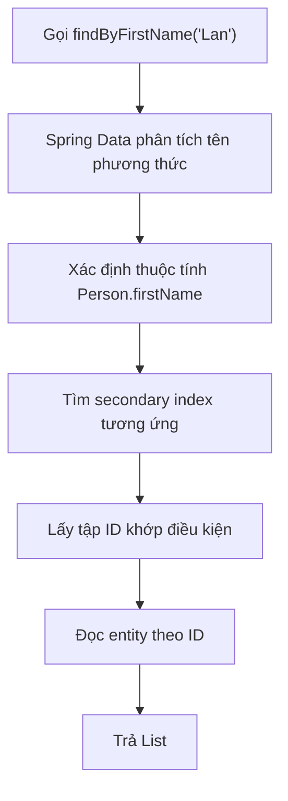
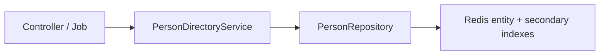

# Suy diễn truy vấn từ tên phương thức Repository trong Spring Data Redis

Khi dùng Spring Data Redis Repository, ta thường cần tìm nhiều thực thể theo một thuộc tính thay vì chỉ đọc theo ID. Ví dụ: tìm tất cả khách hàng có tên `Lan`, tìm nhân viên có `department` bằng `IT` hoặc lọc người dùng theo đồng thời hai thuộc tính. Spring Data cung cấp cơ chế **query derivation**: chỉ cần khai báo tên phương thức theo quy ước, framework phân tích tên đó và tạo truy vấn tương ứng, không cần tự viết câu lệnh Redis cho từng phương thức.

Tuy nhiên, Spring Data Redis **không suy diễn truy vấn theo cách giống hệt JPA**. Redis là kho dữ liệu key-value; truy vấn theo thuộc tính của Redis Repository chủ yếu dựa vào **secondary index** được tạo và duy trì khi lưu entity. Vì vậy, hiểu tên phương thức mới chỉ là một nửa vấn đề: để truy vấn hoạt động, thuộc tính liên quan phải được đánh chỉ mục phù hợp và dữ liệu phải được ghi qua cơ chế có quản lý index.

Bài học giải thích cách tên phương thức trở thành truy vấn, cách chuẩn bị entity với `@RedisHash`, `@Id`, `@Indexed`, cách viết các phương thức `findBy...` và kết hợp điều kiện, những giới hạn của query derivation trong Redis, cũng như các sai sót thường gặp khi dữ liệu hoặc chỉ mục bị lệch.

## 1. Query derivation là gì?

Xét một Repository:

```java
public interface PersonRepository
        extends CrudRepository<Person, String> {

    List<Person> findByFirstName(String firstName);
}
```

Tên `findByFirstName` được Spring Data phân tích thành hai phần:

- `find...By` biểu thị phương thức tìm dữ liệu.
- `FirstName` biểu thị đường dẫn thuộc tính Java `firstName` của entity.

Tham số `String firstName` cung cấp **giá trị cần so khớp** khi thực thi, còn kiểu trả về `List<Person>` cho biết cách biểu diễn kết quả. Ứng dụng có thể gọi:

```java
List<Person> people = personRepository.findByFirstName("Lan");
```

Ứng dụng không cần tự dựng key index trong lời gọi ở trên. Spring Data Repository tạo kế hoạch truy vấn từ tên phương thức và metadata ánh xạ của `Person`.

Đối với Redis, điều quan trọng là câu lệnh tìm theo `firstName` **không có nghĩa Redis tự đi qua mọi key để mở Hash và so sánh trường `firstName`**. Spring Data Redis dựa trên index phù hợp để biết ID của những entity cần lấy.



**Điểm cần nhớ:** cú pháp phương thức được dùng ở nhiều module Spring Data, nhưng **tập toán tử hỗ trợ và cách thực thi thuộc về từng loại datastore**. Không thể lấy một truy vấn JPA rồi mặc định đổi `JpaRepository` thành Redis Repository và kỳ vọng mọi toán tử vẫn dùng được.

## 2. Cấu hình entity để Redis Repository có thể truy vấn

### 2.1. Khai báo thực thể và các thuộc tính được index

Một entity điển hình:

```java
package com.example.redis.people;

import org.springframework.data.annotation.Id;
import org.springframework.data.redis.core.RedisHash;
import org.springframework.data.redis.core.index.Indexed;

@RedisHash("people")
public class Person {

    @Id
    private String id;

    @Indexed
    private String firstName;

    @Indexed
    private String lastName;

    private int age;

    private Address address;

    public Person() {
    }

    public Person(
            String id,
            String firstName,
            String lastName,
            int age,
            Address address) {
        this.id = id;
        this.firstName = firstName;
        this.lastName = lastName;
        this.age = age;
        this.address = address;
    }

    public String getId() {
        return id;
    }

    public void setId(String id) {
        this.id = id;
    }

    public String getFirstName() {
        return firstName;
    }

    public void setFirstName(String firstName) {
        this.firstName = firstName;
    }

    public String getLastName() {
        return lastName;
    }

    public void setLastName(String lastName) {
        this.lastName = lastName;
    }

    public int getAge() {
        return age;
    }

    public void setAge(int age) {
        this.age = age;
    }

    public Address getAddress() {
        return address;
    }

    public void setAddress(Address address) {
        this.address = address;
    }
}
```

Class địa chỉ:

```java
package com.example.redis.people;

import org.springframework.data.redis.core.index.Indexed;

public class Address {

    @Indexed
    private String city;

    private String street;

    public Address() {
    }

    public Address(String city, String street) {
        this.city = city;
        this.street = street;
    }

    public String getCity() {
        return city;
    }

    public void setCity(String city) {
        this.city = city;
    }

    public String getStreet() {
        return street;
    }

    public void setStreet(String street) {
        this.street = street;
    }
}
```

Vai trò từng annotation:

| Annotation | Vai trò |
|---|---|
| `@RedisHash("people")` | Đánh dấu aggregate Redis và xác định keyspace dùng để lưu entity |
| `@Id` | Định danh duy nhất cho từng entity trong keyspace |
| `@Indexed` | Yêu cầu Spring Data Redis duy trì secondary index cho thuộc tính |
| `@Indexed` trên `Address.city` | Cho phép tìm theo đường dẫn thuộc tính lồng nhau |

Trong ví dụ, `age` chưa được đánh index. Điều này có ý nghĩa: dù tên phương thức `findByAge(...)` trông hợp lệ theo quy ước Spring Data, **nó chưa có cơ sở index cần thiết** để truy vấn theo tuổi như ví dụ tìm theo `firstName`.

### 2.2. Khai báo Repository

```java
package com.example.redis.people;

import java.util.List;
import org.springframework.data.repository.CrudRepository;

public interface PersonRepository
        extends CrudRepository<Person, String> {

    List<Person> findByFirstName(String firstName);

    List<Person> findByLastName(String lastName);

    List<Person> findByFirstNameAndLastName(
            String firstName, String lastName);

    List<Person> findByFirstNameOrLastName(
            String firstName, String lastName);

    List<Person> findByAddress_City(String city);
}
```

Ta chỉ **khai báo interface**, không cần viết thân phương thức cho năm truy vấn này. Repository infrastructure sẽ phân tích tên và dùng metadata entity để truy vấn.

Ứng dụng Spring Boot cần Spring Data Redis, cấu hình kết nối Redis và repository scanning phù hợp. Ví dụ, khi tự cấu hình rõ ràng:

```java
package com.example.redis;

import org.springframework.context.annotation.Configuration;
import org.springframework.data.redis.repository.configuration.EnableRedisRepositories;

@Configuration
@EnableRedisRepositories(basePackages = "com.example.redis.people")
public class RedisRepositoryConfiguration {
}
```

Trong ứng dụng Spring Boot, cơ chế auto-configuration có thể đã tạo Redis Repository từ các starter và cấu hình hiện có; không nên vô tình khai báo quét chồng lặp nếu dự án đã có cấu hình tương đương.

### 2.3. Lưu dữ liệu mẫu

```java
personRepository.save(new Person(
        "p-1", "Lan", "Nguyen", 28,
        new Address("Ha Noi", "Cau Giay")));

personRepository.save(new Person(
        "p-2", "Lan", "Tran", 31,
        new Address("Da Nang", "Hai Chau")));

personRepository.save(new Person(
        "p-3", "Minh", "Nguyen", 25,
        new Address("Ha Noi", "Ba Dinh")));
```

Sau đó truy vấn:

```java
List<Person> lan = personRepository.findByFirstName("Lan");
// Kết quả theo ID: p-1, p-2 (thứ tự không được bảo đảm)

List<Person> lanNguyen =
        personRepository.findByFirstNameAndLastName("Lan", "Nguyen");
// Kết quả theo ID: p-1

List<Person> fromHaNoi =
        personRepository.findByAddress_City("Ha Noi");
// Kết quả theo ID: p-1, p-3
```

Các chú thích trên diễn giải **tập ID khớp điều kiện**, không ngụ ý Redis trả theo thứ tự mà ta đã lưu. Nếu giao diện cần sắp xếp rõ ràng, hãy thiết kế và áp dụng cơ chế sắp xếp riêng.

## 3. Secondary index là nền tảng của truy vấn suy diễn

Redis Hash lưu dữ liệu của một entity theo ID, ví dụ:

```text
people:p-1
  id        = "p-1"
  firstName = "Lan"
  lastName  = "Nguyen"
  age       = 28
  address.city = "Ha Noi"
```

Muốn tìm tất cả entity có `firstName=Lan`, Redis không có một câu lệnh Hash tổng quát kiểu `SELECT * WHERE firstName='Lan'`. Spring Data Redis có thể sử dụng một **Redis Set thứ cấp** chứa ID tương ứng với giá trị được index.

Hình dung các quan hệ logic sau (tên Redis key thực tế là chi tiết của phiên bản và mapping; đây chỉ là sơ đồ minh họa):

```text
index for firstName = "Lan"         -> {p-1, p-2}
index for firstName = "Minh"        -> {p-3}
index for lastName  = "Nguyen"      -> {p-1, p-3}
index for lastName  = "Tran"        -> {p-2}
index for address.city = "Ha Noi"  -> {p-1, p-3}
```

Khi gọi `findByFirstName("Lan")`, repository có thể lấy tập ID từ index `firstName=Lan` rồi tải các bản ghi tương ứng. Khi gọi `findByFirstNameAndLastName("Lan", "Nguyen")`, về mặt tập hợp, kết quả là **giao** của hai tập ID:

```text
firstName = Lan       { p-1, p-2 }
lastName  = Nguyen    { p-1, p-3 }
                         |
                         v
AND                    { p-1 }
```

Khi gọi `findByFirstNameOrLastName("Lan", "Nguyen")`, về mặt tập hợp, kết quả là **hợp**:

```text
firstName = Lan       { p-1, p-2 }
lastName  = Nguyen    { p-1, p-3 }
                         |
                         v
OR                 { p-1, p-2, p-3 }
```

Đây là lý do `AND` và `OR` trên các thuộc tính đã index tương đối tự nhiên trong Redis Repository. Nó cũng giải thích vì sao Redis Repository không thể mặc định hỗ trợ mọi loại điều kiện mà SQL hỗ trợ.

**Index không đồng nghĩa với tính duy nhất.** `@Indexed` thường tạo quan hệ từ một giá trị đến **nhiều ID**. Không có bảo đảm chỉ một người có `firstName=Lan`. Nếu nghiệp vụ cần `username` hay `email` duy nhất, phải xây dựng quy tắc cấp phát và cập nhật nguyên tử riêng, hoặc dùng nơi lưu trữ hỗ trợ unique constraint phù hợp.

## 4. Cách Spring Data phân tích tên phương thức

Hãy xét tên:

```java
List<Person> findByFirstNameAndLastName(
        String firstName,
        String lastName
);
```

Cấu trúc khái niệm:

```text
find              By        FirstName      And       LastName
 ^                 ^             ^           ^            ^
 thao tác       bắt đầu      thuộc tính   kết hợp     thuộc tính
 tìm kiếm      điều kiện      firstName   điều kiện    lastName
```

Spring Data dựa vào tên Java property trên entity; ở đây là `firstName`, không nhất thiết trùng tên field mà serializer tạo trong Hash Redis. Điều kiện thuộc tính phải gắn với metadata có thể dùng để query.

### 4.1. Quy tắc tên và tham số

| Phương thức | Ý nghĩa |
|---|---|
| `findByFirstName("Lan")` | Tìm entity có `firstName` bằng `Lan` |
| `findByLastName("Nguyen")` | Tìm entity có `lastName` bằng `Nguyen` |
| `findByFirstNameAndLastName("Lan", "Nguyen")` | Đồng thời thỏa cả hai điều kiện |
| `findByFirstNameOrLastName("Lan", "Nguyen")` | Thỏa ít nhất một trong hai điều kiện |
| `findByAddress_City("Ha Noi")` | So khớp `city` bên trong `address` |

Hai tham số của `findByFirstNameAndLastName` được gắn theo thứ tự các thuộc tính trong tên phương thức. Nếu đảo vị trí truyền giá trị mà không đổi chữ ký/phương thức gọi, truy vấn vẫn chạy nhưng tìm theo giá trị sai.

Quy tắc đặt tên không phân biệt chữ hoa/thường theo cách diễn giải nghiệp vụ. Tên property trong Java được nhận diện theo parser; **giá trị chuỗi** dùng để lập index là dữ liệu mà ứng dụng lưu. Ví dụ `"Lan"` và `"lan"` có thể dẫn tới hai giá trị index khác nhau. Không mặc định có đối sánh không phân biệt hoa/thường.

### 4.2. Truy vấn thuộc tính lồng nhau

Entity chứa:

```java
class Person {
    Address address;
}

class Address {
    @Indexed
    String city;
}
```

Tên phương thức:

```java
List<Person> findByAddress_City(String city);
```

Dấu gạch dưới `_` có ý nghĩa phân tách đường dẫn property cho parser: `address.city`. Trong một số trường hợp, tên `findByAddressCity(...)` cũng có thể được parser hiểu đúng; sử dụng `_` giúp xác định rõ ranh giới giữa hai property, nhất là khi model có tên dễ gây nhập nhằng.

Đường dẫn lồng nhau không có nghĩa Redis hỗ trợ join giữa các entity. Ví dụ này vẫn tìm các phần tử `Person` dựa vào giá trị thuộc tính được ánh xạ và index trong cùng aggregate.

### 4.3. Phần tên mô tả và chủ thể truy vấn

Spring Data có nhiều tiền tố phổ biến như `find...By`, `read...By` hoặc `get...By` trong cơ chế đặt tên query method nói chung. Nhưng với Redis Repository, **cú pháp được parser nhận diện chưa đủ để kết luận truy vấn đó được hỗ trợ ở datastore Redis**. Chỉ nên dùng tổ hợp toán tử, kiểu tham số và kiểu kết quả đã được Redis Repository hỗ trợ trong phiên bản dự án.

Việc tạo một method có tên dài hơn không giúp Redis có thêm loại index. Ví dụ `findByAgeGreaterThan(30)` có vẻ tự nhiên nếu quen dùng JPA, nhưng Redis Repository không tự tạo range index chỉ từ chữ `GreaterThan`. Nếu cần truy vấn theo phạm vi, phải chọn mô hình lưu trữ/index thích hợp.

## 5. Truy vấn bằng AND và OR

### 5.1. Điều kiện AND

Khai báo:

```java
List<Person> findByFirstNameAndLastName(
        String firstName,
        String lastName);
```

Gọi:

```java
List<Person> matches =
        personRepository.findByFirstNameAndLastName(
                "Lan", "Nguyen");
```

Mỗi property dùng trong điều kiện cần index phù hợp. Ở mức mô hình tập hợp, phép `AND` lấy các ID thuộc cả hai tập index. Nếu một điều kiện hiếm gặp, tập kết quả thường nhỏ, song chi phí thực tế vẫn tùy số lượng phần tử của index và chiến lược Redis/Spring Data sử dụng.

### 5.2. Điều kiện OR

Khai báo:

```java
List<Person> findByFirstNameOrLastName(
        String firstName,
        String lastName);
```

Gọi:

```java
List<Person> matches =
        personRepository.findByFirstNameOrLastName(
                "Lan", "Nguyen");
```

Kết quả dựa trên hợp hai điều kiện. Một entity thỏa cả hai điều kiện vẫn tương ứng với cùng ID trong phép hợp tập hợp; không nên dựa vào thứ tự nhận được từ kết quả query này.

### 5.3. Khi nào tên phương thức trở nên khó hiểu?

Ví dụ:

```java
List<Person> findByFirstNameAndLastNameOrAddress_City(
        String firstName,
        String lastName,
        String city);
```

Tên như vậy có thể tạo ra cách diễn giải logic không trực quan cho người đọc; không được mặc định framework cho phép mọi cách nhóm ngoặc. Nếu nghiệp vụ cần điều kiện phức tạp, nhiều nhánh với độ ưu tiên riêng hoặc hơn một loại index, hãy chọn repository method có semantics đã xác định rõ, hoặc xây dựng lớp truy vấn chuyên biệt thay vì nhồi biểu thức vào một tên dài.

Một cách đơn giản trong service là tách các truy vấn được hỗ trợ thành các thao tác dễ hiểu, rồi kết hợp theo **ID duy nhất** khi thật sự phù hợp:

```java
Set<String> ids = new LinkedHashSet<>();

for (Person person : repository.findByFirstName("Lan")) {
    ids.add(person.getId());
}
for (Person person : repository.findByLastName("Nguyen")) {
    ids.add(person.getId());
}
```

Cách kết hợp phía Java chỉ phù hợp với **tập kết quả nhỏ hoặc có giới hạn rõ ràng**; nếu hai tập index lớn, kéo toàn bộ entity về ứng dụng để hợp/giao sẽ tốn mạng và bộ nhớ. Với tập lớn, cần thiết kế truy vấn/index tương ứng và cân nhắc xử lý server-side.

## 6. Những loại truy vấn Redis Repository hỗ trợ và giới hạn cần biết

### 6.1. Điều kiện bằng theo thuộc tính đã index

Trường hợp cốt lõi là truy vấn bằng giá trị:

```java
List<Person> findByFirstName(String firstName);
```

Đây là một hình thức **equality lookup**: tìm index đại diện cho giá trị cụ thể rồi lấy các entity có ID tương ứng.

Nếu muốn tìm theo thuộc tính mới như `department`, trước tiên cần thêm property có `@Indexed` rồi lưu dữ liệu bằng quy trình có quản lý index. Chỉ thêm phương thức `findByDepartment(...)` chưa bảo đảm các bản ghi đã tồn tại sẽ tìm được.

### 6.2. Kết hợp điều kiện trên index

Các điều kiện bằng trên các property được index có thể được kết hợp bằng `And` hoặc `Or` khi được Redis Repository hỗ trợ. Không nên suy rộng từ đó rằng các toán tử SQL như `NOT`, `BETWEEN`, `LIKE`, `IN`, `REGEXP` hoặc mọi phép so sánh số cũng có nghĩa vụ được Redis Repository hỗ trợ.

Một bảng quyết định thực hành:

| Nhu cầu | Hướng tiếp cận |
|---|---|
| Tìm entity theo ID | `findById(id)` |
| Tìm mọi entity có thuộc tính bằng một giá trị | `findByProperty(value)` với `@Indexed` |
| Tìm theo hai giá trị bắt buộc | `findByAAndB(...)` khi cả hai property được index |
| Tìm theo một trong hai giá trị | `findByAOrB(...)` khi hai property được index |
| Tìm theo property lồng nhau | Dùng đường dẫn như `findByAddress_City(...)` và index tương ứng |
| Tìm theo khoảng số hoặc sắp xếp theo score | Thiết kế Sorted Set/chỉ mục phù hợp hoặc nguồn dữ liệu hỗ trợ range query |
| Tìm toàn văn, fuzzy search, lọc phức tạp | Dùng công nghệ index/search chuyên dụng nếu yêu cầu thực sự cần |
| JOIN nhiều loại entity | Tổ chức aggregate/index theo truy vấn hoặc dùng database có khả năng join |

Tài liệu của **đúng phiên bản Spring Data Redis** đang sử dụng là nguồn quyết định tập keyword được hỗ trợ. Bảng trên nhấn mạnh các trường hợp nền tảng và lựa chọn thiết kế, không khẳng định mọi cú pháp query derivation của Spring Data Commons đều hoạt động với Redis.

### 6.3. Geo query là một trường hợp chuyên biệt

Spring Data Redis còn có thể hỗ trợ truy vấn địa lý dựa trên chỉ mục geo, với `@GeoIndexed` và kiểu tọa độ thích hợp. Điều này là một cơ chế index **khác** với equality index bình thường.

Minh họa mô hình:

```java
import org.springframework.data.geo.Point;
import org.springframework.data.redis.core.index.GeoIndexed;

public class StoreLocation {
    @GeoIndexed
    private Point coordinates;

    // constructors, getters và setters ...
}
```

Đối với query địa lý, tên phương thức, kiểu tham số `Point`/`Distance` và kiểu kết quả phải tuân thủ các biến thể được Redis Repository hỗ trợ. Không thay `@Indexed` bằng `@GeoIndexed` tùy ý: mỗi annotation phục vụ một cách truy vấn và một cấu trúc index riêng.

### 6.4. Sắp xếp và phân trang

Một kết quả từ Redis Set không mặc nhiên có thứ tự. Vì vậy đừng kỳ vọng:

```java
findByFirstNameOrderByAgeDesc(...)
```

sẽ hoạt động giống JPA hay sinh ra thao tác sắp xếp tối ưu từ các index equality. Dù cùng dùng Spring Data, các khả năng `Sort`, `Pageable`, keyword `OrderBy` hay phân trang của Redis Repository phụ thuộc vào support thực tế trong phiên bản sử dụng và cấu trúc index.

Đối với API phân trang cần thứ tự ổn định, đặc biệt trên dữ liệu lớn, nên tổ chức một nguồn ID có thứ tự (ví dụ Sorted Set theo điểm số/thời gian) rồi đọc entity theo ID trong lô. Thay vì lấy toàn bộ kết quả `findBy...` để sắp xếp trong JVM, cách thiết kế index theo thứ tự giúp kiểm soát chi phí tốt hơn.

## 7. So sánh phương thức suy diễn với thao tác RedisTemplate

Hãy xem hai cách cùng giải quyết yêu cầu “tìm tất cả `Person` có `firstName=Lan`”.

**Cách dùng Repository:**

```java
List<Person> people = repository.findByFirstName("Lan");
```

**Cách dùng RedisTemplate có chỉ mục tự quản lý (minh họa):**

```java
Set<String> ids = stringRedisTemplate.opsForSet()
        .members("person-index:firstName:Lan");

if (ids != null) {
    for (String id : ids) {
        Map<Object, Object> fields = stringRedisTemplate
                .opsForHash()
                .entries("person-data:" + id);

        // Tự giải mã fields thành Person theo schema đã thiết kế.
    }
}
```

Ví dụ `RedisTemplate` này sử dụng **namespace tự định nghĩa**, hoàn toàn độc lập với index nội bộ của Spring Data Redis Repository. Không lấy các key index giả định của Repository làm giao diện công khai: tên và hình thức index nội bộ không phải hợp đồng lâu dài để các dịch vụ khác cùng ghi.

So sánh:

| Khía cạnh | Derived query trong Repository | Tự quản lý bằng RedisTemplate |
|---|---|---|
| Khai báo truy vấn | Tên phương thức như `findByFirstName` | Tự viết thao tác Redis/index |
| Tạo index | Mapping và `@Indexed` trong cơ chế Repository | Tự tạo, cập nhật, xóa index |
| Đồng bộ index khi cập nhật | Repository quản lý trong phạm vi cơ chế của nó | Ứng dụng phải chủ động xử lý |
| Kiểm soát Redis key và command | Theo contract và implementation của Repository | Chủ động hơn |
| Truy vấn phức tạp, chuyên biệt | Giới hạn theo keyword/index được hỗ trợ | Có thể thiết kế Set, Sorted Set, Lua hoặc giải pháp khác |
| Chi phí phát triển | Ít code cho CRUD/equality query | Nhiều code và trách nhiệm nhất quán hơn |

Repository đặc biệt hữu ích khi thao tác trên entity có mô hình rõ ràng, truy vấn bằng các thuộc tính được index và không cần điều khiển chi tiết từng lệnh Redis. Còn RedisTemplate phù hợp khi thuật toán truy vấn hoặc vòng đời key không khớp với cơ chế Repository.

## 8. Vì sao dữ liệu có trong Redis nhưng findBy... không trả về?

Đây là tình huống phổ biến nhất khi học Redis Repository.

Giả sử có một Redis Hash:

```redis
HSET people:p-9 id p-9 firstName Lan lastName Le
```

Sau đó gọi:

```java
personRepository.findByFirstName("Lan");
```

Có thể không tìm thấy `p-9`, dù khóa `people:p-9` vẫn tồn tại. Nguyên nhân là lệnh `HSET` thủ công **không tự cập nhật secondary index do Repository quản lý**.

### 8.1. Ghi qua Repository tạo và quản lý index

Khi gọi:

```java
personRepository.save(new Person(
        "p-9", "Lan", "Le", 35,
        new Address("Hue", "Le Loi")));
```

Spring Data Redis xử lý ánh xạ entity và các index đã khai báo. Các thao tác liên quan đến lưu entity và index được triển khai bởi Repository infrastructure.

Đừng đồng nhất `@Indexed` với index tự động xây dựng từ mọi Hash có cùng field. Annotation chỉ có hiệu lực trong **đường đi dữ liệu có sử dụng mapping của Spring Data Redis**.

### 8.2. Thay đổi field có index bằng RedisTemplate có thể làm lệch index

Giả sử một entity đã được lưu với:

```text
id = p-1
firstName = Lan
```

Nếu dùng RedisTemplate:

```java
stringRedisTemplate.opsForHash()
        .put("people:p-1", "firstName", "Minh");
```

Hash vật lý có thể đã là `Minh`, trong khi tập index do Repository quản lý vẫn xem ID `p-1` thuộc nhóm `Lan`. Kết quả `findByFirstName("Minh")` và `findByFirstName("Lan")` có thể không phản ánh đúng dữ liệu.

Khi muốn Repository tiếp tục là chủ sở hữu của entity/index, nên cập nhật qua entity và `repository.save(...)`; nếu cần thao tác một field rất thường xuyên, hãy xem xét thiết kế lại ownership hoặc quy trình đồng bộ index thay vì trộn hai cách ghi không có hợp đồng.

### 8.3. Thêm @Indexed sau khi dữ liệu đã tồn tại

Thêm:

```java
@Indexed
private String department;
```

vào entity **không đồng nghĩa toàn bộ dữ liệu cũ trong Redis được backfill index ngay**. Spring Data Redis không có lý do để tự quét toàn bộ keyspace của mọi object chỉ vì code vừa được deploy.

Trước khi sử dụng truy vấn mới trên dữ liệu cũ, phải lập kế hoạch xây dựng lại index. Có thể chọn đọc các entity theo danh sách ID đã biết, xác minh schema rồi ghi lại qua Repository hoặc thực hiện quá trình migration được kiểm soát. Cần cân nhắc TTL, tốc độ, duplicate, lỗi giữa chừng và ảnh hưởng đến dữ liệu đang được cập nhật.

Không nên tự sửa các Redis Set index nội bộ bằng mã ứng dụng mà không hiểu đầy đủ cách Repository duy trì metadata của index.

### 8.4. Keyspace và cấu hình mapping bị thay đổi

Khi đổi `@RedisHash("people")` thành `@RedisHash("persons")`, keyspace của entity và các index liên quan cũng có thể đổi. Việc đọc ID cũ hoặc derived query có thể không tìm thấy dữ liệu của keyspace trước đó.

Do đó thay đổi tên keyspace, serializer hoặc tên property là **schema migration**, không chỉ là một thay đổi tên class.

## 9. Vòng đời của secondary index: save, update, delete, expire

### 9.1. Thêm mới entity

Thông thường khi lưu qua Repository, hệ thống cần:

1. Lưu dữ liệu entity vào Redis theo ID.
2. Thêm ID vào các secondary index có liên quan.
3. Lưu metadata cần thiết để quản lý index khi entity thay đổi hoặc bị xóa.

Các bước này được minh họa ở mức logic; cụ thể Redis command, key nội bộ và tính nguyên tử tùy implementation và phiên bản Spring Data Redis.

### 9.2. Đổi thuộc tính có index

Nếu `Person.firstName` đổi từ `Lan` sang `Minh`, hệ thống cần chuyển ID tương ứng khỏi index cũ và thêm vào index mới. Một lệnh `HSET` trực tiếp không thực hiện đầy đủ quy trình đó.

```java
Person person = personRepository.findById("p-1")
        .orElseThrow();

person.setFirstName("Minh");
personRepository.save(person);
```

Sau thao tác, các truy vấn theo tên có thể phản ánh giá trị mới theo cơ chế quản lý index của Repository. Với nhiều writer đồng thời, vẫn cần xử lý xung đột cập nhật và các yêu cầu nhất quán đặc thù.

### 9.3. Xóa entity

```java
personRepository.deleteById("p-1");
```

Xóa qua Repository cho phép tầng mapping thực hiện dọn các cấu trúc phụ mà nó sở hữu. Nếu xóa khóa Hash bằng `DEL` qua RedisTemplate hay CLI, có nguy cơ để lại thành viên trong index.

### 9.4. Entity hết TTL

Ví dụ cấu hình TTL cho một entity:

```java
import org.springframework.data.redis.core.RedisHash;

@RedisHash(value = "people", timeToLive = 3600)
public class Person {
    // ID, thuộc tính, getter/setter...
}
```

TTL làm khóa dữ liệu hết hạn sau thời gian quy định. Việc dọn các index phụ khi khóa hết hạn có thể phụ thuộc vào **Redis keyspace notifications** và listener của Spring Data Redis.

Điểm vận hành cần chú ý:

- Redis phải được cấu hình phát sự kiện phù hợp nếu ứng dụng dựa vào sự kiện hết hạn.
- Không phải dịch vụ Redis được quản lý nào cũng cho phép tùy biến mọi thiết lập máy chủ.
- Notification có đặc tính **fire-and-forget**, không phải event log bền vững để replay mọi sự kiện.
- Nếu listener không chạy khi khóa hết hạn, event có thể bị bỏ lỡ; index có thể cần cơ chế dọn dẹp hoặc xây lại.
- Các thành viên index cũ có thể khiến truy vấn phải xử lý ID không còn dữ liệu thực tế.

Không nên coi `findBy...` trên entity có TTL là một snapshot hoàn toàn nhất quán trong mọi thời điểm. Với ứng dụng cần độ chính xác cao, hãy xem xét lại vai trò của Redis và chiến lược quản lý index.

## 10. Chẩn đoán truy vấn không trả đúng kết quả

Một quy trình điều tra thực tế nên tách lỗi **cú pháp**, **metadata**, **dữ liệu** và **index**.

| Hiện tượng | Khả năng cần xem xét | Hướng xử lý |
|---|---|---|
| Startup báo không tìm được property | Tên sau `By` không khớp property Java hoặc parser tách sai | Kiểm tra tên field/getter, dùng `_` xác định đường dẫn lồng nhau |
| Startup hoặc lúc gọi báo truy vấn không được hỗ trợ | Keyword/operator không có implementation tương ứng trong Redis | Dùng điều kiện được hỗ trợ hoặc thiết kế truy vấn chuyên biệt |
| Có Hash nhưng `findBy...` trả rỗng | Chưa có `@Indexed`, chưa backfill hoặc dữ liệu được ghi trực tiếp | Kiểm tra ownership của đường ghi và kế hoạch rebuild index |
| Tìm theo giá trị cũ vẫn thấy ID | Index chưa được cập nhật khi ghi trực tiếp | Chuyển đường cập nhật qua Repository hoặc đồng bộ lại index |
| Tìm được ID nhưng không dựng được entity | Hash hết hạn, bị xóa, serializer/schema không tương thích | Kiểm tra dữ liệu gốc và cơ chế expiration/migration |
| `"lan"` không giống `"Lan"` | Giá trị index theo chuỗi lưu trữ, không có normalization mong muốn | Chuẩn hóa trước khi save và trước khi query |
| Entity bị mất khi đổi `@RedisHash` | Keyspace thay đổi | Lập migration cho keyspace và các index liên quan |
| Kết quả không theo thứ tự mong muốn | Index equality có bản chất tập hợp, không sắp xếp theo nghiệp vụ | Dùng cấu trúc thứ tự chuyên dụng |
| Truy vấn tăng độ trễ khi dữ liệu lớn | Index value có quá nhiều ID, phải tải nhiều entity | Giới hạn tập dữ liệu, thêm tiêu chí index hoặc đổi thiết kế truy vấn |

Không nên bắt đầu bằng việc tự chỉnh tay key index nội bộ trong Redis. Trước hết hãy biết chắc entity được lưu theo đường nào, giá trị thực tế của property, annotation đang hoạt động và phiên bản Spring Data Redis đang chạy.

## 11. Tối ưu thiết kế chỉ mục theo truy vấn thực tế

### 11.1. Chỉ index những thuộc tính sẽ được truy vấn

Mỗi `@Indexed` thường có thêm chi phí lưu trữ và cập nhật. Ví dụ nếu ứng dụng có hàng triệu `Person` nhưng chỉ tìm theo `firstName` và `department`, không cần index mọi trường của entity.

Một chỉ mục equality theo `status` với vài giá trị như `ACTIVE`, `INACTIVE` có thể tạo tập ID rất lớn. Derived query khi đó có thể phải tải nhiều entity cùng lúc. Vì vậy “đã index” không đồng nghĩa “mọi truy vấn đều nhẹ”.

### 11.2. Chuẩn hóa trước khi lưu và trước khi truy vấn

Giả sử email là property tìm kiếm:

```java
@Indexed
private String emailNormalized;
```

Service có thể chủ động chuẩn hóa đầu vào theo quy tắc nghiệp vụ:

```java
import java.util.Locale;

static String normalizeEmailForLookup(String email) {
    if (email == null || email.isBlank()) {
        throw new IllegalArgumentException("Email is required");
    }
    return email.trim().toLowerCase(Locale.ROOT);
}
```

Với email thực tế, việc chuẩn hóa cần dựa trên quy tắc ứng dụng và nhận thức rằng email local-part có những đặc thù về so khớp. Đoạn code chỉ minh họa cách dùng **một giá trị lookup chuẩn hóa**, không định nghĩa lại mọi chuẩn địa chỉ email.

Giá trị chuẩn hóa phải được dùng **nhất quán ở cả lúc save và lúc query**. Chỉ chuẩn hóa tham số query mà để dữ liệu đã lưu chưa chuẩn hóa sẽ tạo hai miền giá trị khác nhau.

### 11.3. Tách read model khỏi entity ghi nếu truy vấn phức tạp

Ví dụ nghiệp vụ cần:

> Tìm 20 sản phẩm có `category=BOOK`, `price` trong khoảng cho trước, sắp xếp theo lượt bán giảm dần và phân trang ổn định.

Tên `findByCategoryAndPriceBetweenOrderBySalesDesc` không khiến Redis Repository tự tạo tất cả những khả năng trên. Có thể chọn:

- Dùng Repository cho CRUD theo ID và equality query đơn giản.
- Duy trì Sorted Set/index bổ sung theo khóa phân loại và score cần sắp xếp.
- Dùng Redis Search/RediSearch khi môi trường hỗ trợ và yêu cầu tìm kiếm thực sự cần khả năng filter/range/full-text.
- Chuyển truy vấn phức tạp về cơ sở dữ liệu có chỉ mục và cơ chế query phù hợp.

Nếu index phụ do ứng dụng tự duy trì, cần thiết kế rõ đường cập nhật, giao dịch/atomicity, tái xây dựng, TTL, retry và xử lý trường hợp dữ liệu nguồn/index không đồng bộ.

## 12. Vai trò của kiểu trả về và giới hạn semantics

Spring Data Repository có nhiều loại kiểu trả về trong hệ sinh thái, nhưng Redis không tự mang semantics của SQL. Chọn kiểu trả về phải phù hợp với số kết quả dự kiến và khả năng implementation.

### Trả về nhiều entity

```java
List<Person> findByFirstName(String firstName);
```

Đây là lựa chọn tự nhiên khi giá trị không duy nhất. Nó có thể trả danh sách rỗng khi không có entity phù hợp và có thể chứa nhiều phần tử.

### Trả về một entity hoặc Optional

Nếu một property được thiết kế duy nhất bởi nghiệp vụ, một số kiểu API có thể muốn:

```java
Optional<Person> findByExternalId(String externalId);
```

Nhưng chỉ đánh `@Indexed` cho `externalId` **không tạo ràng buộc uniqueness**. Nếu có hai entity mang cùng giá trị, kiểu trả về một phần tử có thể gây lỗi hoặc hành vi không khớp kỳ vọng. Cần enforce tính duy nhất riêng, và chỉ khai báo phương thức single-result khi số lượng kết quả được bảo đảm bởi thiết kế.

### Phân trang trên tập kết quả lớn

Kể cả khi một kiểu chữ ký với `Pageable`/`Sort` trông đúng trong Spring Data Commons, Redis Repository có thể không hỗ trợ đầy đủ các tính năng tương tự datastore khác. Khi bài toán thực sự cần nhiều trang có thứ tự, hãy chọn cơ chế query có thứ tự xác định và giới hạn số ID đọc trong mỗi lần.

Nên diễn đạt hợp đồng API theo dữ liệu có thể cung cấp ổn định, tránh hứa tổng số trang hay thứ tự mà index equality không bảo đảm.

## 13. Không dùng tên phương thức để giả lập join, LIKE hoặc full-text search

Các ví dụ dưới đây là **những kỳ vọng cần thận trọng**, không phải các phương thức được bài học bảo đảm có thể chạy:

```java
// Không giả định Redis derived query sẽ hỗ trợ như JPA:
List<Person> findByFirstNameContaining(String keyword);
List<Person> findByAgeGreaterThan(int age);
List<Person> findByLastNameIgnoreCase(String lastName);
List<Person> findByFirstNameOrderByAgeDesc(String firstName);
```

Tại sao?

1. Secondary index equality liên kết **giá trị thuộc tính chính xác → tập ID**; nó không tự cung cấp index cho substring, range hoặc collation.
2. Không có SQL engine chung đứng sau Redis Repository để tự dựng `WHERE`, `LIKE`, `ORDER BY` và `JOIN`.
3. Parser có thể hiểu phần tên ở mức cú pháp Spring Data Commons nhưng module Redis chỉ hỗ trợ một tập toán tử phù hợp với backend.
4. Chi phí mô phỏng những điều kiện này bằng cách tải toàn bộ entity về Java thường không phù hợp với dữ liệu lớn.

Nếu một yêu cầu mới chỉ có thể xử lý bằng quét toàn bộ tập entity, cần quyết định đó là job quản trị có giới hạn hay truy vấn online cần tái thiết kế index. Không nên để một API gọi `findAll()` rồi lọc tự do trong bộ nhớ khi số bản ghi có thể tăng không giới hạn.

## 14. Tính nhất quán và các tác động đồng thời

Index thường là **dữ liệu phụ được duy trì cùng với entity**. Khi hệ thống có nhiều writer, TTL, cập nhật không đồng bộ hoặc thao tác Redis trực tiếp, có thể xuất hiện những khoảng thời gian entity và index không nhất quán.

Ví dụ một chức năng tìm kiếm:

```text
T1: entity "p-1" có firstName = "Lan"
T2: worker khác sửa thành "Minh"
T3: request tìm theo "Lan" đang đọc index
T4: entity được tải theo ID
```

Giữa thời điểm đọc index và thời điểm đọc Hash, dữ liệu có thể đã thay đổi. Do đó cần phân biệt:

- **Kết quả truy vấn theo index:** các ID thỏa điều kiện theo trạng thái index được đọc.
- **Dữ liệu entity khi tải:** giá trị tại thời điểm đọc Hash.
- **Snapshot nhất quán:** bảo đảm về thời điểm chung cho điều kiện và entity; derived query trên Redis không tự hứa cung cấp điều này như một transaction isolation của database quan hệ.

Nếu yêu cầu nghiệp vụ cần đảm bảo người được tìm thấy vẫn thỏa điều kiện khi thực hiện thao tác quan trọng, hãy **kiểm tra lại điều kiện tại bước cập nhật** và sử dụng cơ chế atomicity thích hợp. Với Redis, điều kiện và cập nhật trong cùng Lua script hoặc quy trình đồng bộ có thể phù hợp hơn tùy trường hợp.

Với dữ liệu chỉ dùng cho cache/tìm kiếm hỗ trợ giao diện, mức nhất quán cuối cùng có thể chấp nhận được; với thông tin tài chính, quyền truy cập hoặc trạng thái đặt chỗ, cần mô hình dữ liệu và transaction mạnh hơn.

## 15. Ví dụ lớp service sử dụng derived query

Lớp service nên mô tả nghiệp vụ, để Repository phụ trách lookup:

```java
package com.example.redis.people;

import java.util.List;
import java.util.Objects;

import org.springframework.stereotype.Service;

@Service
public class PersonDirectoryService {

    private final PersonRepository repository;

    public PersonDirectoryService(PersonRepository repository) {
        this.repository = repository;
    }

    public List<Person> findByExactName(
            String firstName, String lastName) {
        Objects.requireNonNull(firstName, "firstName");
        Objects.requireNonNull(lastName, "lastName");
        return repository.findByFirstNameAndLastName(
                firstName, lastName);
    }

    public List<Person> findByCity(String city) {
        Objects.requireNonNull(city, "city");
        return repository.findByAddress_City(city);
    }

    public Person rename(String id, String newFirstName) {
        Person person = repository.findById(id)
                .orElseThrow(() -> new IllegalArgumentException(
                        "Unknown person id: " + id));

        person.setFirstName(newFirstName);
        return repository.save(person);
    }
}
```

Mô hình sử dụng:



Khi `rename(...)` sử dụng `repository.save(person)`, đường ghi tiếp tục đi qua cơ chế mapping/index. Ví dụ này không có bảo vệ optimistic locking hay thao tác CAS; nếu nhiều request đổi tên đồng thời và cần tránh ghi đè, service phải thêm quy tắc concurrency phù hợp.

Một cách tổ chức tốt là đưa normalization, kiểm tra điều kiện và xử lý lỗi nghiệp vụ ở service; giữ Repository interface tập trung vào các truy vấn đơn giản, có chỉ mục thực tế.

## 16. Bài tập thực hành

### Bài 1 — Thiết kế chỉ mục và method

Tạo entity `Device` gồm:

```java
@RedisHash("devices")
public class Device {
    @Id
    private String id;

    @Indexed
    private String ownerId;

    @Indexed
    private String status;

    private long lastSeenEpochMillis;

    // constructors, getters, setters...
}
```

Viết `DeviceRepository` có các phương thức:

```java
List<Device> findByOwnerId(String ownerId);

List<Device> findByOwnerIdAndStatus(
        String ownerId,
        String status);

List<Device> findByOwnerIdOrStatus(
        String ownerId,
        String status);
```

Hãy mô tả tập ID trả về sau khi lưu ba device với các cặp giá trị:

| ID | ownerId | status |
|---|---|---|
| `d1` | `u1` | `ONLINE` |
| `d2` | `u1` | `OFFLINE` |
| `d3` | `u2` | `ONLINE` |

Đáp án tập hợp:

- `findByOwnerId("u1")` → `{d1, d2}`.
- `findByOwnerIdAndStatus("u1", "ONLINE")` → `{d1}`.
- `findByOwnerIdOrStatus("u1", "ONLINE")` → `{d1, d2, d3}`.

Không dựa vào thứ tự phần tử trong các danh sách trả về.

### Bài 2 — Điều gì xảy ra khi ghi trực tiếp?

Sau khi `repository.save(device)` với `status=ONLINE`, thử cập nhật field `status` bằng Redis CLI hoặc RedisTemplate. Quan sát sự khác nhau giữa dữ liệu Hash và kết quả derived query. Giải thích vì sao cần đường cập nhật nhất quán với index.

### Bài 3 — Thêm query mới vào dữ liệu cũ

Thêm `@Indexed` cho `lastSeenDate` của `Device`. Hãy đề xuất một quy trình migrate để các device đã tồn tại được đưa vào index, nêu cách xử lý dữ liệu thiếu field, key hết TTL và các lần ghi đang diễn ra trong lúc migrate.

### Bài 4 — Giải bài toán không phù hợp equality index

Thiết kế API “lấy 20 device có `lastSeenEpochMillis` mới nhất trong mỗi owner”. Hãy giải thích vì sao không thể kỳ vọng `findByOwnerIdOrderByLastSeenEpochMillisDesc` hoạt động như JPA, rồi đề xuất cấu trúc Sorted Set theo owner và cách duy trì nó khi device thay đổi.

### Bài 5 — Kiểm tra tính duy nhất

Giả sử `Device.serialNumber` phải duy nhất toàn hệ thống. Đánh `@Indexed` có đủ không? Hãy đề xuất cơ chế reservation/atomic check hoặc nơi lưu trữ có unique constraint, đồng thời xác định cách giải phóng reservation khi xóa device.

Các bài tập nhấn mạnh sự khác biệt giữa *đặt tên đúng một phương thức* và *thiết kế đúng dữ liệu/index để phương thức đó trả kết quả tin cậy*.

## 17. Checklist thiết kế derived query trong Redis

Trước khi đưa một phương thức `findBy...` vào ứng dụng, nên trả lời được những câu hỏi sau:

1. Entity có `@RedisHash` và `@Id`, Repository đã được cấu hình và quét đúng package chưa?
2. Property trong tên phương thức có tồn tại theo đường dẫn Java phù hợp không?
3. Mỗi property cần tìm bằng giá trị có `@Indexed` hoặc annotation index đúng loại không?
4. Toán tử và kiểu kết quả có được Redis Repository của phiên bản đang dùng hỗ trợ không?
5. Các bản ghi trước khi thêm index đã được migration/backfill chưa?
6. Có writer nào dùng RedisTemplate, Redis CLI hoặc script và bỏ qua đường cập nhật index không?
7. Kế hoạch dọn index khi update/delete/TTL đã rõ chưa?
8. Dữ liệu cần thứ tự, range, tìm kiếm văn bản hoặc uniqueness nằm ngoài khả năng equality index không?
9. Kết quả có thể quá lớn để trả về trong một request không? Nếu có, thiết kế read model/index khác.
10. Nếu dữ liệu được cập nhật đồng thời, hành vi nhất quán mà nghiệp vụ cần là gì?

## 18. Kết luận

Trong Spring Data Redis, **suy diễn truy vấn từ tên phương thức Repository** cho phép viết các phương thức như `findByFirstName`, `findByFirstNameAndLastName`, `findByFirstNameOrLastName` và `findByAddress_City` một cách gọn gàng. Nhưng hiệu quả của chúng dựa vào **secondary index** và cơ chế mapping của Redis Repository, không phải một SQL query engine.

Vì vậy, một derived query đúng cần đồng thời ba điều kiện: **tên method mô tả property hợp lệ**, **property có index được hỗ trợ**, và **mọi đường ghi dữ liệu tuân thủ quy trình quản lý index**. Với truy vấn range, sorting phức tạp, full-text hoặc yêu cầu nhất quán cao, hãy thiết kế cấu trúc index hay datastore thích hợp thay vì cố mở rộng tên phương thức.

### Tài liệu tham khảo

- [Spring Data Redis — Queries and Query Methods](https://docs.spring.io/spring-data/redis/reference/redis/redis-repositories/queries-and-query-methods.html)
- [Spring Data Redis — Indexes](https://docs.spring.io/spring-data/redis/reference/redis/redis-repositories/indexes.html)
- [Spring Data Redis — Keyspaces](https://docs.spring.io/spring-data/redis/reference/redis/redis-repositories/keyspaces.html)
- [Spring Data Redis — Time To Live](https://docs.spring.io/spring-data/redis/reference/redis/redis-repositories/expirations.html)
- [Spring Data Commons — Defining Query Methods](https://docs.spring.io/spring-data/commons/reference/repositories/query-methods-details.html)
- [Redis — Sets](https://redis.io/docs/latest/develop/data-types/sets/)
- [Redis — SINTER](https://redis.io/docs/latest/commands/sinter/)
- [Redis — SUNION](https://redis.io/docs/latest/commands/sunion/)
