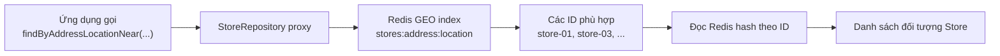

# Truy vấn vị trí địa lý bằng Repository

**Spring Data Redis Repository** không chỉ hỗ trợ lưu và tìm đối tượng theo ID hoặc các chỉ mục thuộc tính thông thường, mà còn có thể tìm đối tượng theo **khoảng cách địa lý**. Ví dụ, ứng dụng quản lý cửa hàng có thể tìm các chi nhánh nằm trong bán kính 3 km quanh tọa độ người dùng, trong khi lớp nghiệp vụ vẫn làm việc với interface `StoreRepository` quen thuộc.

Để làm được điều đó, Spring Data Redis sử dụng **geospatial index** của Redis. Ứng dụng khai báo thuộc tính tọa độ bằng `@GeoIndexed`, lưu aggregate thông qua repository, rồi khai báo phương thức truy vấn có hậu tố `Near` hoặc `Within`. Redis thực hiện việc lọc theo vị trí; Spring Data Redis ánh xạ những ID tìm được trở lại các đối tượng Java.

## 1. Mô hình hoạt động

Giả sử mỗi cửa hàng có tên, trạng thái và một địa chỉ chứa tọa độ:

```text
Store
├── id: "store-01"
├── name: "Chi nhánh A"
├── active: true
└── address
    ├── label: "Quận trung tâm"
    └── location: Point(longitude=106.7000, latitude=10.7800)
```

Khi đối tượng được lưu bằng Redis Repository, thông tin có thể được biểu diễn bằng hai nhóm cấu trúc:

| Cấu trúc Redis | Ví dụ tên khóa | Mục đích |
| --- | --- | --- |
| Hash của aggregate | `stores:store-01` | Lưu các trường của cửa hàng |
| Chỉ mục địa lý (sorted set) | `stores:address:location` | Lưu vị trí, với member là ID cửa hàng |
| Các cấu trúc hỗ trợ repository | Khóa metadata/index do Spring Data tạo | Quản lý keyspace và cập nhật/xóa chỉ mục |

Ví dụ về cách Redis ghi một điểm vào geo index:

```redis
GEOADD stores:address:location 106.7000 10.7800 store-01
```

Redis lưu dữ liệu địa lý bằng cấu trúc **sorted set** và dùng các lệnh thuộc nhóm `GEO` để tìm những member ở gần một tọa độ. Repository kết hợp kết quả của geo index với dữ liệu hash của aggregate.



**Lưu ý:** tên khóa minh họa theo keyspace `stores` và đường dẫn thuộc tính `address.location`. Khi có cấu hình keyspace, converter hoặc chiến lược đặt tên khác, khóa thực tế có thể khác. Hãy để Spring Data Redis quản lý các cấu trúc chỉ mục của repository.

## 2. Điểm, khoảng cách và vùng tìm kiếm

Các kiểu dữ liệu chính của Spring Data:

- `Point`: một điểm có tọa độ `x` và `y`. Với Redis GEO, **`x` là kinh độ (longitude), `y` là vĩ độ (latitude)**.
- `Distance`: một độ dài kèm đơn vị đo, chẳng hạn `new Distance(3, Metrics.KILOMETERS)`.
- `Circle`: vùng hình tròn được xác định bởi một `Point` làm tâm và `Distance` làm bán kính.
- `Metrics`: chọn đơn vị như mét, kilômét hoặc dặm tùy khả năng của Redis và API.

Ví dụ:

```java
import org.springframework.data.geo.Circle;
import org.springframework.data.geo.Distance;
import org.springframework.data.geo.Metrics;
import org.springframework.data.geo.Point;

Point center = new Point(106.7000, 10.7800);
Distance radius = new Distance(3, Metrics.KILOMETERS);
Circle area = new Circle(center, radius);
```

Lệnh tìm kiếm trên có nghĩa là lấy các điểm cách tâm khoảng **tối đa 3 km theo khoảng cách địa lý**. Đó là khoảng cách gần đúng trên bề mặt Trái Đất, **không phải** quãng đường lái xe hay thời gian di chuyển.

Tránh đảo thứ tự tọa độ: `new Point(10.7800, 106.7000)` là sai vì vĩ độ bị đặt ở vị trí của kinh độ, còn tọa độ `y` vượt phạm vi Redis hỗ trợ.

## 3. Chuẩn bị ứng dụng Spring Boot

Với Spring Boot, khai báo starter:

```groovy
// build.gradle
dependencies {
    implementation 'org.springframework.boot:spring-boot-starter-data-redis'
}
```

Cấu hình Redis Server, ví dụ Redis chạy trên máy phát triển:

```yaml
# src/main/resources/application.yml
spring:
  data:
    redis:
      host: localhost
      port: 6379
```

Các ví dụ sử dụng quy ước cấu hình Spring Boot 3.x. Trong môi trường triển khai thật, địa chỉ, tài khoản, TLS và timeout cần lấy từ cấu hình phù hợp với hạ tầng.

Spring Boot có thể tự kích hoạt Redis Repository nếu các điều kiện auto-configuration và phạm vi quét được đáp ứng. Nếu muốn chỉ rõ package chứa repository:

```java
package com.example.store;

import com.example.store.redis.StoreRepository;
import org.springframework.boot.SpringApplication;
import org.springframework.boot.autoconfigure.SpringBootApplication;
import org.springframework.data.redis.repository.configuration.EnableRedisRepositories;

@SpringBootApplication
@EnableRedisRepositories(basePackageClasses = StoreRepository.class)
public class StoreApplication {

    public static void main(String[] args) {
        SpringApplication.run(StoreApplication.class, args);
    }
}
```

`@EnableRedisRepositories` đăng ký và cấu hình repository. Bản thân annotation này **không tạo geospatial index** cho một trường bất kỳ: muốn Spring Data Redis quản lý geo index thì thuộc tính tọa độ phải được khai báo bằng `@GeoIndexed` và aggregate cần được lưu theo cơ chế Redis Repository.

## 4. Ánh xạ aggregate có `@GeoIndexed`

Ta chọn mô hình `Store` có `Address` lồng bên trong. Đường dẫn `address.location` sẽ được sử dụng ở tên phương thức truy vấn.

```java
// com/example/store/redis/Store.java
package com.example.store.redis;

import org.springframework.data.annotation.Id;
import org.springframework.data.geo.Point;
import org.springframework.data.redis.core.RedisHash;
import org.springframework.data.redis.core.index.GeoIndexed;

@RedisHash("stores")
public class Store {

    @Id
    private String id;

    private String name;
    private boolean active;
    private Address address;

    public Store() {
    }

    public Store(String id, String name, boolean active, Address address) {
        this.id = id;
        this.name = name;
        this.active = active;
        this.address = address;
    }

    public String getId() {
        return id;
    }

    public void setId(String id) {
        this.id = id;
    }

    public String getName() {
        return name;
    }

    public void setName(String name) {
        this.name = name;
    }

    public boolean isActive() {
        return active;
    }

    public void setActive(boolean active) {
        this.active = active;
    }

    public Address getAddress() {
        return address;
    }

    public void setAddress(Address address) {
        this.address = address;
    }

    public static class Address {

        private String label;

        @GeoIndexed
        private Point location;

        public Address() {
        }

        public Address(String label, Point location) {
            this.label = label;
            this.location = location;
        }

        public String getLabel() {
            return label;
        }

        public void setLabel(String label) {
            this.label = label;
        }

        public Point getLocation() {
            return location;
        }

        public void setLocation(Point location) {
            this.location = location;
        }
    }
}
```

Các thành phần cần chú ý:

| Thành phần | Vai trò |
| --- | --- |
| `@RedisHash("stores")` | Khai báo aggregate được lưu bằng Redis hash, với keyspace `stores` |
| `@Id` trên `id` | Xác định danh tính của đối tượng và member tương ứng trong geo index |
| `Point location` | Chứa kinh độ và vĩ độ |
| `@GeoIndexed` | Yêu cầu Redis Repository duy trì geospatial index cho `address.location` |
| `Address` là đối tượng lồng | Cho thấy repository có thể tạo chỉ mục trên đường dẫn thuộc tính lồng nhau |

Không nên thay `@GeoIndexed` bằng `@Indexed` để mong có truy vấn bán kính: `@Indexed` phục vụ chỉ mục thứ cấp thông thường, còn truy vấn địa lý cần geospatial index.

Một cửa hàng không có tọa độ hợp lệ sẽ không đáp ứng nhu cầu tìm theo vị trí. Ứng dụng nên kiểm tra tọa độ trước khi lưu, đặc biệt khi giá trị được nhận từ API bên ngoài.

## 5. Khai báo phương thức truy vấn trên Repository

```java
// com/example/store/redis/StoreRepository.java
package com.example.store.redis;

import java.util.List;
import org.springframework.data.geo.Circle;
import org.springframework.data.geo.Distance;
import org.springframework.data.geo.Point;
import org.springframework.data.repository.CrudRepository;

public interface StoreRepository extends CrudRepository<Store, String> {

    List<Store> findByAddressLocationNear(
            Point center, Distance radius);

    List<Store> findByAddressLocationWithin(Circle area);
}
```

Spring Data Redis phân tích tên phương thức:

```text
findByAddressLocationNear
       └──────┬─────┘└─┬─┘
         address.location
                 lọc địa lý theo điểm + bán kính

findByAddressLocationWithin
       └──────┬─────┘└──┬──┘
         address.location
                 lọc địa lý theo Circle
```

`AddressLocation` là đường dẫn tới `Store.address.location`; các từ `Near` và `Within` biểu thị loại phép truy vấn. Chúng hoạt động dựa trên geo index mà Spring Data Redis đã tạo khi lưu các aggregate.

Hai cách diễn đạt tương đương về hình học:

```java
Point center = new Point(106.7000, 10.7800);
Distance threeKm = new Distance(3, Metrics.KILOMETERS);

List<Store> byNear =
        repository.findByAddressLocationNear(center, threeKm);

List<Store> byCircle =
        repository.findByAddressLocationWithin(new Circle(center, threeKm));
```

Với một vị trí tâm và bán kính giống nhau, hai phương thức cùng tìm đối tượng trong hình tròn đó. Phương thức `Near` **không có nghĩa** mặc nhiên là “trả đúng một đối tượng gần nhất”; kiểu trả về `List<Store>` có thể chứa nhiều kết quả. Cũng không nên suy luận rằng danh sách đã được sắp xếp theo khoảng cách nếu API không đưa ra bảo đảm về thứ tự.

### Giới hạn quan trọng của query derivation

Redis Repository **không hỗ trợ kết hợp điều kiện `Near`/`Within` với các điều kiện truy vấn khác trong cùng một phương thức derived query**. Vì vậy, đừng viết và kỳ vọng một khai báo như sau hoạt động:

```java
// Không phải tổ hợp được Redis Repository hỗ trợ:
List<Store> findByAddressLocationNearAndActiveTrue(
        Point center, Distance radius);
```

Nếu muốn chỉ hiển thị cửa hàng đang hoạt động, ứng dụng có thể lọc ở tầng service sau khi tìm theo địa lý, miễn là kích thước tập kết quả đủ nhỏ. Nếu lượng dữ liệu lớn hoặc có yêu cầu lọc/phân trang chặt chẽ, cần một thiết kế truy vấn hay chỉ mục riêng; không nên coi Redis Repository là công cụ truy vấn tùy ý như SQL.

## 6. Lưu dữ liệu và truy vấn từ service

Service sau lưu ba cửa hàng minh họa và cung cấp hai phương thức tìm kiếm:

```java
// com/example/store/StoreLocatorService.java
package com.example.store;

import com.example.store.redis.Store;
import com.example.store.redis.StoreRepository;
import java.util.List;
import org.springframework.data.geo.Circle;
import org.springframework.data.geo.Distance;
import org.springframework.data.geo.Metrics;
import org.springframework.data.geo.Point;
import org.springframework.stereotype.Service;

@Service
public class StoreLocatorService {

    private final StoreRepository stores;

    public StoreLocatorService(StoreRepository stores) {
        this.stores = stores;
    }

    public void seedDemoData() {
        stores.save(new Store(
                "store-01",
                "Chi nhánh A",
                true,
                new Store.Address(
                        "Khu vực trung tâm",
                        new Point(106.7000, 10.7800))));

        stores.save(new Store(
                "store-02",
                "Chi nhánh B",
                false,
                new Store.Address(
                        "Khu vực lân cận",
                        new Point(106.7100, 10.7850))));

        stores.save(new Store(
                "store-03",
                "Chi nhánh C",
                true,
                new Store.Address(
                        "Khu vực xa hơn",
                        new Point(106.8000, 10.8500))));
    }

    public List<Store> findNearby(
            double longitude, double latitude, double radiusKm) {

        requireValidCoordinates(longitude, latitude);
        if (!Double.isFinite(radiusKm) || radiusKm <= 0) {
            throw new IllegalArgumentException("radiusKm must be positive");
        }

        Point center = new Point(longitude, latitude);
        Distance radius = new Distance(radiusKm, Metrics.KILOMETERS);
        return stores.findByAddressLocationNear(center, radius);
    }

    public List<Store> findActiveWithinCircle(
            Point center, Distance radius) {

        Circle area = new Circle(center, radius);
        return stores.findByAddressLocationWithin(area)
                .stream()
                .filter(Store::isActive)
                .toList();
    }

    private static void requireValidCoordinates(
            double longitude, double latitude) {
        if (!Double.isFinite(longitude) || longitude < -180 || longitude > 180
                || !Double.isFinite(latitude)
                || latitude < -85.05112878 || latitude > 85.05112878) {
            throw new IllegalArgumentException("Invalid Redis GEO coordinates");
        }
    }
}
```

Tọa độ trong ví dụ chỉ nhằm minh họa dữ liệu giả lập; không đại diện cho vị trí thực tế của cửa hàng nào.

Sau khi gọi `seedDemoData()`, có thể truy vấn:

```java
List<Store> nearby = locator.findNearby(
        106.7000,  // longitude
        10.7800,   // latitude
        3.0        // radiusKm
);

for (Store store : nearby) {
    System.out.println(store.getId() + ": " + store.getName());
}
```

Với dữ liệu minh họa trên, `store-01` ở tâm và `store-02` nằm gần tâm, còn `store-03` ở xa hơn bán kính 3 km. `store-02` có `active = false` nhưng **vẫn xuất hiện trong kết quả tìm địa lý thuần túy**; chỉ phương thức `findActiveWithinCircle(...)` mới áp dụng bước lọc `active` ở phía Java.

Không nên gọi `seedDemoData()` tự động ở mọi lần chạy production. Đây là dữ liệu học tập và việc ghi lại các ID cố định sẽ cập nhật đè các đối tượng cùng ID nếu chúng đã tồn tại.

## 7. Spring Data Redis chuyển truy vấn thành Redis GEO như thế nào?

Khi lưu:

```java
stores.save(new Store(
    "store-01",
    "Chi nhánh A",
    true,
    new Store.Address(
        "Khu vực trung tâm",
        new Point(106.7000, 10.7800))
));
```

Spring Data Redis lưu hash của aggregate, đồng thời ghi và quản lý member trên chỉ mục:

```redis
# Minh họa câu lệnh tương ứng với geo index.
GEOADD stores:address:location 106.7000 10.7800 store-01
```

Khi gọi:

```java
stores.findByAddressLocationNear(
    new Point(106.7000, 10.7800),
    new Distance(3, Metrics.KILOMETERS)
);
```

Về mặt cơ chế, Redis trả về các ID nằm trong vùng geo index, rồi Spring Data Redis lấy các hash tương ứng để dựng đối tượng:

```redis
# Minh họa cơ chế truy vấn theo bán kính:
GEORADIUS stores:address:location 106.7000 10.7800 3 km

# Sau đó đọc aggregate theo ID khớp:
HGETALL stores:store-01
HGETALL stores:store-02
```

Tên và số lệnh thực tế phụ thuộc phiên bản Spring Data Redis, driver và đường đi nội bộ của repository. Trong Redis hiện đại, `GEOSEARCH` hỗ trợ truy vấn với hình tròn hoặc hình chữ nhật và thay thế nhu cầu sử dụng các lệnh `GEORADIUS` cũ đã bị deprecated.

Từ Redis CLI, một truy vấn tương đương về dữ liệu địa lý có thể viết:

```redis
GEOSEARCH stores:address:location
  FROMLONLAT 106.7000 10.7800
  BYRADIUS 3 km
  ASC COUNT 10 WITHDIST
```

Đây là cú pháp được xuống dòng để dễ đọc; khi chạy Redis CLI có thể nhập trên **một dòng**:

```redis
GEOSEARCH stores:address:location FROMLONLAT 106.7000 10.7800 BYRADIUS 3 km ASC COUNT 10 WITHDIST
```

Kết quả từ Redis CLI là **ID member và khoảng cách**, chưa phải đối tượng `Store`. Điểm mạnh của repository là khôi phục aggregate; nếu cần sắp xếp, lấy số đo khoảng cách và giới hạn kết quả một cách tường minh thì API GEO cấp thấp phù hợp hơn.

## 8. Khi cần khoảng cách và thứ tự gần nhất: phối hợp `GeoOperations`

Phương thức derived query của repository tiện cho việc lấy danh sách aggregate trong một vùng tròn, nhưng ứng dụng bản đồ thường cần thêm:

- Khoảng cách từ vị trí tra cứu tới từng cửa hàng.
- Thứ tự từ gần nhất đến xa nhất.
- Giới hạn số lượng kết quả Redis phải trả về.
- Truy vấn theo hình chữ nhật hoặc theo vị trí của một member đã có.

`StringRedisTemplate.opsForGeo()` cung cấp các thao tác này. Ví dụ dưới đây dùng `GEOSEARCH` qua `GeoOperations.search(...)` (API có trong những dòng Spring Data Redis hỗ trợ Redis GEOSEARCH), rồi tra aggregate bằng repository:

```java
package com.example.store;

import com.example.store.redis.Store;
import com.example.store.redis.StoreRepository;
import java.util.ArrayList;
import java.util.List;
import org.springframework.data.geo.Distance;
import org.springframework.data.geo.GeoResult;
import org.springframework.data.geo.GeoResults;
import org.springframework.data.geo.Metrics;
import org.springframework.data.redis.connection.RedisGeoCommands;
import org.springframework.data.redis.core.StringRedisTemplate;
import org.springframework.data.redis.domain.geo.GeoReference;
import org.springframework.stereotype.Service;

@Service
public class NearestStoreService {

    private static final String GEO_KEY = "stores:address:location";

    private final StringRedisTemplate redis;
    private final StoreRepository stores;

    public NearestStoreService(
            StringRedisTemplate redis, StoreRepository stores) {
        this.redis = redis;
        this.stores = stores;
    }

    public List<StoreDistance> nearest(
            double longitude, double latitude, double radiusKm, int limit) {

        if (limit <= 0 || limit > 100) {
            throw new IllegalArgumentException("limit must be between 1 and 100");
        }

        var args = RedisGeoCommands.GeoSearchCommandArgs
                .newGeoSearchArgs()
                .includeDistance()
                .sortAscending()
                .limit(limit);

        GeoResults<RedisGeoCommands.GeoLocation<String>> hits =
                redis.opsForGeo().search(
                        GEO_KEY,
                        GeoReference.fromCoordinate(longitude, latitude),
                        new Distance(radiusKm, Metrics.KILOMETERS),
                        args);

        List<StoreDistance> result = new ArrayList<>();
        if (hits == null) {
            return result;
        }

        for (GeoResult<RedisGeoCommands.GeoLocation<String>> hit
                : hits.getContent()) {
            String id = hit.getContent().getName();
            stores.findById(id).ifPresent(store ->
                    result.add(new StoreDistance(
                            store,
                            hit.getDistance())));
        }
        return result;
    }

    public record StoreDistance(Store store, Distance distance) {
    }
}
```

Trong ví dụ:

1. `GEO_KEY` tham chiếu tới index mà Redis Repository đã tạo từ `@RedisHash("stores")` và `@GeoIndexed address.location`. Với cấu hình keyspace khác phải sửa tên này.
2. `GeoReference.fromCoordinate(longitude, latitude)` xác định tâm truy vấn.
3. `includeDistance()` yêu cầu Redis trả khoảng cách; `sortAscending()` yêu cầu sắp xếp từ gần tới xa; `limit(limit)` giới hạn số phần tử khớp được lấy từ geo index.
4. Kết quả geo chỉ chứa ID và dữ liệu địa lý. `stores.findById(id)` đọc aggregate đầy đủ. ID nào đã bị xóa giữa lúc tìm và lúc đọc sẽ được bỏ qua.

Ví dụ này minh họa cách kết hợp hai tầng API. Nó giả định cách đặt tên keyspace/index mặc định và Redis đã hỗ trợ `GEOSEARCH`; việc dùng `StringRedisTemplate` trực tiếp với index do repository quản lý cần nhất quán về cấu hình key và member. Khi cần tái sử dụng nhiều nơi, nên đóng gói quy ước index key tại một chỗ để tránh mã nguồn phụ thuộc vào chuỗi được ghép thủ công.

**Giới hạn của `limit`:** đây là số phần tử geo Redis lấy trước khi ứng dụng đọc aggregate hoặc lọc thuộc tính khác. Nếu một số ID đã hết hạn hoặc không còn active, số kết quả cuối có thể nhỏ hơn `limit`. Không thể tự động bảo đảm “10 cửa hàng active gần nhất” chỉ bằng cách lấy 10 kết quả địa lý rồi lọc Java; có thể cần tìm thêm ứng viên và thiết kế truy vấn phù hợp với tải.

## 9. Cập nhật và xóa tọa độ

Vị trí cửa hàng có thể thay đổi. Cách nhất quán với Redis Repository là đọc aggregate, cập nhật `Point`, rồi lưu lại:

```java
public void relocate(
        StoreRepository stores,
        String storeId,
        double newLongitude,
        double newLatitude) {

    Store store = stores.findById(storeId)
            .orElseThrow(() ->
                    new IllegalArgumentException("Store not found: " + storeId));

    store.getAddress().setLocation(
            new Point(newLongitude, newLatitude));
    stores.save(store);
}
```

Khi lưu lại qua repository, Spring Data Redis quản lý việc cập nhật index tương ứng với aggregate. Xóa qua `repository.deleteById(id)` cũng là đường đi đúng để dọn các chỉ mục liên quan theo cơ chế repository.

**Không nên vừa tự gọi `GEOADD`/`ZREM` lên index của repository, vừa quản lý chính các aggregate đó bằng `save()` và `deleteById()`** nếu không có hợp đồng đồng bộ rõ ràng. Redis Repository còn theo dõi metadata chỉ mục; một thao tác GEO viết thẳng có thể làm chỉ mục và hash lệch nhau.

Geo index được bảo trì qua nhiều thao tác Redis; trong lúc lưu, xóa hoặc cập nhật đồng thời, ứng dụng không nên giả định một truy vấn geo đã nhận được snapshot bất biến của cả index lẫn hash.

## 10. TTL, dữ liệu lệch và tính nhất quán

Nếu aggregate có TTL (ví dụ gắn `@RedisHash(timeToLive = ...)`), hash của cửa hàng hoặc địa điểm có thể hết hạn. Redis Repository có cơ chế theo dõi sự kiện hết hạn và dọn chỉ mục liên quan, nhưng khả năng nhận keyspace notifications phụ thuộc cấu hình Redis, trạng thái listener và thời gian ứng dụng hoạt động.

Các tình huống cần dự tính:

| Tình huống | Hậu quả có thể xảy ra | Cách xử lý |
| --- | --- | --- |
| Geo index còn ID nhưng hash aggregate vừa bị xóa/hết hạn | Truy vấn geo tìm thấy ID, đọc hash không có dữ liệu | Bỏ qua kết quả không còn entity, theo dõi chất lượng index |
| Cửa hàng vừa đổi tọa độ | Hai thao tác quét index và đọc entity không nhất thiết nhìn cùng một thời điểm | Chấp nhận tính nhất quán phù hợp hoặc dùng quy trình cập nhật có kiểm soát |
| Dùng Redis CLI xóa trực tiếp hash | Có nguy cơ bỏ lại chỉ mục/metadata của repository | Ưu tiên xóa qua repository, có cơ chế dọn dữ liệu sai lệch |
| Index được thêm sau khi đã có dữ liệu | Dữ liệu cũ có thể chưa được đưa vào geo index | Xây dựng kế hoạch nạp lại/reindex bằng đường đi dữ liệu được kiểm soát |
| Ứng dụng mất kết nối tới Redis | Query có thể thất bại | Xử lý exception, timeout và chính sách retry theo nghiệp vụ |

Nếu bài toán yêu cầu tìm vị trí hiện tại chính xác tuyệt đối trong một chuỗi thay đổi liên tục (ví dụ cập nhật GPS từng giây), Redis Repository có thể không phải lớp trừu tượng tối ưu cho mọi thao tác. Khi đó cần xem xét API GEO trực tiếp hoặc dữ liệu vị trí do một thành phần chuyên trách quản lý, cùng cơ chế kiểm soát phiên bản của dữ liệu.

## 11. Những giới hạn của truy vấn vị trí bằng Repository

### 11.1. Không phải bộ máy truy vấn địa lý đa điều kiện

Repository hỗ trợ mẫu `Near`/`Within` trên geo index, nhưng không tự sinh được mọi loại truy vấn GIS. Những yêu cầu như:

- Tìm điểm trong đa giác bất kỳ.
- Kết hợp bán kính với nhiều điều kiện logic phức tạp.
- Xếp hạng theo khoảng cách đường bộ, thời gian lái xe hoặc mức độ tắc đường.
- Trả chính xác top N sau khi lọc nhiều thuộc tính khác.

thường cần thêm cơ chế ngoài derived query của Redis Repository. Có thể phối hợp API Redis GEO cấp thấp, chỉ mục dữ liệu riêng hoặc một hệ thống tìm kiếm không gian phù hợp.

### 11.2. Khoảng cách là khoảng cách địa lý

Redis GEO dựa trên vị trí kinh độ/vĩ độ và ước lượng khoảng cách trên bề mặt Trái Đất. Hai địa điểm chỉ cách nhau 500 m đường chim bay có thể bị ngăn bởi sông, cầu, đường một chiều hoặc địa hình. Không dùng khoảng cách Redis để kết luận trực tiếp về thời gian giao hàng hoặc quãng đường thực tế.

### 11.3. Giới hạn tọa độ

Redis GEO yêu cầu kinh độ thuộc khoảng `[-180, 180]`; phạm vi vĩ độ mà Redis hỗ trợ hẹp hơn `[-90, 90]` do cách biểu diễn geospatial index. Hãy validate đầu vào, thống nhất đơn vị `longitude`/`latitude`, và cẩn thận khi ánh xạ từ DTO có thứ tự tọa độ khác.

### 11.4. Thứ tự và phân trang

Tên `Near` không tự trở thành hợp đồng sắp xếp theo khoảng cách. Nếu giao diện cần thứ tự và giới hạn chính xác, hãy yêu cầu Redis GEO sắp xếp qua API phù hợp. Với số lượng lớn, phân trang theo số trang/offset của một danh sách thay đổi liên tục có thể tạo kết quả không ổn định; cần xác định rõ hợp đồng tìm kiếm và chiến lược làm mới.

### 11.5. Chỉ mục địa lý tiêu tốn bộ nhớ

`@GeoIndexed` tạo và bảo trì dữ liệu phụ trong Redis. Càng nhiều bản ghi hoặc thuộc tính geo được index, ứng dụng càng phải cân nhắc chi phí ghi, bộ nhớ và bảo trì khi xóa/TTL. Dùng chỉ mục địa lý cho những thuộc tính thực sự cần tìm theo vị trí.

## 12. Các lỗi thường gặp và cách nhận biết

| Dấu hiệu | Nguyên nhân đáng xem xét | Hướng khắc phục |
| --- | --- | --- |
| Lưu được đối tượng, `findBy...Near` luôn rỗng | Thiếu `@GeoIndexed`; dữ liệu được ghi trực tiếp thay vì qua repository; chưa reindex bản ghi cũ | Khai báo chỉ mục, lưu qua repository và nạp lại dữ liệu có kiểm soát |
| Truy vấn báo lỗi tọa độ | Đảo longitude/latitude hoặc giá trị ngoài phạm vi Redis GEO | Dùng `new Point(longitude, latitude)`, kiểm tra số hữu hạn và biên |
| Tìm 3 km nhưng kết quả khác kỳ vọng | Nhầm mét/km hoặc mong đợi khoảng cách đường đi | Dùng `new Distance(3, Metrics.KILOMETERS)`, phân biệt đường chim bay với đường thực tế |
| Không khởi tạo được repository | Chưa có starter, sai vùng quét hoặc cấu hình repository không khớp | Kiểm tra `@EnableRedisRepositories`, entity, package và Redis connection |
| Repository không chấp nhận `NearAndActiveTrue` | Giới hạn kết hợp điều kiện geo với các predicate khác | Tách bước lọc hoặc thiết kế chỉ mục/truy vấn chuyên biệt |
| Thấy member trên geo index nhưng không tìm được đối tượng | Hash đã bị xóa/hết hạn hoặc index không được bảo trì đồng bộ | Kiểm tra TTL, keyspace notifications, thao tác xóa và quy trình dọn |
| Kết quả không theo thứ tự gần nhất | Chưa yêu cầu Redis sắp xếp khoảng cách | Dùng `GeoOperations.search()` kèm `sortAscending()` khi cần |

Khi quan sát Redis bằng CLI, có thể xem tọa độ của một member trong chỉ mục:

```redis
GEOPOS stores:address:location store-01
```

Hoặc thử trực tiếp bán kính:

```redis
GEOSEARCH stores:address:location FROMLONLAT 106.7000 10.7800 BYRADIUS 3 km WITHDIST
```

Kết quả ở CLI giúp nhìn thấy **geo index**. Kết quả của repository còn phụ thuộc bước ánh xạ ID thành aggregate; do đó hai kết quả có thể khác nhau nếu index bị lỗi thời.

## 13. Khi nào nên dùng Repository, khi nào nên dùng GEO API trực tiếp?

| Tiêu chí | Redis Repository + `@GeoIndexed` | `RedisTemplate.opsForGeo()` |
| --- | --- | --- |
| Mô hình dữ liệu | Aggregate Java với `@RedisHash`, `@Id` | Member trong geospatial sorted set |
| Cách gọi | `findByAddressLocationNear(...)`, `...Within(...)` | `search(...)`, `radius(...)`, `distance(...)` và các thao tác GEO khác |
| Lấy đối tượng Java | Repository tự ánh xạ theo ID | Ứng dụng cần tự ánh xạ ID/member sang dữ liệu |
| Sắp xếp, lấy khoảng cách, giới hạn kết quả | Derived query có phạm vi hỗ trợ hẹp | Kiểm soát tường minh hơn thông qua GEO arguments |
| Truy vấn đa điều kiện | Không kết hợp `Near`/`Within` với predicate khác trong derived query | Có thể tự xây dựng quy trình lọc, nhưng cần quan tâm hiệu năng và tính nhất quán |
| Quản lý geo index của aggregate | Spring Data Redis quản lý theo cơ chế repository | Ứng dụng chịu trách nhiệm quản lý vòng đời member/index nếu tự ghi |

Trong ứng dụng CRUD có một thuộc tính tọa độ rõ ràng và nhu cầu phổ biến là “các bản ghi trong bán kính”, repository giúp mã nghiệp vụ đơn giản. Khi cần xử lý bản đồ chuyên sâu, xếp hạng khoảng cách, hình chữ nhật hoặc điều khiển chi tiết câu lệnh Redis, API GEO trực tiếp thường thích hợp hơn. Có thể phối hợp hai cách, miễn là quản lý index và quy ước keyspace nhất quán.

## 14. Tổng kết

Để truy vấn vị trí địa lý bằng Spring Data Redis Repository, cần **khai báo aggregate bằng `@RedisHash`**, đặt `@GeoIndexed` trên thuộc tính `Point`, lưu dữ liệu bằng repository và sử dụng phương thức derived query như `findByAddressLocationNear(Point, Distance)` hoặc `findByAddressLocationWithin(Circle)`. `Point` luôn dùng thứ tự **kinh độ trước, vĩ độ sau**.

Repository tự xử lý việc tra geo index và lấy các aggregate, giúp phần lớn mã nghiệp vụ không phải viết lệnh Redis thủ công. Tuy nhiên cần nhớ giới hạn kết hợp điều kiện, thứ tự kết quả, các chi phí chỉ mục và khả năng dữ liệu thay đổi giữa bước tìm ID với bước đọc đối tượng. Khi cần khoảng cách chính xác theo đơn vị, sắp xếp hoặc giới hạn số kết quả, có thể dùng `GeoOperations` và tự ánh xạ ID sang entity.

### Tài liệu tham khảo

- [Spring Data Redis — Secondary Indexes / Geospatial Index](https://docs.spring.io/spring-data/redis/reference/redis/redis-repositories/indexes.html): `@GeoIndexed`, `Near`, `Within` và cơ chế lưu chỉ mục.
- [Spring Data Redis — Redis Repositories](https://docs.spring.io/spring-data/redis/reference/redis/redis-repositories.html): nền tảng repository, mapping và chỉ mục.
- [Spring Data Redis — GeoOperations API](https://docs.spring.io/spring-data/redis/reference/api/java/org/springframework/data/redis/core/GeoOperations.html): thao tác địa lý cấp thấp.
- [Redis — GEOSEARCH](https://redis.io/docs/latest/commands/geosearch/): cú pháp truy vấn theo bán kính/hình chữ nhật, khoảng cách và thứ tự.
- [Redis — GEOADD](https://redis.io/docs/latest/commands/geoadd/): cách lưu tọa độ vào sorted set địa lý.
