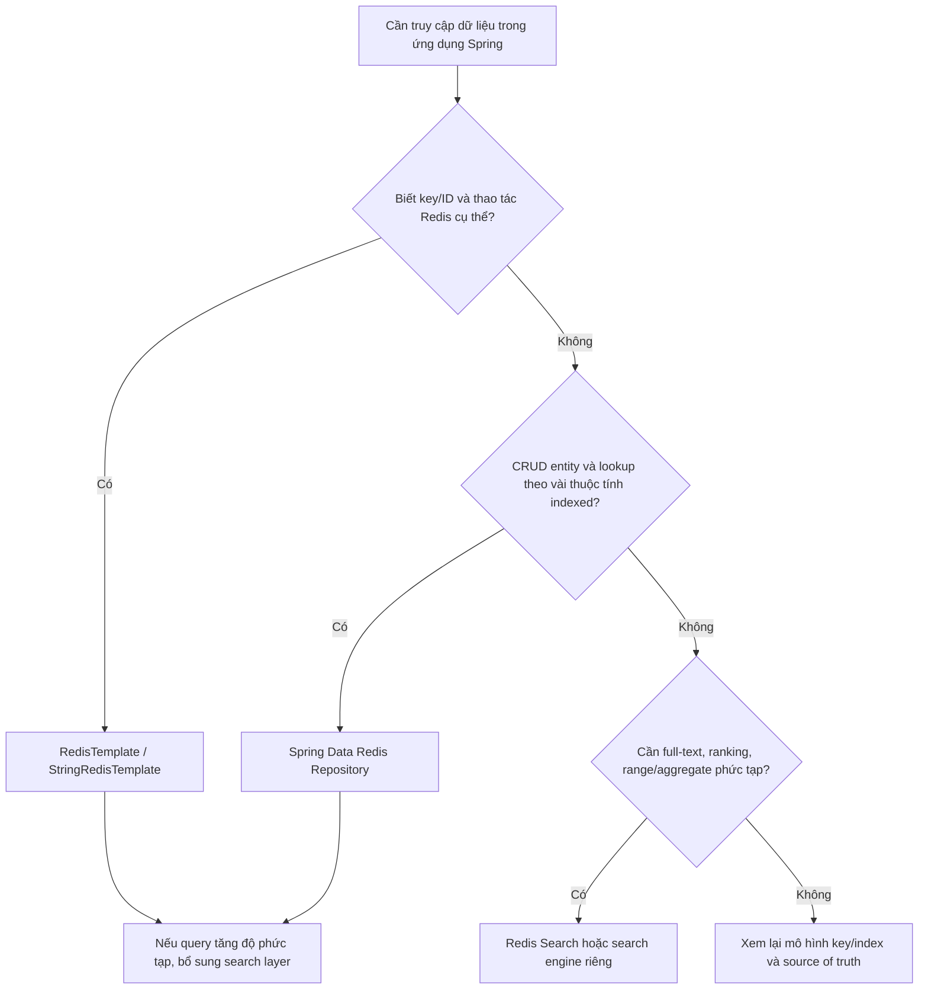
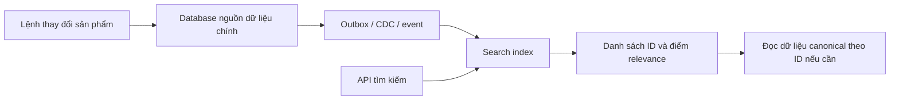

# Lựa chọn Template, Repository hoặc công cụ tìm kiếm riêng trong Spring Data Redis

## 1. Vì sao phải chọn đúng lớp truy cập dữ liệu?

Một ứng dụng dùng Redis có thể bắt đầu với nhu cầu rất đơn giản: đọc một giá trị theo ID, lưu mã xác thực ngắn hạn hoặc tăng bộ đếm. Sau đó nghiệp vụ phát sinh câu hỏi phức tạp hơn:

- "Lấy sản phẩm có ID **P100**."
- "Tìm tất cả sản phẩm thuộc danh mục **electronics**."
- "Tìm sản phẩm có tên gần giống **wireless keyboard**, giá trong khoảng nhất định, sắp xếp theo mức độ liên quan."
- "Lọc theo nhiều điều kiện, phân trang kết quả lớn và tính thống kê theo danh mục."

Đều có thể gọi chung là "truy vấn Redis", nhưng **không có một API nào phù hợp nhất cho mọi trường hợp**. Trong Spring Data Redis, ba hướng thiết kế chính là:

1. **Template**: `RedisTemplate`, `StringRedisTemplate` hoặc `ReactiveRedisTemplate` để thao tác trực tiếp với các cấu trúc và lệnh Redis.
2. **Repository**: khai báo entity, keyspace, index và interface kế thừa `CrudRepository` để quản lý aggregate và truy vấn theo thuộc tính được lập chỉ mục.
3. **Công cụ tìm kiếm riêng**: sử dụng Redis Search / Redis Query Engine hoặc một search engine như Elasticsearch, OpenSearch khi cần full-text search, xếp hạng, lọc phức tạp, thống kê hoặc tìm kiếm vector theo khả năng của công cụ.

Lựa chọn này ảnh hưởng đến **mô hình dữ liệu**, **cách ghi và cập nhật chỉ mục**, **độ trễ truy vấn**, **chi phí bộ nhớ** và **mức độ nhất quán**.

> Trong bài này, "Redis Repository" là chức năng mapping và secondary index của Spring Data Redis. Nó **khác** với Redis Search: annotation `@Indexed` không tự tạo index `FT.CREATE`, còn `FT.SEARCH` không phải một phương thức truy vấn của `CrudRepository` thông thường.

## 2. So sánh nhanh ba lựa chọn

| Tiêu chí | Template | Redis Repository | Search chuyên dụng |
|---|---|---|---|
| Đơn vị thao tác chính | Redis key và cấu trúc dữ liệu | Aggregate Java được ánh xạ | Document / dữ liệu được đưa vào search index |
| API điển hình | `opsForValue()`, `opsForHash()`, `opsForSet()`, `execute()` | `save()`, `findById()`, `findByCategory()` | `FT.SEARCH`, `FT.AGGREGATE` hoặc search client |
| Tìm một giá trị bằng key | Rất trực tiếp | Thích hợp với entity có ID | Thường không cần dùng search cho việc này |
| Tìm theo thuộc tính | Tự thiết kế index hoặc cấu trúc truy cập | Secondary index qua `@Indexed` / cấu hình index | Index theo schema của search engine |
| Tìm kiếm toàn văn, relevance score | Phải tự xây phần lớn logic | Không phải khả năng của secondary index thông thường | Có cơ chế chuyên dụng |
| Lọc numeric range, facets, phân tích | Cần tự thiết kế cách lưu/truy vấn | Phụ thuộc các query method/index được hỗ trợ; không phải SQL tùy ý | Là nhóm bài toán mục tiêu của search engine |
| Điều khiển Redis commands | Cao | Một phần bị framework trừu tượng hóa | Qua giao diện search chuyên biệt |
| Mapping object | Tự kiểm soát serializer/converter | Mapping aggregate tự động | Mapping/index schema của search engine |
| Chi phí duy trì index | Tự chịu trách nhiệm nếu tự làm index | Framework quản lý secondary index cho đường ghi Repository | Engine quản lý search index, cần cấu hình và vận hành |
| Nhất quán khi ghi | Theo lệnh/transaction/script được thiết kế | Theo cơ chế ghi entity và cập nhật index của Repository | Trong cùng Redis có quy tắc engine; với engine ngoài có thể trễ đồng bộ |
| Phù hợp nhất | Cache, counter, TTL, hash, set, sorted set, atomic operations | CRUD aggregate + lookup bằng vài thuộc tính indexed | Text search, ranking, filter/aggregation phức tạp, vector search |

Bảng trên nói về **mức độ phù hợp**, không phải giới hạn cứng: Template vẫn có thể gọi các lệnh thấp hơn để tạo index thủ công, Repository vẫn có thể mở rộng bằng custom implementation, còn một ứng dụng có thể dùng cả Redis Repository và search engine cho những tác vụ khác nhau.

## 3. Bắt đầu từ hình dạng truy vấn, không bắt đầu từ API

Trước khi lựa chọn, mô tả mỗi truy vấn bằng các câu hỏi:

- Có biết **key hoặc ID chính xác** không?
- Điều kiện tìm kiếm là **bằng đúng giá trị** hay **tìm chuỗi gần đúng / full-text**?
- Có cần **khoảng giá trị**, **sắp xếp**, **phân trang sâu**, **aggregation** hoặc **ranking** không?
- Kết quả là một vài phần tử hay có thể hàng trăm nghìn bản ghi?
- Dữ liệu có **TTL**, được sửa thường xuyên hoặc cần đọc nhất quán ngay sau khi ghi không?
- Redis có phải **nguồn dữ liệu chính**, chỉ là **cache**, hay là **bản sao phục vụ tìm kiếm**?
- Hệ thống đã có PostgreSQL, Elasticsearch/OpenSearch hoặc Redis Search chưa?

Sơ đồ định hướng:



**Không cần chọn một công nghệ cho cả hệ thống.** Ví dụ, `StringRedisTemplate` xử lý OTP và bộ đếm, Repository quản lý một nhóm entity Redis đơn giản, còn Elasticsearch/OpenSearch phục vụ trang tìm kiếm sản phẩm.

## 4. Template: khi ứng dụng biết rõ key và thao tác cần thực hiện

### 4.1. Vai trò của RedisTemplate

`RedisTemplate<K, V>` bao bọc connection, chuyển đổi khóa/giá trị qua serializer và cung cấp các nhóm thao tác tương ứng với kiểu dữ liệu Redis:

| Kiểu dữ liệu / hành động | API Template thường dùng | Tình huống |
|---|---|---|
| String | `opsForValue()` | Cache một giá trị, token, bộ đếm |
| Hash | `opsForHash()` | Lưu snapshot nhiều thuộc tính của một ID |
| Set | `opsForSet()` | Thành viên nhóm, quan hệ membership |
| Sorted Set | `opsForZSet()` | Bảng xếp hạng, danh sách theo điểm |
| List | `opsForList()` | Danh sách theo thứ tự, tác vụ đơn giản |
| Stream | `opsForStream()` | Dòng sự kiện trong Redis |
| Keyspace | `expire()`, `hasKey()`, `delete()` | TTL, tồn tại, xóa |
| Lệnh phức hợp | `execute(RedisScript, ...)` hoặc `execute(RedisCallback)` | Logic atomic, các thao tác cấp connection |

Khi key là chuỗi và muốn quan sát được qua `redis-cli`, `StringRedisTemplate` thường thuận tiện hơn. Với `RedisTemplate` tổng quát, phải đặt serializer khớp giữa thành phần ghi và đọc; một key được JDK serialize không có byte tương đương trực tiếp với chuỗi `"cache:product:P100"`.

### 4.2. Ví dụ: lưu snapshot có TTL bằng StringRedisTemplate

Dependency trong dự án Spring Boot:

```groovy
dependencies {
    implementation 'org.springframework.boot:spring-boot-starter-data-redis'
}
```

Kết nối Redis phát triển:

```yaml
spring:
  data:
    redis:
      host: localhost
      port: 6379
```

Dịch vụ thao tác trực tiếp với Hash:

```java
package com.example.catalog.cache;

import java.time.Duration;
import java.util.Map;
import org.springframework.data.redis.core.StringRedisTemplate;
import org.springframework.stereotype.Service;

@Service
public class ProductSnapshotCache {

    private final StringRedisTemplate redis;

    public ProductSnapshotCache(StringRedisTemplate redis) {
        this.redis = redis;
    }

    private static String keyFor(String id) {
        if (id == null || id.isBlank()) {
            throw new IllegalArgumentException("Product ID is required");
        }
        return "cache:product:" + id;
    }

    public void put(
            String id, String title, String category,
            long priceInCents, Duration ttl) {

        if (ttl.isZero() || ttl.isNegative()) {
            throw new IllegalArgumentException("TTL must be positive");
        }

        String key = keyFor(id);
        redis.opsForHash().putAll(
                key,
                Map.of(
                        "title", title,
                        "category", category,
                        "priceInCents", Long.toString(priceInCents)
                )
        );
        redis.expire(key, ttl);
    }

    public Map<Object, Object> get(String id) {
        return redis.opsForHash().entries(keyFor(id));
    }

    public void evict(String id) {
        redis.delete(keyFor(id));
    }
}
```

Khi gọi `get("P100")`, ứng dụng đọc đúng một key `cache:product:P100`. Không cần tạo entity, repository hay secondary index. Mô hình này phù hợp với cache được tra cứu theo ID.

**Giới hạn của ví dụ:** `putAll` và `expire` là hai lệnh riêng. Nếu lệnh thứ nhất thành công nhưng lệnh thứ hai thất bại, khóa có thể không có TTL như mong muốn. Với dữ liệu cần bất biến vận hành chặt chẽ, thiết kế đường ghi nguyên tử bằng lệnh/script phù hợp, hoặc lưu một serialized value bằng thao tác có TTL trong cùng lệnh nếu bài toán cho phép. Không nên xem ví dụ minh họa nhiều lệnh là một transaction.

### 4.3. Tại sao Template không tự tạo khả năng tìm kiếm theo field?

Giả sử có 100.000 khóa `cache:product:<id>`, mỗi Hash chứa `category`. Lời gọi:

```java
redis.opsForHash().entries("cache:product:P100");
```

chỉ đọc Hash với **ID đã biết**. Redis không tự tạo index để thực hiện tương đương:

```sql
SELECT * FROM products WHERE category = 'electronics';
```

Một cách thủ công là duy trì Set `cache:index:category:electronics` chứa danh sách ID:

```redis
SADD cache:index:category:electronics P100
SADD cache:index:category:electronics P120
SMEMBERS cache:index:category:electronics
```

Nhưng nếu sản phẩm P100 chuyển danh mục, ứng dụng phải **xóa ID khỏi Set cũ, thêm ID vào Set mới và cập nhật Hash gốc**. Khi có ghi đồng thời, TTL hoặc lỗi giữa nhiều lệnh, chỉ mục dễ lệch. Template trao quyền điều khiển thấp hơn nhưng đồng thời buộc ứng dụng tự giải quyết consistency, reindex, cleanup và cạnh tranh cập nhật.

Vì vậy, nếu nhu cầu chính là CRUD entity và lookup theo vài thuộc tính cố định, Repository thường giúp giảm đáng kể lượng code quản lý index thủ công.

### 4.4. Template đồng bộ hay reactive?

- `RedisTemplate` và `StringRedisTemplate` là API đồng bộ.
- `ReactiveRedisTemplate` / `ReactiveStringRedisTemplate` phù hợp với luồng xử lý reactive, trả kiểu như `Mono` và `Flux` và sử dụng Redis connection theo mô hình non-blocking khi driver hỗ trợ.

Chọn API theo kiến trúc thực tế của ứng dụng, không chỉ vì "reactive" nghe nhanh hơn. Nếu request chain đã dùng Reactor, dùng API blocking một cách thiếu kiểm soát có thể chiếm event-loop thread; nếu ứng dụng xử lý đồng bộ đơn giản, Template thường dễ sử dụng và quan sát hơn.

## 5. Repository: khi cần quản lý aggregate và truy vấn theo index đơn giản

### 5.1. Redis Repository làm gì?

Spring Data Redis Repository ánh xạ object Java thành các Redis Hash theo keyspace và ID. `@RedisHash` khai báo namespace, `@Id` chọn định danh, `@Indexed` giúp duy trì secondary index theo giá trị thuộc tính.

```java
package com.example.catalog.repository;

import org.springframework.data.annotation.Id;
import org.springframework.data.redis.core.RedisHash;
import org.springframework.data.redis.core.index.Indexed;

@RedisHash("catalogProducts")
public class Product {

    @Id
    private String id;

    private String title;

    @Indexed
    private String category;

    private long priceInCents;

    protected Product() {
    }

    public Product(
            String id, String title,
            String category, long priceInCents) {
        this.id = id;
        this.title = title;
        this.category = category;
        this.priceInCents = priceInCents;
    }

    public String getId() {
        return id;
    }

    public String getTitle() {
        return title;
    }

    public String getCategory() {
        return category;
    }

    public long getPriceInCents() {
        return priceInCents;
    }
}
```

Repository:

```java
package com.example.catalog.repository;

import java.util.List;
import org.springframework.data.repository.CrudRepository;

public interface ProductRepository extends CrudRepository<Product, String> {

    List<Product> findByCategory(String category);
}
```

Sử dụng:

```java
repository.save(
        new Product("P100", "Mechanical Keyboard", "electronics", 12900)
);

Product byId = repository.findById("P100").orElseThrow();

List<Product> electronics =
        repository.findByCategory("electronics");
```

Khi `save` thực thi, Spring Data Redis lưu entity và cập nhật cấu trúc secondary index được khai báo. Với index category, Redis có thể có Set tương tự:

```text
catalogProducts:category:electronics -> Set { "P100", ... }
```

Finder `findByCategory` dựa vào index này để xác định ID rồi tải aggregate. Tên và nội dung key phụ trợ trong Redis có thể khác tùy mapping, nhưng bản chất là **index quản lý bởi Repository**.

### 5.2. Repository có hỗ trợ bao nhiêu kiểu truy vấn?

Repository có khả năng query derivation cho một số toán tử, điển hình:

- So sánh bằng theo thuộc tính `@Indexed`, ví dụ `findByCategory("electronics")`.
- Một số tổ hợp tiêu chí `And`, `Or` dùng giao/hợp các Set index.
- Một số phương thức với giới hạn, phân trang hoặc sắp xếp theo khả năng của **phiên bản Spring Data Redis** đang sử dụng.

Các query method Redis **không phải** SQL engine. Chẳng hạn "tên chứa một chuỗi con bất kỳ, có stemming tiếng Việt, xếp hạng theo mức độ khớp và tính facets" không tự xuất hiện chỉ nhờ khai báo `findByTitleContaining(...)`.

Kể cả khi một phiên bản có hỗ trợ sort kết quả Repository, cần xem **sort được thực hiện ở Redis hay sau khi đọc entity vào Java**. Các tài liệu Spring Data Redis hiện hành mô tả một số dạng sorting bằng cách dùng Comparator trên tập kết quả; điều đó có thể tốn bộ nhớ và thời gian khi lượng kết quả lớn.

Với Query by Example, khả năng thường tập trung ở **exact match, case-sensitive trên các property được index**; không nên tự suy ra hỗ trợ mọi kiểu `StringMatcher` của các store khác. Mỗi trường dùng trong phương thức tìm phải được đánh dấu hoặc cấu hình index phù hợp.

### 5.3. Những đánh đổi khi dùng Repository

**Thuận lợi:**

- Định nghĩa kiểu dữ liệu và truy vấn ở tầng Java, ít thao tác Redis thủ công.
- Dễ đọc code CRUD theo aggregate.
- Framework duy trì Set index khi entity được lưu/xóa qua Repository.
- Có thể kết hợp custom repository implementation khi cần một số lệnh chuyên biệt.

**Giới hạn cần lưu ý:**

- Index theo field tiêu tốn bộ nhớ Redis và làm tăng công việc lúc ghi.
- Một field **không được index** không tự nhiên tìm được bằng derived query.
- Việc sửa Hash trực tiếp qua CLI/Template có thể làm lệch index do Repository quản lý.
- Thêm `@Indexed` cho một field sau khi đã có dữ liệu không tự chứng minh các entity lịch sử đều được backfill.
- Thay đổi keyspace, serializer, tên thuộc tính hoặc TTL tác động trực tiếp tới cách Repository tìm dữ liệu.
- Việc lưu entity và cập nhật index không biến nhiều hệ thống dữ liệu khác nhau thành một distributed transaction.

**Khi nào chọn?** Khi dữ liệu tồn tại tự nhiên dưới dạng một aggregate Redis và các truy vấn chủ yếu là tìm theo ID, vài giá trị bằng nhau, hoặc kết hợp đơn giản của các trường được index.

## 6. Search chuyên dụng: khi "tìm kiếm" thực sự là bài toán chính

Một hệ thống catalog có thể cần:

- Tìm "wireless keyboad" vẫn ra "Wireless Keyboard" nhờ fuzzy/text analysis.
- Xếp hạng kết quả theo mức độ liên quan, có thể thêm trọng số cho title.
- Lọc sản phẩm theo nhiều khoảng giá và thuộc tính.
- Trả facets như số lượng theo brand/category.
- Truy vấn theo vị trí địa lý hoặc tìm kiếm vector, nếu engine và bản triển khai hỗ trợ.
- Phân trang, sắp xếp và tối ưu hóa truy vấn cho tập document lớn.

Đây là nhóm nhu cầu của search engine, không chỉ là lookup bằng Redis key.

### 6.1. Redis Search / Redis Query Engine

Redis có nhóm lệnh `FT.CREATE`, `FT.SEARCH`, `FT.AGGREGATE` dành cho tìm kiếm và truy vấn document. Khả năng sẵn có tùy **phiên bản Redis và cách triển khai**: các bản Redis mới có Query Engine tích hợp, trong khi một số phiên bản hoặc môi trường cũ cần Redis Search module/Redis Stack hay dịch vụ managed hỗ trợ. Cần xác nhận trực tiếp rằng deployment đang chạy hỗ trợ `FT.*`.

Ví dụ dưới đây dùng Redis Hash trong **namespace minh họa riêng** `search:product:`. Nó không giả định cùng keyspace/serializer với Repository ở phần trước.

Tạo search index:

```redis
FT.CREATE idx:products ON HASH PREFIX 1 search:product: SCHEMA
  title TEXT WEIGHT 5.0
  category TAG
  price NUMERIC SORTABLE
```

Trên Redis CLI, có thể gửi lệnh trên cùng một dòng nếu môi trường CLI không hỗ trợ xuống dòng trong một lệnh. Các kiểu field có ý nghĩa khác nhau:

- `TEXT`: phục vụ full-text và phân tích từ khóa.
- `TAG`: phù hợp với thuộc tính phân loại/matching theo tag.
- `NUMERIC`: hỗ trợ điều kiện khoảng giá; `SORTABLE` phục vụ sắp xếp theo trường đó.

Ghi dữ liệu mẫu:

```redis
HSET search:product:P100 title "Wireless Keyboard" category "electronics" price 129
HSET search:product:P120 title "Gaming Mouse" category "electronics" price 89
HSET search:product:P130 title "Notebook" category "stationery" price 12
```

Truy vấn full-text và lọc đồng thời:

```redis
FT.SEARCH idx:products "@title:keyboard @category:{electronics} @price:[50 200]" SORTBY price ASC LIMIT 0 10
```

Truy vấn này yêu cầu từ "keyboard" trong field `title`, tag category là `electronics`, price từ 50 đến 200, sắp theo giá tăng dần và lấy một trang kết quả.

Trường `price` trong ví dụ là số nguyên/số thực không kèm đơn vị; hệ thống thật phải xác định tiền tệ và cách lưu giá để tránh sai lệch khi so sánh.

Một lợi ích của search engine là **chỉ mục được xây theo schema của search index**, phục vụ nhiều kiểu truy vấn trên cùng tập document. Một khác biệt quan trọng: `FT.CREATE` **không phải** cấu hình `@Indexed` của Spring Data Redis Repository. Dùng Redis Search cần có client/adapter hỗ trợ những lệnh này và lifecycle riêng cho search schema.

Đừng cố ép mọi lệnh `FT.SEARCH` thành derived method của `CrudRepository`. Có thể định nghĩa một interface tìm kiếm trong ứng dụng rồi triển khai bằng Redis Search client phù hợp với phiên bản Redis đang chạy.

### 6.2. Elasticsearch, OpenSearch hoặc hệ thống tìm kiếm ngoài Redis

Một search engine độc lập hữu ích khi:

- Đã vận hành sẵn hạ tầng search và muốn thống nhất schema/index/observability.
- Cần tokenizer/analyzer đặc thù, ranking, faceting hoặc query DSL mở rộng.
- Khối lượng document và truy vấn search cần scale hoặc lưu trữ độc lập với Redis cache.
- Muốn giữ Redis cho truy cập key-value tốc độ thấp trễ, còn search phục vụ chức năng khám phá nội dung.

Ví dụ kiến trúc:



Điểm phải nắm: khi dữ liệu chính nằm ở database và index ở dịch vụ khác, **search index thường là bản sao có độ trễ**. Một document mới có thể ghi DB thành công nhưng chưa xuất hiện ngay trong kết quả search. Hệ thống cần xác định SLA về độ trễ, cơ chế retry, xử lý event trùng lặp và cách xây dựng lại index.

Không nên hứa hẹn "ghi DB và search index luôn nguyên tử" chỉ vì hai thao tác nằm trong cùng một service method. Transaction của DB không tự bao trùm một search engine ngoài.

### 6.3. Search engine có thay thế Repository/Template không?

Không nhất thiết. Một ứng dụng có thể sử dụng:

- Redis Template cho cache session và công việc cần cấu trúc Redis cụ thể.
- Repository cho một nhóm aggregate được lưu trọn trong Redis.
- Redis Search hoặc Elasticsearch/OpenSearch cho truy vấn văn bản/phân tích.

Nhưng nên **chỉ định rõ chủ sở hữu dữ liệu và đường ghi**. Nếu Repository quản lý Hash và secondary index của nó, còn search layer xây một index khác từ cùng dữ liệu, đó là **hai cơ chế index riêng**. Cần có cách đồng bộ đã thiết kế rõ, không giả định một annotation `@Indexed` tự đáp ứng truy vấn tìm kiếm toàn văn.

## 7. Ma trận quyết định theo tình huống thực tế

| Tình huống | Lựa chọn khởi đầu | Vì sao | Khi nào chuyển hướng |
|---|---|---|---|
| OTP cần `GET`/`SET` và TTL | `StringRedisTemplate` | Thao tác theo key, không cần entity/index | Khi phát sinh yêu cầu truy vấn ngoài key |
| Bộ đếm lượt xem | Template với lệnh tăng nguyên tử | `INCR` hoặc `increment` giảm nguy cơ lost update | Nếu cần analytics dài hạn, đưa dữ liệu sang hệ thống phân tích |
| Cache hồ sơ theo user ID | Template | Đọc/ghi theo ID, TTL rõ | Khi cần quản lý entity như aggregate |
| Danh sách entity Redis và tìm theo vài field bằng đúng giá trị | Repository + `@Indexed` | Framework quản lý mapping và secondary index | Khi truy vấn phức tạp, kết quả lớn hoặc cần full-text |
| Danh sách top 100 theo điểm | Template + Sorted Set | `ZSET` phù hợp điểm/ranking cố định | Nếu ranking là relevance văn bản động |
| Tìm sản phẩm theo từ khóa, giá, brand và relevance | Redis Search / search engine | Có index phục vụ text và range/filter | Nếu chỉ là vài lookup exact, dùng công cụ đơn giản hơn |
| Tìm document có phân tích ngôn ngữ và synonyms | Search engine chuyên dụng | Cần tokenizer, analyzer, ranking | Nếu không có nhu cầu này, tránh thêm một hệ thống vận hành |
| Tìm theo quan hệ phức tạp và dữ liệu cần transaction chặt | Cân nhắc SQL/document DB làm nguồn chính | Redis Repository không thay thế toàn bộ mô hình truy vấn dữ liệu | Redis dùng bổ trợ cache/search |
| Hàng triệu dữ liệu lịch sử cần phân tích theo thời gian | Hệ analytics phù hợp | Aggregation lớn và retention có đặc tính khác cache | Redis lưu các kết quả aggregate nóng, nếu cần |

Cột "lựa chọn khởi đầu" dựa trên *hình dạng truy vấn*. Sau đó mới xét đến những yêu cầu khác như Redis Cluster, TTL, SLA consistency, hạ tầng hiện có và chi phí quản trị.

## 8. Phối hợp Template, Repository và Search trong cùng ứng dụng

### 8.1. Xác định source of truth

Mọi bản ghi nên có một câu trả lời rõ ràng cho câu hỏi: **nếu dữ liệu ở hai nơi khác nhau, nơi nào đúng?**

Ví dụ thiết kế với database quan hệ là nguồn chính:

```text
POST /products
       |
       v
Database transaction
       |
       +--> Outbox event / CDC --> Search index
       |
       +--> Invalidate / refresh Redis cache
       
GET /products/{id}
       |
       +--> Redis cache (Template)
       |        |
       |        +-- cache miss --> Database --> cache
       |
GET /products/search?q=keyboard
       |
       +--> Search index --> IDs --> canonical DB/cache when needed
```

Trong sơ đồ này, Redis cache có thể hết hạn và được tái tạo; search index có thể được xây lại từ database. Sự tách biệt giúp xử lý lỗi rõ ràng: cache miss không có nghĩa dữ liệu mất, và search lag không nhất thiết có nghĩa transaction ghi không thành công.

Một phương án khác là Redis Repository làm nơi lưu aggregate chính. Khi đó cần xem xét backup, durability của Redis, TTL và cách index search được đồng bộ từ thay đổi của Repository. Không nên coi repository model Redis luôn tương đương một bảng quan hệ có transaction mạnh.

### 8.2. Thiết kế interface theo ý nghĩa nghiệp vụ

Lớp nghiệp vụ nên gọi một hợp đồng diễn đạt nhu cầu, ví dụ:

```java
public interface ProductLookup {

    java.util.Optional<ProductView> findById(String id);

    java.util.List<ProductView> findByCategory(String category);
}
```

Hợp đồng tìm kiếm nâng cao có thể tách riêng:

```java
public interface ProductSearch {

    SearchPage search(ProductSearchCriteria criteria);
}
```

Trong đó `ProductView`, `ProductSearchCriteria` và `SearchPage` là các kiểu ứng dụng tự định nghĩa. Ví dụ nhằm diễn đạt **ranh giới kiến trúc**, không phải một API có sẵn của Spring Data Redis.

Tại adapter, `ProductLookup` có thể dùng Template hoặc Redis Repository tùy nguồn dữ liệu, còn `ProductSearch` có thể dùng Redis Search hoặc Elasticsearch/OpenSearch. Nếu phải thay đổi công cụ bên dưới, business code vẫn có thể giữ một hợp đồng ổn định.

### 8.3. Tránh hai đường ghi cạnh tranh trên cùng key

Giả sử Repository đang quản lý:

```text
catalogProducts:P100
catalogProducts:category:electronics
```

Nếu một service khác dùng `StringRedisTemplate` để sửa trực tiếp field `category` của Hash `catalogProducts:P100`, index Set theo category có thể vẫn trỏ tới giá trị cũ. Kết quả tìm bằng Repository sẽ thiếu hoặc thừa entity so với trạng thái thật.

Cách tổ chức an toàn hơn:

1. Định nghĩa một thành phần sở hữu việc ghi aggregate và secondary index.
2. Nếu cần thao tác cấp Redis đặc biệt, triển khai trong custom repository/adapter có trách nhiệm duy trì đầy đủ những index liên quan.
3. Tránh dùng Redis CLI hoặc `opsForHash().put(...)` trên entity do Repository quản lý trừ khi đã có kế hoạch sửa chỉ mục.
4. Nếu có search engine khác, tổ chức luồng đồng bộ có thứ tự và cơ chế phục hồi lỗi.

## 9. Những khía cạnh kỹ thuật thường quyết định lựa chọn

### 9.1. Độ phức tạp truy vấn

Một truy vấn `findById` thường không đáng để đẩy qua search engine. Ngược lại, việc tự ghép hàng chục Set trong Template để thực hiện range + full-text + relevance dễ tạo ra hạ tầng tìm kiếm tự chế khó bảo trì.

Khi chỉ có một hoặc vài thuộc tính exact-match, Repository có thể là điểm cân bằng. Nếu yêu cầu kết hợp text, tag, số, thời gian và ranking thay đổi thường xuyên, search engine chuyên dụng thường tiết kiệm công sức hơn về dài hạn.

### 9.2. Chi phí bộ nhớ và write amplification

Redis lưu dữ liệu trong bộ nhớ chủ đạo; mỗi secondary index có thể thêm Redis Set và metadata. Một entity được index theo nhiều thuộc tính có thể làm tăng đáng kể chi phí ghi và bộ nhớ.

Redis Search cũng có chi phí index, schema, bảo trì và tái xây dựng riêng. Search engine ngoài có thêm chi phí hạ tầng, network và đồng bộ. Cần ước tính ít nhất:

- Số lượng entity/document và kích thước trung bình.
- Số field index, cardinality và tần suất cập nhật.
- Tần suất ghi so với đọc và loại truy vấn thường dùng.
- Dung lượng index so với giới hạn bộ nhớ/disk.
- SLA p95/p99, khả năng scale và thời gian reindex.

Không nên quyết định chỉ bằng số lượng dòng code Java ít hơn.

### 9.3. Đọc ngay sau khi ghi và tính nhất quán

Template có thể làm việc trực tiếp trên key đã ghi, và từng lệnh Redis có ngữ nghĩa riêng về atomicity. Nhưng một luồng gồm nhiều lệnh, nhiều key hoặc nhiều hệ thống lưu trữ **không đương nhiên nguyên tử**.

Repository hỗ trợ duy trì index qua đường ghi framework, nhưng cần hiểu tác động của TTL, keyspace events, thay đổi ngoài Repository và việc lưu/cập nhật concurrent.

Search index ngoài Redis hoặc ngoài database thường theo mô hình đồng bộ bất đồng bộ. Nếu một màn hình **bắt buộc** hiển thị chính xác thay đổi mới nhất, nên xem xét đọc entity canonical theo ID và thiết kế rõ trạng thái "chưa được index", thay vì mặc định kết quả search luôn mới nhất.

### 9.4. TTL, hết hạn và dữ liệu chỉ mục

Nếu dữ liệu có TTL ngắn, một search engine lưu bản sao dài hạn có thể hiển thị document đã hết hạn ở Redis. Với Redis Repository, secondary index liên quan tới cơ chế lưu/xóa/expiration mà Spring Data hỗ trợ, trong đó khả năng nhận sự kiện hết hạn còn phụ thuộc cấu hình Redis keyspace notifications và listener.

Cần thống nhất chính sách:

- TTL áp dụng cho entity/cached snapshot hay cho search document?
- Khi dữ liệu hết hạn thì có phải xóa khỏi search index không?
- Nếu không nhận được event hết hạn, có cơ chế reconciliation định kỳ không?
- Nếu index được tạo sau khi đã có dữ liệu, có backfill không?

Các câu hỏi này quan trọng hơn việc dùng annotation hay Template để truy vấn.

### 9.5. Redis Cluster và lệnh nhiều key

Redis Cluster phân bố key theo hash slot. Những script, transaction và lệnh nhiều key cần tôn trọng giới hạn slot/điều kiện của deployment. Khi tự duy trì secondary index bằng Template, key thực thể và key index có thể thuộc slot khác nhau, khiến một số cách cập nhật nguyên tử bằng Lua hoặc multi-key command không dùng được theo thiết kế ban đầu.

Repository và các search service có cơ chế hoạt động, topology và giới hạn riêng trong Cluster. Hãy chọn kiến trúc rồi xác nhận khả năng vận hành trong đúng môi trường Redis thực tế, thay vì giả định thao tác chạy trên standalone sẽ chạy y hệt trong Cluster.

### 9.6. Query pagination và sắp xếp kết quả

Một danh sách 10 kết quả và một danh sách 500.000 kết quả đòi hỏi cách xử lý khác nhau. Set index của Repository phù hợp với các lookup có kiểm soát; nhưng các chiến lược lọc/sort ở client hoặc materialize nhiều entity có thể trở thành chi phí lớn.

Search engine thường cung cấp pagination và sort/search ranking theo schema của nó. Tuy vậy, phân trang rất sâu vẫn có thể tốn kém, kể cả ở search engine: nên cân nhắc cursor/search-after theo khả năng backend khi workload đòi hỏi.

## 10. Những cách tiếp cận thường gây vấn đề

### 10.1. Dùng KEYS để "tìm kiếm" trên production

```redis
KEYS catalogProducts:*
```

`KEYS` có thể gây gián đoạn khi quét số lượng lớn key. Nó không tìm được theo điều kiện của field bên trong Hash, và không phải giải pháp thay thế cho index. `SCAN` hữu ích hơn cho một số tác vụ bảo trì theo vòng lặp, nhưng cũng **không biến Hash thành một cơ sở dữ liệu có secondary query engine**.

### 10.2. Cho rằng @Indexed tương đương full-text index

`@Indexed` của Spring Data Redis hỗ trợ lookup theo giá trị thuộc tính bằng cấu trúc index riêng của Repository. Nó không thiết lập analyzer, relevance ranking hoặc `FT.SEARCH`. Nếu cần tìm theo từ khóa, cần công cụ search tương ứng và schema của công cụ đó.

### 10.3. Nghĩ rằng Repository chỉ có mỗi CRUD theo ID

Repository còn có secondary index, derived query method, một số phối hợp `And`/`Or` và các khả năng phụ thuộc phiên bản. Không cần loại bỏ Repository chỉ vì phát sinh lookup theo category/email đơn giản. Ngược lại, không mặc định API query của Repository có cùng độ biểu đạt với JPA hoặc một search engine.

### 10.4. Xây index thủ công mà không quản lý cập nhật

Sử dụng `SADD` để tạo index category ban đầu có vẻ dễ, nhưng cần xử lý `SREM` khi thay category, delete, TTL và cạnh tranh cập nhật. Nếu số lượng index tăng, hệ thống sẽ chứa nhiều logic consistency tự viết. Đó là dấu hiệu nên xem xét Repository hoặc search engine.

### 10.5. Ghi vào database và search engine trong cùng method rồi gọi là transaction

`database.save(entity); searchIndex.save(entity);` gồm ít nhất hai hệ thống. Nếu database commit nhưng search index lỗi, dữ liệu phân kỳ. Tổ chức outbox/CDC, retry idempotent và backfill phù hợp thay vì dựa vào may mắn rằng cả hai lệnh luôn thành công.

### 10.6. Dùng hai serializer hoặc hai keyspace mà không nhận biết

Một ứng dụng có thể dùng `RedisTemplate` với serializer khác `StringRedisTemplate`. Dù tên Java giống nhau, byte key trên Redis có thể khác. Tương tự, Repository tạo key theo `@RedisHash` và ID, không nhất thiết đúng quy ước mà Template khác đang dùng. Trước khi phối hợp hai API trên cùng dữ liệu, thống nhất keyspace, serializer, value format và ownership.

## 11. Ba ví dụ ra quyết định

### Ví dụ A: dịch vụ xác minh mã OTP

Yêu cầu: `SET` giá trị có TTL 5 phút, `GET` theo user/session key, xóa sau khi xác minh, giới hạn số lần thử.

**Hướng phù hợp:** Template. Dữ liệu truy cập bằng key xác định và các thao tác Redis đơn giản. Cơ chế đánh dấu mã đã sử dụng và giới hạn số lần thử có thể cần lệnh/script nguyên tử để tránh hai request dùng cùng một mã. Repository hoặc search engine không giúp ích cho kiểu truy vấn này.

### Ví dụ B: danh mục phòng họp lưu trong Redis

Yêu cầu: mỗi phòng là entity có ID, tên, tầng và trạng thái; thường tìm phòng theo `buildingId` hoặc `status`, chủ yếu là exact-match.

**Hướng phù hợp:** Redis Repository với `@RedisHash`, `@Indexed` trên các field được query; dữ liệu cập nhật qua Repository. Khi số lượng entity và điều kiện truy vấn còn nhỏ, cách này giúp mô hình miền rõ ràng mà không phải duy trì Set index thủ công.

Nếu yêu cầu chuyển sang tìm phòng có diện tích từ A đến B, khoảng cách, ranking theo nhiều tiêu chí và lịch trống phức tạp, cần xem lại cấu trúc dữ liệu và có thể chọn database/search khác thích hợp.

### Ví dụ C: trang tìm kiếm sản phẩm thương mại điện tử

Yêu cầu: tìm theo từ khóa, typo tolerance, danh mục, khoảng giá, gợi ý, score, facets, sắp xếp theo giá hoặc độ liên quan. Dữ liệu sản phẩm gốc lưu ở PostgreSQL.

**Hướng phù hợp:** PostgreSQL làm source of truth, Redis Template cho cache theo ID, search engine cho chức năng tìm kiếm. Đồng bộ qua outbox/CDC hoặc pipeline có khả năng retry và reindex. Redis Search hay Elasticsearch/OpenSearch được chọn theo nhu cầu analyzer, quy mô dữ liệu, khả năng vận hành, chi phí và hạ tầng đã có.

Không cần đưa toàn bộ entity sang Redis Repository chỉ vì ứng dụng đã dùng Redis làm cache.

## 12. Bảng kiểm để chốt lựa chọn trong thiết kế

| Câu hỏi | Nếu câu trả lời là "có" |
|---|---|
| Có thể tính được key chính xác từ tham số đầu vào? | Cân nhắc Template trước |
| Có cần gọi Redis String/Hash/Set/ZSet commands một cách chủ động? | Template là lớp phù hợp |
| Dữ liệu có aggregate Java và vài field exact-match được index? | Redis Repository là ứng viên mạnh |
| Có cần tự động duy trì secondary index của entity Redis? | Repository giảm logic index tự viết |
| Có cần tìm từ khóa, ranking, tag + numeric range, aggregation hoặc vector? | Xem xét Redis Search / công cụ search riêng |
| Có source of truth ngoài Redis? | Định nghĩa chiến lược cache invalidation và đồng bộ search |
| Có nhiều hệ thống ghi cùng một entity? | Xác định một đường ghi có trách nhiệm giữ index nhất quán |
| Có yêu cầu thấy ngay dữ liệu mới qua search? | Thiết kế read-after-write và đo search lag rõ ràng |
| Có TTL, Cluster hoặc dữ liệu cũ khối lượng lớn? | Đánh giá cleanup, slot, migration và reindex |
| Index làm tăng chi phí đáng kể? | Đo memory, write throughput và p95/p99 trước khi mở rộng |

Một quy trình triển khai thực tế có thể bắt đầu từ **một truy vấn đại diện**: ghi ra input, output, cardinality, latency và consistency mong muốn. Sau đó thiết kế key/index, chọn API để thực hiện, mô tả vòng đời cập nhật và khả năng xây dựng lại dữ liệu phụ trợ. Chỉ khi có những dữ kiện đó mới nên chuẩn hóa thành abstraction dùng chung.

## 13. Kết luận

**Template** thích hợp khi ứng dụng cần kiểm soát trực tiếp key và các cấu trúc/lệnh Redis. **Repository** thích hợp khi Redis lưu aggregate Java và truy vấn chủ yếu dựa trên ID hoặc một số property có secondary index. **Công cụ tìm kiếm riêng** phù hợp khi nhu cầu chuyển sang tìm kiếm nội dung, ranking, lọc/aggregation nhiều chiều hoặc truy vấn có ngữ nghĩa phức tạp.

Điều quyết định không chỉ là cú pháp gọi API, mà còn là cách **duy trì index khi dữ liệu thay đổi**, mức **nhất quán** người dùng cần, và khả năng **vận hành/rebuild** dữ liệu. Thiết kế có thể phối hợp cả ba lớp, miễn là keyspace, serializer, nguồn dữ liệu chính và trách nhiệm của mỗi đường ghi được xác định rõ ràng.

## Tài liệu tham khảo

- [Spring Data Redis — Redis Repositories](https://docs.spring.io/spring-data/redis/reference/redis/redis-repositories.html)
- [Spring Data Redis — Secondary Indexes](https://docs.spring.io/spring-data/redis/reference/redis/redis-repositories/indexes.html)
- [Spring Data Redis — Redis-specific Query Methods](https://docs.spring.io/spring-data/redis/reference/redis/redis-repositories/queries.html)
- [Spring Data Redis — Query by Example](https://docs.spring.io/spring-data/redis/reference/redis/redis-repositories/query-by-example.html)
- [Redis — FT.CREATE](https://redis.io/docs/latest/commands/ft.create/)
- [Redis — FT.SEARCH](https://redis.io/docs/latest/commands/ft.search/)
- [Redis — Querying data](https://redis.io/docs/latest/interact/search-and-query/query/)
