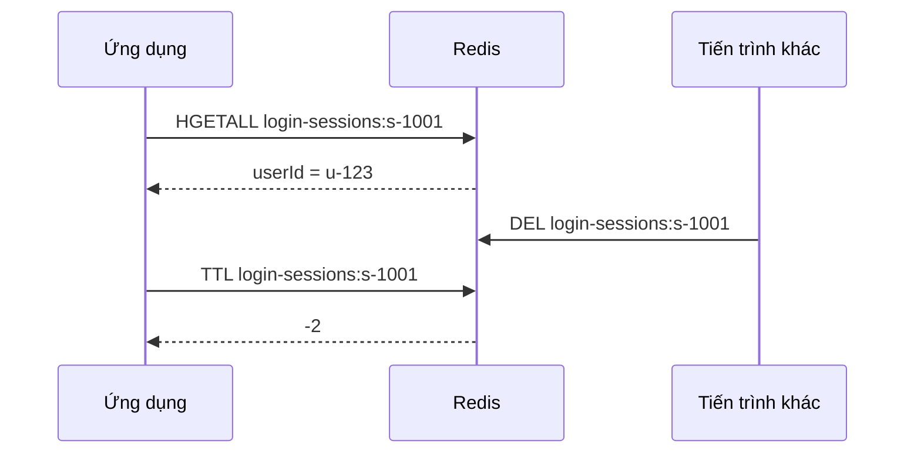

# Đọc TTL còn lại và phân biệt với giá trị cấu hình ban đầu

Trong **Spring Data Redis**, thời gian sống (*Time To Live*, TTL) thường được dùng để tự động xóa session, mã xác thực, giỏ hàng tạm hoặc một thực thể chỉ có hiệu lực trong thời gian giới hạn. Ví dụ, một phiên đăng nhập được cấu hình sống **30 phút**. Mười phút sau khi lưu, câu hỏi “phiên này còn sống bao lâu?” phải được trả lời bằng thời gian còn lại ở Redis, không phải bằng con số **30 phút** trong cấu hình.

Điều này đặc biệt quan trọng khi làm việc với **Redis Repository**: `@RedisHash(timeToLive = ...)` thể hiện chính sách TTL của thực thể, còn `@TimeToLive` đặt trên **thuộc tính** có thể được Spring Data Redis điền bằng TTL thực tế lúc đọc đối tượng. Bài học giải thích hai loại giá trị, cách truy vấn chúng, ý nghĩa các giá trị đặc biệt và cách tránh vô tình gia hạn hoặc làm mất TTL.

## 1. TTL cấu hình ban đầu và TTL còn lại là gì?

Giả sử một `LoginSession` có chính sách tồn tại `1800` giây (30 phút), được lưu vào Redis tại thời điểm `10:00:00`.

| Thời điểm đọc | TTL cấu hình ban đầu | TTL còn lại quan sát ở Redis | Ý nghĩa |
| --- | ---: | ---: | --- |
| Ngay sau khi lưu | 1800 giây | Xấp xỉ 1800 giây | Phiên vừa được tạo |
| Sau 5 phút | 1800 giây | Xấp xỉ 1500 giây | Đồng hồ TTL đang giảm |
| Sau 20 phút | 1800 giây | Xấp xỉ 600 giây | Phiên sắp hết hạn hơn |
| Sau khi hết hạn và khóa biến mất | 1800 giây | `-2` từ `TTL`/`PTTL` | Không còn khóa để tính TTL |

**TTL cấu hình** trả lời câu hỏi: *“Khi ghi/gia hạn, hệ thống định cho đối tượng sống bao lâu?”*

**TTL còn lại** trả lời câu hỏi: *“Tại thời điểm Redis trả lời lệnh, khóa còn bao lâu trước khi hết hạn?”*

```mermaid
timeline
    title Vòng đời ví dụ của một khóa Redis
    10:00 : SAVE session, áp dụng TTL = 1800s
    10:05 : TTL còn khoảng 1500s
    10:20 : TTL còn khoảng 600s
    10:30 : Thời điểm hết hạn dự kiến
```

Ví dụ trên giả định không có thao tác gia hạn, xóa, thay TTL hay ghi đè khóa trong khoảng thời gian đó. Khi có một thao tác làm thay đổi hạn sống, TTL còn lại có thể tăng, giảm đột ngột hoặc trở thành không giới hạn.

Redis quản lý hạn hết hạn của **key**; giá trị TTL là thông tin gắn với khóa chứ không phải một trường đếm ngược được Redis liên tục ghi lại vào hash của thực thể.

## 2. Ba khái niệm cần tách riêng

Khi thiết kế domain hoặc API, nên phân biệt:

| Khái niệm | Ví dụ | Nguồn dữ liệu thường dùng | Có thay đổi theo thời gian? |
| --- | --- | --- | --- |
| **Thời lượng cấu hình** (*configured TTL*) | `1800s` | `@RedisHash`, cấu hình ứng dụng hoặc một thuộc tính nghiệp vụ | Không đổi chỉ vì thời gian trôi; có thể đổi khi chính sách được cập nhật |
| **Thời gian còn lại** (*remaining TTL*) | `537s` | Redis `TTL`, `PTTL`, `RedisTemplate.getExpire(...)` hoặc `@TimeToLive` property được đọc lại | Có, giảm theo thời gian và thay đổi khi thao tác lên key |
| **Thời điểm hết hạn** (*expiresAt*) | `2030-01-01T10:30:00Z` | Chính sách tạo phiên và timestamp, hoặc cơ chế đọc deadline tại Redis | Là mốc tuyệt đối, có thể thay đổi khi gia hạn |

Hai phiên có thể cùng TTL cấu hình `1800s` nhưng TTL còn lại khác nhau do được tạo ở những thời điểm khác nhau. Ngược lại, một phiên được gia hạn có thể có TTL còn lại lớn hơn giá trị mà ứng dụng từng đọc trước đó.

Không được dùng phép so sánh `remainingTtl == configuredTtl` để quyết định “phiên mới” hay “phiên cũ”: chênh lệch thời gian khi truyền lệnh, độ phân giải giây và gia hạn khiến kết quả không ổn định.

## 3. Cấu hình TTL cho một thực thể Redis Repository

Spring Data Redis có một số cơ chế cấu hình thời gian sống. Mỗi cơ chế phục vụ một mục đích khác nhau.

### 3.1. `@RedisHash(timeToLive = ...)`: TTL theo loại thực thể

```java
package com.example.auth.redis;

import org.springframework.data.annotation.Id;
import org.springframework.data.redis.core.RedisHash;

@RedisHash(value = "login-sessions", timeToLive = 1800)
public class LoginSession {

    @Id
    private String id;

    private String userId;

    public LoginSession() {
    }

    public LoginSession(String id, String userId) {
        this.id = id;
        this.userId = userId;
    }

    public String getId() {
        return id;
    }

    public void setId(String id) {
        this.id = id;
    }

    public String getUserId() {
        return userId;
    }

    public void setUserId(String userId) {
        this.userId = userId;
    }
}
```

`timeToLive = 1800` biểu thị **1800 giây**. Khi lưu một aggregate qua Spring Data Redis Repository, cơ chế repository quản lý việc áp dụng hạn sống lên khóa của thực thể.

```java
package com.example.auth.redis;

import org.springframework.data.repository.CrudRepository;

public interface LoginSessionRepository
        extends CrudRepository<LoginSession, String> {
}
```

```java
LoginSession session =
        repository.save(new LoginSession("s-1001", "u-123"));
```

Với cấu hình keyspace mặc định, khóa dữ liệu có dạng `login-sessions:s-1001`. Giá trị `1800` là chính sách áp dụng lúc lưu, **không phải** giá trị mà lệnh `findById()` tự cung cấp dưới dạng bộ đếm TTL còn lại.

### 3.2. `@TimeToLive` trên thuộc tính: TTL theo từng đối tượng

Khi mỗi thực thể có thời gian sống khác nhau, đặt `@TimeToLive` trên thuộc tính số:

```java
package com.example.auth.redis;

import org.springframework.data.annotation.Id;
import org.springframework.data.redis.core.RedisHash;
import org.springframework.data.redis.core.TimeToLive;

@RedisHash("access-tokens")
public class AccessToken {

    @Id
    private String id;

    private String ownerId;

    // Dữ liệu nghiệp vụ độc lập: thời lượng được cấp lúc tạo token.
    private long configuredTtlSeconds;

    // Giá trị đặt khi save; được cập nhật thành TTL thực tế khi load.
    @TimeToLive
    private Long ttlSeconds;

    public AccessToken() {
    }

    public AccessToken(String id, String ownerId, long configuredTtlSeconds) {
        this.id = id;
        this.ownerId = ownerId;
        this.configuredTtlSeconds = configuredTtlSeconds;
        this.ttlSeconds = configuredTtlSeconds;
    }

    public String getId() {
        return id;
    }

    public void setId(String id) {
        this.id = id;
    }

    public String getOwnerId() {
        return ownerId;
    }

    public void setOwnerId(String ownerId) {
        this.ownerId = ownerId;
    }

    public long getConfiguredTtlSeconds() {
        return configuredTtlSeconds;
    }

    public void setConfiguredTtlSeconds(long configuredTtlSeconds) {
        this.configuredTtlSeconds = configuredTtlSeconds;
    }

    public Long getTtlSeconds() {
        return ttlSeconds;
    }

    public void setTtlSeconds(Long ttlSeconds) {
        this.ttlSeconds = ttlSeconds;
    }
}
```

Trong ví dụ, `configuredTtlSeconds` là thuộc tính domain bình thường, được lưu để biết **thời lượng đã cấp ban đầu**. `ttlSeconds` là thuộc tính có `@TimeToLive`, có hai ý nghĩa gắn với thao tác:

1. **Trước khi `save()`**: ứng dụng đặt thời lượng cần áp dụng. Ví dụ `900` giây để tạo token sống 15 phút.
2. **Sau khi `findById()`**: Spring Data Redis đọc TTL/ PTTL từ Redis và điền thời gian **còn lại** vào thuộc tính được đánh dấu, theo đơn vị khai báo. Vì vậy giá trị được đọc sau một thời gian có thể còn `830`, `600` hoặc `-1`.

Điều này có nghĩa **cùng một thuộc tính có thể chứa giá trị cấu hình ở phía ghi và giá trị đang giảm ở phía đọc**. Chính vì vậy ví dụ giữ `configuredTtlSeconds` trong một trường riêng. Không nên thiết kế một trường tên `initialTtl` nhưng lại gắn `@TimeToLive` rồi giả định trường ấy luôn giữ được giá trị ban đầu.

`@TimeToLive` có đơn vị mặc định là `TimeUnit.SECONDS`. Nếu muốn mili giây:

```java
@TimeToLive(unit = java.util.concurrent.TimeUnit.MILLISECONDS)
private Long ttlMillis;
```

Khi đó toàn bộ các giá trị do ứng dụng đặt và đọc ở trường này phải được hiểu là **mili giây**. Chú ý quy đổi khi hiển thị hoặc tính toán; một con số `3000` có thể là 3 giây hoặc 50 phút tùy đơn vị.

**Thứ tự ưu tiên:** thuộc tính được đánh dấu `@TimeToLive` là cấu hình TTL cho riêng aggregate và có ưu tiên hơn cấu hình thời gian sống của keyspace hay `@RedisHash(timeToLive=...)`. Để tránh gây hiểu nhầm, nên dùng một cơ chế chủ đạo cho mỗi mô hình thực thể.

### 3.3. `@TimeToLive` trên phương thức

Spring Data Redis cũng cho phép khai báo TTL qua phương thức:

```java
@RedisHash("temporary-reports")
public class TemporaryReport {

    @Id
    private String id;

    private String content;

    @TimeToLive
    public long getTimeToLive() {
        return 600; // Cấp TTL 10 phút khi repository lấy giá trị để lưu.
    }

    // Constructors, getters/setters khác...
}
```

Cách này phù hợp nếu TTL là kết quả của quy tắc tính toán trong đối tượng. Tuy nhiên **cơ chế đọc ngược TTL thực tế được Spring Data Redis mô tả rõ cho `@TimeToLive` đặt trên thuộc tính**, không nên hiểu phương thức luôn trả về `600` như một phép truy vấn TTL còn lại.

Không khai báo `@TimeToLive` đồng thời ở một thuộc tính và một phương thức trong cùng class.

## 4. Đọc TTL còn lại trực tiếp trong Redis

Redis cung cấp hai lệnh chính:

```redis
TTL login-sessions:s-1001
PTTL login-sessions:s-1001
```

| Lệnh | Đơn vị trả về | Mục đích |
| --- | --- | --- |
| `TTL key` | Giây | Hiển thị thời gian còn lại ở độ phân giải giây |
| `PTTL key` | Mili giây | Hiển thị thời gian còn lại ở độ phân giải mili giây |

Ví dụ thao tác từ Redis CLI:

```redis
SET demo:ttl "hello" EX 60
TTL demo:ttl
# Ví dụ: (integer) 59

PTTL demo:ttl
# Ví dụ: (integer) 58970
```

Giá trị thực tế thay đổi theo thời điểm gọi lệnh. Trả về `59` thay vì `60` không có nghĩa cấu hình ban đầu sai.

### 4.1. Phải phân biệt `-1`, `-2` và `0`

Các lệnh `TTL` và `PTTL` trả về ba nhóm kết quả:

| Giá trị Redis trả về | Diễn giải | Ứng dụng nên làm gì? |
| --- | --- | --- |
| `>= 0` | Key tồn tại và có expiration; số là thời gian còn lại ở đơn vị của lệnh | Hiển thị thời gian còn lại; `0` vẫn là một giá trị hợp lệ |
| `-1` | Key tồn tại nhưng **không có expiration** | Hiển thị “không có hạn hết”, kiểm tra nếu chính sách yêu cầu TTL |
| `-2` | Key **không tồn tại** | Phân biệt với khóa tồn tại nhưng sống vô hạn; xử lý như missing/not found |

`0` **không đồng nghĩa** key đã biến mất: với lệnh `TTL`, khóa có thể còn một phần giây và vẫn tồn tại khi Redis trả về `0`. Phải dựa trên `-2` để biết Redis báo khóa không tồn tại tại thời điểm truy vấn.

Ví dụ minh họa:

```redis
SET demo:persistent "hello"
TTL demo:persistent
# (integer) -1

TTL demo:missing
# (integer) -2

EXPIRE demo:persistent 20
TTL demo:persistent
# Giá trị không âm, xấp xỉ 20

PERSIST demo:persistent
TTL demo:persistent
# (integer) -1
```

`PERSIST` xóa thời hạn hết của khóa, không xóa dữ liệu. Ngược lại, `DEL` xóa hẳn khóa; một lần đọc `TTL` sau khi khóa không còn sẽ thấy `-2`.

### 4.2. TTL không phải số giây chính xác cố định cho mọi lần đọc

Trong thực tế, các lệnh đi qua mạng, có thời gian xử lý và Redis thực thi theo một thứ tự nhất định. Do vậy:

```text
10:00:00  EXPIRE key 1800
10:00:02  TTL key -> khoảng 1798
10:00:03  PTTL key -> khoảng 1797000
```

Không nên viết điều kiện nghiệp vụ kiểu `TTL phải luôn bằng 1800 ngay sau save`, hay bắt buộc hai lần `TTL` liên tiếp khác nhau đúng một đơn vị. Hãy dùng so sánh theo khoảng hợp lý nếu cần hiển thị hoặc kiểm chứng thời gian sống.

## 5. Đọc TTL còn lại bằng Spring Data Redis

`RedisTemplate` và `StringRedisTemplate` cung cấp:

```java
Long seconds = redisTemplate.getExpire(key);
Long milliseconds = redisTemplate.getExpire(
        key, java.util.concurrent.TimeUnit.MILLISECONDS);
```

Lệnh đầu cho biết thời gian sống còn lại theo **giây**; lệnh thứ hai yêu cầu đơn vị **mili giây**. Giá trị này đọc từ Redis tại lúc thực hiện, hoàn toàn độc lập với việc ứng dụng đang nhớ thời lượng cấu hình ban đầu là bao nhiêu.

Trong ví dụ sau, dữ liệu `LoginSession` lưu qua Redis Repository mặc định, còn `StringRedisTemplate` dùng để kiểm tra TTL của **khóa aggregate** `login-sessions:<id>`:

```java
package com.example.auth.redis;

import java.util.concurrent.TimeUnit;
import org.springframework.data.redis.core.StringRedisTemplate;
import org.springframework.stereotype.Service;

@Service
public class LoginSessionTtlService {

    private final StringRedisTemplate redis;

    public LoginSessionTtlService(StringRedisTemplate redis) {
        this.redis = redis;
    }

    public TtlInfo readTtl(String sessionId) {
        String key = "login-sessions:" + sessionId;
        Long ttlSeconds = redis.getExpire(key, TimeUnit.SECONDS);

        // Null có thể được trả về trong pipeline/transaction.
        if (ttlSeconds == null) {
            throw new IllegalStateException(
                    "TTL result is unavailable in this execution context");
        }

        if (ttlSeconds == -2L) {
            return new TtlInfo(TtlState.MISSING, null);
        }
        if (ttlSeconds == -1L) {
            return new TtlInfo(TtlState.PERSISTENT, null);
        }
        return new TtlInfo(TtlState.EXPIRING, ttlSeconds);
    }

    public enum TtlState {
        MISSING,
        PERSISTENT,
        EXPIRING
    }

    public record TtlInfo(TtlState state, Long remainingSeconds) {
    }
}
```

Ví dụ sử dụng:

```java
LoginSessionTtlService.TtlInfo ttl =
        ttlService.readTtl("s-1001");

switch (ttl.state()) {
    case MISSING -> System.out.println("Session không tồn tại");
    case PERSISTENT -> System.out.println("Session không có TTL");
    case EXPIRING -> System.out.println(
            "Còn " + ttl.remainingSeconds() + " giây");
}
```

Điểm đáng chú ý:

- Không lấy `1800` từ `@RedisHash` để giả làm TTL còn lại.
- `getExpire(...)` trả về `Long`, có thể là `-1` hoặc `-2`; không sử dụng `Duration.ofSeconds(-1)` để mô tả “không hết hạn” vì đó là một trạng thái, không phải một khoảng thời gian âm.
- Kết quả `null` **không cùng nghĩa** với `-2`. Trong bối cảnh pipeline hoặc transaction, Spring Data Redis có thể chưa có kết quả trực tiếp tại nơi gọi; cần xử lý ở nơi thu thập kết quả pipeline/transaction.
- Với cấu hình repository mặc định, khóa aggregate thường có dạng `keyspace:id`; nếu ứng dụng tùy chỉnh keyspace, converter hoặc serializer, phải xác định **đúng khóa byte thực tế** và dùng template tương thích. Đọc nhầm key có thể trả `-2` dù aggregate tồn tại dưới khóa khác.
- Đọc TTL không khóa thực thể. Ngay sau câu lệnh, phiên có thể được gia hạn, bị xóa hoặc hết hạn.

### 5.1. Kết hợp đọc Repository và `getExpire(...)`

Giả sử ứng dụng cần hiển thị thông tin phiên kèm TTL:

```java
public record SessionView(
        String sessionId,
        String userId,
        LoginSessionTtlService.TtlInfo ttl) {
}

public Optional<SessionView> findSessionView(String id) {
    return repository.findById(id).map(session ->
            new SessionView(
                    session.getId(),
                    session.getUserId(),
                    ttlService.readTtl(session.getId())));
}
```

Trong ví dụ trên, `repository` là `LoginSessionRepository` và `ttlService` là `LoginSessionTtlService` được inject vào service chứa phương thức.

Hai lần đọc **không nguyên tử**. Có thể `findById` thấy entity nhưng lệnh `getExpire` tiếp theo trả `MISSING` do khóa vừa hết hạn. Đây là trạng thái hợp lệ trong hệ thống đồng thời. Một API cần độ chính xác nhất quán tuyệt đối giữa nội dung entity và deadline phải có thiết kế đọc nguyên tử hoặc version/snapshot phù hợp, thay vì suy diễn rằng hai lời gọi độc lập luôn thuộc cùng một thời điểm.

## 6. Đọc TTL qua thuộc tính `@TimeToLive` của Repository

Đây là điểm khác biệt quan trọng so với `@RedisHash(timeToLive = ...)`: khi một **thuộc tính** được đánh dấu `@TimeToLive`, Spring Data Redis điền TTL thực tế lúc tải aggregate từ Redis.

Với class `AccessToken` ở trên:

```java
package com.example.auth.redis;

import org.springframework.data.repository.CrudRepository;

public interface AccessTokenRepository
        extends CrudRepository<AccessToken, String> {
}
```

Ví dụ tạo token sống 15 phút:

```java
AccessToken created = new AccessToken(
        "token-abc",
        "u-123",
        900
);
tokenRepository.save(created);
```

Sau một khoảng thời gian, đọc lại bằng repository:

```java
AccessToken loaded = tokenRepository.findById("token-abc")
        .orElseThrow();

System.out.println(loaded.getConfiguredTtlSeconds());
// 900: thời lượng nghiệp vụ đã cấp ban đầu

System.out.println(loaded.getTtlSeconds());
// Ví dụ 820: TTL thực tế còn lại tại thời điểm load
```

Con số `820` chỉ là minh họa; không thể biết trước giá trị chính xác. Sự khác biệt giữa hai trường là chủ đích:

```text
configuredTtlSeconds = 900       // không tự giảm theo thời gian
ttlSeconds           = 820       // được lấp bằng TTL còn lại khi load
```

**Không phải mọi `findById` đều tạo ra một object có giá trị TTL dương.** Nếu key còn tồn tại nhưng không còn expiration, trường `@TimeToLive` có thể nhận `-1` theo hợp đồng ánh xạ của Spring Data Redis. Nếu key đã bị xóa/hết hạn, repository thường trả `Optional.empty()`; không có aggregate để gán một trường TTL bằng `-2`.

Với `@TimeToLive(unit = TimeUnit.MILLISECONDS)`, giá trị đọc sẽ có độ phân giải mili giây. Chọn đơn vị theo yêu cầu nghiệp vụ và thống nhất trong cả cách gán trước khi lưu lẫn cách hiển thị sau khi đọc.

### 6.1. Trường hợp chỉ dùng TTL cấu hình ở `@RedisHash`

Nếu entity chỉ có:

```java
@RedisHash(value = "login-sessions", timeToLive = 1800)
public class LoginSession {
    @Id
    private String id;
    // ...
}
```

thì gọi:

```java
LoginSession s = repository.findById("s-1001").orElseThrow();
```

sẽ lấy dữ liệu của entity, nhưng class **không tự xuất hiện một thuộc tính `remainingTtlSeconds`**. Muốn biết thời gian còn lại, ứng dụng cần đọc Redis TTL qua `getExpire(...)` hoặc thiết kế class có thuộc tính `@TimeToLive` và hiểu cách cơ chế đó tương tác với cấu hình TTL.

## 7. Điều gì xảy ra khi lưu lại một entity đã đọc?

Đây là bẫy phổ biến của TTL động.

```text
10:00  Tạo token có @TimeToLive ttlSeconds = 900
10:05  findById(...) đọc lại, ttlSeconds khoảng 600
10:06  Ứng dụng sửa một trường khác rồi save(loaded)
```

Nếu `loaded.getTtlSeconds()` vẫn chứa thời gian **còn lại** khi đọc, repository sử dụng giá trị ấy để áp dụng hạn sống khi lưu. Trong trường hợp này, hành vi của `save` **không tự biết** rằng TTL ban đầu là `900` nếu ứng dụng không chủ động đặt lại `900`.

Điểm cần quyết định:

| Yêu cầu nghiệp vụ | Cách quản lý TTL |
| --- | --- |
| Chỉ muốn đọc TTL để hiển thị | Đọc `getExpire` hoặc `@TimeToLive` property, không lưu lại entity chỉ để “đọc TTL” |
| Muốn mỗi lần gia hạn cấp lại đủ 15 phút | Đặt rõ thời lượng mong muốn trước khi lưu, ví dụ `token.setTtlSeconds(900L)` |
| Muốn hạn cố định theo thời điểm tạo, không kéo dài do cập nhật | Lưu `expiresAt` độc lập và tính thời lượng còn lại tại lúc ghi; không tự động dùng lại TTL ban đầu |
| Chỉ muốn chỉnh sửa một trường mà không đổi hạn sống | Thiết kế đường cập nhật giữ nguyên expire/deadline, tránh mặc định rằng `save()` của repository luôn bảo toàn deadline tuyệt đối |

Ví dụ gia hạn chủ động:

```java
public AccessToken renewToken(
        AccessTokenRepository tokens,
        String id) {

    AccessToken token = tokens.findById(id)
            .orElseThrow(() ->
                    new IllegalArgumentException("Token not found: " + id));

    long grantedSeconds = token.getConfiguredTtlSeconds();
    if (grantedSeconds <= 0) {
        throw new IllegalStateException("Invalid configured token TTL");
    }

    // Đây là hành động gia hạn có chủ đích, không phải đọc TTL.
    token.setTtlSeconds(grantedSeconds);
    return tokens.save(token);
}
```

Ngược lại, không nên gia hạn toàn bộ TTL nếu chính sách yêu cầu token hết hạn không thể kéo dài. Khi đó dùng thời điểm hết hạn cố định hoặc một token bất biến sẽ dễ bảo vệ hợp đồng hơn.

**Cảnh báo đồng thời:** ví dụ `findById` rồi `save` có thể gặp race condition nếu một tiến trình khác vừa xóa, gia hạn hoặc tạo lại key cùng ID. Với session/token có yêu cầu bảo mật cao, cần định danh thế hệ, kiểm tra phiên bản và thao tác nguyên tử phù hợp trước khi cho phép gia hạn; không dùng đoạn mã đơn giản này làm cơ chế xác thực hoàn chỉnh.

## 8. TTL còn lại không đồng nghĩa với “tuổi” hoặc “giá trị cấu hình”

Giả sử `configuredTtlSeconds = 1800`, TTL hiện tại `2000` giây. Điều đó có nhất thiết là lỗi không?

Không. Có nhiều khả năng:

- Một thao tác gia hạn đã đặt thời gian sống dài hơn chính sách gốc.
- Cấu hình đã được đổi từ phiên bản trước.
- Redis được cập nhật qua một luồng khác hoặc bằng lệnh `EXPIRE`/`PEXPIRE`.
- Ứng dụng đọc sai key hoặc so sánh các đơn vị khác nhau.

Tương tự, nếu TTL hiện tại là `-1` thì Redis báo **khóa đang tồn tại và không có hạn hết**; không có nghĩa “còn âm một giây”. TTL `-2` nghĩa là **không tồn tại khóa** vào lúc lệnh chạy; không nói rõ khóa từng tồn tại rồi hết hạn hay chưa bao giờ được tạo.

Một bộ trường API dễ hiểu có thể là:

```json
{
  "sessionId": "s-1001",
  "configuredTtlSeconds": 1800,
  "ttlState": "EXPIRING",
  "remainingTtlSeconds": 742
}
```

Khi không có expiration, có thể trả `ttlState: "PERSISTENT"` và `remainingTtlSeconds: null`. Khi không tìm thấy, trả `ttlState: "MISSING"` và giá trị thời lượng cũng là `null` hoặc phản hồi `404` theo hợp đồng API. Cách biểu diễn này tránh bắt frontend giải mã hai số âm đặc biệt.

### 8.1. “Thời điểm hết hạn” là một trường hợp khác

Nếu nghiệp vụ cần báo “phiên sẽ hết hạn vào lúc nào”, một bản ghi `expiresAt` có thể được tính từ `createdAt + configuredTtl` tại thời điểm cấp quyền. Nhưng nếu ứng dụng cho phép gia hạn hoặc quản trị viên thay TTL trực tiếp trong Redis, deadline được lưu riêng có thể trở thành **không khớp** với TTL thực tế.

Redis hiện đại cũng có các lệnh `EXPIRETIME` và `PEXPIRETIME` để đọc timestamp hết hạn của khóa. Khi sử dụng deadline, vẫn phải quy định rõ **nguồn sự thật**: chính sách nghiệp vụ, deadline đã lưu hay deadline đang có trong Redis.

## 9. Các thao tác Redis có thể làm TTL thay đổi

Đọc TTL đúng còn đòi hỏi hiểu những thao tác có thể giữ nguyên, thay mới hoặc xóa thời hạn.

| Thao tác | Ảnh hưởng đến TTL của key |
| --- | --- |
| `EXPIRE key 600` | Đặt một TTL mới 600 giây nếu thao tác thành công |
| `PEXPIRE key 1500` | Đặt TTL mới 1500 mili giây |
| `PERSIST key` | Bỏ expiration; nếu key vẫn tồn tại, `TTL` trở thành `-1` |
| `DEL key` hoặc key hết hạn | Key không còn; `TTL` trả `-2` |
| `SET key value` ghi đè giá trị | Thông thường làm mất TTL hiện có trừ khi sử dụng tùy chọn giữ TTL phù hợp |
| `HSET key field value` trên hash còn tồn tại | Cập nhật trường trong hash, thông thường không xóa TTL của key |
| `RENAME old new` | TTL gắn với key được chuyển cùng dữ liệu sang tên mới |
| `repository.save(entity)` | Repository áp dụng quy tắc TTL/mapping của thực thể tại lần lưu này; cần chú ý TTL động hoặc TTL cấu hình |

Ví dụ minh họa sự khác nhau giữa thay giá trị và sửa trường:

```redis
SET demo:string "old" EX 60
TTL demo:string
# Giá trị dương

SET demo:string "new"
TTL demo:string
# -1: SET đã thay giá trị và xóa expiration
```

```redis
HSET demo:hash name "old"
EXPIRE demo:hash 60
HSET demo:hash name "new"
TTL demo:hash
# Thường vẫn có TTL đang giảm
```

Với Redis Repository, không nên tự chỉnh sửa hash và các key phụ trợ nếu không hiểu cơ chế index và expiration của repository. Một lệnh Redis trực tiếp không tương đương việc cập nhật aggregate qua repository.

## 10. TTL của aggregate khác TTL của khóa phụ trợ Repository

Spring Data Redis Repository có thể tạo các khóa phụ để quản lý keyspace, secondary index hoặc phục vụ thông báo hết hạn.

Khi aggregate có expiration dương, Spring Data Redis có thể tạo một **bản sao tạm (shadow/phantom copy)** và giữ bản sao này thêm một khoảng thời gian sau khi bản gốc hết hạn, nhằm phục vụ `RedisKeyExpiredEvent`. Cơ chế này phụ thuộc cấu hình repository; có thể được điều chỉnh khi không cần dữ liệu payload của sự kiện.

Vì vậy, khi kiểm tra TTL:

1. Xác định đúng **key của aggregate chính**, ví dụ `login-sessions:s-1001`.
2. Không lấy TTL của index, metadata hoặc shadow copy rồi kết luận đó là thời gian còn lại của session.
3. Khi khóa chính đã hết hạn, `repository.findById(...)` có thể trả rỗng dù Redis vẫn có một số khóa phụ trợ mang tiền tố tương tự.

Một `KEYS login-sessions:*` có thể thấy nhiều khóa và không phải cách đáng tin cậy để suy ra TTL của một entity. Với ứng dụng thực tế, ưu tiên xây dựng key của aggregate theo quy ước mapping hoặc có API repository/service chuyên trách; tránh quét toàn keyspace chỉ để kiểm tra một ID.

TTL trên toàn bộ Redis key cũng khác với cơ chế expiration của **một field bên trong hash** nếu hệ thống đang dùng khả năng hash-field expiration ở các phiên bản Redis hỗ trợ. Những ví dụ `@RedisHash` ở bài này tập trung vào hạn sống của **aggregate key**, không phải một TTL riêng cho từng thuộc tính Java.

## 11. Độ chính xác, thời điểm đọc và race condition

### 11.1. TTL là một ảnh chụp rất ngắn

Một phản hồi `remainingTtlSeconds = 30` chỉ có nghĩa Redis đã trả ra 30 giây tại thời điểm lệnh chạy. Khi HTTP response đến trình duyệt, con số có thể không còn là 30.

Đối với giao diện đếm ngược, có thể truyền `remainingTtlMillis` cùng `observedAt` hoặc `expiresAt` phù hợp với nguồn thời gian. Trình duyệt đếm tiếp tại chỗ để giảm số lần gọi server; khi người dùng thực hiện hành động quan trọng, server vẫn phải kiểm tra trạng thái thật.

### 11.2. Đọc dữ liệu và TTL là hai lệnh riêng biệt



Ứng dụng thấy entity khi đọc nhưng thấy `MISSING` khi hỏi TTL. Đây không nhất thiết là lỗi: hai lệnh đã quan sát Redis ở hai thời điểm khác nhau.

Nếu cần xác thực phiên hoặc quyền truy cập, không nên đưa ra quyết định dựa trên TTL đã đọc nhiều giây trước đó. Cần kiểm tra tính hợp lệ trong thao tác nghiệp vụ hiện tại, hoặc dùng cơ chế nguyên tử khi quyết định phải đồng bộ với cập nhật dữ liệu.

### 11.3. Kết quả từ Redis là nguồn sự thật cho TTL hiện tại

Cấu hình Spring hoặc thuộc tính `configuredTtlSeconds` cho biết chính sách ban đầu. Nếu một thao tác khác đã gọi `EXPIRE`, `PERSIST` hoặc thay key, thì trạng thái Redis có thể khác hoàn toàn. Muốn biết thời gian **thực sự còn lại**, phải hỏi Redis hoặc sử dụng giá trị `@TimeToLive` vừa được ánh xạ từ Redis, đồng thời chấp nhận rằng giá trị ấy tiếp tục thay đổi theo thời gian.

## 12. Lựa chọn thiết kế theo nghiệp vụ

| Nhu cầu | Cách thực hiện phù hợp |
| --- | --- |
| Toàn bộ entity có cùng hạn sống 30 phút | `@RedisHash(timeToLive = 1800)` |
| Mỗi entity có hạn sống khác nhau | Thuộc tính `@TimeToLive` với thời lượng theo từng entity |
| Cần biết hạn sống còn lại khi lấy entity bằng repository | `@TimeToLive` trên **thuộc tính** hoặc truy vấn `getExpire(...)` tường minh |
| Cần giữ lịch sử thời lượng đã cấp | Thuộc tính `configuredTtlSeconds`/metadata chính sách **riêng**, không gắn `@TimeToLive` |
| Cần kiểm tra TTL mà không tải toàn bộ entity | `RedisTemplate.getExpire(key)` |
| Cần phân biệt key vắng mặt và key sống vô hạn | Giải mã `-2` và `-1` thành hai trạng thái khác nhau |
| Cần thời gian có độ phân giải cao | `PTTL` hoặc `getExpire(key, TimeUnit.MILLISECONDS)` |
| Cần gia hạn theo hoạt động người dùng | Định nghĩa rõ chính sách sliding expiration và áp dụng TTL mới có chủ đích |
| Cần hết hạn cố định, không được gia hạn ngầm | Quản lý deadline/version và tránh đường lưu lại tự động reset TTL |

Không có một annotation duy nhất vừa bảo toàn cấu hình ban đầu, vừa cung cấp thời gian còn lại biến động, vừa bảo đảm deadline bất biến trong mọi lần ghi. Mỗi yêu cầu cần một hợp đồng dữ liệu rõ ràng.

## 13. Những lỗi thường gặp

### Lỗi 1: Dùng `@RedisHash(timeToLive=...)` để hiển thị số giây còn lại

```java
// Sai về mặt ý nghĩa: đây là TTL cấu hình của class.
long remaining = 1800;
```

Giá trị `1800` mô tả chính sách, không phản ánh thời gian đã trôi. Để hiển thị thời gian còn lại, dùng `getExpire(...)` hoặc thuộc tính được ánh xạ từ Redis bằng `@TimeToLive`.

### Lỗi 2: Coi `-1` là “đã hết hạn”

Trong Redis, `-1` nghĩa là **key tồn tại nhưng không có expire**; `-2` mới là **key không tồn tại**. Nếu hệ thống trông đợi session tự hết hạn mà lại thấy `-1`, hãy kiểm tra chính sách áp dụng TTL, các thao tác `SET`/`PERSIST`, serialization và đúng key đang đọc.

### Lỗi 3: Coi TTL bằng `0` là không còn key

TTL theo giây có thể trả về `0` khi khóa còn thời gian rất ngắn. Đừng dùng `ttl <= 0` làm điều kiện chung cho “không tồn tại”, vì sẽ gộp cả `0`, `-1`, `-2` thành một tình trạng sai. Nên phân loại bằng các mã đặc biệt trước, rồi mới xử lý giá trị `>= 0`.

### Lỗi 4: Nhầm giây và mili giây

```java
Long seconds = redis.getExpire(key); // Giây
Long millis = redis.getExpire(key, TimeUnit.MILLISECONDS); // Mili giây
```

Đặt tên biến theo đơn vị và tránh tự nhân/chia nếu framework đã quy đổi. Một TTL `5000` với `@TimeToLive(unit = MILLISECONDS)` chỉ tương đương 5 giây.

### Lỗi 5: Đọc trường `@TimeToLive` sau khi load và cho rằng đó là thời lượng đã cấp lúc tạo

Spring Data Redis cập nhật thuộc tính `@TimeToLive` bằng TTL thực tế khi đọc. Nếu cần audit thời lượng ban đầu, lưu thông tin đó riêng hoặc lưu chính sách/version ở hệ thống phù hợp.

### Lỗi 6: Save một thực thể đã load mà không xét TTL

Trường `@TimeToLive` có thể đang chứa số giây còn lại. Khi `save`, đó là một giá trị timeout có ý nghĩa. Hãy quyết định rõ cần giữ hạn cố định, gia hạn theo policy hay dùng TTL hiện có; đừng để hành vi hết hạn trở thành hệ quả ngầm của thao tác sửa tên hoặc metadata.

### Lỗi 7: Nhìn thấy khóa phụ và tưởng entity vẫn tồn tại

Repository có thể có index và shadow copy phục vụ expiration event. Đọc TTL phải nhắm vào khóa aggregate chính; trạng thái của khóa phụ không chứng minh object vẫn còn truy cập được qua repository.

### Lỗi 8: `getExpire(...)` trả `null` rồi giải thích như `-2`

Trong Spring Data Redis, `null` có thể xảy ra khi gọi trong pipeline/transaction và không phải mã trạng thái Redis. Khi thực thi thông thường, hãy dùng `-1`/`-2` để diễn giải ý nghĩa từ Redis; còn `null` phải được xử lý theo ngữ cảnh thực thi.

## 14. Thực hành quan sát TTL thay đổi

Có thể thử trực tiếp trên một Redis dùng cho học tập:

```redis
SET lesson:ttl "value" EX 15
TTL lesson:ttl
PTTL lesson:ttl
```

Chờ vài giây rồi gọi lại:

```redis
TTL lesson:ttl
PTTL lesson:ttl
```

Kết quả sẽ giảm dần. Tiếp đó, gia hạn:

```redis
EXPIRE lesson:ttl 60
TTL lesson:ttl
```

Thời gian còn lại lại xấp xỉ 60 giây: Redis đã cập nhật hạn sống hiện tại. Thử bỏ expiration:

```redis
PERSIST lesson:ttl
TTL lesson:ttl
# -1
```

Cuối cùng, xóa key:

```redis
DEL lesson:ttl
TTL lesson:ttl
# -2
```

Các thao tác minh họa trên một key độc lập giúp hiểu TTL Redis. Khi làm việc với entity thật của Redis Repository, dùng repository và cấu hình TTL của entity để lưu/xóa, tránh tự sửa các khóa index hoặc shadow copy.

## 15. Tổng kết

**Giá trị cấu hình ban đầu** là thời lượng được chọn khi tạo hoặc gia hạn thực thể. **TTL còn lại** là trạng thái hiện tại mà Redis trả về tại thời điểm đọc. Với Spring Data Redis:

1. `@RedisHash(timeToLive = ...)` đặt thời lượng sống mặc định cho aggregate.
2. `@TimeToLive` trên thuộc tính đặt timeout theo từng entity và được Spring Data Redis cập nhật bằng TTL còn lại khi đọc entity.
3. `RedisTemplate.getExpire(...)` hoặc Redis `TTL`/`PTTL` đọc TTL hiện tại mà không cần suy ra từ annotation.
4. `-1` nghĩa là khóa tồn tại nhưng không hết hạn; `-2` nghĩa là khóa không tồn tại; `0` vẫn có thể là khóa còn sống trong một khoảng rất ngắn.
5. Nếu cần cả thời lượng ban đầu lẫn thời gian còn lại, hãy quản lý chúng thành hai thông tin độc lập và xác định rõ quy tắc khi lưu lại hoặc gia hạn.

Hiểu được sự khác nhau này giúp ứng dụng hiển thị đồng hồ đếm ngược đúng, tránh gia hạn session ngoài ý muốn và giải thích chính xác những trường hợp TTL không giống giá trị đã khai báo.

### Tài liệu tham khảo

- [Spring Data Redis — Time To Live](https://docs.spring.io/spring-data/redis/reference/redis/redis-repositories/expirations.html): `@RedisHash(timeToLive)`, `@TimeToLive` và cách đọc ngược TTL thực tế.
- [Spring Data Redis — `@TimeToLive` API](https://docs.spring.io/spring-data/redis/reference/api/java/org/springframework/data/redis/core/TimeToLive.html): đơn vị đo và độ ưu tiên của thuộc tính TTL.
- [Spring Data Redis — `RedisOperations` API](https://docs.spring.io/spring-data/redis/reference/api/java/org/springframework/data/redis/core/RedisOperations.html): `getExpire(key)` và `getExpire(key, TimeUnit)`.
- [Redis — TTL](https://redis.io/docs/latest/commands/ttl/): thời gian sống còn lại theo giây và các mã trả về đặc biệt.
- [Redis — PTTL](https://redis.io/docs/latest/commands/pttl/): thời gian sống còn lại theo mili giây.
- [Redis — EXPIRE](https://redis.io/docs/latest/commands/expire/): đặt TTL, gia hạn và ảnh hưởng của các thao tác thay đổi khóa.
