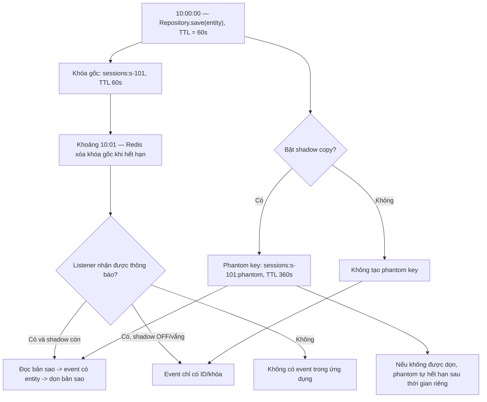

# Cấu hình bật hoặc tắt bản sao phụ và đánh đổi bộ nhớ trong Spring Data Redis

## 1. Bản sao phụ là gì và vì sao xuất hiện khi entity có TTL?

Trong **Spring Data Redis Repository**, entity có thời gian sống (Time To Live – TTL) thường được ánh xạ thành một Redis Hash. Redis tự hết hạn khóa khi TTL kết thúc. Tại thời điểm Redis phát sự kiện `expired`, dữ liệu của khóa gốc đã bị xóa, nên ứng dụng không còn có thể gọi `HGETALL` để lấy lại entity vừa hết hạn.

Để có thể công bố `RedisKeyExpiredEvent` kèm **giá trị của entity đã hết hạn**, Spring Data Redis có cơ chế **shadow copy**, còn được gọi là **phantom copy**: lưu thêm một Redis Hash chứa biểu diễn của entity với thời gian sống dài hơn khóa gốc **5 phút (300 giây)**. Khi listener nhận sự kiện hết hạn của khóa gốc, repository đọc bản sao này để phục hồi giá trị entity cho event và dọn bản sao nếu còn tồn tại.

Ví dụ entity session được lưu với TTL 60 giây:

```text
Thời điểm t = 0:
  sessions:s-101           TTL = 60 giây    (khóa gốc)
  sessions:s-101:phantom   TTL = 360 giây   (bản sao phụ nếu bật)

Khoảng t ≈ 60 giây:
  Redis hết hạn sessions:s-101.
  Redis phát thông báo expired của khóa gốc.
  Listener đang hoạt động -> đọc bản sao phụ -> phát RedisKeyExpiredEvent.
  Nếu đọc được bản sao phụ, listener xóa bản sao ngay sau khi đọc.

Nếu listener không xử lý sự kiện:
  khóa gốc đã hết hạn;
  bản sao phụ có thể tiếp tục tồn tại đến hạn TTL riêng của nó,
  tức khoảng t = 360 giây kể từ lúc lưu.
```

Hậu tố `:phantom` minh họa cách đặt tên khóa trong triển khai Spring Data Redis. **Đừng dùng tên khóa phụ làm hợp đồng nghiệp vụ**: đây là chi tiết nội bộ, có thể thay đổi theo phiên bản và cách ánh xạ.

Điểm quan trọng: bản sao phụ **không phải bản sao dự phòng để khôi phục dữ liệu nghiệp vụ**, không thay thế backup, không ngăn khóa gốc hết hạn và không bảo đảm sự kiện sẽ được nhận. Mục đích của nó là cung cấp **payload của entity** cho sự kiện hết hạn khi listener còn nhận được thông báo từ Redis.

## 2. Phân biệt ba cơ chế dễ bị nhầm

Có ba yếu tố độc lập cần xem xét:

| Cơ chế | Điều khiển | Tác động |
| --- | --- | --- |
| TTL của entity | `@RedisHash(timeToLive = ...)`, `@TimeToLive` hoặc cấu hình keyspace | Quyết định khi nào **khóa gốc** hết hạn. |
| Listener của sự kiện hết hạn | `enableKeyspaceEvents` trong `@EnableRedisRepositories` | Quyết định repository có đăng ký nhận keyspace notifications và phát `RedisKeyExpiredEvent` hay không. |
| Bản sao phụ | `shadowCopy` trong `@EnableRedisRepositories` | Quyết định có lưu thêm một bản của entity có TTL để làm payload sự kiện hay không. |

Từ đó suy ra:

- **Tắt `shadowCopy` không tắt TTL.** Khóa gốc vẫn hết hạn đúng theo chính sách Redis.
- **Tắt `shadowCopy` không nhất thiết tắt event.** Khi listener được bật và nhận thông báo, `RedisKeyExpiredEvent` vẫn có thể được công bố với ID của entity, nhưng không có bản entity đầy đủ.
- **Bật `shadowCopy` không tự bảo đảm có event.** Redis phải phát thông báo hết hạn, listener phải hoạt động và ứng dụng phải còn kết nối.
- **Bật listener không bắt buộc phải lưu bản sao phụ.** Có thể bật nhận sự kiện và tắt shadow copy để giảm chi phí bộ nhớ.

Ví dụ, một hệ thống chỉ cần biết session nào hết hạn để dọn các thông tin liên kết có thể xử lý bằng ID. Ngược lại, một handler cần đọc `userId`, `orderType` hoặc metadata nằm trong entity đã hết hạn có thể cần payload từ bản sao phụ, trừ khi dữ liệu được quản lý ở nguồn bền vững khác.

## 3. Khai báo entity có TTL và repository

Ví dụ entity tạm thời với TTL 60 giây:

```java
import org.springframework.data.annotation.Id;
import org.springframework.data.redis.core.RedisHash;

@RedisHash(value = "sessions", timeToLive = 60)
public class SessionRecord {

    @Id
    private String id;

    private String userId;
    private String deviceId;

    public SessionRecord() {}

    public SessionRecord(String id, String userId, String deviceId) {
        this.id = id;
        this.userId = userId;
        this.deviceId = deviceId;
    }

    public String getId() { return id; }
    public void setId(String id) { this.id = id; }

    public String getUserId() { return userId; }
    public void setUserId(String userId) { this.userId = userId; }

    public String getDeviceId() { return deviceId; }
    public void setDeviceId(String deviceId) { this.deviceId = deviceId; }
}
```

Repository:

```java
import org.springframework.data.repository.CrudRepository;

public interface SessionRecordRepository
        extends CrudRepository<SessionRecord, String> {
}
```

Lưu entity:

```java
repository.save(new SessionRecord("s-101", "u-42", "mobile"));
```

Theo cơ chế TTL của Redis Repository, khóa gốc có TTL 60 giây. **Bản sao phụ có xuất hiện hay không còn tùy cấu hình `shadowCopy` và listener**. Không suy luận rằng chỉ cần đặt `@RedisHash(timeToLive = 60)` thì chắc chắn sẽ có một key `:phantom`.

Ngoài TTL cố định, có thể dùng `@TimeToLive` cho từng entity:

```java
@RedisHash("sessions")
public class SessionRecordWithVariableTtl {

    @Id
    private String id;

    private String userId;

    @TimeToLive
    private Long ttlSeconds;

    // Constructors, getters và setters
}
```

Khi đọc lại một property được đánh dấu `@TimeToLive`, Spring Data Redis có thể đọc TTL/PTTL còn lại từ Redis. Vì thế cần hiểu TTL trên entity là thời gian tính từ thao tác lưu hoặc thời gian còn lại tại lúc đọc, tùy cách khai báo và sử dụng.

## 4. Ba giá trị của `shadowCopy`: `DEFAULT`, `ON`, `OFF`

Spring Data Redis cung cấp enum `RedisKeyValueAdapter.ShadowCopy`:

| Giá trị | Ý nghĩa | Phù hợp khi |
| --- | --- | --- |
| `DEFAULT` | Tự quyết định lưu bản sao phụ dựa trên tình trạng listener sự kiện hết hạn. | Muốn theo hành vi mặc định của repository, đồng bộ với chế độ listener. |
| `ON` | Yêu cầu lưu bản sao phụ cho entity có TTL dương. | Cần payload entity sau khi hết hạn và có listener phù hợp. |
| `OFF` | Không tạo bản sao phụ cho lần ghi mới. | Ưu tiên tiết kiệm bộ nhớ, event chỉ cần ID hoặc không cần payload entity. |

**Lưu ý về mặc định:** `@EnableRedisRepositories` dùng `shadowCopy = DEFAULT`, còn `enableKeyspaceEvents = OFF` theo mặc định API. Vì `DEFAULT` phụ thuộc listener, không nên khẳng định mọi entity có TTL luôn bị nhân đôi khi ứng dụng dùng cấu hình hoàn toàn mặc định.

Về cơ chế, `DEFAULT` giữ bản sao khi listener sự kiện hết hạn đã được khởi tạo. Với `ON_STARTUP`, listener được khởi tạo khi ứng dụng khởi động; với `ON_DEMAND`, listener được khởi tạo khi có lần lưu đầu tiên của entity có TTL dương. Khi listener `OFF`, `DEFAULT` không có lý do tạo bản sao để cung cấp event payload.

### Bật bản sao phụ một cách tường minh

```java
import org.springframework.context.annotation.Configuration;
import org.springframework.data.redis.core.RedisKeyValueAdapter;
import org.springframework.data.redis.repository.configuration.EnableRedisRepositories;

@Configuration
@EnableRedisRepositories(
    basePackages = "com.example.session",
    enableKeyspaceEvents = RedisKeyValueAdapter.EnableKeyspaceEvents.ON_STARTUP,
    shadowCopy = RedisKeyValueAdapter.ShadowCopy.ON
)
public class RedisRepositoryConfig {
}
```

Với cấu hình này, repository tạo shadow copy cho entity hết hạn và listener được yêu cầu hoạt động ngay khi ứng dụng khởi động.

### Tắt bản sao phụ nhưng vẫn nhận sự kiện hết hạn

```java
@Configuration
@EnableRedisRepositories(
    basePackages = "com.example.session",
    enableKeyspaceEvents = RedisKeyValueAdapter.EnableKeyspaceEvents.ON_STARTUP,
    shadowCopy = RedisKeyValueAdapter.ShadowCopy.OFF
)
public class RedisRepositoryConfig {
}
```

Ở đây Redis vẫn hết hạn khóa gốc bình thường. Nếu cấu hình Redis keyspace notifications và listener vận hành đúng, ứng dụng vẫn nhận được `RedisKeyExpiredEvent` với thông tin nhận diện khóa/ID, nhưng **giá trị entity từ bản sao phụ không còn sẵn có**.

### Để Spring tự quyết định

```java
@Configuration
@EnableRedisRepositories(
    basePackages = "com.example.session",
    enableKeyspaceEvents = RedisKeyValueAdapter.EnableKeyspaceEvents.ON_DEMAND,
    shadowCopy = RedisKeyValueAdapter.ShadowCopy.DEFAULT
)
public class RedisRepositoryConfig {
}
```

Chế độ `ON_DEMAND` chỉ khởi tạo listener khi lần đầu lưu entity có TTL dương, thay vì ngay lúc khởi động. Điều này có thể giảm công việc lúc startup nhưng cũng tạo cửa sổ thời gian không có listener, khiến các sự kiện của khóa đã được tạo từ trước không được tiếp nhận.

**Không cấu hình `shadowCopy = ON` cùng listener `OFF` theo thói quen:** dữ liệu bổ sung có thể chiếm bộ nhớ trong khi repository không phát event để sử dụng giá trị ấy. Chỉ giữ sự kết hợp này nếu có lý do cụ thể và đã hiểu tác động.

## 5. Bảng hành vi: kết hợp listener với bản sao phụ

`enableKeyspaceEvents` thuộc enum `RedisKeyValueAdapter.EnableKeyspaceEvents`:

- `OFF`: không bật listener expiration của repository.
- `ON_STARTUP`: khởi tạo listener từ lúc ứng dụng bắt đầu.
- `ON_DEMAND`: khởi tạo listener khi có lần lưu entity TTL dương đầu tiên.

Bảng sau mô tả hành vi mong đợi của các kết hợp tiêu biểu:

| Listener | Shadow copy | Có tạo bản sao phụ với entity có TTL dương? | Có `RedisKeyExpiredEvent` từ repository? | Payload của event |
| --- | --- | --- | --- | --- |
| `OFF` | `DEFAULT` | Không, trong cấu hình adapter thông thường | Không | Không có event |
| `OFF` | `ON` | Có | Không | Không có event |
| `ON_STARTUP` | `ON` | Có | Có nếu Redis phát và listener nhận | Có thể có toàn entity nhờ phantom key |
| `ON_STARTUP` | `OFF` | Không | Có nếu Redis phát và listener nhận | ID/khóa, không có entity từ shadow |
| `ON_STARTUP` | `DEFAULT` | Có khi listener được khởi tạo | Có nếu Redis phát và listener nhận | Có thể có entity |
| `ON_DEMAND` | `DEFAULT` | Có sau khi listener được khởi tạo bởi lần lưu TTL dương đầu tiên | Có từ thời điểm listener hoạt động, nếu nhận thông báo | Có thể có entity |
| `ON_DEMAND` | `OFF` | Không | Có từ thời điểm listener hoạt động, nếu nhận thông báo | ID/khóa |

“Có event” trong bảng **không có nghĩa bảo đảm nhận 100%**. Redis keyspace notifications sử dụng Pub/Sub; event có thể mất khi ứng dụng không kết nối hoặc listener chưa hoạt động. Cũng không bảo đảm thời điểm nhận trùng chính xác với thời điểm TTL đồng hồ về 0: Redis phát thông báo khi quá trình expiration thực sự xóa key.

Ngoài ra, khi shadow copy được bật mà phantom key không đọc được (đã hết hạn, bị xóa, hoặc không được tạo cho bản ghi cũ), payload vẫn có thể vắng mặt. Handler luôn phải xử lý trường hợp không có value.

## 6. Vòng đời khóa gốc, shadow key và sự kiện

Giả sử `SessionRecord("s-101", ...)` được lưu lúc 10:00:00 với TTL = 60 giây:



Một số quy tắc cần ghi nhớ:

1. Shadow copy là một **Redis key khác**, thường mang cùng nội dung Hash đã mapping tại thời điểm lưu.
2. TTL của shadow key được đặt thành **TTL gốc + 300 giây**, nghĩa là thời hạn dự kiến muộn hơn khóa gốc 5 phút.
3. Khi listener xử lý expiry của khóa gốc và phantom vẫn còn, Spring Data Redis đọc dữ liệu, chuyển thành object rồi xóa phantom key. Vì thế shadow copy **không nhất thiết tồn tại đủ 5 phút sau khi khóa gốc hết hạn**.
4. Nếu listener không nhận được event, phantom có thể còn trong Redis đến lúc hết hạn độc lập của nó. Nó không tự phát lại event bị mất của khóa gốc.
5. Khi repository lưu lại entity có TTL, nó có thể tái tạo khóa gốc và refresh phantom theo TTL mới. Nếu sửa/xóa khóa trực tiếp bằng `RedisTemplate` hoặc `redis-cli`, phải hiểu sự khác biệt với thao tác quản lý entity qua repository.

Ví dụ quan sát **trong Redis thử nghiệm**:

```redis
TYPE sessions:s-101
TTL sessions:s-101

TYPE sessions:s-101:phantom
TTL sessions:s-101:phantom
```

Ngay sau khi lưu với `shadowCopy = ON`, TTL thông thường xấp xỉ 60 và 360 giây, trừ thời gian đã trôi qua. Khi listener xử lý sự kiện của khóa gốc, phantom có thể đã bị xóa ngay. Đừng dựa vào `KEYS *` để tìm tất cả khóa trên Redis có lượng dữ liệu lớn; trong môi trường cần quan sát, dùng `SCAN` với pattern hẹp và kiểm soát nhịp quét.

## 7. Đánh đổi bộ nhớ và chi phí vận hành

### 7.1. Vì sao shadow copy tiêu tốn thêm bộ nhớ?

Mỗi entity có TTL dương có thể mang thêm một Hash. Bản sao chứa các trường ánh xạ, metadata của Redis key, bảng băm và cấu trúc cấp phát bộ nhớ. Tùy lượng field và giá trị, tổng bộ nhớ có thể tăng đáng kể.

Giả sử một Redis Repository lưu **100.000 session đang hoạt động**, ước tính mỗi Hash chứa khoảng **2 KiB dữ liệu và overhead tính gộp**:

```text
Không có shadow copy:
  100.000 × 2 KiB ≈ 195 MiB cho Hash gốc

Có shadow copy (giả định kích thước tương đương):
  Hash gốc   ≈ 195 MiB
  Shadow key ≈ 195 MiB
  Tổng       ≈ 390 MiB

Phần tăng ước tính ≈ 195 MiB
```

Đây chỉ là **mô hình minh họa**, không phải hệ số cố định “chính xác gấp đôi RAM Redis”. Bộ nhớ thực tế còn phụ thuộc:

- Kích thước value và số field, loại encoding Hash, độ dài key, metadata cấp phát.
- Số lượng entity có TTL dương so với entity không TTL.
- Tốc độ lưu/sửa/expire, thời gian listener xử lý thông báo và tốc độ dọn phantom.
- Những phantom tồn tại thêm khi event bị lỡ; nếu không được dọn, chúng có thể kéo dài tới 300 giây sau hạn dự kiến của khóa gốc.
- Cấu trúc phụ trợ của Repository như set ID và secondary index, memory fragmentation, buffer kết nối, overhead của Redis server.

Nếu entity chỉ có vài trường nhỏ, overhead cố định mỗi key có thể chiếm tỷ trọng đáng kể. Nếu value lớn, nhân bản payload mới là phần chi phí chính. Shadow copy còn làm tăng số lệnh ghi, chi phí mạng, CPU tuần tự hóa, số key cần expiration và áp lực lên chính sách `maxmemory`.

### 7.2. Mô hình công suất để ước lượng

Ký hiệu:

- `λ`: số entity mới hoặc vòng đời độc lập phát sinh mỗi giây.
- `T`: TTL trung bình của key gốc (giây).
- `M`: dung lượng trung bình của Hash (byte).
- `G = 300`: khoảng TTL kéo dài của phantom key (giây).
- `d`: thời gian shadow còn tồn tại sau khi key gốc hết hạn trước khi được listener dọn, từ gần 0 đến xấp xỉ `G` trong tình huống đơn giản.

Trong điều kiện luồng đến ổn định và không lưu chồng ID:

```text
Số khóa gốc đang tồn tại       ≈ λ × T
Số shadow trước khi khóa hết hạn ≈ λ × T

Nếu listener nhận event, dọn kịp:
  RAM hash gốc + shadow ≈ 2 × λ × T × M

Nếu sự kiện thường xuyên bị mất:
  RAM hash gốc + shadow ≈ λ × (2T + d) × M
  với d có thể tiến tới 300 giây khi shadow không được dọn sớm
```

Ví dụ với TTL 60 giây, `λ = 100 entity/s` và `M = 2 KiB`, giả định listener xử lý nhanh:

```text
Khóa gốc đang sống:       100 × 60 = 6.000
Bản sao đang sống:         khoảng 6.000
Dung lượng hai nhóm Hash:  khoảng 12.000 × 2 KiB ≈ 23,4 MiB
```

Nếu listener ngừng nhận sự kiện trong thời gian dài, số shadow có thể tăng theo cửa sổ TTL 360 giây (và Redis tự expire từng shadow), cao hơn tình huống listener dọn ngay. Mô hình này không thay thế đo đạc vì thực tế có cập nhật lại cùng key, TTL phân bố không đều và chi phí dữ liệu phụ trợ.

### 7.3. Ảnh hưởng khi Redis gần ngưỡng bộ nhớ

Khi Redis dùng chính sách `maxmemory` và eviction, shadow copies tạo thêm áp lực bộ nhớ:

- Cạnh tranh dung lượng với những key nghiệp vụ cần giữ.
- Có thể tăng số lần eviction, khiến hit rate cache giảm hoặc phiên bị loại sớm hơn dự kiến.
- Tăng khối lượng key cần theo dõi expiration và dữ liệu cần truyền/ghi (nếu có replication/persistence).
- Có nguy cơ gây lỗi ghi khi chính sách `noeviction` đang bật và Redis đạt ngưỡng.

**Đặc biệt cần cân nhắc khi TTL ngắn và số lượng entity lớn:** lượng shadow được tạo theo lưu lượng ghi, nên vừa tăng footprint tại thời điểm còn sống vừa tạo đuôi dữ liệu sau khi key gốc đã hết hạn nếu listener không xử lý.

Bật bản sao phụ nên đi cùng việc dự trù RAM, giám sát tải expiration và đánh giá khả năng mất event.

## 8. Payload của `RedisKeyExpiredEvent` khi bật và tắt shadow

Khi listener nhận thông báo hết hạn của khóa gốc, Spring Data Redis công bố một Spring application event dạng `RedisKeyExpiredEvent<?>`.

Ví dụ listener:

```java
import java.util.Arrays;
import org.springframework.context.event.EventListener;
import org.springframework.data.redis.core.RedisKeyExpiredEvent;
import org.springframework.stereotype.Component;

@Component
public class SessionExpirationListener {

    @EventListener
    public void onExpired(RedisKeyExpiredEvent<?> event) {
        byte[] id = event.getId();
        Object entity = event.getValue();

        if (entity instanceof SessionRecord session) {
            // Có shadow copy và đọc được giá trị.
            // Dùng userId/deviceId cho logic không đòi hỏi event đảm bảo giao hàng.
            System.out.println("Expired session for user " + session.getUserId());
        } else {
            // Shadow copy OFF hoặc payload không còn sẵn có.
            System.out.println("Expired entity ID bytes: " + Arrays.toString(id));
        }
    }
}
```

Đoạn code minh họa khác biệt về payload. `getId()` là ID dạng byte; chuyển sang String phải tôn trọng serializer/converter được cấu hình, không mặc định mọi ID có cùng mã hóa. Nếu ứng dụng có nhiều loại Redis entity, handler cần xét keyspace/kiểu sự kiện trước khi áp logic riêng của session.

Khi `shadowCopy = ON` và key phụ còn tồn tại:

- Handler có cơ hội nhận đầy đủ object đã mapping.
- Có thể dùng thông tin chỉ có trong entity để ghi audit, cập nhật cache khác hoặc thông báo nghiệp vụ mức độ thấp.
- Vẫn phải xử lý trường hợp `event.getValue() == null` nếu thiếu shadow hoặc việc đọc bản sao gặp vấn đề.

Khi `shadowCopy = OFF`:

- Event vẫn có thông tin nhận diện khóa/ID nếu listener hoạt động.
- `event.getValue()` không có entity từ shadow copy, thông thường là `null`.
- Handler không thể đọc lại entity đã hết hạn bằng khóa gốc vì Redis đã xóa nó.
- Nếu nghiệp vụ cần thêm `userId` hoặc metadata, phải tra từ nguồn dữ liệu khác hoặc chủ động thiết kế quy trình ghi nhận trước khi hết hạn.

**Không xây quy trình quan trọng chỉ dựa vào key expiration Pub/Sub.** Các thông báo này không được Redis lưu thành hàng đợi bền vững; khi ứng dụng hoặc kết nối dừng, sự kiện có thể bị mất. Đối với billing, thanh toán, thu hồi quyền hoặc workflow bắt buộc xử lý, nên có nguồn dữ liệu bền vững, job đối soát và cơ chế retry/idempotency.

## 9. Cấu hình Redis keyspace notifications đi kèm

Để nhận sự kiện hết hạn, phải có cả phía Spring lẫn phía Redis:

1. Redis phát loại keyspace notification phù hợp, điển hình cấu hình `notify-keyspace-events Ex` để phát **keyevent expired**.
2. Listener Spring Data Redis được khởi tạo (`ON_STARTUP` hoặc `ON_DEMAND`).
3. Kết nối Pub/Sub tồn tại khi Redis phát event.

Trong môi trường Redis dành cho thử nghiệm hoặc Redis self-managed có quyền cấu hình:

```redis
CONFIG GET notify-keyspace-events
CONFIG SET notify-keyspace-events Ex
```

`E` bật loại **keyevent** notification; `x` bật thông báo sự kiện **expired**. Đừng chạy `CONFIG SET` trên Redis dùng chung mà không kiểm tra cấu hình hiện hữu: Redis có thể đang cần các notification khác. Khi thay đổi, ghép các cờ cần thiết thay vì vô tình tắt notification đã được thành phần khác sử dụng.

Ở môi trường managed Redis, nhất là những dịch vụ hạn chế lệnh `CONFIG`, nên khai báo notify-keyspace-events bằng cấu hình nền tảng/parameter group. Để Spring Data Redis không cố thay đổi tham số qua `CONFIG`, đặt:

```java
@Configuration
@EnableRedisRepositories(
    basePackages = "com.example.session",
    enableKeyspaceEvents = RedisKeyValueAdapter.EnableKeyspaceEvents.ON_STARTUP,
    shadowCopy = RedisKeyValueAdapter.ShadowCopy.OFF,
    keyspaceNotificationsConfigParameter = ""
)
public class RedisRepositoryConfig {
}
```

Giá trị rỗng `""` có nghĩa ứng dụng **không tự yêu cầu điều chỉnh `notify-keyspace-events`**. Nó **không tự bật notification trên Redis**: operator vẫn phải đảm bảo Redis được cấu hình `Ex` hoặc các cờ tương thích.

Cần lưu ý thêm:

- Redis Pub/Sub không lưu thông báo đã phát cho subscriber đến muộn.
- Khi nhiều instance ứng dụng cùng subscribe, một expiration có thể xuất hiện ở nhiều listener; handler phải xử lý lặp hoặc phát nhiều lần một cách an toàn.
- Redis Cluster phân tán khóa giữa các node; không mặc định một listener chỉ kết nối một node sẽ nhìn thấy mọi sự kiện trong toàn cluster.
- Redis expiration có tính lazy/active; sự kiện được phát khi khóa thực sự bị xóa, nên thời điểm nhận có thể trễ so với deadline TTL.
- Nếu listener bị tắt hoặc sự kiện bị mất, việc dọn secondary index của Repository có thể không diễn ra như kỳ vọng và cần kiểm tra/reconcile; tắt shadow copy đơn thuần không đồng nghĩa tắt khả năng dọn index theo sự kiện ID.

## 10. Đo mức sử dụng bộ nhớ trong một bài thực hành an toàn

Chỉ thực hành trên Redis thử nghiệm hoặc namespace có quyền sở hữu rõ ràng.

### Chuẩn bị hai lượt chạy có cấu hình khác nhau

**Lượt A:**

```java
@EnableRedisRepositories(
    enableKeyspaceEvents = RedisKeyValueAdapter.EnableKeyspaceEvents.ON_STARTUP,
    shadowCopy = RedisKeyValueAdapter.ShadowCopy.ON
)
```

**Lượt B:**

```java
@EnableRedisRepositories(
    enableKeyspaceEvents = RedisKeyValueAdapter.EnableKeyspaceEvents.ON_STARTUP,
    shadowCopy = RedisKeyValueAdapter.ShadowCopy.OFF
)
```

Các đoạn annotation là phần cấu hình của từng lượt chạy; triển khai chúng trên class `@Configuration` như các ví dụ trước, **không đặt đồng thời hai cấu hình đối nghịch vào cùng nhóm repository**.

Trong mỗi lượt, tạo cùng số lượng entity với ID/namespace thử nghiệm riêng, TTL đủ dài để quan sát, chẳng hạn vài phút. Không trộn dữ liệu còn sót từ lượt trước với số liệu của lượt sau.

### Quan sát các key

Lưu một session TTL = 60 giây, sau đó kiểm tra:

```redis
TYPE sessions:s-101
TTL sessions:s-101
TYPE sessions:s-101:phantom
TTL sessions:s-101:phantom
MEMORY USAGE sessions:s-101
MEMORY USAGE sessions:s-101:phantom
```

`MEMORY USAGE` trả về số byte ước lượng của key cụ thể hoặc `nil` khi key không tồn tại. Với lượt A, sau khi lưu và trước lúc expire, thông thường có cả khóa gốc và phantom. Với lượt B, phantom không được tạo mới.

Để nhìn tổng thể Redis:

```redis
INFO MEMORY
INFO STATS
DBSIZE
```

`used_memory`, `used_memory_peak`, các chỉ số `evicted_keys` và `expired_keys` là dữ liệu tham khảo khi so sánh. `DBSIZE` đếm mọi key trong logical database, bao gồm cả dữ liệu khác, nên chỉ có ý nghĩa tương đối trên instance thử nghiệm được cô lập. Nếu cần đo chính xác hơn, tính trước/sau một loạt dữ liệu cố định, lặp lại ở mức tải đại diện và ghi nhận cả kích thước payload lẫn tần suất ghi.

### Quan sát sự kiện

Thêm handler `RedisKeyExpiredEvent<?>` như ví dụ ở trên và đối chiếu:

| Quan sát | Lượt A: `ON` | Lượt B: `OFF` |
| --- | --- | --- |
| Khóa gốc có TTL | Có | Có |
| Shadow key mới được lưu | Có | Không |
| Sự kiện hết hạn, nếu listener nhận được | Có | Có |
| `event.getValue()` | Có thể chứa entity đã hết hạn | Không có entity từ shadow |
| Chi phí bộ nhớ cho phantom | Có | Giảm đối với entity được lưu sau khi đổi cấu hình |

**Không suy luận từ một sự kiện bị mất rằng shadow copy đã tắt.** Sự kiện có thể mất vì listener chưa hoạt động, Redis chưa bật notification, ứng dụng ngắt kết nối hoặc expiration chưa diễn ra. Quan sát cả key và cấu hình.

## 11. Chuyển đổi từ `ON` sang `OFF` trong hệ thống đang vận hành

Thay đổi cấu hình chỉ tác động đến **các lần lưu mới** sau khi phiên bản ứng dụng dùng cấu hình mới hoạt động. Những phantom key đã được lưu từ trước vẫn có TTL riêng và có thể còn trong Redis cho tới khi listener cũ xử lý sự kiện hoặc key tự hết hạn.

Quy trình chuyển đổi nên có các bước:

1. **Xác định lý do bật shadow:** handler nào đang sử dụng `event.getValue()`? Nó có thể chuyển sang xử lý chỉ bằng ID hoặc truy vấn nguồn bền vững khác không?
2. **Thay đổi handler trước:** chấp nhận payload vắng mặt, lưu log theo keyspace/ID, không dereference entity chưa kiểm tra.
3. **Cấu hình `shadowCopy = OFF`:** giữ listener bật nếu cần nhận expired event và dọn secondary index.
4. **Triển khai có kiểm soát:** nếu có nhiều instance viết cùng keyspace, đánh giá khoảng thời gian trộn phiên bản ON/OFF. Không giả định mọi writer chuyển sang OFF cùng lúc.
5. **Theo dõi sau thay đổi:** số lỗi trong handler, số event nhận được, các key phantom cũ và memory theo thời gian.
6. **Để phantom cũ hết hạn theo chính sách:** không thực hiện xóa hàng loạt bằng pattern trên Redis sản xuất nếu chưa có quy trình duyệt và xác nhận namespace.

Nếu hệ thống từng bật `ON` chỉ để lấy dữ liệu trong sự kiện mà sau đó handler đã bỏ yêu cầu này, việc tắt shadow thường là lựa chọn đơn giản để giảm RAM và ghi dữ liệu phụ. Nhưng nếu workflow cần toàn entity tại lúc hết hạn, cần thiết kế lại nguồn dữ liệu cho handler trước khi tắt.

### Vấn đề lưu giữ dữ liệu

Shadow copy có thể duy trì dữ liệu của entity sau khi khóa nghiệp vụ gốc hết hạn, đặc biệt khi listener không nhận được event. Với thông tin nhạy cảm hoặc yêu cầu xóa đúng hạn, phải đưa khoảng TTL bổ sung vào thiết kế lưu giữ dữ liệu. Tắt shadow giúp giảm bản lưu thứ hai cho những lần ghi mới nhưng không thay thế việc kiểm soát backup, replica, persistence và các nơi dữ liệu khác còn tồn tại.

## 12. Quy tắc ra quyết định

| Tình huống | Lựa chọn phù hợp |
| --- | --- |
| Cần `RedisKeyExpiredEvent` chứa toàn entity đã hết hạn để thực hiện xử lý không mang tính giao dịch quan trọng | `enableKeyspaceEvents = ON_STARTUP` và `shadowCopy = ON`; cân đối RAM, xử lý payload null và event mất. |
| Chỉ cần ID khi entity hết hạn để dọn liên kết hoặc ghi metric | `enableKeyspaceEvents = ON_STARTUP` và `shadowCopy = OFF`; xác minh notification phía Redis. |
| Ứng dụng không cần nhận sự kiện TTL | `enableKeyspaceEvents = OFF`, `shadowCopy = OFF` hoặc `DEFAULT` nếu không có listener; xem xét yêu cầu dọn secondary index. |
| Có rất nhiều entity TTL ngắn, payload lớn, RAM hạn chế | Ưu tiên `shadowCopy = OFF` và điều chỉnh handler để không phụ thuộc expired entity. |
| Cần hành động bắt buộc, chính xác, có retry khi đến hạn | Dùng nguồn lưu trữ bền vững và scheduler/queue có đối soát; Redis expired Pub/Sub chỉ hỗ trợ tín hiệu bổ sung. |
| Chạy Redis managed service chặn `CONFIG` | Cấu hình notification bên ngoài và dùng `keyspaceNotificationsConfigParameter = ""`. |

Các câu hỏi cần tự trả lời trước khi lựa chọn:

1. Handler có thực sự cần dữ liệu của entity sau khi khóa gốc hết hạn, hay chỉ cần ID?
2. Với số lượng key và kích thước entity hiện tại, một Hash bổ sung cho mỗi entity TTL tiêu tốn khoảng bao nhiêu RAM?
3. Listener có luôn kết nối không? Nếu mất event, hệ thống khôi phục hoặc đối soát bằng cách nào?
4. Redis có bật `notify-keyspace-events` phù hợp mà không vi phạm cấu hình vận hành hiện hữu không?
5. Nếu chuyển từ `ON` sang `OFF`, handler có chịu được `getValue() == null` không, và các phantom cũ sẽ tồn tại bao lâu?
6. Có yêu cầu riêng về thời điểm xóa dữ liệu nhạy cảm mà phantom key có thể ảnh hưởng không?

**Ý chính cần ghi nhớ:** Shadow copy của Redis Repository đánh đổi **bộ nhớ và chi phí ghi** để có thể đưa **giá trị entity đã hết hạn** vào `RedisKeyExpiredEvent`. Đặt `shadowCopy = OFF` giúp tránh tạo bản sao phụ mới nhưng vẫn có thể giữ listener nhận event chứa ID. TTL, event listener và shadow copy cần được cấu hình và giám sát như ba quyết định riêng biệt.

## Tài liệu tham khảo

- [Spring Data Redis Reference — Time To Live](https://docs.spring.io/spring-data/redis/reference/redis/redis-repositories/expirations.html): TTL, phantom copy, 5 phút bổ sung, `RedisKeyExpiredEvent` và hạn chế Pub/Sub.
- [EnableRedisRepositories API](https://docs.spring.io/spring-data/redis/reference/api/java/org/springframework/data/redis/repository/configuration/EnableRedisRepositories.html): thuộc tính `shadowCopy`, `enableKeyspaceEvents` và `keyspaceNotificationsConfigParameter`.
- [RedisKeyValueAdapter.ShadowCopy API](https://docs.spring.io/spring-data/redis/reference/api/java/org/springframework/data/redis/core/RedisKeyValueAdapter.ShadowCopy.html): ý nghĩa `DEFAULT`, `ON` và `OFF`.
- [Redis — Keyspace Notifications](https://redis.io/docs/latest/develop/pubsub/keyspace-notifications/): cách bật notification, các kênh sự kiện và tính chất không bền vững của Redis Pub/Sub.
