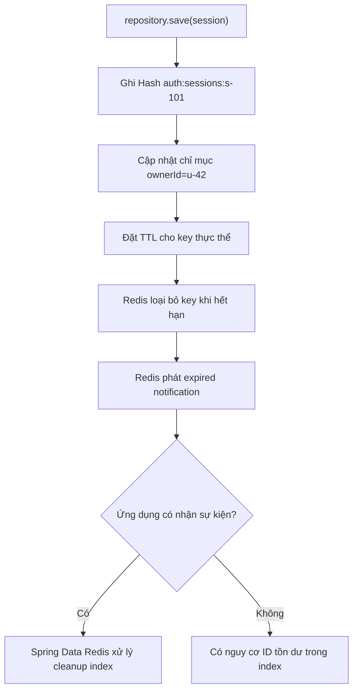

# Thông báo hết hạn, chỉ mục phụ và nguy cơ tham chiếu tồn dư trong Spring Data Redis

## 1. Vấn đề: thực thể đã hết hạn nhưng danh sách tham chiếu vẫn còn

Giả sử một ứng dụng quản lý phiên đăng nhập bằng Spring Data Redis Repository. Mỗi phiên được lưu trong Redis dưới dạng Hash, có TTL hai phút. Ứng dụng còn cần tìm các phiên theo mã người dùng, vì vậy trường `ownerId` được đánh chỉ mục bằng `@Indexed`.

```java
import org.springframework.data.annotation.Id;
import org.springframework.data.redis.core.RedisHash;
import org.springframework.data.redis.core.index.Indexed;

@RedisHash(value = "auth:sessions", timeToLive = 120)
public class LoginSession {

    @Id
    private String id;

    @Indexed
    private String ownerId;

    private String device;

    public LoginSession() {}

    public LoginSession(String id, String ownerId, String device) {
        this.id = id;
        this.ownerId = ownerId;
        this.device = device;
    }

    public String getId() { return id; }
    public void setId(String id) { this.id = id; }
    public String getOwnerId() { return ownerId; }
    public void setOwnerId(String ownerId) { this.ownerId = ownerId; }
    public String getDevice() { return device; }
    public void setDevice(String device) { this.device = device; }
}
```

Khi lưu đối tượng có ID `s-101` và owner `u-42`, Redis Repository thường tạo key thực thể dạng:

```text
auth:sessions:s-101
```

Để hỗ trợ truy vấn theo `ownerId`, repository có thể tạo những Redis Set phụ trợ chứa ID của các phiên. Sau 120 giây, Redis xóa **key Hash của phiên** vì TTL đã hết. Câu hỏi quan trọng là: **những ID đang nằm trong chỉ mục phụ có được gỡ bỏ đúng lúc hay không?**

Nếu cơ chế tiếp nhận thông báo hết hạn bị tắt, chưa khởi động, mất kết nối hoặc bỏ lỡ sự kiện, key thực thể có thể đã biến mất trong khi chỉ mục vẫn còn chứa `s-101`. Đó là **tham chiếu tồn dư** (*stale reference* hoặc *dangling reference*).

Hậu quả có thể gồm:

- Chỉ mục chứa ID không còn dẫn đến thực thể hợp lệ.
- Truy vấn theo chỉ mục phải xử lý các bản ghi thiếu, có thể làm tăng lệnh Redis và thời gian xử lý.
- Số lượng thành viên của Redis Set chỉ mục lớn hơn số thực thể thực sự còn tồn tại.
- Các hệ thống tự quản lý danh sách liên kết có thể hiển thị phần tử "ma" nếu không kiểm tra lại key đích.
- Dữ liệu tham chiếu cũ tồn tại lâu, chiếm bộ nhớ và khiến việc bảo trì khó hơn.

Bài học này phân biệt **expiration của Redis**, **thông báo hết hạn**, **cơ chế chỉ mục phụ của Spring Data Redis** và các chiến lược giảm rủi ro tham chiếu tồn dư.

## 2. Ba cơ chế khác nhau phải được hiểu tách bạch

Khi một entity có TTL, có ít nhất ba loại trạng thái liên quan:

| Lớp | Chức năng | Ai quản lý? |
|---|---|---|
| **Key thực thể** | Lưu dữ liệu Hash của một object Java | Spring Data Redis tạo/ánh xạ; Redis lưu và hết hạn key |
| **Chỉ mục phụ** | Ánh xạ một giá trị thuộc tính đến các ID thực thể | Spring Data Redis Repository duy trì các cấu trúc phụ trợ |
| **Thông báo hết hạn** | Báo Redis đã xóa một key vì hết hạn | Redis phát notification; ứng dụng/Spring Data Redis phải đăng ký nhận |

Ba cơ chế này **không tạo thành một thao tác nguyên tử duy nhất theo mặc định**. Redis có thể xử lý hết hạn của key chính độc lập với một client đang chờ sự kiện để dọn chỉ mục.

Ví dụ minh họa:

```text
Key thực thể:
  auth:sessions:s-101       -> Redis Hash, TTL = 120s

Chỉ mục phụ (minh họa khái niệm):
  ownerId = u-42            -> Redis Set chứa s-101, s-102, ...

Thời điểm key hết hạn:
  auth:sessions:s-101       -> không còn tồn tại
  index ownerId = u-42      -> có thể vẫn giữ s-101 nếu cleanup chưa diễn ra
```

Tên key vật lý của chỉ mục do cơ chế mapping/indexing quyết định; không nên tự ghép các đường dẫn chỉ mục dựa trên minh họa rồi coi đó là API ổn định của Spring Data Redis.

## 3. Redis thực sự làm gì khi TTL về 0?

### 3.1. TTL là thuộc tính của key

Khi tạo một key có TTL:

```redis
SET demo:session:s-101 active EX 120
```

Redis ghi nhận deadline của key. Có thể quan sát:

```redis
TTL demo:session:s-101
PTTL demo:session:s-101
```

Giá trị trả về của `TTL`:

| Kết quả | Ý nghĩa |
|---|---|
| Số không âm | Số giây còn lại, với độ phân giải giây |
| `-1` | Key còn tồn tại nhưng không có expiration |
| `-2` | Key không tồn tại, có thể đã hết hạn hoặc bị xóa |

Redis hỗ trợ cả cơ chế **hết hạn thụ động** (phát hiện key đã hết hạn khi được truy cập) và **hết hạn chủ động** (kiểm tra/xóa các key hết hạn ở nền). Vì vậy, thời điểm Redis **phát sự kiện expired** không được hiểu như một đồng hồ hẹn giờ chạy chính xác tới từng mili giây.

Ứng dụng không nên chờ một event tại đúng mốc `120.000 ms` rồi mới coi session hết hiệu lực. Khi kiểm tra quyền truy cập, **key đã hết hạn phải được coi là không còn hợp lệ**, bất kể listener nhận event chưa.

### 3.2. Hết hạn khác xóa chủ động và eviction

Các thao tác sau không phải cùng một loại sự kiện:

```redis
EXPIRE demo:session:s-101 120
DEL demo:session:s-101
PERSIST demo:session:s-101
```

- `EXPIRE` đặt thời gian sống; Redis phát **expired event** khi key thực sự bị xóa do hết hạn.
- `DEL` chủ động xóa key; về mặt notification, đó là sự kiện **del**, không phải expired.
- `PERSIST` bỏ TTL nhưng vẫn giữ key.
- Khi Redis xóa key vì chính sách thiếu bộ nhớ (*eviction*), đó là một loại sự kiện khác với expired.

Đặc biệt, đặt `EXPIRE key 0` hoặc deadline nằm trong quá khứ có thể làm key bị xóa ngay và được ghi nhận như **del**, không phải expired. Không nên dựa vào expired listener để bắt mọi hình thức xóa key.

## 4. Keyspace notifications: cách Redis phát sự kiện hết hạn

Redis hỗ trợ **keyspace notifications** qua cơ chế Pub/Sub. Khi key hết hạn và bị Redis loại bỏ, máy chủ có thể phát thông điệp cho các client đang đăng ký lắng nghe.

Với database 0, tên channel thường gặp:

```text
__keyevent@0__:expired
```

Thông điệp trên channel mang tên key đã hết hạn, ví dụ:

```text
auth:sessions:s-101
```

Lưu ý: Redis phát thông báo theo cấu hình; đây không phải một hàng đợi sự kiện bền vững có khả năng phát lại.

### 4.1. Cấu hình `notify-keyspace-events`

Để nhận **keyevent expired notification**, Redis cần bật các nhóm sự kiện tương ứng. Một cấu hình phổ biến:

```redis
CONFIG SET notify-keyspace-events Ex
```

Trong đó:

- `E`: phát sự kiện dưới dạng **keyevent notification**.
- `x`: bao gồm **expired events**.

Đối với môi trường thử nghiệm, có thể kiểm tra:

```redis
CONFIG GET notify-keyspace-events
```

**Quan trọng:** cấu hình bằng `CONFIG SET` có thể không được cho phép trên Redis managed service, và việc đổi giá trị hiện tại thành `Ex` có thể làm mất những flag notification khác đang được dùng. Trong production, hãy cấu hình tập flag cần thiết qua cơ chế quản trị của dịch vụ Redis và duy trì cấu hình qua các lần khởi động.

Chỉ bật `Ex` không có nghĩa ứng dụng sẽ nhận được cả `del` hay `evicted` event; mỗi nhóm event có cờ cấu hình riêng.

### 4.2. Kiểm tra notification bằng redis-cli

Tại terminal thứ nhất:

```redis
PSUBSCRIBE __keyevent@0__:expired
```

Tại terminal thứ hai:

```redis
SET demo:expire:one hello EX 3
```

Sau khi Redis loại bỏ key vì hết hạn, subscriber có thể nhận thông điệp chứa `demo:expire:one`.

Đây là **công cụ quan sát**, không phải cơ chế bảo đảm nhận đủ sự kiện. Nếu subscriber vừa ngắt kết nối hoặc chỉ subscribe sau khi key đã hết hạn, các thông báo xảy ra trong khoảng đó không được Redis Pub/Sub phát lại.

## 5. Spring Data Redis Repository liên hệ expiration với chỉ mục ra sao?

Spring Data Redis Repository làm nhiều việc hơn việc ghi một Redis Hash. Với entity chứa `@Id`, `@Indexed` và TTL, framework có thể:

1. Lưu field của object vào Redis Hash theo keyspace và ID.
2. Duy trì thông tin ID của entity trong keyspace.
3. Duy trì các tập chỉ mục phụ cho field `@Indexed`.
4. Thiết lập thời gian sống cho key entity.
5. Đăng ký xử lý sự kiện hết hạn để thực hiện việc dọn các tham chiếu chỉ mục liên quan khi nhận được thông báo.

Một chu trình logic:



Sơ đồ mô tả ý tưởng, không cam kết thứ tự hoặc số lượng lệnh Redis cụ thể trong mọi phiên bản Spring Data Redis.

**Điểm quan trọng:** Redis chỉ tự xóa **key có TTL**. Nó không tự biết rằng một Redis Set khác đang chứa ID của key vừa bị xóa. Việc dọn mối quan hệ giữa key chính và chỉ mục là trách nhiệm của ứng dụng hoặc framework.

### 5.1. Tại sao `@Indexed` liên quan trực tiếp đến vấn đề?

Với entity:

```java
@RedisHash(value = "auth:sessions", timeToLive = 120)
public class LoginSession {
    @Id
    private String id;

    @Indexed
    private String ownerId;

    private String device;
    // ...
}
```

Repository có thể khai báo:

```java
import java.util.List;
import org.springframework.data.repository.CrudRepository;

public interface SessionRepository
        extends CrudRepository<LoginSession, String> {

    List<LoginSession> findByOwnerId(String ownerId);
}
```

Method `findByOwnerId("u-42")` dựa trên chỉ mục được framework duy trì để tìm ID tương ứng. Nếu chỉ mục chứa ID đã hết hạn, quá trình truy vấn có thể phải đi qua ID không còn bản ghi. Tùy implementation, biểu hiện có thể là kết quả bị thiếu, chi phí xử lý tăng hoặc dữ liệu phụ trợ không còn phản ánh tập entity hiện có.

Không nên suy diễn từ một kết quả query trống rằng Redis đã xóa hết mọi thành viên cũ trong Set chỉ mục. **Trạng thái dữ liệu chính** và **trạng thái dữ liệu tham chiếu** là hai điều cần quan sát riêng.

## 6. Khai báo TTL của entity và cấu hình repository

### 6.1. TTL mặc định bằng `@RedisHash`

```java
@RedisHash(value = "auth:sessions", timeToLive = 120)
public class LoginSession {
    // Các trường của entity
}
```

`timeToLive = 120` biểu diễn thời hạn mặc định **120 giây** đối với entity được lưu qua Redis repository mapping. Khi TTL kết thúc, Redis xóa key entity; các bước dọn chỉ mục không mặc nhiên cùng một lệnh Redis với hành động xóa do TTL.

### 6.2. TTL riêng từng object bằng `@TimeToLive`

```java
import org.springframework.data.annotation.Id;
import org.springframework.data.redis.core.RedisHash;
import org.springframework.data.redis.core.TimeToLive;

@RedisHash("auth:tokens")
public class TokenRecord {

    @Id
    private String id;

    private String ownerId;

    @TimeToLive
    private Long ttlSeconds;

    public TokenRecord() {}

    public TokenRecord(String id, String ownerId, Long ttlSeconds) {
        this.id = id;
        this.ownerId = ownerId;
        this.ttlSeconds = ttlSeconds;
    }

    public String getId() { return id; }
    public void setId(String id) { this.id = id; }
    public String getOwnerId() { return ownerId; }
    public void setOwnerId(String ownerId) { this.ownerId = ownerId; }
    public Long getTtlSeconds() { return ttlSeconds; }
    public void setTtlSeconds(Long ttlSeconds) {
        this.ttlSeconds = ttlSeconds;
    }
}
```

Với `@TimeToLive`, mỗi object có thể có thời lượng riêng. Khi entity được đọc trở lại, thuộc tính TTL có thể phản ánh **thời gian còn lại**, không nhất thiết là giá trị ban đầu. Khi lưu lại entity, hãy hiểu chính sách expiration của repository; không mặc định lần `save` tiếp theo giữ nguyên deadline cũ như một lệnh `HSET` đơn giản.

## 7. Bật cơ chế lắng nghe hết hạn trong Spring Data Redis

Spring Data Redis cung cấp cơ chế xử lý Redis keyspace notifications để phát `RedisKeyExpiredEvent` khi một key thực thể có TTL hết hạn.

Một cách cấu hình tường minh bằng `@EnableRedisRepositories`:

```java
import org.springframework.context.annotation.Configuration;
import org.springframework.data.redis.core.RedisKeyValueAdapter.EnableKeyspaceEvents;
import org.springframework.data.redis.repository.configuration.EnableRedisRepositories;

@Configuration
@EnableRedisRepositories(
    basePackageClasses = SessionRepository.class,
    enableKeyspaceEvents = EnableKeyspaceEvents.ON_STARTUP
)
public class RedisRepositoryConfig {
}
```

`EnableKeyspaceEvents.ON_STARTUP` yêu cầu cơ chế listener cho sự kiện keyspace của repository khởi động từ lúc ứng dụng bắt đầu. Điều này giảm khoảng trống do khởi động listener muộn so với thời điểm entity có TTL được tạo.

Tuy nhiên, **đăng ký listener không thay thế việc bật notification trên Redis server**. Một số môi trường cho phép framework cố gắng cấu hình thông qua Redis `CONFIG`; các dịch vụ managed Redis có thể không cho phép lệnh đó.

### 7.1. Redis managed service không cho phép `CONFIG SET`

Khi nhà cung cấp Redis chặn `CONFIG`, có thể yêu cầu Spring Data Redis **không cố thay đổi cấu hình notification trên server**:

```java
import org.springframework.context.annotation.Configuration;
import org.springframework.data.redis.core.RedisKeyValueAdapter.EnableKeyspaceEvents;
import org.springframework.data.redis.repository.configuration.EnableRedisRepositories;

@Configuration
@EnableRedisRepositories(
    basePackageClasses = SessionRepository.class,
    enableKeyspaceEvents = EnableKeyspaceEvents.ON_STARTUP,
    keyspaceNotificationsConfigParameter = ""
)
public class ManagedRedisRepositoryConfig {
}
```

Với cấu hình này, quản trị viên phải **bật notification cần thiết ở chính Redis service** (chẳng hạn keyevent expired). Nếu server không phát expired event, Spring không thể tự suy ra đầy đủ danh sách key đã hết hạn chỉ nhờ việc tạo listener.

Hai ví dụ cấu hình trên là **hai phương án thay thế**, không phải hai lớp `@EnableRedisRepositories` cần khai báo đồng thời.

### 7.2. Listener cho ứng dụng

Ứng dụng có thể lắng nghe event:

```java
import org.slf4j.Logger;
import org.slf4j.LoggerFactory;
import org.springframework.context.event.EventListener;
import org.springframework.data.redis.core.RedisKeyExpiredEvent;
import org.springframework.stereotype.Component;

@Component
public class ExpiredSessionObserver {

    private static final Logger log =
        LoggerFactory.getLogger(ExpiredSessionObserver.class);

    @EventListener
    public void onRedisKeyExpired(RedisKeyExpiredEvent<?> event) {
        log.info("Observed Redis entity expiration event: {}", event);
    }
}
```

Đây là listener **quan sát**. Nó không thêm nghiệp vụ xóa/chuyển trạng thái nào, cũng không khẳng định event được gửi duy nhất một lần. Event có thể chứa ID của key và, tùy cấu hình shadow copy, có thể kèm object đã hết hạn. Không nên giả định lúc event đến vẫn có thể đọc object bằng `repository.findById(...)`: key chính đã bị Redis loại bỏ.

**Lưu ý vận hành:** trong ứng dụng nhiều instance, một notification Redis Pub/Sub có thể được nhiều subscriber nhận. Không được xây dựng side effect không idempotent với giả định event chỉ có một consumer.

## 8. Shadow copy: vì sao Spring Data Redis có thể lưu bản sao thêm?

Khi entity hết hạn, key Hash gốc đã không còn. Nhưng để xử lý expiration và phát event kèm giá trị entity, framework có thể cần biết **các field của object trước khi hết hạn**, chẳng hạn những field được lập chỉ mục.

Spring Data Redis Repository có cơ chế **shadow copy**, còn được gọi là *phantom copy*. Với chế độ được bật, framework có thể lưu thêm một bản sao dữ liệu của entity có TTL. Bản sao này tồn tại **thêm khoảng năm phút sau thời điểm key gốc hết hạn**, nhằm cung cấp dữ liệu của entity cho `RedisKeyExpiredEvent`.

Sơ đồ khái niệm:

```text
Thời gian:          t0                       t0 + 120s         t0 + 420s
                       |                          |                 |
Key Hash chính:        [======== TTL 120s ========] hết hạn
Shadow copy:           [============== TTL ~420s ===================] hết hạn
                                                  |
                                    expired event của key chính
                                    có thể mang dữ liệu entity cũ
```

Tên key của shadow copy là chi tiết triển khai của Spring Data Redis; không nên giả định mã ứng dụng có thể dựng tên đó từ ID mà không sử dụng API được hỗ trợ.

### 8.1. Tác động đến bộ nhớ

Shadow copy giúp event mang theo dữ liệu entity, nhưng đồng thời làm tăng:

- Số key trong Redis.
- Dữ liệu được lưu trong giai đoạn sau khi key gốc hết hạn.
- Lưu lượng ghi và chi phí bảo trì expiration.

Nếu hệ thống có nhiều entity TTL ngắn và tốc độ tạo rất cao, việc lưu thêm shadow copy có thể ảnh hưởng đáng kể đến bộ nhớ. Không nên chỉ ước lượng memory bằng số entity đang còn hiệu lực.

### 8.2. Tắt shadow copy khi không cần payload

Spring Data Redis hỗ trợ chế độ không lưu shadow copy:

```java
import org.springframework.context.annotation.Configuration;
import org.springframework.data.redis.core.RedisKeyValueAdapter.EnableKeyspaceEvents;
import org.springframework.data.redis.core.RedisKeyValueAdapter.ShadowCopy;
import org.springframework.data.redis.repository.configuration.EnableRedisRepositories;

@Configuration
@EnableRedisRepositories(
    basePackageClasses = SessionRepository.class,
    enableKeyspaceEvents = EnableKeyspaceEvents.ON_STARTUP,
    shadowCopy = ShadowCopy.OFF
)
public class RedisRepositoryWithoutShadowConfig {
}
```

Khi tắt shadow copy, expiration event có thể vẫn được phát nhưng **không có giá trị entity đã hết hạn** đi kèm; chỉ còn thông tin định danh/sự kiện phù hợp. Điều này ảnh hưởng đến mọi handler cần đọc field của object để dọn tham chiếu hay chạy xử lý nghiệp vụ.

**Không nên tắt shadow copy chỉ để giảm bộ nhớ nếu cơ chế cleanup hoặc event handler của hệ thống còn phụ thuộc vào dữ liệu trong bản sao.** Cần hiểu phiên bản Spring Data Redis và kiểm tra tình huống index cleanup thực tế trước khi thay đổi.

## 9. Vì sao expired notification không đáng tin như message queue?

Redis Pub/Sub được thiết kế để phát thông tin cho các subscriber đang kết nối, không phải lưu bền sự kiện để consumer xử lý sau. Vì vậy có những giới hạn quan trọng:

| Tình huống | Điều có thể xảy ra | Ý nghĩa với chỉ mục |
|---|---|---|
| Ứng dụng chưa khởi động listener | Event phát trước khi subscriber sẵn sàng | Không nhận được tín hiệu để dọn dữ liệu phụ trợ |
| Ứng dụng restart hoặc mất mạng | Pub/Sub không phát lại thông báo cũ | Dọn chỉ mục có thể bị bỏ sót |
| Redis không bật `notify-keyspace-events` thích hợp | Không có expired message | Repository không thể dựa vào event để cleanup |
| Redis Cluster có nhiều node | Event gắn với node sở hữu key; subscription/topology cần đúng | Có thể chỉ thấy một phần key nếu cấu hình listener chưa bao quát |
| Nhiều instance cùng subscribe | Nhiều process có thể quan sát cùng event | Side effect ngoài Redis cần xử lý trùng lặp |
| Key chưa bị Redis chủ động truy cập/xóa ngay tại deadline | Event đến trễ so với lúc TTL hết | Dọn chỉ mục có thể trễ |
| Key bị `DEL` hoặc eviction | Không phải expired event tương ứng | Handler chỉ nghe `expired` sẽ không thấy mọi kiểu xóa |

Do đó, thông báo hết hạn nên được hiểu là một **tín hiệu hỗ trợ cleanup gần thời gian thực**, không phải nguồn sự thật tuyệt đối để quyết định quyền truy cập, thanh toán, giải phóng tài nguyên quan trọng hoặc bảo toàn dữ liệu dài hạn.

### 9.1. Thời điểm listener khởi động có ý nghĩa

Spring Data Redis có các chế độ kích hoạt listener liên quan đến repository. Nếu listener chỉ bắt đầu khi ứng dụng lần đầu lưu một entity có TTL, các key đã tồn tại hoặc đã hết hạn trước thời điểm đó có thể phát event mà ứng dụng không nghe được.

Chế độ `ON_STARTUP` giảm rủi ro này trong vòng đời một instance, nhưng **không lấp khoảng trống khi toàn bộ ứng dụng dừng**. Nếu tính chính xác lâu dài của chỉ mục là bắt buộc, cần có thêm cơ chế đối soát độc lập.

### 9.2. Event hết hạn không tương đương lịch hẹn chính xác

Một hệ thống gửi email đúng giờ hết hạn hợp đồng không nên dựa vào `RedisKeyExpiredEvent` như hệ thống scheduling bảo đảm thời gian và phát một lần. Redis có thể thông báo muộn, thông báo bị bỏ lỡ hoặc nhiều instance nhận được cùng tín hiệu.

Khi có tác vụ nghiệp vụ quan trọng, hãy dùng cơ chế lập lịch/durable queue có checkpoint, retry và idempotency. Event từ Redis có thể phục vụ cache invalidation hoặc cleanup phụ trợ, với quy trình sửa lỗi khi mất event.

## 10. Tham chiếu tồn dư trông như thế nào?

Có hai nhóm tình huống:

### 10.1. Chỉ mục phụ do Spring Data Redis Repository quản lý

Giả sử chỉ mục `ownerId = u-42` từng chứa ID `s-101`. Redis hết hạn key:

```text
auth:sessions:s-101  -> không còn
index ownerId=u-42   -> có thể còn thành viên s-101
```

Nếu Spring Data Redis nhận được notification và xử lý cleanup thành công, chỉ mục được cập nhật theo cơ chế framework. Nếu không, nó có thể giữ thành viên cũ.

Các chỉ mục được quản lý bởi framework **không nên được chỉnh tay bằng việc đoán tên key**, bởi vì ngoài chỉ mục theo giá trị thuộc tính còn có thể có dữ liệu khác phục vụ mapping và quản lý quan hệ.

### 10.2. Tham chiếu ứng dụng tự quản lý

Để thấy bản chất mà không phụ thuộc key nội bộ của repository, tạo một ví dụ dùng Redis Set:

```redis
SADD demo:user:u-42:sessions s-101
SET demo:session:s-101 "active" EX 3
```

Sau khi key `demo:session:s-101` hết hạn:

```redis
EXISTS demo:session:s-101
SMEMBERS demo:user:u-42:sessions
```

Kết quả về mặt ý nghĩa:

```text
EXISTS demo:session:s-101
  -> 0

SMEMBERS demo:user:u-42:sessions
  -> s-101 có thể vẫn xuất hiện
```

Vì `demo:user:u-42:sessions` là một **key Set độc lập** chưa được gắn TTL hoặc sửa thành viên, Redis không biết phải xóa `s-101` khỏi Set này khi key String `demo:session:s-101` hết hạn.

Ví dụ giúp giải thích vì sao Spring Data Redis cần quản lý chỉ mục phụ và dọn dẹp các tham chiếu theo sự kiện hoặc cơ chế bổ sung.

## 11. Đọc dữ liệu an toàn khi chỉ mục có thể tồn dư

Ứng dụng không nên coi việc một ID xuất hiện trong index nghĩa là entity chắc chắn còn tồn tại.

### 11.1. Nguyên tắc: dữ liệu entity còn sống mới có hiệu lực

Nếu index chỉ trả về ID, bước xử lý an toàn là:

1. Lấy danh sách ID cần kiểm tra.
2. Đọc entity từ key chính (qua repository hoặc API dữ liệu chủ sở hữu).
3. Chỉ chấp nhận entity tìm thấy và còn hợp lệ.
4. Ghi nhận các ID không có entity để đối soát hoặc dọn rác theo quy trình thích hợp.

Ví dụ với một tập ID do tầng ứng dụng cung cấp:

```java
import java.util.ArrayList;
import java.util.List;

public List<LoginSession> findExistingSessions(
        SessionRepository repository,
        List<String> candidateIds) {

    List<LoginSession> existing = new ArrayList<>();
    repository.findAllById(candidateIds).forEach(existing::add);
    return existing;
}
```

Đoạn code chỉ trả về các thực thể repository tìm thấy tại lúc đọc; nó không tự dọn index, và không tạo một snapshot nguyên tử của tập key. Nếu nghiệp vụ cần đồng bộ nghiêm ngặt, cần thiết kế riêng cơ chế kiểm tra điều kiện và tránh race.

### 11.2. Cẩn thận với thống kê dựa trên `SCARD`

Với Redis Set do ứng dụng quản lý:

```redis
SCARD demo:user:u-42:sessions
```

`SCARD` chỉ đếm **số thành viên trong Set đó**, không kiểm tra các key entity tương ứng còn tồn tại. Nếu Set chứa stale references, `SCARD` có thể cao hơn số session sống.

Tương tự, việc nhìn vào số thành viên của một chỉ mục phụ nội bộ không đồng nghĩa đã có một phép đếm entity chính xác. Muốn đếm phiên còn hiệu lực, cần dùng nguồn dữ liệu/thao tác phù hợp với định nghĩa "còn hiệu lực".

### 11.3. Giải quyết ID được tái sử dụng

Nếu một ID cũ vừa hết hạn rồi được sử dụng cho một entity mới, thao tác cleanup đến muộn có thể xóa nhầm tham chiếu đang hợp lệ khi chỉ dựa vào ID.

Ví dụ:

```text
t0:  s-101 thuộc owner u-42
t1:  s-101 hết hạn; event dọn index đến muộn
t2:  entity mới cũng dùng s-101, thuộc owner u-99
t3:  handler cũ xử lý s-101 và xóa theo ID không kiểm tra phiên bản
```

Để hạn chế, dùng ID không tái sử dụng trong thời gian có thể còn event/metadata cũ, hoặc dùng phiên bản/thông tin thế hệ của entity và thao tác dọn có điều kiện. Các hệ thống cần tính nhất quán cao phải thiết kế dọn rác tránh tranh chấp với lệnh ghi mới.

## 12. Các chiến lược đối phó tham chiếu tồn dư

### 12.1. Dựa trên expiration notification để cleanup gần thời gian thực

Đây là cơ chế phù hợp khi yêu cầu là cập nhật chỉ mục sau khi entity hết hạn, và một mức độ trễ/sót event có thể được xử lý bởi các biện pháp khác.

Điều kiện vận hành:

- Redis có cấu hình keyspace notifications thích hợp.
- Spring Data Redis listener hoạt động đúng và subscribe trên các node cần thiết.
- Nếu logic cleanup cần value đã hết hạn, cấu hình shadow copy phải phù hợp.
- Ứng dụng quan sát được lỗi, restart và khoảng mất kết nối.

**Giới hạn:** đây vẫn là Pub/Sub, không có phát lại sự kiện bị bỏ lỡ.

### 12.2. Xác thực tại thời điểm đọc

Khi truy vấn theo chỉ mục, luôn kiểm tra entity chính. Điều này ngăn ID tồn dư trở thành một phiên hợp lệ hoặc một bản ghi nghiệp vụ được tin cậy.

Hạn chế: truy vấn có thể tốn thêm lookup; index vẫn cần quy trình cleanup để tránh tăng dần về kích thước.

### 12.3. Đối soát theo lịch

Với tập chỉ mục do **ứng dụng tự quản lý**, có thể chạy reconciler:

```text
Cho mỗi nhóm tham chiếu trong phạm vi cần bảo trì:
  lấy một batch các ID
  kiểm tra các key/entity tương ứng còn tồn tại
  nếu ID thực sự không còn hợp lệ:
      xóa tham chiếu theo quy tắc có kiểm soát cạnh tranh
  ghi số lượng đã kiểm tra, đã loại bỏ và lỗi
  tiếp tục bằng cursor/chunk phù hợp
```

Với **chỉ mục nội bộ của Spring Data Redis Repository**, không nên áp dụng trực tiếp thuật toán sửa Set bằng việc phỏng đoán tên key. Hãy sử dụng cơ chế/API phù hợp với phiên bản framework, hoặc thiết kế quy trình sửa chữa đã được kiểm chứng trên bản sao dữ liệu.

Đối soát cần tính đến key hết hạn giữa bước `EXISTS` và bước cleanup; chỉ kiểm tra rồi xóa trong hai lệnh không tự bảo đảm an toàn nếu ID có thể được ghi lại. Khi dữ liệu đòi hỏi tính nhất quán, dùng operation có điều kiện, script hoặc phiên bản hóa như một phần của thiết kế.

### 12.4. Không nhân đôi tham chiếu nếu không cần

Mỗi bản sao của quan hệ "user sở hữu session" làm tăng khả năng dữ liệu bất đồng sau expiration. Nếu ứng dụng chỉ cần kiểm tra một session theo ID, có thể đủ dùng key entity có TTL mà không tạo thêm Set do ứng dụng tự quản lý.

Nếu truy vấn ngược "liệt kê mọi session của user" là yêu cầu thiết yếu, cần chỉ mục. Khi đó phải tính luôn **chi phí duy trì và sửa chữa chỉ mục** vào thiết kế dữ liệu.

### 12.5. Chọn hệ thống lưu trữ bền vững cho dữ liệu nguồn

Redis TTL phù hợp với cache, token tạm thời, session hoặc dữ liệu có vòng đời ngắn. Nếu chỉ mục biểu diễn quan hệ nghiệp vụ dài hạn, yêu cầu độ chính xác nghiêm ngặt và kiểm toán được, nên cân nhắc lưu quan hệ nguồn trong hệ thống dữ liệu bền vững phù hợp; Redis chỉ đóng vai trò cache hoặc projection có thể tái tạo.

Khi đó, lost expired event chỉ làm projection tạm chậm cập nhật; quy trình rebuild/reconciliation vẫn có nguồn dữ liệu đáng tin để phục hồi.

## 13. Một phương án bảo trì cho chỉ mục ứng dụng tự quản lý

Ví dụ này **không can thiệp vào index nội bộ của Spring Data Redis**. Nó minh họa cách thiết kế một danh sách tham chiếu riêng, do ứng dụng sở hữu.

Giả sử:

```text
Key entity:        app:sessions:s-101        (String có TTL)
Key index tự quản: app:owners:u-42:sessions  (Set chứa session IDs)
```

Ta có thể cung cấp API đọc các phiên đang tồn tại:

```java
import java.util.HashSet;
import java.util.Set;

import org.springframework.data.redis.core.StringRedisTemplate;

public class LiveSessionLookup {

    private final StringRedisTemplate redis;

    public LiveSessionLookup(StringRedisTemplate redis) {
        this.redis = redis;
    }

    public Set<String> liveSessionIds(String ownerId) {
        String indexKey = "app:owners:" + ownerId + ":sessions";
        Set<String> ids = redis.opsForSet().members(indexKey);
        if (ids == null || ids.isEmpty()) {
            return Set.of();
        }

        Set<String> live = new HashSet<>();
        for (String id : ids) {
            String entityKey = "app:sessions:" + id;
            if (Boolean.TRUE.equals(redis.hasKey(entityKey))) {
                live.add(id);
            }
        }
        return live;
    }
}
```

Phương thức **lọc tham chiếu tại thời điểm đọc**; nó không dọn Set cũ và chưa tối ưu round trip cho danh sách lớn. Với số lượng ID cao, nên xử lý theo batch, áp dụng cách đọc phù hợp và giới hạn thời gian/bộ nhớ thay vì tải toàn bộ Set một lần.

Trong ví dụ này, key entity có thể hết hạn ngay sau khi `hasKey` trả `true`. Vì vậy, phương thức chỉ cung cấp danh sách "đã tồn tại lúc kiểm tra", không chứng minh chúng còn tồn tại khi thao tác tiếp theo diễn ra.

Nếu định dọn thành viên tồn dư, cần thêm logic đối soát có kiểm soát race và không áp dụng nhầm thuật toán này lên Set chỉ mục của repository.

## 14. Quan sát lỗi và đo rủi ro trong production

Khi không chắc cleanup đã chạy đúng, không nên chỉ nhìn `TTL` của một key. Cần quan sát cả đường phát sự kiện và trạng thái index.

Một số chỉ số hữu ích:

| Chỉ số | Ý nghĩa |
|---|---|
| Số entity đang có TTL | Quy mô dữ liệu tạm thời |
| Số expiration event ứng dụng nhận được | Cho biết listener có hoạt động; không chứng minh đã nhận đủ |
| Độ trễ giữa deadline và lúc xử lý event | Giúp thấy mức trễ cleanup, khi có đủ dữ liệu để đo |
| Số ID được trả từ index nhưng không tìm thấy entity | Tín hiệu trực tiếp về tham chiếu tồn dư |
| Tổng dung lượng và cardinality của index phụ | Quan sát xu hướng tăng bất thường |
| Bộ nhớ Redis dành cho dữ liệu TTL và shadow copy | Giúp đánh giá chi phí giữ bản sao |
| Redis connection/subscription errors | Phát hiện mất kết nối Pub/Sub |
| Chênh lệch giữa nguồn dữ liệu bền vững và Redis index | Cơ sở cho reconciliation |

### 14.1. Lệnh Redis hỗ trợ điều tra

```redis
TTL auth:sessions:s-101
PTTL auth:sessions:s-101
EXISTS auth:sessions:s-101
TYPE auth:sessions:s-101
INFO stats
CONFIG GET notify-keyspace-events
```

`INFO stats` có các chỉ số liên quan expired/evicted keys để quan sát xu hướng ở cấp Redis. Chúng **không tương đương số event mà Spring Data Redis đã nhận** và không phản ánh trực tiếp số index đã dọn sạch.

Khi phải duyệt key trong một môi trường lớn, dùng `SCAN` theo phạm vi phù hợp; tránh dùng `KEYS *` trên production chỉ để đếm entity. Với các key chỉ mục do framework quản lý, hãy xác minh quy ước của phiên bản Spring Data Redis trước khi kiểm tra các tập phụ trợ.

### 14.2. Đặc biệt thận trọng với Redis Cluster

Ở Redis Cluster, các key có thể nằm trên nhiều node. Keyspace notifications gắn với node xử lý key, nên cấu hình listener và Redis Pub/Sub phải phù hợp topology. Hãy kiểm tra trong môi trường Cluster thật rằng event từ **mọi shard liên quan** đều được xử lý; không suy ra việc nhận được event từ một node nghĩa là đã bao phủ toàn cluster.

Mỗi node có thể có cấu hình notification riêng. Một cluster được bật `Ex` không đồng nhất trên mọi node có thể dẫn tới hiện tượng cleanup thất thường theo hash slot.

## 15. Các sự cố điển hình và cách suy luận

### Sự cố A: Redis key hết hạn đúng, nhưng `findByOwnerId` có hành vi bất thường

Chuỗi sự kiện khả dĩ:

```text
1. Session được lưu, ownerId được đánh chỉ mục.
2. Redis hết hạn Hash của session.
3. Expired notification không được nhận vì listener dừng.
4. Chỉ mục còn ID cũ.
5. Query theo ownerId đụng phải tham chiếu đến bản ghi thiếu.
```

Hướng điều tra là xác minh TTL của key chính, kết nối listener, cấu hình Redis notifications và dữ liệu chỉ mục trên môi trường kiểm soát. Không kết luận framework tạo lỗi chỉ bằng việc nhìn một ID không tìm thấy: cần biết thao tác xóa thủ công, TTL, ghi lại ID và các bước xử lý khác.

### Sự cố B: Event handler không có object đã hết hạn

Một nguyên nhân có thể là shadow copy bị tắt hoặc giá trị bản sao không sẵn có. Redis notification gốc chủ yếu chứa **tên key**, không mang toàn bộ Hash đã xóa. Nếu handler cần biết `ownerId` để xử lý cleanup ngoài framework, cần thiết kế cách lưu metadata phù hợp và kiểm tra giá trị event trong cấu hình cụ thể.

Không nên viết:

```java
// Minh họa giả định sai: key gốc đã hết hạn nên không thể
// dựa vào findById để chắc chắn lấy được dữ liệu trước đó.
sessionRepository.findById(expiredId);
```

để hy vọng có đầy đủ field của entity đã hết hạn. Nếu cần phục hồi thông tin sau khi key chính mất, dữ liệu phải tồn tại ở một nguồn khác hoặc trong cơ chế shadow copy được hỗ trợ.

### Sự cố C: Cleanup chạy hai lần ở hai instance

Nếu hai instance cùng đăng ký Redis Pub/Sub, cùng một event có thể kích hoạt handler ở cả hai. Việc gọi "gửi email hủy phiên", "hoàn tiền", "xóa dữ liệu bên ngoài" mà không có idempotency/ownership có thể gây side effect trùng.

Giải pháp phù hợp là tách **expiration như tín hiệu** khỏi **thực thi nghiệp vụ bền vững**, với khóa idempotency, consumer ownership hoặc hệ thống queue/scheduler bảo đảm theo yêu cầu.

### Sự cố D: Có nhiều key lạ sống lâu hơn TTL gốc

Với Spring Data Redis, shadow copy và key phụ trợ có thể khiến số key thực tế lớn hơn số entity còn sống. Bản sao của entity có TTL có thể tiếp tục tồn tại khoảng năm phút sau khi key gốc hết hạn. Điều này không tự chứng minh có memory leak.

Tuy nhiên, nếu số key/chỉ mục cứ tăng mãi, cần phân biệt shadow copy hết hạn đúng hạn với **stale index không được cleanup**.

### Sự cố E: Xóa trực tiếp Hash bằng `DEL` nhưng chỉ mục không đồng bộ

Ví dụ:

```redis
DEL auth:sessions:s-101
```

Nếu key thuộc quản lý của Redis Repository, `DEL` trực tiếp bỏ qua những bước cleanup mà repository có thể thực hiện khi gọi `deleteById(...)`. Event do `DEL` phát ra cũng không phải expired event.

Hãy ưu tiên API repository khi xóa entity do repository quản lý. Nếu thực hiện thao tác Redis mức thấp, ứng dụng phải tự chịu trách nhiệm về các mối liên kết bị ảnh hưởng.

## 16. Minh họa trình tự thời gian: điều gì có thể tồn dư?

Giả sử entity được lưu lúc `10:00:00` với TTL 60 giây:

```text
10:00:00  repository.save()
          - Hash session được tạo
          - Chỉ mục ownerId chứa session ID
          - Redis đặt TTL 60s

10:00:59  Redis key chính vẫn có thể tồn tại

10:01:00  Deadline TTL đã tới
          - Các lần đọc key đã hết hạn không được coi là phiên hợp lệ
          - Event có thể chưa phát đúng thời điểm này

10:01:01  Redis phát hiện và xóa key hết hạn
          - Phát expired notification nếu được cấu hình

10:01:01+ Listener nhận event (nếu đang kết nối)
          - Framework có cơ hội cleanup chỉ mục

Nếu listener không nhận:
          - Key chính đã mất
          - ID có thể còn tồn tại trong chỉ mục
          - Cần đọc xác minh và đối soát theo chính sách hệ thống
```

Số giây chỉ để minh họa. Trên hệ thống thực, event có thể đến muộn hơn, bị bỏ lỡ hoặc bị nhiều subscriber quan sát.

Một nguyên tắc thiết kế rất quan trọng là: **tính hợp lệ của entity dựa vào key/nguồn dữ liệu chính tại thời điểm sử dụng**, không dựa vào việc một listener đã kịp xử lý thông báo hết hạn hay chưa.

## 17. Thực hành: quan sát expired event và stale reference

Thực hiện trên môi trường Redis riêng cho thử nghiệm.

### Bước 1: bật và quan sát notification

Khi Redis test cho phép:

```redis
CONFIG SET notify-keyspace-events Ex
```

Mở một terminal khác:

```redis
PSUBSCRIBE __keyevent@0__:expired
```

### Bước 2: tạo key và Set tham chiếu thủ công

```redis
SADD demo:links:u-42 s-101
SET demo:sessions:s-101 ACTIVE EX 5
TTL demo:sessions:s-101
SMEMBERS demo:links:u-42
```

### Bước 3: quan sát sau khi hết hạn

Sau hơn năm giây:

```redis
EXISTS demo:sessions:s-101
SMEMBERS demo:links:u-42
```

Khi key đã hết hạn, `EXISTS` trả `0`, nhưng Set `demo:links:u-42` có thể vẫn chứa ID `s-101`. Redis Pub/Sub báo event **không tự sửa** Set do ta quản lý.

### Bước 4: xóa tham chiếu có chủ đích

Trong bài thực hành đơn luồng này, có thể sửa thủ công:

```redis
SREM demo:links:u-42 s-101
SCARD demo:links:u-42
```

Đây là ví dụ đối với **Set tự quản lý**, không phải chỉ dẫn thao tác lên key chỉ mục nội bộ của repository. Nếu entity có thể được tạo lại cùng ID trong lúc dọn, cần quy trình có điều kiện thay cho việc xóa không kiểm tra.

### Bước 5: kiểm tra với Spring Data Redis Repository

Tạo một `LoginSession`, lưu qua `SessionRepository`, kiểm tra:

```java
sessionRepository.save(
    new LoginSession("s-201", "u-42", "browser")
);

System.out.println(
    sessionRepository.findById("s-201").isPresent()
);

System.out.println(
    sessionRepository.findByOwnerId("u-42").size()
);
```

Sau khi TTL kết thúc, so sánh kết quả tìm theo ID, kết quả truy vấn theo `ownerId` và nhật ký `ExpiredSessionObserver`. Thử tái hiện trạng thái tắt notification trong môi trường thử nghiệm để hiểu rủi ro bỏ lỡ cleanup; cần khởi động và cấu hình lại đúng trước khi tiếp tục sử dụng môi trường chung.

## 18. Những nhận định dễ nhầm

| Nhận định | Điều đúng cần hiểu |
|---|---|
| "Key đã hết hạn thì mọi chỉ mục đến nó cũng biến mất." | Redis chỉ tự hết hạn key có TTL; liên kết ở key khác phải được quản lý riêng. |
| "`@Indexed` là một database index nên Redis tự bảo toàn referential integrity." | Spring Data Redis dùng các cấu trúc Redis và logic của framework; không có khóa ngoại kiểu SQL. |
| "TTL về 0 thì expired event phát chính xác lập tức." | Redis loại bỏ key bằng cơ chế active/passive expiration; notification có thể trễ. |
| "Event sẽ được nhận sau khi ứng dụng khởi động lại." | Redis Pub/Sub không lưu để phát lại các event bị bỏ lỡ. |
| "Có listener tức là Redis đã bật event." | Server phải được cấu hình notification phù hợp. |
| "`RedisKeyExpiredEvent` luôn chứa entity đầy đủ." | Payload phụ thuộc cấu hình và việc còn shadow copy. |
| "Tắt shadow copy không có tác động phụ." | Giảm bộ nhớ nhưng có thể mất dữ liệu event cần cho cleanup/handler. |
| "Một sự kiện chỉ đến một ứng dụng." | Nhiều subscriber có thể nhận cùng notification. |
| "`DEL` tạo expired event." | `DEL` là thao tác xóa chủ động; event khác với hết hạn tự nhiên. |
| "`SCARD` của index bằng số entity sống." | Set có thể chứa ID đã mất entity. |
| "Thấy entity qua index tức là session chắc chắn còn hiệu lực." | Phải xác thực trạng thái và thời hạn tại nguồn dữ liệu chính khi sử dụng. |

## 19. Quyết định kiến trúc theo mức yêu cầu nhất quán

| Nhu cầu | Cách tiếp cận nên cân nhắc | Giới hạn cần chấp nhận |
|---|---|---|
| Cache/session tạm thời, có thể chịu cleanup trễ | Redis TTL + repository event + kiểm tra key tồn tại | Event không bền vững; cần theo dõi stale references |
| Liệt kê entity theo thuộc tính `@Indexed` | Redis Repository + cấu hình notifications đúng | Tốn thêm key và công việc duy trì chỉ mục |
| Truy vấn chỉ cần entity còn hiệu lực | Lọc kết quả qua dữ liệu chính | Có chi phí lookup và race sau lúc kiểm tra |
| Số lượng entity TTL rất lớn | Đo chi phí shadow copy, xem xét chính sách payload event | Tắt copy phải xét lại hành vi cleanup |
| Dữ liệu tham chiếu cần tự phục hồi | Đối soát theo lịch từ nguồn đáng tin hoặc API đã được kiểm chứng | Phải thiết kế giới hạn tải và cạnh tranh |
| Xử lý nghiệp vụ không được bỏ sót | Durable queue/scheduler/idempotency và hệ thống lưu trữ bền vững | Phức tạp hơn Pub/Sub nhưng có khả năng retry |

Khi thiết kế TTL cho entity, hãy đặt hai câu hỏi riêng: **"Khi nào entity hết hiệu lực?"** và **"Khi nào dữ liệu tham chiếu đến entity được dọn?"**. Redis TTL trả lời câu đầu, còn chỉ mục phụ và expiration notifications liên quan đến câu thứ hai. Nếu ứng dụng yêu cầu dữ liệu liên kết nhất quán ngay cả sau restart, mất kết nối hoặc lỗi mạng, cần một cơ chế kiểm chứng/đối soát độc lập thay vì chỉ dựa vào Pub/Sub.

## Tài liệu tham khảo

- [Spring Data Redis Reference — Time To Live](https://docs.spring.io/spring-data/redis/reference/redis/redis-repositories/expirations.html)
- [Spring Data Redis Reference — Secondary Indexes](https://docs.spring.io/spring-data/redis/reference/redis/redis-repositories/indexes.html)
- [Spring Data Redis Reference — Redis Repositories](https://docs.spring.io/spring-data/redis/reference/redis/redis-repositories.html)
- [Spring Data Redis Reference — Object-to-Hash Mapping](https://docs.spring.io/spring-data/redis/reference/redis/redis-repositories/mapping.html)
- [Redis Documentation — Keyspace Notifications](https://redis.io/docs/latest/develop/pubsub/keyspace-notifications/)
- [Redis Documentation — EXPIRE](https://redis.io/docs/latest/commands/expire/)
- [Redis Documentation — TTL](https://redis.io/docs/latest/commands/ttl/)
- [Redis Documentation — Pub/Sub](https://redis.io/docs/latest/develop/pubsub/)
