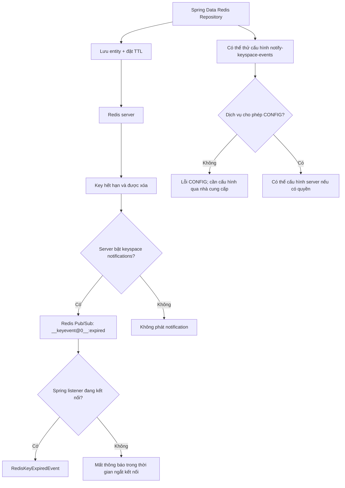

# Giới hạn cấu hình keyspace notification trên dịch vụ Redis được quản lý

> **Module:** Spring Data Redis  
> **Chương:** TTL của thực thể  
> **Chủ đề:** Giới hạn cấu hình keyspace notification trên dịch vụ Redis được quản lý (*managed Redis*), hệ quả với Redis Repository và cách triển khai phù hợp.

## 1. Vấn đề: TTL vẫn hoạt động, nhưng sự kiện hết hạn có thể không hoạt động

Trong Spring Data Redis, một thực thể được lưu qua Redis Repository có thể mang thời gian sống (*Time To Live*, TTL). Khi TTL về 0 và Redis loại bỏ key, ứng dụng đôi khi cần nhận một sự kiện để xóa chỉ mục phụ, cập nhật trạng thái hoặc kích hoạt một quy trình tiếp theo.

Ví dụ một thực thể phiên làm việc:

```java
import org.springframework.data.annotation.Id;
import org.springframework.data.redis.core.RedisHash;
import org.springframework.data.redis.core.index.Indexed;

@RedisHash(value = "loginSessions", timeToLive = 900)
public class LoginSession {

    @Id
    private String id;

    @Indexed
    private String userId;

    private String deviceId;

    protected LoginSession() {}

    public LoginSession(String id, String userId, String deviceId) {
        this.id = id;
        this.userId = userId;
        this.deviceId = deviceId;
    }

    public String getId() { return id; }
    public String getUserId() { return userId; }
    public String getDeviceId() { return deviceId; }
}
```

`@RedisHash(timeToLive = 900)` đặt TTL mặc định 900 giây cho entity. Spring Data Redis Repository sử dụng Redis Hash và lệnh expiration để quản lý key. Khi key hết hạn, **Redis tự loại bỏ key ngay cả khi ứng dụng không nhận keyspace notification**.

Điểm gây nhầm lẫn là ba việc độc lập:

1. **Gắn TTL:** tạo key có hạn sử dụng, ví dụ `EXPIRE loginSessions:s-1 900`.
2. **Redis phát sự kiện:** Redis server bật `notify-keyspace-events` để gửi thông báo `expired` lên Pub/Sub.
3. **Spring lắng nghe sự kiện:** Redis Repository khởi tạo listener, đăng ký nhận thông báo và phát `RedisKeyExpiredEvent` trong ứng dụng.

Một dịch vụ Redis được quản lý có thể cho phép (1) nhưng hạn chế cấu hình (2) hoặc không hỗ trợ (2). Nếu không có (2), việc bật (3) trong Spring **không tự tạo ra thông báo hết hạn**.

### 1.1. Sơ đồ những điểm có thể bị giới hạn



Trong một hệ thống được quản lý, **không được suy luận** rằng vì `repository.save()` thành công nên listener chắc chắn nhận `RedisKeyExpiredEvent`.

## 2. Keyspace notification thực chất là gì?

Redis có cơ chế *keyspace notifications* để phát sự kiện lên các Pub/Sub channel đặc biệt khi key thay đổi hoặc bị xóa.

Ví dụ key `loginSessions:s-1` trong database 0 thật sự hết hạn:

- Channel kiểu **keyevent**: `__keyevent@0__:expired`; payload là tên key, ví dụ `loginSessions:s-1`.
- Channel kiểu **keyspace**: `__keyspace@0__:loginSessions:s-1`; payload là loại sự kiện `expired`.

Cú pháp cấu hình:

```conf
notify-keyspace-events Ex
```

Các ký tự liên quan:

| Ký tự | Ý nghĩa | Khi nào cần |
|---|---|---|
| `E` (chữ hoa) | Phát **keyevent** channel `__keyevent@<db>__:...` | Spring Redis Repository lắng nghe sự kiện key expired theo cơ chế keyevent |
| `K` (chữ hoa) | Phát **keyspace** channel `__keyspace@<db>__:<key>` | Client theo dõi những sự kiện xảy ra trên một key |
| `x` (chữ thường) | Sự kiện key đã **expired** | Cần để nhận `expired` |
| `e` (chữ thường) | Sự kiện key bị **evicted** vì thiếu bộ nhớ | Khi cần quan sát eviction, khác TTL expiration |
| `g` | Các sự kiện chung như DEL/EXPIRE | Không thay thế `x` để nhận key đã thật sự hết hạn |
| `A` | Viết tắt cho một tập rộng các loại sự kiện | Không nên bật toàn bộ chỉ để nghe TTL khi không cần |

Kết hợp `Ex` nghĩa là **phát keyevent cho những key đã expired**. Đây là cấu hình tối thiểu phù hợp cho luồng nhận expiration event thông thường của Spring Data Redis Repository.

`x` một mình **không đủ**, vì phải có ít nhất `E` hoặc `K` để Redis có loại channel cần phát. `EX` với `X` viết hoa cũng không đúng: ký tự phân biệt hoa/thường.

### 2.1. Cần phân biệt lệnh `EXPIRE` và sự kiện `expired`

Đặt TTL không đồng nghĩa key lập tức hết hạn:

```redis
SET trial:key "value"
EXPIRE trial:key 20
```

`EXPIRE` ở đây đặt hạn 20 giây. Khi Redis **thật sự xóa key** do hết hạn, Redis phát sự kiện `expired` (nếu đã bật notifications). Redis thực hiện xóa theo hai cách chính:

- **Passive expiration:** khi một lệnh truy cập key đã hết hạn.
- **Active expiration:** chu kỳ nền của Redis chủ động tìm và xóa key đã hết hạn.

Vì vậy sự kiện `expired` **không được bảo đảm xuất hiện đúng mili giây TTL về 0**; nó phát khi Redis thực sự loại bỏ key hết hạn. Các tác vụ nghiệp vụ đòi hỏi deadline chính xác không nên sử dụng notification như một bộ định thời chính xác tuyệt đối.

### 2.2. Expiration và eviction là hai nguyên nhân khác nhau

- `expired`: key bị xóa do hết TTL; cần ký tự `x`.
- `evicted`: key bị loại bỏ vì `maxmemory-policy`; cần ký tự `e`.

Nếu Redis quá tải bộ nhớ và loại một key trước thời hạn, ứng dụng không thể kỳ vọng sẽ nhận `expired` cho việc xóa đó. `RedisKeyExpiredEvent` của Repository không phải là sự kiện tổng quát cho mọi cách một key biến mất. Cần xác định riêng yêu cầu xử lý eviction, thao tác `DEL` và lỗi ứng dụng.

## 3. Redis Repository sử dụng notifications để làm gì?

### 3.1. Xuất bản sự kiện cho ứng dụng

Spring Data Redis Repository có thể dùng `RedisMessageListenerContainer` để đăng ký nhận sự kiện. Khi xử lý thông báo hết hạn, repository phát `RedisKeyExpiredEvent` bằng cơ chế Spring application events.

Vì key đã bị Redis xóa, Spring Data Redis có thể giữ **phantom copy** (hay *shadow copy*) của entity: một key phụ có hạn sống dài hơn key chính khoảng **5 phút**. Khi nhận notification cho key chính, repository có thể đọc lại giá trị entity từ bản sao để đưa vào event.

Ví dụ với session hết hạn sau 15 phút:

```text
t=0        Repository lưu Hash loginSessions:s-1, TTL 900 giây
           Đồng thời lưu một phantom copy có hạn dài hơn
t≈15 phút  Redis xóa loginSessions:s-1 khi key expired
           Redis phát __keyevent@0__:expired nếu đã bật Ex
           Spring listener tạo RedisKeyExpiredEvent
t≈20 phút  Phantom copy cũng hết hạn
```

Phantom copy không có nghĩa key chính vẫn truy xuất được sau TTL. Đó chỉ là dữ liệu phục vụ quá trình phát event, và **tăng lượng bộ nhớ** so với chỉ lưu entity.

Bạn có thể tắt phantom copy nếu event chỉ cần định danh key; khi đó event không còn bản sao đầy đủ của entity. Tắt phantom copy **không giúp phục hồi sự kiện đã mất**.

### 3.2. Dọn secondary index

Redis Repository có thể tạo các Set để tra cứu entity theo field có `@Indexed`, chẳng hạn index theo `userId` trong ví dụ `LoginSession`. Khi key entity hết hạn, Redis tự xóa Hash nhưng **không tự biết** phải loại id đó khỏi các Set chỉ mục do ứng dụng tạo.

Spring Data Redis sử dụng expiration event để hỗ trợ dọn các tham chiếu index còn sót. Nếu sự kiện không được phát hoặc không được nhận, một Set index có thể giữ id của entity đã biến mất.

Hệ quả:

- `repository.findById(id)` có thể không tìm thấy entity, nhưng id vẫn có mặt ở index Set;
- kết quả truy vấn dựa trên index có thể chứa tham chiếu cũ trước khi mapping thành entity;
- chỉ mục có thể phình lên theo thời gian với tải tạo session/token lớn.

Không nên coi Pub/Sub là cơ chế bảo đảm index luôn nhất quán tuyệt đối: đó là kênh sự kiện không bền vững.

### 3.3. Ba chế độ của listener trong Spring Data Redis

Enum `RedisKeyValueAdapter.EnableKeyspaceEvents` cung cấp các lựa chọn:

| Giá trị | Hành vi | Hệ quả |
|---|---|---|
| `OFF` | Không sử dụng listener expiration của Repository | TTL Redis vẫn chạy, nhưng Repository không tự nhận `RedisKeyExpiredEvent` |
| `ON_DEMAND` | Khởi tạo listener khi lưu entity đầu tiên có thời gian hết hạn | Có thể bỏ lỡ sự kiện nếu listener chưa chạy |
| `ON_STARTUP` | Khởi tạo listener khi ứng dụng khởi động | Giảm khoảng trống trước lần lưu đầu tiên, nhưng không khắc phục mất sự kiện lúc offline/failover |

**Mặc định của thuộc tính `enableKeyspaceEvents` trong `@EnableRedisRepositories` là `OFF`**. Khi cần expiration events, phải bật chế độ thích hợp một cách rõ ràng.

## 4. Vì sao managed Redis thường cấm `CONFIG`?

Với Redis tự triển khai, người quản trị có thể dùng:

```bash
redis-cli CONFIG GET notify-keyspace-events
redis-cli CONFIG SET notify-keyspace-events Ex
```

Trong dịch vụ Redis được quản lý, nhà cung cấp vận hành Redis thay ứng dụng: cấu hình engine, quyền quản trị, failover, replication và cluster được kiểm soát bằng mặt phẳng quản lý (*control plane*). Vì vậy:

- `CONFIG SET` có thể bị từ chối bằng `NOPERM`, `ERR unknown command` hoặc lỗi khác tùy dịch vụ;
- thậm chí `CONFIG GET` có thể không được cho phép hoặc cho kết quả giới hạn;
- nhà cung cấp có thể chỉ cho sửa những tham số nằm trong danh mục được hỗ trợ;
- một số gói/dạng triển khai **không hỗ trợ keyspace notification** bất kể code Spring cấu hình gì;
- cấu hình khác nhau theo phiên bản engine, loại instance, chế độ cluster, SKU và thời điểm triển khai.

Không nên giải quyết lỗi bằng cách yêu cầu ứng dụng Spring có quyền quản trị Redis rộng hơn nếu nhà cung cấp đã chủ động giới hạn. Giải pháp phù hợp là **cấu hình tại giao diện/API hạ tầng được hỗ trợ** hoặc thay đổi cách thiết kế ứng dụng.

### 4.1. Vì sao Spring có thể đụng lệnh bị cấm?

Spring Data Redis Repository có cơ chế hỗ trợ cấu hình `notify-keyspace-events` khi khởi động listener nếu Redis chưa có cấu hình cần thiết. Thuộc tính `keyspaceNotificationsConfigParameter` trong `@EnableRedisRepositories` mặc định là `"Ex"`.

Với môi trường tự quản lý, điều này thường tiện lợi. Nhưng trên một Redis được quản lý chặn `CONFIG`, việc bật listener có thể gây lỗi khởi tạo hoặc bắt đầu lắng nghe do thao tác cấu hình Redis thất bại.

Thông điệp thường gặp có thể có dạng:

```text
ERR unknown command 'CONFIG'
NOPERM this user has no permissions to run the 'config|get' command
ERR CONFIG SET ... is not allowed
```

Đây chỉ là **ví dụ dạng lỗi**, không phải thông báo phải giống hệt giữa các nhà cung cấp và phiên bản driver.

Đừng nhầm:

- `keyspaceNotificationsConfigParameter = "Ex"`: cho phép hạ tầng Repository **cố cấu hình** server khi cần.
- `keyspaceNotificationsConfigParameter = ""`: bảo Spring Data Redis **không tự gọi CONFIG để thay đổi thiết lập**; giữ cấu hình server hiện có.

**Quan trọng:** Gán chuỗi rỗng **không bật notifications trên Redis**. Nó chỉ chuyển trách nhiệm cấu hình sang người quản lý server hoặc dịch vụ Redis.

## 5. Cấu hình Spring khi nhà cung cấp hỗ trợ notification nhưng chặn `CONFIG`

Đây là tình huống thường gặp: dịch vụ có thể phát sự kiện `expired` nhưng ứng dụng không được tự sửa `notify-keyspace-events` qua kết nối dữ liệu.

### 5.1. Bước 1: cấu hình ở phía dịch vụ

Trong control plane của nhà cung cấp, cấu hình engine:

```text
notify-keyspace-events = Ex
```

Nếu hệ thống còn có subscriber khác cần loại sự kiện khác, phải giữ các flag hiện có và thêm những flag cần thiết theo cú pháp Redis, tránh ghi đè vô tình làm mất thông báo cho ứng dụng khác.

Ví dụ, `Ex` chỉ bao gồm keyevent expiration; nếu trước đó một ứng dụng khác cần keyspace notification của Set/Hash, cần thống nhất tập sự kiện có hiệu lực cho cả instance.

### 5.2. Bước 2: bật listener nhưng bỏ thao tác `CONFIG` ở Spring

```java
import org.springframework.context.annotation.Configuration;
import org.springframework.data.redis.core.RedisKeyValueAdapter;
import org.springframework.data.redis.repository.configuration.EnableRedisRepositories;

@Configuration
@EnableRedisRepositories(
        basePackages = "com.example.sessions.repository",
        enableKeyspaceEvents =
                RedisKeyValueAdapter.EnableKeyspaceEvents.ON_STARTUP,
        keyspaceNotificationsConfigParameter = ""
)
public class RedisRepositoriesConfiguration {
}
```

Lớp trên thể hiện ba quyết định:

1. Quét repository thuộc package `com.example.sessions.repository` (thay bằng package thực tế).
2. Khởi tạo listener khi ứng dụng start bằng `ON_STARTUP`.
3. Để server tự chịu trách nhiệm bật `Ex`, tránh Spring tự đổi `notify-keyspace-events` qua `CONFIG`.

Đây là cấu hình dành cho ứng dụng đã thiết lập `RedisConnectionFactory`/Redis Repository tương ứng (ví dụ qua Spring Boot starter). Nếu dự án có nhiều repository configuration, cần kiểm soát phạm vi quét và wiring để tránh xung đột bean.

**Điểm bắt buộc:** trước khi deploy cấu hình này, xác nhận nhà cung cấp thực sự đã bật `Ex`. Nếu server vẫn có `notify-keyspace-events = ""`, listener có thể đăng ký Pub/Sub thành công nhưng **sẽ không có `expired` notification** để nhận.

### 5.3. Bước 3: lựa chọn phantom copy theo nhu cầu

Khi chỉ cần key/id trong sự kiện, có thể cân nhắc:

```java
@Configuration
@EnableRedisRepositories(
        basePackages = "com.example.sessions.repository",
        enableKeyspaceEvents =
                RedisKeyValueAdapter.EnableKeyspaceEvents.ON_STARTUP,
        keyspaceNotificationsConfigParameter = "",
        shadowCopy = RedisKeyValueAdapter.ShadowCopy.OFF
)
public class LightweightRedisRepositoriesConfiguration {
}
```

Đây là **phương án thay thế** cho cấu hình trước, không phải lớp cần bật song song với nó.

Khi `shadowCopy = OFF`, Repository không lưu phantom copy cho entity hết hạn, nhờ đó giảm bộ nhớ và giảm chi phí ghi. `RedisKeyExpiredEvent` lúc đó chỉ giữ thông tin định danh thay vì toàn bộ giá trị entity đã bị xóa. Chỉ sử dụng khi logic xử lý không cần dữ liệu cũ.

Tuy nhiên, event vẫn phụ thuộc vào Redis notifications và kết nối Pub/Sub. `shadowCopy = OFF` không giải quyết sự cố mất event.

### 5.4. Bước 4: bảo đảm listener gắn đúng Redis

Với nhiều `RedisConnectionFactory`, nhiều Redis Cluster hoặc ứng dụng có nhiều repository, cần xác nhận:

- repository đang lưu entity vào Redis nào;
- listener đang subscribe trên Redis nào;
- các event phát từ node/shard và database nào;
- subscriber có quyền `SUBSCRIBE`/`PSUBSCRIBE` theo ACL thực tế không;
- đường kết nối và SSL/TLS phù hợp môi trường.

Một listener subscribe thành công đến Redis A không thể nhận expiration của entity thực chất lưu tại Redis B.

## 6. Trường hợp nhà cung cấp hoàn toàn không hỗ trợ keyspace notification

Nếu service tier hoặc sản phẩm managed Redis không hỗ trợ chức năng này, dù người dùng có quyền truy cập console cũng không bật được `Ex`. Cách cấu hình an toàn là tắt dependency vào sự kiện hết hạn:

```java
import org.springframework.context.annotation.Configuration;
import org.springframework.data.redis.core.RedisKeyValueAdapter;
import org.springframework.data.redis.repository.configuration.EnableRedisRepositories;

@Configuration
@EnableRedisRepositories(
        basePackages = "com.example.sessions.repository",
        enableKeyspaceEvents = RedisKeyValueAdapter.EnableKeyspaceEvents.OFF,
        keyspaceNotificationsConfigParameter = "",
        shadowCopy = RedisKeyValueAdapter.ShadowCopy.OFF
)
public class RedisRepositoriesWithoutNotifications {
}
```

Điều gì còn hoạt động?

- `@RedisHash(timeToLive = ...)`, `@TimeToLive` và Redis `EXPIRE` vẫn tạo thời hạn cho entity.
- Redis vẫn loại key khi hết hạn theo cơ chế của Redis.
- Lệnh `TTL` vẫn phản ánh thời gian sống của key (nếu nhà cung cấp cho phép lệnh này).
- `repository.findById(id)` trả trạng thái vắng mặt khi key không còn.

Điều gì **không** còn?

- Không có `RedisKeyExpiredEvent` từ listener của repository.
- Không có cleanup secondary index dựa trên notification bị tắt.
- Không thể dựa vào event để chạy nghiệp vụ quan trọng sau thời điểm TTL.

Với entity có `@Indexed` và TTL, cần thiết kế **cơ chế bảo dưỡng chỉ mục độc lập** hoặc dùng data model khác. Nếu không, các index Set có thể giữ phần tử tham chiếu tới key đã hết hạn.

## 7. So sánh một số dịch vụ Redis được quản lý

Khả năng thực tế phụ thuộc sản phẩm/SKU/phiên bản; thông tin dưới đây mô tả các phương thức cấu hình được các nhà cung cấp công bố, không thay thế xác minh trên instance của dự án.

| Dịch vụ | Khả năng cấu hình `notify-keyspace-events` | Lưu ý triển khai |
|---|---|---|
| **Amazon ElastiCache Valkey/Redis OSS dạng node-based** | Hỗ trợ tham số này trong *parameter group* tương ứng; mặc định thường trống | Thay đổi qua parameter group/control plane. Spring nên dùng `keyspaceNotificationsConfigParameter = ""` khi `CONFIG` từ ứng dụng bị chặn. |
| **Amazon ElastiCache Serverless** | Tài liệu AWS nêu keyspace notifications hiện **không được hỗ trợ** | Không trông chờ `RedisKeyExpiredEvent`; dùng thiết kế không phụ thuộc thông báo. |
| **Google Cloud Memorystore for Redis** | Có `notify-keyspace-events` trong tập tham số Redis được hỗ trợ | Cập nhật qua cấu hình instance/Google Cloud API hoặc CLI. Kiểm tra đúng sản phẩm/tier, không giả định `CONFIG SET` trong data plane. |
| **Google Cloud Memorystore for Redis Cluster** | Có cấu hình notifications trong danh sách tham số hỗ trợ | Cần xét đặc điểm mỗi shard/node đối với event; kiểm tra subscription thực tế. |
| **Azure Cache for Redis (dịch vụ legacy)** | Tài liệu Microsoft ghi tính năng ở tier **Standard/Premium** qua Advanced settings | Basic hoặc sản phẩm/tier khác không thể được coi là tương đương. |
| **Azure Managed Redis** | Microsoft đã tài liệu hóa tính năng **preview** qua Advanced settings/ARM với `notifyKeyspaceEvents` | Kiểm tra preview availability, vùng, SKU và API version của tài nguyên; tránh dựa vào hướng dẫn cũ khẳng định mọi Azure Managed Redis đều chưa hỗ trợ. |
| **Các dịch vụ Redis khác** | Tùy chính sách nhà cung cấp | Xem danh sách tham số, hạn chế lệnh, Redis Pub/Sub/Cluster và hướng dẫn hỗ trợ chính thức. |

### 7.1. Amazon ElastiCache: parameter group và Serverless

Với ElastiCache dạng node-based, tài liệu AWS liệt kê `notify-keyspace-events` là tham số có thể thay đổi, có hiệu lực ngay cho nhóm cấu hình hỗ trợ. Chẳng hạn:

```text
Parameter group:
    notify-keyspace-events = Ex
```

Trong nhóm tài nguyên này:

1. Tìm parameter group đang gắn với replication group/cluster.
2. Chỉnh đúng parameter `notify-keyspace-events` qua AWS console/API.
3. Xác nhận tham số đã có hiệu lực trên các node cần thiết.
4. Cho Spring subscribe nhưng đặt `keyspaceNotificationsConfigParameter = ""`.

AWS ghi rõ `K` hoặc `E` là điều kiện để notification được phát; chỉ đặt `x` sẽ không có tác dụng. Đừng nhầm cấu hình parameter group (hỗ trợ) với gọi lệnh `CONFIG SET` từ client (bị giới hạn trong môi trường ElastiCache).

Với **ElastiCache Serverless**, AWS ghi keyspace events **chưa được hỗ trợ**. Đây là khác biệt ở mức **loại dịch vụ**, không thể khắc phục chỉ bằng một annotation Spring.

### 7.2. Google Cloud Memorystore

Tài liệu Google Cloud liệt kê `notify-keyspace-events` là tham số cấu hình được hỗ trợ trên Memorystore for Redis. Ứng dụng thường để Google Cloud điều khiển setting:

```text
Redis instance configuration:
    notify-keyspace-events = Ex
```

Về mặt thao tác, có thể dùng quản lý cấu hình của Memorystore; CLI `gcloud redis instances update` cung cấp tùy chọn `--update-redis-config` cho instance kiểu Memorystore for Redis phù hợp. Trong tài liệu học, không cần nhúng project id hoặc credential thật.

Nếu dùng Memorystore for Redis Cluster, cần kiểm tra hướng dẫn riêng cho sản phẩm Cluster, tính năng notification và hành vi publish/subscribe trên shard.

### 7.3. Azure Cache for Redis và Azure Managed Redis

Microsoft có nhiều dòng sản phẩm khác nhau. Tài liệu của **Azure Cache for Redis** mô tả keyspace notifications trong Advanced settings, với giới hạn tier Standard/Premium.

Đối với **Azure Managed Redis**, tài liệu cập nhật năm 2026 mô tả tính năng keyspace notifications ở trạng thái **preview**, có thể thiết lập bằng property `notifyKeyspaceEvents` trên tài nguyên database hoặc qua giao diện Advanced settings ở môi trường được hỗ trợ.

Ví dụ phần cấu hình dạng thuộc tính (minh họa, không phải ARM template đầy đủ):

```json
{
  "properties": {
    "notifyKeyspaceEvents": "Ex"
  }
}
```

Không gộp hướng dẫn Azure Cache for Redis cũ với Azure Managed Redis. Với một managed Redis cụ thể, xác minh chế độ preview, vùng, phiên bản API và tài liệu của SKU trước khi đưa sự kiện hết hạn vào thiết kế hệ thống.

## 8. Quy trình xác nhận khả năng hỗ trợ trong một môi trường managed Redis

Không nên thử `CONFIG SET` trực tiếp trên môi trường sản xuất chỉ để xem dịch vụ có chặn hay không. Trình tự vận hành phù hợp:

1. **Xác định dịch vụ chính xác:** nhà cung cấp, sản phẩm, serverless/node-based, tier, vùng, engine version, cluster mode.
2. **Đọc danh mục cấu hình được hỗ trợ:** tìm `notify-keyspace-events` hoặc property tương ứng.
3. **Kiểm tra phương thức cấu hình chính thức:** parameter group, advanced settings, API, Infrastructure as Code.
4. **Xác nhận quyền Pub/Sub của tài khoản ứng dụng:** xem khả năng subscribe tới các channel `__keyevent@...__:expired`.
5. **Đối chiếu Spring:** `enableKeyspaceEvents` phải khác `OFF`; tránh `CONFIG` từ Spring bằng chuỗi rỗng nếu server do nhà cung cấp điều khiển.
6. **Thử trên môi trường không có dữ liệu thật:** tạo key với TTL ngắn, subscribe và quan sát sự kiện.
7. **Đánh giá mất sự kiện:** ngắt kết nối listener hoặc chạy failover trong môi trường thử nghiệm, xem cơ chế bù trừ.

### 8.1. Lệnh xem cấu hình (nếu dịch vụ cho phép)

```bash
redis-cli CONFIG GET notify-keyspace-events
```

Ví dụ kết quả cho môi trường bật keyevent expiration:

```text
1) "notify-keyspace-events"
2) "Ex"
```

Nếu `CONFIG GET` bị từ chối, đây **không phải bằng chứng rằng tính năng không được hỗ trợ**. Hãy xem giá trị cấu hình từ control plane và xác nhận bằng thử nghiệm Pub/Sub.

### 8.2. Thử notification với hai Redis CLI session

Trên môi trường thử nghiệm có notifications được bật từ server, kết nối bằng cơ chế xác thực/TLS mà nhà cung cấp yêu cầu. Ở terminal **subscriber**:

```redis
PSUBSCRIBE __keyevent@0__:expired
```

Ở terminal **writer** kết nối cùng Redis và database:

```redis
SET tutorial:ttl:1 "hello" EX 3
TTL tutorial:ttl:1
```

Sau khi Redis thực sự xóa key hết hạn, subscriber có thể nhận:

```text
pmessage
__keyevent@0__:expired
__keyevent@0__:expired
tutorial:ttl:1
```

Định dạng CLI thay đổi theo client. Điều quan trọng là channel nhận được `__keyevent@0__:expired` và payload là key name. Nếu chỉ dùng `@RedisHash` mà không có Redis notification thì test này không thể hoạt động.

**Độ trễ:** đừng khẳng định sự kiện phải xuất hiện chính xác sau ba giây. Redis thông báo khi key thật sự bị loại bỏ bởi expiration; có thể trễ hơn deadline.

**Cluster:** Redis keyspace notifications theo node; một subscription vào một node không nhất thiết bao phủ toàn bộ shard. Phải kiểm tra thư viện client và cách subscribe tất cả node lưu key có TTL. Redis Pub/Sub thông thường và keyspace notifications không có cùng quy tắc phát tán event giữa nodes.

**Database:** trong Redis Cluster thường dùng database 0; ở Redis standalone có thể dùng database khác. Sửa `@0` trong channel cho phù hợp với Redis thực sự sử dụng.

### 8.3. Thử end-to-end cùng Repository

Sau khi test CLI thành công:

1. Khởi động Spring application có `ON_STARTUP` và `keyspaceNotificationsConfigParameter = ""`.
2. Lưu một entity `@RedisHash` có TTL ngắn qua repository.
3. Quan sát Redis key được gán TTL, sau đó thật sự biến mất.
4. Quan sát ứng dụng phát `RedisKeyExpiredEvent` từ repository listener.
5. Nếu có index, quan sát hành vi dọn index của Repository theo thiết kế framework.
6. Thực hiện một lần thử khi listener disconnect để hiểu khả năng mất event.

Một sự kiện xuất hiện thành công ở lần thử đầu tiên **không chứng minh tính bền vững** qua restart, mất mạng, failover hoặc scaling.

## 9. Những giới hạn không thể loại bỏ chỉ bằng cấu hình

### 9.1. Pub/Sub không bền vững

Redis keyspace notifications dùng Pub/Sub kiểu *fire-and-forget*. Nếu không có subscriber đang lắng nghe, thông báo bị mất. Khi ứng dụng quay lại online, Redis không có hàng đợi phát lại các notification cũ.

Ví dụ:

```text
09:00  Session s-1 có TTL, ứng dụng A đang chạy
09:10  Ứng dụng A mất mạng / restart
09:15  Redis xóa s-1 vì TTL -> phát expired
09:16  Ứng dụng A kết nối trở lại
       Không có sự kiện expired của s-1 để đọc lại
```

Bật `ON_STARTUP` chỉ làm listener khởi động sớm; nó không bảo đảm online liên tục và không có replay.

### 9.2. Độ trễ sự kiện

Expiration có thể được xử lý trễ do Redis quét key hết hạn theo chu kỳ hoặc do việc truy cập key. Ngay cả khi subscriber đang kết nối, sự kiện không phải một bộ định thời có SLA chính xác ở thời điểm TTL bằng 0.

Tác vụ như khóa tài khoản, thu hồi quyền, trừ tiền, chuyển trạng thái đơn hàng hoặc phát sinh thanh toán bắt buộc phải xác định tính hợp lệ theo **thời gian và trạng thái dữ liệu bền vững**; không nên dựa riêng vào key expiration event.

### 9.3. Nhiều bản sao ứng dụng có thể cùng nhận sự kiện

Nếu nhiều instance Spring cùng subscribe `__keyevent@0__:expired`, một event Pub/Sub có thể được gửi cho tất cả instance đang lắng nghe. Khi mỗi instance phát `RedisKeyExpiredEvent` và cùng kích hoạt side effect, tác vụ có thể chạy trùng.

Ví dụ với 3 replica:

```text
                 Redis expired event
                          |
               +----------+----------+
               |          |          |
          Spring A     Spring B    Spring C
               |          |          |
          Handler A    Handler B   Handler C
```

Nếu handler là gửi email hoặc ghi nhận một nghiệp vụ, phải có **idempotency**, cơ chế claim/lock an toàn hoặc chuyển sự kiện thành tác vụ được điều phối tập trung. Với Pub/Sub, các cơ chế này chỉ giúp tránh trùng; không tự bù lại sự kiện đã mất.

### 9.4. Redis Cluster và Redis failover

Redis Cluster phân tán key theo hash slot. Redis phát keyspace notifications **theo node sở hữu key**, và không quảng bá mặc định cho toàn cluster. Client/subscription phải được thiết kế để nhận từ đúng các node liên quan và xử lý thay đổi topology.

Failover hay bảo trì do nhà cung cấp thực hiện có thể làm đứt kết nối Pub/Sub. Đảm bảo Redis driver có reconnect là cần thiết, nhưng reconnect **không phát lại** sự kiện bị mất trong khoảng gián đoạn.

### 9.5. Hiệu năng và quota dịch vụ

Bật nhiều notification làm tăng lượng thông điệp Pub/Sub và công xử lý của Redis. `KEA` có thể phát nhiều loại sự kiện ngoài expiration; với ứng dụng chỉ cần TTL entity, `Ex` thường phù hợp hơn vì phạm vi nhỏ hơn.

Ngoài ra, phantom copy của repository tồn tại thêm khoảng 5 phút sau hạn gốc và có thể làm tăng memory footprint. Với hàng triệu session ngắn hạn, điều này đáng kể. Nếu ứng dụng không cần nội dung entity trong expiration event, cân nhắc `shadowCopy = OFF`.

## 10. Thiết kế thay thế khi không thể dựa vào notifications

### 10.1. Dùng TTL như tính năng dọn cache, không dùng làm trigger nghiệp vụ

Đối với session cache hoặc kết quả tính toán có thể tạo lại, TTL có thể chỉ đóng vai trò xóa dữ liệu cũ. Khi đọc:

```java
public SessionView findSession(String id) {
    return sessionRepository.findById(id)
            .map(SessionView::fromEntity)
            .orElseThrow(() ->
                    new SessionExpiredException("Session is missing or expired"));
}
```

Ở đây `SessionView` và `SessionExpiredException` là các kiểu của ứng dụng, được minh họa để biểu diễn hành vi nghiệp vụ. Không cần nhận sự kiện để biết một session không còn dùng được. Đổi lại, cần xử lý trường hợp key mất do expiration, eviction hoặc delete.

### 10.2. Lưu deadline trong nguồn dữ liệu bền vững và quét định kỳ

Nếu tác vụ phải xảy ra khi đến hạn, lưu trạng thái và thời điểm đến hạn trong một hệ lưu trữ bền vững (ví dụ database giao dịch) thay vì chỉ trong Redis:

```text
job_id        status      due_at_utc
job-1001      PENDING     2026-11-14T10:00:00Z
job-1002      DONE        2026-11-14T10:10:00Z
```

Một job chạy định kỳ truy vấn những bản ghi `PENDING` có `due_at <= now()`, claim các bản ghi bằng thao tác atomic/transaction, thực hiện công việc idempotent rồi đánh dấu hoàn tất.

Redis có thể tiếp tục cache deadline và trạng thái để đọc nhanh, nhưng database hoặc scheduler bền vững mới là nguồn xác nhận công việc chưa xong.

Mô hình này có thể chậm tối đa theo chu kỳ poll (trừ chi phí xử lý) nhưng có khả năng **phục hồi công việc bị bỏ lỡ**, điều keyspace notification Pub/Sub không đảm bảo.

### 10.3. Dùng Redis Sorted Set làm bảng lịch có thể quét

Nếu yêu cầu nghiệp vụ chấp nhận trạng thái tạm trong Redis và có thiết kế persistence/failover phù hợp, có thể lưu các deadline vào Sorted Set:

```redis
ZADD pending:expirations 1794650400000 "job-1001"
ZADD pending:expirations 1794651000000 "job-1002"
ZRANGEBYSCORE pending:expirations -inf 1794650400000
```

Score trong ví dụ là timestamp mili giây mang tính minh họa. Worker đọc các phần tử đến hạn, **claim atomically** trước khi xử lý và xóa khỏi bảng lịch theo giao thức đáng tin cậy.

Không được chỉ dùng `ZRANGEBYSCORE` rồi `ZREM` riêng lẻ dưới nhiều worker mà cho rằng không thể xử lý trùng. Cần Lua script, transaction phù hợp hoặc một hàng đợi/scheduler chuyên dụng, kết hợp idempotency và cơ chế retry.

Sorted Set giúp **truy vấn lại các deadline còn lưu**, không tự khắc phục việc dữ liệu trong Redis bị eviction hoặc mất khi sự cố. Khi cần độ bền cao, nguồn chuẩn vẫn nên là database/queue bền vững.

### 10.4. Dùng scheduler/queue có persistence và retry

Đối với công việc có yêu cầu tin cậy, cân nhắc:

- scheduler có job store bền vững;
- hàng đợi hỗ trợ lưu thông điệp, xác nhận xử lý và retry;
- bảng outbox trong database để đảm bảo sự kiện nghiệp vụ được ghi cùng transaction;
- workflow engine hoặc delay queue với SLA và semantics rõ ràng.

Khi đó Redis expiration không cần mang trách nhiệm bảo đảm nghiệp vụ; nó chỉ là cache lifecycle.

### 10.5. Dọn index không phụ thuộc sự kiện

Với entity có TTL và `@Indexed`, nếu notification không khả dụng:

- cân nhắc không dùng secondary index của Redis Repository cho các entity sống rất ngắn;
- lưu chỉ mục trong kho dữ liệu có cơ chế TTL hoặc cleanup phù hợp hơn;
- định kỳ so sánh key còn tồn tại với các phần tử của index và loại bỏ tham chiếu mồ côi;
- thiết kế index riêng có TTL và quy tắc cập nhật rõ ràng nếu không dùng Repository;
- tránh thao tác tự sửa những Set index nội bộ mà không hiểu cấu trúc, transaction/concurrency và version framework.

Cần thiết kế quét theo batch/scan để không gây tải lớn, đặc biệt khi số lượng key hoặc index entry rất nhiều. Không dùng `KEYS *` để quét tràn lan trên Redis production. Job cleanup cũng cần an toàn khi cùng lúc repository save/delete entity.

## 11. Phân biệt các cách cấu hình và tác động

| Cấu hình | Redis còn xóa key theo TTL? | Spring nhận `RedisKeyExpiredEvent`? | Spring tự thử cấu hình server? | Dùng trong trường hợp |
|---|---|---|---|---|
| `enableKeyspaceEvents = OFF` | Có | Không | Không từ listener expiration bị tắt | Không cần event hoặc dịch vụ không hỗ trợ |
| `ON_STARTUP` + mặc định `keyspaceNotificationsConfigParameter = "Ex"` | Có | Có nếu server/connection hỗ trợ và listener chạy | Có thể có | Redis tự quản lý hoặc môi trường cho phép `CONFIG` |
| `ON_STARTUP` + `keyspaceNotificationsConfigParameter = ""` và server đã bật `Ex` | Có | Có khi listener online | Không | Managed Redis hỗ trợ events nhưng hạn chế `CONFIG` |
| `ON_STARTUP` + `keyspaceNotificationsConfigParameter = ""` nhưng server chưa bật events | Có | Không | Không | Cấu hình thiếu ở control plane; cần xử lý bên server |
| `ON_DEMAND` + server đã bật `Ex` | Có | Chỉ sau khi listener được khởi tạo và online | Tùy tham số cấu hình | Có thể chấp nhận khởi tạo muộn |

**Điểm dễ nhầm:** `keyspaceNotificationsConfigParameter = ""` có nghĩa là **Spring giữ nguyên cấu hình notification hiện có của Redis**, không phải là “tắt notifications” và cũng không tự “bật Ex”. Trạng thái sự kiện thực tế do **cả Redis server và listener Spring** quyết định.

Một thông tin khác thường bị nhầm: cấu hình `spring.data.redis.*` trong `application.yml` chỉ quản lý connection/property phù hợp cho Spring Boot, không bảo đảm thay đổi tham số quản trị Redis bị nhà cung cấp hạn chế.

## 12. Chẩn đoán lỗi phổ biến

### 12.1. Ứng dụng không khởi động và log liên quan `CONFIG SET`

Khả năng cao:

- Spring bắt đầu listener expiration và thử thay đổi `notify-keyspace-events`;
- nhà cung cấp chặn `CONFIG` trong data plane;
- Redis user không có quyền tương ứng.

Cách tiếp cận: xác minh nhà cung cấp hỗ trợ notifications; cấu hình `Ex` qua công cụ quản trị được hỗ trợ; sau đó đặt `keyspaceNotificationsConfigParameter = ""` trong Spring. Nếu provider không hỗ trợ notifications, chuyển sang `enableKeyspaceEvents = OFF`.

### 12.2. Ứng dụng khởi động bình thường nhưng không có event

Kiểm tra theo thứ tự:

1. Entity có TTL dương không? `@TimeToLive` trả giá trị gì?
2. Key đã thật sự bị Redis loại vì expiration chưa?
3. Server có bật `Ex` không? Provider có hỗ trợ keyspace notification không?
4. Listener của Repository đang `OFF`, `ON_DEMAND` hay `ON_STARTUP`?
5. Spring có subscribe đúng Redis node, database và channel không?
6. Redis user có quyền Pub/Sub/ACL trên channel cần thiết không?
7. Sự kiện có xảy ra khi ứng dụng restart hoặc mất mạng không?

Nếu `TTL key` trả `-2`, chỉ biết key không tồn tại; không đủ để khẳng định nguyên nhân là expiration. So sánh `INFO stats` (nếu được phép) với `expired_keys` và `evicted_keys`, log ứng dụng và lệnh xóa chủ động để có thêm dữ kiện.

### 12.3. Event có khi test local nhưng không có trên cloud

Redis local thường chạy với quyền admin đầy đủ nên `CONFIG SET` được phép; cloud managed có thể chặn. Ngoài ra, môi trường local standalone chỉ có một node, còn môi trường cloud là Cluster với nhiều shard và endpoint khác.

Sao chép `application.yml` từ local lên cloud không đồng nghĩa mô hình event giữ nguyên. Phải cấu hình cloud theo control plane, kiểm tra kết nối subscription và khả năng failover.

### 12.4. Event không đến khi TTL vừa kết thúc

Sự kiện phát khi Redis thật sự xóa key; active/passive expiration có thể gây chậm. Không dùng việc “chờ 3 giây không thấy event” làm bằng chứng cấu hình sai. Đối chiếu key đã biến mất chưa, theo dõi lâu hơn và kiểm tra subscription.

### 12.5. Event được xử lý hai hoặc nhiều lần

Nhiều bản sao ứng dụng đều có listener. Redis Pub/Sub broadcast message tới mọi subscriber đủ điều kiện; Spring ApplicationEvent phát trong từng application context.

Nếu handler tạo side effect cần một lần duy nhất, đưa tác vụ qua cơ chế claim/idempotency hoặc dịch vụ xử lý tập trung; không giả định một Redis expiration event sẽ chỉ tới một instance.

### 12.6. Redis index giữ id không còn tồn tại

Nguyên nhân có thể là notification mất khi app down, listener tắt hoặc provider không hỗ trợ. Kiểm tra cả cơ chế cleanup nội bộ của Spring Data Redis và những thao tác template can thiệp trực tiếp vào entity Hash. Lập kế hoạch khôi phục/rebuild index khi cần.

## 13. Quy trình triển khai đề xuất

### Trường hợp A: Chỉ cần TTL, không cần sự kiện

1. Đặt TTL trên `@RedisHash` hoặc `@TimeToLive`.
2. Để `enableKeyspaceEvents = OFF` và cân nhắc `shadowCopy = OFF`.
3. Thiết kế đọc dữ liệu chịu được key đã mất.
4. Nếu entity có secondary index, chủ động thiết kế vòng đời index và cleanup.
5. Giám sát expiration/eviction bằng metric Redis phù hợp.

### Trường hợp B: Cần notification để hỗ trợ chức năng không quan trọng

1. Chọn managed Redis hỗ trợ notifications trên SKU/region đang dùng.
2. Bật `notify-keyspace-events = Ex` bằng control plane.
3. Dùng `ON_STARTUP` và `keyspaceNotificationsConfigParameter = ""`.
4. Test CLI và luồng `RedisKeyExpiredEvent` end-to-end.
5. Thiết kế event handler idempotent và chấp nhận eventual consistency.
6. Có đường bù khi event mất hoặc xử lý trễ.

### Trường hợp C: Cần thực hiện nghiệp vụ chắc chắn sau hạn

1. Lưu deadline và trạng thái trong nguồn dữ liệu bền vững.
2. Dùng scheduler/queue có retry và khả năng quét lại.
3. Chỉ dùng Redis TTL để giảm dữ liệu thừa hoặc cache.
4. Không dùng Pub/Sub expiration làm nguồn sự thật duy nhất.
5. Test restart, failover, nhiều replica và tình huống handler chạy lại.

## 14. Các câu hỏi tự kiểm tra

**Câu 1:** Nếu provider chặn `CONFIG SET` nhưng cho bật notifications qua giao diện quản trị, có thể dùng Repository expiration events không?

Có, nếu provider thật sự hỗ trợ notifications: bật `Ex` qua control plane và đặt `keyspaceNotificationsConfigParameter = ""`, đồng thời chọn `ON_STARTUP`/`ON_DEMAND` hợp lý. Cần xác nhận subscription từ ứng dụng.

**Câu 2:** Nếu cấu hình `keyspaceNotificationsConfigParameter = ""` nhưng trên server `notify-keyspace-events` vẫn trống, điều gì xảy ra?

TTL vẫn làm key hết hạn; Redis không phát `expired` notification. Spring listener không nhận `RedisKeyExpiredEvent` từ luồng đó.

**Câu 3:** Nếu listener tắt hoàn toàn, `@RedisHash(timeToLive = 300)` có còn hoạt động không?

Có. TTL là cơ chế của Redis server, không đòi hỏi Spring nhận event.

**Câu 4:** Với `@Indexed`, có thể bỏ qua hoàn toàn notifications không?

Có thể về mặt runtime nhưng phải chấp nhận/khắc phục nguy cơ chỉ mục giữ tham chiếu tới entity đã hết hạn. Nếu cần kết quả truy vấn sạch và tin cậy, phải có giải pháp index lifecycle khác.

**Câu 5:** Nếu ứng dụng offline đúng lúc key hết hạn, sau khi reconnect có đọc lại sự kiện đó không?

Không qua Redis keyspace Pub/Sub; thông báo không bền vững và không có replay. Cần cơ chế bù độc lập.

**Câu 6:** Nếu một Redis Cluster có 3 shard, subscribe một node có chắc nhận tất cả expiration events không?

Không. Redis keyspace events có phạm vi theo node; phải kiểm tra khả năng subscription trên các node và client library.

**Câu 7:** Phantom copy giúp gì và không giúp gì?

Giúp Spring có bản sao giá trị entity để gắn vào expiration event sau khi key chính đã biến mất. Nó **không** biến Pub/Sub thành hàng đợi bền vững, cũng không làm key chính sống lâu hơn TTL.

## 15. Kết luận

Khi Redis được vận hành bởi nhà cung cấp cloud, **giới hạn chính không nằm ở annotation `@TimeToLive`**, mà nằm ở quyền và khả năng bật `notify-keyspace-events`, kết nối listener và đặc tính không bền vững của Redis Pub/Sub. Spring Data Redis có thể gắn TTL cho entity và Redis tự xóa key mà không cần notification. Nhưng để nhận `RedisKeyExpiredEvent` hoặc dọn secondary index dựa trên expired events, ứng dụng cần một chuỗi điều kiện: server thực sự phát `Ex`, listener được bật, subscription kết nối đúng và không bị gián đoạn vào lúc event phát.

Với managed Redis hỗ trợ notifications nhưng chặn `CONFIG`, mẫu cấu hình thường dùng là **bật `Ex` ở control plane + `ON_STARTUP` + `keyspaceNotificationsConfigParameter = ""`**. Nếu dịch vụ không hỗ trợ notifications hoặc hệ thống đòi hỏi xử lý sau hạn với độ tin cậy cao, hãy chọn mô hình dữ liệu/scheduler có khả năng quét lại và retry; chỉ xem keyspace notification là tín hiệu hỗ trợ.

## Tài liệu tham khảo

- Spring Data Redis — [Time To Live](https://docs.spring.io/spring-data/redis/reference/redis/redis-repositories/expirations.html): TTL entity, phantom copy, listener và giới hạn `CONFIG` trên ElastiCache.
- Spring Data Redis — [`@EnableRedisRepositories` API](https://docs.spring.io/spring-data-redis/reference/api/java/org/springframework/data/redis/repository/configuration/EnableRedisRepositories.html): `enableKeyspaceEvents`, `keyspaceNotificationsConfigParameter`, `shadowCopy`.
- Spring Data Redis — [`RedisKeyValueAdapter` API](https://docs.spring.io/spring-data-redis/reference/api/java/org/springframework/data/redis/core/RedisKeyValueAdapter.html): cấu hình listener và shadow copy.
- Redis — [Keyspace notifications](https://redis.io/docs/latest/develop/pubsub/keyspace-notifications/): `Ex`, Pub/Sub, timing, event types và giới hạn Redis Cluster.
- AWS — [ElastiCache Engine-specific parameters](https://docs.aws.amazon.com/AmazonElastiCache/latest/dg/ParameterGroups.Engine.html): `notify-keyspace-events` trong parameter groups.
- AWS — [ElastiCache Serverless configuration and limits](https://docs.aws.amazon.com/AmazonElastiCache/latest/dg/RedisConfiguration.html): giới hạn notification của serverless.
- Google Cloud — [Memorystore for Redis supported configurations](https://cloud.google.com/memorystore/docs/redis/supported-redis-configurations): tham số `notify-keyspace-events`.
- Google Cloud — [Memorystore for Redis Cluster supported configurations](https://cloud.google.com/memorystore/docs/cluster/supported-instance-configurations): cấu hình Redis Cluster.
- Microsoft Learn — [Azure Cache for Redis configuration](https://learn.microsoft.com/en-us/azure/azure-cache-for-redis/cache-configure): giới hạn keyspace notifications theo tier.
- Microsoft Learn — [Enable Redis keyspace notifications in Azure Managed Redis (preview)](https://learn.microsoft.com/en-us/azure/redis/enable-redis-keyspace-notifications): cách bật `notifyKeyspaceEvents` qua portal/ARM, trạng thái preview.
