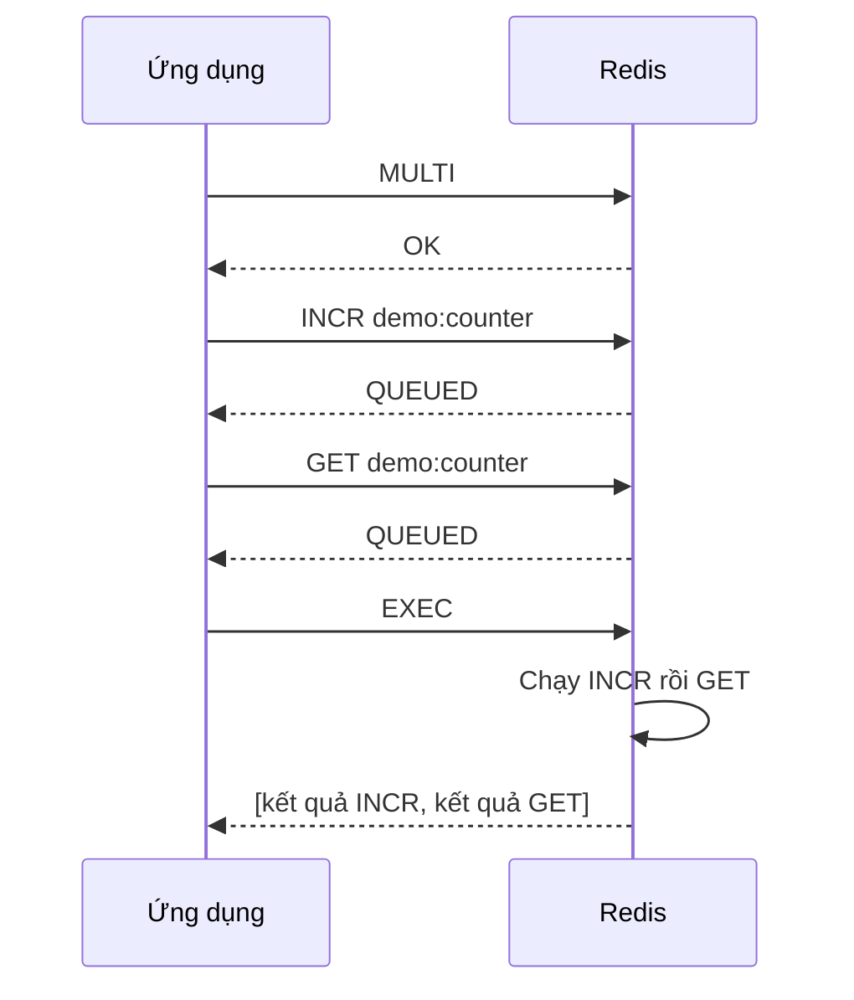
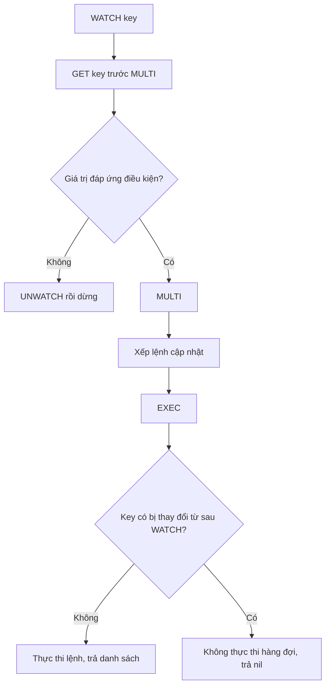

# Đưa lệnh vào hàng đợi và đọc kết quả EXEC trong Spring Data Redis

Trong Redis, một giao dịch thông thường bắt đầu bằng `MULTI`, nhận một chuỗi lệnh được **xếp vào hàng đợi**, rồi thực thi cả chuỗi khi nhận `EXEC`. Điểm dễ gây nhầm lẫn khi viết ứng dụng Spring Data Redis là: **giá trị trả về từ một lời gọi lệnh trong giai đoạn xếp hàng không phải kết quả thực thi lệnh đó**. Kết quả thực tế được trả về sau `EXEC`, theo thứ tự các lệnh đã được xếp hàng.

Ví dụ, ứng dụng gọi tăng bộ đếm rồi đọc nó trong một giao dịch. Nếu đọc trực tiếp giá trị Java trả về từ `increment(...)` hoặc `get(...)` sau `MULTI`, lập trình viên có thể nhận `null` và kết luận nhầm Redis không có dữ liệu hoặc lệnh đã thất bại. Thực ra Redis mới ghi nhận yêu cầu vào hàng đợi. Khi `EXEC` chạy, kết quả của `INCR` và `GET` mới xuất hiện.

Bài học đi từ giao thức Redis đến mã Spring Data Redis: cách `QUEUED` hoạt động, ý nghĩa của `EXEC`, cách dùng `SessionCallback` để giữ cùng kết nối, cách lấy và giải mã `List<Object>`, xử lý `WATCH`/`DISCARD`, và những giới hạn quan trọng của tính nguyên tử, lỗi thực thi, serializer và giao dịch Spring.

## 1. Ba giai đoạn của một giao dịch Redis

Một vòng giao dịch Redis có dạng:

```redis
MULTI
INCR demo:counter
GET demo:counter
EXEC
```

Có thể hình dung Redis xử lý theo ba giai đoạn:

1. **Bắt đầu:** `MULTI` chuyển kết nối sang trạng thái giao dịch.
2. **Xếp hàng:** những lệnh tiếp theo được nhận và ghi vào hàng đợi của giao dịch trên kết nối đó. Redis thường phản hồi `QUEUED`, chưa chạy thao tác dữ liệu ngay.
3. **Thực thi:** `EXEC` chạy các lệnh đã xếp theo đúng thứ tự và trả về danh sách kết quả.



Ví dụ Redis CLI khi `demo:counter` ban đầu không tồn tại:

```text
127.0.0.1:6379> MULTI
OK

127.0.0.1:6379(TX)> INCR demo:counter
QUEUED

127.0.0.1:6379(TX)> GET demo:counter
QUEUED

127.0.0.1:6379(TX)> EXEC
1) (integer) 1
2) "1"
```

Danh sách từ `EXEC` có **hai phần tử** vì có hai lệnh được xếp hàng. Phần tử đầu là kết quả số của `INCR`; phần tử thứ hai là giá trị chuỗi được `GET` đọc sau khi `INCR` đã chạy. Hai phản hồi `QUEUED` trước đó không thuộc danh sách kết quả thực thi.

**Không phải cứ gọi `MULTI` rồi `GET` là có thể đọc trạng thái mới ngay trong code Java.** Giao dịch Redis vận hành như một hàng đợi lệnh, không như một khối mã Java có thể liên tục quan sát kết quả trung gian trước thời điểm commit.

## 2. Redis đảm bảo điều gì khi chạy EXEC?

Khi `EXEC` bắt đầu chạy các lệnh đã xếp hàng, Redis thực thi chúng **theo thứ tự** và không chen lệnh của các client khác vào giữa chuỗi đó. Trong phạm vi các lệnh hợp lệ có thể thực thi, ứng dụng có thể dựa vào thứ tự tác động:

```redis
MULTI
SET order:17:status PROCESSING
INCR orders:processed
GET order:17:status
EXEC
```

Ở thời điểm chạy `EXEC`, `GET` nhìn thấy giá trị sau `SET` trước đó trong cùng giao dịch.

Tuy nhiên, cần phân biệt rõ **thực thi liền mạch** với **rollback**:

| Thuộc tính | Giao dịch MULTI/EXEC của Redis |
|---|---|
| Xếp nhiều lệnh để thực thi liên tiếp | Có |
| Thứ tự thực thi theo thứ tự được xếp | Có |
| Client khác chen lệnh vào giữa các lệnh của một `EXEC` | Không |
| Đọc kết quả của lệnh trước khi gọi `EXEC` | Không |
| Tự rollback toàn bộ lệnh đã thành công nếu một lệnh lỗi lúc chạy | Không |
| Dừng, bỏ hàng đợi trước khi chạy bằng `DISCARD` | Có |
| Hủy có điều kiện nếu dữ liệu được `WATCH` thay đổi | Có |
| Giao dịch ACID phân tán với database khác | Không tự có |

Redis còn có ngữ nghĩa lưu bền và phục hồi riêng theo cấu hình persistence. Khái niệm “atomic” ở đây trước hết nói về **thứ tự thực thi và không bị xen ngang**, không có nghĩa mọi hệ thống liên quan cùng commit hay một giao dịch Redis có khả năng rollback tùy ý.

## 3. Những gì được trả về trước và sau EXEC

Hai tầng kết quả cần tách bạch:

**Phản hồi khi xếp hàng:** Redis CLI hiện `QUEUED` cho một lệnh đã nhận vào hàng đợi. Trong các API cấp cao của Spring Data Redis, lời gọi lúc này có thể trả `null` hoặc không có kết quả trực tiếp, tùy chữ ký phương thức.

**Kết quả thực thi:** `EXEC` trả về một mảng gồm kết quả của các lệnh, đúng thứ tự xếp hàng. Spring Data Redis thông thường chuyển đổi nó thành `List<Object>` để Java xử lý.

Minh họa:

```text
Lệnh xếp hàng        Phản hồi trước EXEC     Kết quả sau EXEC
------------------------------------------------------------------
INCR demo:counter      QUEUED                 1
GET demo:counter       QUEUED                 "1"
EXISTS demo:counter    QUEUED                 1  (mức giao thức Redis)
------------------------------------------------------------------
EXEC                                        [1, "1", 1]
```

Kiểu Java trong `List<Object>` phụ thuộc lệnh, serializer và chuyển đổi kết quả của Spring Data Redis. Chẳng hạn một số kết quả ở dạng số nguyên của Redis có thể được chuyển sang `Long`, trong khi phản hồi từ `GET` thường được deserializer của template chuyển thành kiểu value Java.

Khi đọc `EXEC` bằng Java, **không gộp tất cả kết quả về String**: một lệnh đếm có thể trả số, lệnh kiểm tra tồn tại có thể trả Boolean sau khi Spring chuyển đổi, còn một lệnh đọc nhiều giá trị có thể cho kết quả dạng danh sách lồng nhau.

## 4. Thực hiện MULTI/EXEC bằng SessionCallback

### 4.1. Vì sao phải giữ cùng kết nối?

Trạng thái `MULTI` và hàng đợi giao dịch thuộc về **kết nối Redis đang sử dụng**. Nếu:

1. Gửi `MULTI` bằng kết nối A;
2. Gửi `SET` bằng kết nối B;
3. Gửi `EXEC` bằng kết nối C;

thì ba lời gọi không tạo thành một giao dịch duy nhất. Do đó, điều quan trọng khi dùng `RedisTemplate` là giữ các thao tác trong **cùng một session/kết nối**.

Spring Data Redis cung cấp `SessionCallback<T>` để gom các lời gọi `RedisOperations` vào một phiên làm việc:

```java
import org.springframework.data.redis.core.RedisOperations;
import org.springframework.data.redis.core.SessionCallback;

// Hình thức chung:
redisTemplate.execute(new SessionCallback<>() {
    @Override
    public <K, V> /* kiểu kết quả */ execute(
            RedisOperations<K, V> operations) {
        operations.multi();
        // Các thao tác Redis được xếp hàng.
        return operations.exec();
    }
});
```

Đoạn trên là mô tả hình thức; phần sau cung cấp một ví dụ Java hoàn chỉnh có kiểu trả về cụ thể.

Trong một `SessionCallback`, hãy gọi thao tác bằng đối tượng `operations` được truyền vào callback. Tránh sử dụng một template khác trong khi đang dựng giao dịch, vì nó có thể chọn kết nối khác và nằm ngoài hàng đợi.

### 4.2. Ví dụ hoàn chỉnh với StringRedisTemplate

Giả sử ứng dụng cần tăng một bộ đếm rồi đọc lại giá trị đã tăng, đảm bảo hai lệnh thực thi liên tiếp:

```java
package com.example.redis.tx;

import java.util.List;

import org.springframework.data.redis.core.RedisOperations;
import org.springframework.data.redis.core.SessionCallback;
import org.springframework.data.redis.core.StringRedisTemplate;
import org.springframework.stereotype.Service;

@Service
public class TransactionCounterService {

    private final StringRedisTemplate template;

    public TransactionCounterService(StringRedisTemplate template) {
        this.template = template;
    }

    public CounterTransactionResult incrementAndRead(String counterId) {
        String key = "demo:counter:" + counterId;

        return template.execute(
                new SessionCallback<CounterTransactionResult>() {
                    @Override
                    public <K, V> CounterTransactionResult execute(
                            RedisOperations<K, V> genericOperations) {

                        // SessionCallback có method generic.
                        // Template đang dùng là StringRedisTemplate.
                        @SuppressWarnings("unchecked")
                        RedisOperations<String, String> operations =
                                (RedisOperations<String, String>) genericOperations;

                        operations.multi();

                        // Lúc này chỉ XẾP HÀNG; cả hai thường trả null.
                        Long queuedIncrement =
                                operations.opsForValue().increment(key);
                        String queuedRead =
                                operations.opsForValue().get(key);

                        // Hai giá trị trên KHÔNG phải kết quả thực thi.
                        // Giá trị thật được trả về khi EXEC chạy.
                        List<Object> results = operations.exec();

                        if (results == null || results.size() != 2) {
                            throw new IllegalStateException(
                                    "Transaction was aborted or returned "
                                            + "an unexpected result count");
                        }

                        long afterIncrement =
                                ((Number) results.get(0)).longValue();
                        String readBack = (String) results.get(1);

                        return new CounterTransactionResult(
                                afterIncrement, readBack);
                    }
                });
    }

    public record CounterTransactionResult(
            long afterIncrement,
            String readBack
    ) {}
}
```

Với Redis key `demo:counter:alpha` chưa tồn tại:

```java
var result = service.incrementAndRead("alpha");

System.out.println(result.afterIncrement()); // 1
System.out.println(result.readBack());       // "1"
```

Gọi tiếp sẽ tăng dần, ví dụ `2` và `"2"`.

Trong ví dụ:

- `StringRedisTemplate` dùng serializer chuỗi cho dữ liệu key/value, nên kết quả từ `GET` có thể giải mã thành `String`.
- `SessionCallback` giữ các lệnh trong cùng phiên làm việc.
- `operations.multi()` bắt đầu xếp hàng.
- `increment(key)` xếp `INCR`; `get(key)` xếp `GET`.
- `operations.exec()` thực thi các lệnh đang xếp và trả `List<Object>`.
- `results.get(0)` ứng với `INCR`, `results.get(1)` ứng với `GET`.
- Việc ép `Number` rồi dùng `longValue()` biểu diễn rõ kết quả số; riêng kiểu Java cụ thể có thể khác nếu cấu hình converter/driver khác.

Biến `queuedIncrement` và `queuedRead` được đặt tên cố ý để nhấn mạnh trạng thái xếp hàng. Không dùng chúng để cập nhật nghiệp vụ trước `EXEC`. Trong code thực tế, có thể bỏ hai biến đó và chỉ gọi lệnh.

### 4.3. Lưu ý về chữ ký generic của SessionCallback

Phương thức `execute` của `SessionCallback<T>` có các tham số kiểu `<K, V>` cho `RedisOperations<K,V>`. Trong ví dụ, vì thực tế callback được gọi qua `StringRedisTemplate`, ta ép kiểu `RedisOperations<String, String>` để viết code đọc và ghi key/value chuỗi một cách rõ ràng.

Việc ép kiểu này chỉ hợp lý khi **template thực sự làm việc với những kiểu tương ứng**. Nếu chuyển sang `RedisTemplate<String, Product>`, ta phải điều chỉnh kiểu value và serializer, không sao chép nguyên phép ép kiểu của `StringRedisTemplate`.

Một cách tổ chức khác là đóng gói logic transaction trong một lớp xử lý typed operations chuyên biệt để tránh lặp phép ép kiểu ở nhiều callback. Nhưng dù tổ chức theo cách nào, nguyên tắc quan trọng vẫn là các thao tác Redis của giao dịch đi qua session/kết nối phù hợp.

## 5. Đọc danh sách kết quả EXEC cho đúng

### 5.1. Kết quả có thứ tự theo lệnh xếp hàng

Giả sử:

```redis
MULTI
SET demo:status ready
INCR demo:metric
GET demo:status
EXEC
```

Danh sách trả về có **ba vị trí**, vì có ba lệnh trước `EXEC`. Không cần quan sát trước đó có bao nhiêu phản hồi `QUEUED`, vì chúng chỉ xác nhận đã đưa lệnh vào hàng đợi.

Khi viết Java, nên giữ thứ tự lệnh và thứ tự giải mã ở gần nhau:

```java
operations.multi();

operations.opsForValue().set("demo:status", "ready"); // vị trí 0
operations.opsForValue().increment("demo:metric");   // vị trí 1
operations.opsForValue().get("demo:status");          // vị trí 2

List<Object> results = operations.exec();

// results[0] : kết quả lệnh SET
// results[1] : kết quả lệnh INCR
// results[2] : kết quả lệnh GET
```

Đoạn này mô tả phần thân một `SessionCallback` với `operations` typed `RedisOperations<String,String>`. Kiểu chi tiết của kết quả `SET` có thể được chuyển đổi theo abstraction của Spring/driver, nên không nên ép tất cả các phần tử thành `String`.

### 5.2. Kết quả có nhiều kiểu

| Nhóm lệnh | Phản hồi mức giao thức Redis | Điều nên chờ đợi ở tầng Java |
|---|---|---|
| `INCR`, `DECR`, `INCRBY` | Integer | Giá trị số, thường là `Long` |
| `GET`, `HGET` | Bulk string hoặc nil | Value đã deserialization, hoặc `null` nếu field/key vắng |
| `MGET`, `HMGET` | Array | Một collection kết quả, có thể chứa phần tử `null` |
| `SADD`, `HDEL` | Integer | Giá trị số cho biết số phần tử thay đổi |
| `SET` | Status `OK` | Kiểu do Spring connection adapter chuyển đổi |
| Lệnh lỗi khi thực thi | Error reply tại vị trí của lệnh | Driver/template có thể biểu diễn lỗi hoặc ném exception |

Trong lời gọi `exec()` ở tầng template, Spring Data Redis còn thực hiện **giải mã dữ liệu theo serializer**. Do đó, bảng trên không phải cam kết rằng mọi driver và mọi version đều trả cùng kiểu Java cụ thể ở mọi vị trí.

Với mã nghiệp vụ, nên kiểm tra kích thước `List<Object>`, giữ rõ ánh xạ lệnh ↔ vị trí, và giải mã theo đúng lệnh mình đã xếp. Không mặc định rằng mọi phần tử non-null đều là kết quả thành công hay mọi giá trị `null` đều là transaction abort.

### 5.3. Phân biệt ba dạng null

Trong các giao dịch Redis/Spring Data Redis, có ba tình huống khác nhau thường bị gộp làm một:

1. **Giá trị trả về lúc xếp hàng là `null`.** Ví dụ gọi `opsForValue().get(key)` giữa `MULTI` và `EXEC`: lệnh chưa chạy.
2. **Một phần tử của kết quả `EXEC` là `null`.** Ví dụ `GET missing:key` được thực thi, kết quả key không tồn tại là nil; RedisTemplate giải mã thành `null` tại *đúng vị trí lệnh đó*.
3. **Toàn bộ kết quả `EXEC` là nil/không có danh sách kết quả do `WATCH` thất bại.** Redis hủy việc thực thi vì key đã bị thay đổi; bên Spring có thể biểu diễn kết quả abort bằng `null`.

Ví dụ về trường hợp thứ hai:

```redis
MULTI
GET demo:missing:1
INCR demo:counter
EXEC
```

Ở Redis CLI, kết quả có thể là:

```text
1) (nil)
2) (integer) 1
```

Giao dịch vẫn **đã thực thi** dù phần tử đầu là nil. Vì vậy phải kiểm tra **cả danh sách** trước, rồi mới xem từng phần tử.

### 5.4. Không giả định mọi lệnh có đúng một scalar String

Một lệnh như `MGET` có thể trả một tập con kết quả trong *một phần tử* của danh sách `EXEC`:

```redis
MULTI
MGET demo:a demo:b
INCR demo:counter
EXEC
```

Ở mức giao thức, `EXEC` có hai phần tử: phần tử đầu là mảng kết quả `MGET`, phần tử sau là số nguyên của `INCR`. Nó không được “trải phẳng” thành ba hoặc nhiều lệnh giao dịch chỉ vì `MGET` đọc nhiều key.

Khi thiết kế result DTO, cân nhắc lệnh có kết quả dạng collection, cách serializer giải mã nested arrays và các trường hợp nil bên trong collection.

## 6. Lời gọi đọc sau MULTI có trả trạng thái mới không?

Không. Đây là một sai lầm quan trọng trong ứng dụng Java.

Giả sử:

```java
operations.multi();

operations.opsForValue().set("account:1:status", "ACTIVE");
String state = operations.opsForValue().get("account:1:status");

if ("ACTIVE".equals(state)) {
    // Khối này không phản ánh kết quả GET đã thực thi.
}

List<Object> results = operations.exec();
```

Khi dùng manual transaction qua cùng kết nối, `GET` trong ví dụ chỉ được xếp hàng; `state` thường là `null`. Một biểu thức điều kiện Java dùng `state` **không thể quyết định hành động dựa trên dữ liệu do lệnh đã xếp hàng tạo ra**, vì dữ liệu đó chưa được quan sát trước `EXEC`.

Nếu muốn quyết định có ghi hay không dựa vào giá trị hiện tại, một số hướng giải quyết gồm:

- Dùng `WATCH` và đọc giá trị **trước `MULTI`**, rồi kiểm tra `EXEC` có bị hủy vì xung đột hay không.
- Dùng Lua script để kiểm tra điều kiện và cập nhật dữ liệu ở server trong một bước nguyên tử.
- Thiết kế lệnh Redis nguyên tử thích hợp, ví dụ `SET NX`, `INCR` hoặc các biến thể lệnh hỗ trợ điều kiện sẵn có.

Không nên “sửa lỗi null” bằng cách gửi `GET` qua template khác trong lúc transaction còn mở. Giá trị đọc từ kết nối ngoài giao dịch có thể là dữ liệu cũ và việc này phá vỡ giả định về cùng một phiên giao dịch.

## 7. WATCH: hủy EXEC nếu dữ liệu bị thay đổi

`WATCH` cho phép xây dựng **optimistic locking** trong Redis. Ta theo dõi một hoặc nhiều key, đọc dữ liệu hiện tại và quyết định cập nhật. Nếu key được theo dõi bị thay đổi sau khi `WATCH` và trước `EXEC`, Redis sẽ không thực thi hàng đợi giao dịch đó.

### 7.1. Mẫu lệnh Redis

Giả sử:

```redis
SET inventory:sku-1 10
```

Client A:

```redis
WATCH inventory:sku-1
GET inventory:sku-1
```

Ứng dụng thấy còn 10 và muốn trừ 2. Client A tiếp tục:

```redis
MULTI
DECRBY inventory:sku-1 2
EXEC
```

Nếu không có thay đổi xung đột, `EXEC` chạy và trả kết quả sau khi trừ. Nếu client B đã thay đổi `inventory:sku-1` trước `EXEC`, Redis trả nil cho toàn bộ `EXEC` và **không chạy** lệnh `DECRBY` trong hàng đợi của client A.

Lược đồ:



**Điều rất quan trọng:** `WATCH` phải được gọi **trước `MULTI`**. Tên lệnh `WATCH` không phải một lệnh đọc; nó đăng ký việc giám sát thay đổi trên key.

### 7.2. Ví dụ Java: compare-and-set

Đoạn code sau dùng `SessionCallback` để so sánh giá trị hiện tại rồi chỉ cập nhật nếu nó vẫn bằng giá trị mong đợi:

```java
package com.example.redis.tx;

import java.util.List;
import java.util.Objects;

import org.springframework.data.redis.core.RedisOperations;
import org.springframework.data.redis.core.SessionCallback;
import org.springframework.data.redis.core.StringRedisTemplate;
import org.springframework.stereotype.Service;

@Service
public class RedisCompareAndSetService {

    private final StringRedisTemplate template;

    public RedisCompareAndSetService(StringRedisTemplate template) {
        this.template = template;
    }

    public boolean compareAndSet(
            String key, String expected, String replacement) {

        Boolean updated = template.execute(
                new SessionCallback<Boolean>() {
                    @Override
                    public <K, V> Boolean execute(
                            RedisOperations<K, V> genericOperations) {

                        @SuppressWarnings("unchecked")
                        RedisOperations<String, String> operations =
                                (RedisOperations<String, String>) genericOperations;

                        operations.watch(key);
                        boolean multiStarted = false;

                        try {
                            // Đọc trước MULTI nên đây là dữ liệu thật.
                            String current = operations.opsForValue().get(key);

                            if (!Objects.equals(expected, current)) {
                                operations.unwatch();
                                return false;
                            }

                            operations.multi();
                            multiStarted = true;
                            operations.opsForValue().set(key, replacement);

                            List<Object> execResults = operations.exec();
                            multiStarted = false;

                            // null thường biểu thị EXEC bị hủy vì WATCH.
                            return execResults != null;
                        } catch (RuntimeException error) {
                            try {
                                if (multiStarted) {
                                    operations.discard();
                                } else {
                                    operations.unwatch();
                                }
                            } catch (RuntimeException cleanupError) {
                                error.addSuppressed(cleanupError);
                            }
                            throw error;
                        }
                    }
                });

        return Boolean.TRUE.equals(updated);
    }
}
```

Đây là một mẫu kiểm tra và thay thế đơn giản. Khi `expected == null` và key chưa tồn tại, mã sẽ coi đó là một trạng thái khớp và thử tạo key. Nếu bài toán cần các quy tắc khác về key vắng mặt, TTL, kiểu value hoặc validation, hãy thay đổi điều kiện trước khi gọi `MULTI`.

`false` có thể xuất phát từ hai tình huống: giá trị đọc ban đầu không khớp hoặc `WATCH` phát hiện xung đột. Trong ứng dụng thực tế, có thể dùng result type chi tiết hơn để phân biệt và chỉ retry khi có xung đột.

Nếu có xung đột và muốn thử lại, hãy thực hiện **một vòng WATCH → GET → MULTI → EXEC mới**, không gửi lại `EXEC` trên cùng giao dịch đã bị hủy. Giới hạn số lần retry và chọn backoff phù hợp để tránh tạo tải khi nhiều writer tranh chấp.

### 7.3. WATCH không thay thế transaction rollback

`WATCH` quyết định **có chạy cả hàng đợi hay không** dựa trên thay đổi của key được theo dõi. Nó không biến Redis thành database hỗ trợ rollback từng bước sau khi các lệnh của `EXEC` đã bắt đầu thực thi. Nếu một lệnh bên trong `EXEC` bị lỗi lúc chạy, những lệnh khác vẫn có thể đã thành công.

## 8. DISCARD: bỏ hàng đợi trước khi thực thi

`DISCARD` kết thúc giao dịch đang mở và bỏ các lệnh đã được xếp hàng mà chưa chạy:

```redis
MULTI
SET demo:discard:key "will-not-be-written"
INCR demo:discard:counter
DISCARD
```

Sau `DISCARD`, cả hai lệnh `SET` và `INCR` trong hàng đợi đều không được thực thi. `DISCARD` cũng hủy trạng thái `WATCH` liên quan trên kết nối.

Trong Spring Data Redis:

```java
operations.multi();
operations.opsForValue().set("demo:discard:key", "pending");

boolean accepted = shouldProceed();
if (accepted) {
    List<Object> result = operations.exec();
} else {
    operations.discard();
}
```

Mã trên mô tả một đoạn trong `SessionCallback`, nơi `operations` cùng phiên làm việc. `shouldProceed()` là điều kiện Java đã có sẵn, không phải kết quả của một lệnh Redis vẫn đang xếp hàng.

**Giới hạn:** `DISCARD` chỉ bỏ **các lệnh chưa được thực thi**. Nếu `EXEC` đã chạy hoặc đã đến Redis nhưng phản hồi bị mất vì timeout, một lời gọi `DISCARD` sau đó **không thể hoàn tác** những thay đổi đã xảy ra.

## 9. Hai loại lỗi khác nhau trong giao dịch Redis

### 9.1. Lỗi lúc xếp hàng

Trong một số trường hợp, Redis biết lệnh không hợp lệ ngay khi client gửi trong trạng thái `MULTI`, ví dụ sai số tham số hoặc cú pháp lệnh.

```text
MULTI
SET some:key value
INCR                         # Thiếu key: lỗi ngay lúc gửi
EXEC
```

Redis đánh dấu giao dịch có lỗi xếp hàng; ở các phiên bản Redis hiện đại, `EXEC` bị từ chối bằng `EXECABORT` và không chạy hàng đợi đó.

### 9.2. Lỗi lúc lệnh được thực thi

Một lệnh có thể có cú pháp hợp lệ khi xếp hàng nhưng thất bại khi được chạy, chẳng hạn `INCR` trên chuỗi không phải số nguyên:

```redis
SET demo:bad-counter "hello"

MULTI
INCR demo:bad-counter
SET demo:marker "processed"
EXEC
```

Khi `EXEC` chạy:

- `INCR demo:bad-counter` thất bại vì không thể chuyển `"hello"` thành số nguyên.
- `SET demo:marker "processed"` **vẫn có thể thực thi thành công** sau lỗi `INCR`.
- Redis không rollback `SET` vừa chạy vì một lệnh khác trong cùng `EXEC` thất bại.

Trong Redis CLI, kết quả `EXEC` thể hiện một phần tử lỗi cho `INCR` và một phần tử trạng thái cho `SET`. Ở Spring Data Redis, cách lỗi được trình bày phụ thuộc connection driver và phiên bản: exception có thể được ném khi thực thi/giải mã kết quả thay vì ứng dụng nhận đủ một `List<Object>` chứa cả phần tử lỗi.

**Tuyệt đối không kết luận giao dịch đã rollback hoàn toàn chỉ vì `exec()` ném exception.** Nếu cần mọi thay đổi hoặc không thay đổi theo điều kiện nghiệp vụ, nên chọn các lệnh Redis có ngữ nghĩa phù hợp, Lua script, hoặc thiết kế kiểm soát dữ liệu/đền bù rõ ràng.

### 9.3. Timeout có thể để lại kết quả không rõ

Đường mạng có thể đứt sau khi Redis nhận `EXEC` nhưng trước khi client nhận phản hồi. Lúc đó ứng dụng không biết chắc giao dịch đã được thực thi hay chưa.

Retry mù lệnh tăng bộ đếm hoặc trừ tồn kho có thể áp dụng thao tác hai lần. Các hướng kiểm soát thường dùng:

- Thiết kế thao tác có thể chạy lại an toàn (idempotent) nếu khả thi.
- Sử dụng operation ID để nhận diện yêu cầu đã xử lý và gắn nó với thao tác cập nhật trong cùng một bước nguyên tử.
- Ghi nhận trạng thái ở nguồn dữ liệu có yêu cầu bền vững phù hợp nếu nghiệp vụ cần phục hồi chính xác.
- Phân biệt lỗi “chắc chắn chưa gửi”, lỗi “bị hủy do `WATCH`” và lỗi “không rõ server đã chạy chưa”.

## 10. Dọn trạng thái giao dịch khi callback thất bại

Khi dùng `SessionCallback`, nếu đã gọi `MULTI` mà code ném ngoại lệ trước `EXEC`, hãy cố gắng gọi `DISCARD` khi vẫn còn phiên giao dịch. Trạng thái `MULTI` thuộc về kết nối và có thể ảnh hưởng các thao tác sau nếu không được dọn đúng.

Mẫu quản lý vòng đời:

```java
boolean multiStarted = false;

try {
    operations.multi();
    multiStarted = true;

    operations.opsForValue().set("demo:a", "A");
    operations.opsForValue().set("demo:b", "B");

    List<Object> results = operations.exec();
    multiStarted = false;
    return results;

} catch (RuntimeException error) {
    if (multiStarted) {
        try {
            operations.discard();
        } catch (RuntimeException cleanupError) {
            error.addSuppressed(cleanupError);
        }
    }
    throw error;
}
```

Đoạn này là phần thân của callback có kiểu trả về `List<Object>`. Nếu `EXEC` đã được gửi nhưng phản hồi gây lỗi, `DISCARD` chỉ là **nỗ lực dọn trạng thái kết nối**, không phải bằng chứng các thay đổi đã được hoàn tác. Với connection lỗi/đóng, Spring Data Redis và driver còn đảm nhận việc giải phóng kết nối.

Không gọi `EXEC` lần thứ hai để “lấy kết quả lại” từ cùng giao dịch: sau `EXEC` hoặc `DISCARD`, hàng đợi giao dịch đó đã kết thúc.

## 11. Transaction qua SessionCallback và @Transactional khác nhau thế nào?

Trong ứng dụng Spring, có thể có ít nhất hai cơ chế dùng từ “transaction”:

1. **Giao dịch Redis thủ công**: gọi `MULTI`/`EXEC` qua `SessionCallback` để điều khiển chính xác lệnh nào được xếp hàng và khi nào đọc kết quả.
2. **Giao dịch do Spring quản lý**: dùng `@Transactional` cùng transaction manager; `RedisTemplate` có thể tham gia transaction synchronization khi bật hỗ trợ.

### 11.1. Transaction thủ công với SessionCallback

Với ví dụ `TransactionCounterService`:

```java
template.execute(new SessionCallback<>() {
    @Override
    public <K, V> List<Object> execute(
            RedisOperations<K, V> operations) {
        operations.multi();
        // ...
        return operations.exec();
    }
});
```

Giao dịch tồn tại trong phạm vi callback và ứng dụng lấy được kết quả từ `EXEC` ngay khi callback chạy. Đây là cách rõ nhất khi yêu cầu bài toán là **xếp hàng và đọc các kết quả**.

### 11.2. Hỗ trợ transaction synchronization trong RedisTemplate

Spring Data Redis có cấu hình:

```java
template.setEnableTransactionSupport(true);
```

Khi được tích hợp với Spring transaction đang hoạt động, các thao tác ghi Redis có thể được xếp hàng trên kết nối gắn với transaction và `EXEC`/`DISCARD` được điều phối theo kết quả commit/rollback của Spring transaction.

Ví dụ cấu hình một template chuyên dùng:

```java
import org.springframework.context.annotation.Bean;
import org.springframework.context.annotation.Configuration;
import org.springframework.data.redis.connection.RedisConnectionFactory;
import org.springframework.data.redis.core.StringRedisTemplate;

@Configuration
public class RedisTransactionTemplateConfig {

    @Bean("transactionalStringRedisTemplate")
    StringRedisTemplate transactionalStringRedisTemplate(
            RedisConnectionFactory connectionFactory) {
        StringRedisTemplate template =
                new StringRedisTemplate(connectionFactory);
        template.setEnableTransactionSupport(true);
        return template;
    }
}
```

Trong một Spring-managed transaction, thao tác ghi Redis thường được xếp hàng cho đến khi transaction kết thúc. Một số thao tác đọc có thể được gửi qua **kết nối riêng, không tham gia queue giao dịch**, để trả dữ liệu đang tồn tại bên ngoài transaction; chúng không được hiểu là đọc kết quả của các lệnh ghi chưa commit.

Do đó, với phương thức `@Transactional`, không nên mặc định lấy được danh sách kết quả `EXEC` ngay tại nơi gọi `set(...)` hay `increment(...)`. Commit có thể xảy ra **sau khi thân phương thức đã trả về**.

Không nên trộn thủ công `MULTI`/`EXEC` với việc một transaction manager khác đã quản lý kết nối Redis mà không xác định rõ ownership, vì dễ gây tình trạng lệnh được xếp hàng ngoài ý muốn hoặc nỗ lực commit hai lần.

### 11.3. Redis và cơ sở dữ liệu khác không tự có một giao dịch chung

Ví dụ một method cập nhật PostgreSQL và Redis:

```java
@Transactional
public void updateOrder(...) {
    // Ghi database quan hệ.
    // Ghi Redis.
}
```

Annotation `@Transactional` không tự tạo giao dịch phân tán ACID giữa JDBC và Redis. Transaction manager, transaction synchronization, thứ tự commit và xử lý lỗi giữa các resource cần được thiết kế rõ ràng. Nếu nghiệp vụ đòi hỏi dữ liệu giữa database và Redis nhất quán, có thể dùng outbox/event, cache invalidation hoặc quy trình bù trừ thích hợp.

## 12. Serializer ảnh hưởng kết quả EXEC như thế nào?

Một giá trị Redis được lưu là byte. Khi dùng `StringRedisTemplate`, giá trị chuỗi thường được giải mã lại thành `String`. Với `RedisTemplate<String, SomeType>`, value serializer có thể là JSON, JDK serialization hoặc serializer do ứng dụng cấu hình.

Giả sử:

```java
operations.multi();
operations.opsForValue().set("sample:key", "hello");
operations.opsForValue().get("sample:key");
List<Object> results = operations.exec();
```

Kết quả tại vị trí `GET` cần được giải mã dựa trên serializer mà template sử dụng. Spring Data Redis cung cấp cơ chế chuyển đổi kết quả giao dịch, và một số API template cho phép chỉ định serializer khi đọc kết quả `EXEC`.

Điều nên chú ý:

- Không dùng `StringRedisTemplate` để đọc giá trị được lưu bằng serializer nhị phân không tương thích rồi mặc định ép `String`.
- Nếu một giao dịch kết hợp lệnh đọc key, hash field, set và sorted set, các phần tử kết quả có thể mang các cấu trúc và serializer khác nhau.
- Các kết quả số của lệnh như `INCR` có thể được adapter giữ ở dạng số; không bắt buộc mọi kết quả phải qua value serializer.
- Khi đổi serializer, dữ liệu đã lưu từ phiên bản trước có thể không giải mã được; giao dịch không tự giải quyết vấn đề migration schema.
- Với `exec()`, luôn xác định bạn đang gọi qua API template nào: API cấp cao có chuyển đổi và API `RedisConnection` cấp thấp có thể cung cấp kết quả raw khác nhau.

Ví dụ, nếu chỉ cần dữ liệu chuỗi và bộ đếm số, dùng `StringRedisTemplate` giúp bài toán dễ dự đoán hơn vì hợp đồng key/value rõ ràng.

## 13. Transaction và pipeline là hai khái niệm khác nhau

**Pipeline** nhằm giảm chi phí round trip bằng cách gửi nhiều lệnh và đọc kết quả sau; nó không tự cung cấp tính nguyên tử cho chuỗi lệnh.

**MULTI/EXEC** nhằm xếp lệnh rồi thực thi liên tiếp theo ngữ nghĩa transaction Redis; nó có hàng đợi và kết quả từ `EXEC`.

| Khía cạnh | Pipeline | MULTI/EXEC |
|---|---|---|
| Mục đích chính | Giảm số lần chờ mạng | Thực thi các lệnh đã xếp theo chuỗi transaction |
| Lệnh phải đợi đến EXEC mới chạy | Không | Có |
| Kết quả thường đọc sau khi gửi nhiều lệnh | Có | Có, từ `EXEC` |
| Không bị lệnh client khác chen giữa toàn chuỗi | Không tự bảo đảm | Có trong pha `EXEC` |
| Có `WATCH` để kiểm tra xung đột | Không | Có |
| Tự rollback nếu một lệnh lỗi lúc chạy | Không | Không |

Spring Data Redis có `executePipelined(...)` riêng. Có thể kết hợp pipelining với transaction trong một số hoàn cảnh, nhưng lúc đó cần phân biệt **kết quả pipeline** với **mảng kết quả nằm bên trong phản hồi EXEC** và hiểu cách driver chuyển đổi chúng. Với nhu cầu học cách đọc `EXEC`, nên bắt đầu bằng `SessionCallback` bình thường, không bật pipeline cùng lúc.

## 14. Redis Cluster và giới hạn các key trong một giao dịch

Trong Redis Cluster, các thao tác nhiều key phải tuân thủ quy tắc hash slot. Một giao dịch dùng các key ở **nhiều slot khác nhau** có thể không được hỗ trợ và gây lỗi như `CROSSSLOT`.

Ví dụ muốn ghi hai key liên quan trong một giao dịch:

```redis
MULTI
SET order:{17}:status paid
INCR order:{17}:revisions
EXEC
```

Hai key cùng chứa hash tag `{17}`, nên được định tuyến đến cùng slot Redis Cluster. Tên key trong ví dụ là quy ước được thiết kế trước; không phải cứ có cùng tiền tố `order:` thì hai key tự thuộc cùng slot.

Khi dùng transaction trong cluster:

- Thiết kế nhóm key phải cập nhật cùng nhau để chúng dùng cùng hash slot khi cần.
- Kiểm tra giới hạn của driver và kiểu kết nối cluster đang dùng.
- Lưu ý failover hoặc mất mạng trong lúc `EXEC` vẫn có thể khiến client không biết chắc kết quả.
- Không kéo dài giao dịch qua nhiều Redis node rồi kỳ vọng `MULTI/EXEC` là cơ chế distributed transaction.

## 15. Một tình huống thực tế: cập nhật trạng thái và số phiên bản

Giả sử hệ thống theo dõi trạng thái xử lý của một job. Mỗi lần chuyển trạng thái, hệ thống cần tăng số phiên bản. Hai thao tác nên thực thi liên tiếp:

```redis
MULTI
SET job:{42}:status RUNNING
INCR job:{42}:version
EXEC
```

Ở Spring Data Redis, một phần callback có thể viết:

```java
operations.multi();

operations.opsForValue().set("job:{42}:status", "RUNNING");
operations.opsForValue().increment("job:{42}:version");

List<Object> results = operations.exec();
```

Giá trị số phiên bản mới nằm tại phần tử tương ứng với `INCR` (vị trí thứ hai). Nếu không có xung đột hay lỗi, phiên bản này có thể được đưa vào response của tầng service.

Tuy nhiên, **transaction chỉ bảo đảm hai lệnh chạy liền nhau, không kiểm tra trạng thái cũ có cho phép đổi sang `RUNNING` hay không**. Nếu cần quy tắc:

> Chỉ chuyển trạng thái từ PENDING sang RUNNING nếu chưa có worker khác nhận job.

thì phải thêm cơ chế `WATCH` và đọc trạng thái trước `MULTI`, hoặc dùng Lua/command có điều kiện phù hợp. Không thể xếp `GET` vào hàng đợi rồi dùng kết quả `GET` đó trong một câu `if` Java trước `EXEC`.

## 16. Những lỗi thường gặp

### Lỗi 1: Dùng giá trị null của lệnh đã xếp hàng làm dữ liệu nghiệp vụ

```java
operations.multi();
Long newValue = operations.opsForValue().increment("counter");
// newValue có thể là null vì INCR chỉ mới QUEUED.
```

**Cách hiểu đúng:** lấy giá trị từ phần tử tương ứng của `operations.exec()`.

### Lỗi 2: Gọi MULTI và EXEC trên các kết nối khác nhau

`MULTI` là trạng thái kết nối. Hãy dùng `SessionCallback` hoặc mô hình session được Spring Data Redis hỗ trợ để toàn bộ lệnh thuộc một kết nối.

### Lỗi 3: Trộn thứ tự lệnh với thứ tự giải mã kết quả

```java
operations.opsForValue().increment("counter"); // results[0]
operations.opsForValue().get("counter");       // results[1]
```

Nếu đọc `results.get(0)` thành `String` hoặc `results.get(1)` thành `Long`, code có thể ném `ClassCastException` hoặc hiểu nhầm dữ liệu. Nên giữ ánh xạ lệnh ↔ vị trí rõ ràng và chỉ giải mã khi `EXEC` thành công.

### Lỗi 4: Cho rằng một phần tử null nghĩa là WATCH abort

Phần tử `null` trong danh sách có thể là kết quả hợp lệ của `GET` trên key không tồn tại. WATCH abort liên quan tới **toàn bộ kết quả EXEC**, không chỉ một vị trí.

### Lỗi 5: Cho rằng Redis tự rollback khi có lỗi lúc chạy

Một lệnh thất bại trong pha thực thi không mặc định hoàn tác những lệnh khác. Phân biệt lỗi xếp hàng, lỗi thực thi và abort do `WATCH`.

### Lỗi 6: Gọi DISCARD sau khi đã EXEC để hoàn tác

`DISCARD` chỉ bỏ các lệnh chưa chạy. Nếu `EXEC` đã tới server, cần cơ chế bù trừ hoặc thiết kế idempotent khi xử lý hậu quả.

### Lỗi 7: Dùng @Transactional nhưng mong lệnh đọc thấy write chưa commit

Khi dùng Spring transaction synchronization, thao tác đọc có thể dùng kết nối riêng và không đọc được lệnh ghi vẫn đang xếp hàng. Muốn đọc kết quả lệnh thuộc giao dịch thủ công, hãy đọc danh sách từ `EXEC`.

### Lỗi 8: Cho rằng transaction đồng nghĩa với pipeline

Pipeline tối ưu mạng; transaction điều khiển thứ tự chạy và cơ chế `WATCH`/`DISCARD`. Hai khái niệm khác nhau, dù đều có việc nhận kết quả theo lô.

### Lỗi 9: Không giới hạn thao tác trong transaction

Xếp hàng số lượng cực lớn lệnh có thể tạo áp lực bộ nhớ và khiến thời gian chạy `EXEC` kéo dài, ảnh hưởng độ trễ client khác. Với hàng triệu phần tử, cân nhắc chia tác vụ, thiết kế lệnh theo lô có giới hạn hoặc Lua phù hợp.

### Lỗi 10: Retry INCR sau timeout mà không kiểm tra

Timeout có thể đến **sau khi Redis đã thực thi**. Retry lệnh không idempotent như `INCR` có thể khiến bộ đếm sai. Nên dùng operation ID hoặc cơ chế phục hồi theo yêu cầu chính xác của nghiệp vụ.

## 17. Bài tập thực hành

### Bài 1 — Dự đoán kết quả theo thứ tự

Giả sử các key đều chưa tồn tại:

```redis
MULTI
INCR learning:counter
INCR learning:counter
GET learning:counter
EXEC
```

Hãy dự đoán kết quả `EXEC`. Đáp án: phần tử số thứ nhất là `1`, phần tử số thứ hai là `2`, phần tử chuỗi thứ ba là `"2"`.

### Bài 2 — Phân biệt null khi xếp hàng và null khi đọc

```redis
MULTI
GET learning:missing
INCR learning:counter2
EXEC
```

Phân biệt:

- `GET` lúc xếp hàng: nhận `QUEUED`.
- Phần tử đầu của `EXEC`: nil vì key không tồn tại.
- Phần tử thứ hai: số nguyên sau `INCR`.
- Giao dịch vẫn đã thực thi, không phải WATCH abort.

### Bài 3 — Dùng SessionCallback

Viết service nhận `userId`, rồi trong cùng `SessionCallback`:

1. `MULTI`.
2. `SET user:{id}:lastAction` thành chuỗi `"LOGIN"`.
3. `INCR user:{id}:loginCount`.
4. `GET user:{id}:loginCount`.
5. `EXEC`.

Yêu cầu nhận kết quả tăng counter ở vị trí tương ứng và so sánh với giá trị `GET`. Giải thích vì sao hai lời gọi Java trước `EXEC` không cung cấp được giá trị mới ngay lập tức.

### Bài 4 — Thử WATCH

Dùng hai kết nối Redis CLI riêng:

1. Client A gọi `WATCH example:key` và đọc key.
2. Client B thay đổi `example:key`.
3. Client A gọi `MULTI`, xếp một lệnh `SET`, rồi `EXEC`.

Quan sát `EXEC` bị hủy. Sau đó thử không cho client B cập nhật để thấy `EXEC` thực thi thành công.

### Bài 5 — Lỗi lúc thực thi không rollback

Đặt một key thành `"not-a-number"` rồi thử xếp `INCR` trên key đó cùng một `SET` khác trong transaction. Dùng Redis CLI quan sát lỗi của `INCR` và sự thay đổi của key thứ hai. Từ đó giải thích vì sao việc xử lý kết quả giao dịch cần kiểm tra từng trường hợp lỗi.

## 18. Ghi nhớ khi áp dụng

| Câu hỏi | Câu trả lời |
|---|---|
| Khi nào một lệnh trong giao dịch Redis thực sự chạy? | Khi `EXEC` chạy |
| `QUEUED` có phải kết quả lệnh không? | Không; đó là phản hồi xác nhận xếp hàng |
| Spring Data Redis trả kết quả transaction ở đâu? | Thường từ `operations.exec()` dưới dạng `List<Object>` |
| Kết quả có theo đúng thứ tự lệnh không? | Có, theo thứ tự đã xếp hàng |
| Vì sao `get(...)` trước `EXEC` có thể trả `null`? | Vì lệnh đọc cũng mới được xếp hàng |
| Dùng gì để giữ các lệnh trong cùng kết nối? | `SessionCallback` |
| Dùng gì để bỏ một transaction chưa chạy? | `DISCARD` |
| Dùng gì để hủy `EXEC` khi key bị thay đổi? | `WATCH` trước `MULTI` |
| EXEC có rollback tất cả khi một lệnh lỗi lúc thực thi không? | Không |
| MULTI/EXEC có thay thế giao dịch phân tán không? | Không |

Trong Spring Data Redis, cách tiếp cận an toàn là **xếp hàng có chủ đích, thực thi trong cùng session, kiểm tra trạng thái toàn bộ `EXEC`, rồi giải mã từng phần tử theo thứ tự và kiểu thực tế**. Khi yêu cầu phụ thuộc vào kết quả của lệnh đang xếp hàng, hãy chuyển logic kiểm tra sang trước `MULTI` với `WATCH`, dùng lệnh Redis có điều kiện, hoặc viết một thao tác server-side phù hợp.

### Tài liệu tham khảo

- [Redis — Transactions](https://redis.io/docs/latest/develop/using-commands/transactions/)
- [Redis — MULTI](https://redis.io/docs/latest/commands/multi/)
- [Redis — EXEC](https://redis.io/docs/latest/commands/exec/)
- [Redis — DISCARD](https://redis.io/docs/latest/commands/discard/)
- [Redis — WATCH](https://redis.io/docs/latest/commands/watch/)
- [Spring Data Redis — Redis Transactions](https://docs.spring.io/spring-data/redis/reference/redis/transactions.html)
- [Spring Data Redis — RedisTemplate API](https://docs.spring.io/spring-data/redis/reference/api/java/org/springframework/data/redis/core/RedisTemplate.html)
- [Spring Data Redis — SessionCallback API](https://docs.spring.io/spring-data/redis/reference/api/java/org/springframework/data/redis/core/SessionCallback.html)
