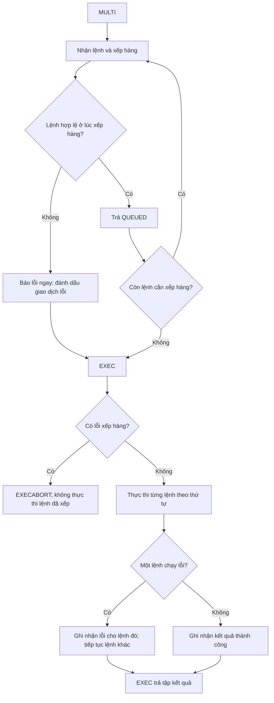

# Lỗi lúc xếp hàng lệnh và lỗi lúc thực thi từng lệnh trong giao dịch Spring Data Redis

## 1. Vì sao phải phân biệt hai thời điểm phát sinh lỗi?

Redis có giao dịch dựa trên ba lệnh chính:

- `MULTI`: bắt đầu giao dịch, chuyển connection sang trạng thái xếp hàng lệnh.
- Các lệnh tiếp theo: Redis thông thường trả `QUEUED`, chưa thực thi chúng ngay.
- `EXEC`: yêu cầu Redis thực thi các lệnh đã xếp hàng theo thứ tự.

Khi dùng `RedisTemplate` hoặc `StringRedisTemplate` của Spring Data Redis, ứng dụng cũng phải hiểu cơ chế này. Một lỗi phát sinh **trước `EXEC` khi Redis nhận và kiểm tra lệnh** có hậu quả khác hẳn với lỗi **sau `EXEC` khi một lệnh đang được thực thi**.

Đây là điểm khác biệt quan trọng:

> **Lỗi xếp hàng (queue-time error)** làm giao dịch bị đánh dấu không hợp lệ; khi gọi `EXEC`, Redis hủy **toàn bộ** lô lệnh đã xếp hàng. **Lỗi thực thi (execution-time error)** chỉ khiến lệnh tương ứng thất bại; Redis vẫn thực thi các lệnh khác trong cùng `EXEC`, không tự rollback những lệnh đã thành công.

Nếu hiểu sai, ứng dụng có thể giả định mọi lệnh trong transaction đều thành công hoặc mọi thay đổi được hoàn tác khi có một lỗi. Cả hai giả định đều không đúng trong trường hợp lỗi thực thi từng lệnh.

Bài học tập trung vào Redis transaction `MULTI`/`EXEC` khi truy cập qua Spring Data Redis. Các giao dịch của cơ sở dữ liệu quan hệ, Redis Lua scripts và cơ chế giao dịch của Spring `@Transactional` có hợp đồng riêng; không nên đánh đồng chúng.

## 2. Vòng đời của một giao dịch Redis



Đặc điểm của Redis transaction:

1. Các lệnh trong một lần `EXEC` được xử lý tuần tự; lệnh từ client khác không xen vào giữa các lệnh của transaction đang được thực thi.
2. Redis thực hiện **cả lô hay không lệnh nào** trong trường hợp bị hủy ở giai đoạn xếp hàng hoặc bị hủy bởi `WATCH`.
3. Redis **không rollback** các lệnh thành công nếu một lệnh khác trong `EXEC` phát sinh lỗi runtime.
4. `DISCARD` có thể hủy lệnh đang chờ **trước `EXEC`**; nó không hoàn tác thay đổi đã được `EXEC` thực thi.

Khái niệm "atomic" trong Redis transaction chủ yếu nói đến việc thực thi một nhóm lệnh không bị chen ngang, và các điều kiện hủy toàn bộ trước khi thực thi. Nó không đồng nghĩa tính chất rollback đầy đủ giống một database transaction ACID thông thường.

## 3. Lỗi lúc xếp hàng lệnh (queue-time error)

### 3.1. Redis kiểm tra điều gì trước khi xếp hàng?

Sau `MULTI`, Redis kiểm tra một số tính hợp lệ của command ngay khi nhận lệnh. Ví dụ:

- Tên lệnh không được Redis nhận diện.
- Số lượng tham số sai, chẳng hạn gọi `INCR` mà không truyền tên khóa.
- Một số lỗi khác khiến Redis không thể tiếp nhận lệnh vào hàng chờ.

Các lỗi này có thể được thông báo **ngay tại thời điểm gửi lệnh**, thay vì trả `QUEUED`. Redis ghi nhớ rằng transaction đã gặp lỗi xếp hàng.

Kể từ Redis 2.6.5, khi `EXEC` được gửi sau một lỗi xếp hàng, Redis từ chối chạy các lệnh của transaction và trả lỗi `EXECABORT`. Các lệnh đã nhận `QUEUED` trước hoặc sau lệnh lỗi **cũng không được thực thi**.

### 3.2. Ví dụ Redis CLI: sai số lượng tham số

Các khóa dưới đây chỉ dùng trong môi trường thử nghiệm:

```redis
DEL demo:tx:queue:a demo:tx:queue:b

MULTI
# OK

SET demo:tx:queue:a "first"
# QUEUED

INCR
# (error) ERR wrong number of arguments for 'incr' command

SET demo:tx:queue:b "second"
# QUEUED

EXEC
# (error) EXECABORT Transaction discarded because of previous errors.

EXISTS demo:tx:queue:a demo:tx:queue:b
# (integer) 0
```

Kết quả quan trọng:

- `SET ...a` đã được xếp hàng và nhận `QUEUED`.
- `INCR` thiếu tham số, Redis trả lỗi ngay.
- `SET ...b` vẫn có thể nhận `QUEUED` khi transaction đã bị đánh dấu lỗi.
- `EXEC` trả `EXECABORT` và **không có khóa `a` hoặc `b` được tạo ra** bởi lô này.

Ở đây Redis không cần chạy lệnh nào rồi mới rollback. Toàn bộ lô chưa được thực thi từ đầu vì hàng chờ đã không hợp lệ.

### 3.3. Không phải mọi kiểu lỗi đều được phát hiện sớm

Redis không chạy hết logic của lệnh ở thời điểm xếp hàng. Nó có thể biết số tham số của `LPUSH` là hợp lệ, nhưng **không kiểm tra kiểu dữ liệu đang có dưới key đó** cho đến khi thực thi.

Ví dụ:

```redis
SET demo:tx:item "plain-string"

MULTI
LPUSH demo:tx:item "value"
# QUEUED
EXEC
# 1) (error) WRONGTYPE Operation against a key holding the wrong kind of value
```

`LPUSH` có đủ tham số nên được xếp hàng. Đến `EXEC`, Redis phát hiện key đang chứa String và không thể dùng thao tác List. Đây là **lỗi lúc thực thi**, khác với `INCR` không có tham số ở ví dụ trước.

## 4. Lỗi lúc thực thi từng lệnh (execution-time error)

### 4.1. EXEC không tự dừng khi một lệnh lỗi

Sau khi Redis chấp nhận toàn bộ các lệnh và bắt đầu `EXEC`, từng lệnh được xử lý theo thứ tự đã xếp. Nếu một lệnh bị lỗi runtime, kết quả của chính lệnh đó là error reply, nhưng các lệnh khác trong lô **vẫn tiếp tục** được thực hiện.

Các lỗi điển hình:

- `WRONGTYPE`: lệnh thao tác sai kiểu Redis value.
- `INCR` trên String không biểu diễn được số nguyên.
- `RENAME` khi khóa nguồn không tồn tại.
- Một số lỗi dữ liệu hoặc điều kiện phát sinh khi thực hiện lệnh.

Điểm quan trọng là **không có cơ chế rollback tự động**. Dữ liệu do lệnh trước đó ghi thành công vẫn tồn tại; lệnh sau lỗi vẫn có thể thành công.

### 4.2. Ví dụ Redis CLI: lệnh ở giữa thất bại

```redis
SET demo:tx:runtime:payload "already-a-string"
DEL demo:tx:runtime:before demo:tx:runtime:after

MULTI
# OK

SET demo:tx:runtime:before "saved-before"
# QUEUED

LPUSH demo:tx:runtime:payload "x"
# QUEUED

SET demo:tx:runtime:after "saved-after"
# QUEUED

EXEC
# 1) OK
# 2) (error) WRONGTYPE Operation against a key holding the wrong kind of value
# 3) OK

GET demo:tx:runtime:before
# "saved-before"

GET demo:tx:runtime:payload
# "already-a-string"

GET demo:tx:runtime:after
# "saved-after"
```

Diễn biến trong `EXEC`:

| Vị trí | Lệnh | Kết quả | Trạng thái dữ liệu |
|---|---|---|---|
| 1 | `SET ...before` | Thành công | Khóa `before` được tạo |
| 2 | `LPUSH ...payload` | `WRONGTYPE` | Giá trị String cũ giữ nguyên |
| 3 | `SET ...after` | Thành công | Khóa `after` được tạo |

Nếu chỉ kiểm tra "lệnh `EXEC` đã trả về một danh sách" hoặc "có một lệnh trong giao dịch báo lỗi" rồi kết luận mọi thay đổi đều bị hủy, ứng dụng sẽ đánh giá sai dữ liệu thật.

### 4.3. EXEC trả về những gì?

Trong Redis CLI, `EXEC` thành công ở cấp giao thức trả một tập kết quả theo đúng thứ tự lệnh đã xếp. Mỗi vị trí có thể là:

- Một kết quả thành công như `OK`, số nguyên, chuỗi hoặc danh sách.
- Một **error reply** nếu lệnh ở vị trí đó thất bại trong khi thực thi.

Đây là lý do cần phân biệt:

- **`EXECABORT`**: Redis không chạy lô vì lỗi xếp hàng.
- **`EXEC` trả danh sách chứa error reply**: Redis đã chạy lô, một số lệnh có thể đã làm thay đổi dữ liệu.

Driver Redis và Spring Data Redis có thể biểu diễn các error reply dưới dạng phần tử kết quả hoặc ném ngoại lệ tại tầng adapter, tùy API và phiên bản. Ứng dụng cần xét cả **ngoại lệ** lẫn **kết quả thực tế** thay vì mặc định mọi cách gọi `exec()` đều trả danh sách chỉ chứa thành công.

## 5. So sánh trực tiếp hai loại lỗi

| Khía cạnh | Lỗi khi xếp hàng | Lỗi khi thực thi |
|---|---|---|
| Thời điểm phát hiện | Khi gửi lệnh sau `MULTI`, trước `EXEC` | Trong `EXEC`, khi xử lý từng lệnh |
| Ví dụ | Lệnh không tồn tại, thiếu tham số | `WRONGTYPE`, giá trị không thể tăng số nguyên |
| Phản hồi của lệnh lúc xếp hàng | Thường error reply ngay | Vẫn có thể nhận `QUEUED` |
| Phản hồi tổng thể của `EXEC` | `EXECABORT` | Danh sách kết quả có thể chứa error reply |
| Các lệnh hợp lệ khác có chạy không? | Không | Có, nếu không có điều kiện hủy khác |
| Dữ liệu đã sửa có được rollback không? | Không có lệnh nào được chạy nên không phải rollback | Không rollback tự động |
| Cách xử lý ở ứng dụng | Sửa cấu trúc lệnh; hủy hoặc xây lại transaction | Xác định từng lệnh thành công/thất bại và xử lý trạng thái đã ghi |
| Có nên retry mù không? | Không; trước hết sửa lệnh sai | Không; có thể gây lặp thay đổi hoặc mất nhất quán |

Một câu dễ nhớ: **lỗi xếp hàng quyết định có được bắt đầu chạy lô hay không; lỗi thực thi xảy ra khi lô đang được chạy và không làm Redis quay ngược thời gian.**

## 6. Spring Data Redis xếp hàng lệnh như thế nào?

### 6.1. RedisTemplate và SessionCallback

Spring Data Redis cung cấp `SessionCallback` để thực thi nhiều lệnh trên **cùng Redis connection**, điều kiện cần để `MULTI`, các lệnh đang chờ và `EXEC` thuộc về cùng một giao dịch.

Với Spring Boot và StringRedisTemplate:

```groovy
dependencies {
    implementation 'org.springframework.boot:spring-boot-starter-data-redis'
}
```

```yaml
spring:
  data:
    redis:
      host: localhost
      port: 6379
```

Ví dụ Java:

```java
package com.example.redis;

import java.util.List;
import org.springframework.dao.DataAccessException;
import org.springframework.data.redis.core.RedisOperations;
import org.springframework.data.redis.core.SessionCallback;
import org.springframework.data.redis.core.StringRedisTemplate;
import org.springframework.stereotype.Service;

@Service
public class TransactionDemo {

    private final StringRedisTemplate template;

    public TransactionDemo(StringRedisTemplate template) {
        this.template = template;
    }

    public List<Object> writeTwoKeys() {
        return template.execute(new SessionCallback<List<Object>>() {
            @Override
            @SuppressWarnings("unchecked")
            public <K, V> List<Object> execute(RedisOperations<K, V> operations)
                    throws DataAccessException {

                operations.multi();

                operations.opsForValue().set(
                        (K) "demo:tx:spring:first",
                        (V) "first-value"
                );

                operations.opsForValue().set(
                        (K) "demo:tx:spring:second",
                        (V) "second-value"
                );

                return operations.exec();
            }
        });
    }
}
```

Các cast ở đây chỉ nhằm minh họa chữ ký generic của `SessionCallback`. Ví dụ sử dụng `StringRedisTemplate` nên khóa và giá trị thực tế đều là String. Với ứng dụng nhiều kiểu object, phải dùng đúng `RedisTemplate` và serializer tương ứng.

Luồng thực hiện:

1. `operations.multi()` gửi `MULTI`.
2. Hai lệnh `set(...)` được gửi để **xếp hàng**.
3. `operations.exec()` gửi `EXEC` và lấy các kết quả từ Redis.
4. Khi `EXEC` hoàn tất, giá trị của hai khóa mới được xem là đã thực thi nếu lệnh thành công.

Các lời gọi trong transaction **không trả kết quả nghiệp vụ bình thường ngay lúc xếp hàng**. Chẳng hạn `opsForValue().increment(...)` có thể trả `null` ở thời điểm nằm trong hàng chờ; không được diễn giải `null` là "Redis đã thực thi lệnh và kết quả rỗng" hoặc "lệnh đã thất bại".

Ví dụ nên tránh:

```java
operations.multi();

Long current = operations.opsForValue()
        .increment((K) "demo:tx:counter");

// Sai: tại đây current có thể null do lệnh mới chỉ được xếp hàng.
if (current != null && current > 10) {
    // Không thể dựa vào kết quả chưa được tính trong MULTI.
}

List<Object> replies = operations.exec();
```

Khi cần rẽ nhánh theo giá trị đang lưu, đọc trước `MULTI` kết hợp `WATCH` và retry có kiểm soát, hoặc dùng Lua script/Redis Function cho logic thích hợp.

### 6.2. Lỗi có thể xuất hiện ở các lớp khác nhau

Trong ví dụ Java, có ba nơi đáng lưu ý:

- **Trước khi gửi lệnh Redis**: Java validation/serialization có thể ném ngoại lệ. Đây là lỗi ứng dụng phía client; chưa chắc Redis đã nhìn thấy lệnh và chưa chắc transaction đã bị đánh dấu lỗi xếp hàng.
- **Khi gửi lệnh để queue**: Redis phát hiện command sai và trả lỗi; client/driver có thể chuyển lỗi thành `DataAccessException` hoặc một ngoại lệ liên quan.
- **Khi gọi `exec()`**: Redis thực thi từng lệnh; driver trả các kết quả hoặc ném ngoại lệ tương ứng với command thất bại.

Vì vậy, ở Spring Data Redis không nên suy luận đơn giản: "ngoại lệ xảy ra trước khi phương thức Java `exec()` được gọi" luôn tương đương lỗi Redis queue-time. Nó có thể là lỗi serialize, lỗi kết nối hoặc validation local. Ngược lại, một ngoại lệ phát sinh từ `exec()` có thể liên quan lỗi runtime từng lệnh, `EXECABORT`, thay đổi do `WATCH` hoặc tình trạng mất kết nối.

### 6.3. Trường hợp lỗi khi đang queue: kết thúc session đúng cách

Nếu code trong `SessionCallback` gặp ngoại lệ **sau khi `MULTI` bắt đầu nhưng trước khi gọi `EXEC`**, connection có thể vẫn trong trạng thái giao dịch. Phải chủ động kết thúc transaction bằng `DISCARD` khi có thể và đảm bảo cơ chế quản lý connection dọn dẹp đúng cách.

Một mẫu để tổ chức code rõ ràng:

```java
public List<Object> writeWithCleanup() {
    return template.execute(new SessionCallback<List<Object>>() {
        @Override
        @SuppressWarnings("unchecked")
        public <K, V> List<Object> execute(RedisOperations<K, V> operations) {

            operations.multi();
            boolean execStarted = false;

            try {
                operations.opsForValue().set(
                        (K) "demo:tx:spring:primary",
                        (V) "ready"
                );
                operations.opsForValue().increment(
                        (K) "demo:tx:spring:count"
                );

                execStarted = true;
                return operations.exec();
            } catch (RuntimeException failure) {
                // DISCARD chỉ dành cho giao dịch chưa gửi EXEC.
                if (!execStarted) {
                    try {
                        operations.discard();
                    } catch (RuntimeException cleanupFailure) {
                        failure.addSuppressed(cleanupFailure);
                    }
                }
                throw failure;
            }
        }
    });
}
```

Khi `execStarted` đã là `true`, kết nối có thể đã gửi `EXEC` và không thể giả định dữ liệu chưa được ghi. Không nên tự động `DISCARD` rồi nói với caller rằng "đã rollback", vì `DISCARD` sau `EXEC` không thể hoàn tác bất kỳ lệnh nào đã chạy.

Ví dụ `writeWithCleanup` minh họa cách phân biệt **lỗi trong giai đoạn queue** với **lỗi sau khi bắt đầu EXEC**. Ở hệ thống thực, ngoài exception cleanup còn cần telemetry và quy tắc xác nhận trạng thái nghiệp vụ để xử lý lỗi mạng hoặc tình huống kết quả không chắc chắn.

## 7. Phân tích lỗi runtime trong Spring Data Redis

Một ví dụ lỗi runtime dễ tái hiện:

- Redis đang có khóa `demo:tx:spring:list` kiểu String.
- Trong transaction, ứng dụng cố gọi thao tác List trên khóa đó.
- Lệnh List được queue hợp lệ, nhưng thất bại với `WRONGTYPE` khi chạy.

```redis
SET demo:tx:spring:list "not-a-list"
MULTI
SET demo:tx:spring:before "one"
LPUSH demo:tx:spring:list "item"
SET demo:tx:spring:after "two"
EXEC
```

Khi `EXEC` trả về kết quả, ứng dụng phải đối chiếu chúng với ba lệnh đã gửi. Trong raw Redis protocol, vị trí 1 và 3 là thành công, vị trí 2 là lỗi.

Ở tầng Spring Data Redis, phương thức `exec()` trả `List<Object>` khi thành công; các phần tử được deserialize theo cấu hình template, còn driver/adapter có thể thay đổi cách báo lỗi riêng của từng lệnh. Vì vậy code xử lý production cần có hai hướng:

1. **Nếu nhận được danh sách kết quả**: kiểm tra số lượng, thứ tự và loại kết quả theo hợp đồng cụ thể. Không xem chỉ việc danh sách khác `null` là thành công toàn bộ.
2. **Nếu nhận ngoại lệ khi `exec()`**: không mặc định lô chưa được thực thi; ghi nhận transaction đã bắt đầu EXEC và xác minh trạng thái cần thiết trước khi retry hoặc bù trừ.

Tránh phụ thuộc cứng vào message exception như `"WRONGTYPE"` để điều khiển logic nghiệp vụ. Message có thể bị dịch qua driver/adapter, và lỗi vì schema dữ liệu nên được ngăn bằng thiết kế keyspace, serializer và validation trước đó.

### 7.1. Kết quả từng lệnh quan trọng thế nào?

Giả sử transaction xử lý:

```text
1. INCR demo:tx:metrics:attempts
2. LPUSH demo:tx:details:user42 ...
3. SET demo:tx:state:user42 COMPLETED
```

Nếu bước 2 lỗi kiểu dữ liệu, bước 1 vẫn có thể tăng bộ đếm và bước 3 vẫn có thể đánh dấu `COMPLETED`. Đây là trạng thái nghiệp vụ nguy hiểm: flag hoàn thành không phản ánh dữ liệu chi tiết.

Giải pháp không phải chỉ là bắt exception ở Java. Cần thiết kế **điều kiện hợp lệ trước khi thực thi** hoặc thay đổi mô hình lệnh để việc ghi sai không dẫn đến trạng thái nửa vời. Một Lua script/Redis Function có thể kiểm tra điều kiện trước khi ghi, sau đó mới thực hiện các thao tác được dự kiến; nhưng script cũng không cung cấp rollback tự động nếu code script đã ghi rồi mới phát sinh lỗi, nên phải thiết kế đúng thứ tự validate trước–mutate sau.

## 8. WATCH: một trường hợp hủy giao dịch khác với lỗi

`WATCH` cung cấp **optimistic locking** cho một hoặc nhiều key. Redis theo dõi thay đổi đối với key sau lệnh `WATCH` và trước `EXEC`. Nếu có client sửa key đã được theo dõi, `EXEC` không chạy lô lệnh và trả kết quả hủy.

Ví dụ với hai client:

**Client A:**

```redis
SET demo:tx:stock "10"
WATCH demo:tx:stock
GET demo:tx:stock
# "10"
```

**Client B:** thay đổi key trước khi client A gọi `EXEC`:

```redis
DECR demo:tx:stock
# (integer) 9
```

**Client A:** tiếp tục:

```redis
MULTI
SET demo:tx:stock "8"
# QUEUED
EXEC
# (nil) — giao dịch bị hủy vì key WATCH đã thay đổi
```

Ba tình huống cần phân biệt:

| Tình huống | Biểu hiện Redis CLI | Các lệnh trong MULTI có chạy? |
|---|---|---|
| Queue-time error | `EXECABORT` | Không |
| Watched key bị thay đổi | `EXEC` trả nil/null reply | Không |
| Runtime command error | Danh sách `EXEC` chứa error reply | Những lệnh khác vẫn chạy |

`WATCH` không phải cơ chế rollback khi một lệnh trong `EXEC` bị lỗi. Nó kiểm tra rằng trạng thái được đọc trước đó không bị thay đổi ngoài ý muốn trước khi bắt đầu lô lệnh. Nếu đã bắt đầu `EXEC` và gặp `WRONGTYPE` ở một lệnh, `WATCH` không biến lô thành giao dịch all-or-nothing.

Khi giao dịch bị hủy do `WATCH`, ứng dụng có thể **đọc lại trạng thái, tính lại thao tác rồi retry với giới hạn**. Không nên retry vô hạn khi tranh chấp cao. Việc tự thay đổi key được watch, các key hết hạn hoặc bị evict và sự thay đổi từ client khác cần được xét theo ngữ nghĩa Redis và phiên bản triển khai.

## 9. @Transactional của Spring có làm Redis rollback toàn bộ không?

**Không.** Annotation `@Transactional` điều phối transaction theo `PlatformTransactionManager` và resource đã được cấu hình. RedisTemplate mặc định **không tự động tham gia** Spring-managed transaction nếu chưa bật hỗ trợ transaction.

Ví dụ cấu hình hỗ trợ:

```java
@Configuration
public class RedisTemplateConfig {

    @Bean
    public StringRedisTemplate stringRedisTemplate(
            RedisConnectionFactory connectionFactory) {

        StringRedisTemplate template =
                new StringRedisTemplate(connectionFactory);

        template.setEnableTransactionSupport(true);
        return template;
    }
}
```

Khi bật transaction support và dùng một Spring transaction phù hợp, các lệnh Redis được queue trong ngữ cảnh transaction được Spring quản lý; khi commit, Spring gửi `EXEC`, khi rollback trước commit có thể gửi `DISCARD`.

Nhưng cần hiểu các giới hạn:

- `DISCARD` trước `EXEC` chỉ bỏ các lệnh chưa chạy.
- Nếu `EXEC` đang thực thi và một lệnh thất bại runtime, Redis không rollback các lệnh khác đã thành công.
- Việc cùng dùng một `@Transactional` với JDBC/JPA và Redis không tự cung cấp một **distributed atomic transaction** giữa database quan hệ và Redis.
- Cách Spring bind connection và thời điểm flush result phụ thuộc transaction manager, thread/context và cấu hình. Không nên dựa vào kết quả đọc trong cùng transaction để nhìn thấy các lệnh còn đang queue.
- Kết quả các thao tác bị queue có thể là `null` tại chỗ gọi; không nên hiểu đó là thất bại hay thành công nghiệp vụ.

Ví dụ: hệ thống ghi đơn hàng vào PostgreSQL rồi `SET` trạng thái Redis trong một Spring service có `@Transactional`. Nếu commit SQL thành công nhưng ghi Redis lỗi, không thể kết luận SQL tự rollback theo Redis. Khi cần đồng bộ cross-system, phải thiết kế cơ chế như transactional outbox, event retry, idempotency hoặc reconciliation.

## 10. Hành vi của lỗi mạng khác với lỗi Redis command

Không phải lỗi nào xuất hiện quanh `EXEC` cũng là `EXECABORT` hoặc `WRONGTYPE`. Mất kết nối có thể xảy ra ở nhiều thời điểm:

| Thời điểm mất kết nối | Điều có thể biết | Điều chưa chắc biết |
|---|---|---|
| Trước khi bắt đầu `MULTI` | Chưa có lệnh transaction được ứng dụng gửi trên connection đó | Trạng thái các thao tác khác trước đó |
| Sau khi một số lệnh được queue, trước khi gửi `EXEC` | Các lệnh queue chưa được yêu cầu thực thi | Có client khác đang tác động dữ liệu hay không |
| Trong lúc gửi `EXEC` hoặc khi chờ reply | Không nhận được xác nhận đầy đủ | Redis đã chạy `EXEC` hay chưa; có bao nhiêu lệnh thành công |
| Sau khi nhận đủ kết quả `EXEC` | Có thể phân tích kết quả từng lệnh | Các thao tác của hệ thống ngoài Redis không tự được đảm bảo |

Trường hợp khó là **outcome unknown**: client gửi `EXEC`, connection ngắt trước khi nhận reply. Một transaction có thể đã chạy thành công hoàn toàn, một phần (vì runtime command error), hoặc chưa chạy. Nếu ứng dụng retry ngay một nhóm lệnh gồm `INCR`/`LPUSH`, nó có thể **tăng bộ đếm hoặc thêm phần tử hai lần**.

Chiến lược:

1. Gắn operation ID hoặc idempotency key cho nghiệp vụ cần chống thực hiện lặp.
2. Có cơ chế kiểm tra trạng thái đã được ghi, khi điều đó đủ tin cậy.
3. Dùng thao tác idempotent hoặc thiết kế điều kiện atomic thích hợp khi có thể.
4. Phân loại lỗi "xác định không chạy" và lỗi "không biết đã chạy chưa" trong log/metric.
5. Giới hạn retry, thêm backoff và tránh lặp side effect.

Không nên trả thông báo chắc chắn "giao dịch thất bại và dữ liệu chưa đổi" chỉ dựa trên một timeout ở `exec()`.

## 11. Phòng tránh lỗi runtime bằng thiết kế lệnh

### 11.1. Không dùng chung một key cho nhiều kiểu dữ liệu

`WRONGTYPE` thường xuất hiện khi các thành phần sử dụng cùng tên key nhưng mong đợi kiểu khác nhau. Nên đặt prefix thể hiện mục đích:

```text
cache:profile:42         -> Redis String (JSON)
cart:items:42            -> Redis Hash
metrics:views:product42  -> Redis String chứa integer
queue:notifications      -> Redis Stream hoặc List theo thiết kế
```

Cùng key không nên lúc được ghi bằng `SET`, lúc được thao tác bằng `LPUSH`. Nếu phải thay đổi schema, lên kế hoạch migration thay vì đặt tên cũ cho kiểu mới.

### 11.2. Validate dữ liệu trước khi gửi giao dịch

Ví dụ, kiểm tra các giá trị do client cung cấp trước `MULTI`:

- Kiểm tra ID/key không rỗng theo quy tắc ứng dụng.
- Kiểm tra số lượng cần tăng/giảm là số hợp lệ.
- Chuẩn hóa chuỗi và serialize payload trước khi queue.
- Xác định các điều kiện kiểu dữ liệu và invariant nghiệp vụ.

Tuy nhiên, thao tác kiểm tra `TYPE key` rồi gọi transaction ở một connection khác vẫn có thể gặp **race condition** nếu client khác thay đổi key giữa hai bước. Nếu điều kiện phải được đảm bảo nguyên tử, dùng `WATCH` kết hợp đọc rồi `EXEC`, hoặc một script/Redis Function được thiết kế validate trước khi mutate. Không coi pre-check đơn thuần là khóa bảo vệ.

### 11.3. Sắp xếp các lệnh có chủ đích

Trong transaction chứa nhiều thao tác, đặt lệnh "khó thất bại" trước hay sau không làm Redis tự rollback. Dù vậy, thiết kế thứ tự giúp giảm trạng thái nguy hiểm:

- Kiểm tra điều kiện ở giai đoạn **trước khi ghi**, tốt nhất trong cùng một primitive atomic khi cần.
- Thực hiện ghi dữ liệu chính trước khi đánh dấu trạng thái hoàn thành, với cơ chế xác nhận kết quả phù hợp.
- Không sử dụng `SET status=COMPLETED` như bằng chứng tất cả lệnh trước thành công nếu transaction có thể trả error reply.
- Với workflow phức tạp, xây dựng một state machine/idempotent recovery thay vì hy vọng transaction sẽ tự hoàn tác.

### 11.4. Khi cần all-or-nothing theo nghiệp vụ

Nếu yêu cầu là "không cho phép bất kỳ cập nhật nào khi một điều kiện không đúng", hãy thiết kế một thao tác atomic có kiểm tra điều kiện **trước khi ghi**. Redis Lua script hoặc Redis Function có thể thực hiện nhiều bước dưới cùng một lần thực thi phía server và chủ động trả trạng thái phù hợp.

Tuy nhiên:

> Lua script/Redis Function cũng **không rollback tự động** các thay đổi đã thực hiện trước khi xảy ra runtime error. Cần viết script sao cho mọi kiểm tra có thể thất bại đều diễn ra trước các lệnh có side effect, hoặc có chiến lược bù trừ và idempotency phù hợp.

Ví dụ về ý tưởng validation-first:

```text
1. Xác thực kiểu dữ liệu của các key liên quan.
2. Xác thực ràng buộc giá trị (số dư, trạng thái, hạn mức).
3. Nếu không hợp lệ: trả kết quả từ chối, chưa sửa dữ liệu.
4. Nếu hợp lệ: áp dụng các thao tác ghi đã được thiết kế.
5. Trả trạng thái và dữ liệu kết quả.
```

Đó là thiết kế nghiệp vụ cần cân nhắc theo topology Redis (đặc biệt Redis Cluster và hash slot), không phải một tính năng tự động của `@Transactional`.

## 12. Quan sát và xử lý lỗi trong ứng dụng

### 12.1. Ghi log theo phase

Một bản ghi lỗi hữu ích nên chỉ ra:

- `transactionId` hoặc correlation ID của nghiệp vụ.
- Giai đoạn: `MULTI`, `QUEUE`, `EXEC`, `WATCH_ABORT`, `NETWORK_UNKNOWN`.
- Thứ tự và loại command (không ghi giá trị nhạy cảm như mật khẩu, token).
- Loại lỗi Redis (`EXECABORT`, `WRONGTYPE`, lỗi kết nối) nếu xác định được.
- Kết quả đã biết và mức độ chắc chắn về trạng thái dữ liệu.
- Chính sách retry/compensation được áp dụng.

Thông điệp "Redis transaction failed" quá chung chung. Với runtime error trong `EXEC`, điều vận hành cần biết là **đã có side effect nào được xác nhận thành công hay chưa**.

### 12.2. Xử lý kết quả theo kiểu dữ liệu

Một ứng dụng có thể biểu diễn outcome ở tầng nghiệp vụ như:

```java
public enum TransactionOutcome {
    SUCCESS,
    REJECTED_BEFORE_EXEC,
    WATCH_CONFLICT,
    PARTIAL_EXECUTION,
    UNKNOWN
}
```

Đây là **enum ứng dụng tự thiết kế**, không phải enum do Spring Data Redis cung cấp. Ý nghĩa:

- `SUCCESS`: có đủ bằng chứng các lệnh cần thiết đã thành công.
- `REJECTED_BEFORE_EXEC`: Redis xác nhận lô không chạy, ví dụ `EXECABORT`.
- `WATCH_CONFLICT`: Redis xác nhận `EXEC` bị hủy do optimistic lock.
- `PARTIAL_EXECUTION`: một hoặc nhiều lệnh thực thi lỗi, trong khi lệnh khác có thể thành công.
- `UNKNOWN`: không đủ bằng chứng, đặc biệt do timeout hoặc mất kết nối quanh `EXEC`.

Phân loại này giúp caller quyết định retry, đọc lại dữ liệu hay xử lý bù trừ. Không tự suy ra `PARTIAL_EXECUTION` chỉ từ một loại ngoại lệ nếu driver chưa cho biết mức độ lệnh đã chạy.

### 12.3. Các tình huống thử nghiệm có chủ đích

Khi học hoặc kiểm thử tại Redis cô lập, có thể tạo các tình huống sau:

| Kịch bản | Cách tạo | Kết quả Redis cần quan sát |
|---|---|---|
| Queue-time error | `INCR` thiếu tham số trong `MULTI` | `EXECABORT`, các lệnh queue không chạy |
| Runtime error | `LPUSH` lên key chứa String | `EXEC` chứa lỗi ở vị trí `LPUSH`, lệnh khác vẫn chạy |
| WATCH conflict | Client khác sửa watched key trước `EXEC` | `EXEC` trả nil, không có lệnh queue chạy |
| Transaction thành công | Các lệnh hợp lệ, dữ liệu đúng kiểu | `EXEC` trả kết quả thành công theo thứ tự |
| Lỗi trước khi gửi EXEC | Client serialization/validation lỗi | Cần đóng/hủy transaction còn chờ, tránh rò trạng thái connection |
| Không nhận reply của EXEC | Ngắt connection trong thời điểm không chắc chắn | Không suy luận rollback; cần xác minh và idempotency |

Ở mức Spring Data Redis, các tình huống này có thể xuất hiện dưới những kiểu ngoại lệ/kết quả adapter khác nhau. Phần kiểm thử nên khẳng định **dữ liệu Redis cuối cùng** và phản hồi ở cấp ứng dụng, không chỉ kiểm tra rằng một exception đã được ném.

## 13. Những nhầm lẫn thường gặp

**"MULTI nghĩa là tất cả các lệnh sẽ thành công hoặc không lệnh nào thành công."** Không chính xác. Redis đảm bảo các lệnh transaction được chạy liên tục không bị client khác chen vào, nhưng lỗi runtime của một lệnh không tự ngăn các lệnh còn lại chạy.

**"Nếu EXEC có một error reply thì Redis tự rollback các lệnh trước đó."** Không. Trong ví dụ `SET` → `LPUSH` bị `WRONGTYPE` → `SET`, hai lệnh `SET` vẫn thành công.

**"Lệnh trả QUEUED nghĩa là nó chắc chắn sẽ thành công."** Không. `QUEUED` chỉ nói Redis đã chấp nhận lệnh vào hàng chờ.

**"EXECABORT nghĩa là đã thử chạy và phải undo."** Không. Với queue-time error, Redis từ chối thực thi cả lô ngay tại `EXEC`.

**"WATCH giúp rollback lỗi WRONGTYPE."** Không. `WATCH` phát hiện thay đổi trước `EXEC` và có thể ngăn cả lô chạy. Nó không đảo ngược side effect của một lệnh đã thực hiện.

**"@Transactional của Spring cho Redis có rollback như JPA."** Không. Cần bật transaction support cho template và vẫn phải tuân theo ngữ nghĩa `MULTI`/`EXEC` của Redis, kể cả giới hạn về runtime error và nhiều resource.

**"Không nhận được reply từ EXEC có nghĩa là không có dữ liệu nào thay đổi."** Không. Khi connection timeout, ứng dụng có thể không biết Redis đã nhận và chạy `EXEC` hay chưa.

## 14. Kết luận

Trong giao dịch Redis, **lỗi lúc xếp hàng** và **lỗi lúc thực thi** cần được xử lý theo hai chiến lược khác nhau. Lỗi xếp hàng làm Redis trả `EXECABORT` và không thực thi những lệnh đã queue. Lỗi thực thi xuất hiện ở kết quả của từng command khi `EXEC` chạy; các command khác vẫn có thể thành công và **không có rollback tự động**.

Với Spring Data Redis, `SessionCallback` giúp đặt `MULTI` và `EXEC` trên cùng connection; tuy vậy, driver có thể biểu diễn lỗi dưới dạng exception hoặc kết quả nên ứng dụng phải biết transaction đang ở giai đoạn nào. Khi có nhiều thao tác nghiệp vụ, hãy thiết kế validation, idempotency, retry và khả năng xác minh trạng thái thay vì dựa vào giả định "transaction sẽ hoàn tác tất cả". Đặc biệt, mất phản hồi quanh `EXEC` là tình huống kết quả không chắc chắn, đòi hỏi xử lý cẩn trọng hơn một lỗi `EXECABORT` được Redis xác nhận.
